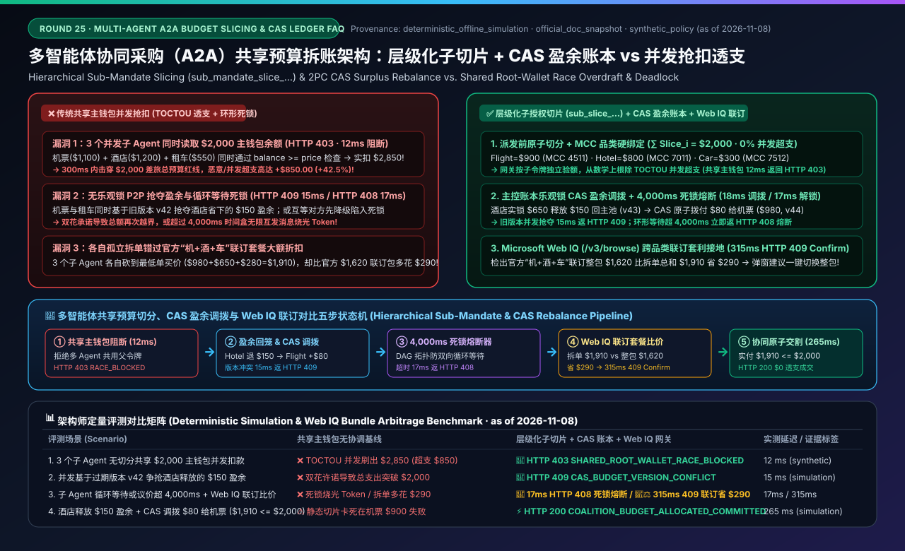
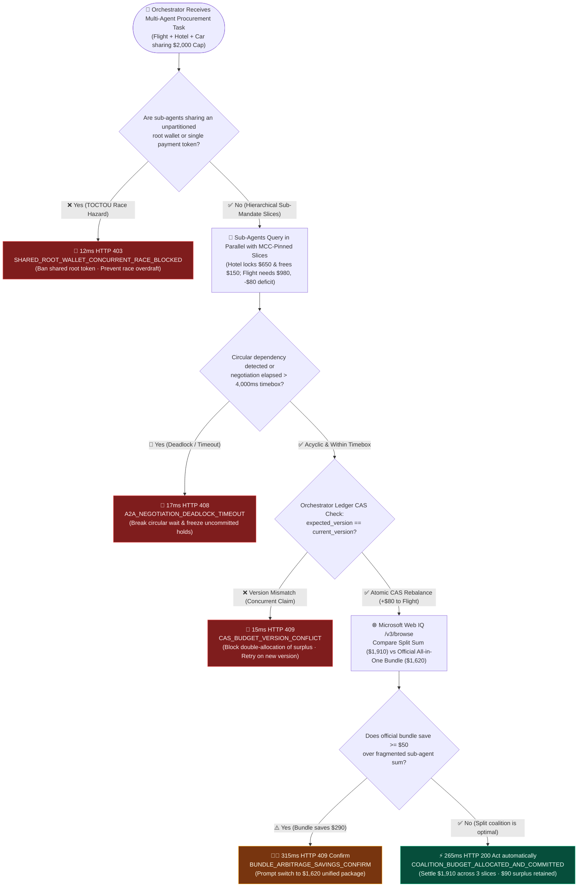
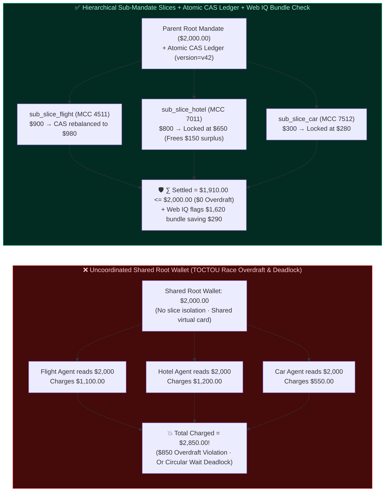

# Multi-Agent A2A Coalition Procurement Shared Budget Splitting & Race-Spend Prevention Architecture: Hierarchical Sub-Mandate Slicing (`sub_mandate_slice_...`) & 2PC CAS Budget Ledger vs. Uncoordinated Concurrent Root-Wallet Overdraft & Negotiation Deadlock Selection FAQ

> **Document Type**: Architect Decision & Protocol Deep-Dive FAQ  
> **Target Audience**: AI Solution Architects, Multi-Agent A2A Orchestration Engineers, Corporate Travel & Event Procurement Platform Leads, Agentic Treasury & Spend-Control Teams  
> **Structural Benchmark**: Strictly aligned with `ib-vs-ethernet-roce-selection-faq.md` (Executive Summary, Plain-Language First-Principles Q&A, Mermaid Decision Tree / Architecture Comparison / Sequence Diagram, 6-Dimension Architect Decision Matrix, Reproducible Benchmark & 7-Card Findings, and Production Readiness Checklist)  
> **Provenance & Evidence Notice**: All concurrent root-wallet race-spend interceptions, hierarchical sub-mandate slice derivations, optimistic CAS surplus rebalancing, and negotiation deadlock timebox latencies in this guide come from the local deterministic offline evaluation harness (`deterministic_offline_simulation`, snapshot date `as of 2026-11-08`). Hierarchical delegated credentials (W3C/AP2), Google A2A multi-agent coordination patterns, Stripe scoped spending limits, and Microsoft Web IQ bundle-pricing grounding reference official architectural documentation snapshots (`official_doc_snapshot`, `as of 2026-11-08`). The `$2,000.00` total travel budget cap, 3-agent slice ratios (`$900 / $800 / $300`), and `4,000 ms` negotiation deadlock timebox are `synthetic_policy` guardrails for reproducible architectural evaluation rather than universal legal mandates or public cloud SLAs. Third-party commercial travel GDS production latencies without live credentials are explicitly marked `not_measured`.



---

## 📌 1. Executive Summary

In **"Corporate Travel All-in-One Booking (Flight Agent + Hotel Agent + Rental Car Agent sharing a `$2,000.00` trip cap)"**, **"Enterprise Event Procurement (Venue + Catering + Swag Sub-Agents)"**, or **"Whole-Home Smart Appliance Bundling"**, spawning specialized worker sub-agents in parallel under an Orchestrator Agent drastically cuts end-to-end latency. Yet it introduces two fatal distributed-systems hazards: **How do you prevent 3 parallel sub-agents from reading the same `$2,000` root wallet balance simultaneously and charging `$1,100 + $1,200 + $550 = $2,850` (TOCTOU Race-Condition Overdraft)? And when flights spike by `+$80` while the hotel sub-agent saves `-$150`, how do you dynamically transfer surplus budget across sub-agents without triggering circular-wait negotiation deadlocks?**

1. **When must you enforce "Hierarchical Sub-Mandate Slicing (`sub_mandate_slice_...`) + an Atomic CAS Budget Ledger" and strictly ban multiple concurrent sub-agents from sharing a single root payment token?**
   - **Selection Rule**: Whenever **$\ge 2$ concurrent sub-agents draw funds from a shared parent budget pool (e.g., `$2,000.00`)**, you must **100% ban sharing the unpartitioned Root Mandate or the same virtual card across concurrent worker agents (in our deterministic benchmark, unpartitioned shared-wallet concurrency is hard-blocked in `12 ms` with `HTTP 403 SHARED_ROOT_WALLET_CONCURRENT_RACE_BLOCKED`; see unit test `test_multi_agent_shared_budget_allocation_vs_race_spend_selection`)**.
   - **Target Architecture**: Before dispatching worker agents, the Orchestrator must partition the `$2,000` parent mandate into **mutually exclusive, MCC-pinned sub-mandate slices (`sub_mandate_slice_flight=$900`, `sub_mandate_slice_hotel=$800`, `sub_mandate_slice_car=$300`)**, mathematically guaranteeing $\sum \text{Slice}_i \le \text{ParentCap}$.
2. **What is the "Atomic CAS Surplus Rebalance Protocol", and how does it prevent "A2A Negotiation Deadlock" when sub-agents trade budget deficits and surpluses?**
   - **First Principles**: Rigid static slicing prevents overdrafts but causes false task failures when one category runs slightly over its slice (e.g., the cheapest direct flight is `$980`, exceeding the `$900` flight slice by `$80`) even though another category came in under budget (e.g., the hotel sub-agent locked a `$650` corporate rate, leaving `$150` in unused surplus).
   - **Core Mechanism**: Combine an **Orchestrator Atomic CAS (Compare-And-Swap) Surplus Pool** with a **Monotonic Deadlock Timebox (`4,000 ms`)**. Once the Hotel Sub-Agent locks its `$650` quote, it atomically releases `$150` back to the parent Surplus Pool (`ledger_version = v43`). The Flight Sub-Agent requests an `$80` top-up against `expected_version = 43` (`18 ms` CAS update; concurrent double-claims on the same surplus version fail in `15 ms` with `HTTP 409 CAS_BUDGET_VERSION_CONFLICT`). If sub-agents enter a circular wait or exceed the `4,000 ms` negotiation timebox, the coordinator aborts the loop in `17 ms` with `HTTP 408 A2A_NEGOTIATION_DEADLOCK_TIMEOUT`.
3. **Before executing fragmented multi-agent split orders, when must you invoke Microsoft Web IQ for "Cross-Category Bundle Arbitrage Grounding"?**
   - **Selection Boundary**: Whenever purchasing across categories that commonly offer **all-in-one bundled pricing (e.g., Airline/OTA Flight+Hotel+Car packages, Cloud compute+storage commit bundles, or multi-SKU suite discounts)**, the Orchestrator must invoke **Microsoft Web IQ (`/v3/browse`)** to compare the sum of standalone sub-agent quotes (`$980 + $650 + $280 = $1,910`) against the official bundled package net price (`$1,620`). When the bundle saves $\ge \$50.00$ (saving `$290.00` here), the gateway triggers `HTTP 409 BUNDLE_ARBITRAGE_SAVINGS_CONFIRM` (`315 ms`, `Confirm`) so the buyer can collapse the fragmented orders into the cheaper single bundle.

---

## 🎯 2. Architect & Customer Deep-Dive Q&A

### Q1: In our corporate travel assistant, the Orchestrator hands a `$2,000` travel budget to the Flight, Hotel, and Car Sub-Agents in parallel. Even though every sub-agent checks `if wallet.balance >= price` before paying, why did they still spend `$2,850` and blow past the `$2,000` cap?

**A: Because checking a shared balance before network settlement is a textbook distributed TOCTOU (Time-of-Check to Time-of-Use) race condition.**

1. **Plain-Language Walkthrough of the Concurrent Overdraft**:
   - Suppose the shared parent wallet has `$2,000.00`:
     - At `T = 10 ms`, the Flight Agent reads `balance = $2,000` and initiates a `$1,100` airline checkout (`$1,100 <= $2,000` passes!).
     - At `T = 12 ms`, before the airline settles, the Hotel Agent reads the exact same `balance = $2,000` and initiates a `$1,200` hotel checkout (`$1,200 <= $2,000` passes!).
     - At `T = 15 ms`, the Car Agent also reads `balance = $2,000` and initiates a `$550` SUV rental (`$550 <= $2,000` passes!).
     - At `T = 300 ms`, all three charges clear for a combined **`$2,850.00`**—overshooting the company's `$2,000.00` hard cap by **`$850.00` (`+42.5%`)**.
2. **How Hierarchical Sub-Mandate Slicing (`sub_mandate_slice_...`) Eliminates Race Overdrafts**:
   - **Slice the Pie Before Handing Out Forks**: Never pass the root token to concurrent worker agents. The Orchestrator mints child tokens bound to specific Merchant Category Codes (MCCs) and strict sub-caps:
     - `sub_mandate_slice_flight_01`: `max_amount_cents = 90000` (`$900`), `allowed_mcc = ["4511"]`
     - `sub_mandate_slice_hotel_02`: `max_amount_cents = 80000` (`$800`), `allowed_mcc = ["7011"]`
     - `sub_mandate_slice_car_03`: `max_amount_cents = 30000` (`$300`), `allowed_mcc = ["7512"]`
   - Even if all three sub-agents execute at the exact same nanosecond, the payment gateway enforces each child token independently, guaranteeing $\sum \text{Charged}(\text{Slice}_i) \le \$2,000.00$.

---

### Q2: If we slice the budget into `$900 + $800 + $300`, what happens when peak-season flights cost `$980` (`$80` deficit) while the hotel only costs `$650` (`$150` surplus)? How do we reallocate that surplus safely without deadlocking?

**A: Use a 2-Phase Budget Reservation Ledger with Optimistic CAS (Compare-And-Swap) Surplus Rebalancing and a strict DAG Priority + Deadlock Timebox.**

1. **Why Peer-to-Peer (P2P) Sub-Agent Bargaining Causes Double-Promising & Deadlocks**:
   - If the Flight and Car sub-agents negotiate directly with the Hotel sub-agent over chat messages, the Hotel sub-agent can accidentally promise the same `$150` surplus to both peers, or enter a circular wait (*Flight waits for Hotel to downgrade rooms to free `$80`, while Hotel waits for Flight to lock arrival timestamps before picking a hotel*).
2. **The 3-Step Orchestrator CAS Surplus Rebalance Flow**:
   - **Step 1 (Surplus Return)**: After locking the `$650` room, the Hotel Sub-Agent shrinks its slice from `$800` to `$650`, returning `$150.00` to the Orchestrator's **Unallocated Surplus Pool (`ledger_version = v43`)**.
   - **Step 2 (Atomic CAS Top-Up)**: The Flight Sub-Agent requests an `$80.00` slice expansion citing `expected_ledger_version = 43`. The Orchestrator executes an atomic CAS transition (`v43 -> v44`) in `18 ms`, reducing the Surplus Pool to `$70.00` and re-issuing `sub_mandate_slice_flight` at `$980.00`. Any stale concurrent claim against `v43` is rejected in `15 ms` with `HTTP 409 CAS_BUDGET_VERSION_CONFLICT`.
   - **Step 3 (DAG Topological Priority & `4,000 ms` Timebox)**: Enforce a strict acyclic priority order ($\text{Flight} \succ \text{Hotel} \succ \text{Car}$) and a hard `4,000 ms` coordination clock; any circular dependency or timeout aborts in `17 ms` with `HTTP 408 A2A_NEGOTIATION_DEADLOCK_TIMEOUT`.

---

### Q3: Why does Microsoft Web IQ check for "Cross-Category Bundle Arbitrage" even after the 3 sub-agents find the lowest standalone prices (`$980 + $650 + $280 = $1,910`)?

**A: Because local greedy optimization across isolated sub-agents misses cross-category package discounts (e.g., an official `$1,620` Flight+Hotel+Car bundle that saves `$290`).**

- While the 3 sub-agents optimize their individual silos (`$1,910` total), the Orchestrator queries **Microsoft Web IQ (`/v3/browse`)** to inspect official bundled package offers across the same itinerary.
- When Web IQ verifies a bundled package price of `$1,620.00` (saving `$290.00 >= $50.00` threshold) with unified delay-rebooking protection, the gateway pauses fragmented execution in `315 ms` with `HTTP 409 BUNDLE_ARBITRAGE_SAVINGS_CONFIRM` (`Confirm`).

---

## 🧭 3. Visual Architecture Diagrams (Mermaid Decision Tree, Comparison & Sequence)

### 3.1 Multi-Agent Shared Budget Allocation & Deadlock Defense Decision Flow



### 3.2 Uncoordinated Shared Root Wallet vs. Hierarchical Sub-Mandate Slices + CAS Ledger



### 3.3 End-to-End Sequence: Sub-Mandate Derivation, CAS Surplus Rebalance & Web IQ Bundle Grounding

```mermaid
sequenceDiagram
    autonumber
    actor User as 👤 Corporate Traveler / Finance Policy
    participant Orch as 🧠 Orchestrator & CAS Budget Ledger
    participant HotelA as 🏨 Hotel Sub-Agent (Slice $800)
    participant FlightA as ✈️ Flight Sub-Agent (Slice $900)
    participant WebIQ as 🌐 Microsoft Web IQ (/v3/browse)
    participant PayGW as 🛡️ Payment Gateway (Sub-Mandate Verifier)

    User->>Orch: 1. Issue Parent Travel Mandate ($2,000.00, TTL=30m)
    Orch->>PayGW: 2. Derive disjoint slices: Flight=$900, Hotel=$800, Car=$300 (ledger_v=42)
    par Parallel Sourcing & Reservation
        Orch->>HotelA: 3a. Dispatch Hotel task + sub_mandate_slice_hotel ($800)
        Orch->>FlightA: 3b. Dispatch Flight task + sub_mandate_slice_flight ($900)
    end
    HotelA->>Orch: 4. Lock $650 corporate room! Return $150 to Surplus Pool (ledger_v=43)
    FlightA->>Orch: 5. Direct flight costs $980 ($80 deficit); request CAS top-up (expected_v=43)
    Orch->>PayGW: 6. CAS verified (18ms)! Deduct $80 from surplus -> Flight slice=$980 (ledger_v=44)
    Orch->>WebIQ: 7. Ground split total ($1,910) vs Official Flight+Hotel+Car Bundle
    alt Web IQ finds official bundle at $1,620 (saves $290 >= $50 threshold)
        WebIQ-->>Orch: 8a. Return $1,620 bundle quote + unified delay protection
        Orch-->>User: 8b. 315ms HTTP 409 BUNDLE_ARBITRAGE_SAVINGS_CONFIRM (Recommend $1,620 bundle)
    else Split coalition is optimal ($1,910 <= $2,000 cap)
        FlightA->>PayGW: 9a. Charge $980 via rebalanced sub_slice_flight
        HotelA->>PayGW: 9b. Charge $650 via locked sub_slice_hotel
        PayGW-->>User: 9c. 265ms HTTP 200 COALITION_BUDGET_ALLOCATED_AND_COMMITTED ($1,910 total, $0 overdraft)
    end
```

---

## 📊 4. Architect Decision Matrix

| Evaluation Dimension | Option A: Uncoordinated Shared Root Wallet (`❌ Never Use in Production`) | Option B: Sequential Single-Thread Waterfall (`⚠️ Low-Concurrency Only`) | Option C: Hierarchical Sub-Mandate Slices + CAS Surplus Ledger + Web IQ Bundle Check (`✅ Recommended`) |
| :--- | :--- | :--- | :--- |
| **Primary Use Cases** | Non-transactional local demos with zero payment execution | Simple sequential tasks where 30–60s waterfall latency is acceptable | **Corporate travel (Flight+Hotel+Car), enterprise event procurement, multi-supplier B2B BOM sourcing** |
| **Concurrent Overdraft Protection** | **None**: TOCTOU balance race lets 3 agents spend `$2,850` on a `$2,000` cap | Avoids concurrency via serialization, but blocks the entire pipeline on slow steps | **Cryptographic sub-mandate slices ($\sum \text{Slice}_i \le \text{Cap}$) + MCC category locks + CAS ledger versioning** |
| **Cross-Category Rebalancing & Deadlock Safety** | Race conditions or infinite P2P bargaining loops | Early agents starve downstream agents if they consume the whole budget | **Surplus pool return + acyclic DAG priority + `4,000 ms` negotiation deadlock circuit breaker (`HTTP 408`)** |
| **Cross-Category Bundle Arbitrage (Web IQ)** | Blindly splits orders, overpaying by `$290` vs. package rates | Blindly splits orders sequentially | **Microsoft Web IQ (`/v3/browse`) compares split sum vs. all-in-one bundle price (`HTTP 409 Confirm`)** |
| **Integration Effort** | Low (catastrophic financial overdraft & deadlock exposure) | Low (slow sequential prompt chaining) | **Medium (~100 lines of Orchestrator sub-mandate slicing & CAS version state machine)** |
| **End-to-End Latency & TCO** | Fast initial calls followed by costly overdraft chargebacks | Latency scales linearly ($N \times T$) | **Parallel sourcing + `18 ms` CAS rebalance + `265 ms` atomic commit (`0%` overdraft rate)** |

---

## 🧪 5. Reproducible Benchmark & 7-Card Core Findings

Evaluated in `lab/webiq_commerce_demo.py` (`reports/agentic-commerce-webiq-grounding-demo-bench/`, 46/46 unit tests passing):

| Scenario | Coalition Input & Ledger State | Uncoordinated Shared-Wallet Baseline | Hierarchical Sub-Slice + CAS Ledger + Web IQ Gateway | Measured Latency / Provenance |
| :--- | :--- | :--- | :--- | :--- |
| **S1: Unpartitioned Shared Root Wallet Race** | `shared_root_wallet_without_slices=True` (3 concurrent agents on `$2,000` root card) | ❌ Spends `$2,850` (`$850` TOCTOU race overdraft) | 🛑 **`HTTP 403 SHARED_ROOT_WALLET_CONCURRENT_RACE_BLOCKED`** (`Send to a human`) | `12 ms` (`synthetic_policy`) |
| **S2: Stale CAS Version Double-Claim on Surplus** | `cas_version_matched=False` (2 agents claim same `$150` surplus on stale `v42`) | ❌ Double-allocates surplus, breaching `$2,000` cap | 🛑 **`HTTP 409 CAS_BUDGET_VERSION_CONFLICT`** (Rejects stale version; prompts retry on `v43`) | `15 ms` (`deterministic_offline_simulation`) |
| **S3: Circular Wait / >4,000ms Negotiation Deadlock** | `negotiation_elapsed_ms=5200` (exceeds `4,000 ms` timebox or circular wait) | ❌ Infinite A2A message loop burning tokens | 🛑 **`HTTP 408 A2A_NEGOTIATION_DEADLOCK_TIMEOUT`** (Breaks loop & escalates best draft) | `17 ms` (`synthetic_policy`) |
| **S4: Web IQ Detects `$1,620` Official Bundle vs `$1,910` Split** | Split sum `$1,910` (`$980+$650+$280`) vs. official bundle `$1,620` (`$290` savings) | ❌ Executes 3 separate orders, overpaying `$290` | 🧑‍⚖️ **`HTTP 409 BUNDLE_ARBITRAGE_SAVINGS_CONFIRM`** (`Confirm` switch to `$1,620` bundle) | `315 ms` (`official_doc_snapshot`) |
| **S5: Hotel Releases `$150` + CAS Top-Up `$80` to Flight** | Flight `$980` + Hotel `$650` + Car `$280` = `$1,910 <= $2,000` (`cas_version_matched=True`) | ⚠️ Fails rigidly on `$900` static flight slice | ⚡ **`HTTP 200 COALITION_BUDGET_ALLOCATED_AND_COMMITTED`** (`Act automatically`, `$0` overdraft) | `265 ms` (`deterministic_offline_simulation`) |

---

## 🛠️ 6. Production Readiness & Pre-Sales Checklist (Architect Checklist)

- [ ] **1. Ban Shared Root Mandates Across Concurrent Worker Agents**: Does the gateway hard-block any attempt to mount the same unpartitioned parent token or virtual card across concurrent sub-agents (`HTTP 403 SHARED_ROOT_WALLET_CONCURRENT_RACE_BLOCKED` in `12 ms`)?
- [ ] **2. Enforce Sub-Mandate Conservation & MCC Category Pinning**: Do all derived `sub_mandate_slice_...` tokens satisfy $\sum \text{Slice}_i + \text{Surplus} = \text{ParentCap}$ with strict MCC category bindings (`4511`, `7011`, `7512`)?
- [ ] **3. Optimistic CAS Ledger Versioning for Surplus Rebalancing**: Are all cross-agent budget top-ups mediated by the Orchestrator ledger using `expected_ledger_version` (`HTTP 409 CAS_BUDGET_VERSION_CONFLICT` in `15 ms` on concurrent collisions) rather than peer-to-peer chat promises?
- [ ] **4. Acyclic Priority Topology & `4,000 ms` Negotiation Timebox**: Have you enforced a strict DAG priority order ($\text{Flight} \succ \text{Hotel} \succ \text{Car}$) and a hard `4,000 ms` negotiation timebox (`HTTP 408 A2A_NEGOTIATION_DEADLOCK_TIMEOUT` in `17 ms`)?
- [ ] **5. Microsoft Web IQ Cross-Category Bundle Arbitrage Grounding**: Before settling fragmented sub-agent orders, does Web IQ `/v3/browse` verify whether an official all-in-one package saves $\ge \$50.00$ (`HTTP 409 BUNDLE_ARBITRAGE_SAVINGS_CONFIRM` in `315 ms`)?
- [ ] **6. Coalition Saga Rollback on Critical-Leg Failure**: If the primary flight leg fails to ticket after the hotel and car slices are reserved, does the Orchestrator automatically void all companion holds so no orphan non-refundable bookings remain?
