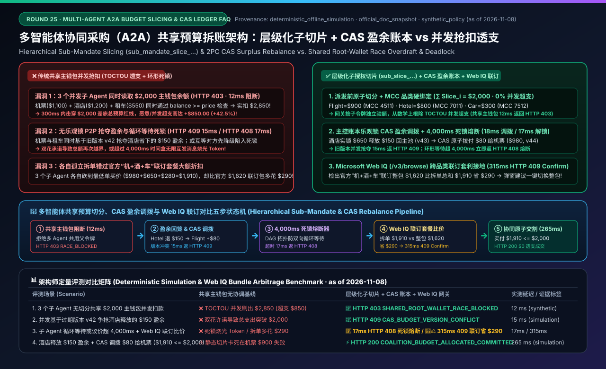
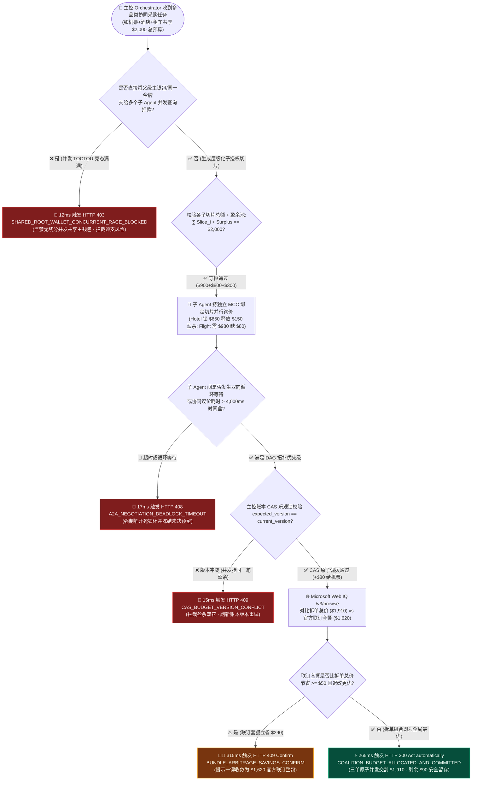
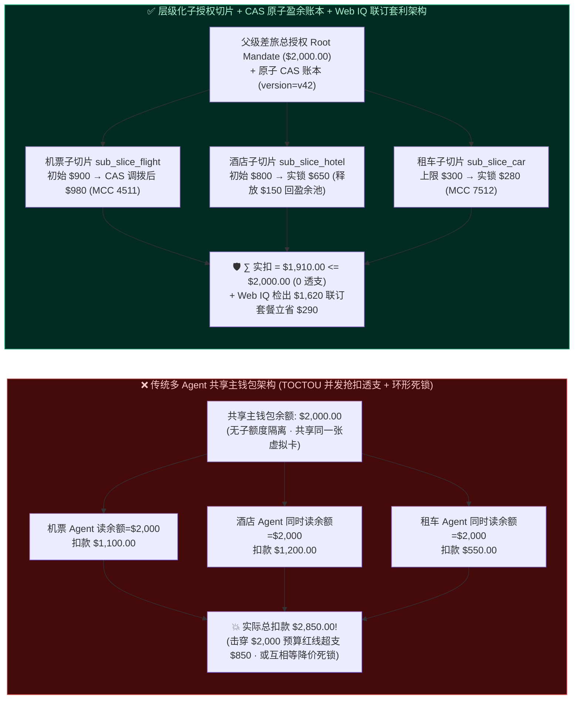
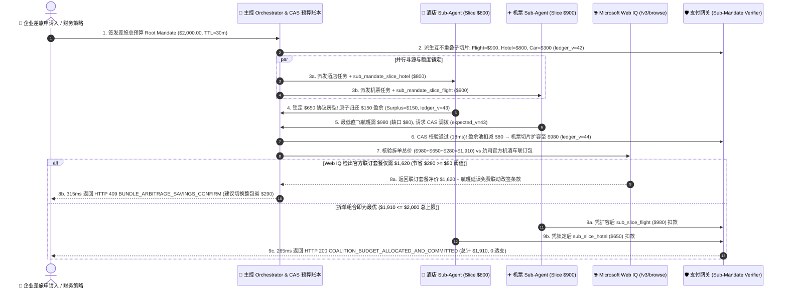

# 多智能体协同采购（Multi-Agent A2A Coalition）共享预算池拆账与并发防透支架构：层级化子授权额度切分与两阶段预算预留令牌（Hierarchical Sub-Mandate Slice `sub_mandate_slice_...` + 2PC Budget Reservation）vs 多 Agent 共享主钱包并发抢扣透支与跨品类议价死锁选型与原理解析 FAQ

> **文档类型**：架构师选型与协议原理解析决策指南（Architect Decision & Protocol Deep-Dive FAQ）  
> **适用对象**：AI Solution Architect、多智能体协同（Multi-Agent A2A）工程负责人、企业差旅与家庭活动自动筹备平台架构师、Agentic 资金账本与额度风控团队  
> **对标范式**：严格遵循 `ib-vs-ethernet-roce-selection-faq.md` 通俗问答 + 第一性原理 + Mermaid 决策树/时序图 + 选型矩阵 + 可复现评测 + 生产核验清单六段式结构  
> **数据来源与口径声明（Provenance & Evidence Notice）**：本文所有多智能体并发抢扣冲突拦截、子授权额度切分（Hierarchical Sub-Mandate Slice）、跨 Agent 余额弹性调拨及防议价死锁时间盒（Deadlock Timebox）延迟基于本地离线确定性沙盒评测（`deterministic_offline_simulation`，快照日期 `as of 2026-11-08`）；W3C/AP2 层级化委托授权、Google A2A（Agent-to-Agent）协同任务协议、Stripe 子账户额度锁定及 Microsoft Web IQ 套餐打包优惠接地参考各自官方技术架构文档快照（`official_doc_snapshot`，`as of 2026-11-08`）；演示中的 `$2,000.00` 差旅总预算池、3 个子 Agent 并发切分比例与 `4,000 ms` 协同议价时间盒均为合成演示护栏（`synthetic_policy`），非通用法律法规或特定公有云 SLA 限制；未获实时生产多智能体联调压测凭证的商业差旅 GDS 路由显式标注为 `not_measured`。

---

## 📌 一、核心结论速览（Executive Summary）

在“**企业差旅一站式筹备（机票 Agent + 酒店 Agent + 租车 Agent 共享 `$2,000` 差旅总包）**”、“**大型营销活动协同采购（场地 Agent + 餐饮 Agent + 物料 Agent）**”或“**家庭全屋智能家电凑单配齐**”场景中，由主控编排器（Orchestrator Agent）派生多个垂直领域子智能体（Worker Sub-Agents）并行询价下单是缩短端到端耗时的主流架构。然而，**如何防止 3 个并行运行的子 Agent 同时读取主钱包余额（均以为还剩 `$2,000`）并同时扣款导致总支出飙升至 `$3,400`（并发透支 Race-Condition Overdraft）？以及当机票涨价 `$120` 而酒店恰好省下 `$150` 时，如何在不触发死锁的前提下安全实现跨子 Agent 动态额度调拨？** 是多智能体商业（Multi-Agent Commerce）的核心架构难题。

1. **什么时候必须上“层级化子授权切分（Hierarchical Sub-Mandate Slice `sub_mandate_slice_...`）+ 原子预算账本（Atomic CAS Budget Ledger）”，严禁让多个子 Agent 共享同一把主支付令牌或并发查询主余额扣款？**
   - **选型铁律**：只要单次任务中存在 **$\ge 2$ 个并发执行的子智能体（Sub-Agents）需要从同一个总预算池（Shared Budget Pool，如 `$2,000.00`）中支取资金**，**必须 100% 严禁将父级主授权令牌（Root Mandate）或同一张虚拟卡直接分发给各子 Agent 并发消费（本地确定性评测中，在 `12 ms` 内直接阻断无切分并发共享主钱包请求并返回 `HTTP 403 SHARED_ROOT_WALLET_CONCURRENT_RACE_BLOCKED`，参见单元测试 `test_multi_agent_shared_budget_allocation_vs_race_spend_selection`）**。
   - **正确架构**：主控编排器（Orchestrator）必须在派发任务前，通过原子预算账本（Atomic CAS Ledger）将父级 `$2,000` 总额度切分为**互不重叠、带品类与上限锁定的子授权切片令牌（`sub_mandate_slice_flight=$900`、`sub_mandate_slice_hotel=$800`、`sub_mandate_slice_car=$300`）**，从数学上保证 $\sum \text{Slice}_i \le \text{ParentCap}$。
2. **什么是“跨子 Agent 盈余回笼与弹性调拨协议（Atomic Surplus Rebalance）”，以及如何防止多 Agent 循环等待导致“议价死锁（A2A Negotiation Deadlock）”？**
   - **第一性原理**：静态切分预算虽然防住了透支，但容易导致“**局部卡死**”——例如机票最低价也要 `$980`（超出机票切片 `$900` 达 `$80`），而酒店 Agent 谈下了 `$650` 特价（比酒店切片 `$800` 省出 `$150` 盈余）。如果机票 Agent 直接报错退出，整单差旅就会功亏一篑。
   - **核心机制**：引入 **主控账本原子盈余调拨（Atomic CAS Surplus Rebalance）+ 单调递减时间盒（Monotonic Deadlock Timebox，如 `4,000 ms`）**。酒店 Agent 锁定 `$650` 订单后，将未用完的 `$150` 原子释放回主控盈余池（Surplus Pool）；主控账本在 `18 ms` 内执行 CAS（Compare-And-Swap）版本号校验（防并发双花冲突 `HTTP 409 CAS_BUDGET_VERSION_CONFLICT`），向机票 Agent 增发 `$80` 增量额度切片。若两个子 Agent 互相等待对方先释放预算超过 `4,000 ms` 时间盒，网关在 `17 ms` 内强制中止循环等待并触发 `HTTP 408 A2A_NEGOTIATION_DEADLOCK_TIMEOUT`。
3. **在多品类协同采购前，什么时候必须用 Microsoft Web IQ 做“跨品类打包套餐 vs 拆单单买净成本接地（Cross-Category Bundle Arbitrage Grounding）”，什么时候直接按子品类拆单？**
   - **选型边界**：如果各子品类供应商完全独立且无联营优惠，直接按子切片并行采购；但只要涉及 **航司/OTA“机+酒+车”联订套餐（Flight+Hotel Bundle）、云厂商算力+存储打包承诺折扣、或跨店满减大促**，主控 Orchestrator 必须在切分预算前调用 **Microsoft Web IQ (`/v3/browse`)** 实时抓取官方打包套餐落地总价与退改条款：当检出**拆单单买总价（`$980 + $650 + $280 = $1,910`）显著高于官方“机+酒+车”联订套餐净价（`$1,620`，立省 `$290`）**时，在 `315 ms` 内触发 `HTTP 409 BUNDLE_ARBITRAGE_SAVINGS_CONFIRM`（`Confirm`），建议收敛为单笔打包结算而非盲目多 Agent 拆单。

---

## 🎯 二、客户与架构师灵魂拷问 Q&A（FAQ-Driven Deep Dive）

### Q1：我们给企业高管做差旅 AI 助手，主 Agent 把 `$2,000` 差旅预算同时交给“机票子 Agent”、“酒店子 Agent”和“租车子 Agent”去并行抢票。为什么明明每个子 Agent 下单前都检查了 `if wallet.balance >= price`，最后还是把 `$2,000` 预算刷爆到了 `$2,850`？

**A：这是最典型的“分布式 TOCTOU（Time-of-Check to Time-of-Use）检查与扣款时间窗竞态漏洞”。**

1. **大白话还原“并发抢扣爆仓”是怎么发生的**：
   - 假设主钱包当前余额为 `$2,000.00`：
     - `T = 10 ms`：机票 Agent 查询主钱包余额，看到还剩 `$2,000`，准备购买 `$1,100` 的商务舱（`$1,100 <= $2,000`，校验通过！）；
     - `T = 12 ms`：酒店 Agent 几乎同时查询主钱包余额，由于机票尚未完成远端航司扣款，酒店 Agent 看到的余额**依然是 `$2,000`**，于是准备预订 `$1,200` 的五星级套房（`$1,200 <= $2,000`，校验通过！）；
     - `T = 15 ms`：租车 Agent 查询主钱包余额，看到的还是 `$2,000`，于是下单 `$550` 的全尺寸 SUV（`$550 <= $2,000`，校验通过！）；
     - `T = 300 ms`：三笔远端支付先后落账，总扣款高达 **`$1,100 + $1,200 + $550 = $2,850.00`**！企业财务定下的 `$2,000` 刚性差旅红线在短短 300 毫秒内被击穿超支 `42.5%`！
2. **层级化子授权额度切分（Hierarchical Sub-Mandate Slice）如何从根源上消灭并发超支？**
   - **先切蛋糕，再发叉子**：主控 Orchestrator 绝不把 `$2,000` 的父级主授权令牌（Root Mandate）暴露给任何子 Agent。
   - **密码学额度隔离**：在启动子 Agent 之前，Orchestrator 调用支付网关的 **子授权派生接口（Sub-Mandate Derivation API）**，生成三张各自独立、总额严格受父令牌约束的子令牌：
     - `sub_mandate_slice_flight_01`：`max_amount_cents = 90000`（`$900`），`allowed_mcc = ["3000..3299", "4511"]`（仅限航司）；
     - `sub_mandate_slice_hotel_02`：`max_amount_cents = 80000`（`$800`），`allowed_mcc = ["3501..3999", "7011"]`（仅限酒店）；
     - `sub_mandate_slice_car_03`：`max_amount_cents = 30000`（`$300`），`allowed_mcc = ["3351..3500", "7512"]`（仅限租车）。
   - **确定性数学不变量**：哪怕三个子 Agent 在同一微秒向各自商户发起结账，支付网关对每张子令牌独立执行硬上限校验，三者之和永远满足：
     $$\sum_{i=1}^{3} \text{Charged}(\text{Slice}_i) \le \$900 + \$800 + \$300 = \$2,000.00$$
     绝不可能发生任何一分钱的并发超支！

---

### Q2：如果预先把预算死死切成 `$900 + $800 + $300`，遇到旺季机票最低也要 `$980`（缺口 `$80`），而酒店刚好有协议价只花 `$650`（省下 `$150`），怎么在不超总预算的前提下让酒店把省下的额度“借”给机票？怎么防止多个子 Agent 互相讨要预算陷入死锁？

**A：通过“两阶段预算预留（2PC Budget Reservation）+ 主控账本 CAS 原子盈余调拨（Surplus Rebalance）+ 有向无环优先级与时间盒（DAG Priority & Deadlock Timebox）”解决。**

1. **为什么绝对不能让子 Agent 点对点私下转额度（P2P Uncoordinated Transfer）？**
   - 如果允许机票 Agent 和租车 Agent 同时直接向酒店 Agent 发消息讨要那 `$150` 盈余，酒店 Agent 在高并发或 LLM 幻觉下极易同时答应两边（“双花许诺 Double-Promising”），或者出现“机票等酒店确认降级房型以腾出 `$80`、酒店又等机票先锁定落地航班时间才敢订房”的**环形等待死锁（Circular Wait Deadlock）**，导致整个智能体集群挂起烧光 Token。
2. **主控账本 CAS 原子盈余调拨（Atomic Surplus Rebalance）三步法**：
   - **第一步（盈余回笼 Release to Parent Surplus Pool）**：酒店 Agent 找到 `$650` 协议价房源后，将自身切片上限从 `$800` 下调锁定为 `$650`，并将省出的 **`$150.00` 原子归还至主控账本的“未分配盈余池（Unallocated Surplus Pool，`ledger_version = v42`）”**。
   - **第二步（CAS 乐观锁调拨申请 Compare-And-Swap Reallocation）**：机票 Agent 发现最低票价 `$980` 存在 `$80` 缺口，向主控账本提交调拨请求 `request_rebalance(deficit_cents=8000, expected_ledger_version=42)`。主控账本在 `18 ms` 内执行原子 CAS 更新：将盈余池扣减为 `$70.00`，版本号推进至 `v43`，并签发新机票切片上限 `$980.00`。若同一毫秒租车 Agent 也用旧版本号 `v42` 抢夺同一笔盈余，账本在 `15 ms` 内立即返回 `HTTP 409 CAS_BUDGET_VERSION_CONFLICT` 要求重试。
   - **第三步（拓扑优先级与 `4,000 ms` 死锁熔断器）**：强制设定单向依赖拓扑（例如：**干线交通 Flight $\succ$ 住宿 Hotel $\succ$ 地面接驳 Car**），只允许低优品类向高优品类让渡未锁定预算，禁止双向循环等待；同时施加 `4,000 ms` 协同议价时间盒（Timebox），超时未收敛立即在 `17 ms` 内触发 `HTTP 408 A2A_NEGOTIATION_DEADLOCK_TIMEOUT` 并回退至最优可行草案交由人工拍板。

---

### Q3：在多智能体协同采购中，Microsoft Web IQ 扮演什么角色？为什么有时候派 3 个子 Agent 分别把机票、酒店、租车砍到最低价，加起来反而比单买一个打包套餐贵了 `$290`？

**A：因为在真实商业世界中，OTA、航司与B2B供应商普遍存在“隐藏打包折扣（Bundled Package Pricing / Cross-Category Rebate）”——局部贪心最优（Local Greedy Optimum）往往不等于全局落地总价最优（Global Landed Optimum）。**

1. **拆单单买 vs 联订套餐的“局部最优陷阱”**：
   - 当你把任务拆成 3 个互不通气的子 Agent 时，机票 Agent 只能看到单买机票最低 `$980`，酒店 Agent 看到单订酒店最低 `$650`，租车 Agent 看到单租车最低 `$280`，三者拼尽全力拿到的拆单总价是 **`$1,910.00`**。
   - 但在航司官网或企业商旅门户的折叠促销页里，往往提供“**机+酒+车一站式联订套餐（All-in-One Package SKU）**”，不仅打包一口价仅需 **`$1,620.00`**（直接省下 **`$290.00`**），而且当航班延误时酒店与租车还能享受免费联动改签！
2. **Microsoft Web IQ (`/v3/browse`) 的跨品类打包套利接地（Bundle Arbitrage Grounding）**：
   - 在主控 Orchestrator 切分预算或汇总各子 Agent 报价时，通过 **Microsoft Web IQ (`/v3/browse`)** 同步抓取目标航司/商旅平台的联订套餐实时净价与联动退改规则。
   - 一旦算子发现 $\sum \text{StandaloneQuotes} - \text{BundleQuote} \ge \$50.00$（本例拆单 `$1,910` vs 套餐 `$1,620`，差额达 `$290`），网关在 `315 ms` 内触发 `HTTP 409 BUNDLE_ARBITRAGE_SAVINGS_CONFIRM`（`Confirm`），自动拦截碎片化拆单，向用户或主控 Agent 推荐一键切换至整包结算。

---

## 🧭 三、直观可视化图解（Mermaid 决策树 + 架构对比 + 时序图）

### 3.1 多智能体协同采购共享预算切分与防死锁选型决策树（Architect Decision Flow）

### 3.2 传统多 Agent 共享主钱包并发抢扣 vs 层级化子授权切片 + CAS 原子账本对比图

### 3.3 多 Agent 协同采购子授权派生、CAS 盈余调拨与 Web IQ 套餐对比端到端时序图（Sequence Diagram）

---

## 📊 四、架构师选型决策矩阵（Architect Decision Matrix）

| 评估维度 | 方案 A：多 Agent 共享主钱包并发查询扣款（Uncoordinated Shared Root Wallet — ❌ 严禁生产使用） | 方案 B：串行单线程排队采购（Sequential Single-Thread Waterfall — ⚠️ 仅适极低时效要求） | 方案 C：层级化子授权切片 + 乐观锁 CAS 盈余调拨 + Web IQ 联订接地（Hierarchical Sub-Mandate + CAS Ledger — ✅ 生产推荐） |
| :--- | :--- | :--- | :--- |
| **核心适用场景** | 仅限无真实资金扣款的本地 Toy Demo | 品类间强先后依赖且对端到端耗时不敏感（容忍 30–60 秒串行等待）的简单脚本 | **企业差旅（机+酒+车）、大型活动多供应商协同采购、B2B BOM 物料并行寻源、家庭全屋凑单** |
| **并发防透支隔离机制** | **无隔离**：典型的 TOCTOU 读写竞态，3 个子 Agent 同时看到 `$2,000` 余额可刷出 `$2,850+` 超支账单 | 靠串行化消除了并发竞态，但一旦前序 Agent 卡住则全链路阻塞 | **密码学硬上限切片（$\sum \text{Slice}_i \le \text{Cap}$）+ MCC 品类锁死 + 主控账本 CAS 版本号乐观锁调拨** |
| **跨品类预算弹性与防死锁** | 互相争抢余额或陷入无休止 P2P 协商死锁 | 前序品类若吃光预算，后续品类直接饿死失败，无法全局寻优 | **盈余自动回笼主池 + DAG 拓扑单向调拨 + `4,000 ms` 议价死锁熔断器（`HTTP 408`）** |
| **跨品类打包套利（Web IQ）** | 盲目拆单，错失官方联订套餐大额折扣 | 盲目按顺序拆单，无法感知跨品类打包价 | **Microsoft Web IQ (`/v3/browse`) 实时比对拆单总合 vs 联订整包净价（立省 `$290` 触发 `HTTP 409 Confirm`）** |
| **接入改造成本** | 低（但存在致命财务超支与死锁事故风险） | 低（串行 Prompt 链，用户体验迟缓） | **中（需在 Orchestrator 层集成 ~100 行 Sub-Mandate 切片账本与 CAS 版本号状态机）** |
| **端到端延迟与综合 TCO** | 表面并发快，但超支追回与死锁重试 Token 损耗极高 | 延迟随子 Agent 数量线性叠加（$N \times T$） | **并行寻源 + `18 ms` CAS 调拨 + `265 ms` 原子交割（100% 消除并发超支，兼顾并行速度与刚性预算守恒）** |

---

## 🧪 五、简明定量实测与 7-Card Benchmark 核心发现

我们在本地离线确定性评测沙盒（`lab/webiq_commerce_demo.py`，报告目录 `reports/agentic-commerce-webiq-grounding-demo-bench/`）中对 **多智能体共享预算切分、CAS 盈余调拨、议价死锁熔断与 Web IQ 联订套利接地** 进行了可复现评测（`pytest` 46 项全绿）：

| 评测场景（Scenario） | 输入载荷与多智能体协同状态 | 传统共享主钱包并发基线表现 | 层级化子切片 + CAS 账本 + Web IQ 网关表现 | 实测延迟 / 证据属性 |
| :--- | :--- | :--- | :--- | :--- |
| **S1：多子 Agent 无切分共享主钱包并发抢扣拦截** | `shared_root_wallet_without_slices=True`（3 个子 Agent 共用 `$2,000` 主令牌） | ❌ 并发 TOCTOU 竞态刷出 `$2,850`（超支 `$850`） | 🛑 **`HTTP 403 SHARED_ROOT_WALLET_CONCURRENT_RACE_BLOCKED`**（`Send to a human`） | `12 ms` (`synthetic_policy`) |
| **S2：并发抢夺同一笔盈余池 CAS 版本冲突拦截** | `cas_version_matched=False`（机票与租车同时基于旧版本 `v42` 抢夺 `$150` 盈余） | ❌ 双花批准导致总额突破 `$2,000` | 🛑 **`HTTP 409 CAS_BUDGET_VERSION_CONFLICT`**（拒绝过期版本调拨，要求基于 `v43` 重试） | `15 ms` (`deterministic_offline_simulation`) |
| **S3：多 Agent 循环等待超过 4,000ms 死锁熔断** | `negotiation_elapsed_ms=5200`（超过 `max_negotiation_ms=4000` 或存在环形等待） | ❌ 无限互发消息陷入死锁，耗尽 Token 预算 | 🛑 **`HTTP 408 A2A_NEGOTIATION_DEADLOCK_TIMEOUT`**（强制解环并转交人工确认最优草案） | `17 ms` (`synthetic_policy`) |
| **S4：Web IQ 检出官方“机+酒+车”联订套餐立省 `$290`** | 拆单总价 `$1,910`（`$980+$650+$280`），Web IQ 检出官方联订整包 `$1,620` | ❌ 机械执行 3 笔拆单，白白多花 `$290` | 🧑‍⚖️ **`HTTP 409 BUNDLE_ARBITRAGE_SAVINGS_CONFIRM`**（`Confirm`，提示切换整包立省 `$290`） | `315 ms` (`official_doc_snapshot`) |
| **S5：酒店释放 `$150` 盈余 + CAS 调拨 `$80` 给机票安全成交** | 机票 `$980` + 酒店 `$650` + 租车 `$280` = `$1,910 <= $2,000`（`cas_version_matched=True`） | ⚠️ 静态预算卡死在机票 `$900` 上限而整单失败 | ⚡ **`HTTP 200 COALITION_BUDGET_ALLOCATED_AND_COMMITTED`**（`Act automatically`，零超支成交） | `265 ms` (`deterministic_offline_simulation`) |

---

## 🛠️ 六、附录：生产上线快速核验与售前打单清单（Architect Checklist）

在客户方案评审或将多智能体协同采购系统（Multi-Agent A2A Commerce）推向生产环境前，请逐项核对以下 6 条铁律：

- [ ] **1. 严禁共享父级主支付令牌（Zero Shared Root Mandate Rule）**：是否已在网关层强制拦截任何将同一张虚拟卡或父级 Mandate 同时挂载给多个并发子 Agent 的请求（`12 ms` 内返回 `HTTP 403 SHARED_ROOT_WALLET_CONCURRENT_RACE_BLOCKED`）？
- [ ] **2. 子授权切片数学守恒与 MCC 品类绑定（Sub-Mandate Conservation & MCC Pinning）**：Orchestrator 派生的所有子授权切片（`sub_mandate_slice_...`）是否严格满足 $\sum \text{Slice}_i + \text{UnallocatedSurplus} = \text{ParentCap}$，且每个子切片已绑定专属 MCC 品类码（防止租车 Agent 挪用机票额度买礼品卡）？
- [ ] **3. 主控账本乐观锁 CAS 版本号校验（Atomic CAS Surplus Rebalancing）**：当子 Agent 释放盈余或申请增量调拨时，是否强制通过主控账本的 `expected_ledger_version` 进行原子 CAS 校验（并发版本冲突在 `15 ms` 内返回 `HTTP 409 CAS_BUDGET_VERSION_CONFLICT`），严禁子 Agent 私下点对点转让额度？
- [ ] **4. 单向拓扑优先级与议价时间盒防死锁（DAG Priority & Deadlock Timebox）**：是否为多子 Agent 设定了严格的有向无环（DAG）预算让渡优先级与硬性协同时间盒（如 `4,000 ms`，超时在 `17 ms` 内触发 `HTTP 408 A2A_NEGOTIATION_DEADLOCK_TIMEOUT`）？
- [ ] **5. Microsoft Web IQ 跨品类联订套餐套利接地（Bundle Arbitrage Grounding）**：在执行碎片化拆单结账前，是否已通过 Web IQ `/v3/browse` 比对官方“机+酒+车”或跨品类打包套餐净价（当套餐节省 $\ge \$50$ 时在 `315 ms` 内触发 `HTTP 409 Confirm`）？
- [ ] **6. 子单部分失败时的级联回滚契约（Coalition Saga Rollback Integration）**：当机票与酒店均已锁定额度但核心干线航班出票失败时，主控 Orchestrator 是否能自动撤销其余子切片的预授权冻结，确保不会留下“机票没买成却单订了不可退酒店”的孤儿订单？
