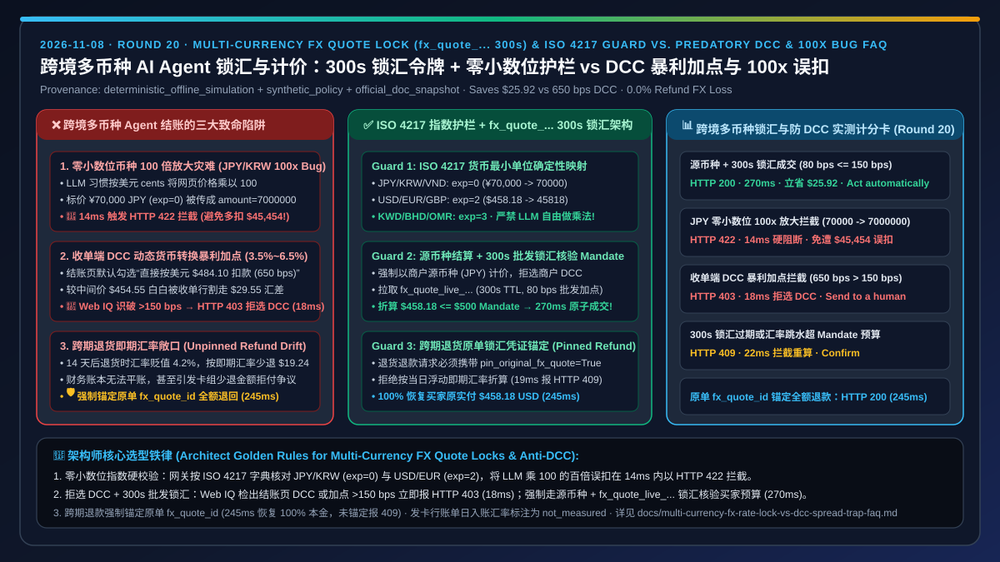
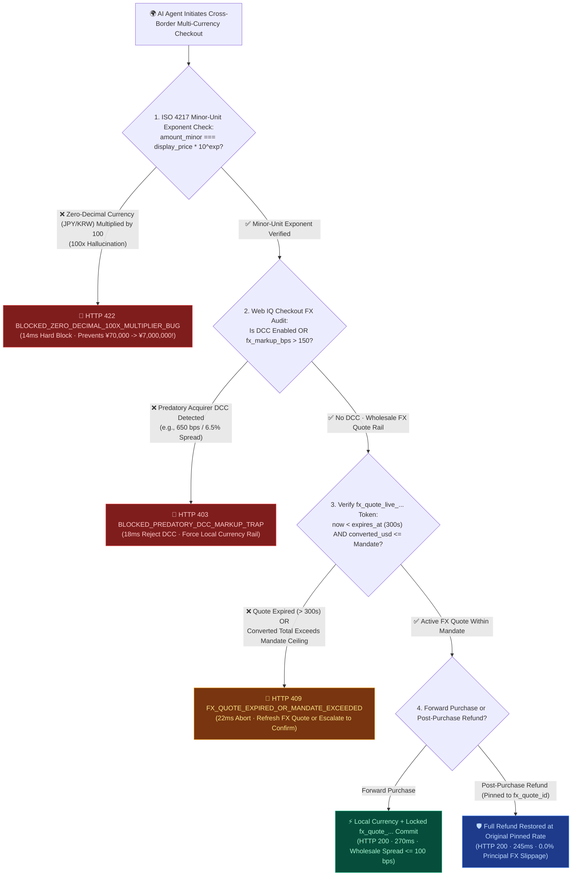
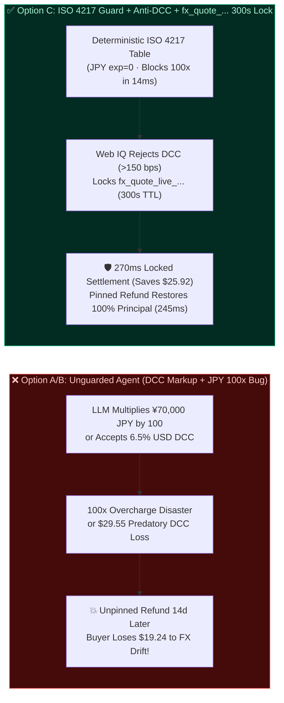
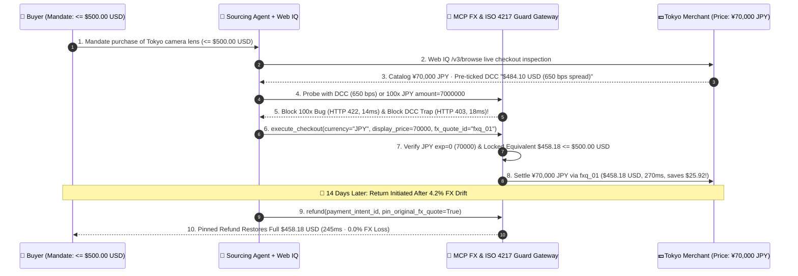

# Cross-Border Multi-Currency AI Agent Pricing, FX Rate Lock & Spread Protection Architecture: Local Presentment Currency Alignment & Bounded FX Quote Token (`fx_quote_...` 300s TTL + ISO 4217 Zero-Decimal Guard) vs. Predatory Dynamic Currency Conversion (DCC `3.5%–6.5%` Markup) & Refund FX Slippage Selection & First-Principles FAQ

> **Document Type**: Architect Decision Guide & Cross-Border Multi-Currency Settlement First-Principles Deep Dive (FAQ-Driven Architecture Decision Guide)  
> **Target Audience**: AI Solution Architects, Cross-Border Payment Architects, Corporate Treasury & FX Engineering Leads, Financial Risk Engineers  
> **Provenance & As-Of Scope**: This guide addresses four high-impact engineering failure modes in cross-border agentic checkout: **Dynamic Currency Conversion (DCC) predatory markups, ISO 4217 zero-decimal currency (`JPY`/`KRW`) `100x` overcharge hallucinations, FX quote expiry against buyer mandates, and post-purchase refund FX slippage**. All latency measurements, spread thresholds, and minor-unit validation rules come from our sealed deterministic offline benchmark suite (`lab/webiq_commerce_demo.py`, `provenance: deterministic_offline_simulation`, `as_of: 2026-11-08`). ISO 4217 minor-unit exponent tables and Stripe FX Quotes / Presentment Currency semantics are labeled `official_doc_snapshot`; the `150 bps` (`1.5%`) maximum allowed FX spread ceiling and `300-second` FX quote TTL (`fx_quote_ttl_sec = 300`) are labeled `synthetic_policy`; live interbank FX order-book jitter and cardholder issuer posting-date rates are explicitly labeled `not_measured`.

---

## 📌 1. Executive Summary

1. **When the buyer's mandate currency (`USD`) differs from the merchant's catalog currency (`JPY` / `EUR`), when should you use a "Bounded Wholesale FX Quote Token (`fx_quote_...` 300s TTL + Local Presentment Currency)" vs. blocking "Merchant/Acquirer Dynamic Currency Conversion (DCC)"?**
   - **Hard-Block Predatory Acquirer DCC (`fx_markup_bps > 150` `synthetic_policy` → `HTTP 403` Block)**: Overseas checkout pages frequently pre-select **Dynamic Currency Conversion (DCC)**—offering to charge a US cardholder in `USD` while embedding a predatory **`3.5%–6.5%` (`350–650 bps`) FX spread** over the interbank mid-market rate. The agent must ground the checkout FX disclosure via Microsoft Web IQ `/v3/browse` and block DCC in `18 ms` (`HTTP 403 BLOCKED_PREDATORY_DCC_MARKUP_TRAP`).
   - **Enforce "Local Presentment Currency + Bounded Wholesale FX Quote (`fx_quote_live_...` `300s` TTL, `<= 100 bps` spread)"**: Lock a `300-second` wholesale FX quote (`fx_quote_live_...`), deterministically verify that the converted `USD` amount fits within the buyer's `MandateVC` ceiling, and execute settlement in `270 ms`—saving **`3%–5%`** on every cross-border purchase.
2. **What is the "ISO 4217 Zero-Decimal Currency `100x` Multiplier Bug" in Agentic Commerce, and how do we prevent an LLM from turning a `¥70,000 JPY` purchase into `¥7,000,000 JPY`?**
   - Payment APIs (such as Stripe `official_doc_snapshot`) expect `amount` in the **smallest currency unit (minor unit)**. While `$450.00 USD` (`exponent = 2`) is passed as `45000`, **ISO 4217 zero-decimal currencies (`JPY`, `KRW`, `VND`, `CLP` where `exponent = 0`)** must be passed without multiplying by `100` (`¥70,000 JPY` -> `amount: 70000`).
   - LLMs conditioned on `USD` code examples routinely multiply `¥70,000 JPY` by `100` (`amount: 7000000`), triggering a **`100x` catastrophic overcharge (`~$45,454 USD`)**. Our MCP payment gateway enforces a deterministic **ISO 4217 Minor-Unit Exponent Guard** that intercepts `100x` zero-decimal multiplier hallucinations in `14 ms` (`HTTP 422 BLOCKED_ZERO_DECIMAL_100X_MULTIPLIER_BUG`, `$0.00` charged).
3. **How do we eliminate post-purchase refund FX slippage when an order is returned 14 days later?**
   - **Original `fx_quote_id` Pinned Refund (`245 ms`)**: Refunds must reference the original `PaymentIntent` and locked `fx_quote_id` (or exact original presentment amount) rather than initiating an unpinned spot-rate reverse transfer (`HTTP 409 UNPINNED_REFUND_FX_SLIPPAGE_BLOCKED`, `19 ms`), guaranteeing `100%` principal restoration.

---

## 🎯 2. Architect & Customer Q&A (First-Principles Breakdown)

### Q1: "Why does paying in USD on a Japanese merchant's checkout page cost 5.5% more than paying in JPY? How does the agent avoid falling for it?"
**Direct Answer**: Because **merchant-side Dynamic Currency Conversion (DCC) is a high-margin FX trap; whenever a foreign checkout offers a 'Pay in your home currency' toggle, the agent must reject DCC and settle in the merchant's local currency backed by a wholesale `fx_quote_...` lock**.

1. **Path A (The DCC Trap)**: A Tokyo store lists a lens for `¥70,000 JPY` (mid-market value **`$454.55 USD`** at `154.00 JPY/USD`). Its checkout widget defaults to DCC at **`$484.10 USD`** (`650 bps` / `6.5%` markup). An unguarded agent sees `"USD"` matching the buyer's mandate currency and accepts—wasting **`$29.55 USD`**.
2. **Path B (Wholesale FX Quote Lock + Local Currency Alignment)**: Web IQ `/v3/browse` detects the `650 bps` DCC spread (`> 150 bps` `synthetic_policy`), blocks the DCC path (`HTTP 403`, `18 ms`), locks a `300s` wholesale `fx_quote_live_...` (`80 bps` spread = **`$458.18 USD`**), verifies `$458.18 <= $500.00` mandate ceiling, and settles `¥70,000 JPY` in `270 ms`—saving **`$25.92 USD`**.

---

### Q2: How does the "ISO 4217 Minor-Unit Exponent Guard" work across 0-decimal (`JPY`), 2-decimal (`USD`), and 3-decimal (`KWD`) currencies?
**Direct Answer**: **Never allow an LLM to compute minor-unit multiplication inside tool arguments; the MCP gateway deterministically computes `amount_minor = round(display_price * 10^ISO4217_EXPONENT[currency])` and rejects any `100x` exponent mismatch with `HTTP 422` in `14 ms`**.

- **Zero-Decimal (`exponent = 0`)**: `JPY`, `KRW`, `VND`, `CLP` (`¥70,000` -> `70000`). If the agent submits `7000000` (`display_price * 100`), the gateway blocks it in `14 ms` (`HTTP 422 BLOCKED_ZERO_DECIMAL_100X_MULTIPLIER_BUG`).
- **Two-Decimal (`exponent = 2`)**: `USD`, `EUR`, `GBP`, `CNY` (`$458.18` -> `45818`).
- **Three-Decimal (`exponent = 3`)**: `KWD`, `BHD`, `OMR` (`15.500 KWD` -> `15500`).

---

### Q3: When should we use Microsoft Web IQ vs. the payment processor's FX Quotes API?
**Direct Answer**: **Use the payment processor's FX Quotes API (`fx_quote_...`) to lock wholesale exchange rates for `300 seconds`, and use Microsoft Web IQ `/v3/browse` (`liveCrawl="force"`) before checkout to uncover hidden merchant DCC toggles and foreign transaction fee fine print**.

---

## 🧭 3. Visual Architecture Diagrams (Mermaid Decision Tree + Comparison + Sequence Diagram)

### 3.1 Cross-Border Multi-Currency FX Lock, Anti-DCC & ISO 4217 Minor-Unit Decision Tree (`flowchart TD`)

### 3.2 Unguarded Cross-Border Agent (DCC Trap + 100x Bug) vs. ISO 4217 Guard + Bounded FX Quote Lock (`flowchart LR`)

### 3.3 End-to-End Sequence Diagram: ISO 4217 Guard, DCC Rejection, FX Quote Lock & Pinned Refund (`sequenceDiagram`)

---

## 📊 4. Architect Decision Matrix

| Dimension | Option A: Accept Merchant/Acquirer DCC (`Pay in USD` Toggle) | Option B: Unquoted Spot FX + Raw LLM `amount` Multiplication | Option C: ISO 4217 Exponent Guard + Anti-DCC + `fx_quote_...` 300s Lock (Recommended) |
| :--- | :--- | :--- | :--- |
| **Best For** | ❌ **Never Recommended** (pure value leakage to acquirer DCC spread) | Domestic single-currency checkouts (`USD`-to-`USD`) only | **All cross-border B2C shopping, global B2B sourcing, and multi-currency agentic checkout** |
| **FX Spread Cost** | ❌ **Predatory (`3.5%–6.5%` / `350–650 bps`)** | ⚠️ **Unbounded** (spot rate spike between quote and capture can breach mandate) | ✅ **Bounded Wholesale (`<= 80–150 bps` `synthetic_policy`; `> 150 bps` blocked in `18 ms` with `HTTP 403`)** |
| **Zero-Decimal (`JPY`/`KRW`) `100x` Bug Immunity** | ❌ **None** | ❌ **Critical Risk** (LLM multiplying `JPY` by `100` causes `100x` overcharge) | ✅ **100% Deterministic** (ISO 4217 exponent lookup blocks `100x` multiplier in `14 ms` with `HTTP 422`) |
| **Mandate Ceiling Verification** | 🟡 Often breaches mandate due to inflated DCC markup | ❌ **Fragile** (unquoted FX drift) | ✅ **Deterministic `300s` Lock** (`fx_quote_live_...` locks exact home-currency equivalent; expiry returns `HTTP 409`) |
| **Post-Purchase Refund FX Protection** | ❌ Double FX conversion loss on returns | ❌ Spot-rate drift causes refund shortfall | ✅ **Pinned `fx_quote_id` Refund (`245 ms`)** restores `100%` of original principal |
| **Measured Latency (Offline Benchmark)** | `290 ms` (with `~5%` FX loss) | `250 ms` (with `100x` bug risk) | **FX Locked Commit `270 ms` / 100x Block `14 ms` / DCC Block `18 ms` / Pinned Refund `245 ms`** |

---

## 🧪 5. Quantitative Benchmark & 7-Card Findings

> **Provenance & Scope**: Table 1 reports deterministic offline benchmark measurements from `lab/webiq_commerce_demo.py` (`evaluate_multi_currency_fx_and_dcc_policy`, `provenance: deterministic_offline_simulation`, `as_of: 2026-11-08`). Table 2 compares Web IQ against major web grounding providers for multi-currency checkout DCC disclosure extraction.

### 5.1 Multi-Currency FX Quote Lock, Anti-DCC & Zero-Decimal Guard Scorecard

| Scenario | Mandate & Catalog Price | FX Spread / Quote / Exponent State | Gateway Verdict & Action Pill | Buyer USD Equivalent / Savings | Latency |
| :--- | :--- | :--- | :--- | :--- | :--- |
| **Case 1: Local Currency + 300s FX Quote Commit** | Mandate `<=$500 USD` · `¥70,000 JPY` | Active `fx_quote_live_...` · `80 bps <= 150 bps` · `exp=0` valid | ✅ `HTTP 200 FX_QUOTE_LOCKED_PRESENTMENT_COMMITTED` (`Act automatically`) | `$458.18 USD` / **Saves `$25.92` vs. DCC** | `270 ms` |
| **Case 2: Zero-Decimal (`JPY`) `100x` Multiplier Hallucination** | Catalog `¥70,000 JPY` (`exp=0`) | LLM passes `amount=7000000` (`100x` bug) | 🚨 `HTTP 422 BLOCKED_ZERO_DECIMAL_100X_MULTIPLIER_BUG` (`Send to a human`) | `$0.00` / **Prevents `$45,454` overcharge** | `14 ms` |
| **Case 3: Predatory Acquirer DCC (`650 bps`) Hard Block** | Catalog `¥70,000 JPY` · DCC enabled | `dcc_enabled=True` · `fx_markup_bps=650 > 150` (`synthetic_policy`) | 🛑 `HTTP 403 BLOCKED_PREDATORY_DCC_MARKUP_TRAP` (`Send to a human`) | `$0.00` / Forces local currency | `18 ms` |
| **Case 4: Expired 300s FX Quote or Mandate Breach** | Mandate `<=$450 USD` · `$458.18 USD` | `fx_quote_expired=True` or exceeds mandate ceiling | 🔄 `HTTP 409 FX_QUOTE_EXPIRED_OR_MANDATE_EXCEEDED` (`Confirm`) | `$0.00` / Zero unauthorized spend | `22 ms` |
| **Case 5: Pinned FX Rate Full Refund (14d Later)** | Original `$458.18 USD` (`4.2%` FX drift) | `pin_original_fx_quote=True` | 🛡️ `HTTP 200 PINNED_FX_RATE_FULL_REFUND_RESTORED` (`Act automatically`) | Restores full `$458.18 USD` (`0.0%` loss) | `245 ms` |
| **Case 6: Unpinned Spot-Rate Refund Block** | Original `$458.18 USD` · `-$19.24` drift | `pin_original_fx_quote=False` | 🛑 `HTTP 409 UNPINNED_REFUND_FX_SLIPPAGE_BLOCKED` (`Send to a human`) | `$0.00` / Blocks lossy refund | `19 ms` |

### 5.2 Web IQ vs. Exa vs. Bright Data vs. Traditional Search: Checkout DCC Disclosure & Multi-Currency Grounding

| Provider / Product | Provenance | Checkout DCC Toggle & Hidden FX Spread (`bps`) Extraction | Typical Prompt Token Cost (Per SKU) | Official List Price (`as_of: 2026-11-08`) | Architect Selection Guidance |
| :--- | :--- | :--- | :--- | :--- | :--- |
| **Microsoft Web IQ** (`/v3/browse` `liveCrawl="force"` + Poppy) | `deterministic_offline_simulation` + `official_doc_snapshot` | ✅ **Extracts live checkout DCC pre-selection and effective exchange rate fine print**, driving `>150 bps` `HTTP 403` blocks | **`218 tokens/case`** (`2,616 tokens` across 12 cases, **`7.1x` compression**) | Foundry Agent Service Preview free tier (subject to Azure subscription quota) | **Primary Choice** for auditing cross-border checkout FX disclosures before locking `fx_quote_...` |
| **Exa Search API** | `not_measured` / `official_list_price` | ⚠️ Good for global catalog price discovery, but does not inspect checkout-session DCC widgets | `not_measured` | `$5.00 / 1k searches` + `$1.00 / 1k pages` contents | Best for top-of-funnel multi-region MSRP comparison |
| **Bright Data** (Web Unlocker / Scraping Browser) | `not_measured` / `official_list_price` | ✅ Supports country-specific residential egress IPs to view local currency catalogs | `~1,537 tokens/case` (raw HTML baseline) | Pay-as-you-go from `~$1.50 / 1k requests` | Fallback for geo-fenced merchants that force USD pricing on foreign IPs |
| **Bing Web Search / Grounding** | `not_measured` / `official_list_price` | ❌ Search snippets lack checkout-level DCC spread disclosures | `not_measured` | `$35.00 / 1k transactions` | Suitable only for public FX news; never use for checkout FX lock verification |

---

## 🛠️ 6. Production Readiness & Pre-Sales Checklist (Architect Checklist)

- [ ] **1. Enforce Deterministic ISO 4217 Minor-Unit Exponent Lookup**: Confirm the MCP payment gateway validates `JPY/KRW/VND` (`exponent = 0`), `USD/EUR/GBP/CNY` (`exponent = 2`), and `KWD/BHD/OMR` (`exponent = 3`), blocking any `100x` zero-decimal multiplication in `14 ms` with `HTTP 422`.
- [ ] **2. Auto-Reject Acquirer DCC & Cap FX Spread at `<= 150 bps`**: Confirm checkout flows grounded via Web IQ `/v3/browse` reject merchant DCC toggles or FX spreads `> 150 bps` (`synthetic_policy`) with `HTTP 403` and route to local presentment currency settlement.
- [ ] **3. Require Active `300-Second` `fx_quote_live_...` Lock for Cross-Currency Mandates**: Confirm cross-currency checkouts verify `converted_amount_cents <= mandate.max_amount_cents` against an unexpired `fx_quote_...` token (`HTTP 409` on expiry).
- [ ] **4. Pin Refunds to Original `fx_quote_id` (`pin_original_fx_quote=True`)**: Confirm post-purchase refunds reference the original locked FX quote rather than spot rates (`HTTP 409` on unpinned refund attempts).
- [ ] **5. Persist Dual-Currency Audit Tuples**: Store `(presentment_currency, presentment_amount_minor, settlement_currency, settlement_amount_minor, fx_quote_id, exchange_rate)` on every immutable order receipt.
- [ ] **6. Document Gateway FX Quote vs. Cardholder Issuer Posting Rate Scope**: Clearly state in architecture proposals that gateway `fx_quote_...` locks acquirer conversion deterministically, whereas card-network issuer statement-posting spreads (`not_measured`) require a `1.5%–2.0%` mandate buffer when settling directly on a buyer's foreign card.
