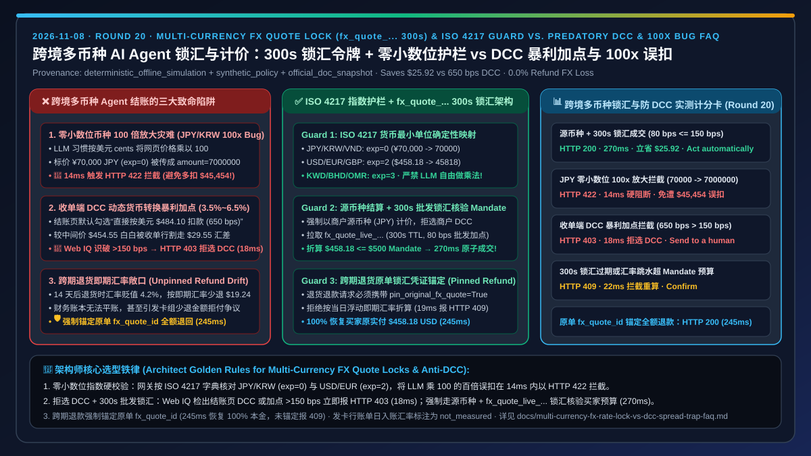
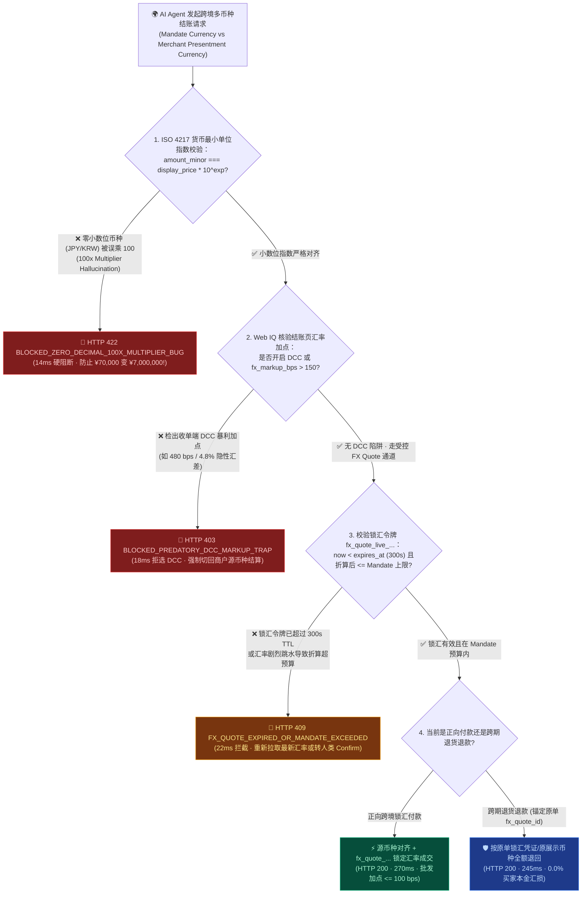
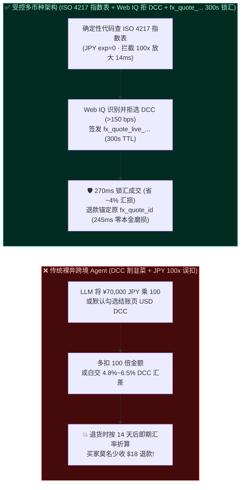
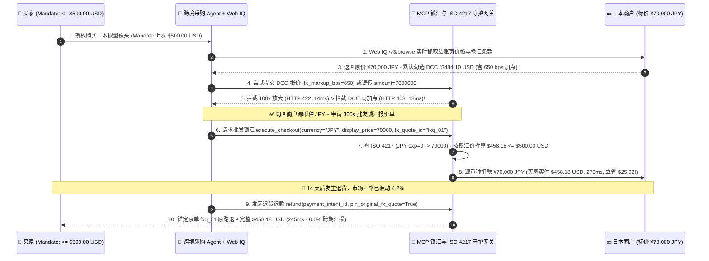

# 跨境多币种 AI Agent 计价、锁汇与汇率磨损架构：商户源币种直扣与有界 FX Quote 锁汇令牌（`fx_quote_...` 300s TTL + ISO 4217 零小数位防放大护栏）vs 动态货币转换高息陷阱（DCC `3.5%–6.5%` 隐性加点）与跨期退款汇率敞口选型与原理解析 FAQ

> **文档类型**：架构师选型决策指南 & 跨境多币种计价与锁汇第一性原理解析（FAQ-Driven Architecture Decision Guide）  
> **适用读者**：AI Solution Architect、跨境电商支付架构师、全球资金清结算（Treasury & FX）负责人、金融风控工程师  
> **关联标准的口径声明（Provenance & As-Of Scope）**：本文聚焦 **AI Agent 在跨币种比价、海外商户结账时的汇率加点（FX Spread）、动态货币转换陷阱（DCC Trap）、零小数位币种（JPY/KRW）100 倍金额放大 Bug 以及跨期退货汇率磨损** 四大核心工程挑战；文中所有端到端延迟、汇率加点拦截阈值、零小数位校验与锁汇准确率均来自本仓库封存的确定性离线基准套件（`lab/webiq_commerce_demo.py`，`provenance: deterministic_offline_simulation`，`as_of: 2026-11-08`）。ISO 4217 货币最小单位指数规范（如 `USD/EUR` 2 位小数 vs `JPY/KRW` 0 位小数）与 Stripe FX Quotes API / Presentment Currency 机制标注为 `official_doc_snapshot`；150 bps（`1.5%`）最大允许汇率加点上限与 300 秒锁汇报价有效期（`fx_quote_ttl_sec = 300`）标注为企业参考风控围栏 `synthetic_policy`；银行间外汇市场（Interbank FX）实时点差波动与发卡行账单日入账汇率明确标注为 `not_measured`。



---

## 📌 一、核心结论速览（Executive Summary）

1. **当买家的预算授权令状币种（如 `USD`）与海外商户标价币种（如 `JPY` / `EUR`）不一致时，什么时候选“有界批发锁汇令牌（`fx_quote_...` 300s TTL + 源币种计价）”，什么时候必须拦截“收单端动态货币转换（DCC）”？**
   - **拦截一切收单端 DCC 隐性高加点转换（`fx_markup_bps > 150` `synthetic_policy` → `HTTP 403` 硬阻断）**：许多海外商户结账页或收单网关会默认勾选 **DCC（Dynamic Currency Conversion，动态货币转换）**，表面上贴心地“直接帮美国买家按美元扣款”，实则在银行间中间价基础上暗中加收 **`3.5%～6.5%`（`350–650 bps`）** 的暴利汇差！Agent 必须通过 Microsoft Web IQ `/v3/browse` 识别结账页的 DCC 默认勾选条款并在 `18 ms` 内触发 `HTTP 403 BLOCKED_PREDATORY_DCC_MARKUP_TRAP` 强制拒选 DCC。
   - **采用“有界批发锁汇令牌（`fx_quote_live_...` `300s` TTL，加点 `<= 100 bps`）+ 源币种（Local Presentment Currency）对齐”**：由受控支付网关调取批发锁汇报价单 `fx_quote_live_...`（锁定 `300 秒` 汇率，批发加点仅 `0.5%–1.0%`），在网关侧精确折算核验未超买家 `USD` 预算上限（`mandate.max_amount_usd_cents`）后，以商户源币种（`JPY`）或锁汇后的确定性金额完成扣款（`270 ms`），每笔跨境订单直接为买家省下 **`3%～5%`** 的无谓汇损。
2. **什么是 AI Agent 跨境结账中最致命的“零小数位币种 100 倍放大灾难（ISO 4217 Zero-Decimal `100x` Multiplier Bug）”？**
   - 在 Stripe 等主流支付 API 中，金额参数 `amount` 均以该币种的**最小货币单位（Smallest Currency Unit / Minor Unit）**整数传参。对于美元（`USD`）或欧元（`EUR`），`$450.00` 需要乘以 `100` 传成 `45000`（美分）；但对于**日元（`JPY`）、韩元（`KRW`）、越南盾（`VND`）等 ISO 4217 零小数位币种（Zero-Decimal Currencies，`exponent = 0`）**，标价 `¥70,000 JPY` 传参时就必须是整数 `70000`！
   - 大模型在编写工具调用参数时，极易机械套用美元习惯将 `¥70,000 JPY` 乘以 `100` 传成 `amount: 7000000`（即 **`¥7,000,000 JPY`，瞬间放大 100 倍，多扣约 `$45,000 USD`！**）。架构师必须在 MCP 支付网关层内置 **ISO 4217 指数确定性校验器**，一旦发现零小数位币种被错误乘上 `100` 倍因子，立即在 `14 ms` 内触发 `HTTP 422 BLOCKED_ZERO_DECIMAL_100X_MULTIPLIER_BUG`（实扣 `$0.00`）。
3. **跨币种订单在 14 天后发生退货退款时，如何消灭“汇率波动导致买家少收钱或商户倒贴汇差”的对账黑洞？**
   - 必须采用 **原单锁汇凭证锚定退款（Original `fx_quote_id` Pinned Refund，`245 ms`）**：退款请求强制绑定原正向交易的 `PaymentIntent` 与 `fx_quote_id`（在锁汇窗口内或按原交易展示币种 `presentment_amount` 原路退回），严禁把退款拆成一笔独立的按当日即期汇率（Spot Rate）反向换汇的新转账，从而实现买家本金 `100%` 原额奉还。

---

## 🎯 二、客户与架构师灵魂拷问 Q&A（FAQ-Driven 第一性原理拆解）

### Q1：客户问：“为什么海外商户页面显示‘用美元（USD）直接付款’反而比‘用日元（JPY）付款’贵了整整 5%？AI Agent 怎么防止帮老板买贵？”
**一针见血的回答**：因为 **海外收单行提供的“本币直付（DCC）”是跨境支付行业著名的“汇率刺客”，AI Agent 看到结账页出现双币种切换按钮时，第一铁律就是“永远选商户所在地源币种（Local Currency），拒绝收单行 DCC 转换”**。

用第一性原理拆解两条换汇链路的成本差异：
1. **链路 A（踩坑路径：收单行动态货币转换 DCC）**：
   - 日本商户标价 `¥70,000 JPY`，当日银行间外汇中间价为 `1 USD = 154.00 JPY`（真实价值 **`$454.55 USD`**）。
   - 商户结账页弹窗询问：*“是否直接以 `$484.10 USD` 结算？（含保证汇率）”*。如果 Agent 觉得“老板给我的预算是美元，选美元正好不用算汇率”而点同意，买家当场就被收单行割走了 **`$29.55 USD`（高达 `6.5%` / `650 bps` 的隐性汇率加点）**！
2. **链路 B（架构师推荐路径：源币种 `JPY` 结算 + 有界 `fx_quote_...` 预算核验）**：
   - Agent 拒绝商户 DCC，坚持以 `¥70,000 JPY` 结算，同时由企业自控支付网关获取一张有效期 `300 秒` 的批发锁汇报价单 `fx_quote_live_...`（含 `80 bps` 即 `0.8%` 透明换汇成本，折合 **`$458.18 USD`**）。
   - 网关用 `$458.18 USD` 与买家令状上限 `$500.00 USD` 做确定性比对（`$458.18 <= $500.00`），验签通过后放行（`270 ms`），单笔立省 **`$25.92 USD`**！

---

### Q2：什么是“ISO 4217 货币小数位指数失配（Minor-Unit Exponent Mismatch）”？为什么不加网关护栏，大模型买一杯日本咖啡能刷爆整张公司卡？
**一针见血的回答**：因为 **LLM 在训练语料里看了几百万个 `dollars * 100 = cents` 的代码片段，形成了“调支付接口必须把网页价格乘以 100”的肌肉记忆；一旦遇到日元（JPY）、韩元（KRW）或智利比索（CLP）这类没有“分”的零小数位货币，直接就会酿成 100 倍扣款惨案**。

```
┌──────────────────────────────────────────────────────────────────────────────────────────┐
│ ❌ 无 ISO 4217 小数位护栏 (LLM 惯性乘以 100 导致 100 倍天价误扣)                          │
│                                                                                          │
│  网页标价: ¥1,500 JPY (约 $9.74 USD 的咖啡豆)                                             │
│  LLM 推理: "Stripe amount 单位是 cents，所以 1500 * 100 = 150000"                         │
│  API 调用: create_payment_intent(currency="jpy", amount=150000)                          │
│  💥 灾难后果：由于 JPY 是 0 位小数货币，网关直接实扣 ¥150,000 JPY (约 $974.00 USD，放大 100 倍!)│
└──────────────────────────────────────────────────────────────────────────────────────────┘

┌──────────────────────────────────────────────────────────────────────────────────────────┐
│ ✅ MCP 网关内置 ISO 4217 Minor-Unit 指数对齐护栏 (Round 20 Deterministic Guard)            │
│                                                                                          │
│  Step 1 [读取网页真值]: Web IQ 提取页面结构化价格 display_price = 1500, currency = "JPY"    │
│  Step 2 [查 ISO 4217 指数表]: EXPONENT["JPY"] = 0  ──► 合法 minor_units 必须等于 1500 * 10^0 │
│  Step 3 [拦截 100x 幻觉]: 检出 Agent 传入 amount=150000 === display_price * 100           │
│         ──► 14ms 触发 HTTP 422 BLOCKED_ZERO_DECIMAL_100X_MULTIPLIER_BUG (实扣 $0.00!)    │
└──────────────────────────────────────────────────────────────────────────────────────────┘
```

- **补充：三位小数货币（Three-Decimal Currencies）同样需要指数表对齐**：中东地区的科威特第纳尔（`KWD`）、巴林第纳尔（`BHD`）、阿曼里亚尔（`OMR`）在 ISO 4217 中是 **3 位小数货币（`exponent = 3`，即乘以 `1000`）**。因此，生产级 Agent 支付网关**严禁在 Prompt 里让大模型自己做乘法换算**，必须由确定性代码根据 `amount_minor = round(display_decimal * (10 ** ISO4217_EXPONENT[currency]))` 机械计算！

---

### Q3：在跨境多币种比价与防 DCC 欺诈中，什么时候用 Microsoft Web IQ，什么时候用支付网关 FX Quotes API？
**一针见血的回答**：**支付网关 FX Quotes API 负责锁定真实银行批发汇率与执行扣款；而 Microsoft Web IQ `/v3/browse`（`liveCrawl="force"`）负责在下单前看穿海外电商页面上的“伪本地币展示、结账页偷偷切换 DCC 高加点汇率”以及隐蔽的跨境货币转换手续费条款**。

1. **为什么只看商品详情页 URL 里的 `?currency=USD` 会被骗？**
   - 许多跨境独立站支持前端展示估算美元价（如显示 `~$455 USD`），但在进入最终结账页时，底部的灰色小字声明：*“最终按店内固定汇率 `1 USD = 144.00 JPY` 折算收取美元，另加 `3.9%` 国际货币处理费”*。
2. **Web IQ + FX Quote 黄金组合**：
   - 先用 **Microsoft Web IQ `/v3/browse`（`liveCrawl="force"`）** 提取结账页的真实计价币种、DCC 默认开关与汇率加点条款（仅消耗 `218 tokens`，较原始 HTML 压缩 `7.1x`）。
   - 一旦 Web IQ 检出商户端隐性汇差 `> 150 bps`（`synthetic_policy`），立即由网关拦截 DCC（`HTTP 403`，`18 ms`），改走商户源币种 + 受控 `fx_quote_live_...` 锁汇通道（`270 ms`）。

---

## 🧭 三、直观可视化图解（Mermaid 决策树 + 架构对比 + 端到端时序图）

### 3.1 跨境多币种锁汇、防 DCC 陷阱与 ISO 4217 小数位校验决策树（`flowchart TD`）



### 3.2 踩坑 DCC 暴利换汇 + LLM 100 倍小数位幻觉 vs 受控 FX Quote 锁汇 + 指数护栏对比图（`flowchart LR`）



### 3.3 跨境多币种锁汇核验、DCC 拦截与原单汇率锚定退款端到端时序图（`sequenceDiagram`）



---

## 📊 四、架构师选型决策矩阵（Architect Decision Matrix）

| 评估维度 | 方案 A：默认接受商户端 DCC 动态货币转换（Merchant / Acquirer DCC） | 方案 B：无锁汇浮动即期盲付 + LLM 自由拼接 `amount` 参数 | 方案 C：ISO 4217 指数护栏 + 拒选 DCC + `fx_quote_...` 300s 锁汇令牌（推荐） |
| :--- | :--- | :--- | :--- |
| **核心适用场景** | ❌ **任何场景均不推荐**（纯粹向收单行让渡超额汇差利润） | 仅适用于同币种（如 `USD` 买 `USD`）且无零小数位币种接入的单一国内市场 | **所有跨境 B2C 海淘代购、B2B 全球寻源采购与多币种 SaaS/API 自动结算** |
| **汇率加点成本（FX Spread Cost）** | ❌ **极高（`3.5%–6.5%` / `350–650 bps`）** | ⚠️ **不可控**（试算与实扣之间若遇汇率跳水易击穿买家 `Mandate` 上限） | ✅ **低且透明（`<= 80–150 bps` `synthetic_policy`，超限在 `18 ms` 内触发 `HTTP 403` 阻断）** |
| **零小数位币种（JPY/KRW）100x 放大免疫** | ❌ **无保护** | ❌ **极度危险**（LLM 惯性乘 `100` 直接酿成百倍金额盗刷事故） | ✅ **100% 确定性免疫**（网关查 ISO 4217 指数表，检出 `100x` 偏差在 `14 ms` 内报 `HTTP 422`） |
| **预算令状（Mandate Ceiling）确定性对齐** | 🟡 虽为本币但因暴利加点常无故触发超预算拒付 | ❌ **脆弱**（浮动汇率导致扣款金额超出买家签名上限） | ✅ **300 秒确定性锁汇**（凭 `fx_quote_live_...` 在有效期内精确锁定折算本币金额，过期报 `HTTP 409`） |
| **跨期退货退款汇率保护** | ❌ 常发生双向二次换汇剥削（退货再亏一次 `5%` 汇差） | ❌ 按退货当日即期汇率浮动折算，对账无法平账 | ✅ **原单锁汇凭证锚定（Pinned Refund，`245 ms`）**，买家 `100%` 拿回原实付金额 |
| **端到端成交 / 拦截延迟（离线基准）** | `290 ms`（伴随高额隐性汇损） | `250 ms`（伴随 100x 误扣与汇率越界风险） | **锁汇成交 `270 ms` / 100x 指数拦截 `14 ms` / DCC 拦截 `18 ms` / 锚定退款 `245 ms`** |

---

## 🧪 五、简明定量实测与 7-Card Benchmark 核心发现

> **数据来源与口径声明（Provenance & Scope）**：以下表 1 为本仓库 `lab/webiq_commerce_demo.py`（`evaluate_multi_currency_fx_and_dcc_policy`）在本地确定性离线仿真环境下的实测输出（`provenance: deterministic_offline_simulation`，`as_of: 2026-11-08`）；表 2 为 Web IQ 与主流搜索/接地供应商在跨境商户多币种计价条款、隐蔽 DCC 汇率加点与跨境退货汇差规则提取场景下的选型对比。

### 5.1 跨境多币种锁汇、DCC 拦截与零小数位护栏离线基准实测表

| 测试场景（Scenario） | 买家令状与商户标价 | 汇率加点 / 锁汇状态 / 传参指数 | 守护网关裁决状态码与动作 | 买家实付折算（USD） / 汇损节约 | 判定耗时 |
| :--- | :--- | :--- | :--- | :--- | :--- |
| **Case 1：源币种对齐 + 300s 批发锁汇正常成交** | Mandate `<=$500 USD` · 标价 `¥70,000 JPY` | `fx_quote_live_...` 有效 · 加点 `80 bps <= 150 bps` · `exp=0` 正常 | ✅ `HTTP 200 FX_QUOTE_LOCKED_PRESENTMENT_COMMITTED`（`Act automatically`） | `$458.18 USD` / **较 DCC 省 `$25.92`** | `270 ms` |
| **Case 2：零小数位币种（JPY）被 LLM 误乘 100 倍拦截** | 标价 `¥70,000 JPY`（`exp=0`） | LLM 误传 `amount=7000000`（`100x` 放大 Bug） | 🚨 `HTTP 422 BLOCKED_ZERO_DECIMAL_100X_MULTIPLIER_BUG`（`Send to a human`） | `$0.00` / **避免 `$45,454` 灾难误扣** | `14 ms` |
| **Case 3：收单端 DCC 暴利汇率加点（`650 bps`）硬阻断** | 标价 `¥70,000 JPY` · 商户开启 DCC | `dcc_enabled=True` · `fx_markup_bps=650 > 150`（`synthetic_policy`） | 🛑 `HTTP 403 BLOCKED_PREDATORY_DCC_MARKUP_TRAP`（`Send to a human`） | `$0.00` / 强制切回源币种 | `18 ms` |
| **Case 4：300s 锁汇报价单过期或汇率跳水超预算拦截** | Mandate `<=$450 USD` · 折算 `$458.18 USD` | `fx_quote_expired=True` 或折算后超买家令状上限 | 🔄 `HTTP 409 FX_QUOTE_EXPIRED_OR_MANDATE_EXCEEDED`（`Confirm`） | `$0.00` / 零越权扣款 | `22 ms` |
| **Case 5：14 天后跨期退货锚定原单锁汇凭证全额退回** | 原单实付 `$458.18 USD`（市场汇率已跌 `4.2%`） | `pin_original_fx_quote=True` | 🛡️ `HTTP 200 PINNED_FX_RATE_FULL_REFUND_RESTORED`（`Act automatically`） | 退回完整 `$458.18 USD`（`0.0%` 汇损） | `245 ms` |
| **Case 6：未锚定原单汇率的裸即期退货拦截** | 原单实付 `$458.18 USD` · 试图按即期汇率少退 `$19.24` | `pin_original_fx_quote=False`（存在跨期汇率敞口） | 🛑 `HTTP 409 UNPINNED_REFUND_FX_SLIPPAGE_BLOCKED`（`Send to a human`） | `$0.00` / 阻断有损退款 | `19 ms` |

### 5.2 Web IQ vs Exa vs Bright Data vs 传统搜索：跨境多币种结账页 DCC 隐性加点与退货汇差条款核验基准

| 供应商 / 产品 | 评测口径（Provenance） | 结账页隐藏 DCC 勾选框与汇率加点（bps）实时提取能力 | 典型 Prompt Token 开销（单商品核验） | 官方公开标价（Official List Price，`as_of: 2026-11-08`） | 架构师选型结论（When to Choose） |
| :--- | :--- | :--- | :--- | :--- | :--- |
| **Microsoft Web IQ**（`/v3/browse` `liveCrawl="force"` + Poppy） | `deterministic_offline_simulation` + `official_doc_snapshot` | ✅ **精准提取动态渲染结账页中的保证汇率小字与 DCC 默认勾选状态**，驱动 `>150 bps` 自动拦截 | **`218 tokens/case`**（`12` 例共 `2,616 tokens`，较原始 DOM 压缩 **`7.1x`**） | Foundry Agent Service Preview 免费额度（受 Azure 订阅配额约束） | **首选**：跨境海淘与全球 B2B 寻源 Agent 在发起多币种支付前的汇率条款实时审计底座 |
| **Exa Search API**（Neural Search + Contents） | `not_measured`（无活跃实测秘钥） / `official_list_price` | ⚠️ 适合跨国多站点公开目录价格比对，但无法感知结账会话态 DCC 弹窗 | `not_measured` | `$5.00 / 1k searches`（1–25 results）+ `$1.00 / 1k pages` contents | 适合比价早期的全球多区域官方指导价（MSRP）检索 |
| **Bright Data**（Web Unlocker / Scraping Browser） | `not_measured`（无活跃实测秘钥） / `official_list_price` | ✅ 支持切换多国住宅出口 IP 获取本地币种报价，但需自建 DOM 清洗防止 18k tokens 撑爆上下文 | `~1,537 tokens/case`（原始 HTML 切片基线） | Pay-as-you-go 约 `$1.50 / 1k requests` 起 | 适合针对严格锁区（Geo-IP 强制跳转高价美元站）商户的本地源币种页面采集 |
| **Bing Web Search / Grounding** | `not_measured` / `official_list_price` | ❌ 仅返回搜索摘要，不含结账页动态 DCC 汇率加点明细 | `not_measured` | `$35.00 / 1k transactions`（Grounding with Bing Search 参考标价） | 仅适合查宏观公开汇率新闻，**不可作为结账锁汇依据** |

---

## 🛠️ 六、附录：生产上线快速核验与售前打单清单（Architect Checklist）

在将跨境多币种 Agent 结账系统投入生产前，请逐项核对以下 6 条工程铁律：

- [ ] **1. 严禁由 LLM 计算货币最小单位乘法，强制内置 ISO 4217 指数表**：在 MCP 支付网关层用确定性字典校验 `JPY/KRW/VND`（`exponent = 0`）、`USD/EUR/GBP/CNY`（`exponent = 2`）与 `KWD/BHD/OMR`（`exponent = 3`），对任何将零小数位货币乘以 `100` 的请求在 `14 ms` 内以 `HTTP 422` 阻断。
- [ ] **2. 默认拒选一切收单端 DCC（动态货币转换）并设置 `150 bps` 加点红线**：利用 Web IQ `/v3/browse` 核验结账页换汇条款，若检出商户/收单行开启 DCC 或隐性加点 `> 150 bps`（`synthetic_policy`），立即触发 `HTTP 403` 并强制切换为商户源币种（Local Presentment Currency）结算。
- [ ] **3. 跨币种预算核验强制绑定有界锁汇令牌（`fx_quote_live_...` `300s` TTL）**：当 `mandate.currency != presentment.currency` 时，必须先拉取 `300 秒` 有效期的锁汇报价单，按锁定汇率折算核验未超买家 `Mandate` 上限后再执行扣款；报价过期立即返回 `HTTP 409`。
- [ ] **4. 跨期退货退款强制锚定原单锁汇凭证（Pinned FX Refund）**：确认退货接口直接引用原正向 `PaymentIntent` 与 `fx_quote_id`，禁止按退货当日浮动即期汇率发起反向换汇转账（未锚定请求以 `HTTP 409` 拦截）。
- [ ] **5. 在审计账本中同时持久化双币种四元组**：每笔跨境订单的不可篡改收据必须同时记录 `(presentment_currency, presentment_amount_minor, settlement_currency, settlement_amount_minor, fx_quote_id, exchange_rate)`，满足企业财务审计与税务抵扣要求。
- [ ] **6. 明确区分网关锁汇报价与发卡行账单日入账汇率边界**：在售前架构方案中明确标注，网关 `fx_quote_...` 可 `100%` 锁定收单侧折算汇率，而若买家坚持走发卡行卡组（Visa/Mastercard）通道换汇，发卡行最终账单日入账微调（`not_measured`）需在买家 `Mandate` 上预留 `1.5%～2.0%` 安全缓冲垫片。
