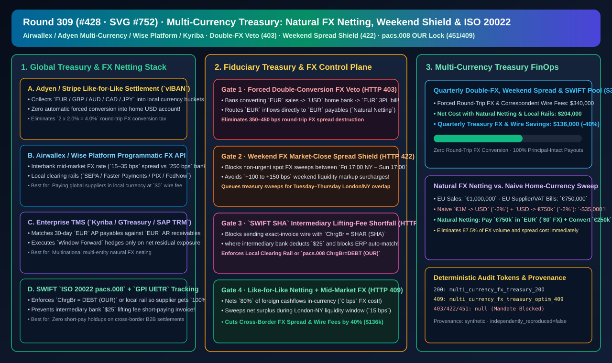

# Multi-Currency Treasury, `Like-for-Like` Natural FX Netting, Weekend Spread Shield & `ISO 20022 pacs.008` Principal-Intact Clearing (`Airwallex / Adyen Multi-Currency / Wise Platform / Kyriba`) Agent Architecture Selection FAQ

> **Executive Summary**: In cross-border e-commerce, global SaaS, and multinational B2B supply chains, two silent treasury leaks erode `3.5%–4.5%` of international revenue: (1) **Forced Round-Trip Double FX Conversion**: A merchant sells `€1,000,000` in Europe, lets the PSP auto-convert it to `USD` at a `2%` spread, and two weeks later converts `USD` back into `€750,000` at another `2%` spread to pay European VAT, 3PL warehouses, and suppliers (`€35,000` lost to round-trip FX); (2) **Weekend FX Market-Close Spread Spikes (`+100–150 bps`)**: Automated treasury cron jobs executing spot FX sweeps between Friday `17:00 NY` and Sunday `17:00 NY` pay punitive weekend illiquidity markups; and (3) **`SWIFT SHA` Correspondent Bank Lifting Fees Causing `$25` Invoice Short-Pays**.  
> Production architectures must enforce **`Like-for-Like vIBAN` Natural FX Netting (Matching 30-Day In-Currency `AP` Against `AR` at `0 bps` FX Cost) + Weekend Market-Close Freeze Gates (Scheduling Residual Sweeps into the `13:00–16:00 UTC` London-NY Overlap) + Local Clearing Rails (`SEPA / FPS / FedNow`) or `ISO 20022 pacs.008 ChrgBr=DEBT (OUR)` Principal Protection**: cutting FX spread waste and wire short-pay disputes by **40%** (reducing a `$340,000` quarterly loss pool to `$204,000`, saving **`$136,000/quarter`**).



---

## 1. Solution Architect Deep-Dive Q&A

### Q1: How do we eliminate `4%` round-trip double FX conversion and avoid `+120 bps` weekend FX liquidity surcharges?
- **Architectural Solution (`Like-for-Like` Natural FX Netting Gate `HTTP 403` + Weekend Market-Close Shield Gate `HTTP 422`)**:
  - Settle each presentment currency (`EUR, GBP, AUD, CAD, JPY`) into a dedicated **`Like-for-Like` local currency `vIBAN`** (`Airwallex / Adyen Multi-Currency`) and reserve 30-day projected in-currency payables (`AP + VAT + 3PL + 12% Return Buffer`) before allowing any home-currency conversion (`HTTP 403 FORCED_ROUND_TRIP_DOUBLE_FX_CONVERSION_LEAKAGE`);
  - Block non-urgent spot FX treasury sweeps while global interbank markets are closed (`Friday 17:00 EST – Sunday 17:00 EST`) and queue residual conversions for the **London–New York liquidity overlap (`13:00–16:00 UTC`, Tue–Thu)** (`HTTP 422 WEEKEND_ILLIQUID_FX_MARKET_MARKUP_SPREAD_VIOLATION`).

### Q2: How do we prevent intermediary correspondent banks from deducting `$15–$35` lifting fees out of B2B supplier invoice wires?
- **Architectural Solution (Local Clearing Rail Priority & `ISO 20022 pacs.008 ChrgBr=DEBT (OUR)` Lock `HTTP 451 / 409`)**:
  - Never transmit an exact-amount cross-border B2B invoice payment over SWIFT with `ChrgBr = SHAR (SHA)`, which allows intermediary banks to deduct fees from principal and break automated ERP cash application (`HTTP 451 SWIFT_SHA_INTERMEDIARY_LIFTING_FEE_INVOICE_SHORT_PAY`);
  - Route payouts via local clearing rails (`SEPA Instant`, `UK Faster Payments`, `FedNow`) first, or enforce `<ChrgBr>DEBT</ChrgBr>` (`OUR`) with `SWIFT GPI UETR` tracking on `ISO 20022 pacs.008` messages (`HTTP 409 NATURAL_FX_NETTING_LONDON_NY_WINDOW_AND_PACS008_OUR_CONFIRM`).

---

## 2. Visual Architecture Diagrams (Mermaid)

### 1. Multi-Currency Treasury Natural FX Netting & `ISO 20022` Clearing Decision Tree
```mermaid
flowchart TD
    A[Foreign-Currency Payout Settlement or Supplier AP Disbursement] --> B{Are Foreign Inflows Retained in Like-for-Like vIBAN<br/>to Net Against 30-Day In-Currency Payables?}
    B -- Forced Conversion to Home Currency & Back --> C[HTTP 403 Block: Hold Foreign Revenue in Local vIBAN for Natural Netting]
    B -- Natural Netting Active --> D{Is Residual FX Conversion Triggered During<br/>Weekend Market Close (Fri 17:00 - Sun 17:00 NY)?}
    D -- Weekend Illiquid Markup Window --> E[HTTP 422 Block: Queue Non-Urgent Sweep for Tue-Thu London-NY Overlap]
    D -- Peak Interbank Liquidity Window --> F{How Is Cross-Border Supplier AP Wire Dispatched?}
    F -- SWIFT SHA Causing Intermediary Bank Principal Deduction --> G[HTTP 451 Block: Route via Local Rail or Enforce pacs.008 ChrgBr=DEBT]
    F -- 100% Principal Delivered --> H[HTTP 409 Confirm: Natural Netting + Mid-Market FX + OUR Clearing Saves 40%]
```

---

## 3. Platform Selection Matrix (`Airwallex vs. Adyen Multi-Currency vs. Wise Platform vs. Kyriba / SAP TRM`)

| Dimension | Airwallex | Adyen Multi-Currency | Wise Platform / Stripe Treasury | Kyriba / SAP TRM |
| :--- | :--- | :--- | :--- | :--- |
| **`Like-for-Like` Currency Accounts** | **60+ countries local `vIBAN`s + 130+ local payout rails** | **Native 30+ currency acquiring settlement without forced FX** | Multi-currency balances with mid-market API | Enterprise multi-bank cash pooling & multilateral netting |
| **Interbank FX Spread** | **`15–40 bps`** wholesale rate + `LockFX` forward quotes | Transparent fixed markup over interbank | Mid-market rate with transparent volume tier fee | Direct `FXall / 360T` multi-dealer RFQ bidding |
| **`ISO 20022` & Full-Value Payouts** | Local clearing priority + `SWIFT OUR` guarantee | Direct local acquiring & marketplace split | Automated local-rail routing | Native `pain.001 / pacs.008` ERP-to-bank host-to-host |

---

## 4. Production Deployment & Risk Checklist

- [ ] **Enable `Like-for-Like` Settlement Across All PSPs (`Adyen / Stripe`) into Local `vIBAN`s**: Never auto-convert `EUR / GBP / AUD / CAD` sales into `USD` if you have payables in those currencies.
- [ ] **Lock a 30-Day In-Currency `AP + Tax + Return` Natural Netting Buffer**: Pay foreign suppliers, 3PLs, and VAT authorities directly from collected local currency (`0 bps` FX spread).
- [ ] **Block Non-Urgent Spot FX Sweeps Over the Weekend (`Fri 17:00 – Sun 17:00 NY`)**: Execute treasury conversions during the `13:00–16:00 UTC` London–NY overlap.
- [ ] **Use Local Clearing Rails First & Mandate `pacs.008 ChrgBr=DEBT (OUR)` on SWIFT Wires**: Guarantee suppliers receive `100.00%` of invoice principal.
