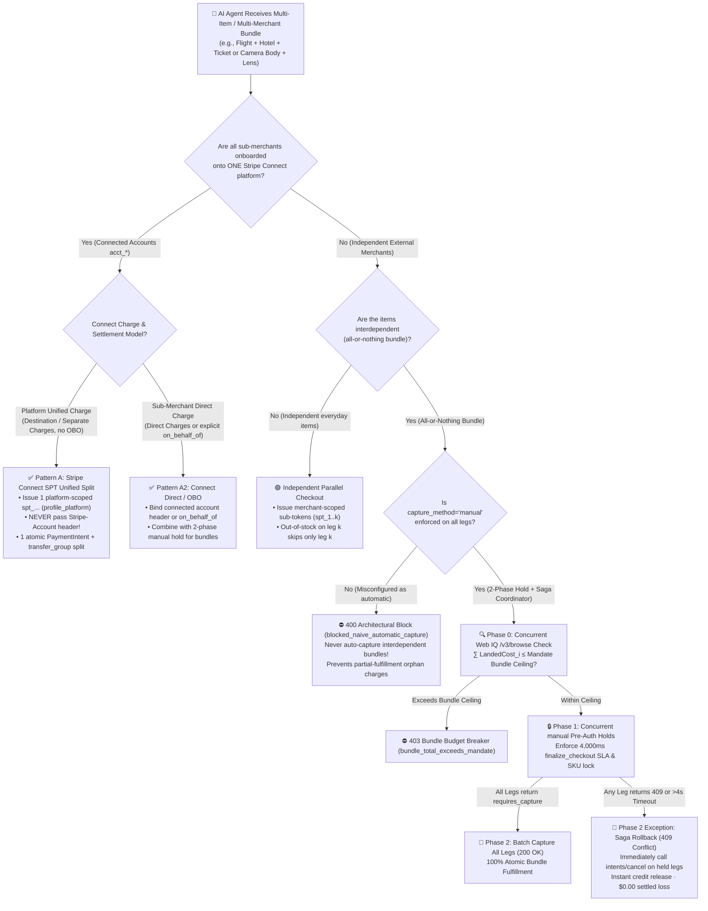
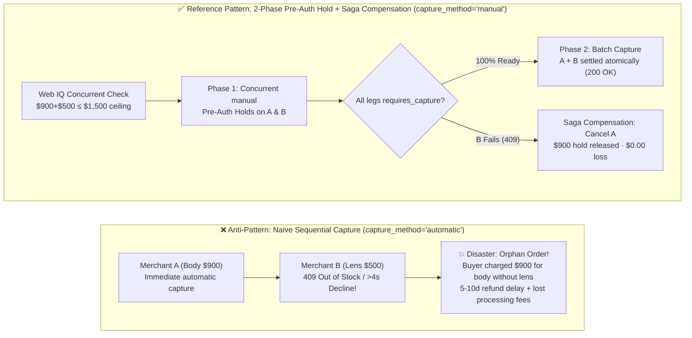

# Multi-Merchant Split-Cart Atomic Orchestration: Two-Phase Pre-Auth Hold & Saga Compensation vs. Unified Platform Marketplace Settlement (Stripe Connect SPT) Selection & First-Principles FAQ

> **Document Scope**: Single-topic architectural selection and first-principles protocol guide for **AI Solution Architects** (strictly following the one-topic-per-guide rule and the 6-section structure of `ib-vs-ethernet-roce-selection-faq.md`).  
> **Bilingual Editions**: **[中文版](multi-merchant-split-cart-saga-vs-connect-faq.md)** · **[English Version (Current)](multi-merchant-split-cart-saga-vs-connect-faq.en.md)**  
> **Related Single-Topic Guides**: [Payment Rails Selection FAQ (Topic 1A)](agentic-payment-rails-spt-vic-x402-selection-faq.en.md) · [Web Grounding Selection FAQ (Topic 1B)](webiq-vs-exa-brightdata-grounding-selection-faq.en.md) · [B2B Spend Mandate FAQ (Topic 2)](b2b-procurement-mandate-vs-hitl-selection-faq.en.md) · [Cross-Border Settlement FAQ (Topic 3)](cross-border-agent-settlement-x402-vs-card-network-faq.en.md) · [Web Bot Auth vs. WAF FAQ (Topic 4)](ecommerce-agent-identity-web-bot-auth-tap-vs-waf-faq.en.md) · [BNPL Controlled WebView Handover FAQ (Topic 5)](bnpl-webview-handover-vs-headless-agent-faq.en.md)  
> **Companion Deliverables**: **[🚀 Interactive Multi-Merchant Split-Cart Saga & Connect Sandbox (`live-demo.en.html#split-cart-saga-selector-sandbox`)](../live-demo.en.html)** · **[📊 7-Card 4:5 Benchmark Deck (`benchmark-cards.en.html`)](../benchmark-cards.en.html)**


---

## ① 📌 Executive Summary

1. **Same-Platform Multi-Vendor Orders (All sub-merchants onboarded onto a single marketplace) → Choose "Stripe Connect SPT Unified Charge + Split Transfers (`Separate Charges and Transfers`)"**: The buyer issues **one** master `Shared Payment Token (spt_...)` scoped to the platform's `network_business_profile (profile_...)` (`official_doc_snapshot`, `as_of: 2026-11-08`). Once all sub-merchants confirm inventory, the platform executes **one atomic `PaymentIntent`** and routes funds via `transfer_group` to connected accounts (`acct_...`). **Critical Header Guardrail**: On `Destination Charges` or `Separate Charges and Transfers` **without `on_behalf_of`**, the platform **must omit the `Stripe-Account` HTTP header** when creating the `PaymentIntent` (passing it triggers an `HTTP 400` ownership conflict).
2. **Cross-Platform Bundled Dependency Orders (e.g., "Flight on Airline A + Hotel on Resort B + Concert Ticket on Venue C" or "Camera Body + Matching Lens" across independent external stores) → Choose "Two-Phase Pre-Auth Hold (`capture_method="manual"`) + Distributed Saga Compensation (`Cancel Hold`)"**: Never execute sequential `capture_method="automatic"` charges on interdependent multi-merchant bundles! The orchestrator must split the parent Mandate into merchant-scoped sub-tokens (`spt_1..k`), execute **Phase 1 (`manual` authorization hold + inventory lock across all legs)**, and execute **Phase 2 (`capture` all)** only if 100% of legs return `requires_capture`. If any leg fails (`409 slot_unavailable` or `finalize_checkout > 4,000 ms`), the Saga Coordinator immediately calls `POST /v1/payment_intents/{id}/cancel` on all held legs—releasing the buyer's credit hold in seconds with **`$0.00` settled loss and `$0.00` refund processing fees** (`deterministic_offline_simulation`).
3. **The Asymmetric 4,000 ms Seller Webhook Law (`official_doc_snapshot`)**: Stripe enforces a strict `4,000 ms` timeout on seller `v1.delegated_checkout.*` webhooks, but fails asymmetrically by design: a timeout (`> 4,000 ms`) on `product_price_availability` **gracefully falls back to the seller's imported Catalog Feed (`upsert`) and continues checkout**, whereas a timeout (`> 4,000 ms`) on `finalize_checkout` **immediately declines the leg**, triggering an automatic Saga rollback across all sibling legs.

---

## ② 🎯 Architect & Client Q&A (From First Principles in Plain English)

### Q1: When a buyer asks an AI Agent to purchase an interdependent bundle ("Flight + Non-Refundable Hotel + Concert Ticket" or "Camera Body + Lens"), why can't the agent simply loop over each merchant and charge them one by one?
- **Plain-English First Principles**:
  - When a human buys a weekend concert package, if the concert ticket sells out at checkout, the human never books the non-refundable hotel room.
  - If an architect builds an AI agent as a naive loop (`for merchant in [A, B, C]: charge_immediately(merchant)` with `capture_method="automatic"`), it creates a **Partial Fulfillment Disaster**:
    1. At second 1, Merchant A immediately captures `$600` for the hotel (funds enter settlement);
    2. At second 2, Merchant B returns `HTTP 409 slot_unavailable` because the concert ticket sold out 500ms ago;
    3. The buyer is now stuck with a `$600` hotel reservation for a concert they cannot attend! Even if a refund is eventually negotiated, card refunds take **5–10 business days** to restore credit limits and cost the merchant non-refundable processing fees (`~2.9% + $0.30`).
  - **The Architectural Fix**: Apply **Two-Phase Commit (2PC) + Saga Compensation** to payment rails:
    - **Phase 1 (Authorize & Hold Only)**: Call all merchants with `capture_method="manual"`. The issuer freezes the credit limit and the merchant locks the SKU, but **zero money is captured**;
    - **Phase 2 (Capture All or Cancel All)**: Only if every leg reaches `requires_capture` does the coordinator call `/capture` on all legs. If any leg fails, the coordinator immediately calls `/cancel` (Authorization Reversal) on the held legs—releasing the holds in seconds with zero settled charges and zero refund fees!

### Q2: When should we choose Pattern A (Stripe Connect SPT Unified Split) vs. Pattern B (Cross-Merchant Two-Phase Pre-Auth Saga)? And what is the #1 `Stripe-Account` header trap in Connect?
- **Plain-English Selection Rule**:
  - **Ask one question: Are all sub-merchants onboarded onto your own Stripe Connect platform?**
    1. **Choose Pattern A (Stripe Connect SPT Unified Split)**: When you operate the marketplace yourself (e.g., a vertical travel portal, B2B industrial marketplace, or multi-vendor retail platform) and every seller is a `Connected Account (acct_...)`. Use **one** platform-scoped `spt_...` (`profile_...`), capture **one** `PaymentIntent` after inventory lock, and fan out payouts via `Separate Charges and Transfers` (`transfer_group`).
    2. **Choose Pattern B (Cross-Platform 2-Phase Pre-Auth Hold + Saga)**: When your AI agent shops across **independent external merchants** on the open web (e.g., an airline's direct site, a boutique hotel, and an independent gear shop) that do not share a Connect platform.
- **The #1 `Stripe-Account` Header Trap (`official_doc_snapshot`, `as_of: 2026-11-08`)**:
  - On **Direct Charges** (where the connected sub-merchant is the Merchant of Record), you **must** pass `Stripe-Account: acct_submerchant`.
  - On **Destination Charges** or **Separate Charges and Transfers** **without `on_behalf_of`** (where the platform is the Merchant of Record), you must use the platform's own `profile_...` ID and **must NEVER pass the `Stripe-Account` header** on `POST /v1/payment_intents`—doing so causes an immediate `HTTP 400` account-ownership mismatch.

### Q3: What happens under the hood if one merchant's webhook takes longer than 4,000 ms, and how does Microsoft Web IQ stop a single merchant's price surge from blowing up the bundle budget?
- **First-Principles Protocol Mechanics**:
  1. **Phase 0 — Web IQ Pre-Hold Bundle Budget Gate**:
     - Before placing any authorization holds, the coordinator concurrently calls Microsoft Web IQ `/v3/browse` (`contentFormat="passage"`) across all $k$ merchant URLs to extract live unit prices, shipping, and taxes.
     - If any single merchant's price surged such that $\sum_{i=1}^{k} \text{LandedCost}_i > \text{BundleMandate.max\_total\_usd}$ (e.g., `$1,560 > $1,500`), the coordinator halts at **Phase 0 (`403 Forbidden · bundle_total_exceeds_mandate_ceiling`)** before touching any payment rail.
  2. **Asymmetric 4,000 ms Seller Webhook SLA (`official_doc_snapshot`)**:
     - If a merchant's `product_price_availability` webhook exceeds `4,000 ms`, Stripe **automatically falls back to the merchant's Catalog Feed (`upsert`)** and keeps the transaction alive;
     - If a merchant's `finalize_checkout` webhook exceeds `4,000 ms`, Stripe **immediately declines that leg (`declined_timeout_4s`)**, prompting the Saga coordinator to cancel all sibling authorization holds.

---

## ③ 🧭 Visual Architecture Diagrams (Mermaid Decision Tree + Pattern Comparison + Saga Sequence)

### 3.1 Multi-Merchant Split-Cart Architecture Selection Decision Tree (`flowchart TD`)



### 3.2 Naive Sequential Automatic Capture vs. Two-Phase Pre-Auth Saga Path (`flowchart LR`)



### 3.3 End-to-End Two-Phase Pre-Auth Hold & Saga Compensation Sequence (`sequenceDiagram`)

```mermaid
sequenceDiagram
    autonumber
    actor Buyer as 👤 Buyer (Bundle Mandate Ceiling $1,500)
    participant Saga as 🤖 Agent Saga Coordinator
    participant WebIQ as 🔍 Microsoft Web IQ (/v3/browse)
    participant MerchA as 🏪 Merchant A (Flight/Body $900)
    participant MerchB as 🏬 Merchant B (Hotel/Lens $500)

    Buyer->>Saga: Authorize interdependent bundle (A + B, all_or_nothing=true, ceiling=$1,500)
    Saga->>WebIQ: Phase 0: Concurrently fetch live passages for A & B
    WebIQ-->>Saga: Verified A=$900, B=$500 (Total $1,400 ≤ $1,500, zero injection)

    Saga->>Saga: Mint scoped sub-tokens: spt_A (cap=$900), spt_B (cap=$500)
    par Phase 1: Concurrent Two-Phase Authorization Holds (capture_method="manual")
        Saga->>MerchA: POST /checkout (spt_A, capture_method="manual")
        MerchA-->>Saga: 200 requires_capture (pi_A holds $900, SKU locked, 310ms)
    and
        Saga->>MerchB: POST /checkout (spt_B, capture_method="manual")
        Note over MerchB: Case 1: In stock & finalize_checkout <= 4,000ms<br/>Case 2: 409 slot_unavailable or > 4,000ms timeout
    end

    alt All Legs Succeed (All Legs requires_capture)
        MerchB-->>Saga: 200 requires_capture (pi_B holds $500, 332ms)
        Saga->>MerchA: Phase 2: POST /v1/payment_intents/pi_A/capture
        Saga->>MerchB: Phase 2: POST /v1/payment_intents/pi_B/capture
        Saga-->>Buyer: ✅ 200 OK Atomic Bundle Settled ($1,400)
    else Merchant B Out of Stock (409) or finalize_checkout > 4,000ms
        MerchB-->>Saga: 409 Conflict (slot_unavailable / declined_timeout_4s)
        Saga->>MerchA: 🔄 Saga Rollback: POST /v1/payment_intents/pi_A/cancel
        MerchA-->>Saga: 200 canceled ($900 hold released immediately, $0.00 captured)
        Saga-->>Buyer: 🛡️ 409 Safely Compensated: Leg B unavailable; Leg A $900 hold released ($0 loss)
    end
```

---

## ④ 📊 Architect Decision Matrix

| Evaluation Dimension | Pattern A: Stripe Connect SPT Unified Split (`Separate Charges & Transfers`) | Pattern B: Cross-Platform 2-Phase Pre-Auth Hold + Saga (`Manual Hold + Cancel`) | Anti-Pattern: Naive Sequential Automatic Capture (`capture_method="automatic"`) |
| :--- | :--- | :--- | :--- |
| **Primary Use Case** | **Multi-vendor orders inside one marketplace** (OTA portals, B2B MRO marketplaces, multi-seller platforms) | **Interdependent bundles across independent external merchants** (Flight+Hotel+Ticket, Camera+Lens) | Only acceptable for **unrelated everyday items** where partial fulfillment is desired |
| **Token & Header Isolation** | 1 platform-scoped `spt_...` (`profile_...`); **forbids `Stripe-Account` header** when `on_behalf_of` is unset (`official_doc_snapshot`) | Parent Mandate split into $k$ merchant-scoped `spt_1..k` tokens with mandatory `capture_method="manual"` (`synthetic_policy`) | Uncoordinated `automatic` capture across merchants without hold phase |
| **Safety on Single-Leg Out-of-Stock / >4s Timeout** | **100% Atomic**: Single platform charge executes only after all connected sellers confirm inventory | **100% Zero-Loss Rollback**: Coordinator immediately calls `cancel` on held legs; **`$0.00` settled loss** | **High Risk (Orphan Charges)**: Earlier legs are already captured; refunds take 5–10 days and forfeit fees |
| **4,000 ms Seller Webhook SLA Behavior** | Price hook >4s falls back to Catalog Feed (`upsert`); `finalize_checkout` >4s declines cleanly (`official_doc_snapshot`) | Any leg's `finalize_checkout` >4s decline triggers immediate Saga `cancel` across all sibling holds | Earlier legs stay captured while later leg declines, tearing order state |
| **Integration Effort** | **Low** (Platform controls Connect `transfer_group` routing internally) | **Medium** (Requires 2-phase Saga state machine `HOLDING → CAPTURED / COMPENSATED` in orchestrator) | Minimal initial code, but severe post-purchase support and refund liability |
| **Fees & Total TCO** | Single processing fee + Connect split; **zero wasted refund fees** | Processing fees paid only when 100% of legs succeed; rollback uses free Auth Reversal (**`$0` refund fee**) | Every partial failure forfeits non-refundable card fees (`~2.9% + $0.30`) |

---

## ⑤ 🧪 Quantitative Benchmark Findings (With Explicit Provenance Ledger)

> **Provenance & Scope Disclosure (`as_of: 2026-11-08`)**:
> - **`official_doc_snapshot`**: Stripe Connect SPT (`shared-payment-tokens?agent-seller=connect`) charge models (`Direct`, `Destination`, `Separate Charges and Transfers`), the prohibition on passing `Stripe-Account` without `on_behalf_of`, the asymmetric `4,000 ms` seller webhook timeout (`product_price_availability` fallback to Catalog Feed `upsert` vs. `finalize_checkout` immediate decline), and `PaymentIntent` `capture_method="manual"` hold/cancel semantics.
> - **`synthetic_policy`**: The 3-leg interdependent bundle policy (`all_or_nothing_bundle=True`, `max_bundle_budget_usd = $1,500.00`) and mandatory `manual` hold gate are reference architectural guardrails modeled in `evaluate_multi_merchant_split_cart_saga()` in `lab/webiq_commerce_demo.py`.
> - **`deterministic_offline_simulation`**: The `518 ms`, `642 ms`, and `445 ms` orchestration latencies and `$0.00` settled loss figures below come from our deterministic local test suite (`tests/test_webiq_commerce_demo.py`).
> - **`not_measured`**: Live retail issuer-bank push-notification propagation delay after `POST /v1/payment_intents/{id}/cancel` is labeled **`not_measured`** in offline simulation and never coerced to zero.

| Benchmark Scenario (`evaluate_multi_merchant_split_cart_saga`) | Orchestration Topology & Mode | Leg Inventory & Hook Status | Deterministic Verifier Verdict | Settled Loss / Sandbox Latency | Action Pill |
| :--- | :--- | :--- | :--- | :--- | :--- |
| **Case 1: Compliant Connect Unified Split** | `stripe_connect_separate_charges` (`obo=False`, no `Stripe-Account` header) | All 3 sub-merchants in stock (`$1,380 ≤ $1,500`) | **`200 OK` (`connect_unified_split_transfers`)** | `$0.00` loss · **`518 ms`** | `Act automatically` |
| **Case 2: Connect Header Mismatch Trap** | `stripe_connect_separate_charges` (`obo=False`, **erroneous `Stripe-Account` header**) | All 3 sub-merchants in stock | **`400 Bad Request` (`blocked_connect_header_without_obo`)** | Blocked pre-charge · **`15 ms`** | `Send to a human` |
| **Case 3: Cross-Merchant 3-Leg 2-Phase Atomic Success** | `cross_merchant_2phase_saga` (`capture_method="manual"`) | All 3 legs `requires_capture` (`$1,420 ≤ $1,500`) | **`200 OK` (`two_phase_preauth_captured_all`)** | 100% atomic capture · **`642 ms`** | `Act automatically` |
| **Case 4: Cross-Merchant Leg 3 Out-of-Stock Saga Rollback** | `cross_merchant_2phase_saga` (`capture_method="manual"`) | Legs 1/2 held (`$1,100`), **Leg 3 returns `409 slot_unavailable`** | **`409 Conflict` (`saga_compensated_preauth_released_zero_loss`)** | **`$1,100` hold canceled · `$0.00` loss (`445 ms`)** | `Confirm` |
| **Case 5: Naive Automatic Capture on Interdependent Bundle** | `cross_merchant_2phase_saga` (**`capture_method="automatic"`**) | Interdependent bundle (`all_or_nothing_bundle=True`) | **`400 Bad Request` (`blocked_naive_automatic_capture_on_bundle`)** | Blocked orphan-charge risk · **`16 ms`** | `Send to a human` |

---

## ⑥ 🛠️ Production Readiness & Pre-Sales Checklist (Architect Checklist)

- [ ] **Separated Connect Unified Marketplaces from Cross-Merchant Saga**: Route same-platform multi-vendor carts through `Stripe Connect SPT` (`Separate Charges and Transfers`) and cross-site interdependent carts through merchant-scoped sub-tokens with `capture_method="manual"`.
- [ ] **Enforced the `Stripe-Account` vs. `on_behalf_of` Header Guard**: Automatically strip the `Stripe-Account` header on `Destination` and `Separate Charges and Transfers` requests whenever `on_behalf_of` is unset.
- [ ] **Banned `capture_method="automatic"` on Interdependent Bundles**: Reject any multi-merchant request marked `all_or_nothing_bundle=True` unless `capture_method == "manual"` is explicitly set on every leg.
- [ ] **Wired Automatic Saga Compensation (`intents/cancel`)**: Whenever any leg returns `409 slot_unavailable`, exceeds the `4,000 ms` `finalize_checkout` SLA, or fails digest validation, automatically cancel all sibling `requires_capture` holds.
- [ ] **Enabled Phase 0 Web IQ Bundle Price Check & `upsert` Feeds**: Verify $\sum \text{LandedCost}_i \le \text{MandateCeiling}$ via Web IQ `/v3/browse` (`contentFormat="passage"`) before Phase 1 holds, and enforce `upsert` mode on all non-product catalog feeds (`inventory`, `FulfillmentOption`).
