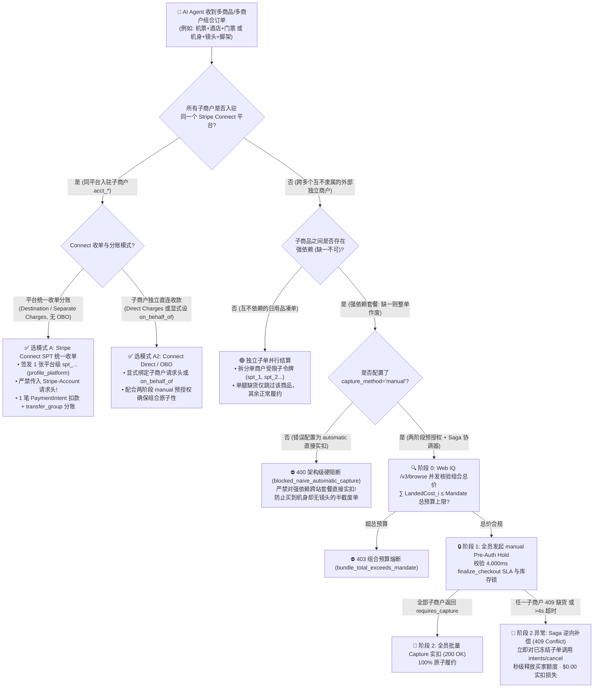
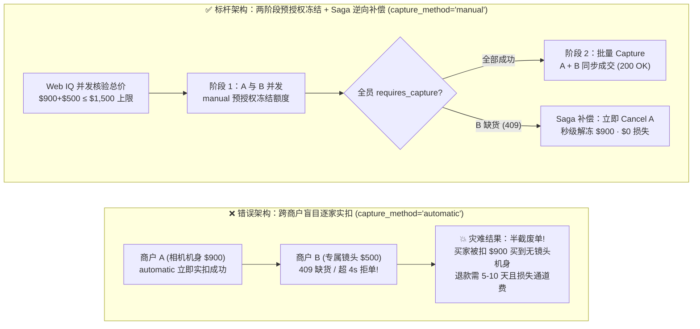
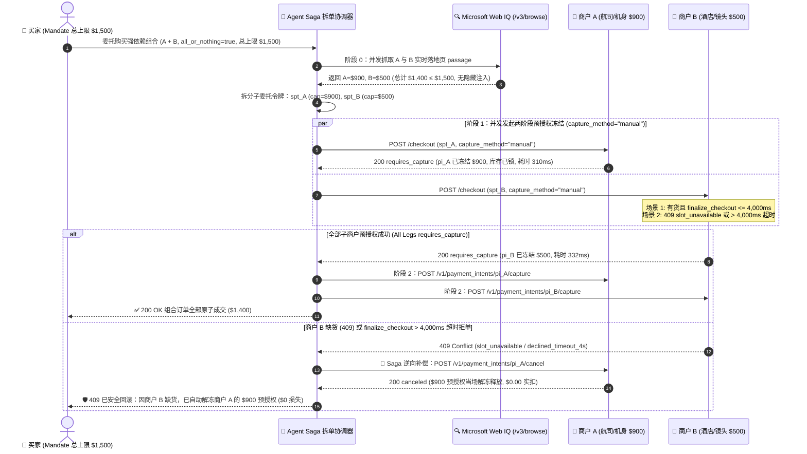

# 跨平台多商户拆单原子编排架构：两阶段预授权 Saga 补偿（2-Phase Pre-Auth Hold + Saga）vs. 平台撮合统一分账（Stripe Connect SPT）选型与原理解析 FAQ

> **文档定位**：面向 AI Solution Architect（AI 解决方案架构师）的**单专题深度选型与第一性原理指南**（严格遵循一文一专题规范，对标 `ib-vs-ethernet-roce-selection-faq.md` 六段式结构）。  
> **双语版本**：**[中文版（当前）](multi-merchant-split-cart-saga-vs-connect-faq.md)** · **[English Version](multi-merchant-split-cart-saga-vs-connect-faq.en.md)**  
> **关联独立专题**：[支付轨道选型 FAQ（Topic 1A）](agentic-payment-rails-spt-vic-x402-selection-faq.md) · [Web Grounding 选型 FAQ（Topic 1B）](webiq-vs-exa-brightdata-grounding-selection-faq.md) · [B2B 采购策略网关 FAQ（Topic 2）](b2b-procurement-mandate-vs-hitl-selection-faq.md) · [跨境双轨结算 FAQ（Topic 3）](cross-border-agent-settlement-x402-vs-card-network-faq.md) · [Web Bot Auth 防爬认证 FAQ（Topic 4）](ecommerce-agent-identity-web-bot-auth-tap-vs-waf-faq.md) · [BNPL 受控跳转接管 FAQ（Topic 5）](bnpl-webview-handover-vs-headless-agent-faq.md)  
> **配套交付物**：**[🚀 跨商户拆单 Saga 与 Connect 分账交互沙盒 (`live-demo.html#split-cart-saga-selector-sandbox`)](../live-demo.html)** · **[📊 7-Card 4:5 视觉评测报告 (`benchmark-cards.html`)](../benchmark-cards.html)**

---

## ① 📌 核心结论速览（Executive Summary）

1. **同平台多子商户撮合订单（所有卖家入驻同一商城/平台）→ 选“Stripe Connect SPT 统一收单 + 分账划拨（Separate Charges and Transfers）”**：买家只需签发 **1 张** 绑定平台 `profile_...` 的 `Shared Payment Token (spt_...)`（`official_doc_snapshot`，截至 `2026-11-08`）。平台先确认所有子商户库存就绪，再发起 **1 笔原子扣款** 并通过 `transfer_group` 异步分账给各子商户。**极易踩坑铁律**：在 `Destination Charges` 或 `Separate Charges and Transfers` 模式且**未设置 `on_behalf_of`** 时，平台创建 `PaymentIntent` **严禁传入 `Stripe-Account` 请求头**（否则触发 `HTTP 400` 账户归属冲突）。
2. **跨独立站强依赖组合订单（如“A 航司买机票 + B 酒店订房 + C 票务买演出票”或“机身 + 镜头”）→ 必须选“两阶段预授权冻结（`capture_method="manual"`）+ 分布式 Saga 逆向补偿（Cancel Hold）”**：严禁对强依赖套餐使用 `capture_method="automatic"` 逐家直接实扣！编排器必须将父级 Mandate 拆分为多张单商户子令牌，先执行 **阶段 1（全员 `manual` 预授权冻结额度并锁库存）**；仅当所有子商户均返回 `requires_capture` 时才执行 **阶段 2（全员 `capture` 实扣）**；只要任一子商户缺货（`409 slot_unavailable`）或 `finalize_checkout` 超过 **4,000 ms** 被拒，Saga 协调器立即对已冻结子单调用 `POST /v1/payment_intents/{id}/cancel` 秒级解冻额度，实现 **`$0.00` 实扣资金损失与 `$0.00` 退款通道费**（`deterministic_offline_simulation`）。
3. **卖家 4,000 ms Webhook 的“非对称容错”定律（Asymmetric 4s Seller Hook SLA）**：在多商户并发询价与锁单中，Stripe 对卖家回调严格执行 **4,000 ms 超时门禁**（`official_doc_snapshot`），但两个阶段的行为完全不同——询价阶段（`product_price_availability`）超 4 秒会**自动降级读取卖家预先通过 Catalog Feed (`upsert`) 导入的目录价继续结账**；而最终锁单阶段（`finalize_checkout`）超 4 秒会**立即拒单（Decline）**，从而触发跨商户 Saga 整体回滚。

---

## ② 🎯 客户与架构师灵魂拷问 Q&A（FAQ-Driven，从第一性原理讲透）

### Q1：买家让 AI Agent 一次性买齐“机票 + 酒店 + 演唱会门票”（或“相机机身 + 专属镜头”），为什么不能让 Agent 挨个商户调普通扣款接口？
- **大白话与第一性原理**：
  - 在人类网购时，如果演唱会门票没抢到，人类根本不会去订那晚的不可退酒店。
  - 但如果架构师把 AI Agent 写成简单的 `for merchant in [A, B, C]: charge_immediately(merchant)`（即 `capture_method="automatic"`），就会酿成严重的**“半截废单灾难（Partial Fulfillment Disaster）”**：
    1. Agent 在第 1 秒成功扣了买家 `$600` 买下不可退酒店（资金已进入清算通道）；
    2. 第 2 秒去买演唱会门票时，票务网站返回 `HTTP 409 slot_unavailable`（门票售罄）或网页临时涨价超出总预算；
    3. 此时买家拿到了没有门票的酒店订单！哪怕酒店同意退款，信用卡的原路退回（Refund）不仅需要 **5～10 个工作日** 占用买家信用额度，还会让商户白白损失不可退还的收单通道手续费（约 `2.9% + $0.30`）。
  - **怎么根治？** 把数据库里的 **两阶段提交（2PC）与 Saga 补偿模式** 引入支付轨道：
    - **第一阶段（Hold / 只冻不扣）**：所有子商户统一用 `capture_method="manual"` 发起预授权（Authorization Hold）。银行只冻结买家额度、商户锁定库存，但**一分钱都还没真正划走**；
    - **第二阶段（Capture or Cancel / 全成才扣、一败全撤）**：3 家全部返回 `requires_capture` 才批量调用 `/capture`；哪怕只有 1 家失败，立即对另外 2 家调用 `/cancel`（Authorization Void/Reversal），银行额度当场释放，不产生任何退款流水与通道费损失！

### Q2：什么时候用“Stripe Connect 平台统一分账（模式 A）”，什么时候用“跨站两阶段预授权 Saga（模式 B）”？Connect 分账最容易踩的请求头大坑是什么？
- **大白话选型边界**：
  - **看卖家是不是“同一个屋檐下的入驻商户”**：
    1. **选模式 A（Stripe Connect SPT 统一收单分账）**：如果你自己就是平台方（例如你正在搭建企业级 MRO 工业品商城、OTA 聚合旅游平台或 Shopify 类多商户平台），所有子卖家都是你平台下的 `Connected Accounts (acct_...)`。此时**千万不要拆成多笔外部扣款**！直接用平台主账号收 1 笔钱，再用 `Separate Charges and Transfers` 拆账给子商户，原子性最好、买家只看到 1 笔账单。
    2. **选模式 B（跨独立站两阶段预授权 + Saga 补偿）**：如果你的 AI Agent 是买方个人助理或跨网比价代购助手，去京东、亚马逊、航司官网、独立品牌站等**互不统属的外部网站**凑齐一套装备，它们根本不在同一个 Connect 平台里，此时必须用模式 B（子令牌拆分 + `manual` 预授权 + Saga 自动回滚）。
- **Connect 请求头防坑铁律（`official_doc_snapshot`，截至 `2026-11-08`）**：
  - Stripe Connect 支持三种 SPT 收单模式：
    - **Direct Charges（子商户直连收款）**：子商户自己当卖家，**必须传** `Stripe-Account: acct_submerchant` 请求头；
    - **Destination Charges / Separate Charges and Transfers（平台代收分账，且未设置 `on_behalf_of`）**：平台自己当记录在册的卖家（Merchant of Record），此时调用 `POST /v1/payment_intents` 必须使用平台自己的 `network_business_profile (profile_...)`，**绝对禁止在 HTTP 请求头里传 `Stripe-Account`**！如果工程师顺手传了 `Stripe-Account` 却没配 `on_behalf_of`，Stripe 会直接抛出 `HTTP 400` 权限归属冲突错误。

### Q3：在跨商户并发锁单时，如果某家商户的服务器卡顿超过 4 秒，协议底层会发生什么？Web IQ 怎么防止某家商户临时涨价撑爆总预算？
- **第一性原理拆解**：
  1. **Web IQ 结账前组合总价守卫（Pre-Hold Bundle Budget Gate）**：
     - 在发起任何预授权前，编排器并发调用 Microsoft Web IQ `/v3/browse`（`contentFormat="passage"`）核验所有子商户的实时单价、运费与税费，计算组合总价 $\sum_{i=1}^{k} \text{LandedCost}_i$。
     - 只要某一家商户临时涨价导致 $\sum \text{LandedCost}_i > \text{BundleMandate.max\_total\_usd}$（例如总预算 `$1,500`，但机票突然涨了 `$120` 使总价达到 `$1,560`），在**第 0 阶段（零支付调用前）**就直接熔断拦截（`403 Forbidden · bundle_total_exceeds_mandate_ceiling`）。
  2. **卖家 4,000 ms 非对称 Webhook SLA（`official_doc_snapshot`）**：
     - **询价阶段（`product_price_availability` Hook > 4,000 ms）**：优雅降级！Stripe 自动回退读取该卖家通过 Catalog Feed（`upsert` 模式，注意非商品类如 `inventory` / `FulfillmentOption` 严禁使用 `replace` 模式）导入的目录价，交易继续推进；
     - **最终锁单阶段（`finalize_checkout` Hook > 4,000 ms）**：零容忍硬拒单！Stripe 立即判定该子单 `declined_timeout_4s`，Saga 协调器捕获后立即撤销其余已冻结子单的预授权。

---

## ③ 🧭 直观可视化图解（Mermaid 选型决策树 + 架构对比 + Saga 补偿时序图）

### 3.1 多商户拆单原子编排架构选型决策树（`flowchart TD`）

### 3.2 盲目逐家实扣（Naive Automatic Capture）vs. 两阶段预授权 Saga 补偿路径对比（`flowchart LR`）

### 3.3 跨平台多商户两阶段预授权与 Saga 补偿端到端时序图（`sequenceDiagram`）

---

## ④ 📊 架构师选型决策矩阵（Architect Decision Matrix）

| 评估维度 | 模式 A：Stripe Connect SPT 统一收单分账（`Separate Charges & Transfers`） | 模式 B：跨独立站两阶段预授权 + Saga 补偿（`2-Phase Manual Hold + Cancel`） | 错误反模式：跨站盲目逐家直接实扣（`Naive Automatic Capture`） |
| :--- | :--- | :--- | :--- |
| **核心适用场景** | **同一撮合平台/商城内的多子商户拆单**（如垂直 OTA、B2B 商城、多店铺零售平台） | **跨多个互不隶属外部独立站的强依赖组合代购**（如机票+酒店+门票、机身+镜头） | 仅适用于**完全无关联、买不到某件也无所谓**的零散日用品采购 |
| **令牌与授权隔离机制** | 1 张平台级 `spt_...`（绑定平台 `profile_...`），未设 `on_behalf_of` 时**严禁传 `Stripe-Account` 头**（`official_doc_snapshot`） | 父级 Mandate 拆分为 $k$ 张单商户限定金额的 `spt_1..k`，强制设置 `capture_method="manual"`（`synthetic_policy`） | 多张子令牌直接设 `capture_method="automatic"`，缺乏跨商户协调门禁 |
| **单腿缺货/超 4s 时的资金安全性** | **100% 原子安全**：全部子商户确认锁库后才执行单笔扣款与 `transfer_group` 分账 | **100% 资金无损回滚**：任一子单失败，协调器秒级 `cancel` 其余预授权，**`$0.00` 实扣损失** | **极高危（半截废单）**：前面已扣款的商户无法无损撤销，退货退款耗时 5–10 天且亏手续费 |
| **卖家 4,000 ms Webhook SLA 行为** | 询价超 4s 降级读 Catalog Feed（`upsert`）；`finalize_checkout` 超 4s 整单拒付（`official_doc_snapshot`） | 任一子商户 `finalize_checkout` 超 4s 拒付即触发全链路 Saga `cancel` 补偿 | 前序商户已实扣，后续商户超 4s 拒付导致订单状态撕裂 |
| **接入改造成本** | **低**（平台自身控制 Connect 分账路由与 `transfer_group`） | **中**（需在 Agent 编排层实现两阶段状态机 `HOLDING → CAPTURED / COMPENSATED`） | 表面代码最少，但售后客诉与人工退单成本极高 |
| **费率与综合 TCO** | 单笔收单通道费 + Connect 分账费；**零无效退款损耗** | 仅全部成功时产生收单费；回滚走 Authorization Reversal（**`$0` 退款费**） | 每次部分失败均损失不可退通道费（`~2.9% + $0.30`）及人工客服赔付 |

---

## ⑤ 🧪 简明定量实测与 Benchmark 核心发现（含明确数据来源标签）

> **数据来源与诚实口径声明（Provenance Ledger · `as_of: 2026-11-08`）**：
> - **`official_doc_snapshot`**：Stripe Connect SPT（`shared-payment-tokens?agent-seller=connect`）三种收单分账模式、未设 `on_behalf_of` 禁止传 `Stripe-Account` 请求头规则、卖家 Webhook `4,000 ms` 非对称超时规则（`product_price_availability` 降级 Catalog Feed `upsert` vs `finalize_checkout` 立即拒单）、以及 `PaymentIntent` `capture_method="manual"` 预授权冻结与 `cancel` 释放规范。
> - **`synthetic_policy`**：本评测中的“3 腿强依赖组合订单（`all_or_nothing_bundle=True`）”、“组合总预算上限 `$1,500.00`”及“禁止对强依赖跨站套餐使用 `capture_method="automatic"`”属于参考架构编排策略围栏（Reference Orchestration Policy），在 `lab/webiq_commerce_demo.py` 的 `evaluate_multi_merchant_split_cart_saga()` 中建模验证。
> - **`deterministic_offline_simulation`**：下表中的 `518 ms`、`642 ms`、`445 ms` 编排耗时与 `$0.00` 资金损失率来自本地确定性沙盒状态机测试（`tests/test_webiq_commerce_demo.py`）。
> - **`not_measured`**：不同发卡银行（Issuer Bank）在收到 `/v1/payment_intents/{id}/cancel` 后向持卡人手机 App 推送“预授权已解冻”账单通知的跨行传输延迟在无真实银行卡扣款环境下标注为 **`not_measured`**，绝不伪造为 0。

| 测试场景（Deterministic Saga & Connect Suite） | 编排拓扑与收单模式 | 子商户库存与响应状态 | 确定性编排器裁决状态 | 实扣资金损失 / 沙盒耗时 | 推荐动作标签 |
| :--- | :--- | :--- | :--- | :--- | :--- |
| **Case 1：同平台 Connect 统一分账合规成单** | `stripe_connect_separate_charges`（`obo=False`, 无 `Stripe-Account` 头） | 3 家子商户全有货（总价 `$1,380 ≤ $1,500`） | **`200 OK` (`connect_unified_split_transfers`)** | `$0.00` 异常损耗 · **`518 ms`** | `Act automatically` |
| **Case 2：同平台 Connect 误传 `Stripe-Account` 请求头** | `stripe_connect_separate_charges`（`obo=False`, **误传 `Stripe-Account`**） | 3 家子商户全有货 | **`400 Bad Request` (`blocked_connect_header_without_obo`)** | 事前拦截 · **`15 ms`** | `Send to a human` |
| **Case 3：跨独立站 3 腿强依赖套餐两阶段全成** | `cross_merchant_2phase_saga`（`capture_method="manual"`） | 机票+酒店+门票全 `requires_capture`（`$1,420 ≤ $1,500`） | **`200 OK` (`two_phase_preauth_captured_all`)** | 100% 原子实扣 · **`642 ms`** | `Act automatically` |
| **Case 4：跨独立站第 3 腿缺货触发 Saga 秒级回滚** | `cross_merchant_2phase_saga`（`capture_method="manual"`） | 腿 1/2 已冻结 (`$1,100`)，**腿 3 返回 `409 slot_unavailable`** | **`409 Conflict` (`saga_compensated_preauth_released_zero_loss`)** | **已解冻 `$1,100` · `$0.00` 实扣损失 (`445 ms`)** | `Confirm` |
| **Case 5：跨独立站强依赖套餐误配 `automatic` 直接实扣** | `cross_merchant_2phase_saga`（**`capture_method="automatic"`**） | 强依赖套餐（`all_or_nothing_bundle=True`） | **`400 Bad Request` (`blocked_naive_automatic_capture_on_bundle`)** | 事前阻断半截废单 · **`16 ms`** | `Send to a human` |

---

## ⑥ 🛠️ 附录：生产上线快速核验与售前打单清单（Architect Checklist）

- [ ] **已区分“同平台 Connect 分账”与“跨独立站 Saga 编排”**：同一商城/平台内子商户统一走 `Stripe Connect SPT` 单笔收单 + `transfer_group` 分账；跨外部独立站组合代购统一走子令牌拆分 + `capture_method="manual"` 两阶段预授权。
- [ ] **已加固 Stripe Connect 请求头校验门禁**：在 `Destination Charges` 或 `Separate Charges and Transfers` 且未显式指定 `on_behalf_of` 时，代码层强制剥离 `Stripe-Account` 请求头，杜绝 `HTTP 400` 归属冲突。
- [ ] **已对强依赖组合订单禁用 `capture_method="automatic"`**：凡标注 `all_or_nothing_bundle=True` 的跨商户订单（如机酒套餐、机身+镜头），网关层强制校验 `capture_method == "manual"`，未开启两阶段预授权直接拒绝执行。
- [ ] **已实现 Saga 逆向补偿器（Automatic Hold Cancellation）**：当任意子商户返回 `409 slot_unavailable`、`finalize_checkout` 超 `4,000 ms` 拒单或校验异常时，协调器自动遍历所有处于 `requires_capture` 状态的子单并调用 `POST /v1/payment_intents/{id}/cancel`。
- [ ] **已前置 Web IQ 组合总价与 Catalog Feed `upsert` 核验**：阶段 1 预授权前，先用 Web IQ `/v3/browse`（`contentFormat="passage"`）核验所有子商品含税总价不超过父级 Mandate 上限，并确保非商品类 Feed（`inventory` / `FulfillmentOption`）全部采用 `upsert` 而非 `replace` 模式。
