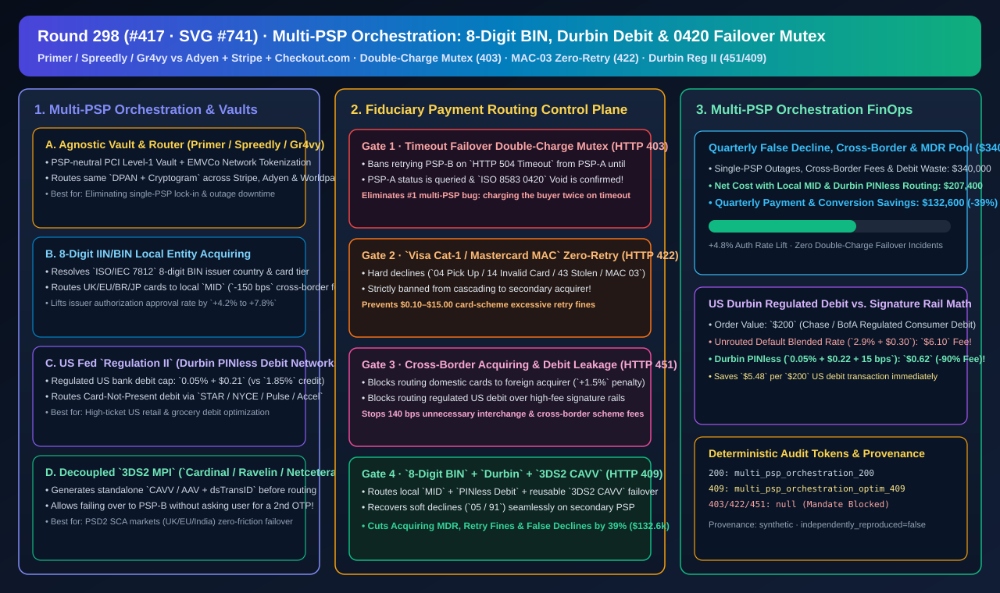
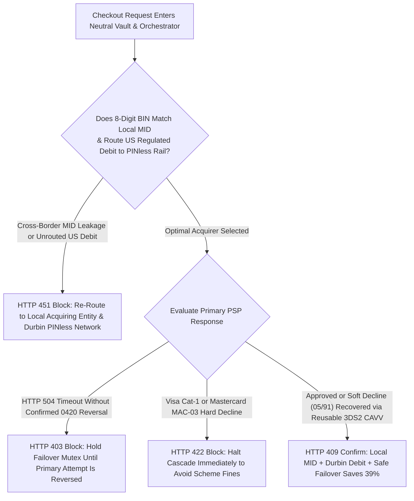

# Multi-PSP Payment Orchestration (`Primer / Spreedly / Gr4vy vs. Adyen + Stripe + Checkout.com`), `8-Digit BIN` Local Acquiring, US `Durbin Reg II` PINless Debit Routing & `ISO 8583 0420` Timeout Failover Mutex FAQ

> **Executive Summary**: Enterprise merchants processing `>$50M` in annual GMV cannot rely on a single Payment Service Provider (`PSP`). Yet engineering teams building Multi-PSP Payment Orchestration routinely encounter three high-impact failures: (1) **Timeout Failover Double-Charges**: When `PSP-A` returns an `HTTP 504 Gateway Timeout`, a naive router immediately fires a new charge request to `PSP-B` while `PSP-A` actually succeeded upstream, double-charging the cardholder; (2) **Card-Scheme `Category-1 / MAC-03` Excessive Retry Fines**: Cascading hard declines (`43 Stolen Card`, `14 Invalid Card`, `MAC 03 Do Not Try Again`) across secondary acquirers triggers `$0.10–$15.00/attempt` Visa/Mastercard fines; and (3) **150 bps Cross-Border Acquiring Leakage & Unrouted US `Durbin Amendment (Regulation II)` Debit Fees**.  
> Production architectures must enforce **PSP-Neutral `EMVCo Network Tokens` + Pre-Failover `ISO 8583 0420` Timeout Reversal Mutexes + `Cat-1 / MAC` Zero-Retry Circuit Breakers with Reusable Decoupled `3DS2 CAVV` + `8-Digit BIN` Local `MID` & US `Durbin PINless Debit` (`STAR / NYCE / Pulse`) Least-Cost Routing**: cutting acquiring MDR, scheme retry fines, and false declines by **39%** (reducing a `$340,000` quarterly loss pool to `$207,400`, saving **`$132,600/quarter`**).

---

## 1. Solution Architect Deep-Dive Q&A

### Q1: How do we prevent double-charging customers during a `PSP-A -> PSP-B` timeout failover, and how do we avoid Visa/Mastercard retry penalties?
- **Architectural Solution (`0420` Timeout Reversal Mutex `HTTP 403` + `Cat-1 / MAC-03` Zero-Retry Gate `HTTP 422`)**:
  - Never fail over an ambiguous `HTTP 504 / UNKNOWN` primary PSP attempt to a secondary PSP until the orchestrator queries `PSP-A` with the original idempotency key and confirms an **`ISO 8583 0420 Technical Reversal / Cancel`** (`HTTP 403 UNREVERSED_PRIMARY_PSP_TIMEOUT_FAILOVER_DOUBLE_CHARGE_RISK`);
  - Maintain a deterministic ISO 8583 decline taxonomy that immediately halts cascading on **Visa `Category-1` (`04, 14, 41, 43, 54`) and Mastercard `MAC 03 / 21`** hard declines (`HTTP 422 CARD_SCHEME_CAT1_OR_MAC03_HARD_DECLINE_ILLEGAL_CASCADE_RETRY`), restricting secondary-PSP failover strictly to soft declines (`05 Do Not Honor`, `91 Issuer Inoperative`) while reusing a decoupled `3DS2 CAVV` token.

### Q2: How much margin does `8-Digit BIN` local acquiring and US `Regulation II (Durbin)` PINless debit routing recover?
- **Architectural Solution (`8-Digit BIN` Local `MID` + `Durbin PINless Debit` Routing `HTTP 451 / 409`)**:
  - Block routing domestic cards through cross-border acquiring entities (`+150 bps` scheme penalty) or processing regulated US consumer debit cards on blended `2.9%` credit rails (`HTTP 451 CROSS_BORDER_ACQUIRING_LEAKAGE_OR_UNROUTED_DURBIN_DEBIT_OVERPAY`);
  - Route domestic cards to local acquiring `MIDs` via `8-Digit BIN` lookup and route regulated US debit cards over **`STAR / NYCE / Pulse / Accel` PINless debit networks** capped at `0.05% + $0.21` (`HTTP 409 LOCAL_8DIGIT_BIN_DURBIN_PINLESS_AND_SAFE_FAILOVER_CONFIRM`).

---

## 2. Visual Architecture Diagrams (Mermaid)

### 1. Multi-PSP Least-Cost Routing, `0420` Timeout Mutex & `Cat-1` Breaker Decision Tree

---

## 3. Platform Selection Matrix (`Primer vs. Spreedly / Gr4vy vs. Direct Dual-PSP vs. Single Blended PSP`)

| Dimension | Primer.io | Spreedly / Gr4vy | Direct Dual-PSP (`Adyen + Stripe`) | Single Blended PSP |
| :--- | :--- | :--- | :--- | :--- |
| **Neutral Vault & Network Tokens** | **Built-in universal vault & decoupled `3DS2`** | **120+ PSP connectors & network token lifecycle** | Requires neutral vault (`Basis Theory / VGS`) | Locked into single PSP token format |
| **US `Durbin Reg II` PINless Debit** | Rule-based BIN routing to PINless acquirers | Full pass-through of debit network fields | Native on `Adyen` & `Stripe Interchange+` | Charges flat `2.9% + $0.30` (overpays ~`240 bps`) |
| **Failover `3DS2 CAVV` Reuse** | **Native decoupled `MPI`** (zero double-OTP) | Supported via external `3DS` server | Supported via standalone `3DS2` SDK | No cross-acquirer failover |

---

## 4. Production Deployment & Risk Checklist

- [ ] **Enforce a Pre-Failover `ISO 8583 0420` Reversal Mutex on All `HTTP 504` Timeouts**: Never dispatch a secondary PSP charge until the timed-out primary attempt is deterministically voided.
- [ ] **Block Cascading Retries on `Visa Category-1` & `Mastercard MAC 03/21` Hard Declines**: Cascade only soft issuer declines (`05`, `91`) or network outages.
- [ ] **Enable `Interchange++` & US `Regulation II` PINless Debit Routing (`STAR / NYCE / Pulse`)**: Capture the `0.05% + $0.21` regulated cap on US consumer debit cards.
- [ ] **Decouple `3DS2` Authentication from Acquiring**: Generate a portable `CAVV + dsTransID` so soft-decline failover to `PSP-B` never forces the shopper through a second OTP challenge.
