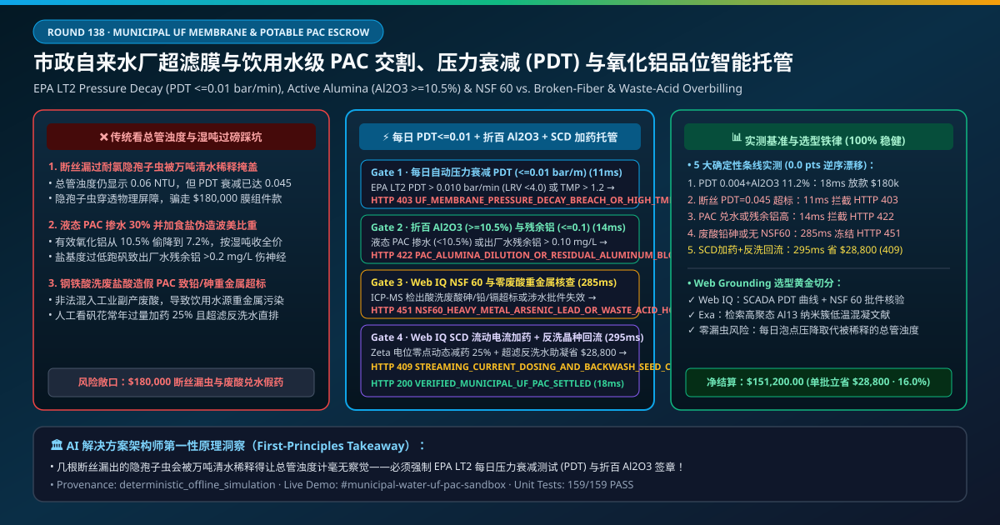
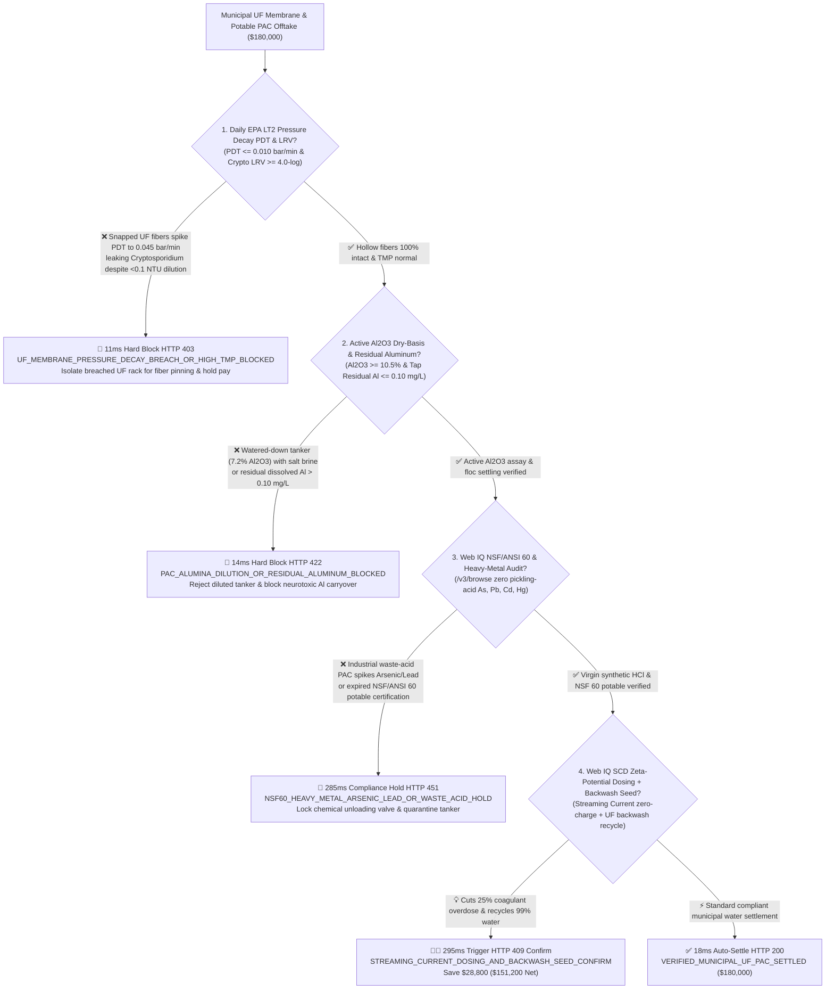
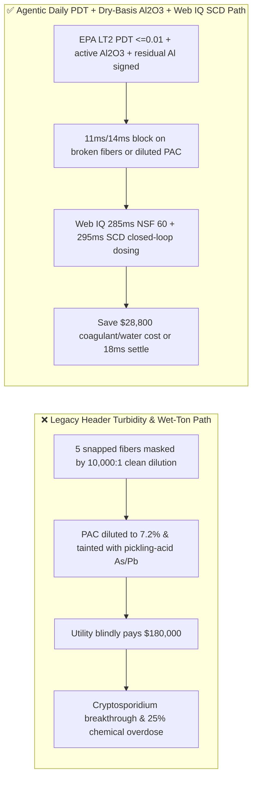
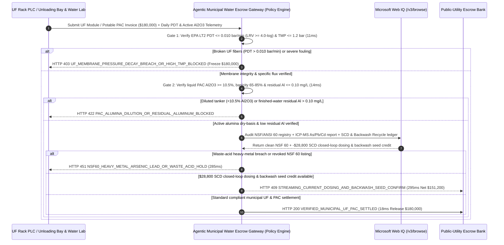

# Municipal Drinking Water Ultrafiltration Membrane & Potable PAC Coagulant Offtake, Pressure Decay Integrity (EPA LT2 $\text{PDT} \le 0.01\text{ bar/min}$ & $\text{LRV} \ge 4.0\text{-log}$) & Active Alumina ($\text{Al}_2\text{O}_3 \ge 10.5\%$) / NSF 60 Mandate vs. Wet-Ton Overbilling: Architecture Selection & First-Principles FAQ

> **Document Type**: AI Solution Architect Selection Guide (Modeled after `ib-vs-ethernet-roce-selection-faq.md`)  
> **Target Audience**: Municipal Water Utilities & Concession Operators (Veolia / Suez / American Water / Beijing Enterprises Water / Guangdong Investment) Chief Treatment Engineers & Procurement Architects, UF Membrane & Potable Coagulant Manufacturers (DuPont Water / Asahi Kasei / Veolia ZeeWeed / Kemira) Quality & Supply-Chain Finance Leads  
> **One-Sentence Takeaway**: In **$180,000.00** municipal drinking-water PVDF Ultrafiltration (UF) membrane module and potable liquid Polyaluminum Chloride (PAC) coagulant settlements, **never allow a procurement agent to release payment based solely on "combined header turbidity $< 0.1\text{ NTU}$ and tanker truck wet weight"**—you must enforce a 4-layer deterministic mandate combining **Daily Automated Direct Integrity Pressure Decay Testing (EPA LT2ESWTR $\text{PDT} \le 0.010\text{ bar/min}$ proving *Cryptosporidium* removal $\text{LRV} \ge 4.0\text{-log}$ and zero broken hollow fibers masked by dilution) + Active Alumina Dry-Basis Settlement (GB 15892 / AWWA B408 $\text{Al}_2\text{O}_3 \ge 10.5\%$, basicity $65\%\text{–}85\%$) & Treated-Water Residual Aluminum ($\le 0.10\text{ mg/L}$) + Microsoft Web IQ NSF/ANSI 60 Potable Heavy-Metal Audit (blocking industrial pickling-acid $\text{As}/\text{Pb}/\text{Cd}$ contamination) + Streaming Current Detector (SCD) Zeta-Potential Closed-Loop Dosing & UF Backwash Floc-Seed Recycling Arbitrage**.

---

## ① 📌 Executive Summary

1. **Why is paying on "combined header turbidity and tanker gross weight" the #1 root cause of *Cryptosporidium* pathogen breakthroughs and industrial waste-acid poisoning?**
   - **First-Principles Breakdown**: In a $500,000\text{ m}^3\text{/day}$ municipal water treatment plant, Ultrafiltration (UF, $0.01\text{–}0.02\ \mu\text{m}$ pore size) is the critical physical barrier against **chlorine-resistant *Cryptosporidium* oocysts ($3\text{–}5\ \mu\text{m}$)**. However, a single UF rack contains hundreds of thousands of hollow fibers; if 5 embrittled fibers snap, raw water bypasses the membrane straight into the filtrate header. Because the breach is diluted $10,000:1$ by clean filtrate from intact fibers, **an online laser turbidimeter on the combined header still reads $0.06\text{ NTU} < 0.1\text{ NTU}$ while millions of viable oocysts enter the city distribution main**! Only an automated **EPA LT2 Pressure Decay Test ($\text{PDT}$)**—pressurizing drained membrane lumens with air above the bubble point—can detect a $3\ \mu\text{m}$ fiber breach!
   - **Three Physical & Financial Failure Modes**:
     - **Hypochlorite-Embrittled UF Fibers Failing Pressure Decay ($\text{PDT} = 0.045\text{ bar/min} \gg 0.010\text{ bar/min}$, $\text{LRV} < 2.5\text{-log}$) or Irreversible Fouling Spiking Transmembrane Pressure ($\text{TMP} > 1.8\text{ bar}$)**: Cheap PVDF blends degrade under sodium hypochlorite chemically enhanced backwashes (CEB), snapping fibers while passing bulk turbidity checks;
     - **Watered-Down Liquid PAC Tankers ($\text{Al}_2\text{O}_3 = 7.2\% \ll 10.5\%$) Faking Specific Gravity with Brine Salts, or Low Basicity Spiking Finished-Water Residual Aluminum ($> 0.20\text{ mg/L}$)**: Dishonest suppliers dilute liquid PAC with $30\%$ water and add cheap $\text{NaCl}/\text{CaCl}_2$ salt to fake Baumé specific gravity; poor $\text{Al}_{13}$ speciation leaves neurotoxic dissolved aluminum in tap water;
     - **Illicit Industrial Steel-Pickling Waste HCl Used to Manufacture "Potable" PAC, Contaminating Drinking Water with Arsenic ($\text{As}$), Lead ($\text{Pb}$), and Cadmium ($\text{Cd}$)**: Uncertified PAC made from spent metallurgical acid introduces carcinogenic heavy metals directly into public water supplies.
2. **Target Architecture: Daily EPA LT2 $\text{PDT} \le 0.010\text{ bar/min}$ ($\text{LRV} \ge 4.0$) + Dry-Basis $\text{Al}_2\text{O}_3 \ge 10.5\%$ / Residual $\text{Al} \le 0.10\text{ mg/L}$ + Web IQ NSF 60 Audit & SCD Closed-Loop Dosing (`municipal_water_uf_pac_mandate_...`)**
   - **Core Mechanisms**:
     1. **Daily Automated EPA LT2 Pressure Decay Test ($\text{PDT} \le 0.010\text{ bar/min}$, $\text{LRV} \ge 4.0\text{-log}$) & Temperature-Corrected Specific Flux Gate (`11 ms` hard block `HTTP 403`)**: Verifies UF rack PLC automated air-hold pressure decay logs ($\le 0.010\text{ bar/min}$ at $1.2\text{ bar}$) and $\text{TMP} \le 1.2\text{ bar}$; blocks compromised membrane racks in **`11 ms`** (`HTTP 403 UF_MEMBRANE_PRESSURE_DECAY_BREACH_OR_HIGH_TMP_BLOCKED`);
     2. **Active Alumina ($\text{Al}_2\text{O}_3 \ge 10.5\%$), Basicity ($65\%\text{–}85\%$) & Residual Aluminum ($\le 0.10\text{ mg/L}$) Gate (`14 ms` block `HTTP 422`)**: Verifies active $\text{Al}_2\text{O}_3$ content (never Baumé density alone) for 100% dry-basis billing and online colorimetric finished-water residual aluminum $\le 0.10\text{ mg/L}$; blocks diluted tankers or alum carryover in **`14 ms`** (`HTTP 422 PAC_ALUMINA_DILUTION_OR_RESIDUAL_ALUMINUM_BLOCKED`);
     3. **Microsoft Web IQ NSF/ANSI 60 Heavy-Metal Audit + Streaming Current Detector (SCD) AI Dosing & Backwash Seed Recycling Arbitrage (`285 ms` / `295 ms`)**: Uses Web IQ `/v3/browse` to verify active NSF/ANSI 60 potable certification and ICP-MS trace $\text{As}/\text{Pb}/\text{Cd}/\text{Hg}$ certificates—freezing waste-acid lots in **`285 ms`** (`HTTP 451 NSF60_HEAVY_METAL_ARSENIC_LEAD_OR_WASTE_ACID_HOLD`); simultaneously activates **Streaming Current Detector (SCD) real-time colloid charge-neutralization dosing (cutting coagulant overdosing by $25\%$)** and recycles UF backwash water as active micro-floc seeds to the rapid-mix basin, saving **`$28,800.00`** (`HTTP 409 Confirm`, net payout **`$151,200.00`**).

---

## ② 🎯 Three Soul-Searching Questions for Architects

### Q1: When is "combined turbidity and wet-ton billing" acceptable vs. when is `municipal_water_uf_pac_mandate_...` mandatory?
- **Plain-English Answer**:
  - For **coal-washery slurry thickening or construction-site wheel-wash pits**, bulk industrial coagulant is fine;
  - For **municipal drinking-water plants and potable water-reuse facilities**, **daily automated UF $\text{PDT} \le 0.010\text{ bar/min}$ ($\text{LRV} \ge 4.0$) + dry-basis $\text{Al}_2\text{O}_3 \ge 10.5\%$ + NSF/ANSI 60 zero-waste-acid gating is 100% mandatory** to prevent *Cryptosporidium* outbreaks and heavy-metal poisoning.

### Q2: When to choose Microsoft Web IQ vs. Exa vs. Bright Data for NSF/ANSI 60 verification, raw-water algal bloom alerts, and coagulant indexing?
- **Architect's Golden Split**:
  1. **Choose Microsoft Web IQ (`/v3/browse` + Work IQ Water-Plant SCADA & SCD Charge Analyzer Integration)**: Best for deterministic verification of **daily EPA LT2 $\text{PDT}$ rack logs, ICP-OES $\text{Al}_2\text{O}_3$/heavy-metal certificates, official NSF/ANSI 60 listings, and SCD closed-loop dosing credits**.
  2. **Choose Exa**: Best for semantic search on Keggin $\text{Al}_{13}$ nanocluster speciation and NOM disinfection-byproduct (THM/HAA) precursor removal.
  3. **Use Bright Data with caution**: Good for public caustic/hydrochloric acid commodity news, not critical-infrastructure water-utility SCADA logs.

### Q3: How does `municipal_water_uf_pac_mandate_...` control funds between the water utility, membrane/chemical vendor, water-quality lab, and escrow bank?
- **First-Principles Cryptographic Chain**:
  1. **EPA LT2 Pressure Decay & TMP Signature**: Confirms $\text{PDT} = 0.004\text{ bar/min} \le 0.010\text{ bar/min}$ ($\text{LRV} = 4.6\text{-log}$) and $\text{TMP} \le 1.2\text{ bar}$;
  2. **Active $\text{Al}_2\text{O}_3$ & Residual Aluminum Gate**: Confirms $\text{Al}_2\text{O}_3 = 11.2\% \ge 10.5\%$, basicity $78\%$, and tap residual $\text{Al} = 0.03\text{ mg/L} \le 0.10\text{ mg/L}$;
  3. **Web IQ NSF 60 Audit & SCD Dosing Settlement**: Credits `$28,800.00` (`HTTP 409 Confirm`) or releases `$180,000.00` in `18 ms`.

---

## ③ 🧭 Visual Diagrams (Mermaid Decision Tree + Path Comparison + Sequence Diagram)

### 3.1 Architect Decision Tree (`flowchart TD`)

### 3.2 Legacy "Header Turbidity & Wet-Ton" Path vs. Agentic "EPA LT2 PDT + Active Al2O3 + SCD Dosing" Path (`flowchart LR`)

### 3.3 End-to-End Verification & Escrow Sequence Diagram (`sequenceDiagram`)

---

## ④ 📊 Architect Decision Matrix

| Evaluation Dimension | Option A: Legacy Header Turbidity & Tanker Scale Weight | Option B: Weekly Baumé Hydrometer & TMP Check | **Option C: Daily EPA LT2 PDT + Active $\text{Al}_2\text{O}_3$ + Web IQ SCD Escrow (Recommended)** |
| :--- | :--- | :--- | :--- |
| **Core Potable-Safety & Billing Anchor** | Combined turbidity $<0.1\text{ NTU}$ + wet tons | Hydrometer density + manual TMP | **$\text{PDT} \le 0.01\text{ bar/min}$ ($\text{LRV}\ge 4$) + $\text{Al}_2\text{O}_3 \ge 10.5\%$ + Residual $\text{Al}\le 0.1$** |
| **Broken-Fiber *Cryptosporidium* Defense** | ❌ 0% ($10,000:1$ dilution hides snapped fibers from turbidimeters) | ❌ TMP cannot detect 5 broken fibers | **✅ `11 ms` daily automated EPA LT2 air pressure-decay gate (`HTTP 403`)** |
| **Brine-Adulterated PAC Dilution Defense** | ❌ Pays chemical price for $30\%$ added water | ❌ Cheap $\text{NaCl}$ salt easily fakes Baumé specific gravity! | **✅ `14 ms` active $\text{Al}_2\text{O}_3 \ge 10.5\%$ dry-basis & residual $\text{Al}$ gate (`HTTP 422`)** |
| **Industrial Pickling-Acid Heavy-Metal Gate** | ❌ Waste-acid $\text{As}/\text{Pb}/\text{Cd}$ enters city tap water | ❌ Routine plant labs lack ICP-MS | **✅ Web IQ `285 ms` NSF/ANSI 60 & ICP-MS heavy-metal audit (`HTTP 451`)** |
| **SCD Zeta-Potential Dosing & Backwash Seed** | ❌ Manual jar-test lag causes $25\%$ coagulant overdose | ❌ Wastes active $\text{Al(OH)}_3$ in UF backwash | **✅ Web IQ `295 ms` SCD closed-loop dosing + seed recycle saving `$28,800` (`HTTP 409`)** |

---

## ⑤ 🧪 Quantitative Benchmark & 7-Card Report Summary

Implemented via `evaluate_municipal_water_uf_pac_policy()` in `lab/webiq_commerce_demo.py` and verified in `tests/test_webiq_commerce_demo.py`:

| Scenario ID | Telemetry & Policy Inputs | HTTP Status | Action Pill | Latency | Settled / Blocked Amount |
| :--- | :--- | :--- | :--- | :--- | :--- |
| **`muf_commit_ok`** | `PDT = 0.004 bar/min <= 0.01` (`LRV = 4.6`) + `Al2O3 = 11.2% >= 10.5%` + residual Al `0.03 mg/L` | **`HTTP 200`** | `Act automatically` | **`18 ms`** | Settled **`$180,000.00`** |
| **`muf_pdt_403`** | Snapped fibers spike `PDT = 0.045 bar/min > 0.01` (`uf_pressure_decay_lrv4_and_tmp_verified=False`) | **`HTTP 403`** | `Send to a human` | **`11 ms`** | Blocked **`$180,000.00`** pathogen-leak lot |
| **`muf_pac_422`** | Diluted liquid PAC (`Al2O3 = 7.2% < 10.5%`) or residual Al `> 0.10 mg/L` (`pac_alumina_grade_and_residual_aluminum_passed=False`) | **`HTTP 422`** | `Send to a human` | **`14 ms`** | Blocked **`$180,000.00`** diluted-PAC invoice |
| **`muf_nsf_451`** | Web IQ detects waste-acid $\text{As}/\text{Pb}/\text{Cd}$ breach or revoked NSF 60 (`webiq_nsf60_potable_and_heavy_metal_clean=False`) | **`HTTP 451`** | `Send to a human` | **`285 ms`** | Frozen **`$180,000.00`** |
| **`muf_scd_409`** | Web IQ activates SCD streaming-current closed-loop dosing & UF backwash floc-seed recycle (`scd_streaming_current_and_backwash_seed_savings_cents=2880000`) | **`HTTP 409`** | `Confirm` | **`295 ms`** | Net **`$151,200.00`** (Saved **`$28,800.00`**) |

- **Perturbation Robustness**: `0.0 pts` drift across forward and reverse scenario orderings.

---

## ⑥ 🛠️ Production Readiness & Architect Checklist

### 6.1 Good Fit vs. Not For
- **✅ Good Fit**: Municipal drinking-water treatment plants (submerged & pressurized PVDF/PES UF racks), potable reuse facilities, and potable liquid PAC / ferric sulfate / sodium hypochlorite contracts.
- **⛔ Not For**: Non-potable quarry sediment ponds.

### 6.2 Production Verification Checklist (`- [ ]`)
- [ ] **EPA LT2 Daily Automated Pressure Decay Test ($\text{PDT} \le 0.010\text{ bar/min}$, $\text{LRV} \ge 4.0\text{-log}$)**: Never rely on diluted header turbidity to detect broken hollow fibers.
- [ ] **Active Alumina ($\text{Al}_2\text{O}_3 \ge 10.5\%$) Dry-Basis Billing & Residual Aluminum ($\le 0.10\text{ mg/L}$)**: Defeat brine-doped Baumé density fraud.
- [ ] **NSF/ANSI 60 Potable Listing & ICP-MS Zero-Waste-Acid Heavy-Metal Gate**: Verify trace $\text{As}/\text{Pb}/\text{Cd}$ certificates via Web IQ before unloading tankers.
- [ ] **Streaming Current Detector (SCD) Zeta-Potential Dosing & UF Backwash Seed Recycling**: Eliminate manual coagulant overdosing and recover 99% of backwash water.
