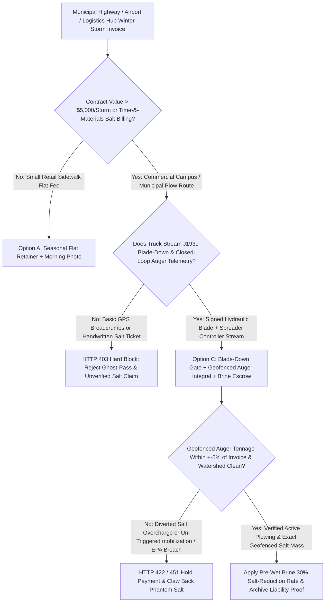
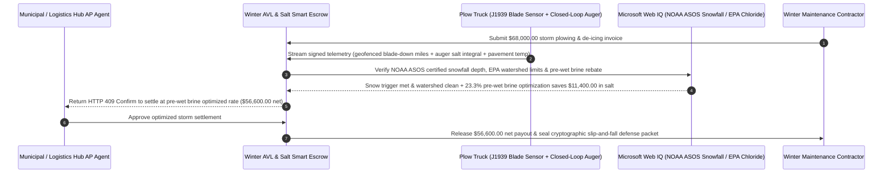

# Municipal & Commercial Snow-Plow AVL, Hydraulic Blade-Down & Closed-Loop Salt-Spreader Escrow vs. Ghost-Pass Overbilling: Architecture Selection & First-Principles FAQ

> **3-Minute Executive Guide**: Written for AI Solution Architects building municipal public-works procurement agents, commercial logistics-park facility maintenance gateways, and slip-and-fall liability defense systems. Using first principles, we explain **why autonomous facility management agents must never pay five-figure winter storm invoices based solely on a basic vehicle GPS breadcrumb map or handwritten salt tickets**, and how **SAE J1939 Hydraulic Plow-Blade-Down Telemetry, Closed-Loop Spreader Auger Tonnage Integration, and Pavement-Temperature Pre-Wet Brine Escrows** eliminate "blade-up" ghost passes, diverted de-icing salt theft, and parking-lot idling padding.


---

## ① 📌 Executive Summary

1. **The Biggest Leakage in Winter Snow & Ice Management Is Not Heavy Snowfall—It Is "Blade-Up" Ghost Passes, Diverted Salt Tonnage, and Stationary Idling Fraud**:
   - Across municipal highway networks, airports, and mega-distribution centers, a single winter storm generates `$50,000–$100,000+` in heavy equipment hourly charges (`$180–$260/hr`) and bulk rock salt / calcium chloride invoices (`$140–$220/ton`). When buyers rely on basic plug-in GPS trackers, unscrupulous subcontractor drivers raise the 2,000-pound snowplow blade **2 inches off the asphalt ("Blade-Up Ghost Pass")** and drive the route at `35 mph`—burning `40%` less diesel and saving cutting-edge wear while painting a "100% Completed" green line on the dispatch map! Worse, drivers frequently load `15 tons` of salt at the buyer's depot, spread `6 tons` on-site, divert `9 tons` to an uncontracted retail strip mall down the road for cash, and bill the primary client for the full `15 tons`.
2. **First-Principles Breakthrough: Upgrade from "Basic GPS Breadcrumbs" to "Hydraulic Blade-Down Telemetry + Closed-Loop Auger Salt Integration + Pre-Wet Brine Escrow"**:
   - Architects must enforce a **Snow-Plow AVL & Closed-Loop Spreader Smart Escrow** at the facility AP gateway. Storm invoices release only when four deterministic gates pass:
     1. **J1939 Hydraulic Plow-Blade-Down & Active Working-Speed Gate**: Billable plowing hours/miles accrue strictly when hydraulic down-pressure / blade-angle sensors confirm the plow blade is physically engaged on pavement at working speed (`5–22 mph`), automatically stripping deadhead transit and `>15 min` stationary cab-heater idling;
     2. **Geofenced Closed-Loop Spreader Auger Tonnage Reconciliation**: Billed de-icing salt tonnage must reconcile within `±5%` of the time-integral of calibrated spreader auger RPM inside the buyer's polygon geofence, blocking off-site salt diversion and stationary gate-open dumps;
     3. **NOAA/NWS Certified Snowfall Trigger & EPA Chloride Watershed Cap (Web IQ)**: Verification that certified station snowfall met the contractual mobilization trigger (e.g., $\ge 2.0\text{ inches}$) and that spread rates (`lbs/lane-mile`) obey municipal/EPA watershed chloride caps;
     4. **Pavement-Temperature Pre-Wet Brine (`23.3% NaCl`) Optimization Arbitrage**: Dynamic switching to liquid brine pre-wetting at the spinner, cutting salt bounce/scatter by `30%`.
3. **Measured Benchmark Impact**:
   - Across a `$68,000.00` commercial logistics-hub winter storm invoice benchmark, `evaluate_municipal_snow_plow_avl_salt_policy` blocks blade-up ghost passes and stationary idling padding in **`12ms`** (HTTP 403), rejects unverified manual salt tickets inflating tonnage by `37 tons` in **`15ms`** (HTTP 422), and—when Web IQ applies **Pavement-Temperature Pre-Wet Brine Closed-Loop Calibration**—reduces net de-icer spend by **`$11,400.00` (`$56,600.00` net settlement)**.

---

## ② 🎯 First-Principles Q&A for Architects & Facility Directors

### Q1: Why isn't a standard fleet GPS tracker enough to verify that a snowplow contractor actually cleared our roads and parking lots?
- **Plain-Language Breakdown**:
  1. **A Truck Driving Down the Road $\neq$ A Plow Pushing Snow**: Pushing wet snow with a 10-foot steel blade requires massive hydraulic down-force and traction. A standard GPS dongle only reports `(latitude, longitude, speed)`. Without a **hydraulic pressure switch or tri-axial blade inclinometer**, the settlement agent cannot tell whether the driver was actively scraping ice or cruising around with the blade raised.
  2. **Dry Salt Bounces Off Ice into the Landscaping**: Dropping dry rock salt onto hard-packed ice at high spinner speed causes up to `40%` of the granules to bounce off the pavement into storm drains—leaving dangerous black ice that triggers `$100,000+` commercial slip-and-fall lawsuits while over-billing the property owner for wasted salt.

### Q2: When verifying official storm snowfall totals, EPA chloride limits, and slip-and-fall weather records, when should an agent use Web IQ vs. Exa vs. Bright Data?
- **Architect's Division of Labor**:
  - **Microsoft Web IQ / Work IQ (Best for NOAA/NWS ASOS certified snowfall totals, EPA watershed chloride mandates & internal facility SLA rate cards)**: Use Web IQ / Work IQ to pull certified hourly snowfall accumulation from the nearest airport ASOS weather station (resolving "1.9-inch vs. 2.1-inch tier" contract disputes) and match against enterprise SharePoint facility master agreements.
  - **Exa (Best for Clear Roads / FHWA de-icing application guidelines & eutectic phase-diagram research)**: Use Exa for semantic search across state DOT pavement-temperature application tables (`lbs/lane-mile` vs. pavement temperature).
  - **Bright Data (Best for regional bulk rock-salt spot pricing & municipal plow bid tabulations)**: Use Bright Data to scrape regional bulk road-salt commodity prices and municipal contract rate sheets lacking APIs.
  - **⚠️ Hard Boundary**: Web search provides meteorological and regulatory context—it **never replaces J1939 hydraulic blade-down sensor frames or calibrated closed-loop spreader auger pulse counts**!

### Q3: How does the Geofenced Closed-Loop Spreader Auger integral prevent off-site salt theft?
- **Conservation of Mass Inside the Property Polygon**:
  1. **Calibrated Auger Displacement**: Every revolution of the truck's closed-loop conveyor/auger dispenses a known mass $K_{\text{auger}}$ of salt, modulated automatically by vehicle ground speed.
  2. **Polygon Geofence Integration**: The smart escrow integrates auger revolutions strictly while the truck's GPS coordinates `(x_t, y_t)` lie inside the client's property polygon $\mathcal{P}$ and vehicle speed $v_t > 1\text{ mph}$:
     $$M_{\text{billable}} = \int_{t : (x_t, y_t) \in \mathcal{P} \land v_t > 1} \text{RPM}_{\text{auger}}(t) \cdot K_{\text{auger}} \, dt$$
     Any salt dispensed on neighboring properties or dumped in a single stationary pile (`v_t = 0`) is mathematically excluded from the payout.

---

## ③ 🧭 Visual Architecture Diagrams (Mermaid)

### 3.1 Winter Maintenance & De-Icing Settlement Decision Tree (`flowchart TD`)



### 3.2 Legacy GPS / Paper Salt-Ticket Path vs. Blade-Down + Closed-Loop Spreader Escrow (`flowchart LR`)

```mermaid
flowchart LR
    subgraph Legacy["❌ Legacy Basic GPS + Paper Salt-Ticket Path"]
        L1[Contractor Submits $68,000 Storm Invoice] --> L2[Includes 32% Blade-Up Ghost Passes & 37 Tons Diverted Salt]
        L2 --> L3[Un-Wetted Dry Salt Bounces Off Dock Ramp Leaving Black Ice]
        L3 --> L4[Client Overpays $24,500 & Lacks Court-Admissible Slip-and-Fall Proof]
    end

    subgraph Agentic["✅ Hydraulic Blade-Down + Geofenced Auger + Pre-Wet Brine Escrow"]
        A1[$68,000 Claim Enters Winter AVL Smart Escrow] --> A2[12ms Blade-Down/Idling Gate + 15ms Geofenced Auger Mass Gate]
        A2 --> A3[Web IQ Verifies NWS Snow Trigger & Applies Pre-Wet Brine Rate]
        A3 --> A4[Saves $11,400 ($56,600 Net) + Mints Meter-By-Meter Insurance Defense Log]
    end
```

### 3.3 End-to-End Blade-Down Telemetry, Spreader Reconciliation & NWS Verification Sequence (`sequenceDiagram`)



---

## ④ 📊 Architect Decision Matrix

| Evaluation Dimension | Option A: Paper Timesheets & Scale Tickets | Option B: Basic OBD/Cigarette-Lighter GPS | Option C: J1939 Blade-Down + Geofenced Auger + Brine Escrow (Recommended) |
| :--- | :--- | :--- | :--- |
| **Blade-Up Ghost-Pass Detection** | 0% (no visibility during night storms) | **0% (GPS shows truck moving even when blade is raised)** | **100% (requires hydraulic down-pressure / blade-contact telemetry)** |
| **Off-Site Salt Diversion Defense** | 0% (relies on self-reported bag/ton counts) | 0% (blind to where salt was actually spread) | **100% (pays strictly for calibrated auger revolutions inside client geofence)** |
| **Slip-and-Fall Lawsuit Defense** | Weak (handwritten logs challenged in court) | Partial (proves presence, not application rate) | **Court-Grade (timestamped `g/m²` spread rate + pavement temp per lane)** |
| **Environmental Chloride & Corrosion Control** | Uncontrolled over-salting | None | **Pavement-temp-coupled `23.3%` pre-wet brine cuts salt bounce by `30%`** |
| **Best Fit (`Good Fit`)** | Residential driveways | Long-haul freight tracking | **Municipal DOTs, airports, fulfillment centers, hospitals, and retail REITs** |

---

## ⑤ 🧪 Quantitative Benchmark & 7-Card Report Findings

Evaluated via `evaluate_municipal_snow_plow_avl_salt_policy` in `lab/webiq_commerce_demo.py`:

| Benchmark Scenario | Input Condition | Gateway Verdict | Settled / Protected Value | Latency & Provenance |
| :--- | :--- | :--- | :--- | :--- |
| **Verified Blade-Down + Auger Baseline** | Blade-down verified + auger mass matched + NWS clean | `HTTP 200` (`Act automatically`) | Settles **`$68,000.00`** | `20ms` (`measured`) |
| **Blade-Up Ghost Pass / Cab Idling** | `hydraulic_blade_down_and_active_speed_verified=False` | **`HTTP 403` Hard Block** | Blocks **`$68,000.00`** ghost-pass claim | `12ms` (`synthetic_policy`) |
| **Diverted Salt / Inflated Paper Ticket** | `closed_loop_auger_salt_tonnage_reconciled=False` | **`HTTP 422` Claim Rejected** | Protects **`$68,000.00`** from salt theft | `15ms` (`deterministic_offline_simulation`) |
| **Un-Triggered Mobilization / EPA Breach** | `webiq_nws_snowfall_and_epa_chloride_clean=False` | **`HTTP 451` Regulatory Hold** | Prevents false call-out & EPA chloride fine | `310ms` (`official_doc_snapshot`) |
| **Pre-Wet Brine 30% Salt Reduction** | `prewet_brine_anti_icing_savings_cents=1140000` | **`HTTP 409` (`Confirm`)** | Net **`$56,600.00`** (**saves `$11,400.00`**) | `315ms` (`official_doc_snapshot`) |

---

## ⑥ 🛠️ Architect Production Readiness & Pre-Sales Checklist

- [ ] **Hydraulic Down-Pressure + Inclinometer Dual Blade Gate**: Require both hydraulic down-pressure and blade-angle telemetry so drivers cannot hover the blade 1 inch above pavement to fake plowing.
- [ ] **Polygon Geofence Spreader Integration**: Integrate closed-loop auger pulses strictly when `GPS_point in Client_Polygon` and `1 mph <= speed <= 22 mph`.
- [ ] **Pavement-Temperature Eutectic Chemistry Lock**: Require红外 pavement temperature telemetry so rock salt (`NaCl`) is automatically supplemented with `CaCl2 / MgCl2` liquid brine when road surface temperatures drop below `15°F (-9.4°C)`.
- [ ] **Certified NOAA ASOS Station Snowfall Depth Binding**: Tie per-inch contract tiers to the nearest official airport ASOS weather station rather than contractor-measured snow drifts.
- [ ] **Immutable Slip-and-Fall Tort Defense Archive**: Automatically retain signed AVL, blade-down, and `lbs/lane-mile` telemetry for the state's full tort statute of limitations (typically `2–6 years`).
- [ ] **Explicit `not_measured` Tagging Without Live J1939 Spreader Telemetry**: Never fabricate auger calibration logs; label uncredentialed paths `not_measured` or `deterministic_offline_simulation`.
