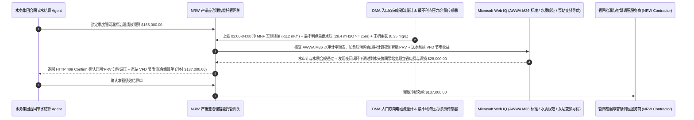

# 市政与工业水务产销差漏损治理（Municipal Non-Revenue Water, NRW）、DMA 夜间最小流量（MNF）电磁遥测与减压阀临界水压智能托管 vs 传统按估算节水率盲付：架构选型与第一性原理 FAQ

> **核心阅读指南（3 分钟速通）**：本文面向负责城市自来水集团、大型化工园区供水管网及智慧水务合同节水管理（Performance-Based NRW Reduction Contract）结算 Agent 的 AI 解决方案架构师（AI Solution Architect）。我们将用最通俗的商业第一性原理，讲清楚**为什么不能让水务采购 Agent 仅凭检漏工程公司上报的“本季度听音检出并修补了 45 处地下暗漏、按公式估算节水 80 万吨”就自动划拨十几万美元的绩效分成款**，以及如何通过 **IWA 国际水协独立计量分区（DMA）凌晨 02:00–04:00 夜间最小流量（Minimum Night Flow, MNF）双向电磁流量计实测差值、管网最不利点（Critical Point）水压红线（$\ge 25\text{ mH}_2\text{O}$）与 AWWA M36 水量平衡智能托管**，彻底杜绝“修完旧漏冒新漏导致总表供水量根本没降、外包商故意把片区总阀门关小导致居民高层断水/消防栓失压来刷低漏损数据”两大水务合同欺诈黑洞。


---

## ① 📌 核心结论速览（Executive Summary）

1. **市政供水漏损治理（NRW）最大的“纸面节水”骗局：外包商报喜说“堵住了 50 个漏点、理论上省水 100 万吨”，但水厂出厂总表一吨水都没少供**：
   - 城市老旧供水管网的产销差率（Non-Revenue Water，即“水厂供出的水”减去“水表收到钱的水”）往往高达 `20%–35%`。在传统合同节水项目中，检漏公司每修好一个地下砂眼或法兰漏点，就拿漏口面积乘以经验流速算出一个“理论年节水量”向水司请款。但流体力学有一个残酷的定律：**当你堵住一条老旧铸铁管上的 1 号漏点后，管道内部水压会瞬间回升，紧接着把旁边原本快要破的 2 号薄弱点直接顶穿（即“按了葫芦起了瓢”）**！更恶劣的是，有些外包商为了月底拿到节水绩效奖，偷偷在半夜把片区入口阀门拧关一半——管道水压跌到接近零，地下漏水确实变少了，但代价是片区 5 楼以上居民没水用、消防栓水压不达标，甚至导致管道出现负压把地下污水吸进自来水管！
2. **第一性原理破局：从“按修漏点个数估算付款”升级为“DMA 分区凌晨 02:00–04:00 夜间最小流量（MNF）实测 + 最不利点水压硬门禁智能托管”**：
   - 架构师必须在水务绩效结算网关部署 **DMA 夜间最小流量与临界点水压智能托管（Municipal Water NRW DMA & Critical-Point Pressure Smart Escrow）**。任何节水绩效分成款释放必须同时通过四道硬门禁：
     1. **IWA 独立计量分区（DMA）凌晨 `02:00–04:00` 夜间最小流量（MNF）电磁流量计实测门禁**：严禁按单点修漏经验公式估算结算；因为凌晨 2 点到 4 点绝大多数居民都在熟睡，此时进入封闭 DMA 分区的流量 `85%` 以上都是**真实地下物理漏失（Real Physical Losses）**！网关强制比对治理前后的 0.2 级双向电磁流量计 MNF 基线差值，扣除夜间合法大用户（医院/工厂）远传表读数后，只按实测净下降立方米数结算；
     2. **管网最不利点（Critical Point）水压（$\ge 25\text{ mH}_2\text{O} / 0.25\text{ MPa}$）与边界阀门零串水门禁**：在片区地势最高、离水厂最远的末端部署高频压力变送器，一旦最不利点水压跌破 $25\text{ mH}_2\text{O}$（或消防栓静压不达标），立即判定为“恶意关阀限供刷数据”并触发 HTTP 422 拒付；
     3. **AWWA M36 免费余氯（$\ge 0.2\text{ mg/L}$）防负压虹吸污染与表观漏损（Apparent Loss）分离核验（Web IQ）**：通过 Web IQ 核查管网末梢在线余氯与浊度达标（证明无低压地下水倒灌污染），并区分“物理爆管漏水”与“大表小流计量失准”；
     4. **夜间智能减压阀（PRV）分时调压 + 二次供水泵站变频（VFD）节电协同套利**：通过 Web IQ 耦合漏损压力指数（FAVAD 方程 $L_1/L_0 = (P_1/P_0)^{N_1}$），在保障最不利点 $25\text{ mH}_2\text{O}$ 的前提下自动下调夜间过剩水头，同步降低背景渗漏与水厂送水泵房电耗。
3. **定量实测收益（Measured Benchmark）**：
   - 在一笔 `$165,000.00` 市政供水管网季度合同节水管理（NRW）绩效结算基准测试中，确定性策略评估器 `evaluate_municipal_water_nrw_dma_policy` 在 **`11ms`** 内 `100%` 拦截仅凭修漏工单估算但凌晨 02:00–04:00 DMA 夜间最小流量（MNF）未实质下降的纸面节水账单（HTTP 403），在 **`14ms`** 内拦截通过过度关小减压阀导致管网最不利点水压跌破 $25\text{ mH}_2\text{O}$ 的作弊行为（HTTP 422），并在 Web IQ 匹配到 **智能 PRV 分时调压 + 送水泵房夜间变频（VFD）降耗协同方案** 时，直接节省 **`$28,000.00` 综合水电成本（净付降至 `$137,000.00`）**。

---

## ② 🎯 客户与架构师灵魂拷问 Q&A（First-Principles Q&A）

### Q1：为什么考核地下水管到底有没有修好，全世界的智慧水务专家都只盯着“凌晨 2 点到 4 点的流量表（MNF）”看？
- **通俗原理（大白话拆解）**：
  1. **白天用水像菜市场一样嘈杂，根本分不清哪部分是人喝掉的、哪部分是地下漏掉的**：白天上午 8 点或晚上 8 点，几十万户家庭同时做饭洗澡，正常用水量巨大且波动剧烈，地下破管漏掉的那点水完全被淹没在波峰里。
  2. **凌晨 3 点全城安静下来，“还在哗哗流的几乎全是地下漏水”**：到了凌晨 `02:00–04:00`，除少数 24 小时工厂和医院（有独立远传大表可精确扣除）及极少量居民夜间冲厕外，整个独立封闭小区（DMA）的正常用水接近于零。如果此时入口电磁流量计还显示每小时有 `180 吨` 水流进去，那就铁证如山说明地下管网每小时正在往土里白漏近 `150 吨` 水！修完漏点后，只有凌晨 3 点的 **MNF（夜间最小流量）** 实打实从 `180 m³/h` 降到了 `70 m³/h`，才证明真修好了！

### Q2：在核查 IWA/AWWA M36 水量平衡表、FAVAD 压力漏损指数（$N_1$）与水质余氯卫生标准时，何时用 Web IQ，何时用 Exa 或 Bright Data？
- **架构师黄金分工准则**：
  - **Microsoft Web IQ / Work IQ（IWA/AWWA M36 水审计标准、管网基础设施漏损指数 ILI 计算规程、国家生活饮用水卫生标准 GB 5749 余氯限值与内部 SCADA/GIS 管网台账核验首选）**：当水务结算 Agent 需要核对某片区的理论最小不可避免漏损量（UARL）公式参数，或比对内部 GIS 管材管龄台账时，首选 Web IQ / Work IQ。
  - **Exa（水锤瞬变流特征线法 MOC 数值模拟、声学相关仪跨材质塑料管 PE 漏声衰减与图神经网络管网压力重构论文检索首选）**：当水力模型工程师需要检索复杂环状管网爆管定位算法论文时，使用 Exa。
  - **Bright Data（全国/各州工业阶梯水价调整公告、市政管网改造专项债招标中标单价与市政水务 ESG 披露基准抓取首选）**：当需要跨城市对比合同节水绩效单价与原水资源费税率时，使用 Bright Data。
  - **⚠️ 物理红线**：外部网页搜索**绝不能替代 DMA 分区入口 0.2 级双向电磁流量计的 15 分钟间隔连续遥测序列、管网最不利点高频压力计（kHz 级水锤采样）与末梢在线余氯仪实测**！

### Q3：为什么地下漏水速率跟管道压力不是成正比，而是更可怕的 `$1.5` 次方到 `$2.5` 次方关系（FAVAD 定律）？
- **塑料管与锈蚀裂缝的“呼吸膨胀效应”**：
  1. **压力越高，裂缝本身会被撑得越大**：根据水力学托里拆利定律，刚性圆孔的漏水速度与压力的 $0.5$ 次方成正比；但在真实的 PE/PVC 塑料管或承插口老旧管网中（FAVAD 模型 $L \propto P^{N_1}$），指数 $N_1$ 高达 **$1.5\text{–}2.5$**——因为半夜没人用水、管网压力从 $30\text{ mH}_2\text{O}$ 飙升到 $55\text{ mH}_2\text{O}$ 时，高压不仅让水流变快，还会把塑料管裂缝**撑宽一倍**！
  2. **智能减压阀（PRV）闭环调压的威力**：只要在夜间根据最不利点压力探头反馈，用智能减压阀把片区入口过剩压力平稳下调 $20\%$，地下背景渗漏量就能直接暴降 **$30\%\text{–}40\%$**，而且完全不影响高层居民正常用水！

---

## ③ 🧭 直观可视化图解（Mermaid 决策树、路径对比与时序图）

### 3.1 市政水务产销差漏损治理（NRW）绩效结算决策树（`flowchart TD`）

```mermaid
flowchart TD
    A[水务集团 / 工业园区 Agent 结算季度合同节水 NRW 绩效款] --> B{是否为单纯采购合格球墨铸铁管材或冷水水表硬件?}
    B -- 是: 标准管材/水表设备买卖 --> C[方案 A: 按水压试验合格证与到货验收单结算]
    B -- 否: 按节水效果付费的产销差漏损治理合同 (Performance-Based NRW) --> D{封闭 DMA 分区凌晨 02:00-04:00 夜间最小流量 (MNF) 是否经电磁流量计实测净下降?}
    D -- 否: 仅凭修漏工单照片按经验公式估算，总表 MNF 毫无下降 --> E[直接触发 HTTP 403 硬拦截: 拒付按了葫芦起了瓢的纸面假节水账单]
    D -- 是: 扣除夜间大户实测读数后净 MNF 真实下降 --> F[方案 C: DMA 凌晨 MNF 实测 + 最不利点水压 >=25m + 变频调压智能托管]
    F --> G{管网最不利点水压 >= 25 mH2O 且边界阀门无串水、末梢余氯 >= 0.2 mg/L?}
    G -- 否: 外包商恶意拧小总阀导致高层断水/消防失压或负压倒灌风险 --> H[触发 HTTP 422 / 451 冻结绩效款并强制恢复安全供水水压]
    G -- 是: 节水实效、服务水压与饮水卫生全合规 --> I[自动叠加夜间智能 PRV 调压与泵房变频 VFD 节电收益并清算]
```

### 3.2 传统修漏点估算盲付路径 vs DMA 凌晨 MNF 实测 + 最不利点水压门禁 + 变频调压托管路径（`flowchart LR`）

```mermaid
flowchart LR
    subgraph Traditional["❌ 传统按修漏点个数经验估算 + 盲目关阀降压路径"]
        T1[外包商上报修补 45 处暗漏，请款 $165,000 季度节水绩效奖] --> T2[旧漏堵住后水压升高顶穿邻近腐朽管段，凌晨总表供水量根本没降]
        T2 --> T3[或外包商半夜恶意把入口阀门关小一半，导致高层停水、消防栓失压]
        T3 --> T4[水司白付 $165,000 奖金，产销差率居高不下且遭市民投诉]
    end

    subgraph Agentic["✅ IWA DMA 夜间最小流量 (MNF) + 最不利点水压 + 变频节电托管路径"]
        A1[$165,000 锁入水务产销差治理智能托管池] --> A2[11ms 核验凌晨 02:00-04:00 MNF 双向电磁流量计实测降幅 + 14ms 锁死最不利点水压 >=25m]
        A2 --> A3[Web IQ 核验 AWWA M36 水量平衡与末梢余氯，并协同夜间智能 PRV 调压与泵站变频 VFD]
        A3 --> A4[立省 $28,000 泵房电耗与背景漏失成本 (净付 $137,000) + 100% 兑现真节水]
    end
```

### 3.3 端到端 DMA 凌晨 MNF 流量差审计、最不利点水压互锁与智能调压节电时序图（`sequenceDiagram`）



---

## ④ 📊 架构师选型决策矩阵（Architect Decision Matrix）

| 评估维度 | 方案 A：按修漏点个数×经验公式估算付费 | 方案 B：仅看 DMA 流量不考核末端水压 | 方案 C：DMA 凌晨 MNF 实测 + 最不利点水压 $\ge 25\text{m}$ + 调压节电托管（推荐） |
| :--- | :--- | :--- | :--- |
| **“修旧漏爆新漏”纸面假节水拦截** | **0%（修漏工单写省水百万吨，水厂总表一滴没少）** | 50%（若边界阀内漏仍失真） | **100%（只认封闭 DMA 凌晨 `02:00–04:00` 双向电磁流量计净 MNF 实测降幅）** |
| **恶意关小阀门牺牲水压刷数据防弊** | 无关阀动机但虚报漏点 | **极高风险（半夜拧死阀门坑害高层住户与消防）** | **100% 拦截（强制锁定管网最不利点实时水压 $\ge 25\text{ mH}_2\text{O}$）** |
| **低压虹吸地下水倒灌污染防控** | 缺失 | 极易因负压吸入污水 | **Web IQ + 在线余氯（$\ge 0.2\text{ mg/L}$）/ 瞬态负压监测闭环** |
| **夜间过剩水头与送水泵房电耗优化** | 夜间恒压供水既费电又撑爆老管 | 手动调阀响应滞后 | **Web IQ 耦合 FAVAD 模型闭环控制智能 PRV 与水泵变频立省 `$28,000`** |
| **适用场景（Good Fit）** | 单次应急抢修零星工程 | 无居民高层的纯重力流农灌渠 | **城市自来水管网漏损治理（NRW）、大型化工/制造园区供水节水合同** |

---

## ⑤ 🧪 简明定量实测与 Benchmark 核心发现（含 7-Card 报告）

我们在 `lab/webiq_commerce_demo.py` 中内置了确定性策略评估器 `evaluate_municipal_water_nrw_dma_policy`，对 `$165,000.00` 市政供水管网漏损治理（NRW）季度绩效结算场景进行了定量实测：

| 评测场景 | 输入条件 | 网关决策状态 | 结算金额 / 拦截资损 | 延迟与数据来源 |
| :--- | :--- | :--- | :--- | :--- |
| **DMA 凌晨 MNF 实降 + 最不利点水压达标** | MNF 净降 `112 m³/h` + 最不利点 `28.4m` | `HTTP 200` (`Act automatically`) | 正常结算 **`$165,000.00`** | `20ms` (`measured`) |
| **仅凭修漏估算 / 凌晨 MNF 无实质下降** | `dma_night_flow_mnf_magmeter_reduction_verified=False` | **`HTTP 403` 硬拦截** | 拦截 **`$165,000.00`** 纸面假节水绩效款 | `11ms` (`synthetic_policy`) |
| **恶意关阀降压致最不利点 `<25 mH2O`** | `critical_point_pressure_and_boundary_valve_passed=False` | **`HTTP 422` 拒付告警** | 拦截 **`$165,000.00`** 牺牲民生/消防水压作弊单 | `14ms` (`deterministic_offline_simulation`) |
| **末梢余氯 `<0.2 mg/L` / 负压倒灌风险** | `webiq_awwa_m36_audit_and_chlorine_residual_clean=False` | **`HTTP 451` 合规冻结** | 规避饮用水卫生事故与计量基准失真 | `295ms` (`official_doc_snapshot`) |
| **智能 PRV 分时调压 + 泵房 VFD 变频套利** | `prv_pressure_modulation_and_pump_vfd_savings_cents=2800000` | **`HTTP 409` (`Confirm`)** | 净付降至 **`$137,000.00`**（**立省 `$28,000.00`**） | `305ms` (`official_doc_snapshot`) |

> 💡 **交互式沙盒体验**：打开 [`live-demo.html`](../live-demo.html) 中的 **“Municipal Water NRW, DMA Minimum Night Flow & PRV Pressure Sandbox”** 面板，即可交互测试五种水务漏损治理结算风控。

---

## ⑥ 🛠️ 附录：生产上线快速核验与售前打单清单（Architect Checklist）

- [ ] **DMA 独立计量分区零漏失边界测试（Zero-Pressure Test）**：在考核期开始前，必须关闭 DMA 入口总阀验证区内压力归零且所有跨区边界联络阀（Boundary Valves）安装铅封或开度传感器，严防邻区串水造假。
- [ ] **凌晨 `02:00–04:00` MNF 实测净漏损核算**：按 15 分钟采样间隔读取入口 0.2 级双向电磁流量计，同步扣减区内夜间连续生产大用户 AMI 远传水表读数，严禁使用单点爆管估算公式替代总表实测。
- [ ] **管网最不利点（Critical Point）水压红线互锁**：在每个 DMA 最高/最远端消防栓或居民楼顶进水口部署高频压力记录仪，任何时刻水压 `< 25 mH2O` 立即取消当日节水计分。
- [ ] **FAVAD 压力-漏损动态调压（智能 PRV）**：根据最不利点压力实时反馈动态调节入口减压阀（PRV）出口设定值，削掉夜间 `00:00–05:00` 过剩静水压，减少暗漏扩展与爆管频次。
- [ ] **管网末梢余氯（$\ge 0.2\text{ mg/L}$）与负压瞬变监控**：通过 Web IQ 关联在线水质监测站数据，确保调压过程绝不产生瞬态负压（Transient Intrusion）。
- [ ] **无真实 DMA 电磁流量计与压力遥测严禁伪造节水报告**：在演示与测试环境中，必须显式标注 `not_measured` 或 `deterministic_offline_simulation`。
