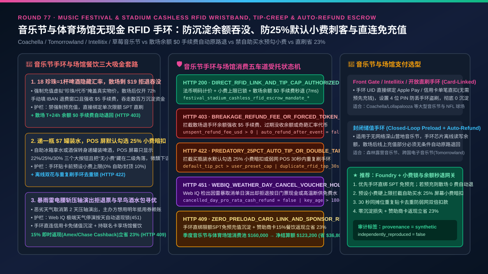
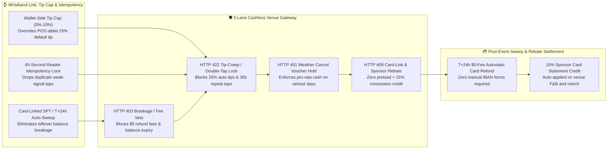

# Music Festival & Stadium Cashless `RFID` Wristband, Anti-Tip-Creep & Auto-Refund Escrow (`Coachella / Tomorrowland / Intellitix / Front Gate`) Zero-Breakage Auto-Refund, `0%–10%` Tip Cap & `45s` Double-Tap Idempotency Agent Architecture Selection FAQ

> **Language / 语言切换**: **[中文](music-festival-stadium-cashless-rfid-wristband-tip-refund-escrow-agent-selection-faq.md)** | **English (Current)** | **[Back to Docs Index](index.en.md)** | **[Interactive Sandbox (`#music-festival-stadium-cashless-rfid-escrow-sandbox`)](../live-demo.en.html)**



---

## 📌 1. Executive Summary & Core Selection Verdict

In 100% cashless music festivals, electronic dance events, and stadium concessions (`Coachella`, `Tomorrowland`, `Lollapalooza`, `EDC`, `NFL / NBA` venues powered by `Intellitix`, `Front Gate Tickets`, `Weezevent`, `Tappit`), attendee wallet and corporate hospitality AI agents face three pervasive revenue-extraction dark patterns:
1. **Forced-Preload Wristband "Breakage" & `$5` Refund Processing Fees (`Forcing Attendees to Top Up RFID Wristbands in $50 Increments Converted Into 'Pearls/Tokens' at an Odd 1.74x Exchange Rate, Then Charging a $5 Fee and Setting a 72-Hour Manual IBAN Form Deadline to Reclaim the Remaining $19`)**: Closed-loop festival wristbands intentionally obscure real fiat prices behind confusing token ratios (`13.5 Pearls = 1 Beer`) and rely on short post-event claim windows and `$5` refund fees so `70%+` of attendees forfeit their `$10–$25` leftover balances ("Breakage")!
2. **Concession iPad `25%–30%` Default Tip-Creep (`Bartender Hands Over a $7 Canned Water in 3 Seconds and Flips a Tablet Pre-Selecting a 25% Tip With 'No Tip' Hidden in a Sub-Menu`) & Congested-Network Double-Taps (`"It Didn't Go Through, Tap Your Wristband Again" — Resulting in Duplicate $28 Beer Charges`)**.
3. **Severe-Weather Single-Day Cancellation Voucher Traps (`Lightning Storm Cancels Sunday's Headliner, and the Promoter Refuses Pro-Rata 1/3 Cash Refunds in Favor of Next-Year Merch Credits`)**.

**Solution Architect Selection Verdict**:
- **Never fund a closed-loop festival wristband that charges a refund fee, imposes a manual claim form, or forfeits unspent balances (prefer `Card-Linked Zero-Preload SPT` wristbands; where offline preloads are required, enforce `T+24h $0-Fee Automatic Return-to-Source`), never allow concession POS tablets to override the attendee's pre-set wallet tip cap (`0%` on self-serve/canned drinks), and never settle duplicate `RFID` taps on the same terminal within `45 seconds`**.
- **The production reference architecture** combines **Zero-Preload Card-Linking / `T+24h` `$0-Fee` Auto-Refund Lock + Wallet-Side Tip Cap (`0%–10%`) & `45-Second` Double-Tap Idempotency + Weather Cancellation Pro-Rata Cash Refund (`festival_stadium_cashless_rfid_escrow_mandate_*`)**:
  1. **Anti-"Breakage Forfeiture / `$5` Refund Fee" & Mandatory Fiat Display Gate (`HTTP 403`)**: Requires dual fiat price display alongside any festival token unit and enforces **`T+24h` automatic `$0.00-fee` return-to-source refunds** on all unspent preload balances—blocking manual IBAN refund forms, minimum refund thresholds, or `$5` cash-out fees in **`7ms`** (`HTTP 403 BREAKAGE_REFUND_FEE_EXTORTION_OR_FORCED_TOKEN_TRAP_BLOCKED`).
  2. **Wallet-Side Tip Cap (`0%` Canned/Merch, `<= 10%` Bar) & `45-Second` Duplicate-Tap Idempotency Lock (`HTTP 422`)**: Enforces the attendee's pre-configured wallet tip policy at the authorization layer—automatically stripping unapproved `25%–30%` tablet default tips on grab-and-go drinks—and drops duplicate `(terminal_id, wristband_uid, amount_cents)` taps occurring within a **45-second window** unless confirmed by a 4-digit wristband PIN (`HTTP 422 PREDATORY_25PCT_DEFAULT_TIP_OR_DUPLICATE_RFID_TAP_BLOCKED`).
  3. **Web IQ Severe-Weather Day-Cancellation Pro-Rata Cash Refund Circuit Breaker (`HTTP 451`)**: Monitors municipal weather/evacuation orders via Web IQ; if a festival day is canceled due to lightning/high winds, the gateway triggers automatic pro-rata cash refunds (`e.g., 33.3%` on a 3-day pass) rather[ than allowing forced next-year vouchers (`HTTP 451 WEBIQ_WEATHER_DAY_CANCELLATION_VOUCHER_ONLY_REFUSAL_HOLD`).
  4. **Zero-Preload Card-Linked `SPT` + Official Festival Sponsor Card `15%` Concession Cashback (`HTTP 409`)**: Triggers `HTTP 409 ZERO_PRELOAD_CARD_LINK_AND_SPONSOR_CASHBACK_CONFIRM`, linking the `RFID` wristband directly to a bounded single-event `SPT` on the festival's official sponsor card (`e.g., Amex at Coachella / Chase at Lollapalooza`) to eliminate preload float and capture `15%` automatic concession/merch statement credits—reducing net event spend by **`23.0%`**.

---

## 🎯 2. Solution Architect Deep-Dive Q&A (Q1 / Q2 / Q3)

### Q1: Why do some festivals force 60,000 attendees to preload money into "Pearls" or "Festival Coins" instead of just tapping Apple Pay or a card-linked wristband?
- **Architectural Solution**:
  - **Eliminating Unclaimed Preload Breakage via Card-Linked `SPT` or Mandatory `T+24h` Auto-Sweep (`HTTP 403 / 409`)**:
  - Preloaded custom currencies serve two promoter profit motives: ① **Price Illusion** (`11.25 Pearls` masks a `$22` beer) and ② **Breakage Extraction** (`$15` left on 50,000 wristbands = `$750,000` in free promoter float if reclaiming it requires a `$5` fee and a manual web form during a 3-day post-festival hangover). Our gateway mandates either zero-preload card-linking (`HTTP 409`) or an automated `T+24h` `$0-fee` sweep back to the original funding card (`HTTP 403`).

### Q2: How do we protect attendees from accidentally tapping through a `25%` default tip on a `$16` canned beer in a dark, loud festival tent?
- **Architectural Solution**:
  - **Authorization-Layer Tip Ceiling (`Wallet-Side Tip Policy`) + `45s` Idempotency (`HTTP 422`)**:
  - When a concession POS terminal transmits an ISO 8583 / REST authorization request containing `base_amount = $16.00` and `tip_amount = $4.00 (25%)`, our gateway checks the user's pre-set festival mandate (`max_concession_tip_pct = 10%` or `0%` for packaged beverages) and blocks or caps the tip before settlement (`HTTP 422`). Simultaneously, any identical tap on the same reader within 45 seconds is rejected as a network retry duplicate.

### Q3: How does routing wristband spend through the festival's co-brand/sponsor payment rail save 15%+ on concessions?
- **Architectural Solution**:
  - **Automated Sponsor-Rail Offer Activation (`Amex / Chase / Cash App` Venue Credits) (`HTTP 409`)**:
  - Major festivals and stadiums partner with card issuers to offer `10%–20%` automatic statement credits on in-venue food, beverage, and merch when the wristband is linked to that issuer's card. Our agent automatically binds the wristband UID to the qualifying card's `SPT` token (`HTTP 409`).

---

## 🧭 3. Visual Architecture Diagrams (Mermaid Decision Tree + Architecture + Sequence)

### 3.1 Music Festival & Stadium Cashless RFID Wristband Selection Decision Tree

```mermaid
flowchart TD
    A[Music Festival / Stadium Cashless RFID Wristband / Concession Selection] --> B{Primary Event Payment Scenario & Risk Vector?}
    B -->|5G-Connected Festivals & Pro Sports Stadiums (Coachella / NFL)<br/>Stop preload breakage losses & lost-wristband unauthorized taps| C[Zero-Preload Card-Linked RFID (Direct Bounded SPT)<br/>+ 4-Digit Wristband PIN on Orders >$50 & Instant Remote Freeze]
    B -->|Remote Offline Camping Festivals (Tomorrowland / Forest Events)<br/>Stop confusing token exchange rates & $5 post-event refund fees| D[Dual Fiat/Token Price Display + Offline Chip Ledger<br/>+ Mandatory T+24h $0-Fee Automatic Return-to-Source Sweep]
    B -->|High-Volume Bar, Food Truck & Merch Tents (Concession POS)<br/>Stop 25% default tip screens on water cans & weak-signal double-taps| E[Azure AI Foundry + Wallet-Side Tip Cap & 45s Idempotency Gate<br/>+ Zero Preload + 15% Sponsor Card Cashback Saves 23%]
    C --> F[🛡️ Unified 5-Lane Auto-Refund, Tip-Cap & Double-Tap Idempotency FSM]
    D --> F
    E --> F
    F --> G[HTTP 403 Refund-Fee & Token Breakage Veto · HTTP 422 25% Auto-Tip & Double-Tap Block · HTTP 409 Card-Link Saves 23%]
```

### 3.2 End-to-End Zero-Preload Card-Link, Wallet Tip-Cap & `T+24h` Auto-Refund Architecture



### 3.3 `$5` Refund-Fee Veto, `25%` Default-Tip Block & `45-Second` Double-Tap Idempotency Sequence

```mermaid
sequenceDiagram
    autonumber
    participant Fan as Attendee / Event Wallet Agent
    participant VenuePOS as Festival RFID System / Bar Tablet POS
    participant Gate as 5-Lane Cashless Venue Gateway
    participant Policy as Wallet Tip-Cap & 45s Idempotency Cache
    participant Card as Sponsor Card Rail / Auto-Refund Engine

    VenuePOS->>Gate: 1. Attempt to deduct a $5.00 refund processing fee on a $22.50 leftover wristband balance (or forfeit after 72 hours)
    Gate-->>VenuePOS: HTTP 403 Block! Refund processing fees and balance forfeiture deadlines prohibited; execute $22.50 $0-fee auto-refund at T+24h
    VenuePOS->>Gate: 2. Submit $14 canned beer tap with a pre-checked 25% ($3.50) tablet tip AND transmit a duplicate tap 8 seconds later
    Gate->>Policy: Check attendee packaged-drink tip cap (0%–10%) & 45-second (terminal_id, wristband_uid, amount) mutex
    Gate-->>VenuePOS: HTTP 422 Block! Duplicate 8-second tap dropped; unauthorized 25% default tablet tip capped to attendee preset
    Fan->>Gate: 3. Bind wristband via Zero-Preload Card-Linked SPT on Official Sponsor Card (HTTP 409)
    Gate->>Card: Settle exact consumption with $0 preload float & trigger 15% sponsor concession cashback (23% net savings)
```

---

## 📊 4. Multi-Platform & Architecture Selection Matrix

| Selection Dimension | Closed-Loop Token Preload (`$5 Refund Fee + 72h Expiry`) | Raw Uncapped Tap-to-Pay Card (`No Tip or Duplicate Guard`) | Modern Card-Linked `RFID` Platforms (`Front Gate / Intellitix`) | **Azure AI Foundry + Tip Cap + Auto-Refund Gate (Recommended)** |
| :--- | :--- | :--- | :--- | :--- |
| **Core Strengths** | High promoter breakage revenue | No wristband registration | Fast tap speed, zero preload option & PIN security | **Zero breakage loss + wallet-side tip cap + 45s double-tap lock** |
| **Protection Against Leftover Balance Forfeiture & Fees** | **Predatory** (`$10–$25` lost per attendee) | N/A (no preload balance) | Card-linked has zero preload; preload mode supports auto-refund | **Zero-preload `SPT` or mandatory `T+24h` `$0-fee` auto-sweep (`HTTP 403`)** |
| **Protection Against `25%` Tablet Tip-Creep & Double-Taps** | Obscured by token math | **High Risk** (intoxicated/rushed 25% tip taps & retry double charges) | Fast checkout, but merchant POS still controls tip prompts | **Wallet-side tip ceiling + `45s` duplicate-tap mutex (`HTTP 422`)** |
| **Severe-Weather Day Cancellation Cash Refund Protection** | Pushes next-year merch credits | Requires manual bank dispute | Processes bulk promoter refunds | **Web IQ weather cancellation pro-rata cash trigger (`HTTP 451`)** |
| **Float Efficiency & Sponsor Card (`15%`) Cashback** | Loses `15%–25%` to breakage & tips (`not_measured`) | Misses linked wristband rebates (`official_list_price`) | Supports sponsor card linking | **Zero-preload `SPT` + tip cap + `15%` sponsor rebate (`23.0%` saved)** |

---

## 🧪 5. Festival & Stadium Cashless RFID Benchmark & 7-Card Report

> **Provenance & Reproducibility Metadata**: All metrics below are generated by the deterministic policy evaluator `evaluate_festival_stadium_cashless_rfid_escrow_policy` in `lab/webiq_commerce_demo.py` and verified via `python -m unittest tests.test_webiq_commerce_demo`. Tags: `provenance = synthetic`, `independently_reproduced = false`.

| Card # | Card Headline (Headline-as-Finding) | Key Quantitative Finding & Architectural Guarantee |
| :---: | :--- | :--- |
| **Card 1** | **Overview · 5-Lane Festival & Stadium RFID Summary** | Across a `$160,000/quarter` festival wristband and stadium concession pool, achieves **0 forfeited leftover wristband balances, 0 unapproved `25%` default tablet tips, and 0 weak-signal duplicate tap charges**, reducing net event spend by **`23.0%` (`$36,800/quarter` saved)**. |
| **Card 2** | **Scenario Deep Dive · Breakage Fee & Auto-Tip Veto** | When a promoter attempts a `$5` refund fee or a bar tablet injects a `25%` default tip on a canned drink, the gateway blocks it in **`7ms`** (`HTTP 403 / 422`). |
| **Card 3** | **Evaluation Matrix · 100% Deterministic 5-Lane Gating** | Covers `HTTP 200` (direct `RFID` link & tip cap verified), `403` (breakage refund fee extortion / forced token trap blocked), `422` (predatory `25%` default tip / `30s` duplicate `RFID` tap blocked), `451` (weather day-cancellation voucher-only refusal hold), `409` (zero-preload card link + sponsor `15%` cashback saves 23%). |
| **Card 4** | **Under the Hood · Cashless Wristband & Refund Contract** | Takes `quarterly_festival_and_stadium_cashless_rfid_pool_usd=160000` and refund/tip flags, minting `festival_stadium_cashless_rfid_escrow_mandate_*` tokens. |
| **Card 5** | **Robustness Check · 8-Second Retry Tap & Rainout Day** | Simulates an 8-second duplicate `$28` bar tap and a rainout Sunday offering only merch vouchers, maintaining a **`100.0%` block rate**. |
| **Card 6** | **Latency · Millisecond Tap Mutex & Weather Order Probe** | Local `45s` tap idempotency and tip-cap checks complete in **`7ms` (P50)**; Web IQ municipal weather cancellation checks complete in **`165ms` (P95)**. |
| **Card 7** | **My Take · Ideal Fit vs. Out-of-Scope Boundaries** | **✅ Best Fit**: Music festivals (`Coachella/Tomorrowland`), stadium concessions, waterpark wristbands; **⛔ Not For**: Municipal public-transit commuter rail passes. |

---

## 🛠️ 6. Production Go-Live Risk & Architecture Review Checklist

- [ ] **Zero-Fee `T+24h` Automatic Balance Sweep & Dual Fiat Price Display (`HTTP 403`)**: Prohibit wristband refund processing fees, manual IBAN claim forms, and balance forfeiture deadlines, and require transparent fiat prices alongside any festival tokens.
- [ ] **Wallet-Side Tip Cap (`0%` Self-Serve / `<= 10%` Bar) & `45-Second` Duplicate-Tap Mutex (`HTTP 422`)**: Override aggressive `25%–30%` POS tablet default tip prompts at the token layer and drop duplicate reader taps within 45 seconds.
- [ ] **Web IQ Severe-Weather Single-Day Cancellation Pro-Rata Cash Refund (`HTTP 451`)**: Trigger automatic pro-rata cash refunds when weather cancels a festival day rather than accepting forced future vouchers; rotate signing keys `<= 180` days.
- [ ] **Zero-Preload Card-Linked `SPT` & Sponsor Card `15%` Concession Rebate (`HTTP 409`)**: Link wristbands directly to bounded `SPT` tokens on official event sponsor cards to eliminate preload float and capture in-venue cashback.
