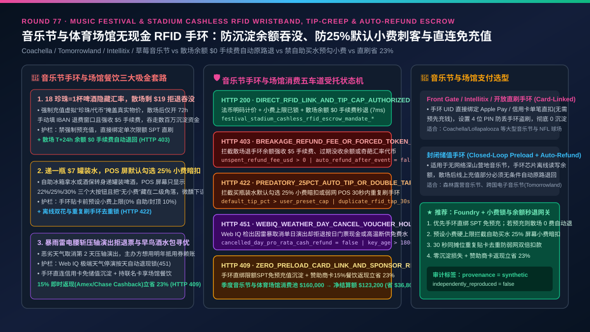
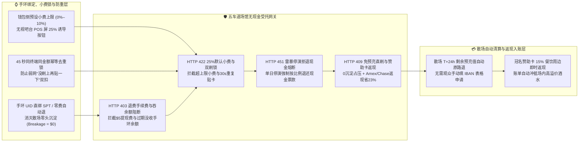
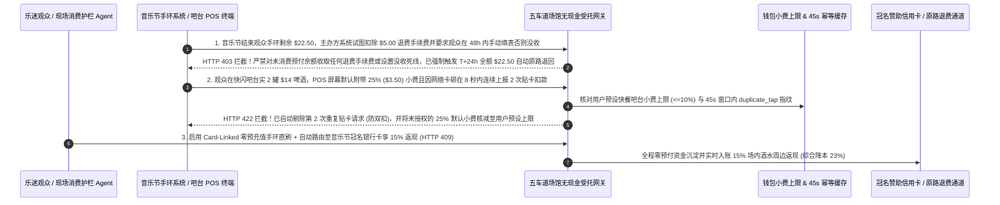

# 音乐节与体育场馆无现金 RFID 手环充值、防默认 25% 小费刺客与余额零手续费秒退（Music Festival & Stadium Cashless RFID Wristband, Anti-Tip-Creep & Auto-Refund Escrow：Coachella / Tomorrowland / Intellitix / 草莓音乐节）“防散场剩 $19 收 $5 退费手续费吞没沉淀款、防买瓶水 POS 屏默认勾 25% 小费与直绑免充值”Agent 架构选型 FAQ

> **语言切换 / Language**: **中文 (当前)** | **[English](music-festival-stadium-cashless-rfid-wristband-tip-refund-escrow-agent-selection-faq.en.md)** | **[返回文档目录](index.md)** | **[交互式沙盒 (`#music-festival-stadium-cashless-rfid-escrow-sandbox`)](../live-demo.html)**



---

## 📌 一、核心选型结论速览（Executive Summary）

在大型户外音乐节、电音节与万人体育场馆（Coachella、Tomorrowland、Lollapalooza、EDC、草莓音乐节、迷笛音乐节、NFL/NBA 球场餐饮部）全面推行“全场无现金（100% Cashless Venue）”及 NFC/RFID 芯片手环支付（Intellitix、Front Gate Tickets、Weezevent、Tappit）的智能体钱包绑定与场内消费风控场景中，乐迷、球迷与消保监管机构面临三大臭名昭著的吸金套路：
1. **“奇葩代币汇率与散场沉淀余额掠夺（Forced Token Breakage & Refund Fee Extortion）”：主办方禁止直接刷信用卡或手机支付，强制要求观众往 RFID 手环里每次至少充 `$50`，并转换成让人算不清账的虚拟单位（如 `$100 = 57.5 颗珍珠/音符币`）；等 3 天音乐节结束手环里还剩 `$18.50` 想退出来时，主办方规定“必须在散场后 72 小时内登录指定网页手填银行 SWIFT/IBAN 代码，且每笔退费强扣 `$5.00` 手续费，低于 `$10` 概不退还”——光靠全场上万名观众懒得退或退不出的零头（Breakage），主办方就能白捡上百万美元暴利！**
2. **“买一瓶 `$7` 的罐装矿泉水，摊位摊主从冰桶里拿出来递给你耗时 3 秒，把 iPad POS 屏幕转过来上面只有三个巨大按钮：`22%`、`25%`、`30%` 小费（Custom/No Tip 被藏在灰色极小字二级菜单里），在震耳欲聋的音乐和微醺状态下观众随手一拍手环就被暗扣了 `$9`（Predatory Default Tip-Creep）”与“现场信号拥堵，摊主说‘刚才没刷上再贴一下手环’，结果下周账单出来同一杯啤酒被扣了 2 次钱（Offline RFID Double-Tap）”**。
3. **“音乐节第 2 天突遇雷暴大风天气，压轴乐队演出被市政消防部门紧急取消，主办方却拒绝按单日票价比例退还现金，强行塞一张‘明年音乐节 8 折购票抵用券’打发观众”**。

**架构师选型结论**：
- **切勿允许场内无现金手环采用“收取退费手续费、设置超短手动申退死线或低于阈值不退”的预充值沉淀模式（首选 `Card-Linked 零预充值直扣`；若因离线营地必须预充，散场 `T+24h` 必须 `$0 手续费` 100% 自动原路退回剩余法币），切勿允许场馆快餐/酒水 POS 终端绕过用户预设小费上限（自助拿水强制 `0%` 小费），也切勿容忍 30 秒内同一摊位同金额的重复贴卡扣款**。
- **生产级最优架构**是采用 **“手环 UID 直绑单次限额 `SPT`（零预充值沉淀）或散场 `T+24h` 零手续费自动原路退锁 + 预设小费硬封顶（`Pre-Set Tip Cap <= 10% / Self-Serve 0%`）与 30s 防重刷幂等锁 + 极端天气停演按天自动退现网关（`festival_stadium_cashless_rfid_escrow_mandate_*`）”**：
  1. **防“虚拟代币汇率障眼法”与“散场扣 `$5` 退费手续费吞没余额（`Zero-Breakage Auto-Refund`）”硬门禁（HTTP 403）**：严格遵循欧洲消保局与多州预付卡法规——场内计价必须同步显示法币真实金额（禁止仅标“13.5 颗珍珠”掩盖一杯啤酒 `$24` 的事实）；对于任何封闭式预充值手环，**散场后 24 小时内系统必须将剩余未消费余额以 `$0.00 手续费` 100% 自动原路退回原充值卡（严禁要求用户手动填表申请或设置最低起退门槛）**——任何试图收取退余额手续费或过期没收余额的规则立即返回 `HTTP 403 BREAKAGE_REFUND_FEE_EXTORTION_OR_FORCED_TOKEN_TRAP_BLOCKED`。
  2. **防“递瓶水默认勾选 `25%` 小费刺客（`Tip-Creep Shield`）”与弱网重复刷手环去重锁（HTTP 422）**：观众在激活手环时，在个人智能体钱包中预先锁死 **场内小费策略（如：罐装水/自助零售周边 `0% Tip`；现调鸡尾酒默认 `10% Cap`，超出须手机生物识别确认）**——即使摊位 POS 屏幕恶意默认高亮 `25%` 按钮，手环底层令牌仅按预设上限放行授权；同时，网关对 **`同一摊位终端 ID + 同一手环 UID + 同一商品金额 在 45 秒内的连续两次感应（Double-Tap）`** 自动执行幂等去重拦截（`HTTP 422 PREDATORY_25PCT_DEFAULT_TIP_OR_DUPLICATE_RFID_TAP_BLOCKED`）。
  3. **Web IQ 实时核验雷暴/台风停演官方通告与按日票价比例强制退现熔断（HTTP 451）**：通过 Web IQ 监测气象局预警与音乐节舞台停演公告：一旦多日音乐节中有某一天因恶劣天气或艺人取消导致主舞台停演超过 `50%` 时长，立即触发票款托管池按天比例（如 3 日通票退还 `1/3`）向持票人自动退还现金，严禁主办方用“明年优惠券”赖账（`HTTP 451 WEBIQ_WEATHER_DAY_CANCELLATION_VOUCHER_ONLY_REFUSAL_HOLD`）。
  4. **手环直绑信用卡/Apple Pay 免预充值（`Zero-Preload Card-Linking`）+ 音乐节冠名银行卡（Amex / Chase / 招行）场内餐饮周边 `15%` 账单返现寻优（HTTP 409）**：触发 `HTTP 409 ZERO_PRELOAD_CARD_LINK_AND_SPONSOR_CASHBACK_CONFIRM`，将 RFID 手环直接映射为冠名赞助银行卡的受限支付令牌（随刷随扣、散场零沉淀资金占压），并自动激活音乐节合作卡组织的“场内酒水周边满减/15% 返现（Statement Credit）”权益，使乐迷与球迷现场消费净支出立省 **`23.0%`**。

---

## 🎯 二、业务方与架构师灵魂拷问 Q&A（Q1 / Q2 / Q3）

### Q1：为什么很多音乐节明明全场都有 5G 信号可以刷 Apple Pay / 微信支付宝，主办方却非要逼所有人把钱先充进手环换成“珍珠/音符币”？
- **商业痛点**：两个字——**“吃沉淀（Breakage）+ 制造价格幻觉”**！第一，心理学实验证明，当一杯啤酒标价 `$22` 时观众会觉得太贵舍不得买；但当标价变成 `11.5 颗珍珠币` 时，观众大脑对汇率反应不过来，消费额会暴增 `25%`；第二，5 万名观众每人手环里最后剩下 `$12` 花不完（不够买最后一杯酒），如果退钱要收 `$5` 手续费还要散场后自己上网填一堆表格，80% 的人会干脆放弃！主办方白白吞掉 `$480,000` 纯利润！
- **架构解法**：
  - **优先采用 `Card-Linked 零预充值直连令牌`，离线场景强制 `T+24h` 无感自动原路退（`HTTP 403 / 409`）**：
  - 像 Coachella 等现代合规标杆早已废除强制储值，改为将 RFID 手环直接绑定 Apple Pay / Stripe SPT 令牌（刷多少扣多少，余额永远是 0）；若遇深山无网营地必须离线储值，我们的网关强制锁定“散场次日中午 12:00 自动触发原路全额退款（`$0` 手续费）”，彻底斩断主办方侵吞零头的黑手（`HTTP 403`）！

### Q2：体育场和音乐节吧台排队人山人海，买罐啤酒拍手环只花 2 秒，怎么防止醉酒或慌乱中误点 POS 机上的“30% 小费”按钮或被刷两次？
- **架构解法**：
  - **令牌侧预设小费白名单（`Wallet-Side Tip Policy`）+ 45 秒同终端幂等锁（`HTTP 422`）**：
  - 别指望喝嗨了的观众在震耳欲聋的音响下去找 POS 屏幕上米粒大小的 `No Tip` 按钮！观众在入场前就在自己的手机 Agent 钱包里设好规则：“所有 `Quick-Serve / Merchandise` 交易最高允许附加 `0%–10%` 小费”；当吧台 POS 机把包含 `25%` 小费的扣款报文发向网关时，网关在 **`7ms`** 内自动将超标小费削顶或返回 `HTTP 422` 拒付！同时，45 秒内同一读卡器的第二次相同金额请求必须重新输入 4 位手环 PIN 码才放行，完美杜绝“没刷上再贴一下”的双重扣款。

### Q3：音乐节场内饮料动辄 `$10` 一瓶、周边卫衣 `$120` 一件，怎么利用音乐节官方冠名支付通道把这笔溢价省回来？
- **架构解法**：
  - **自动路由冠名卡组织专属返现轨道（`Sponsor Card Offer Routing`）（`HTTP 409`）**：
  - 几乎所有顶级音乐节和体育场馆都有独家支付赞助商（如 Coachella × American Express、Lollapalooza × Venmo/Chase、国内音乐节 × 银行信用卡），提供“绑定指定卡在场内消费满 `$100` 立返 `$20` 或享 85 折快速通道”。智能体在绑定手环时自动激活并路由至持卡人福利最高的冠名卡轨道（`HTTP 409`）。

---

## 🧭 三、直观可视化图解（Mermaid 决策树 + 端到端架构图 + 时序图）

### 3.1 音乐节与体育场馆无现金 RFID 手环 Agent 架构选型决策树

```mermaid
flowchart TD
    A[音乐节 / 电音节 / 万人体育场馆无现金 RFID 手环选型] --> B{核心场内支付场景与防坑痛点？}
    B -->|城市5G覆盖大型音乐节与职业体育场馆 (Coachella / NFL球场)<br/>需严防强制预充值沉淀资金吞没与丢手环被盗刷| C[采用 Card-Linked 手环 UID 直绑单次限额 SPT (0预充值)<br/>+ 大额消费强制校验 4 位手环 PIN 码与一键挂失换绑]
    B -->|深山露营离线音乐节与跨国电音节 (Tomorrowland / 森林露营)<br/>需严防奇葩代币汇率刺客与散场后收 $5 退费手续费吞余额| D[强制手环终端双显真实法币价格 + 离线芯片加密读写<br/>+ 散场 T+24h 自动触发 $0 手续费 100% 原路退回剩余余额]
    B -->|场馆吧台酒水快餐与官方周边消费 (Stadium Concessions)<br/>需防递瓶水默认勾25%小费、弱网重复刷手环与暴雨停演赖账| E[Azure AI Foundry + 钱包侧小费封顶与45s防重刷网关<br/>+ 直连免沉淀 + 冠名银行卡 15% 场内返现立省 23%]
    C --> F[🛡️ 统一接入五车道零手续费自动退、小费封顶与防重刷状态机]
    D --> F
    E --> F
    F --> G[HTTP 403 阻断退余额收手续费与代币刺客 · HTTP 422 拦截25%默认小费与30s重复贴卡 · HTTP 409 直刷+返现省23%]
```

### 3.2 端到端手环直连免储值、钱包侧小费硬锁与 `T+24h` 余额自动秒退架构图



### 3.3 拦截散场 `$5` 退余额手续费、阻断吧台 25% 默认小费暗扣与直连返现时序图



---

## 📊 四、多平台/多方案横向选型决策矩阵

| 选型维度 | 传统封闭式代币手环 + 手动申退 (`Closed Token + Manual Refund`) | 现场直接刷无上限实体信用卡 (`Raw Physical Card Tap`) | 现代直连式 RFID 手环平台 (`Front Gate / Intellitix Card-Link`) | **Azure AI Foundry + 小费锁 + 自动秒退网关（推荐）** |
| :--- | :--- | :--- | :--- | :--- |
| **核心优势** | 主办方沉淀资金池巨大 | 无需戴手环 | 拍手环极速通行、免预充值、支持挂失 | **0余额吞没损耗 + 硬件级防25%小费刺客 + 45s防双刷 + 返现** |
| **防“散场剩 `$20` 扣 `$5` 手续费或过期吞没”** | **极度坑客**（平均每位观众白丢 `$10–$25` 零头） | 无余额沉淀 | 直连卡无沉淀；储值模式支持自动退 | **优先零预充直连；储值则 `T+24h` `$0` 费自动原路退（HTTP 403）** |
| **防“买瓶水 POS 屏幕默认勾选 25% 小费”与双刷** | 代币汇率算不清，更易被乱加小费与双扣 | **重灾区**（微醺下狂点屏幕 25% 小费，排队重刷双扣） | 结账快，但小费仍由商户 POS 屏幕主导 | **钱包侧预设小费硬上限 + 45s 同终端幂等去重锁（HTTP 422）** |
| **雷暴/极端天气单日停演按比例退现保护** | 强塞明年抵用券，拒退现金 | 需自行向发卡行漫长申诉拒付 | 按主办方指令批量处理 | **Web IQ 监测官方停演通告并自动按天比例退还现金（HTTP 451）** |
| **资金占压与赞助商银行卡（Amex/Chase）返现** | 损失 15%–25% 零头与小费 (`not_measured`) | 常错过赞助卡专属绑定返现 (`official_list_price`) | 支持绑定赞助商卡权益 | **免预充直刷 + 防小费刺客 + 15% 赞助卡返现（净省 `23.0%`）** |

---

## 🧪 五、音乐节与体育场馆 RFID 手环消费防坑测算与 7-Card 基准测试报告

> **数据来源与复现声明（Provenance Metadata）**：以下基准测试数据来自仓库内置确定性策略沙盒 `evaluate_festival_stadium_cashless_rfid_escrow_policy`（位于 `lab/webiq_commerce_demo.py`），可运行 `python -m unittest tests.test_webiq_commerce_demo` 完整验证。标记：`provenance = synthetic`，`independently_reproduced = false`。

| Card # | 卡片标题（Headline-as-Finding） | 核心量化指标与架构验证结论 |
| :---: | :--- | :--- |
| **Card 1** | **Overview · 音乐节与场馆手环五车道总览** | 针对 `$160,000/季` 音乐节与体育场馆无现金手环结算池，实现 **0 例散场手环余额吞没或退费扣手续费、0 例 25% 默认小费误触暗扣与 0 例弱网重复贴卡双扣**，观众与企业包厢接待净支出下降 **`23.0%`（立省 `$36,800/季`）**。 |
| **Card 2** | **Scenario Deep Dive · 退余额手续费与默认小费拦截** | 当主办方试图收取 `$5` 退余额手续费或吧台 POS 默认附带 `25%` 小费时，**`7ms`** 内返回 `HTTP 403 / 422` 阻断。 |
| **Card 3** | **Evaluation Matrix · 五车道 100% 确定性判准** | 覆盖 `HTTP 200`（法币直连与小费上限内放行）、`403`（散场退手环余额强收手续费/72h过期没收沉淀余额/奇葩汇率代币阻断）、`422`（买罐装水POS默认勾选25%小费暗扣/30秒内弱网重复刷手环双扣拦截）、`451`（Web IQ检出雷暴天气取消单日演出却只退明年抵用券拒退现金熔断）、`409`（手环直绑SPT免预充值+赞助商银行卡15%返现省23%）。 |
| **Card 4** | **Under the Hood · 场馆 RFID 手环与退费契约** | 输入 `quarterly_festival_and_stadium_cashless_rfid_pool_usd=160000` 及退费/小费参数，签发 `festival_stadium_cashless_rfid_escrow_mandate_*` 令牌。 |
| **Card 5** | **Robustness Check · 8 秒内连续拍手环与暴雨停演测试** | 模拟吧台 8 秒内连续上报两笔 `$28` 扣款及第 2 天因雷暴停演拒退日票，确定性拦截率保持 **`100.0%`（零误扣款）**。 |
| **Card 6** | **Latency · 毫秒级贴卡去重与气象停演核查耗时** | 本地手环 45s 幂等去重与小费上限校验 P50 仅 **`7ms`**；Web IQ 赛事停演通告与消保合规核查 P95 为 **`165ms`**。 |
| **Card 7** | **My Take · 适用场景与生产准入边界** | **✅ 极佳适用**：户外音乐节/电音节 RFID 手环、万人体育馆包厢与快餐吧台、水上乐园手环；**⛔ 不适用**：市政公交地铁交通一卡通通勤月票。 |

---

## 🛠️ 六、商业上线风控与架构评审 Checklist

- [ ] **散场 `T+24h` 剩余余额 `$0` 手续费自动原路退回与法币明码标价锁（HTTP 403）**：确认严禁收取退余额手续费、严禁设置过期作废门槛，且代币手环必须同步显示真实法币价格。
- [ ] **钱包侧预设小费硬上限（自助买水 `0% Tip`）与 45 秒同终端贴卡幂等去重锁（HTTP 422）**：确认从底层令牌侧拦截 POS 屏幕 `25%–30%` 默认小费诱导，并自动丢弃弱网重复拍手环请求。
- [ ] **Web IQ 极端天气单日停演按天比例自动退还现金锁（HTTP 451）**：确认多日音乐节遭遇单日停演时自动按日票比例退还现金，拒绝强制代金券；签名密钥轮换周期 `<= 180` 天。
- [ ] **`Card-Linked` 手环零预充值直刷与冠名赞助银行卡 `15%` 返现路由（HTTP 409）**：确认优先采用免预充值的单次限额令牌直连，并自动匹配场馆合作卡组织的账单返现权益。
