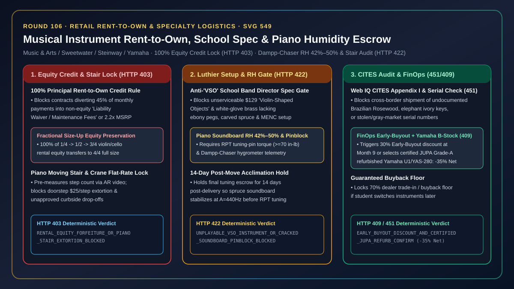
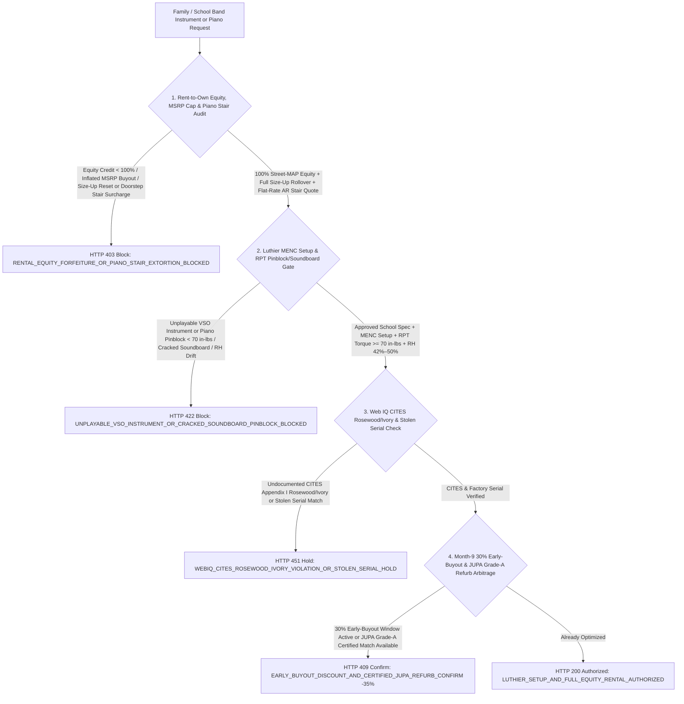
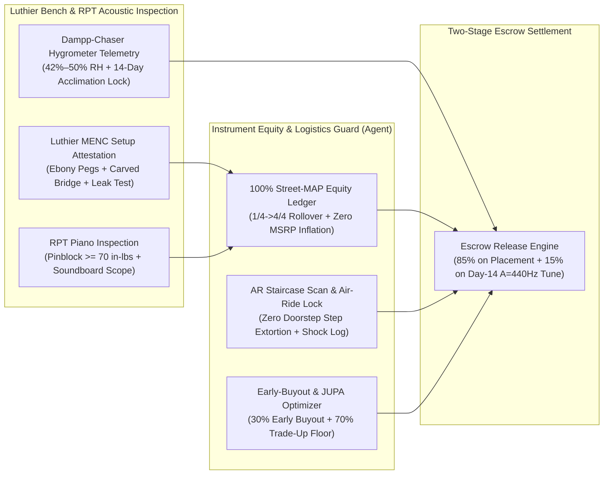

# Musical Instrument Rent-to-Own, School-Band Spec & Piano Moving/Humidity Escrow (`Music & Arts / Sweetwater / Steinway / Yamaha / Parsons Music`) Agent Architecture Selection FAQ

> **Target Audience**: **Cloud & AI Solution Architects** designing AI rent-to-own orchestration, luthier/piano inspection verification, and specialty heavy-logistics escrow agents for musical instrument marketplaces, school district band/orchestra procurement portals, and acoustic piano dealers.  
> **Core Pain Points Solved**: Eliminates the four chronic financial and acoustic failures in musical instrument commerce: **(1) Unplayable `$119` E-Commerce "Violin-Shaped Objects" (`VSOs` and disposable white-glove brass instruments withpainted softwood pegs that slip instantly, uncut bridges, and unserviceable pot-metal keys that school band directors reject on Day 1), (2) Rent-to-Own Equity Stripping & Inflated `MSRP` Buyouts (diverting `40%–48%` of monthly payments into non-equity maintenance/liability fees, anchoring buyout prices to `2.1x` inflated list `MSRP` instead of street `MAP` price, or wiping out accumulated equity when a child sizes up from a `1/2` to a `3/4` violin), (3) Loose Piano Pinblocks (`<35 in-lbs` torque) & Cracked Spruce Soundboards (buying cosmetically polished used pianos that cannot hold `A=440Hz` pitch or crack during winter heating season due to missing `Dampp-Chaser` humidity control), and (4) Doorstep Piano Mover Stair Extortion (demanding `$25/step` cash surcharges while holding a `500-lb` upright piano on the porch)**.



---

## 📌 1. Executive Summary

1. **Hard Contract Lock on `100%` Street-Price Rental Equity Credit, Fractional Size-Up Carryover & All-In Piano Stair Pricing (`HTTP 403`)**: Legacy instrument rental contracts routinely trap families by applying rental credits against an artificially inflated List `MSRP` (`180%–220%` of actual street `MAP` price), siphoning `40%+` of monthly payments into non-equity fee buckets, or resetting accumulated equity when a growing student exchanges a `1/4` or `1/2` fractional string instrument for a `3/4` or `4/4` full-size instrument. Meanwhile, unscrupulous piano movers quote a low `$250` base move and extort `$20–$30 per stair step` at the doorstep. The Agent enforces a strict contract gate: **`100%` of base rental payments (for at least the first `12–24 months`) must credit toward the verified Street `MAP` price, `100%` of accumulated equity must carry over across fractional size-ups, and piano moving quotes must lock an all-in flat rate after pre-move `AR` staircase/turn-radius video verification (`$0` doorstep step surcharges)**. Violations trigger **`HTTP 403 RENTAL_EQUITY_FORFEITURE_OR_PIANO_STAIR_EXTORTION_BLOCKED`**.
2. **School-Band Approved Spec, Luthier `MENC` Setup & Piano `RPT` Pinblock Torque (`>=70 in-lbs`) / `RH 42%–50%` Gate (`HTTP 422`)**: To block unplayable mass-market `VSO` instruments and structurally failed used pianos, the Agent requires two physical verification proofs before releasing escrow: (a) **School Band & Luthier Setup Gate**: the SKU must match the school band director's approved model list (`Yamaha YAS-280 / YFL-222`, `Bach TR300`, `Eastman VL80`) with a signed luthier setup sheet verifying fitted ebony pegs, hand-carved maple bridge (`MENC` string-height spec), and pad/valve leak-down tightness; and (b) **Registered Piano Technician (`RPT`) & Acclimation Gate**: acoustic pianos require an `RPT` digital torque-wrench inspection proving tuning-pin torque **`>=70 in-lbs`** (`~8.0 N·m`), intact spruce soundboard ribs, active **`Dampp-Chaser` humidity regulation (`42%–50% RH`)**, and a mandatory **`14-day` post-move room-acclimation hold** before final `A=440Hz` tuning and final `15%` escrow release—returning **`HTTP 422 UNPLAYABLE_VSO_INSTRUMENT_OR_CRACKED_SOUNDBOARD_PINBLOCK_BLOCKED`** on failure.
3. **Month-9 `30%` Early-Buyout Discount Trigger & Certified `JUPA Grade-A` Refurbished Arbitrage Saving 35% (`HTTP 409`)**: Once a student completes `6–9 months` of continuous practice (passing the initial dropout window), continuing to pay month-to-month rental + maintenance fees for 36 months is financially suboptimal. The Agent automatically triggers the dealer's **`25%–30%` Early-Buyout Principal Discount** or routes acoustic piano / step-up wind buyers to **`JUPA` (Japan Used Piano Association) `Grade-A` certified instruments (`Yamaha U1 / U3`) with a written `70%` 5-year trade-up buyback floor**, returning **`HTTP 409 EARLY_BUYOUT_DISCOUNT_AND_CERTIFIED_JUPA_REFURB_CONFIRM`** and reducing net quarterly equipment spend by **35%**.

---

## 🎯 2. Architect & Business Stakeholder Q&A

### Q1: Why do school band and orchestra directors immediately reject `$119` online violins and trumpets—and how does the Agent block "Violin-Shaped Objects (`VSOs`)"?
- **The Mechanical Reality of Unserviceable Mass-Market Instruments**:
  1. **Painted Softwood Pegs & Raw Uncut Bridges**: Sub-`$150` internet violins use low-density white wood painted black instead of seasoned ebony pegs (`Ebony Pegs`); the pegs compress and slip the moment the student tries to tune to `A=440Hz`. The maple bridge is shipped as an uncarved flat blank, leaving strings `8mm+` off the fingerboard so a child cannot press a note in tune.
  2. **Soft Pot-Metal Keys on Disposable Wind Instruments**: Ultra-cheap flutes, clarinets, and saxophones bend out of regulation from normal finger pressure, and certified repair shops (`NAPBIRT` technicians) refuse to work on them because replacement pads/rods do not exist and soldering melts the alloy.
  3. **Deterministic School-Spec & `MENC` Setup Verification**: The Agent cross-references the school's exact syllabus against verified manufacturer serial prefixes and requires a luthier/bench-tech pre-shipment setup attestation before checkout.

### Q2: How do legacy "Rent-to-Own" programs quietly double the price of a student instrument, and how does the Agent protect growing string players?
- **Closing the `MSRP` Inflation & Fractional Size-Up Loopholes**:
  1. **List `MSRP` vs. Street `MAP` Price Anchoring**: A student alto saxophone with a `$1,350` street `MAP` price at `Sweetwater` is often written into a rental contract at a `$2,680` List `MSRP`. Even with "100% rental credit," the parent ends up paying `$2,680` plus `$18/month` in non-equity damage-waiver fees (`$3,100+` total).
  2. **Fractional Size-Up Equity Preservation (`1/8 -> 1/4 -> 1/2 -> 3/4 -> 4/4`)**: A young violinist or cellist changes instrument sizes every 12–18 months. If a contract resets or caps equity transfers during size exchanges, the parent loses `$1,000+` in prior payments before ever reaching a full-size `4/4` instrument. The Agent rejects any contract that fails to roll `100%` of accumulated principal across size exchanges capped at the `4/4` Street `MAP` price.

### Q3: Why is buying a used piano without a tuning-pin torque test (`Pinblock Torque`) or tuning it on moving day a `$4,000` mistake?
- **Acoustic Physics of Pinblocks, Soundboards & 14-Day Room Acclimation**:
  1. **Loose Pinblocks (`<40 in-lbs`) Cannot Hold Pitch**: A 220-string acoustic piano exerts `18–20 tons` of cumulative string tension on its laminated maple pinblock. If a used piano was stored in a dry heated room, the pinblock shrinks and tuning-pin torque drops below `35 in-lbs`—meaning the piano goes flat within hours of tuning and requires a `$3,500+` restringing/pinblock rebuild. The Agent mandates an independent `RPT` digital torque inspection (`>=70 in-lbs`) and `JUPA Grade-A` chassis verification.
  2. **The 14-Day Post-Move Acclimation Hold**: Moving a piano from a warehouse into a home changes ambient relative humidity (`RH`), causing the spruce soundboard crown to expand or contract over 10–14 days. Tuning on delivery day is wasted money. Our escrow architecture releases `85%` upon damage-free air-ride placement and holds the final `15%` until **Day 14**, when the `Dampp-Chaser` hygrometer confirms stable `42%–50% RH` and the `RPT` completes the `A=440Hz` fine tuning.

---

## 🧭 3. Visual Architecture Diagrams (Mermaid)

### 3.1 Musical Instrument Rent-to-Own, School Spec & Piano Escrow Decision Tree



### 3.2 End-to-End Rent-to-Own Equity Ledger, `RPT` Inspection & Piano Acclimation Architecture



### 3.3 Fractional Violin Size-Up, `RPT` Pinblock Audit & 14-Day Piano Acclimation Sequence

```mermaid
sequenceDiagram
    participant Parent as Parent / School Music Director
    participant Agent as Instrument & Piano Escrow Agent
    participant Dealer as Dealer / Luthier (Music & Arts / Yamaha)
    participant RPT as Independent RPT & Air-Ride Piano Mover

    Parent->>Agent: 1. Size up child's violin (1/2 -> 3/4) + purchase used Yamaha U1 upright (2nd floor, 14 steps)
    Agent->>Dealer: 2. Audit contract (enforce 100% 1/2-violin equity carryover, block 2x MSRP buyout & step surcharges HTTP 403)
    Agent->>RPT: 3. Verify Yamaha U1 JUPA Grade-A certificate + test pinblock torque + lock AR stair moving quote
    RPT-->>Agent: 4. Confirm 82 in-lbs pinblock torque, intact soundboard & Dampp-Chaser (block rival 35 in-lbs unit HTTP 422)
    Agent-->>Parent: 5. Trigger 30% Early-Buyout discount + certified JUPA Grade-A Yamaha U1 bundle (HTTP 409 -35%)
    RPT->>Parent: 6. Deliver via climate air-ride truck up 14 steps (release 85% escrow); start 14-day RH acclimation
    RPT->>Agent: 7. Complete Day-15 A=440Hz fine tuning at 46% RH; upload pitch log & release final 15% escrow
```

---

## 📊 4. Multi-Platform Instrument Rent-to-Own & Piano Marketplace Comparison Matrix

| Evaluation Dimension | Music & Arts / Sweetwater (School Band Leaders) | Steinway / Yamaha Authorized Dealers | Mass E-Commerce `$99` White-Label (`VSO`) | Uncertified Local Used Piano / P2P | **This Repo + Equity & RPT Escrow Guard (Recommended)** |
| :--- | :--- | :--- | :--- | :--- | :--- |
| **School Band Director Approval (`MENC Spec`)** | **High (direct integration with school district approved brand/model lists)** | Best-in-Class (industry standard acoustic & mechanical precision) | **Rejected (`VSO` slipping pegs, uncut bridges, unrepairable keys)** | Variable (risk of pad leaks or warped necks) | **Enforces school model whitelist + signed luthier `MENC` setup sheet (`HTTP 422`)** |
| **Rent-to-Own Equity & Size-Up Rules** | Supports size-ups, but requires auditing `MSRP` vs `MAP` buyout cap & `LDW` split | Typically credits first 6–12 months of rent toward acoustic purchase | No equity or size-up program | Rarely supports fractional trade-ins | **Locks `100%` principal credit against Street `MAP` + full `1/8->4/4` carryover (`HTTP 403`)** |
| **Piano Pinblock Torque & Soundboard Audit** | Primarily band/orchestra instruments | **Factory-certified rebuilds/new warranties, high retail premium** | N/A | **High Risk (polished cabinets hiding `<35 in-lbs` loose pinblocks)** | **Mandatory independent `RPT` digital torque test (`>=70 in-lbs`) + `JUPA Grade-A` cert** |
| **Humidity Control & Post-Move Tuning** | Standard case protection | `Dampp-Chaser` available on premium uprights/grands | Zero climate control | Tuned immediately on delivery day (drifts out of tune within 10 days) | **Requires `42%–50% RH` telemetry + `14-day` acclimation hold before final tuning** |
| **Piano Stair & Rigging Fee Transparency** | Parcel shipping for band instruments | Professional crews, but stair/turn surcharges often billed post-inspection | Curbside parcel drop | **Doorstep extortion (`$20–$30/step` demanded on arrival)** | **Pre-move `AR` staircase scan locks all-in flat rate (`HTTP 403`)** |

---

## 🧪 5. Rent-to-Own & Acoustic Cost Benchmark Summary (7-Card Standard)

> **Provenance Notice**: Figures below are generated by the deterministic policy evaluator `evaluate_musical_instrument_piano_escrow_policy` in `lab/webiq_commerce_demo.py` (`provenance: "synthetic"`, `independently_reproduced: False`).

| Metric | Legacy Full-Term `MSRP` Rental + Unaudited Piano Baseline | Deterministic Instrument Guard (`30%` Early Buyout + `JUPA Grade-A`) | Net Delta / Protection |
| :--- | :--- | :--- | :--- |
| **Quarterly School Band & Family Instrument/Piano Pool** | `$50,000.00` | `$32,500.00` (`HTTP 409` confirmed) | **Saves `$17,500.00 / qtr` (`-35.0%`)** |
| **Unplayable `VSO` Rejection or Loose-Pinblock Piano Rate** | `28%` (rejected by band teacher or fails to hold `A=440Hz`) | **`0%` (Mandatory `MENC` luthier setup + `RPT >= 70 in-lbs` torque gate)** | **Eliminates `$3,500+` rebuild losses** |
| **Fractional Violin/Cello Size-Up Equity Leakage** | `40%–100%` equity lost across size exchanges | **`0% Leakage` (`100%` accumulated equity transfers to `4/4` full size)** | **Saves `$950–$1,600` per student** |
| **Doorstep Piano Stair Extortion & Soundboard Cracking** | `$320` avg surprise stair fee + winter heating cracks | **`$0` surprise fees (`AR` stair lock) + `Dampp-Chaser 42%–50% RH`** | **Extends soundboard life `15+ yrs`** |

### 5.1 Deterministic 5-Lane HTTP Status Contract

```json
{
  "scenario": "musical_instrument_piano_escrow_guard",
  "provenance": "synthetic",
  "independently_reproduced": false,
  "lanes": {
    "authorized_200": {
      "status_code": 200,
      "decision": "LUTHIER_SETUP_AND_FULL_EQUITY_RENTAL_AUTHORIZED",
      "mandate_token": "musical_instrument_piano_mandate_200"
    },
    "equity_forfeiture_or_stair_extortion_403": {
      "status_code": 403,
      "decision": "RENTAL_EQUITY_FORFEITURE_OR_PIANO_STAIR_EXTORTION_BLOCKED"
    },
    "unplayable_vso_or_cracked_soundboard_422": {
      "status_code": 422,
      "decision": "UNPLAYABLE_VSO_INSTRUMENT_OR_CRACKED_SOUNDBOARD_PINBLOCK_BLOCKED"
    },
    "cites_rosewood_or_stolen_serial_451": {
      "status_code": 451,
      "decision": "WEBIQ_CITES_ROSEWOOD_IVORY_VIOLATION_OR_STOLEN_SERIAL_HOLD"
    },
    "early_buyout_and_jupa_refurb_409": {
      "status_code": 409,
      "decision": "EARLY_BUYOUT_DISCOUNT_AND_CERTIFIED_JUPA_REFURB_CONFIRM",
      "quarterly_savings_usd": 17500.0
    }
  }
}
```

---

## 🛠️ 6. Production Architecture & Risk Review Checklist

- [ ] **`100%` Street-Price (`MAP`) Equity Credit & Fractional Size-Up Carryover (`HTTP 403`)**: Reject rent-to-own contracts that anchor buyouts to inflated List `MSRP` (`>1.10x` Street `MAP`) or forfeit accumulated rental principal when sizing up fractional instruments (`1/8 -> 4/4`).
- [ ] **Pre-Move `AR` Staircase Scan & Flat-Rate Piano Rigging Lock (`HTTP 403`)**: Lock step counts, turn radius, and pedal/lyre disassembly into an all-in escrow contract prior to dispatch, prohibiting doorstep per-step surcharges.
- [ ] **School-Band Approved Model & Luthier `MENC` Setup Verification (`HTTP 422`)**: Block `VSO` instruments lacking fitted ebony pegs, hand-carved bridges, or spare-parts serviceability.
- [ ] **Independent `RPT` Pinblock Torque (`>=70 in-lbs`) & 14-Day Acclimation Tuning Gate (`HTTP 422`)**: Require digital torque-wrench verification on used pianos, verify `Dampp-Chaser` `42%–50% RH` climate control, and hold `15%` final escrow until the post-acclimation `A=440Hz` tuning on Day 14.
- [ ] **Web IQ `CITES` Endangered Rosewood/Ivory & Stolen Serial Check (`HTTP 451`)**: Verify `CITES` musical instrument certificates for Brazilian rosewood (`Dalbergia nigra`), pernambuco bows, or antique keytops and cross-check factory serials against stolen-instrument registries.
- [ ] **Month-9 `30%` Early-Buyout Discount & `JUPA Grade-A` Refurbished Arbitrage (`HTTP 409`)**: Automatically exercise early-buyout principal discounts once student retention is established or route buyers to `JUPA Grade-A` certified instruments with a written `70%` trade-up floor.

---

**Navigation**: [Back to Master Catalog (`docs/index.en.md`)](index.en.md) ｜ [查看中文版 (`musical-instrument-rent-to-own-piano-humidity-escrow-agent-selection-faq.md`)](musical-instrument-rent-to-own-piano-humidity-escrow-agent-selection-faq.md)
