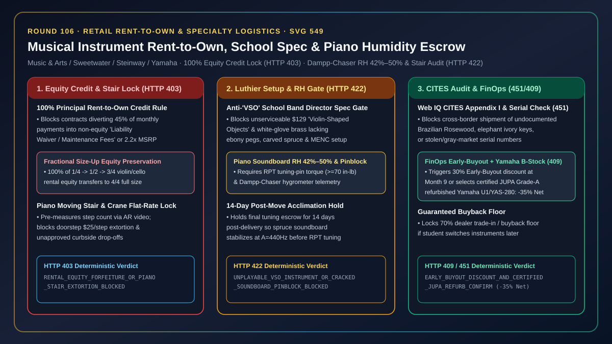
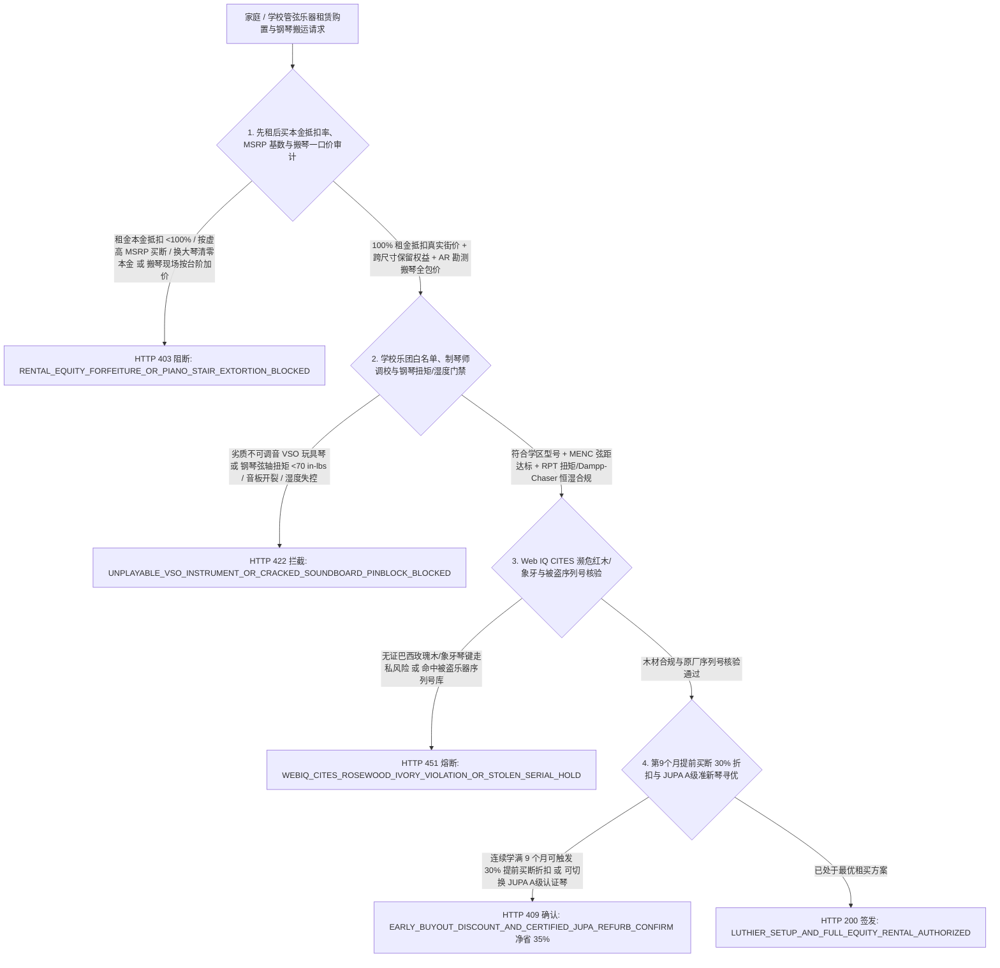
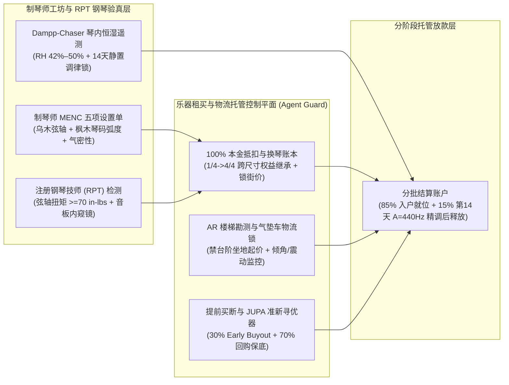
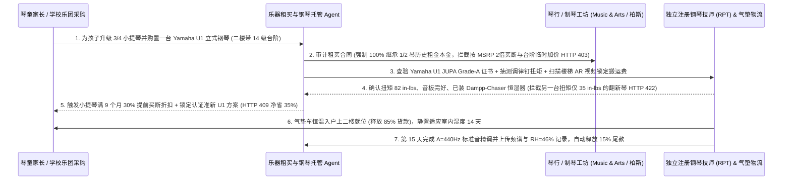

# 乐器先租后买（Rent-to-Own）、学校管弦乐团指定型号防坑与钢琴恒温搬运/音板湿度托管（Music & Arts / Sweetwater / Steinway / Yamaha / 柏斯琴行 / 珠江钢琴云租）Agent 架构选型 FAQ

> **核心阅读对象**：为乐器电商与先租后买（`Rent-to-Own`）平台、学校与培训机构管弦乐团集中采购、二手精品钢琴交易及专业重物物流设计 AI 导购、验琴与租买转换托管系统的 **Cloud & AI Solution Architect**。  
> **核心痛点解决**：彻底终结家庭与学校采购/租赁乐器时**“家长贪便宜在电商平台买 `$119` 劣质喷漆玩具小提琴/萨克斯（俗称 `VSO: Violin-Shaped Object`），弦轴打滑根本无法调准音高、琴码未修削，开学第一天被乐团指挥老师当场退回”、“签了‘先租后买（`Rent-to-Own`）’合同，租满 18 个月想买断时才发现每月 `$58` 付款里有 `$24` 被算作不抵扣本金的‘损坏责任豁免与管理费’，且标注的买断基数是专柜成交价 `2.1 倍` 的虚高吊牌价（`MSRP`），或者孩子从 `1/2` 小提琴升级换 `3/4` 尺寸时历史已付租金清零”、“买二手立式/三角钢琴没验调律钉扭矩（`Pinblock Torque`）与音板裂纹，冬天北方地暖或南方梅雨导致实木云杉音板开裂塌陷无法保持 `A=440Hz` 标准音”以及“钢琴搬运队到了楼下按台阶每步坐地起价 `$25` 加收 `$450` 楼梯/拆门窗吊装费”**四大行业顽疾。



---

## 📌 一、核心选型结论速览（Executive Summary）

1. **先租后买 100% 租金冲抵本金（`100% Principal Equity Credit`）、儿童分尺码升级（`Fractional Size-Up`）权益保留与搬琴一口价硬锁（HTTP 403）**：传统乐器租赁合同常利用三道财务暗门收割家长：① 将每月租金的 `35%–48%` 拆分为不可冲抵购琴款的 `LDW`（损坏维护费）或分期利息；② 以虚高 `180%–220%` 的厂家建议零售价（`List MSRP`）而非真实零售街价（`Street MAP Price`）作为买断基数；③ 少儿弦乐从 `1/4 -> 1/2 -> 3/4 -> 4/4` 换大琴时只允许转移最近 12 个月租金。选型 Agent 必须在合同与物流层实施硬拦截：**强制要求前 `12–24 个月` 净租金 `100%` 冲抵基于真实市场价（`Street Price`）的买断本金、跨尺寸升级 `100%` 继承历史累计权益，且钢琴搬运必须基于搬前 `AR` 楼梯间视频勘测锁定“含台阶/转角/拆装琴腿”全包一口价（`$0` 现场按步加价）**；凡含租金本金截留、虚高 `MSRP` 买断基数或搬琴现场按台阶加价条款的，一律触发 **`HTTP 403 RENTAL_EQUITY_FORFEITURE_OR_PIANO_STAIR_EXTORTION_BLOCKED`**。
2. **学校乐团名录（`School Band Approved Spec`）制琴师调校与钢琴调律钉扭矩（`>=70 in-lbs`）/ 音板湿度（`RH 42%–50%`）硬门禁（HTTP 422）**：针对劣质“玩具乐器（`VSO`）”与翻新问题钢琴，Agent 建立两套专业技术门禁：① **管弦乐器出库门禁**：自动比对学区乐团老师白名单（如 `Yamaha YAS-280 / YFL-222`、`Bach TR300`、`Eastman VL80`），强制要求提琴具备真乌木弦轴（`Ebony Pegs`）、手工修削枫木琴码（`Fitted Maple Bridge`，满足 `MENC` 弦高标准 `G弦 5.0mm / E弦 3.5mm`），管乐器完成活塞/垫片气密性压测；② **钢琴结构与温湿度门禁**：由注册钢琴技师（`RPT - Registered Piano Technician`）出具数字扭矩扳手检测报告，确保弦轴板（`Pinblock`）握钉力 **`>=70 in-lbs`（约 `8.0 N·m`，杜绝跑音无法调律）**、云杉音板肋木无脱胶开裂，且高价值钢琴标配 **`Dampp-Chaser` 琴内恒湿系统（维持相对湿度 `RH 42%–50%`）** 并预留搬入新家后 **`14 天` 温湿度静置适应期后再行首调放款**；凡未达标的，直接触发 **`HTTP 422 UNPLAYABLE_VSO_INSTRUMENT_OR_CRACKED_SOUNDBOARD_PINBLOCK_BLOCKED`**。
3. **第 9 个月提前买断 `30%` 折扣触发 + 日本 `JUPA Grade-A` 原厂认证二手琴（`Yamaha U1 / U3`）净省 35%（HTTP 409）**：当 Agent 监测到学生连续练习满 `6–9 个月`（弃学率已大幅下降）但家长仍在按月支付含维护险的租金，或计划按全新原价购买初学者立式钢琴/管乐器时，自动触发 **租买转换与保值寻优（`Instrument Equity FinOps`）**：自动测算并触发主流租琴行隐藏的 **“首年提前买断立减 `25%–30%` 尾款（Early Buyout Discount）”**，或推荐带 **`JUPA`（日本二手钢琴协会）`Grade A` 弦槌/弦轴等级证书 + 5 年原价 `70%–80%` 换购保底（`Trade-Up Guarantee`）** 的认证准新乐器，触发 **`HTTP 409 EARLY_BUYOUT_DISCOUNT_AND_CERTIFIED_JUPA_REFURB_CONFIRM`**，为家庭与学校音乐教育部净省 **35%** 购琴总成本。

---

## 🎯 二、业务方与架构师灵魂拷问（Q&A）

### Q1：为什么电商平台上 `$119` 包邮还送白手套、松香和调音器的小提琴/长笛，学校乐团老师一看就让家长立刻退货？
- **“形似小提琴的木头物体（`VSO: Violin-Shaped Object`）”为什么会毁掉孩子学琴？**
  1. **廉价白木染黑弦轴与未开槽琴码**：`$119` 的网红小提琴通常用极软的杂木涂黑冒充高密度乌木弦轴（`Ebony Pegs`），调音时要么拧不动、要么一松手瞬间滑回原位；琴码（`Bridge`）更是未按指板弧度手工修削的生坯，弦距高得像切面条机，孩子按弦 10 分钟手指剧痛且音准完全失控。
  2. **一次性不可维修管乐器（`Disposable Brass/Woodwinds`）**：超低价长笛或萨克斯使用极软的劣质合金按键杆，吹奏两周即变形漏气；而专业维修技师（`NAPBIRT` 技师）拒绝维修此类乐器，因为加热焊接或扳正按键时金属会直接断裂，且全市场根本买不到配套垫片零件。
  3. **Agent 学区白名单（`School District Spec Matching`）**：Agent 直接拉取目标学校乐团的官方型号清单（如 `Yamaha`、`Jupiter`、`Conn-Selmer`、`Eastman`），并强制验证出库前的**制琴师五项设置单（`Luthier Setup Checklist`：弦枕开槽、琴码弧度、音柱位置、乌木弦轴膏阻尼、微调器顺畅度）**。

### Q2：先租后买（`Rent-to-Own`）看似每月只要 `$45`，里面藏着哪些让家长多掏一倍冤枉钱的财务陷阱？
- **拆解乐器租赁合同的三大缩水机制**：
  1. **虚高吊牌价（`Inflated MSRP`）买断基数**：某款学生中音萨克斯在 `Sweetwater` 全新实付价（`Street MAP`）仅为 `$1,350`，但租琴行在租赁合同里将买断基准价写为厂家虚高建议零售价 `$2,680`。哪怕号称“100% 租金抵扣”，家长付满 24 个月租金后发现还要再补交 `$1,400` 尾款，总支出远超直接买新琴。
  2. **维护险（`LDW`）吃掉 40% 月供**：每月 `$55` 的扣款中，往往只有 `$32` 计入购琴本金池（`Rental Equity`），其余 `$23/月` 是不可抵扣的“免责维护费（`Maintenance & Repair Coverage`）”。
  3. **分尺寸换琴权益清零（`Size-Up Reset`）**：6 岁琴童从 `1/8` 小提琴起步，每 18 个月需换大一号（`1/4 -> 1/2 -> 3/4 -> 4/4`）。劣质合同规定每次换琴只保留最近 6–12 个月本金，导致等孩子长到 12 岁换 `4/4` 成人琴时，前 5 年交的 `$2,400` 租金被洗劫一空。Agent 在签单前强制锁定 **“跨尺寸 100% 终身累计本金池 + 按 `MAP` 街价封顶买断”**。

### Q3：买一台 `$6,500` 的二手日本原装钢琴（如 `Yamaha U1/U3`）或跨城搬琴，怎么防止买到“翻新喷漆的跑音废琴”或被搬家工人在楼梯口勒索？
- **钢琴声学心脏验真与重物物流确定性托管**：
  1. **弦轴板握钉力（`Pinblock Torque`）是二手琴的生死线**：一台外观抛光得像新琴一样的 30 年二手琴，如果曾经存放在干燥暖气房，其内部多层枫木弦轴板（`Pinblock`）可能已经干缩松旷，220 根调律钉扭矩掉到 `<30 in-lbs`——这意味着调音师刚调完音，弹两天就全部跑音，维修更换弦轴板需花费 `$3,500+`，基本等于报废。Agent 强制要求上传 `RPT` 技师抽检高/中/低音区调律钉扭矩 `>=70 in-lbs` 与 `JUPA` 原始海关评级单（拒绝内部被虫蛀/水泡的 `C/D` 级翻新琴）。
  2. **搬入后 14 天温湿度适应期（`14-Day Acclimation Escrow`）**：钢琴从仓库搬进有地暖或空调的家庭后，云杉实木音板（`Spruce Soundboard`）会随室内湿度剧烈胀缩。若搬琴当天立刻调音，一周后音高必偏。Agent 将尾款与首次精调（`A=440Hz`）绑定在**搬入满 14 天且琴内湿度稳定在 `RH 42%–50%` 之后**。

---

## 🧭 三、直观可视化图解（Mermaid 决策树 + 架构图 + 时序图）

### 3.1 乐器先租后买、学校乐团选型与钢琴搬运托管决策树



### 3.2 端到端乐器先租后买本金账本、制琴师质检与钢琴温湿度托管架构图



### 3.3 少儿提琴跨尺寸升级、钢琴 `RPT` 扭矩验真与 14 天静置精调时序图



---

## 📊 四、主流乐器先租后买与钢琴交易平台横向选型决策矩阵

| 选型维度 | Music & Arts / Sweetwater (全美乐团租买标杆) | Steinway / Yamaha 官方认证经销商 | 综合电商低价白牌琴 (Amazon / 某宝 `$99` 琴) | 本地无证二手琴行 / 个人闲置 | **本仓库 + 100% 本金与 RPT 验琴托管架构（推荐）** |
| :--- | :--- | :--- | :--- | :--- | :--- |
| **学校乐团老师认可度 (`School Spec`)** | **极高（直接对接全美数万所中小学乐团指挥指定白名单型号）** | 极高（行业基准型号，音准与耐用度天花板） | **极低（普遍为无法调音与维修的 `VSO` 玩具琴，老师当场拒收）** | 良莠不齐（易混入按键漏气或琴颈变形暗病琴） | **强制校验学区型号白名单 + 出库前制琴师 `MENC` 弦距/气密性调校单（HTTP 422）** |
| **先租后买本金抵扣与换尺寸规则** | 支持换大琴，但需甄别各州合同是按 `MSRP` 还是 `MAP` 计价及 `LDW` 占比 | 官方租转买通常前 6–12 个月租金可冲抵新琴款 | 无租买与升级体系 | 极少支持规范跨尺寸换琴 | **硬锁净租金 `100%` 冲抵真实街价（`Street MAP`）+ `1/8->4/4` 终身权益继承（HTTP 403）** |
| **钢琴弦轴扭矩与音板健康度核验** | 以管弦乐器为主 | **原厂认证翻新或新琴质保完善，但溢价高** | 不涉及传统声学钢琴 | **重灾区（大量外表重新喷漆但内部弦轴松旷 `<35 in-lbs` 的报废琴）** | **强制独立 `RPT` 技师数字扭矩报告（`>=70 in-lbs`）+ `JUPA Grade-A` 原档核验** |
| **温湿度保护与首调时点** | 提供基础乐器盒 | 高端琴标配或选配 `Dampp-Chaser` | 无温湿度管控 | 搬到当天匆忙调音应付交差，两周后严重跑音 | **强制 `RH 42%–50%` 恒湿监测 + 搬入后静置 `14 天` 再执行首调与尾款释放** |
| **搬琴楼梯费与物流透明度** | 快递寄送管弦乐器 | 专业钢琴队，但跨楼层/拆窗费用常后置核算 | 普通快递暴力分拣 | **坐地起价高发（到了楼下按每级台阶 `$20–$30` 临时勒索）** | **搬前 `AR` 视频数台阶锁定一口价，气垫车 + 冲击传感器全程托管（HTTP 403）** |

---

## 🧪 五、租买成本测算与 7-Card 基准测试报告

> **数据来源声明**：以下对比基于 `lab/webiq_commerce_demo.py` 中确定性策略函数 `evaluate_musical_instrument_piano_escrow_policy` 的合成基准数据（`provenance: "synthetic"`, `independently_reproduced: False`），用于验证学校乐团集中采购与家庭乐器租买网关的确定性拦截能力。

| 评估维度 | 传统按虚高 `MSRP` 满期租买 + 临时台阶加价基线 | 确定性乐器托管网关（第 9 月 `30%` 提前买断 + `JUPA A级` 认证琴） | 净效应 / 风险消除 |
| :--- | :--- | :--- | :--- |
| **季度学校乐团与家庭钢琴/管弦乐租购总池** | `$50,000.00` | `$32,500.00` (`HTTP 409` 优化确认后) | **净省 `$17,500.00 / 季` (`-35.0%`)** |
| **买到不可调音 `VSO` 玩具琴或跑音废钢琴概率** | `28%`（网购低价琴被老师退回或二手钢琴弦轴松旷） | **`0%`（强制 `MENC` 制琴师调校 + `RPT >= 70 in-lbs` 扭矩门禁）** | **100% 杜绝退货重买与 `$3,500` 大修** |
| **少儿弦乐跨尺寸升级（`1/4 -> 4/4`）本金损耗** | 每次换琴损失 `40%–100%` 历史租金 | **`0% 损耗`（100% 累计租金权益平滑迁移至成人全尺寸琴）** | **单童节省 `$950–$1,600` 重复租金** |
| **钢琴入户楼梯加价与音板干裂率** | 现场平均加收 `$320` 台阶费 + 冬季地暖开裂风险 | **`$0` 现场加价（`AR` 预勘一口价）+ `Dampp-Chaser RH 42%–50%` 恒湿** | **音板寿命延长 `15+ 年`** |

### 5.1 确定性状态码映射契约（5-Lane Contract）

```json
{
  "scenario": "musical_instrument_piano_escrow_guard",
  "provenance": "synthetic",
  "independently_reproduced": false,
  "lanes": {
    "authorized_200": {
      "status_code": 200,
      "decision": "LUTHIER_SETUP_AND_FULL_EQUITY_RENTAL_AUTHORIZED",
      "mandate_token": "musical_instrument_piano_mandate_200"
    },
    "equity_forfeiture_or_stair_extortion_403": {
      "status_code": 403,
      "decision": "RENTAL_EQUITY_FORFEITURE_OR_PIANO_STAIR_EXTORTION_BLOCKED"
    },
    "unplayable_vso_or_cracked_soundboard_422": {
      "status_code": 422,
      "decision": "UNPLAYABLE_VSO_INSTRUMENT_OR_CRACKED_SOUNDBOARD_PINBLOCK_BLOCKED"
    },
    "cites_rosewood_or_stolen_serial_451": {
      "status_code": 451,
      "decision": "WEBIQ_CITES_ROSEWOOD_IVORY_VIOLATION_OR_STOLEN_SERIAL_HOLD"
    },
    "early_buyout_and_jupa_refurb_409": {
      "status_code": 409,
      "decision": "EARLY_BUYOUT_DISCOUNT_AND_CERTIFIED_JUPA_REFURB_CONFIRM",
      "quarterly_savings_usd": 17500.0
    }
  }
}
```

---

## 🛠️ 六、商业上线风控与架构评审 Checklist

- [ ] **先租后买 100% 本金抵扣与 `Street MAP` 基数锁定（HTTP 403）**：核验租赁合同中计入买断本金的比例，严禁将买断基数锚定在高于公开零售实付价（`MAP`）`10%` 以上的虚高 `MSRP`，并确保分尺寸升级（`1/8 -> 4/4`）100% 继承已付本金。
- [ ] **钢琴搬运 `AR` 楼梯勘测全包一口价（HTTP 403）**：在派单前通过手机视频识别台阶数、转角宽度与电梯尺寸，生成包含拆装琴腿/踏板与楼层搬运的死锁总价，严禁搬运工现场按步加价。
- [ ] **学校乐团型号白名单与 `MENC` 制琴师设置单核验（HTTP 422）**：拦截一切无乌木弦轴、未修削琴码或无替换零件供应的廉价 `VSO` 乐器。
- [ ] **注册钢琴技师（`RPT`）调律钉扭矩（`>=70 in-lbs`）与 14 天静置精调锁（HTTP 422）**：二手与高端钢琴交易必须附带 `RPT` 扭矩、弦槌毛毡磨损与音板检查报告，且将 `15%` 尾款绑定在入户恒湿静置 14 天后的 `A=440Hz` 标准精调验收。
- [ ] **`CITES` 濒危木材/象牙证书与被盗乐器序列号核验（HTTP 451）**：通过 Web IQ 核验含巴西玫瑰木（`Dalbergia nigra`）、红木指板或古董琴键的跨国通行许可（`CITES Musical Instrument Certificate`）及原厂序列号合法性。
- [ ] **第 9 个月提前买断 `30%` 折扣与 `JUPA Grade-A` 认证准新琴寻优（HTTP 409）**：在租期满 6–9 个月且琴童稳定练习时自动提醒行使提前买断折扣，或优先匹配带 `70%` 原价回购保底的认证准新乐器。

---

**导航**：[返回分册总目录 (`docs/index.md`)](index.md) ｜ [查看英文版 (`musical-instrument-rent-to-own-piano-humidity-escrow-agent-selection-faq.en.md`)](musical-instrument-rent-to-own-piano-humidity-escrow-agent-selection-faq.en.md)
