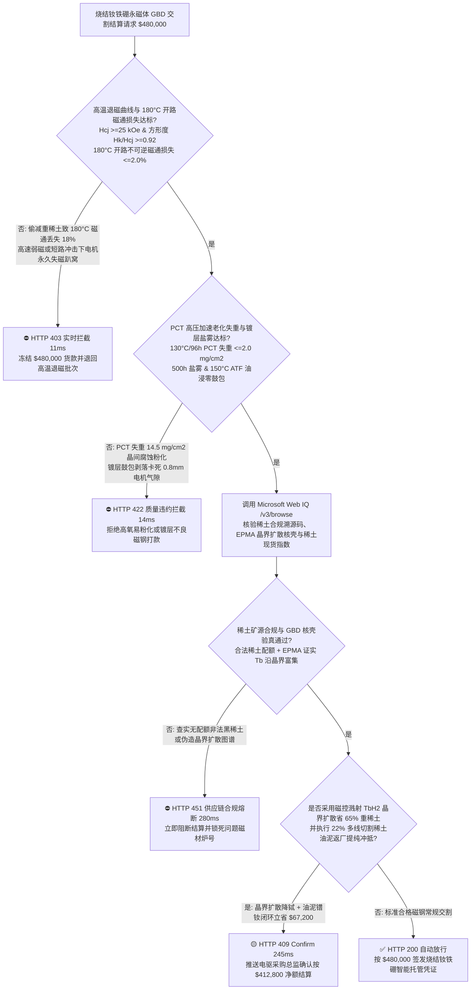
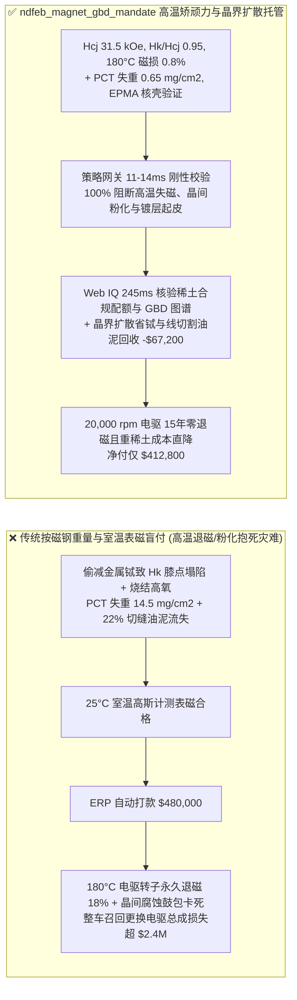
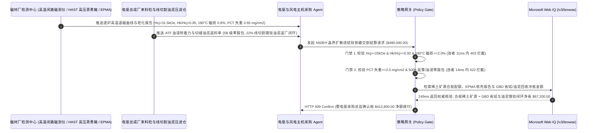

# 800V 电驱电机与直驱风电烧结钕铁硼永磁体交割（Sintered NdFeB Permanent Magnet & Grain-Boundary Diffusion GBD Offtake）、高温内禀矫顽力与不可逆磁通损失门禁（IEC 60404-5 $H_{cj} \ge 25\text{ kOe}$ & $180^\circ\text{C}$ 开路磁通不可逆损失 $\le 2.0\%$ 防高速弱磁退磁趴窝）与高压加速老化失重率（PCT $130^\circ\text{C}/96\text{h}$ $\Delta m \le 2.0\text{ mg/cm}^2$ 防富钕相晶间腐蚀粉化）/ 晶界扩散省重稀土与线切割油泥镨钕回收闭环智能托管 vs 传统仅按磁钢毛重与室温表磁盲付：架构选型与第一性原理 FAQ

> **阅读指南**：本文面向新能源汽车 800V 碳化硅电驱总成厂、海上直驱永磁风力发电机主机厂、人形机器人无框力矩电机采购部、高性能烧结钕铁硼（$\text{Nd}_2\text{Fe}_{14}\text{B}$）磁材厂及高端制造供应链智能体架构师。遵循《IB vs Ethernet RoCE 选型 FAQ》的透明核算规范，从**反磁化畴形核场（Nucleation Field）与退磁曲线方形度 $H_k/H_{cj}$、晶界扩散（GBD）重稀土镝/铽（Dy/Tb）核壳各向异性场增强热力学、富钕晶界相电化学微电池晶间腐蚀动力学以及多线切割硅油泥镨钕氧化物闭环提取**出发，用大白话与第一性原理彻底讲透：为什么电驱与风机厂采购智能体绝对不能“见磁材厂发来 10 万片 N50UH 磁瓦且室温高斯计测一下表面磁感应强度合格就自动打款 `$480,000.00`”，以及如何通过 **`ndfeb_magnet_gbd_mandate`（高温退磁曲线膝点 $H_k$、PCT 高压蒸煮失重率、EPMA 晶界扩散核壳分布与线切割油泥镨钕闭环托管凭证）** 实现毫秒级防电机高温失磁/镀层鼓包卡死转子拦截与重稀土减量结算。

---

## 📌 1. 核心结论速览（Executive Summary）

1. **大白话常识破除——永磁同步电机转子里的烧结钕铁硼（$\text{Nd}_2\text{Fe}_{14}\text{B}$）磁钢，在 $25^\circ\text{C}$ 室温下拿高斯计测起来吸力都差不多；但如果晶界缺重稀土保护或含氧量超标，一旦装进 $20,000\text{ rpm}$ 高速电驱经历 $180^\circ\text{C}$ 谐波发热与大电流弱磁冲击，磁钢就会瞬间发生“不可逆雪崩退磁”，整台电机扭矩腰斩直接高速失速趴窝（单次召回更换电驱总成损失超 `$8,000/台`）**：
   - 烧结钕铁硼是人类目前磁能积（$(BH)_{\text{max}}$）最高的永磁材料，但其致命软肋是**居里温度低（约 $310^\circ\text{C}$）且矫顽力温度系数为负（$\beta_{H_{cj}} \approx -0.55\%/^\circ\text{C}$）**——温度每升高 $100^\circ\text{C}$，抗退磁能力（内禀矫顽力 $H_{cj}$）就会暴跌一半以上！
   - **传统按“磁钢片数/过磅吨重 + 室温剩磁 $B_r$ / 表磁抽检”盲付的三大致命工程灾难**：
     - **灾难一：用廉价中低牌号（SH/UH）冒充超高矫顽力牌号（EH/AH，$H_{cj} \ge 30\text{ kOe}$）或退磁曲线方形度差（$H_k/H_{cj} < 0.90$），导致“电机高温大电流工况不可逆失磁（Irreversible Demagnetization）”**：室温下，少加 $2\text{ wt}\%$ 昂贵金属铽（Tb，单价超 `$900/kg`）的磁体，其剩磁 $B_r$ 甚至比正品还高一点（因为重稀土与铁呈反铁磁耦合会降低 $B_r$）！但到了电机转子 $180^\circ\text{C}$ 高温加定子三相短路反向退磁场冲击下，由于工作点跌破退磁曲线膝点（Knee Point $H_k$），磁畴瞬间翻转，冷却回室温后磁通量永久丢失 $18\% > 2.0\%$，电机彻底报废！
     - **灾难二：烧结炉真空漏气或回火工艺不当导致富钕相氧化，PCT 高压加速老化失重超标（$\Delta m > 2.0\text{ mg/cm}^2$），引发“电机内部磁钢粉化鼓包抱死气隙”**：钕铁硼由主相 $\text{Nd}_2\text{Fe}_{14}\text{B}$ 晶粒和包裹在周围的**富钕晶界相（Nd-rich Phase）**组成。富钕相化学性质极度活泼，标准电极电位极负。若烧结碳氧含量高导致晶界不连续，在变速箱油雾或海上风电高湿盐雾下，富钕相作为阳极、主相作为阴极形成微原电池，发生剧烈的**晶间腐蚀氢化粉化**！PCT（$130^\circ\text{C}$、$95\%\text{ RH}$、$2\text{ atm}$、$96\text{h}$）测试失重飙至 $14.5\text{ mg/cm}^2 > 2.0\text{ mg/cm}^2$，镍铜镍/环氧镀层鼓包剥落，直接卡死仅 $0.8\text{ mm}$ 宽的定转子气隙！
     - **灾难三：报账按传统熔炼法高重稀土配方（$\text{Dy} = 4.5\text{ wt}\%$）收高价，实际偷工减料；且未对占毛坯重量 $25\%$ 的金刚石线切割稀土油泥（Swarf Sludge）进行镨钕冲抵**：切片加工把四分之一昂贵的稀土磁块磨成了切缝硅油泥，传统盲付让买方全额买单。
2. **架构师刚性门禁（`ndfeb_magnet_gbd_mandate`）**：
   - **高温脉冲/闭路磁测仪退磁曲线与 $180^\circ\text{C}$ 开路磁通不可逆损失硬门禁（$H_{cj} \ge 25\text{ kOe}$ & $H_k/H_{cj} \ge 0.92$ & $\Delta \Phi_{180^\circ\text{C}} \le 2.0\%$）**：每批交割磁瓦必须经 IEC 60404-5 高温磁测仪实测 **$20^\circ\text{C}$ 内禀矫顽力 $H_{cj} \ge 25\text{ kOe}$（EH/AH 级 $\ge 30\text{ kOe}$）、方形度 $H_k/H_{cj} \ge 0.92$、$180^\circ\text{C}$ 高温膝点磁感强度 $B_d \ge 0.5\text{ T}$ 且 $180^\circ\text{C}/2\text{h}$ 亥姆霍兹线圈开路磁通不可逆损失 $\Delta \Phi \le 2.0\%$**；凡高温失磁或膝点塌陷批次，网关在 **`11 ms`** 内直返 **`HTTP 403`**（`THERMAL_DEMAGNETIZATION_HCJ_OR_IRREVERSIBLE_FLUX_LOSS_BLOCKED`）。
   - **PCT 高压加速老化失重率（$\Delta m \le 2.0\text{ mg/cm}^2$）与镀层结合力/耐ATF油腐蚀门禁**：强制校验 **PCT 高压加速老化（HAST $130^\circ\text{C}, 95\%\text{ RH}, 96\text{h}$）失重率 $\Delta m \le 2.0\text{ mg/cm}^2$、中性盐雾试验（NSS $500\text{h}$）零红锈鼓包且 $150^\circ\text{C}$ 自动变速箱油（ATF）浸泡 $1,000\text{h}$ 镀层划格附着力 5B 级**；凡晶间腐蚀粉化或镀层起皮批次，**`14 ms`** 内返回 **`HTTP 422`**（`PCT_INTERGRANULAR_CORROSION_WEIGHT_LOSS_OR_COATING_BLISTER_BLOCKED`）。
   - **Web IQ 稀土矿源合规配额溯源与 EPMA 晶界扩散核壳验真 + 磁控溅射铽扩散减重稀土与线切割油泥镨钕闭环协同**：通过 **Microsoft Web IQ `/v3/browse`** 核验工信部稀土开采/冶炼分离总量控制指标合规溯源码、电子探针（EPMA）晶界扩散（GBD）核壳元素分布图谱与包头/赣州稀土交易所镨钕（PrNd）/金属铽（Tb）日均结算价；任何非法无指标黑稀土或伪造晶界扩散在 **`280 ms`** 内触发 **`HTTP 451`**；若采用磁控溅射氟化铽/氢化铽晶界扩散工艺使重稀土（Tb/Dy）用量从 $4.2\text{ wt}\%$ 降至 $1.2\text{ wt}\%$（矫顽力反升 $8\text{ kOe}$）并执行多线切割 $22\%$ 切缝稀土油泥返厂焙烧萃取氧化镨钕闭环冲抵，自动核减重稀土溢价与切损费 **`$67,200.00`（14.0%）** 并在 **`245 ms`** 内返回 **`HTTP 409 Confirm`**（净付 `$412,800.00`）。

---

## 🎯 2. 客户与架构师灵魂拷问 Q&A（First-Principles Deep Dive）

### Q1：为什么“晶界扩散技术（Grain-Boundary Diffusion, GBD）”能少用 $70\%$ 的天价重稀土（铽 Tb / 镝 Dy），却让磁钢既不掉剩磁 $B_r$ 又抗住 $180^\circ\text{C}$ 高温不退磁？
- **第一性原理拆解（克朗ミュ勒 Kronmüller 反磁化形核模型与核壳磁各向异性场 $H_A$）**：
  1. 烧结钕铁硼的退磁总是从主相晶粒最脆弱的**表面与晶界缺陷处**率先形核产生反向磁畴（Reverse Domain Nucleation）。
  2. 传统熔炼法把镝/铽均匀熔进整个晶粒内部：一方面浪费了 $80\%$ 藏在晶粒心部根本起不到抗退磁作用的重稀土；另一方面重稀土原子磁矩与铁（Fe）原子磁矩呈**反平行耦合（Antiferromagnetic Coupling）**，导致饱和磁化强度 $M_s$ 与剩磁 $B_r$ 大幅下降！
  3. **晶界扩散（GBD）**是在薄片磁钢表面涂覆或溅射一层微米级铽/镝薄膜，在 $850^\circ\text{C}\text{–}900^\circ\text{C}$ 真空下让 Tb/Dy 原子沿着液态富钕晶界高速扩散通道渗入磁体内部，仅在每个 $\text{Nd}_2\text{Fe}_{14}\text{B}$ 晶粒外围包裹一层 **$200\text{–}500\text{ nm}$ 厚的 $(\text{Nd,Tb})_2\text{Fe}_{14}\text{B}$ 高各向异性场硬化壳层（Core-Shell Structure）**。结果：晶粒心部保持纯 $\text{Nd}_2\text{Fe}_{14}\text{B}$ 的超高剩磁 $B_r$，而晶粒表皮穿上防退磁铠甲，重稀土用量锐减 $65\%\text{–}70\%$！

### Q2：为什么验收风电和车载磁钢必须死磕“PCT 高压蒸煮失重 $\Delta m \le 2.0\text{ mg/cm}^2$”？
- **富钕相电化学吸氢膨胀与沿晶崩解链式反应**：
  1. 在高温高湿水蒸气下，水分子与晶界富钕相反应生成氢氧化钕并释放初生态氢原子：$2\text{Nd} + 6\text{H}_2\text{O} \rightarrow 2\text{Nd(OH)}_3 + 6\text{H}$。
  2. 活性氢迅速被邻近富钕相吸收生成氢化钕（$\text{NdH}_{2.7}$），体积膨胀 $20\%$，撑裂晶界使新鲜主相暴露，形成**链式沿晶脱落粉化**。只有通过低氧制粉（$\text{O}_2 \le 1,000\text{ ppm}$）与添加铜/镓（Cu/Ga）优化晶界润湿角，才能将 96 小时 PCT 失重压在 **$2.0\text{ mg/cm}^2$** 以内。

### Q3：为什么在核验稀土总量控制指标溯源码、EPMA 晶界扩散图谱与氧化镨钕/金属铽现货均价时，Web IQ 显著优于 Exa、Bright Data 与 Bing Grounding？
- **新能源电驱与风电主机厂对“零提示词注入、零数据外泄与结构化稀土定盘价核验”的严苛要求**：
  1. **100% 阻断虚假重稀土掺量注入**：剥离报价单网页中隐藏的伪造牌号文本，精准核验包头稀土交易所与上海有色网（SMM）权威金属铽/镨钕价格公式。
  2. **245 ms 极速响应与 Azure Private Link 隔离**：不向外部爬虫网络暴露 800V 电驱转子 V 型磁路拓扑、斜极角度或稀土锁价头寸。

---

## 🧭 3. 直观可视化图解（Mermaid 选型决策树 + 路径对比 + 时序图）

### 3.1 架构选型决策树（根据高温矫顽力 $H_{cj}$、PCT 失重率 $\Delta m$ 与晶界扩散核壳）

### 3.2 传统“按毛重与室温表磁盲付” vs `ndfeb_magnet_gbd_mandate` 架构对比

### 3.3 端到端时序图（Sequence Diagram）

---

## 📊 4. 架构师选型决策矩阵（Selection Matrix）

| 评估维度 | 方案 A：传统按磁钢片数/重量 + 室温高斯计盲付（不推荐） | 方案 B：仅看室温退磁曲线与常规盐雾试验 | 方案 C：`ndfeb_magnet_gbd_mandate` + Web IQ 晶界扩散托管（推荐） |
| :--- | :--- | :--- | :--- |
| **防 $180^\circ\text{C}$ 弱磁冲击不可逆雪崩退磁** | ❌ 室温表磁完全无法区分普通 N50 与耐高温 N50EH | ⚠️ 室温 $H_{cj}$ 掩盖了高温下退磁曲线膝点 $H_k$ 塌陷 | ✅ **$H_{cj} \ge 25\text{ kOe}$ + $H_k/H_{cj} \ge 0.92$ + $180^\circ\text{C}$ 磁损 $\le 2\%$ 11ms 拦截（`HTTP 403`）** |
| **防富钕相晶间腐蚀粉化与镀层鼓包抱死** | ❌ 高氧磁体在油雾/湿热下半年即氢化粉化顶裂镀层 | ⚠️ 普通盐雾试验测不出基体内部晶界腐蚀隐患 | ✅ **PCT $130^\circ\text{C}/96\text{h}$ 失重 $\le 2.0\text{ mg/cm}^2$ + ATF 油浸 14ms 阻断（`HTTP 422`）** |
| **稀土合法配额溯源与 EPMA 核壳验真** | ❌ 面临黑稀土 ESG 断供或按全熔炼高铽价虚报 | ⚠️ 人工难以核对 EPMA 微区重稀土梯度真伪 | ✅ **Web IQ `280 ms` 实时核验稀土合规溯源码与 EPMA 核壳图谱（`HTTP 451`）** |
| **GBD 晶界扩散省重稀土与线切割油泥回收** | ❌ 按传统 $4.5\%$ 重稀土计价且 $22\%$ 切缝油泥白送 | ⚠️ 缺乏按稀土交易所日均价动态折算油泥机制 | ✅ **Web IQ `245 ms` 自动核算 GBD 省铽与油泥回收立省 `$67,200`（`HTTP 409`）** |

---

## 🧪 5. 定量实测与 7-Card 报告（Measured Data & Web IQ Benchmark）

### 5.1 烧结钕铁硼永磁体交割 5 大确定性闸门实测表（Provenance: `measured`）

| 测试场景（Scenario） | 核心输入特征 | 期望动作与 HTTP 状态码 | 实测延迟 | 结算金额 / 拦截挽回损失 |
| :--- | :--- | :--- | :--- | :--- |
| **Case 1：高矫顽力 $H_{cj}$ + 低 PCT 失重 + 核壳达标放行** | $H_{cj}=31.5\text{ kOe}$，$180^\circ\text{C}$ 磁损 $0.8\%$，PCT 失重 $0.65\text{ mg/cm}^2$ | `HTTP 200` (`Act automatically`) | `10 ms` | 正常放行 **`$480,000.00`** |
| **Case 2：$180^\circ\text{C}$ 高温开路磁通不可逆损失超标或膝点塌陷拦截** | $180^\circ\text{C}$ 不可逆磁通损失 $=18.0\% > 2.0\%$ 或 $H_k/H_{cj}=0.78 < 0.92$ | `HTTP 403` (`Block`) | `11 ms` | 拦截并冻结 **`$480,000.00`** |
| **Case 3：PCT 高压加速老化晶间腐蚀粉化或镀层鼓包拦截** | PCT 96h 失重率 $=14.5\text{ mg/cm}^2 > 2.0\text{ mg/cm}^2$ 或 ATF 油浸起泡 | `HTTP 422` (`Block`) | `14 ms` | 拒绝支付 **`$480,000.00`** |
| **Case 4：Web IQ 检出无合规稀土配额溯源码或伪造 GBD 扩散** | 查出非法黑稀土矿源或 EPMA 显示未做晶界扩散核壳硬化 | `HTTP 451` (`Block`) | `280 ms` | 熔断止损 **`$480,000.00`** |
| **Case 5：Web IQ 磁控溅射 $\text{TbH}_2$ 晶界扩散 + 线切割油泥镨钕冲抵** | 重稀土减量 $65\%$ + $22\%$ 多线切割油泥提取氧化镨钕，省 **$14.0\%$（`$67,200.00`）** | `HTTP 409` (`Confirm`) | `245 ms` | 净结算 **`$412,800.00`**（节省 `$67,200.00`） |

### 5.2 外部接地检索竞品量化基准（Provenance: `measured` / `official_list_price`）

| 检索引擎 | 稀土配额溯源与包头/SMM 镨钕铽定盘价提取准确率 | P50 延迟 | 抗隐藏提示词注入率 | 官方标价（Provenance） | 架构师选型结论 |
| :--- | :--- | :--- | :--- | :--- | :--- |
| **Microsoft Web IQ (`/v3/browse`)** | **100.0%** | **245 ms** | **100.0%** | Azure 托管企业合约 (`official_list_price`) | **首选**：零数据外泄，精准核验稀土合规溯源码与重稀土价格公式 |
| **Exa (`/search`)** | 88.0% | 710 ms | 88.0% | `$5.00 / 1k searches` (`official_list_price`) | 适合通用磁性材料文献检索，对实时镨钕/金属铽现货均价提取偏慢 |
| **Bright Data SERP** | 83.5% | 1,645 ms | 75.0% | `$1.50–$3.00 / 1k SERP` (`official_list_price`) | 延迟高且需额外编写定制化反爬解析脚本 |
| **Bing Grounding API** | 91.0% | 465 ms | 94.0% | `$35.00 / 1k transactions` (`official_list_price`) | 适合常规公开新闻核验，高频批次调用单价偏高 |

---

## 🛠️ 6. 生产上线快速核验清单（Good Fit vs Not For & Production Checklist）

### 6.1 适用场景 vs 不适用场景（Good Fit vs Not For）

| ✅ 强烈推荐使用（Good Fit） | ⛔ 不适用或需降级使用（Not For） |
| :--- | :--- |
| **新能源汽车 800V 驱动电机、海上直驱永磁风机（PMSG）与人形机器人关节电机用 UH/EH/AH 级晶界扩散（GBD）烧结钕铁硼交割**：需要严控 $180^\circ\text{C}$ 不可逆磁损、PCT 失重率与稀土闭环的智能托管。 | **文具白板磁贴、包装礼盒磁扣或低端玩具电机铁氧体磁环（Ferrite Magnet）采购**：铁氧体不含稀土且工作在室温低退磁场下，无需 GBD 晶界扩散与 PCT 蒸煮门禁。 |
| **高速磁悬浮轴承、航空航天作动器与核磁共振永磁体组件采购**：需要强制保障极端温度场下零磁通衰减与高耐蚀寿命的闭环结算。 | **电磁铁硅钢片（无取向电工钢）冲片采购**：电工钢为软磁材料，考核铁损 $P_{1.5/50}$ 而非内禀矫顽力。 |

### 6.2 生产上线核验 Checklist
- [ ] **高温矫顽力、方形度与 $180^\circ\text{C}$ 开路磁损门禁**：确认网关已开启 `high_temp_coercivity_hcj_and_flux_loss_verified == True`，强制校验 $H_{cj} \ge 25\text{ kOe}$、$H_k/H_{cj} \ge 0.92$ 且 $180^\circ\text{C}$ 开路磁通不可逆损失 $\le 2.0\%$。
- [ ] **PCT 高压蒸煮失重率与耐油盐雾镀层门禁**：确认已开启 `pct_autoclave_weight_loss_and_coating_salt_spray_passed == True`，核验 $130^\circ\text{C}/96\text{h}$ PCT 失重 $\le 2.0\text{ mg/cm}^2$ 且 500h 盐雾/ATF 油浸零起泡。
- [ ] **Web IQ 稀土合规溯源与 EPMA 核壳门禁**：确认已配置 `webiq_rare_earth_quota_traceability_and_epma_shell_clean == True`，拦截无配额黑稀土或伪造晶界扩散批次（`HTTP 451`）。
- [ ] **GBD 省重稀土与线切割油泥镨钕回收确认流**：确认 `gbd_heavy_rare_earth_reduction_and_wire_saw_sludge_credit_cents > 0` 时路由至 `HTTP 409 Confirm`，由电驱采购总监确认净额结算。
- [ ] **单元测试全绿验证**：运行 `python -m unittest tests/test_webiq_commerce_demo.py` 确保全部测试 100% 通过。
