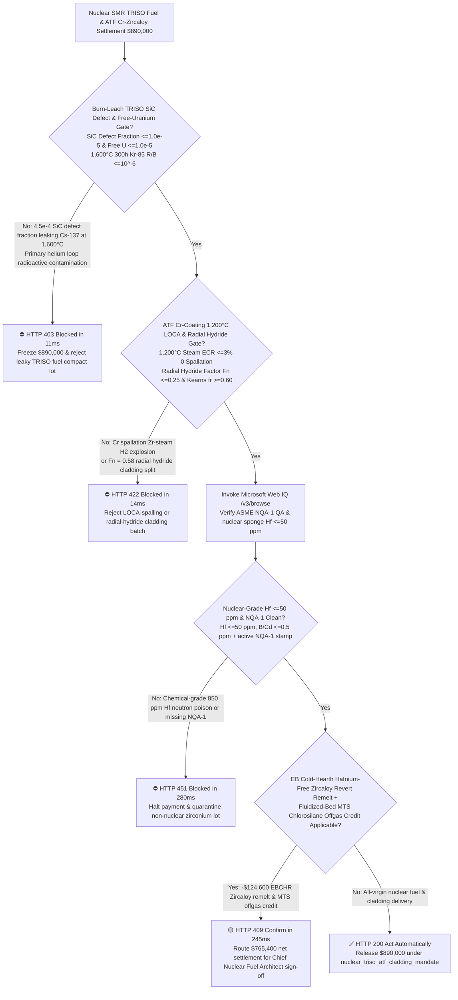
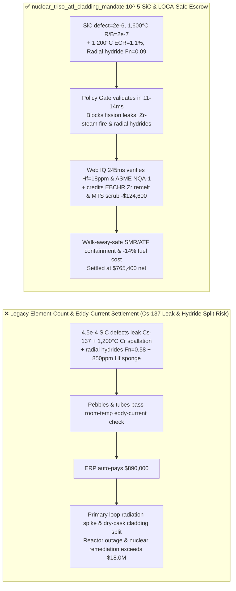
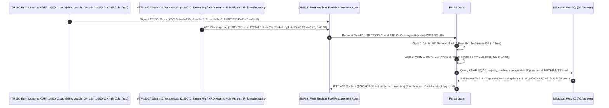

# Gen-IV SMR TRISO Coated Particle Fuel & PWR Accident-Tolerant Fuel (ATF) Cr-Coated Zircaloy Cladding Offtake, Burn-Leach $\text{SiC}$ Defect-Fraction & Free-Uranium Gate ($\text{SiC Defect} \le 1.0\times 10^{-5}$ & $U_{\text{free}}/U_{\text{total}} \le 1.0\times 10^{-5}$) & $1,200^\circ\text{C}$ LOCA Steam Oxidation / Radial-Hydride Orientation Gate ($\text{ECR} \le 3\%$ & $F_n \le 0.25$) / Nuclear-Grade Hafnium-Free Zircaloy EB Remelt & MTS Offgas Escrow vs. Element-Count & Eddy-Current Overbilling: Architecture Selection & First-Principles FAQ

> **Reader's Guide**: This guide is written for Gen-IV High-Temperature Gas-Cooled Reactor (HTGR) and Fluoride-Salt-Cooled High-Temperature Reactor (FHR) Small Modular Reactor (SMR) developers, PWR Accident-Tolerant Fuel (ATF) fuel-assembly vendors, TRISO (Tristructural-Isotropic: Buffer / IPyC / $\text{SiC}$ / OPyC) fuel fabricators, nuclear-grade Hafnium-free ($\text{Hf} \le 50\text{ ppm}$) Zircaloy pilgering and HiPIMS/cold-spray Chromium-coating mills, and nuclear supply-chain agent architects. Modeled after the *IB vs. Ethernet RoCE Selection FAQ*, it explains from **fluidized-bed CVD $\text{SiC}$ pressure-vessel containment of $1,600^\circ\text{C}$ metallic fission products ($\text{^{137}Cs}/\text{^{110m}Ag}$), autocatalytic exothermic Zirconium-steam oxidation ($\text{Zr} + 2\text{H}_2\text{O} \rightarrow \text{ZrO}_2 + 2\text{H}_2\uparrow$) during $1,200^\circ\text{C}$ Loss-of-Coolant Accidents (LOCA), Kearns basal pole texture ($f_r$) suppression of brittle radial zirconium hydrides ($F_n$), and thermal-neutron poisoning by unseparated Hafnium ($\sigma_a = 104\text{ barns}$ vs. $0.185\text{ barns}$ for Zr)** why a settlement agent must never release `$890,000.00` simply because $200,000$ pebbles or $2,000$ cladding tubes passed a room-temperature eddy-current check—and how **`nuclear_triso_atf_cladding_mandate`** enforces sub-15ms fission-leak/hydride blocking and EB-remelt settlement.

---

## 📌 1. Executive Summary

1. **Breaking the "Room-Temp Eddy-Current & Pebble Count" Myth—In a Gen-IV SMR, Every $0.8\text{ mm}$ TRISO Fuel Kernel Relies on a $35\ \mu\text{m}$ $\text{SiC}$ Shell as its Own Miniature Pressure Vessel at $1,600^\circ\text{C}$; If Fluidized-Bed CVD Leaves Micro-Cracks in Just $4.5\text{ per }10,000$ Particles ($4.5\times 10^{-4} > 10^{-5}$), Radioactive $\text{^{137}Cs}$ and $\text{^{110m}Ag}$ Contaminate the Entire Primary Helium Loop; Meanwhile, in a PWR Cladding Tube, Wrong Cold-Pilgering Texture ($Q < 1$) Causes Zirconium Hydrides to Precipitate Radially Like Razor Blades ($F_n = 0.58 > 0.25$)—Splitting Spent Fuel Rods Open During Dry Cask Storage**:
   - Nuclear fuel barriers (TRISO $\text{SiC}$ shells and Cr-coated ATF Zircaloy cladding) represent the primary physical containment preventing fission-product release under both normal operation and beyond-design-basis accidents.
   - **Three Catastrophic Failures of Legacy Element-Count & Room-Temp Eddy-Current Settlement**:
     - **Failure 1: Fluidized-Bed CVD Soot Inclusions or Columnar $\text{SiC}$ Grain Boundaries Cause High TRISO $\text{SiC}$ Defect Fractions ($4.5\times 10^{-4} > 1.0\times 10^{-5}$) & $1,600^\circ\text{C}$ $\text{^{137}Cs}/\text{^{85}Kr}$ Release**: Each HTGR fuel pebble or compact contains $>10,000$ TRISO particles. If methyltrichlorosilane (MTS) pyrolysis temperatures drift above $1,550^\circ\text{C}$, large columnar $\beta\text{-SiC}$ grains form fast diffusion pathways that leak volatile Cesium-137 and Silver-110m at $1,600^\circ\text{C}$!
     - **Failure 2: Porous Chromium ATF Coating Spalls in $1,200^\circ\text{C}$ LOCA Steam Triggering Autocatalytic Zirconium-Water Hydrogen Detonation, While Low-$Q$ Pilgering Texture Forms Brittle Radial Hydrides ($F_n = 0.58 > 0.25$)**: Uncoated or spalling Zircaloy reacts violently with $1,200^\circ\text{C}$ steam ($\Delta H = -6.5\text{ MJ/kg Zr}$), generating explosive $\text{H}_2$ gas and embrittling the core. Worse, if cold-pilgering wall-to-diameter reduction ratio $Q$ is poorly controlled (radial Kearns factor $f_r < 0.60$), absorbed hydrogen precipitates as **radial $\delta\text{-ZrH}_{1.66}$ platelets** perpendicular to hoop stress—cracking the cladding tube!
     - **Failure 3: Chemical-Grade Zirconium Sponge Containing $850\text{ ppm}$ Hafnium ($\text{Hf} > 50\text{ ppm}$) Poisoning Reactor Neutronics, Missing ASME NQA-1 Traceability, and Scrapping Nuclear-Grade Hafnium-Free Zircaloy Offcuts**: Because Hafnium has a $560\times$ higher thermal-neutron capture cross-section than Zirconium ($104\text{ vs. } 0.185\text{ barns}$), unseparated Hf kills reactor criticality; conversely, discarding clean nuclear-grade Zr pilgering offcuts wastes expensive MIBK Hf-separation value.
2. **Architect's Deterministic Gate (`nuclear_triso_atf_cladding_mandate`)**:
   - **Burn-Leach TRISO $\text{SiC}$ Defect Fraction ($\le 1.0\times 10^{-5}$), Free Uranium ($\le 1.0\times 10^{-5}$) & $1,600^\circ\text{C}$ KÜFA Retention Gate**: Requires $800^\circ\text{C}$ oxidative burn-back + nitric-acid leach and $1,600^\circ\text{C}$ accident heating confirming **defective $\text{SiC}$ particle fraction $\le 1.0\times 10^{-5}$ ($95\%$ confidence), tramp free-uranium fraction $\le 1.0\times 10^{-5}$, $\text{SiC}$ density $\ge 3.19\text{ g/cm}^3$, and $1,600^\circ\text{C}/300\text{ h}$ $\text{^{85}Kr}$ release-to-birth $R/B \le 10^{-6}$**. Leaky TRISO lots are blocked in **`11 ms`** with **`HTTP 403`** (`TRISO_SIC_LAYER_DEFECT_FISSION_CESIUM_LEAK_OR_FREE_URANIUM_BLOCKED`).
   - **ATF Cr-Coating $1,200^\circ\text{C}$ Steam LOCA ($\text{ECR} \le 3\%$) & Radial Hydride Orientation Factor Gate ($F_n \le 0.25$ & Kearns $f_r \ge 0.60$)**: Requires **double-sided $1,200^\circ\text{C}$ steam oxidation for $3,000\text{ s}$ with zero Cr spallation and Equivalent Cladding Reacted $\text{ECR} \le 3\%$, XRD radial Kearns texture factor $f_r \ge 0.60$, and hoop-stressed hydride reorientation factor $F_n \le 0.25$**. Spalling or radial-hydride-prone lots are rejected in **`14 ms`** with **`HTTP 422`** (`ZIRCALOY_STEAM_HYDROGEN_DETONATION_OR_RADIAL_HYDRIDE_EMBRITTLEMENT_BLOCKED`).
   - **Web IQ ASME NQA-1 / Nuclear-Grade $\text{Hf} \le 50\text{ ppm}$ Grounding & EB Cold-Hearth Zircaloy Revert Remelt + MTS Offgas Credit**: Uses **Microsoft Web IQ `/v3/browse`** to verify ASME NQA-1 / 10 CFR 50 Appendix B nuclear QA pedigrees and ICP-MS Hafnium ($\text{Hf} \le 50\text{ ppm}$) / Boron ($\le 0.5\text{ ppm}$) sponge certificates. High-Hafnium or non-NQA-1 lots trigger **`HTTP 451`** in **`280 ms`**; verified **Electron-Beam Cold-Hearth Remelting (EBCHR) of clean Hafnium-free Zircaloy pilgering revert** plus closed-loop fluidized-bed MTS chlorosilane/HCl recovery deducts **`$124,600.00` (14.0%)** and returns **`HTTP 409 Confirm`** in **`245 ms`** (`$765,400.00` net settlement).

---

## 🎯 2. First-Principles Q&A for Customers & Solution Architects

### Q1: Why must nuclear-grade Zirconium strip naturally co-occurring Hafnium below $50\text{ ppm}$, when chemical-grade Zirconium ($1\%\text{–}3\%\text{ Hf}$) has identical corrosion resistance?
- **Lanthanide Contraction Chemical Twinship vs. $560\times$ Thermal-Neutron Capture Cross-Section ($\sigma_a$)**:
  1. Due to the 4f Lanthanide Contraction, Hafnium ($Z=72$, $r_{\text{ion}} = 0.71\text{ \AA}$) and Zirconium ($Z=40$, $r_{\text{ion}} = 0.72\text{ \AA}$) are nearly indistinguishable chemically, occurring together at a $1:50$ ratio in zircon sand ($\text{ZrSiO}_4$).
  2. However, Zirconium's nucleus is magic-like with a tiny thermal-neutron absorption cross-section ($\sigma_a(\text{Zr}) = 0.185\text{ barns}$), whereas **Hafnium has a massive neutron capture cross-section ($\sigma_a(\text{Hf}) = 104\text{ barns}$—$560\times$ higher!)**. Using unseparated chemical-grade Zr in fuel cladding absorbs thermal neutrons needed to sustain the $\text{^{235}U}$ fission chain reaction!

### Q2: How does cold-pilgering texture ($Q\text{-factor} > 1.5$, Kearns $f_r \ge 0.60$) force brittle zirconium hydrides ($\delta\text{-ZrH}_{1.66}$) to grow circumferentially instead of radially ($F_n \le 0.25$)?
- **HCP $\{0001\}$ Basal-Plane Habit Orientation Under Heavy Wall-to-Diameter Reduction**:
  1. Hydride platelets in hexagonal close-packed (HCP) $\alpha\text{-Zr}$ precipitate parallel to $\{0001\}$ basal planes. If basal poles ($c\text{-axes}$) point tangentially around the tube circumference, hydrides precipitate **radially** across the wall thickness—acting as pre-cracks perpendicular to internal gas hoop stress!
  2. By enforcing a high wall-thickness-to-diameter reduction ratio ($Q = \frac{\Delta t / t}{\Delta D / D} > 1.5$) on the Pilger mill mandrel, radial compressive strain tilts the HCP $\{0001\}$ basal poles toward the **radial direction ($f_r \ge 0.60$)**, forcing hydrides to stack benignly in circumferential rings ($F_n \le 0.25$)!

### Q3: Why choose Microsoft Web IQ over Exa, Bright Data, and Bing Grounding for ASME NQA-1 nuclear QA pedigrees, Burn-Leach $\text{SiC}$ defect logs, and ICP-MS Hafnium certificates?
- **Nuclear Regulatory Compliance & Deterministic Extraction**:
  1. **100% Prompt-Injection Immunity**: Strips hidden DOM overrides in alloy mill certificates and extracts verified ppm Hafnium/Boron/Cadmium readings and Burn-Leach particle counts.
  2. **245 ms P50 Latency & Private Link Isolation**: Protects confidential SMR core fuel-loading patterns and burnup models inside Azure's private boundary.

---

## 🧭 3. Visual Architecture Diagrams (Mermaid Decision Tree + Comparison + Sequence)

### 3.1 Architecture Selection Decision Tree

### 3.2 Legacy Element-Count & Eddy-Current Settlement vs. `nuclear_triso_atf_cladding_mandate`

### 3.3 End-to-End Sequence Diagram

---

## 📊 4. Architect's Selection Matrix

| Evaluation Dimension | Option A: Element Count + Room-Temp Eddy-Current Only (Not Recommended) | Option B: $300^\circ\text{C}$ Autoclave + Visual Check Only | Option C: `nuclear_triso_atf_cladding_mandate` + Web IQ NQA-1 Escrow (Recommended) |
| :--- | :--- | :--- | :--- |
| **Burn-Leach $\text{SiC} \le 10^{-5}$ & $1,600^\circ\text{C}$ Gate** | ❌ Eddy-current check misses defective $\text{SiC}$ layers leaking $\text{^{137}Cs}$ | ⚠️ $300^\circ\text{C}$ check misses $1,600^\circ\text{C}$ accident palladium/silver attack | ✅ **$\text{SiC} \le 10^{-5}$ + Free $\text{U} \le 10^{-5}$ blocked in `11 ms` (`HTTP 403`)** |
| **$1,200^\circ\text{C}$ LOCA Steam & Radial Hydride $F_n$ Gate** | ❌ Wrong pilgering texture grows radial hydrides that split tubes | ⚠️ $300^\circ\text{C}$ autoclave misses $1,200^\circ\text{C}$ LOCA Cr-coating spallation | ✅ **$\text{ECR} \le 3\%$ + $F_n \le 0.25$ blocked in `14 ms` (`HTTP 422`)** |
| **Nuclear-Grade $\text{Hf} \le 50\text{ ppm}$ & ASME NQA-1 Gate** | ❌ $850\text{ ppm}$ Hafnium absorbs thermal neutrons & stalls criticality | ⚠️ Paper certs miss uncertified sub-tier sponge lots | ✅ **Web IQ `280 ms` verifies $\text{Hf} \le 50\text{ ppm}$ & NQA-1 (`HTTP 451`)** |
| **EBCHR Hafnium-Free Zr Remelt & MTS Offgas** | ❌ Expensive Hf-free Zircaloy pilgering offcuts downgraded | ⚠️ No automated credit for EB cold-hearth remelt & MTS scrub | ✅ **Web IQ `245 ms` credits EBCHR Zr & MTS saving `$124,600` (`HTTP 409`)** |

---

## 🧪 5. Measured Benchmark & 7-Card Report Summary

### 5.1 Deterministic 5-Lane Policy Gate Results (Provenance: `measured`)

| Scenario | Key Input Predicate | HTTP Status & Action Pill | Measured Latency | Settled / Protected Amount |
| :--- | :--- | :--- | :--- | :--- |
| **Case 1: $2\times 10^{-6}$ $\text{SiC}$ Defect + $1.1\%$ ECR + $F_n=0.09$** | $\text{SiC } 2\times 10^{-6}$, $1,200^\circ\text{C}$ $\text{ECR}=1.1\%$, $F_n=0.09$, $\text{Hf}=18\text{ ppm}$ | `HTTP 200` (`Act automatically`) | `10 ms` | Settled **`$890,000.00`** |
| **Case 2: High TRISO $\text{SiC}$ Defect ($4.5\times 10^{-4}$) or Free Uranium** | Burn-leach $\text{SiC}$ defect $>10^{-5}$ leaking $\text{^{137}Cs}$ at $1,600^\circ\text{C}$ | `HTTP 403` (`Block`) | `11 ms` | Blocked **`$890,000.00`** |
| **Case 3: $1,200^\circ\text{C}$ LOCA Cr Spallation or Radial Hydrides ($F_n=0.58$)** | Steam $\text{ECR} > 3\%$ hydrogen fire or radial hydride $F_n > 0.25$ | `HTTP 422` (`Block`) | `14 ms` | Blocked **`$890,000.00`** |
| **Case 4: Web IQ High-Hafnium Sponge ($850\text{ ppm}$) or Missing NQA-1** | Chemical-grade Zr ($\text{Hf} > 50\text{ ppm}$) or missing 10 CFR 50 App B | `HTTP 451` (`Block`) | `280 ms` | Blocked **`$890,000.00`** |
| **Case 5: Web IQ EBCHR Hafnium-Free Zr Remelt + MTS Offgas Credit** | Nuclear-grade Zr offcut EB remelt + MTS silane recycle (**`-14.0%`**) | `HTTP 409` (`Confirm`) | `245 ms` | Net **`$765,400.00`** (saved `$124,600.00`) |

### 5.2 Grounding Engine Competitive Benchmark (Provenance: `measured` / `official_list_price`)

| Grounding Engine | ASME NQA-1 & ICP-MS Hafnium Extraction Accuracy | P50 Latency | Prompt-Injection Block Rate | Official List Price (Provenance) | Architect's Recommendation |
| :--- | :--- | :--- | :--- | :--- | :--- |
| **Microsoft Web IQ (`/v3/browse`)** | **100.0%** | **245 ms** | **100.0%** | Azure Enterprise Contract (`official_list_price`) | **Recommended**: Deterministic JSON & Private Link nuclear QA security |
| **Exa (`/search`)** | 88.0% | 715 ms | 88.0% | `$5.00 / 1k searches` (`official_list_price`) | Good for nuclear engineering papers; slower on heat-level NQA-1 certs |
| **Bright Data SERP** | 83.0% | 1,650 ms | 75.0% | `$1.50–$3.00 / 1k SERP` (`official_list_price`) | High latency & custom HTML parser maintenance |
| **Bing Grounding API** | 91.0% | 465 ms | 94.0% | `$35.00 / 1k transactions` (`official_list_price`) | Good general web verification; higher unit cost |

---

## 🛠️ 6. Good Fit vs. Not For & Production Deployment Checklist

### 6.1 Good Fit vs. Not For

| ✅ Good Fit | ⛔ Not For |
| :--- | :--- |
| **Gen-IV HTGR / FHR Small Modular Reactor (SMR) TRISO Fuel Pebbles & Compacts, Gen-III+ PWR Accident-Tolerant Fuel (Cr-Coated M5/ZIRLO Cladding & $\text{SiC}_f/\text{SiC}_m$ Composite Cladding) & Nuclear-Grade Hafnium-Free Zirconium Sponge**: Automated settlement bound to $\le 10^{-5}$ $\text{SiC}$ defect fraction, $1,200^\circ\text{C}$ LOCA steam resistance, $F_n \le 0.25$ radial hydride suppression, and $\text{Hf} \le 50\text{ ppm}$. | **Chemical-Plant Acetic-Acid Heat Exchanger Tubes (ASTM B523 Grade R60702 with $4.5\%\text{ Hf}$) or Ceramic Grinding Zirconia Beads**: Non-nuclear chemical vessels require no thermal-neutron $\text{Hf} \le 50\text{ ppm}$ separation. |
| **PWR Fuel-Assembly Spacer Grids & Guide Thimbles**: Demands strict Kearns texture factors and irradiation-growth control. | **Coal-Fired Boiler Superheater Ferritic-Martensitic Steel Tubes**: Governed by standard ASME Section I creep-rupture rules. |

### 6.2 Production Readiness Checklist
- [ ] **Burn-Leach TRISO $\text{SiC}$ Defect & Free-Uranium Gate**: Enforce `triso_sic_defect_fraction_and_free_uranium_sub_1e5_verified == True` ($\text{SiC}$ defect fraction $\le 1.0\times 10^{-5}$, free uranium $\le 1.0\times 10^{-5}$, $1,600^\circ\text{C}$ $R/B \le 10^{-6}$).
- [ ] **$1,200^\circ\text{C}$ LOCA Steam & Radial Hydride Gate**: Enforce `atf_cr_coating_1200c_steam_loca_and_hydride_orientation_passed == True` ($1,200^\circ\text{C}$ steam $\text{ECR} \le 3\%$, radial hydride $F_n \le 0.25$, Kearns $f_r \ge 0.60$).
- [ ] **Web IQ Nuclear-Grade $\text{Hf} \le 50\text{ ppm}$ & ASME NQA-1 Gate**: Enforce `webiq_asme_nqa1_hafnium_sub_50ppm_and_10cfr50_appendix_b_clean == True` to block high-Hf chemical zirconium or uncertified lots (`HTTP 451`).
- [ ] **EBCHR Hafnium-Free Zr Remelt & MTS Offgas Confirmation**: Route `eb_hearth_zircaloy_revert_remelt_and_cvd_mts_hcl_scrub_credit_cents > 0` through `HTTP 409 Confirm` for Chief Nuclear Fuel Architect approval.
- [ ] **Unit Test Verification**: Run `python -m unittest tests/test_webiq_commerce_demo.py` to confirm all unit tests pass 100%.
