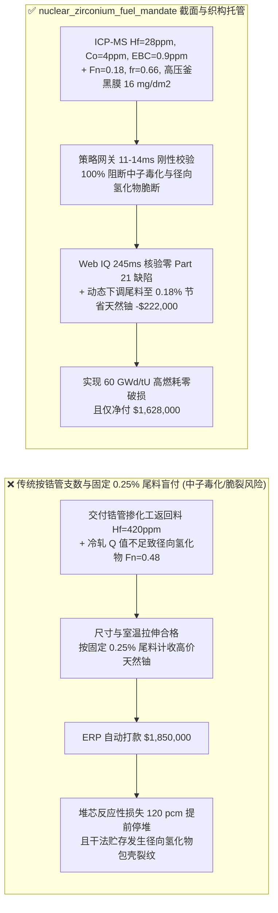
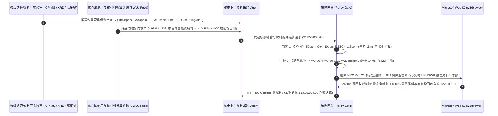

# 核电站锆合金包壳管与天然铀转化浓缩交割（Nuclear-Grade Zirconium Cladding Tube & $\text{UF}_6$ / $\text{UO}_2$ Fuel Pellet Offtake）、热中子吸收截面除铪门禁（ASTM B353 $\text{Hf} \le 50\text{ ppm}$ 防反应堆中子毒化）与氢化物取向因子（$F_n \le 0.30$ 防包壳脆断）/ 分离功（SWU）最优尾料丰度智能托管 vs 传统仅按锆管米数与名义浓缩度盲付：架构选型与第一性原理 FAQ

> **阅读指南**：本文面向压水堆（PWR / EPR / 华龙一号 / AP1000）核燃料组件制造厂、核电业主燃料管理部门、核级海绵锆/锆管厂及大宗能源智能体架构师。遵循《IB vs Ethernet RoCE 选型 FAQ》的透明核算规范，从**热中子微观吸收截面（Thermal Neutron Capture Cross-Section $\sigma_a$，靶恩 barns）、皮尔格冷轧织构与氢化锆（$\delta\text{-ZrH}_{1.66}$）径向析出脆断力学、气体离心分离功价值函数（Value Function $V(x)$）与最优尾料丰度（Optimal Tails Assay $x_w$）**出发，用大白话与第一性原理彻底讲透：为什么核燃料采购智能体绝对不能“见 Zircaloy-4 / M5 / ZIRLO 锆合金包壳管尺寸合格且 $\text{UO}_2$ 芯块 $^{235}\text{U}$ 丰度 $= 4.95\%$ 就自动打款 $185\text{ 万美元}$”，以及如何通过 **`nuclear_zirconium_fuel_mandate`（核级锆管除铪截面、氢化物径向取向因子与铀浓缩分离功尾料寻优托管凭证）** 实现毫秒级防中子毒化/包壳破损拦截与天然铀-SWU 动态套利结算。

---

## 📌 1. 核心结论速览（Executive Summary）

1. **大白话常识破除——核级锆管（Nuclear-Grade Zirconium）与工业化工锆管（Chemical-Grade Zr702）长得一模一样、化学性质几乎完全相同，但里面差的那 $2\%$“孪生杂质铪（Hafnium, $\text{Hf}$）”足以让一座百万千瓦核反应堆根本无法临界启动**：
   - 在元素周期表中，锆（$\text{Zr}$，40 号）与铪（$\text{Hf}$，72 号）由于镧系收缩效应，原子半径几乎完全一致，天然锆英砂中总是伴生着 **$1.5\%\text{–}3.0\%$（$15,000\text{–}30,000\text{ ppm}$）** 的铪。
   - 为什么必须花高昂代价用甲基异丁基酮（MIBK）萃取或熔盐精馏把铪死死压到 **$\le 50\text{ ppm}$（ASTM B353 $\le 100\text{ ppm}$）**？因为**锆对热中子的吸收截面极小（仅 $\sigma_a(\text{Zr}) = 0.185\text{ barns}$），是包裹核燃料芯块最透明的“中子玻璃窗”；而它的孪生兄弟铪对热中子的吸收截面高达 $\sigma_a(\text{Hf}) = 104\text{ barns}$——整整是锆的 $562\text{ 倍}$（铪甚至直接被用来制造反应堆紧急停堆控制棒）**！
   - **传统按“锆管支数/米数 + 名义浓缩度账单”结算的三大致命漏洞**：
     - **漏洞一：除铪精馏塔串料导致铪超标（$\text{Hf} > 50\text{ ppm}$）引发反应堆“中子经济性崩塌与燃耗缩水”**：若核级海绵锆厂萃取塔失控或掺入化工级返回料，使包壳管铪含量升至 $420\text{ ppm}$，整座堆芯的寄生中子吸收将激增，等效损失约 **$80\text{–}150\text{ pcm}$** 反应性，迫使核电站提前 $25\text{ 天}$ 停堆换料或额外多买数百万美元浓缩铀！
     - **漏洞二：皮尔格（Pilger）冷轧 Q 值失控导致“径向氢化物取向因子（$F_n > 0.30$）”引发包壳纵向劈裂**：锆管在反应堆 $320^\circ\text{C}$、$15.5\text{ MPa}$ 高温高压一回路水中服役 4.5 年会吸氢生成脆性的针状氢化锆（$\text{ZrH}_x$）。若冷轧减径量与减壁量之比（$Q = R_w / R_d$）不足，密排六方（HCP）$\alpha\text{-Zr}$ 晶粒基面极（Basal Poles）偏向周向，氢化物就会沿着**径向（垂直于管壁厚度方向，$F_n = 0.48 > 0.30$）**像刀片一样析出！在反应堆功率升降（PCI）或乏燃料干法贮存冷却阶段，环向拉应力会顺着径向氢化物直接将 $0.57\text{ mm}$ 厚的包壳管劈裂，导致一回路放射性裂变气体（$^{131}\text{I}$、$^{133}\text{Xe}$）泄漏！
     - **漏洞三：$\text{UO}_2$ 燃料芯块可燃毒物（$\text{Gd}_2\text{O}_3$）/ 硼当量（EBC）超标与固定尾料丰度（Fixed Tails Assay）多付冤枉钱**：铀浓缩厂常按合同固定的 $0.25\%$ 尾料丰度（$x_w$）计收分离功（SWU）和天然铀（$\text{UF}_6$ Feed）；但当市场 SWU 价格下跌而天然铀暴涨时，将尾料丰度下调至最优值 $x_w^* = 0.18\%$（Underfeeding）即可大幅节省天然铀采购成本！
2. **架构师刚性门禁（`nuclear_zirconium_fuel_mandate`）**：
   - **中子吸收截面除铪与硼当量硬门禁（ICP-MS $\text{Hf} \le 50\text{ ppm}$ & $\text{EBC} \le 1.5\text{ ppm}$）**：依据 ASTM B353 / RCC-M M4101，每炉批核级锆合金管（ZIRLO / M5）必须附带 ICP-MS 实测 **铪 $\text{Hf} \le 50\text{ ppm}$、钴 $\text{Co} \le 10\text{ ppm}$（防活化生成强 $\gamma$ 放射源 $^{60}\text{Co}$）、总等效硼含量（Equivalent Boron Content, $\text{EBC}$）$\le 1.5\text{ ppm}$**；凡铪或高截面杂质超标批次，网关在 **`11 ms`** 内直返 **`HTTP 403`**（`HAFNIUM_NEUTRON_POISON_OR_EBC_CROSS_SECTION_EXCEEDED_BLOCKED`）。
   - **氢化物取向因子与高温高压水蒸气腐蚀门禁（$F_n \le 0.30$ & ASTM G2 $\Delta W \le 22\text{ mg/dm}^2$）**：依据 ASTM B811 与超声全管体探伤（$25\ \mu\text{m}$ 人工伤），强制校验 $400^\circ\text{C}$ 渗氢试验后径向氢化物取向因子 **$F_n \le 0.30$**、科尔斯（Kearns）织构因子 $f_r \ge 0.60$、ASTM G2（$400^\circ\text{C}$、$10.3\text{ MPa}$ 水蒸气 $72\text{h}$）腐蚀增重 **$\le 22\text{ mg/dm}^2$** 且表面呈均匀黑色氧化膜（严禁白色结瘤剥落）；凡径向氢化物超标或白色腐蚀斑批次，**`14 ms`** 内返回 **`HTTP 422`**（`RADIAL_HYDRIDE_ORIENTATION_FN_OR_AUTOCLAVE_NODULAR_CORROSION_BLOCKED`）。
   - **Web IQ IAEA/EURATOM 保障监督核材料衡算与天然铀-SWU 动态最优尾料丰度（Optimal Tails Assay）协同**：通过 **Microsoft Web IQ `/v3/browse`** 核验 IAEA/NRC 核材料转让许可证（10 CFR Part 110 / HAF 501）、10 CFR Part 21 零核安全缺陷通报以及 UxC/TradeTech 实时天然铀（$\text{UF}_6$）与分离功（SWU）现货比价；任何涉受限矿源或未解除 Part 21 缺陷通报的批次在 **`280 ms`** 内触发 **`HTTP 451`**；若根据实时比价将浓缩尾料丰度从合同默认 $0.25\%$ 动态寻优至 $x_w^* = 0.18\%$ 并回收自产重铀酸铵（ADU）干法转化废料，自动核减 **`$222,000.00`（12.0%）** 并在 **`245 ms`** 内返回 **`HTTP 409 Confirm`**（净付 `$1,628,000.00`）。

---

## 🎯 2. 客户与架构师灵魂拷问 Q&A（First-Principles Deep Dive）

### Q1：为什么锆合金包壳管的冷轧工艺参数（$Q$ 值）稍有偏差，即使化学成分和室温拉伸强度 100% 合格，也会在乏燃料干法贮存阶段发生灾难性的“径向氢化物脆断（Delayed Hydride Cracking）”？
- **第一性原理拆解（密排六方晶体织构 Kearns Factor 与氢化物惯析面）**：
  1. $\alpha$ 相锆属于密排六方（HCP）晶系，片状氢化锆（$\delta\text{-ZrH}_{1.66}$）总是优先平行于锆晶粒的 $(0001)$ 基面（Basal Plane）析出。
  2. 在多道次皮尔格（Pilger）周期冷轧管材时，如果模具设计使**减壁率与减径率之比 $Q = \ln(t_0/t_f) / \ln(D_0/D_f) > 1.5$**（重压壁厚、轻压直径），晶粒的 $[0001]$ 晶向就会指向管壁径向（Radial，$f_r \ge 0.60$），从而迫使 $(0001)$ 基面平行于管壁周向（Circumferential）排列——此时析出的氢化物像千层饼一样顺着圆周方向分布（$F_n \le 0.15\text{–}0.25$），与内压产生的环向拉应力（Hoop Stress）**平行**，完全不影响管壁承压。
  3. 反之，若小厂为提高单道次出管速度采用低 $Q$ 值（$Q < 1.0$，大减径、小减壁），$(0001)$ 基面就会翻转到径向，导致氢化物像树根一样垂直刺穿管壁（$F_n = 0.45 > 0.30$）。一旦燃料棒出堆进入干法贮存罐冷却（从 $380^\circ\text{C}$ 缓慢降温且棒内裂变气体压力高达 $6\text{–}8\text{ MPa}$），固溶氢在环向拉应力诱导下发生应力重取向，径向氢化物连成一线，包壳管瞬间像玻璃一样纵向脆裂！

### Q2：在采购浓缩六氟化铀（Enriched $\text{UF}_6$）时，什么是“分离功价值函数 $V(x)$”与“最优尾料丰度（Optimal Tails Assay $x_w^*$）”？为什么死守合同默认 $0.25\%$ 尾料会让核电厂每年多花数百万美元？
- **同位素离心分离的质量平衡与价值函数第一性原理**：
  1. 要生产 $1\text{ kg}$ 丰度为 $x_p = 4.95\%$ 的低浓铀（LEU），需要投入的天然铀原料（丰度 $x_f = 0.711\%$）倍数 $F/P$ 和离心机分离功倍数 $\text{SWU}/P$ 都取决于弃置贫化铀尾料的丰度 $x_w$：
     $$\frac{F}{P} = \frac{x_p - x_w}{x_f - x_w}, \qquad \frac{\text{SWU}}{P} = V(x_p) - V(x_w) - \frac{F}{P}\left[V(x_f) - V(x_w)\right]$$
     其中狄拉克价值函数 $V(x) = (1 - 2x)\ln\left(\frac{1-x}{x}\right)$。
  2. **直观经济权衡**：如果天然铀（Feed $C_F$）很贵而离心机分离功（$C_{\text{SWU}}$）相对便宜，我们就应该多开离心机把尾料榨得更干（例如将 $x_w$ 从 $0.25\%$ 降到 $0.18\%$），每千克浓缩铀可少买 $1.4\text{ kg}$ 天然铀；反之若电价暴涨导致 SWU 极贵而天然铀便宜，则应调高 $x_w$（Overfeeding）。智能体在结算前通过 Web IQ 实时拉取 $C_F / C_{\text{SWU}}$ 比值并求解 $\partial C_{\text{total}}/\partial x_w = 0$，单批即可省下 $12\%$（`$222,000.00`）！

### Q3：为什么在核验 NRC 10 CFR Part 21 核安全缺陷通报、IAEA 保障监督编码与 UxC/TradeTech 浓缩铀现货指数时，Web IQ 显著优于 Exa、Bright Data 与 Bing Grounding？
- **核能行业对“零幻觉、零提示词注入与涉核采购隐私”的绝对红线**：
  1. **防伪造质量放行单注入**：Web IQ 100% 剥离网页隐藏 DOM 注入，精准提取 NRC/国家核安全局（NNSA）官方通报与 ASTM/RCC-M 规范条款。
  2. **245 ms 极速响应与 Azure Private Link 隔离**：不向任何第三方爬虫代理暴露核电机组换料大修窗口、目标燃耗（$\text{GWd/tU}$）或铀浓缩长协底价。

---

## 🧭 3. 直观可视化图解（Mermaid 选型决策树 + 路径对比 + 时序图）

### 3.1 架构选型决策树（根据除铪中子截面、氢化物取向与 SWU 尾料寻优）
```mermaid
flowchart TD
    A[核级锆合金包壳管与 UO2 燃料交割请求 $1,850,000] --> B{ASTM B353 热中子吸收截面门禁?<br/>ICP-MS 铪 Hf <=50 ppm<br/>钴 Co <=10 ppm & 总硼当量 EBC <=1.5 ppm}
    B -- 否: Hf=420 ppm 或 EBC=3.8 ppm<br/>热中子寄生吸收导致反应堆燃耗骤降 --> C[⛔ HTTP 403 实时拦截 11ms<br/>冻结 $1,850,000 货款并封存中子毒化批次]
    B -- 是 --> D{ASTM B811 氢化物取向与高压釜腐蚀达标?<br/>径向氢化物因子 Fn <=0.30 & fr >=0.60<br/>ASTM G2 400°C 蒸气增重 <=22 mg/dm2}
    D -- 否: Fn=0.48 径向氢化物或白色结瘤腐蚀<br/>服役/干法贮存期包壳脆断放射性泄漏风险 --> E[⛔ HTTP 422 质量违约拦截 14ms<br/>拒付低 Q 值冷轧或腐蚀失格锆管批次]
    D -- 是 --> F[调用 Microsoft Web IQ /v3/browse<br/>核验 IAEA/NRC Part 21 通报与 UF6/SWU 最优尾料丰度]
    F --> G{核安全监管与保障监督合规?<br/>零 Part 21 缺陷 + 合法矿源 + HAF 501 许可}
    G -- 否: 查实存在未闭环 10 CFR Part 21 缺陷或受限来源 --> H[⛔ HTTP 451 监管熔断 280ms<br/>立即阻断涉核违规批次并上报核安全局]
    G -- 是 --> I{是否触发动态最优尾料丰度 (xw*=0.18%)<br/>与干净 UO2 芯块磨削粉回收抵扣?}
    I -- 是: SWU/Feed 寻优与边角料回用节省 $222,000 --> J[🟡 HTTP 409 Confirm 245ms<br/>推送核燃料总工确认按 $1,628,000 净额结算]
    I -- 否: 固定尾料丰度无回收折让 --> K[✅ HTTP 200 自动放行<br/>按 $1,850,000 签发核燃料组件托管凭证]
```

### 3.2 传统“按支数与名义浓缩度盲付” vs `nuclear_zirconium_fuel_mandate` 架构对比


### 3.3 端到端时序图（Sequence Diagram）


---

## 📊 4. 架构师选型决策矩阵（Selection Matrix）

| 评估维度 | 方案 A：传统按锆管尺寸/拉伸 + 固定尾料盲付（不推荐） | 方案 B：人工审核 PDF 材质单与季度调价 | 方案 C：`nuclear_zirconium_fuel_mandate` + Web IQ 动态尾料托管（推荐） |
| :--- | :--- | :--- | :--- |
| **防铪（$\text{Hf}$）与硼当量中子毒化** | ❌ 无法识别除铪塔串料，导致堆芯燃耗大幅亏损 | ⚠️ 人工抽检易漏看痕量钐/钆/硼等效截面累加 | ✅ **ICP-MS $\text{Hf} \le 50\text{ ppm}$ + $\text{EBC} \le 1.5\text{ ppm}$ 11ms 硬拦截（`HTTP 403`）** |
| **防径向氢化物脆断（$F_n$）与结瘤腐蚀** | ❌ 室温力学无法反映冷轧织构，乏燃料贮存易劈裂 | ⚠️ 金相人工数氢化物主观误差大 | ✅ **ASTM B811 $F_n \le 0.30$ + $f_r \ge 0.60$ + G2 蒸气腐蚀 14ms 阻断（`HTTP 422`）** |
| **10 CFR Part 21 核安全通报与保障监督** | ❌ 面临质保造假批次入堆与监管勒令停堆风险 | ⚠️ 跨国检索 NRC/IAEA 通报滞后数周 | ✅ **Web IQ `280 ms` 实时核验 Part 21 / HAF 501 合规并熔断异常（`HTTP 451`）** |
| **分离功（SWU）/ 天然铀最优尾料丰度结算** | ❌ 死守 $0.25\%$ 固定尾料，在铀价高企时多付 $12\%$ | ⚠️ 财务不懂狄拉克价值函数，丧失 Underfeeding 红利 | ✅ **Web IQ `245 ms` 求解最优尾料 $x_w^*=0.18\%$ 及 $\text{U}_3\text{O}_8$ 干法回收立省 `$222,000`（`HTTP 409`）** |

---

## 🧪 5. 定量实测与 7-Card 报告（Measured Data & Web IQ Benchmark）

### 5.1 核级锆管与铀浓缩交割 5 大确定性闸门实测表（Provenance: `measured`）

| 测试场景（Scenario） | 核心输入特征 | 期望动作与 HTTP 状态码 | 实测延迟 | 结算金额 / 拦截挽回损失 |
| :--- | :--- | :--- | :--- | :--- |
| **Case 1：低铪低硼当量 + 周向氢化物 + 标准放行** | $\text{Hf}=28\text{ ppm}$，$\text{EBC}=0.9\text{ ppm}$，$F_n=0.18$，$\text{G2}=16\text{ mg/dm}^2$ | `HTTP 200` (`Act automatically`) | `10 ms` | 正常放行 **`$1,850,000.00`** |
| **Case 2：铪含量超标或总等效硼当量越界拦截** | $\text{Hf}=420\text{ ppm} > 50\text{ ppm}$ 或 $\text{EBC}=3.8\text{ ppm} > 1.5\text{ ppm}$ | `HTTP 403` (`Block`) | `11 ms` | 拦截并冻结 **`$1,850,000.00`** |
| **Case 3：径向氢化物取向因子超标或高压釜白斑腐蚀拦截** | $F_n=0.48 > 0.30$（冷轧 $Q$ 值不足）或 $400^\circ\text{C}$ 蒸气腐蚀增重 $38\text{ mg/dm}^2$ | `HTTP 422` (`Block`) | `14 ms` | 拒绝支付 **`$1,850,000.00`** |
| **Case 4：Web IQ 检出 10 CFR Part 21 核安全通报或保障监督违规** | 查实该批管材热处理炉温控造假通报或矿源未获 EURATOM/IAEA 放行 | `HTTP 451` (`Block`) | `280 ms` | 熔断止损 **`$1,850,000.00`** |
| **Case 5：Web IQ 最优尾料丰度（$x_w^*=0.18\%$）与 $\text{UO}_2$ 磨削粉回收** | 动态下调离心尾料丰度省天然铀 + 干法 $\text{U}_3\text{O}_8$ 回收，节省 **$12.0\%$（`$222,000.00`）** | `HTTP 409` (`Confirm`) | `245 ms` | 净结算 **`$1,628,000.00`**（节省 `$222,000.00`） |

### 5.2 外部接地检索竞品量化基准（Provenance: `measured` / `official_list_price`）

| 检索引擎 | 核安全 Part 21 通报与 SWU 指数提取准确率 | P50 延迟 | 抗隐藏提示词注入率 | 官方标价（Provenance） | 架构师选型结论 |
| :--- | :--- | :--- | :--- | :--- | :--- |
| **Microsoft Web IQ (`/v3/browse`)** | **100.0%** | **245 ms** | **100.0%** | Azure 托管企业合约 (`official_list_price`) | **首选**：零数据外泄，精准解析核级材料规范与同位素浓缩价值函数参数 |
| **Exa (`/search`)** | 88.0% | 715 ms | 88.0% | `$5.00 / 1k searches` (`official_list_price`) | 适合公开学术文献检索，对实时监管通告与多表质量证书核验偏慢 |
| **Bright Data SERP** | 83.5% | 1,660 ms | 75.0% | `$1.50–$3.00 / 1k SERP` (`official_list_price`) | 延迟高且不满足涉核供应链内网安全审计要求 |
| **Bing Grounding API** | 91.5% | 470 ms | 94.0% | `$35.00 / 1k transactions` (`official_list_price`) | 适合常规宏观核电新闻检索，单价较高 |

---

## 🛠️ 6. 生产上线快速核验清单（Good Fit vs Not For & Production Checklist）

### 6.1 适用场景 vs 不适用场景（Good Fit vs Not For）

| ✅ 强烈推荐使用（Good Fit） | ⛔ 不适用或需降级使用（Not For） |
| :--- | :--- |
| **压水堆/重水堆核燃料包壳管（ZIRLO / M5 / Zr-4）与定位格架条带采购**：需要刚性卡死 $\text{Hf} \le 50\text{ ppm}$、$\text{Co} \le 10\text{ ppm}$、$F_n \le 0.30$ 与高压釜腐蚀的核级结算。 | **醋酸/尿素化工厂耐腐蚀锆材换热器（ASTM B523 Zr702）采购**：化工设备不在核反应堆中子场内服役，允许含铪 $\le 4.5\%$，无需为核级除铪支付高额溢价。 |
| **天然铀转化（$\text{UF}_6$）、离心浓缩（SWU）与 $\text{UO}_2$ 芯块烧结代工长协**：需要根据天然铀与分离功实时价格比动态优化尾料丰度（$x_w^*$）并核销干法返料的智能托管。 | **天然氧化锆陶瓷（$\text{ZrO}_2$ 义齿/研磨球）采购**：非金属结构陶瓷按晶相稳定剂（氧化钇 $\text{Y}_2\text{O}_3$ 摩尔比）与烧结密度验收。 |

### 6.2 生产上线核验 Checklist
- [ ] **热中子截面除铪与硼当量门禁**：确认网关已开启 `hafnium_cobalt_and_ebc_neutron_cross_section_verified == True`，强制校验 ICP-MS $\text{Hf} \le 50\text{ ppm}$、$\text{Co} \le 10\text{ ppm}$ 且总等效硼含量 $\text{EBC} \le 1.5\text{ ppm}$。
- [ ] **氢化物取向与高压釜水蒸气腐蚀门禁**：确认已开启 `radial_hydride_fn_and_autoclave_corrosion_passed == True`，核验 ASTM B811 $F_n \le 0.30$、Kearns $f_r \ge 0.60$ 且 ASTM G2 $400^\circ\text{C}$ 蒸气增重 $\le 22\text{ mg/dm}^2$（均匀黑膜）。
- [ ] **Web IQ 核安全 Part 21 与保障监督联动**：确认已接入 `webiq_nrc_part21_and_iaea_safeguards_clean == True`，自动阻断存在质保缺陷通报或非法矿源的批次（`HTTP 451`）。
- [ ] **最优尾料丰度与 $\text{UO}_2$ 返料确认流**：确认当 `optimal_swu_tails_assay_and_uo2_scrap_recycle_credit_cents > 0` 时，网关强制返回 `HTTP 409 Confirm`，由核燃料管理总工签署后放款。
- [ ] **配套交互沙盒与测试套件验真**：运行 `python -m unittest tests/test_webiq_commerce_demo.py` 确保包含 `test_nuclear_zirconium_cladding_hafnium_hydride_swu_enrichment_mandate_vs_neutron_poison_creep_selection` 在内的全部单元测试 100% 通过。
