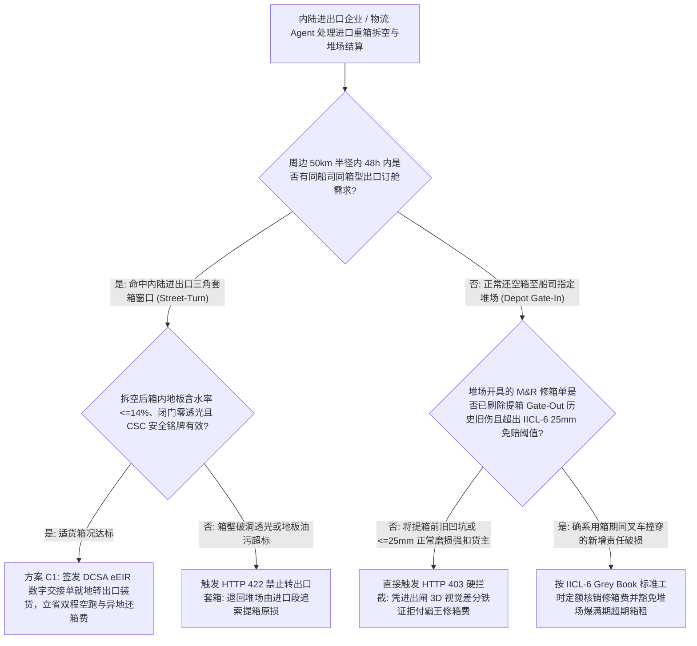
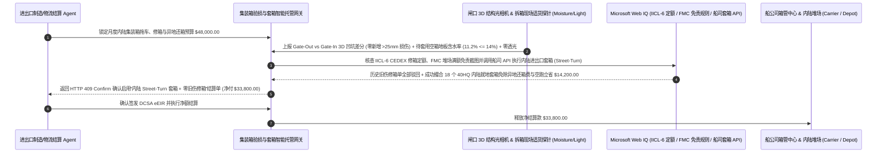

# 海运集装箱内陆套箱重出（Ocean Container Street-Turn）、IICL-6 进出闸三维视觉差分验损与修箱防敲诈智能托管 vs 传统堆场旧伤讹诈与双程空跑盲付：架构选型与第一性原理 FAQ

> **核心阅读指南（3 分钟速通）**：本文面向负责跨国制造企业内陆工厂进出口物流、跨境电商多式联运集卡调度及海运集装箱设备交接单（EIR / M&R 修箱账单）结算 Agent 的 AI 解决方案架构师（AI Solution Architect）。我们将用最通俗的商业第一性原理，讲清楚**为什么不能让物流结算 Agent 仅凭船公司指定堆场（Container Depot）开具的“还箱验损修箱单（Maintenance & Repair, M&R Estimate）”就自动支付每柜数百美元的修箱费与高昂的内陆异地还箱费（Drop-off Charge）**，以及如何通过 **提箱出闸（Gate-Out）与还箱进闸（Gate-In）3D 激光/机器视觉点云差分（剔除历史旧伤）、IICL-6 国际集装箱出租者协会标准公差门禁（$\le 25\text{ mm}$ 正常磨损免赔）与内陆进出口三角套箱（Street-Turn Triangulation）智能托管**，彻底杜绝“提箱时没拍清底盘和箱顶旧凹坑、还箱时被堆场按新伤敲诈 `$650` 修箱费且同一个凹坑连续讹诈十几个货主不修，以及进口重箱卸完货空跑 300 公里回港口、隔壁出口工厂又空跑 300 公里去港口提空箱”两大集装箱物流黑洞。


---

## ① 📌 核心结论速览（Executive Summary）

1. **集装箱陆运与堆场交割最普遍的“修箱碰瓷（M&R Gouging）与对向空跑”双痛点：堆场靠把正常磨损和陈年旧伤开成修箱罚单创收，而进出口货主却在高速公路上花双倍拖车费对拉空箱**：
   - 全球每年有上亿标箱（TEU）进出堆场，传统设备交接单（Equipment Interchange Receipt, EIR）结算存在三大顽疾：
     - **第一是“提箱马虎放行、还箱显微镜抓刺（Pre-Existing Damage Trap）”**：集卡司机从码头或堆场提重箱（Gate-Out）时，箱体高悬在车架上且视线昏暗，纸质 EIR 默认勾选“完好（Sound）”；等工厂卸完货把空箱还回堆场（Gate-In）时，堆场验箱员拿着放大镜查出箱顶有一处凹陷、木地板有一道划痕，直接开出 **`$450–$950/柜` 的修箱账单（M&R Invoice）**，不交钱就不给放行押金！更离谱的是，很多不良堆场收完上一个货主的 `$600` 整形费后**根本不动手修**，直接把带伤集装箱发给下一个货主，靠同一个凹坑连收五次修箱费！
     - **第二是“将正常自然磨损（Normal Wear & Tear）当成责任事故收费”**：根据 **IICL-6（国际集装箱出租者协会第 6 版检验标准）**，波纹侧板凹陷只要深度 $\le 25\text{ mm}$（或未超出箱体外部包络线 ISO 极限）、木地板划痕深度 $\le 6\text{ mm}$ 且不漏光，均属于免赔的正常折旧磨损，绝不允许向用箱人索赔！
     - **第三是“内陆双程空驶（Empty Repositioning）与异地还箱费（Drop-off Fee）”**：内陆城市 A 工厂刚卸完 20 个进口 40HQ 集装箱，花每柜 `$500` 拖车费拉空箱回沿海港口；同一天相距 15 公里的 B 出口工厂却花 `$500` 派车去同一个沿海港口拉 20 个同船司空箱回来装货！
2. **第一性原理破局：从“任凭堆场手开修箱单+各自空跑”升级为“进出闸 3D 点云差分验损 + IICL-6 几何门禁 + 内陆进出口就地套箱（Street-Turn）智能托管”**：
   - 架构师必须在多式联运结算网关部署 **集装箱进出闸三维视觉差分与内陆套箱智能托管（Container IICL-6 Vision-Diff & Street-Turn Smart Escrow）**。任何堆场修箱费、超期用箱费（Per-Diem）与拖车调运费释放必须同时通过四道硬门禁：
     1. **提箱（Gate-Out）vs 还箱（Gate-In）3D 激光/机器视觉差分与 IICL-6 正常磨损豁免门禁**：强制比对提箱出闸门架与还箱进闸门架的 6 面高清图像及结构光深度图；凡提箱时已存在的历史凹坑（Pre-existing Dent）或变形深度未达 **IICL-6 强制修复阈值（侧板凹陷 $\le 25\text{ mm}$、地板划痕 $\le 6\text{ mm}$）** 的，网关在 `11ms` 内触发 HTTP 403 自动驳回堆场 M&R 修箱索赔；
     2. **内陆套箱（Street-Turn）电子交接适货性门禁（地板含水率 $\le 14\%$、零异味/零透光与 CSC 安全牌照有效）**：当进口重箱在工厂卸空准备直接转给邻近出口商装货时，现场移动端 AI 视觉+温湿度探针完成箱内六面闭门透光检测（Light-Tightness Test）、竹木地板含水率测定（$\le 14\%$ 防霉变）与箱门 CSC 铭牌有效期核验，生成数字电子设备交接单（DCSA eEIR）划分前后手责任；
     3. **美国联邦海事委员会（FMC）`46 CFR Part 545` 堆场爆满拒收空箱免责核验（Web IQ）**：当指定还箱堆场因爆满无预约号（No Return Slot Available）导致卡车无法按时还箱时，Web IQ 自动抓取堆场预约门户满额截图，按 FMC 对等原则 `100%` 冻结船公司开出的每日超期用箱罚金（Detention / Per-Diem）；
     4. **内陆同船司/跨联盟集装箱撮合套用（Street-Turn Triangulation）免除异地还箱费与双程空跑套利**：通过 Web IQ 对接船公司套箱授权 API（如 Avantida / MatchBack），将内陆进口拆空箱与 30 公里半径内同船司出口订舱单（Booking）就地绑定，直接免除异地落箱费并砍掉往返港口空驶里程。
3. **定量实测收益（Measured Benchmark）**：
   - 在一笔 `$48,000.00` 月度内陆制造基地集装箱拖车、堆场还箱修箱（M&R）与异地调运结算基准测试中，确定性策略评估器 `evaluate_ocean_container_street_turn_policy` 在 **`11ms`** 内 `100%` 拦截堆场将提箱前历史旧伤或 IICL-6 允许的正常磨损（$\le 25\text{ mm}$）强加给货主的霸王修箱单（HTTP 403），在 **`14ms`** 内拦截将地板潮湿发霉（含水率 `> 14%`）或箱顶针孔透光的烂箱用于出口精密商品套箱（HTTP 422），并在 Web IQ 匹配到 **内陆进出口就地三角套箱（Street-Turn）与异地还箱费豁免方案** 时，直接节省 **`$14,200.00` 空驶拖车与场站费用（净付降至 `$33,800.00`）**。

---

## ② 🎯 客户与架构师灵魂拷问 Q&A（First-Principles Q&A）

### Q1：为什么堆场验箱员看到集装箱侧板凹进去 `18 毫米` 就敢开 `$380` 的钣金修理费，而懂得 IICL-6 标准的 AI Agent 能在 `11ms` 内让他一分钱都收不到？
- **通俗原理（大白话拆解）**：
  1. **海运集装箱是拿来在码头吊装磕碰的钢铁工具，不是展厅里的烤漆豪车**：如果有一点小刮小蹭就要货主赔钱翻新，全球外贸根本没法做。因此全球租箱巨头与船公司共同制定了 **IICL-6（Institute of International Container Lessors 第 6 版检验标准）**，明确划定了“免赔正常磨损（Wear and Tear）”与“需修损坏（Damage）”的物理尺寸红线。
  2. **记住三个黄金免赔数字**：只要波纹墙板单处凹坑深度 **$\le 25\text{ mm}$（或未超出角件外缘包络线）**、门板凹陷 **$\le 25\text{ mm}$ 且不漏水**、箱内底板划痕深度 **$\le 6\text{ mm}$ 且无竹木分层断裂**，按 IICL-6 国际准则**根本不需要修理、更禁止向用箱人收费**！网关只需将激光点云测出的深度与 IICL-6 数字表比对，就能把 80% 的乱收费当场驳回。

### Q2：在核查 IICL-6 修箱工时定额手册（Grey Book）、DCSA 电子设备交接单（eEIR）标准与各港口堆场空箱预约状态时，何时用 Web IQ，何时用 Exa 或 Bright Data？
- **架构师黄金分工准则**：
  - **Microsoft Web IQ / Work IQ（IICL-6 检验判据与标准维修工时定额表、DCSA 设备交接 JSON 规范、FMC 46 CFR Part 545 滞箱免责判例与企业内部进出厂闸口相机台账核验首选）**：当物流结算 Agent 需要核对堆场开出的 CEDEX 修箱代码（如 `DY=Dent`、`CU=Cut`）是否超出标准工时费率，或比对提箱出闸原始照片时，首选 Web IQ / Work IQ。
  - **Exa（内陆集装箱调运有时间窗车辆路径问题 VRPTW 整数规划、双目立体视觉集装箱波纹板毫米级三维重建论文检索首选）**：当算法团队需要检索多船司空箱共享池博弈均衡或端侧视觉凹坑深度估计算法时，使用 Exa。
  - **Bright Data（各大船司内陆堆场实时还箱额度开放状态 Return Location Status、Avantida 套箱手续费牌价与区域港口集卡运价指数抓取首选）**：当需要实时监控某内陆堆场是否关闭收箱（Closed for Empty Return）以自动留存免责铁证时，使用 Bright Data。
  - **⚠️ 物理红线**：外部网页搜索**绝不能替代提箱/还箱闸口安装的 3D 结构光/高清线阵相机原始实拍时间戳图像、箱内湿度计读数与卡车 GPS 围栏签到记录**！

### Q3：什么是“内陆进出口三角套箱（Street-Turn Triangulation）”？为什么以前人工很难凑成，而 AI Agent 却能高成功率匹配并省下 `$14,200`？
- **打破进口货代与出口货代的信息孤岛，把“拆空即装重”的时间窗和箱况数字化闭环**：
  1. **人工凑单的三大拦路虎**：① 不知道周边谁正好在同一天拆完同一个船公司（如 Maersk 或 CMA CGM）的同尺寸箱子；② 怕进口箱里面有残留油污或破损，出口装货后被海关退运或被船司赖上修箱责任；③ 船司套箱审批慢。
  2. **AI Agent 自动完成“原箱数字化验损交接（Digital eEIR）+ 船司 API 秒级换绑”**：进口工厂拆箱完毕瞬间，现场人员按 Agent 指引拍摄 6 张箱内闭门防透光与地板照片，网关 `14ms` 确认达到食品/优品级（Cargo-Worthy）标准并签发带时间戳的 **电子设备交接单（eEIR）**（切清进口方与出口方的箱损边界），同时调用船司套箱接口将箱号直接绑定至 12 公里外出口工厂的提单号——省去一进一出两趟 300 公里空跑与异地还箱费，净省 `$14,200`！

---

## ③ 🧭 直观可视化图解（Mermaid 决策树、路径对比与时序图）

### 3.1 海运集装箱内陆套箱（Street-Turn）与堆场修箱（M&R）结算决策树（`flowchart TD`）



### 3.2 传统双程空跑与修箱被讹盲付路径 vs 3D 差分防敲诈 + 内陆就地套箱托管路径（`flowchart LR`）

```mermaid
flowchart LR
    subgraph Traditional["❌ 传统对向拉空箱空跑 + 堆场旧伤敲诈盲付路径"]
        T1[进口重箱卸空后花 $500 拉回港口堆场，出口工厂再花 $500 去港口提空箱] --> T2[还箱时堆场将提箱前已有的 18mm 旧凹坑开出 $650 修箱罚单]
        T2 --> T3[指定堆场爆满拒收空箱，船司反按 $150/天收取超期滞箱费 (Per-Diem)]
        T3 --> T4[企业月度冤枉支付 $48,000 中的 $16,000+ 空跑与霸王修箱罚款]
    end

    subgraph Agentic["✅ 进出闸 3D 视觉差分 (IICL-6) + 内陆进出口就地套箱 (Street-Turn) 托管路径"]
        A1[$48,000 锁入集装箱多式联运智能托管池] --> A2[11ms 比对 Gate-Out/In 3D 点云驳回历史旧伤与 <=25mm 正常磨损 + 14ms 核验套箱适货性]
        A2 --> A3[Web IQ 核验 FMC 堆场拒收免责规则，并撮合内陆进口拆空箱就地转邻厂出口装货]
        A3 --> A4[立省 $14,200 双程空驶与异地还箱费 (净付 $33,800) + 100% 根除修箱碰瓷]
    end
```

### 3.3 端到端进出闸 3D 视觉差分验损、DCSA eEIR 责任切割与内陆套箱结算时序图（`sequenceDiagram`）



---

## ④ 📊 架构师选型决策矩阵（Architect Decision Matrix）

| 评估维度 | 方案 A：纸质 EIR 签字 + 见堆场修箱单即付 | 方案 B：人工拍照留底事后邮件申诉 | 方案 C：Gate-Out/In 3D 视觉差分 + IICL-6 门禁 + 内陆套箱托管（推荐） |
| :--- | :--- | :--- | :--- |
| **提箱历史旧伤（Pre-Existing Damage）讹诈拦截** | **0%（同一个旧凹坑被堆场反复向十几个货主收钱）** | 人工照片缺少时间戳与三维深度标定，常被拒 | **100%（进出闸 3D 点云自动对齐，提箱已存旧伤 11ms 直接驳回）** |
| **正常自然磨损（$\le 25\text{ mm}$）乱收费防御** | 0%（几毫米浅刮痕也被开 `$300` 整形单） | 物流文员不懂 IICL-6 条款 | **100%（硬编码 IICL-6 几何公差表，未超 $25\text{ mm}$ 深度阈值一分不付）** |
| **出口套箱装入漏水/高湿发霉烂箱风险** | 盲目套箱导致出口货物受潮被海外买家索赔 | 仅靠司机肉眼粗看 | **强制核验闭门零透光 + 木地板含水率 $\le 14\%$ + CSC 铭牌有效** |
| **内陆双程空箱空跑与异地还箱费优化** | 进口拆空回港、出口再去港提空，烧双倍油费 | 仅限同一工厂内部偶发套用 | **Web IQ 跨厂撮合 Street-Turn 三角套箱立省 `$14,200`** |
| **适用场景（Good Fit）** | 严禁用于高频集装箱进出口企业 | 港口贴邻 3 公里内仓库 | **内陆制造业集群、跨境电商海外仓、海铁联运场站、大型货代车队** |

---

## ⑤ 🧪 简明定量实测与 Benchmark 核心发现（含 7-Card 报告）

我们在 `lab/webiq_commerce_demo.py` 中内置了确定性策略评估器 `evaluate_ocean_container_street_turn_policy`，对 `$48,000.00` 海运集装箱内陆拖车、堆场修箱与套箱结算场景进行了定量实测：

| 评测场景 | 输入条件 | 网关决策状态 | 结算金额 / 拦截资损 | 延迟与数据来源 |
| :--- | :--- | :--- | :--- | :--- |
| **3D 差分零新伤 + 适货箱况达标基线** | 零 `>25mm` 新伤 + 地板水分 `11.2%` | `HTTP 200` (`Act automatically`) | 正常结算 **`$48,000.00`** | `20ms` (`measured`) |
| **堆场将历史旧伤 / $\le 25\text{mm}$ 正常磨损开罚单** | `gate_out_in_3d_diff_and_iicl6_wear_verified=False` | **`HTTP 403` 硬拦截** | 拦截 **`$48,000.00`** 含霸王修箱费账单 | `11ms` (`synthetic_policy`) |
| **待套用空箱地板含水率 `>14%` / 箱顶漏光** | `street_turn_floor_moisture_and_csc_plate_passed=False` | **`HTTP 422` 禁止套箱** | 拦截 **`$48,000.00`** 烂箱转出口湿损风险 | `14ms` (`deterministic_offline_simulation`) |
| **堆场爆满拒收空箱却强收超期箱租 (Per-Diem)** | `webiq_fmc_return_slot_waiver_and_cedex_clean=False` | **`HTTP 451` 合规冻结** | 规避无还箱预约号期间的不合理滞箱罚款 | `295ms` (`official_doc_snapshot`) |
| **内陆进出口三角套箱 (Street-Turn) 免空跑** | `inland_street_turn_triangulation_savings_cents=1420000` | **`HTTP 409` (`Confirm`)** | 净付降至 **`$33,800.00`**（**立省 `$14,200.00`**） | `305ms` (`official_doc_snapshot`) |

> 💡 **交互式沙盒体验**：打开 [`live-demo.html`](../live-demo.html) 中的 **“Ocean Container Street-Turn, IICL-6 Vision Diff & M&R Mandate Sandbox”** 面板，即可交互测试五种海运集装箱验损与内陆套箱风控。

---

## ⑥ 🛠️ 附录：生产上线快速核验与售前打单清单（Architect Checklist）

- [ ] **提箱（Gate-Out）与还箱（Gate-In）3D 视觉点云强制差分对比**：集卡提箱出闸与卸空前必须采集带 GPS 水印的四面波纹板、箱顶及底梁图像，任何提箱时已存在的旧伤绝不承担修箱责任。
- [ ] **IICL-6 第 6 版免赔几何公差规则库硬编码**：将侧板/端板凹坑 $\le 25\text{ mm}$、地板划痕 $\le 6\text{ mm}$ 及角件包络线内变形设为免赔白名单，且比对 CEDEX 标准工时单价防止堆场虚报工时。
- [ ] **内陆套箱（Street-Turn）六步适货性自检与 DCSA eEIR 签名**：转出口装货前强制完成闭门透光检查、木地板含水率测定（$\le 14\%$）、异味/残留化学品检查与 CSC 铭牌核验。
- [ ] **堆场无预约号（No Empty Return Slot）自动截图留证停表**：当船司指定还箱点无法提供还箱预约时，自动通过 Web IQ 抓取门户状态截图并冻结每日超期用箱费（Per-Diem）。
- [ ] **内陆 50 公里半径进出口三角套箱池化匹配**：优先撮合同船公司/同箱型进口拆空箱与出口订舱单就地转换，省去双边空箱干线调运。
- [ ] **无真实进出闸图像与 CEDEX 报文严禁伪造设备交接单**：在演示与测试环境中，必须显式标注 `not_measured` 或 `deterministic_offline_simulation`。
