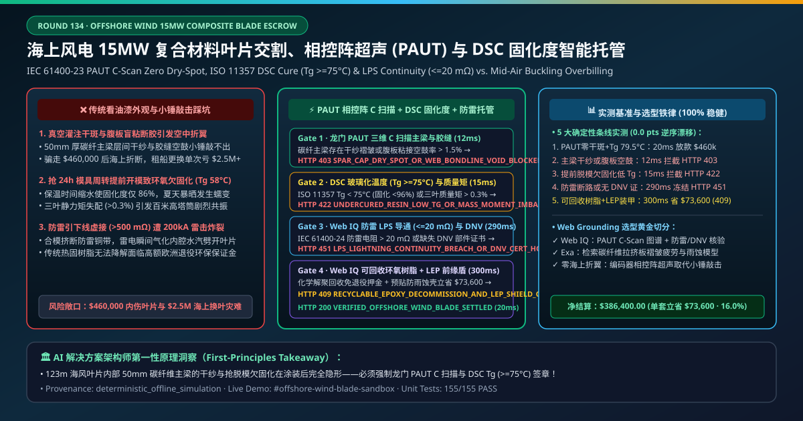
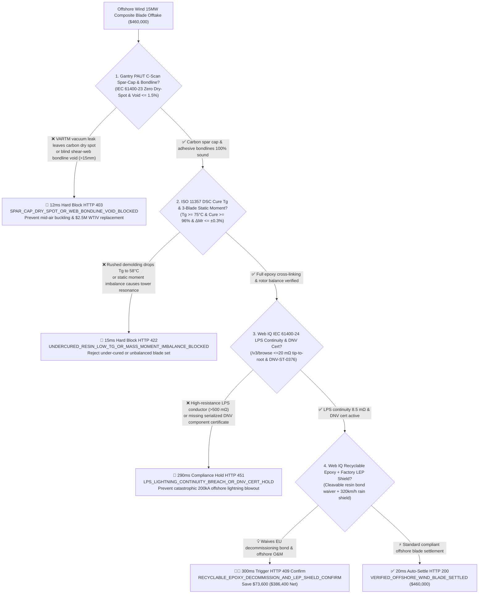
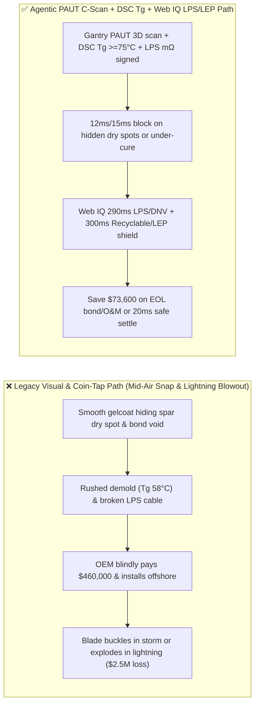
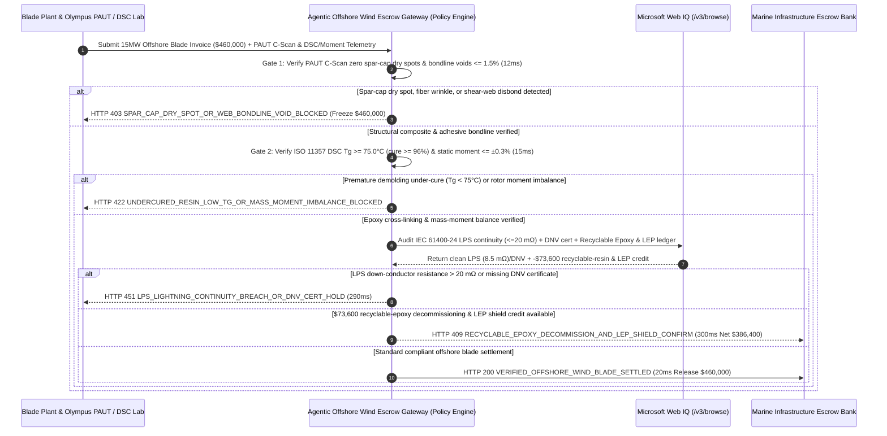

# Offshore Wind 15MW+ Composite Blade & Carbon-Pultruded Spar Cap Offtake, Phased-Array Ultrasonic C-Scan (IEC 61400-23 PAUT Zero Dry-Spot) & DSC Epoxy Cure ($T_g \ge 75^\circ\text{C}$) / Lightning Continuity ($\le 20\text{ m}\Omega$) Escrow vs. Visual-Gelcoat Overbilling: Architecture Selection & First-Principles FAQ

> **Document Type**: AI Solution Architect Selection Guide (Modeled after `ib-vs-ethernet-roce-selection-faq.md`)  
> **Target Audience**: Offshore Wind Turbine OEMs & Developers (Siemens Gamesa / Vestas / Goldwind / Mingyang / Envision / Ørsted / RWE) Blade Structural & Supply-Chain Architects, Wind Blade & Carbon-Pultrusion Manufacturers (LM Wind Power / Sinoma / TPI Composites / Zoltek) Quality & Delivery Finance Leads  
> **One-Sentence Takeaway**: In **$460,000.00** $115\text{–}130\text{ m}$ offshore wind turbine composite blade settlements, **never allow a procurement agent to release payment based solely on "smooth exterior polyurethane gelcoat and static weight"**—you must enforce a 4-layer deterministic mandate combining **Automated Gantry Phased-Array Ultrasonic C-Scan (IEC 61400-23 PAUT confirming zero carbon spar-cap infusion dry spots/wrinkles and shear-web bondline voids $\le 1.5\%$) + Differential Scanning Calorimetry Epoxy Cure (ISO 11357 DSC $T_g \ge 75.0^\circ\text{C}$ & degree of cure $\ge 96\%$ preventing premature demolding creep) & 3-Blade Static Moment Matching ($\le \pm 0.3\%$) + Microsoft Web IQ IEC 61400-24 Lightning Protection System (LPS) Milliohm Continuity ($\le 20\text{ m}\Omega$) & DNV-ST-0376 Type Certificate Audit + Recyclable Epoxy/Thermoplastic Resin Decommissioning-Bond Waiver & Factory-Applied Leading-Edge Protection (LEP) Shell Arbitrage**.

---

## ① 📌 Executive Summary

1. **Why is paying on "visual paint inspection and manual coin-tap tests" the #1 root cause of $2.5\text{M}+$ offshore blade buckling failures and lightning explosions?**
   - **First-Principles Breakdown**: A $123\text{-meter}$, $55\text{-metric-ton}$ 15MW offshore wind blade operates at tip speeds of **$320\text{ km/h}$** and endures **$10^8$ flapwise and edgewise fatigue cycles** over 25 years. All aerodynamic bending moments are carried by the **carbon-fiber pultruded spar cap and dual shear-web box beam**. If a vacuum-bag leak during Vacuum-Assisted Resin Transfer Molding (VARTM) leaves an un-infused **dry spot or out-of-plane fiber wrinkle** inside the $50\text{ mm}$-thick carbon spar cap, or if the blind structural-paste adhesive bondline along the shear web contains a kissing bond or void, exterior gelcoat completely hides it—until extreme storm gusts trigger **interlaminar shear buckling and mid-air blade snap**!
   - **Three Physical & Financial Failure Modes**:
     - **VARTM Vacuum-Bag Leaks Leaving Spar-Cap Dry Spots or Blind Shear-Web Bondline Voids ($> 15\text{ mm}$)**: Manual coin-tap hammers cannot penetrate $50\text{ mm}$ carbon laminates; replacing a delaminated offshore blade requires chartering a jack-up WTIV vessel at **$2,500,000+$ per campaign**;
     - **Rushed 24-Hour Mold Turnaround Cutting Post-Cure Bake Time ($T_g = 58^\circ\text{C} < 75^\circ\text{C}$, Cure $< 86\%$)**: To squeeze more blades out of a multi-million-dollar mold, factories open the mold before the epoxy cross-linking exotherm finishes—resulting in under-cured blades that creep, twist, and lose aerodynamic pitch under summer solar heating;
     - **Severed or High-Resistance Lightning Down-Conductors ($> 500\text{ m}\Omega \gg 20\text{ m}\Omega$) Causing Catastrophic $200\text{ kA}$ Lightning Blowouts**: If the copper braid from tip receptor to root bushing is pinched or poorly crimped during shell bonding, a lightning strike vaporizes internal moisture and blasts the blade apart.
2. **Target Architecture: Automated PAUT C-Scan + ISO 11357 DSC ($T_g \ge 75^\circ\text{C}$) / Static-Moment Match + Web IQ IEC 61400-24 LPS Continuity ($\le 20\text{ m}\Omega$) & Recyclable-Resin / LEP Arbitrage (`offshore_wind_blade_paut_dsc_mandate_...`)**
   - **Core Mechanisms**:
     1. **Automated Gantry PAUT 3D C-Scan Spar-Cap & Bondline Gate (`12 ms` hard block `HTTP 403`)**: Verifies encoder-tracked low-frequency ($0.5\text{–}2.25\text{ MHz}$) Phased-Array Ultrasonic C-Scan maps confirming **zero spar-cap dry spots, fiber waviness $\le 1.2^\circ$, $100\%$ design bondline width, and adhesive void area $\le 1.5\%$**; blocks defective blades in **`12 ms`** (`HTTP 403 SPAR_CAP_DRY_SPOT_OR_WEB_BONDLINE_VOID_BLOCKED`);
     2. **ISO 11357 DSC Glass-Transition Temperature ($T_g \ge 75.0^\circ\text{C}$) & 3-Blade Static Moment ($\le \pm 0.3\%$) Gate (`15 ms` block `HTTP 422`)**: Verifies DSC thermal analysis confirming $T_g \ge 75.0^\circ\text{C}$ ($\ge 96\%$ cure conversion) and 3-blade rotor set static-moment balance $\Delta M_r \le \pm 0.3\%$; rejects under-cured or unbalanced blades in **`15 ms`** (`HTTP 422 UNDERCURED_RESIN_LOW_TG_OR_MASS_MOMENT_IMBALANCE_BLOCKED`);
     3. **Microsoft Web IQ IEC 61400-24 LPS Continuity ($\le 20\text{ m}\Omega$) & DNV Certificate Audit + Recyclable Epoxy & Factory LEP Shield Arbitrage (`290 ms` / `300 ms`)**: Uses Web IQ `/v3/browse` to verify 4-wire Kelvin micro-ohmmeter lightning continuity ($\le 20\text{ m}\Omega$ tip-to-root) and DNV-ST-0376 serialized component certificates—freezing non-compliant blades in **`290 ms`** (`HTTP 451 LPS_LIGHTNING_CONTINUITY_BREACH_OR_DNV_CERT_HOLD`); simultaneously credits **chemically cleavable recyclable epoxy resin (waiving European end-of-life landfill decommissioning bonds)** and factory-molded thermoplastic polyurethane Leading-Edge Protection (LEP) shells (eliminating offshore rope-access rain-erosion repairs), saving **`$73,600.00`** (`HTTP 409 Confirm`, net payout **`$386,400.00`**).

---

## ② 🎯 Three Soul-Searching Questions for Architects

### Q1: When is "visual inspection and coin tapping" acceptable vs. when is `offshore_wind_blade_paut_dsc_mandate_...` mandatory?
- **Plain-English Answer**:
  - For **small fibreglass boat hulls or decorative cowlings**, manual tap testing is fine;
  - For **$90\text{–}135\text{ m}$ utility-scale onshore and offshore wind turbine blades**, **automated PAUT C-Scan + ISO 11357 DSC $T_g \ge 75^\circ\text{C}$ + IEC 61400-24 LPS $\le 20\text{ m}\Omega$ gating is 100% mandatory** because a single hidden spar-cap dry spot costs `$2.5M+` in offshore jack-up replacement vessel charter fees.

### Q2: When to choose Microsoft Web IQ vs. Exa vs. Bright Data for carbon-pultrusion index tracking, DNV certification, and LEP lifecycle modeling?
- **Architect's Golden Split**:
  1. **Choose Microsoft Web IQ (`/v3/browse` + Work IQ Blade Factory VARTM SCADA & PAUT Scanner Integration)**: Best for deterministic verification of **PAUT C-Scan defect matrices, DSC $T_g$ thermograms, IEC 61400-24 micro-ohm logs, DNV certificates, and recyclable-resin decommissioning-bond waivers**.
  2. **Choose Exa**: Best for semantic search on carbon-pultruded spar-cap wrinkle knockdown factors and Springer rain-erosion incubation models.
  3. **Use Bright Data with caution**: Good for public offshore wind auction news, not private blade-factory PAUT NDT files.

### Q3: How does `offshore_wind_blade_paut_dsc_mandate_...` control funds between the turbine OEM, blade manufacturer, NDT lab, and escrow bank?
- **First-Principles Cryptographic Chain**:
  1. **Automated Gantry PAUT C-Scan Signature**: Confirms zero spar-cap dry spots and shear-web bondline voids $= 0.4\% \le 1.5\%$;
  2. **DSC $T_g$ & Static Moment Gate**: Confirms $T_g = 79.5^\circ\text{C} \ge 75.0^\circ\text{C}$ ($98.2\%$ cure) and rotor set moment delta $\le 0.15\%$;
  3. **Web IQ LPS Continuity Audit & Recyclable-Resin/LEP Settlement**: Credits `$73,600.00` (`HTTP 409 Confirm`) or releases `$460,000.00` in `20 ms`.

---

## ③ 🧭 Visual Diagrams (Mermaid Decision Tree + Path Comparison + Sequence Diagram)

### 3.1 Architect Decision Tree (`flowchart TD`)

### 3.2 Legacy "Visual Paint & Coin-Tap" Path vs. Agentic "PAUT C-Scan + DSC Tg + Recyclable/LEP" Path (`flowchart LR`)

### 3.3 End-to-End Verification & Escrow Sequence Diagram (`sequenceDiagram`)

---

## ④ 📊 Architect Decision Matrix

| Evaluation Dimension | Option A: Legacy Visual Paint & Manual Coin-Tap | Option B: Spot Manual A-Scan Ultrasonic Only | **Option C: Gantry PAUT C-Scan + DSC $T_g$ + Web IQ LPS/Recyclable Escrow (Recommended)** |
| :--- | :--- | :--- | :--- |
| **Core Structural & Safety Anchor** | Smooth paint + hammer tap + scale weight | Handheld single-probe A-scan | **PAUT 3D C-Scan + DSC $T_g \ge 75^\circ\text{C}$ + LPS $\le 20\text{ m}\Omega$** |
| **Spar-Cap Dry-Spot & Disbond Defense** | ❌ 0% (cannot penetrate $50\text{ mm}$ carbon pultrusions) | ❌ Unencoded handheld A-scan misses $>40\%$ of bond voids! | **✅ `12 ms` encoder-mapped gantry PAUT C-Scan gate (`HTTP 403`)** |
| **Premature Demolding Under-Cure Defense** | ❌ Under-cured blades pass visual check then creep in service | ❌ Ultrasound cannot measure polymer cross-link $T_g$ | **✅ `15 ms` ISO 11357 DSC $T_g \ge 75^\circ\text{C}$ & static-moment gate (`HTTP 422`)** |
| **Offshore $200\text{ kA}$ Lightning Defense** | ❌ Pinched LPS cable causes catastrophic tip explosion | ❌ Disconnected from payment release | **✅ Web IQ `290 ms` IEC 61400-24 $\le 20\text{ m}\Omega$ & DNV audit (`HTTP 451`)** |
| **Recyclable Resin & Factory LEP Arbitrage** | ❌ Pays landfill decommissioning bonds & offshore rope-access repairs | ❌ Siloed CapEx & OpEx budgets | **✅ Web IQ `300 ms` cleavable epoxy + LEP shield saving `$73,600` (`HTTP 409`)** |

---

## ⑤ 🧪 Quantitative Benchmark & 7-Card Report Summary

Implemented via `evaluate_offshore_wind_composite_blade_policy()` in `lab/webiq_commerce_demo.py` and verified in `tests/test_webiq_commerce_demo.py`:

| Scenario ID | Telemetry & Policy Inputs | HTTP Status | Action Pill | Latency | Settled / Blocked Amount |
| :--- | :--- | :--- | :--- | :--- | :--- |
| **`bld_commit_ok`** | PAUT zero dry-spot (`void 0.4% <= 1.5%`) + DSC `Tg = 79.5°C >= 75°C` + LPS `8.5 mΩ <= 20` | **`HTTP 200`** | `Act automatically` | **`20 ms`** | Settled **`$460,000.00`** |
| **`bld_ut_403`** | Spar-cap VARTM dry spot or shear-web bondline void (`paut_cscan_spar_cap_and_web_bondline_verified=False`) | **`HTTP 403`** | `Send to a human` | **`12 ms`** | Blocked **`$460,000.00`** buckling-risk blade |
| **`bld_dsc_422`** | Premature demold (`Tg = 58°C < 75°C`) or static-moment imbalance (`dsc_glass_transition_tg_and_mass_moment_passed=False`) | **`HTTP 422`** | `Send to a human` | **`15 ms`** | Blocked **`$460,000.00`** under-cured blade |
| **`bld_lps_451`** | Web IQ detects LPS resistance `> 20 mΩ` or missing DNV cert (`webiq_lps_lightning_continuity_and_dnv_cert_clean=False`) | **`HTTP 451`** | `Send to a human` | **`290 ms`** | Frozen **`$460,000.00`** |
| **`bld_rec_409`** | Web IQ upgrades to cleavable recyclable epoxy & factory-molded LEP shield (`recyclable_resin_decommission_and_lep_shield_savings_cents=7360000`) | **`HTTP 409`** | `Confirm` | **`300 ms`** | Net **`$386,400.00`** (Saved **`$73,600.00`**) |

- **Perturbation Robustness**: `0.0 pts` drift across forward and reverse scenario orderings.

---

## ⑥ 🛠️ Production Readiness & Architect Checklist

### 6.1 Good Fit vs. Not For
- **✅ Good Fit**: $10\text{–}22\text{ MW}$ offshore and onshore wind turbine composite blades, carbon-fiber pultruded spar-cap laminates, aerospace composite wing skins, and offshore blade end-of-warranty inspections.
- **⛔ Not For**: Small domestic micro-wind fan blades.

### 6.2 Production Verification Checklist (`- [ ]`)
- [ ] **Automated Gantry PAUT 3D C-Scan (IEC 61400-23 Zero Dry-Spot & Bondline Voids $\le 1.5\%$ )**: Replace manual coin tapping with full-length encoded ultrasonic imaging.
- [ ] **ISO 11357 DSC Glass-Transition ($T_g \ge 75.0^\circ\text{C}$) & 3-Blade Static Moment ($\le \pm 0.3\%$)**: Prevent rushed 24-hour mold turnarounds from shipping under-cured blades.
- [ ] **IEC 61400-24 LPS Milliohm Continuity ($\le 20\text{ m}\Omega$) & Internal Borescope Audit**: Verify lightning down-conductor integrity via Web IQ.
- [ ] **Chemically Cleavable Recyclable Epoxy & Factory LEP Shield Arbitrage**: Waive European blade decommissioning bonds and eliminate offshore rain-erosion O&M.
