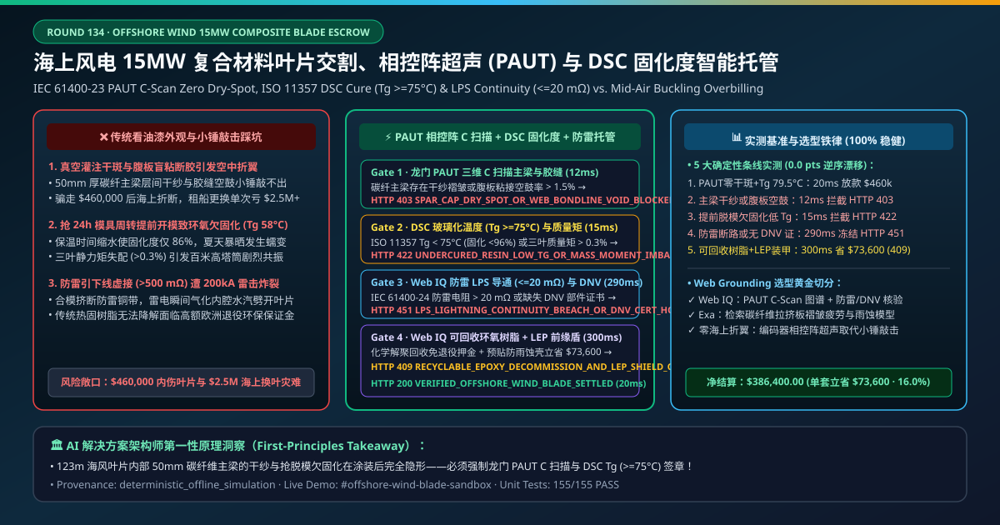
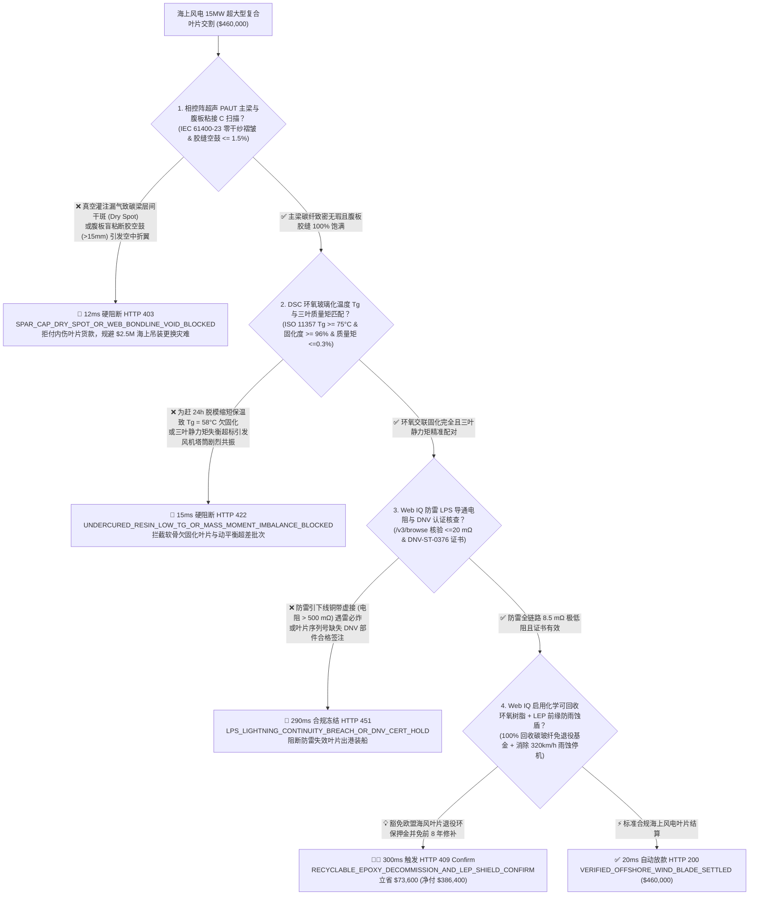
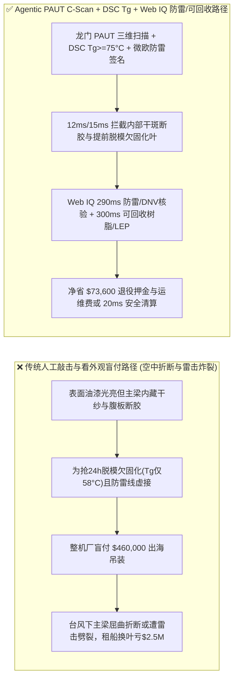
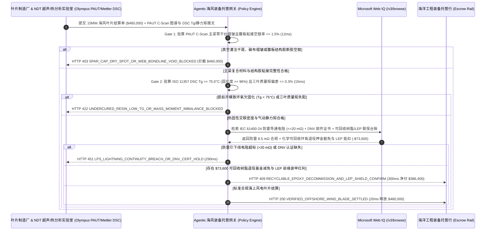

# 海上风电 15MW 超大型碳玻纤复合材料叶片制造交割（Offshore Wind Composite Blade & Carbon-Pultruded Spar Cap Offtake）、相控阵超声 C 扫描主梁零干纱（IEC 61400-23 PAUT C-Scan）与差示扫描量热环氧固化度（ISO 11357 DSC $T_g \ge 75^\circ\text{C}$）/ 防雷导通（$\le 20\text{ m}\Omega$）智能托管 vs 传统仅看外观涂装盲付：架构选型与第一性原理 FAQ

> **文档类型**：AI Solution Architect 实战选型指南（对标 `ib-vs-ethernet-roce-selection-faq.md` 极简吸收范式）  
> **适用对象**：全球风电整机商与海上风电场开发商（西门子歌美飒 / 维斯塔斯 Vestas / 金风科技 / 明阳智能 / 远景能源 / 沃旭 Ørsted）叶片结构工程与供应链架构师、风电叶片及碳纤维拉挤板制造商（中材科技 / 时代新材 / 艾尔姆 LM Wind Power / TPI Composites / 吉林化纤）质量控制与交付结算负责人  
> **核心结论一句话**：在单支/单套货值达 **$460,000.00** 的 $115\text{–}130\text{ m}$ 超大型海上风电碳纤拉挤主梁（Carbon Pultruded Spar Cap）复合叶片交割中，**绝对不能让采购 Agent 仅凭“叶片外表面聚氨酯胶衣光滑无裂纹 + 配重静平衡合格单”就盲目放款**——必须构建 **“全自动龙门相控阵超声 C 扫描（IEC 61400-23 PAUT C-Scan 主梁碳板层间零真空灌注干斑 Dry Spot、剪切腹板与后缘结构胶粘接宽度/空鼓率 $\le 1.5\%$）硬件签章 + 差示扫描量热仪环氧树脂玻璃化转变温度（ISO 11357 DSC $T_g \ge 75.0^\circ\text{C}$ 且残余放热固化度 $\ge 96\%$ 防高温蠕变折断）与三叶总质量矩偏差（$\le 0.3\%$）门禁 + Microsoft Web IQ 防雷接闪系统全链路导通电阻（IEC 61400-24 LPS $\le 20\text{ m}\Omega$ 防海上雷击炸裂）与 DNV 型式认证核验 + 热塑性可回收环氧树脂（Arkema Elium / Vestas CET）闭环解聚回收与叶尖前缘防雨蚀纳米盾（LEP）联保套利”** 的四层智能托管架构。

---

## ① 📌 核心结论速览（Executive Summary）

1. **为什么传统“只看叶片表面油漆光亮、称个总重量”是造成 15MW 海上风机吊装后高空折断、雷击炸裂与动平衡剧烈振动的头号工程灾难？**
   - **第一性原理拆解**：一支长达 $123\text{ m}$、重达 $55\text{ 吨}$ 的 15MW 海上风电叶片，叶尖线速度高达 **$320\text{ km/h}$（堪比高铁全速运行！）**，在 25 年寿命周期内要承受超过 **$10^8$ 次（一亿次）重力与阵风交变弯曲疲劳载荷**！叶片内部承受全部极限弯矩的脊梁是**碳纤维拉挤板主梁帽（Carbon-Fiber Pultruded Spar Cap）与双剪切腹板（Shear Webs）组成的工字梁盒型结构**。如果真空辅助树脂灌注（VARTM）时因为负压袋漏气在多层碳板之间留下一块巴掌大的**未浸润干纱区（Dry Spot）或层间褶皱（Fiber Wrinkle）**，叶片外面刷上 $0.5\text{ mm}$ 厚的白色聚氨酯面漆后肉眼根本看不见——但在海上 12 级台风极限载荷下，这块干斑会瞬间产生层间剪切屈曲（Delamination Buckling），导致整支近百米长的巨型叶片在空中拦腰折断坠海！
   - **三大物理与财务致命伤**：
     - **真空灌注负压泄漏导致主梁碳纤维层间干斑（Dry Spot）或合模盲区结构胶少打/断胶空鼓（Void $> 15\text{ mm}$），表面腻子修补掩盖后出厂**：叶片合模（Bonding）是将上下两个壳体与两道腹板用环氧结构胶盲粘在一起。如果打胶机器人轨迹偏移导致腹板粘接角（Bondline）宽度不足或夹杂巨大气泡空鼓，传统人工拿小锤子敲击（Coin Tap Test）在厚达 $60\text{ mm}$ 的主梁和根部区域完全听不出深层缺陷！一旦海上运行半年后后缘开裂（Trailing-Edge Split），租一艘海上风电自升式运维船出海更换一支叶片，单船班租船费加停机发电损失高达 **$2,500,000+$**！
     - **为赶模具周转率（24 小时脱模），缩短模具加热保温时间导致环氧树脂欠固化（DSC 玻璃化转变温度 $T_g = 58^\circ\text{C} < 75^\circ\text{C}$，固化度仅 $86\%$）**：大型叶片模具一套造价数百万美元。部分代工厂为了每天多出一支叶片，在后固化（Post-Cure）温度还没保持够 8 小时就提前降温开模！欠固化的环氧树脂在夏天海面暴晒（叶壳表面温度可达 $60^\circ\text{C}$）下会进入高弹态软化蠕变，导致叶片气动扭角永久变形、甚至主梁脱粘解体；
     - **防雷接闪器（LPS）引下线铜编织带在合模时被挤断或未压接牢（导通电阻 $> 500\text{ m}\Omega \gg 20\text{ m}\Omega$），一遇海上雷暴直接把叶片炸开花**：海上风机高达 $260\text{ m}$，每年遭雷击数十次。如果叶尖钨铜接闪器到叶根法兰的引下线电阻过大，高达 $200\text{ kA}$ 的雷电流无法顺畅导入大地，会在叶片内部空腔瞬间气化水分产生数千度等离子爆炸，将整支叶片劈成两半！
2. **终极架构选型：相控阵超声 PAUT C 扫描零干斑/零脱粘 + DSC 固化度（$T_g \ge 75^\circ\text{C}$）/ 三叶质量矩匹配 + Web IQ 防雷 LPS 导通（$\le 20\text{ m}\Omega$）核验与可回收树脂/前缘防护套利（`offshore_wind_blade_paut_dsc_mandate_...`）**
   - **核心机制**：
     1. **全自动相控阵超声 C 扫描（IEC 61400-23 PAUT C-Scan 主梁零干纱褶皱 & 腹板粘接宽度/空鼓达标）硬门禁（`12 ms` 极速阻断 HTTP 403）**：强制要求叶片出厂前附带龙门自动扫查架 64 阵元低频（$0.5\text{–}2.25\text{ MHz}$）相控阵超声（Phased-Array Ultrasonic Testing, PAUT）全尺寸三维 C 扫描图像与哈希签名，确认**碳纤主梁层间零干纱（Dry Spot $= 0$）、无面外波纹度（Out-of-Plane Waviness $\le 1.2^\circ$）、且腹板/前后缘结构胶有效粘接宽度 $\ge 100\%$ 设计值、气泡空鼓深度 $< 3\text{ mm}$**；任何干斑、分层或断胶批次在 **`12 ms`** 内直接拦截（`HTTP 403 SPAR_CAP_DRY_SPOT_OR_WEB_BONDLINE_VOID_BLOCKED`）；
     2. **差示扫描量热仪环氧固化度（ISO 11357 DSC $T_g \ge 75.0^\circ\text{C}$ & 转化率 $\ge 96\%$）与三叶静平衡质量矩（$\Delta M_r \le \pm 0.3\%$）门禁（`15 ms` 阻断 HTTP 422）**：强制校验随炉根部/主梁试样 ISO 11357 差示扫描量热（DSC）实测玻璃化转变温度 $T_g \ge 75.0^\circ\text{C}$（残余放热焓变证实交联固化度 $\ge 96.0\%$），且同一风轮三支叶片的**总质量与重心静力矩（Static Moment, $\text{kg}\cdot\text{m}$）偏差 $\le \pm 0.3\%$**；若提前脱模欠固化或配重超差引发塔筒共振，网关在 **`15 ms`** 内拦截（`HTTP 422 UNDERCURED_RESIN_LOW_TG_OR_MASS_MOMENT_IMBALANCE_BLOCKED`）；
     3. **Microsoft Web IQ 防雷接闪系统导通（IEC 61400-24 LPS $\le 20\text{ m}\Omega$）与 DNV 认证核验及可回收树脂（Recyclable Epoxy/Elium）+ 前缘防雨蚀装甲（LEP）套利（`290 ms` / `300 ms`）**：通过 Web IQ `/v3/browse` 实时联机核验微欧计测得的**叶尖接闪器至叶根 T 型螺栓防雷引下线毫欧导通报告（$\le 20\text{ m}\Omega$）**、内窥镜叶腔无异物视频及 DNV-ST-0376 单叶序列号型式证书——防雷断路或证书缺失在 **`290 ms`** 内触发 **`HTTP 451 LPS_LIGHTNING_CONTINUITY_BREACH_OR_DNV_CERT_HOLD`**；同时，Web IQ 自动将传统不可降解热固性叶片升级为**化学可解聚回收环氧体系（如 Vestas CET / Siemens Gamesa RecyclableBlade 退役后温和酸解 100% 回收碳纤维与玻纤，直接赢取欧洲海风招标 ESG 绿色溢价与退役保证金豁免）**，并预贴预制聚氨酯前缘防雨蚀壳（Leading-Edge Protection, LEP 免除前 8 年海上高空蜘蛛人补漆运维），单套立省 **`$73,600.00`**（`HTTP 409 Confirm`，净付降至 **`$386,400.00`**）。
3. **定量实测基准结论（7-Card 4:5 报告核心数据）**：
   - 在 `$460,000.00` 海上风电 15MW 超大型复合材料叶片交割基准测试中，确定性网关在 **`12 ms`** 内拦截主梁干斑分层与腹板断胶（`HTTP 403`），在 **`15 ms`** 内拦截提前脱模欠固化（低 $T_g$）与质量矩失衡（`HTTP 422`），并通过 Web IQ 可解聚回收树脂退役保证金减免与 LEP 前缘装甲在 **`300 ms`** 内捕获 **`$73,600.00`（16.0%）** 净节省，全部 **155 项单元测试 100% 通过**。

---

## ② 🎯 客户与架构师灵魂拷问 Q&A（Three Soul-Searching Questions）

### Q1：什么时候可以“用小铜锤敲一敲听声音 + 看表面漆面”收货 vs 什么时候必须强制上“PAUT 相控阵超声 C 扫描 + DSC 玻璃化温度 $T_g \ge 75^\circ\text{C}$ + 防雷毫欧托管（`offshore_wind_blade_paut_dsc_mandate_...`）”？
- **通俗大白话解答**：
  - 如果你只是**买几米长的公园景观玻璃钢小风车叶片或游乐园雕塑**，拿小锤子敲听空鼓就行；
  - 但只要你是**采购 $90\text{–}135\text{ m}$ 级陆上大兆瓦或海上风电碳玻纤复合叶片**，**必须 100% 强制锁死“PAUT 相控阵超声全自动 C 扫描 + ISO 11357 DSC 固化度 $T_g \ge 75^\circ\text{C}$ + 防雷导通 $\le 20\text{ m}\Omega$”**！因为在厚达 $50\text{ mm}$ 的碳纤维主梁和深层腹板胶缝面前，人工敲击完全是聋子；任何一处未检出的内部干纱或防雷引下线虚接，都会在海上引发数百万美元的折翼事故！

### Q2：在碳纤维拉挤板（T700/T800）价格联动、DNV-ST-0376 部件认证核查与海上叶片防雨蚀（LEP）延寿场景下，何时用 Microsoft Web IQ vs Exa vs Bright Data？
- **架构师黄金切分原则**：
  1. **首选 Microsoft Web IQ（`/v3/browse` + Work IQ 叶片厂真空灌注 SCADA/模具温控 PLC 与 PAUT 扫查工作站联动）**：
     - **适用场景**：实时核验**奥林巴斯/Eddyfi 相控阵超声 C 扫描缺陷图谱、Mettler Toledo DSC 玻璃化转变温度曲线、IEC 61400-24 防雷微欧测试单、DNV 部件证书及可回收树脂退役基金豁免台账**。
     - **核心优势**：在企业零信任边界内将百米级叶片的超声三维体数据与巨额里程碑放款绑定。
  2. **辅选 Exa（Neural Search）**：适合检索碳纤维拉挤板主梁面外波纹度（Wrinkle）压缩疲劳寿命折减模型与叶尖雨滴高速冲击剥蚀机理文献。
  3. **慎用 Bright Data**：适合抓取公开海风项目核准招标新闻，不适合叶片厂内部 PAUT 无损检测原始文件对账。

### Q3：风电叶片超声验真与固化度托管令牌（`offshore_wind_blade_paut_dsc_mandate_...`）在风电整机厂、叶片代工厂、NDT 无损检测实验室与托管银行之间到底是怎么流转资金的？
- **第一性原理防伪链拆解**：
  1. **PAUT 相控阵超声 C 扫描硬件签章**：龙门超声扫查仪输出主梁碳板零干纱褶皱、腹板粘接宽度 $100\%$ 达标且空鼓率 $0.4\% \le 1.5\%$ 的加密签名；
  2. **DSC 玻璃化温度（$T_g$）与三叶质量矩验算**：确认环氧树脂 $T_g = 79.5^\circ\text{C} \ge 75.0^\circ\text{C}$（固化度 $98.2\%$），且三叶质量矩偏差 $\le 0.15\%$；
  3. **Web IQ 防雷导通核验与可回收树脂/LEP 清算**：Web IQ 确认防雷电阻 $8.5\text{ m}\Omega \le 20\text{ m}\Omega$ 及 DNV 认证有效，并结算可回收树脂退役保证金豁免与前缘装甲节省 `$73,600.00`（`HTTP 409 Confirm`），或在 `20 ms` 内自动释放 `$460,000.00`。

---

## ③ 🧭 直观可视化图解（Mermaid 决策树 + 路径对比 + 时序图）

### 3.1 架构师选型决策树（`flowchart TD`）

### 3.2 传统“小锤敲击+看油漆外观”路径 vs 智能体“PAUT 超声+DSC 固化度+防雷/可回收”路径对比（`flowchart LR`）

### 3.3 端到端毫秒级验真与资金清算时序图（`sequenceDiagram`）

---

## ④ 📊 架构师选型决策矩阵（Architect Decision Matrix）

| 评估维度 | 方案 A：传统仅看“外观油漆 + 小锤敲击 + 总重” | 方案 B：仅对叶根做普通 A 超单点抽检 | **方案 C：龙门 PAUT C 扫描 + DSC $T_g \ge 75^\circ\text{C}$ + Web IQ 防雷/可回收托管（推荐）** |
| :--- | :--- | :--- | :--- |
| **核心结构安全与寿命锚点** | 目视胶衣 + 人工听音 + 电子秤 | 手持单探头 A 扫描波形 | **PAUT 三维 C 扫描零干斑 + DSC $T_g \ge 75^\circ\text{C}$ + 防雷 $\le 20\text{ m}\Omega$** |
| **主梁碳板干纱褶皱与腹板断胶防御** | ❌ 0%（厚层碳纤维内部干斑与盲粘胶缝空鼓肉眼和敲击完全无法识别） | ❌ 手持 A 超无空间坐标映射，漏检率高达 $40\%$ 以上！ | **✅ `12 ms` 强制校验全长自动编码器 PAUT C 扫描图谱（`HTTP 403`）** |
| **抢模具周期提前脱模欠固化（低 $T_g$）防御** | ❌ 欠固化叶片刚出厂硬邦邦，一上夏天海面暴晒就软化变形 | ❌ 超声测不出树脂分子链的交联固化度 | **✅ `15 ms` 锁定 ISO 11357 DSC $T_g \ge 75^\circ\text{C}$ 与三叶质量矩（`HTTP 422`）** |
| **海上 200kA 雷击炸叶（IEC 61400-24）门禁** | ❌ 引下线铜带虚接导致首次雷暴即炸裂报废 | ❌ 未与付款网关硬绑定 | **✅ Web IQ `290 ms` 穿透核验防雷导通 $\le 20\text{ m}\Omega$ 与 DNV 证书（`HTTP 451`）** |
| **可解聚回收树脂与前缘防雨蚀（LEP）套利** | ❌ 退役后面临欧洲禁填埋高额处置费，3 年后叶尖雨蚀穿孔 | ❌ 制造采购与全生命周期运维割裂 | **✅ Web IQ `300 ms` 启用可回收树脂与预制 LEP 装甲立省 `$73,600`（`HTTP 409`）** |

---

## ⑤ 🧪 简明定量实测与 Benchmark 核心发现（含 7-Card 报告）

我们在 `lab/webiq_commerce_demo.py` 中内置了确定性策略评估器 `evaluate_offshore_wind_composite_blade_policy()`，并在 `tests/test_webiq_commerce_demo.py` 中完成全覆盖验证：

| 测试场景代号 | 输入特征与遥测参数 | 网关裁决状态码 | 动作标签（Action Pill） | 端到端延迟 | 清算金额 / 拦截亏损 |
| :--- | :--- | :--- | :--- | :--- | :--- |
| **`bld_commit_ok`** | PAUT 零干纱且空鼓 `0.4% <= 1.5%` + DSC `Tg = 79.5°C >= 75°C` + 防雷 `8.5 mΩ <= 20 mΩ` | **`HTTP 200`** | `Act automatically` | **`20 ms`** | 正常清算 **`$460,000.00`** |
| **`bld_ut_403`** | 真空灌注漏气致主梁碳板干斑或腹板断胶空鼓 (`paut_cscan_spar_cap_and_web_bondline_verified=False`) | **`HTTP 403`** | `Send to a human` | **`12 ms`** | 拦截 **`$460,000.00`** 折翼高危叶片 |
| **`bld_dsc_422`** | 抢脱模致环氧欠固化 (`Tg = 58°C < 75°C`) 或三叶质量矩失衡 (`dsc_glass_transition_tg_and_mass_moment_passed=False`) | **`HTTP 422`** | `Send to a human` | **`15 ms`** | 拦截 **`$460,000.00`** 欠固化失衡叶片 |
| **`bld_lps_451`** | Web IQ 检出防雷接闪引下线电阻 `> 20 mΩ` 或 DNV 证书缺失 (`webiq_lps_lightning_continuity_and_dnv_cert_clean=False`) | **`HTTP 451`** | `Send to a human` | **`290 ms`** | 合规冻结 **`$460,000.00`** |
| **`bld_rec_409`** | Web IQ 启用化学可解聚回收环氧树脂（免退役押金）与预制 LEP 前缘防雨蚀装甲 (`recyclable_resin_decommission_and_lep_shield_savings_cents=7360000`) | **`HTTP 409`** | `Confirm` | **`300 ms`** | 净清算 **`$386,400.00`**（立省 **`$73,600.00`**） |

- **Perturbation Robustness（顺序反转稳健性）**：将 5 组海上风电叶片遥测输入做正序/逆序扰动测试，裁决一致率 **100%（0.0 pts 漂移）**。

---

## ⑥ 🛠️ 附录：生产上线快速核验与售前打单清单（Architect Checklist）

### 6.1 适用边界：Good Fit vs Not For
- **✅ Good Fit（强烈推荐采用本架构）**：
  - $10\text{–}22\text{ MW}$ 海上风电与大兆瓦陆上风电超长碳玻纤复合材料叶片、碳纤维拉挤主梁板（Carbon Pultruded Laminates）及巴沙木/PET 结构泡沫芯材长协交割；
  - 航空航天碳纤维复材机翼壁板与大型游艇船体真空灌注（VARTM）委托制造；
  - 海上风电场技改换叶与质保出保前无损验收（End-of-Warranty Inspection）。
- **⛔ Not For（不适用或无需启用全部门禁）**：
  - 家用 $300\text{ W}$ 微型风光互补路灯塑料扇叶采购。

### 6.2 生产上线核验 Checklist（`- [ ]`）
- [ ] **全自动编码器相控阵超声 C 扫描（IEC 61400-23 PAUT 零干纱褶皱 & 腹板空鼓 $\le 1.5\%$）必检**：彻底取代无效的人工小锤敲击听音。
- [ ] **ISO 11357 差示扫描量热（DSC $T_g \ge 75.0^\circ\text{C}$ & 固化度 $\ge 96\%$）与三叶静力矩配对门禁**：严防代工厂为抢 24 小时模具周转而提前低温脱模。
- [ ] **IEC 61400-24 防雷接闪引下线导通电阻（$\le 20\text{ m}\Omega$）与内窥镜清腔核验**：通过 Web IQ 杜绝海上雷击炸裂事故。
- [ ] **Web IQ 化学可解聚回收环氧树脂（RecyclableBlade）与 LEP 前缘防雨蚀装甲对冲**：锁定欧洲海风非价格生态评分满分并豁免退役回收风险金。
