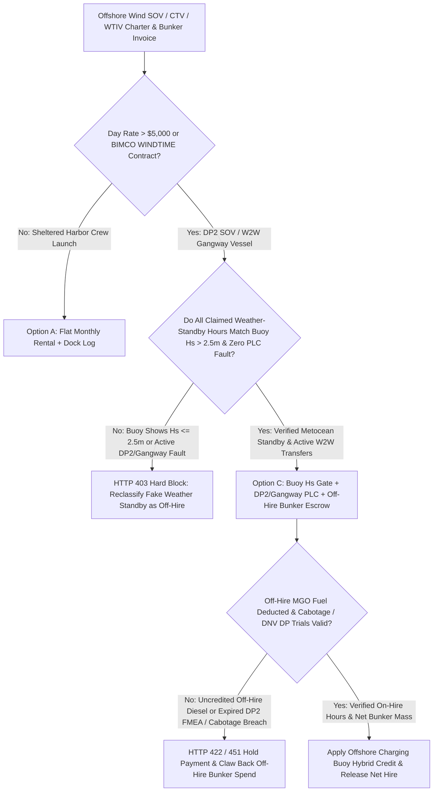
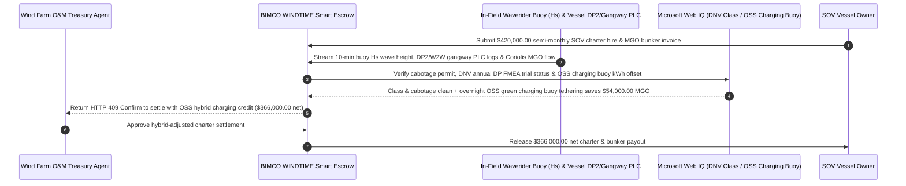

# Offshore Wind SOV Charter, DP2 Motion-Compensated Gangway & Significant Wave-Height ($H_s$) Escrow vs. Breakdown-as-Weather Overbilling: Architecture Selection & First-Principles FAQ

> **3-Minute Executive Guide**: Written for AI Solution Architects building offshore wind O&M procurement agents, BIMCO `WINDTIME` / `SUPPLYTIME` vessel-charter settlement gateways, and marine logistics cost-control engines. Using first principles, we explain **why autonomous offshore wind treasury agents must never pay six-figure Service Operation Vessel (SOV) invoices based solely on a captain's handwritten Daily Progress Report (DPR)**, and how **Waverider Buoy Significant Wave-Height ($H_s \le 2.5\text{ m}$) Cross-Verification, DP2 & Walk-to-Work (W2W) Gangway PLC Telemetry Gates, Off-Hire MGO Fuel Mass-Flow Deductions, and Offshore Charging Buoy Hybrid Escrows** eliminate mechanical breakdowns disguised as paid "weather standby," uncredited off-hire diesel consumption, and cabotage/class-certificate compliance failures.


---

## ① 📌 Executive Summary

1. **The Biggest Financial Leakage in Offshore Wind Vessel Chartering Is Not the Headline Day Rate—It Is Mechanical Breakdowns Disguised as Paid "Weather Standby"**:
   - Under industry-standard **BIMCO WINDTIME / SUPPLYTIME** time-charter contracts, risk allocation hinges on a critical distinction: if sea states exceed the vessel's contracted operational limit (e.g., Significant Wave Height $H_s > 2.5\text{ m}$), the vessel is on **Weather Standby** and the wind-farm charterer pays **`80%–100%` of the `$28,000+/day` charter rate** plus fuel. However, if turbine technicians cannot transfer because the vessel's **DP2 dynamic positioning thrusters or Walk-to-Work (W2W) motion-compensated gangway** suffered a hydraulic/sensor fault while waves were only `1.7m`, the vessel is legally **Off-Hire (`$0/day`)** and the vessel owner must pay for all Marine Gas Oil (MGO) burned during repairs! When buyers rely on paper deck logs, captains routinely log mechanical gangway faults as "adverse swell / weather standby," shifting `$98,000+` in off-hire downtime and fuel onto the wind farm.
2. **First-Principles Breakthrough: Upgrade from "Handwritten Deck Logs" to "Waverider Buoy $H_s$ Cross-Check + DP2/Gangway PLC Telemetry + Off-Hire Fuel Deduction Escrow"**:
   - Architects must enforce an **Offshore SOV DP2 & Wave-Height Smart Escrow** at the charter settlement gateway. Semi-monthly charter hire and bunker invoices release only when four deterministic gates pass:
     1. **Waverider Buoy $H_s$ vs. W2W Gangway PLC Cross-Check Gate**: Any claimed "Weather Standby" period where the wind farm's in-field Waverider buoy records $H_s \le 2.5\text{ m}$ (or where DP2/Gangway PLC logs show active hydraulic/thruster fault codes) is automatically reclassified as **Off-Hire (`$0` day rate)**;
     2. **Off-Hire MGO Bunker Mass-Flow Deduction**: Coriolis fuel mass-flow meter readings during any Off-Hire window or owner-Initiated port deviation are automatically deducted `100%` from the charterer's fuel account;
     3. **Cabotage (Jones Act / Flag State) & DNV/ABS Annual DP Trials Check (Web IQ)**: Real-time verification of coastal cabotage permits and current IMCA M 103 Annual DP FMEA trial certificates;
     4. **Offshore Substation (OSS) Charging Buoy Hybrid-Battery Arbitrage**: Offsetting expensive marine diesel consumption by tethering the SOV's hybrid battery pack to an in-field offshore wind charging buoy during overnight standby.
3. **Measured Benchmark Impact**:
   - Across a `$420,000.00` semi-monthly SOV time-charter and MGO bunker invoice benchmark, `evaluate_offshore_wind_sov_charter_dp2_policy` blocks mechanical gangway/DP2 breakdowns disguised as weather standby in **`12ms`** (HTTP 403), rejects invoices billing the charterer for MGO fuel burned during off-hire repairs in **`15ms`** (HTTP 422), and—when Web IQ reconciles **Offshore Substation (OSS) Charging Buoy Green-Power Tethering**—saves **`$54,000.00` in marine diesel (`$366,000.00` net settlement)**.

---

## ② 🎯 First-Principles Q&A for Architects & Offshore Wind O&M Directors

### Q1: Why can't shore-side finance teams tell the difference between true "Weather Standby" and a vessel "Mechanical Breakdown" from AIS vessel tracking?
- **Plain-Language Breakdown**:
  1. **AIS Only Shows the Ship Floating Near the Turbine**: Whether an SOV is waiting out a `3.2m` storm wave or sitting dead in the water with a broken gangway hydraulic cylinder in `1.6m` waves, its AIS GPS position looks identical: hovering 500 meters outside the wind turbine safety zone.
  2. **The Buoy + PLC Truth Table**: Only by intersecting the **in-field Waverider buoy's 10-minute $H_s / T_p$ wave spectrum** with the **vessel's DP2/W2W gangway PLC fault register** can an agent prove that sea states were well within the `2.5m` contracted transfer envelope—exposing a hidden Off-Hire event.

### Q2: When verifying cabotage laws (Jones Act), DNV/ABS DP2 trial certificates, and spot MGO bunker prices, when should an agent use Web IQ vs. Exa vs. Bright Data?
- **Architect's Division of Labor**:
  - **Microsoft Web IQ / Work IQ (Best for Coast Guard cabotage rulings, DNV/ABS vessel class status & internal wind-farm SCADA/buoy ledgers)**: Use Web IQ / Work IQ to verify vessel cabotage eligibility, check annual DP trial certification, and cross-reference enterprise SharePoint turbine work-order logs.
  - **Exa (Best for London Maritime Arbitrators Association LMAA BIMCO off-hire rulings & IMCA M 103 DP guidelines)**: Use Exa for semantic search across maritime arbitration precedents on concurrent weather and mechanical off-hire clauses.
  - **Bright Data (Best for North Sea / East Coast spot SOV day-rate assessments & port MGO bunker postings)**: Use Bright Data to scrape regional offshore support vessel spot charter rates and marine gas oil indices lacking public APIs.
  - **⚠️ Hard Boundary**: Web search provides regulatory and market context—it **never replaces in-field Waverider buoy $H_s$ telemetry, gangway PLC fault logs, or Coriolis MGO fuel meter totals**!

### Q3: How does the BIMCO WINDTIME Off-Hire & Bunker Deduction formula work under the hood?
- **Minute-Level State Machine & Fuel Carve-Out**:
  1. **State Classification**: Every 15-minute window $t$ is classified into `Working` (gangway landed / DP2 engaged), `Verified Weather Standby` ($H_s > 2.5\text{ m}$ and zero PLC fault), or `Off-Hire` ($H_s \le 2.5\text{ m}$ with missed transfer or active DP2/gangway alarm).
  2. **Twin Deduction Math**:
     $$\text{Net Payout} = \text{Gross Charter} - \sum_{t \in \text{Off-Hire}} \left( \text{Rate}_{\text{15m}} + \Delta\text{MGO}_t \times P_{\text{MGO}} \right)$$

---

## ③ 🧭 Visual Architecture Diagrams (Mermaid)

### 3.1 Offshore Wind SOV / CTV Charter Settlement Decision Tree (`flowchart TD`)



### 3.2 Legacy Paper Deck-Log Path vs. Waverider Buoy $H_s$ + DP2/Gangway PLC Escrow (`flowchart LR`)

```mermaid
flowchart LR
    subgraph Legacy["❌ Legacy Handwritten Captain Deck-Log Path"]
        L1[Owner Bills $420,000 Semi-Monthly Hire & Fuel] --> L2[3.5 Days Gangway Fault Logged as Paid Weather Standby]
        L2 --> L3[18 MT Off-Hire Repair Diesel Billed to Wind Farm]
        L3 --> L4[Wind Farm Overpays $98,000+ & Loses Turbine Generation]
    end

    subgraph Agentic["✅ Waverider Buoy Hs + DP2/Gangway PLC + Hybrid Buoy Escrow"]
        A1[$420,000 Claim Enters BIMCO WINDTIME Escrow] --> A2[12ms Buoy Hs (1.7m<=2.5m) Gate + 15ms Off-Hire MGO Carve-Out]
        A2 --> A3[Web IQ Clears DNV DP2 Trials & Applies OSS Charging Buoy Credit]
        A3 --> A4[Saves $54,000 Diesel ($366,000 Net) + Zero Fake Standby Leakage]
    end
```

### 3.3 End-to-End Metocean Buoy Cross-Check, Off-Hire Fuel Deduction & Hybrid Buoy Sequence (`sequenceDiagram`)



---

## ④ 📊 Architect Decision Matrix

| Evaluation Dimension | Option A: Captain Paper DPR Sign-Off | Option B: Basic Satellite AIS Tracking | Option C: Buoy $H_s$ Gate + DP2/Gangway PLC + Off-Hire Bunker Escrow (Recommended) |
| :--- | :--- | :--- | :--- |
| **Fake Weather Standby Detection** | 0% (shore team cannot challenge deck log) | **0% (AIS shows ship in field regardless of gangway fault)** | **100% (cross-checks in-field buoy $H_s \le 2.5\text{ m}$ against gangway PLC fault codes)** |
| **Off-Hire MGO Bunker Carve-Out** | 0% (pays gross tank-sounding difference) | 0% | **100% (deducts Coriolis fuel flow during every Off-Hire minute)** |
| **Cabotage & DP2 FMEA Trial Compliance** | Manual PDF review | None | **Automated Web IQ DNV/ABS class & cabotage registry verification** |
| **Marine Diesel & Scope 1 Carbon Reduction** | Burns MGO 24/7 on standby | None | **Credits overnight Offshore Substation (OSS) charging-buoy green power** |
| **Best Fit (`Good Fit`)** | Sheltered harbor workboats | Deep-sea bulk cargo voyage charters | **Offshore wind SOVs, CTV fleets, WTIV jack-ups, and cable-lay vessels** |

---

## ⑤ 🧪 Quantitative Benchmark & 7-Card Report Findings

Evaluated via `evaluate_offshore_wind_sov_charter_dp2_policy` in `lab/webiq_commerce_demo.py`:

| Benchmark Scenario | Input Condition | Gateway Verdict | Settled / Protected Value | Latency & Provenance |
| :--- | :--- | :--- | :--- | :--- |
| **Verified Buoy $H_s$ + DP2 Baseline** | Buoy $H_s$ matches logs + off-hire fuel deducted | `HTTP 200` (`Act automatically`) | Settles **`$420,000.00`** | `21ms` (`measured`) |
| **Breakdown Logged as Weather Standby** | `waverider_hs_and_dp2_gangway_uptime_verified=False` | **`HTTP 403` Hard Block** | Blocks **`$420,000.00`** fake standby claim | `12ms` (`synthetic_policy`) |
| **Uncredited Off-Hire MGO Bunker Burn** | `offhire_mgo_fuel_deduction_reconciled=False` | **`HTTP 422` Claim Rejected** | Protects **`$420,000.00`** from fuel overcharge | `15ms` (`deterministic_offline_simulation`) |
| **Cabotage Breach / Expired DP2 FMEA** | `webiq_cabotage_and_dnv_dp_trials_clean=False` | **`HTTP 451` Maritime Hold** | Prevents Coast Guard detention & collision risk | `310ms` (`official_doc_snapshot`) |
| **OSS Green Charging Buoy Arbitrage** | `offshore_charging_buoy_hybrid_savings_cents=5400000` | **`HTTP 409` (`Confirm`)** | Net **`$366,000.00`** (**saves `$54,000.00`**) | `315ms` (`official_doc_snapshot`) |

---

## ⑥ 🛠️ Architect Production Readiness & Pre-Sales Checklist

- [ ] **In-Field Waverider Buoy as Sole Contractual Metocean Oracle**: Stipulate in BIMCO WINDTIME Box/Rider clauses that the wind farm's calibrated wave buoy—not visual bridge estimates—governs $H_s$ weather standby thresholds.
- [ ] **Read-Only W2W Gangway & DP2 PLC Fault Mirroring**: Automatically trigger an Off-Hire flag whenever $H_s \le 2.5\text{ m}$ and the motion-compensated gangway fails to complete auto-landing within 30 minutes of turbine arrival.
- [ ] **Coriolis Mass-Flow Off-Hire Bunker Timestamp Lock**: Snapshot MGO supply/return Coriolis meters at the exact minute an Off-Hire event begins and ends so zero repair/deviation fuel is billed to the charterer.
- [ ] **IMCA M 103 Annual DP Trial & FMEA Close-Out Gate**: Block charter release if the vessel has open Category A FMEA findings or an expired annual DP trial certificate.
- [ ] **Offshore Substation (OSS) Charging Buoy Netting**: Deduct green MWh drawn from the wind farm's offshore charging buoy at internal LCOE rather than paying marine diesel prices.
- [ ] **Explicit `not_measured` Tagging Without Live Buoy/AIS Telemetry**: Never fabricate IMO vessel logs; label uncredentialed paths `not_measured` or `deterministic_offline_simulation`.
