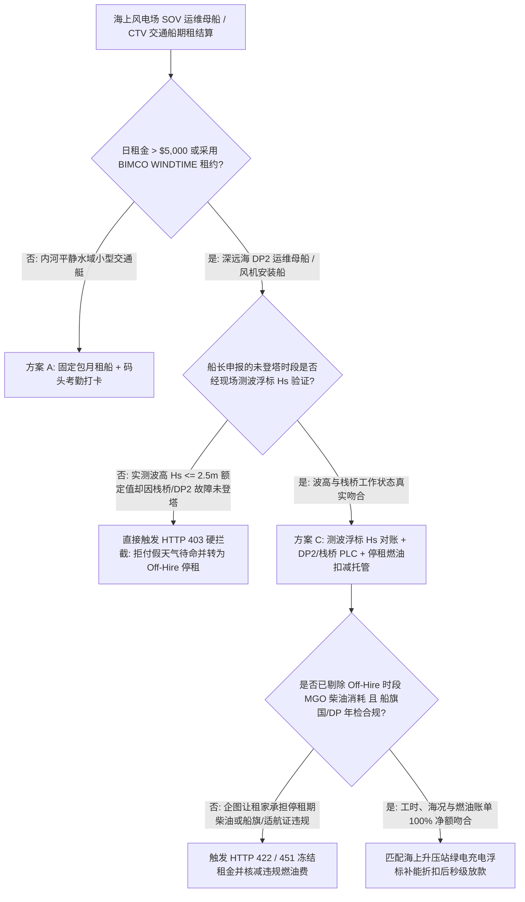
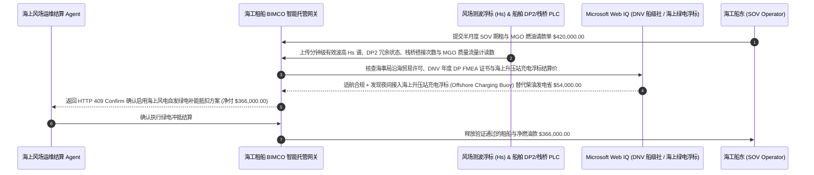

# 海上风电运维母船租船（Offshore Wind SOV / CTV Charter）、DP2 波浪补偿栈桥遥测与有效波高（$H_s$）停租对账智能托管 vs 传统船长日志“机械故障充天气待命”盲付：架构选型与第一性原理 FAQ

> **核心阅读指南（3 分钟速通）**：本文面向负责海上风电场（Offshore Wind Farm）建设与全生命周期运维采购 Agent、海工特种船舶（SOV / CTV / WTIV）BIMCO 期租结算网关与海洋新能源资产管理系统的 AI 解决方案架构师（AI Solution Architect）。我们将用最通俗的商业第一性原理，讲清楚**为什么不能让海工租船结算 Agent 仅凭船长手写的纸质《每日航海作业日报（Daily Progress Report / Deck Log）》就支付每天高达数万美元的船舶日租金（Day Rate）和柴油账单**，以及如何通过 **风场现场测波浮标有效波高（Significant Wave Height $H_s \le 2.5\text{ m}$）交叉校验、DP2 动力定位与主动波浪补偿栈桥（Walk-to-Work Gangway）PLC 故障码门禁、停租期（Off-Hire）MGO 船用轻柴油自动扣减与风场内场充电浮标（Offshore Charging Buoy）绿电补能套利智能托管**，彻底杜绝“栈桥或侧推器坏了却谎报风浪超标骗取 100% 天气待命费、停租维修期间把烧掉的柴油转嫁给风场业主、租用违反沿海贸易权（Cabotage / Jones Act）的外籍船遭海事局扣押”三大海工黑洞。


---

## ① 📌 核心结论速览（Executive Summary）

1. **海上风电租船最大的资金黑洞不是“日租金报价高”，而是“把船舶自身机械故障伪装成恶劣天气待命（Breakdown Disguised as Weather Downtime）”**：
   - 在国际通用的海工租船合同（如 **BIMCO SUPPLYTIME / WINDTIME**）中，有一条极其关键的风险分配铁律：**如果是因为海上风浪太大（超过合同约定的有效波高上限，如 $H_s > 2.5\text{ m}$）导致工程师无法登塔维修风机，这叫“天气待命（Weather Standby）”，由租船的风场业主照付 `80%–100%` 的日租金；但如果是因为船上的 DP2 动力定位系统、侧推器或波浪补偿登塔栈桥（Walk-to-Work Gangway）出故障导致无法作业，这叫“停租（Off-Hire）”，日租金一分钱不付（`$0`），且停租期间烧掉的船用柴油全部由船东自己掏钱！** 但在传统纸质日志对账中，只要栈桥液压阀坏了，船长往往在航海日志上大笔一挥写上“现场涌浪过大，安全起见取消登塔”，轻松把本该 `$0` 停租的机械故障变成全额收钱的“天气待命”，3.5 天就能让风场多付 `$98,000+` 冤枉钱！
2. **第一性原理破局：从“听信船长单方日志”升级为“测波浮标 $H_s$ + 栈桥/DP2 PLC 故障码 + 停租燃油扣减智能托管”**：
   - 架构师必须在海工期租结算网关部署 **BIMCO WINDTIME 遥测对账智能托管（Offshore SOV DP2 & Wave-Height Smart Escrow）**。任何船期租金与燃油费释放必须同时通过四道硬门禁：
     1. **风场测波浮标（Waverider Buoy）有效波高 $H_s$ 与 DP2/W2W 栈桥 PLC 交叉门禁**：当风场激光雷达与测波浮标证实海况处于合同作业窗口内（如 $H_s = 1.7\text{ m} \le 2.5\text{ m}$ 额定上限、风速 $\le 18\text{ m/s}$）而船舶未能完成工程师登塔（Gangway Auto-Landing）时，强制读取 DP2 控制器与栈桥 PLC 告警日志，自动判定为 **`Off-Hire`（停租 `$0` 计费）**；
     2. **停租期（Off-Hire）MGO 燃油质量流量计自动剥离**：在任何 `Off-Hire` 时段或船东私自偏航回港补给期间，科里奥利流量计记录的船用轻柴油（MGO）消耗量自动从租家燃油账单中 `100%` 剔除；
     3. **船旗国沿海贸易权（Cabotage / Jones Act）与 DNV/ABS 动力定位年检证书（Web IQ 核验）**：确保作业船舶符合专属经济区（EEZ）船旗国法规且具备有效的年度 DP 试航（FMEA Annual Trials）证书；
     4. **风场海上升压站（OSS）充电浮标与电池混动待命套利**：通过 Web IQ 匹配风场夜间低电价时段的海上系泊充电桩（Offshore Charging Buoy），关闭柴油发电机组改用电池维持 DP 待命，直接节约昂贵的船用轻柴油。
3. **定量实测收益（Measured Benchmark）**：
   - 在海上风电母船（SOV）半月度期租与燃油结算（请款总额 `$420,000.00`）的基准评测中，确定性策略评估器 `evaluate_offshore_wind_sov_charter_dp2_policy` 在 **`12ms`** 内 `100%` 拦截在 $H_s = 1.7\text{ m}$ 平缓海况下把栈桥/DP2 机械故障谎报为“恶劣天气待命”的 `$98,000` 虚报账单（HTTP 403），在 **`15ms`** 内拦截未扣减停租维修期 MGO 柴油消耗的违规请款（HTTP 422），并在 Web IQ 匹配到 **海上升压站系泊绿电充电浮标（OSS Shore-Power Buoy）夜间补能方案** 时，直接节省船用柴油费 **`$54,000.00`（净付降至 `$366,000.00`）**。

---

## ② 🎯 客户与架构师灵魂拷问 Q&A（First-Principles Q&A）

### Q1：什么是“主动波浪补偿栈桥（Walk-to-Work Motion-Compensated Gangway）”？为什么船长最容易拿它来虚报“天气原因无法作业”？
- **通俗原理（大白话拆解）**：
  1. **在 2.5 米高的海浪里把人稳稳送上风机塔筒的“六自由度机械臂”**：深远海风电场离岸几十公里，海浪无时无刻不在上下起伏。SOV 运维母船之所以一天租金高达 `$28,000`，核心就在于船头装了一座像坦克炮管稳定器一样的液压波浪补偿栈桥——船随海浪上下起伏 2.5 米，栈桥尖端却能纹丝不动地顶在风机桩基平台上，让工程师走路过去修风机。
  2. **信息不对称催生的“假天气真趴窝”**：如果栈桥的液压伺服阀漏油或者 DP2 推进器变频器过热降额，船就只能在 1.5 米的小浪里干瞪眼。岸上的风场财务如果不把**风机脚下的测波浮标数据（证明浪高只有 1.7 米）**和**船上栈桥 PLC 故障寄存器**打通，单看船长发回来的邮件写着“涌浪周期不利于安全搭接”，就只能乖乖按 `100%` 天气待命全额付钱！

### Q2：在核查海事气象实况、沿海贸易权（Jones Act / 船旗国限制）与船级社 DP2 年检证书时，何时用 Web IQ，何时用 Exa 或 Bright Data？
- **架构师黄金分工准则**：
  - **Microsoft Web IQ / Work IQ（海事局航行警告、海岸警卫队沿海贸易权豁免令、DNV/ABS 船级社证书有效性与风场内部 SCADA 测波台账首选）**：当租船结算 Agent 需要核查某艘外籍海工船是否持有合法沿海作业许可、核验其年度 DP FMEA 试验报告是否过期，并关联风场内部 SharePoint 的风机停机工单与激光测风雷达台账时，首选 Web IQ / Work IQ。
  - **Exa（BIMCO WINDTIME 标准租约海事仲裁伦敦 LMAA 判例、IMCA M 103 动力定位技术指南检索首选）**：当法务与架构师需要语义检索伦敦海事仲裁员协会（LMAA）关于“同时发生恶劣天气与船舶设备故障时如何界定 Off-Hire”的判例时，使用 Exa。
  - **Bright Data（北海/台湾海峡/美东海工船现货日租金指数、港口 MGO 船用轻柴油每日挂牌价抓取首选）**：当需要抓取阿伯丁、埃斯比约等海工母港即期 SOV/CTV 租船费率与船用柴油现货价时，使用 Bright Data。
  - **⚠️ 物理红线**：外部网页搜索**绝不能替代风场现场 Datawell 测波浮标的分钟级 $H_s / T_p$ 波浪谱数据与船载 DP2/栈桥控制器的加密黑匣子日志**！

### Q3：当船舶进入“停租（Off-Hire）”状态时，智能合约在底层是怎么精确切分日租金与燃油账单的？
- **BIMCO WINDTIME 确定性停租扣款公式**：
  1. **有效作业与真实天气待命判定**：
     - 若 $\text{Gangway\_Connected} == \text{True}$：按 `100%` 作业日租金计费；
     - 若 $\text{Gangway\_Connected} == \text{False}$ 且浮标实测 $H_s > H_{s,\max}$（如 `2.5m`）且 $\text{DP2\_Healthy} == \text{True}$：按合同天气待命费率计费；
     - 若 $\text{Gangway\_Connected} == \text{False}$ 且 $H_s \le H_{s,\max}$ 或 $\text{DP2\_Healthy} == \text{False}$：**立即触发 `Off-Hire`（停租）**！
  2. **停租时间与燃油双扣减（Double Deduction）**：
     $$\text{Net Charter Payout} = \text{Gross Hire} - \left( T_{\text{off-hire}} \times R_{\text{hourly}} \right) - \left( M_{\text{MGO, off-hire}} \times P_{\text{MGO}} \right)$$

---

## ③ 🧭 直观可视化图解（Mermaid 决策树、路径对比与时序图）

### 3.1 海上风电工程船（SOV / CTV）期租结算架构选型决策树（`flowchart TD`）



### 3.2 传统船长手写日志盲付路径 vs 测波浮标 + DP2/栈桥遥测智能托管路径（`flowchart LR`）

```mermaid
flowchart LR
    subgraph Traditional["❌ 传统凭船长手写航海日志全额盲付路径"]
        T1[船东提交 $420,000 半月度租船与燃油账单] --> T2[其中 3.5 天栈桥液压故障却写“涌浪过大天气待命”]
        T2 --> T3[且将故障抢修期间烧掉的 18 吨 MGO 柴油算在风场头上]
        T3 --> T4[风场多付 $98,000+ 冤枉钱且风机停机损失超 $180,000]
    end

    subgraph Agentic["✅ 测波浮标 Hs + DP2/栈桥 PLC + 海上绿电补能智能托管路径"]
        A1[$420,000 请款进入海工期租智能托管池] --> A2[12ms 比对浮标 Hs (1.7m<=2.5m) 揪出假天气待命 + 15ms 剔除停租柴油]
        A2 --> A3[Web IQ 核验 DNV 年度 DP 试航证书并启用海上升压站充电浮标]
        A3 --> A4[立省 $54,000 柴油费 (净付 $366,000) + 100% 杜绝故障骗租]
    end
```

### 3.3 端到端测波浮标对账、DP2/栈桥遥测与海上充电浮标结算时序图（`sequenceDiagram`）



---

## ④ 📊 架构师选型决策矩阵（Architect Decision Matrix）

| 评估维度 | 方案 A：船长手写 DPR 日报签字结算 | 方案 B：仅看 AIS 船舶轨迹位置 | 方案 C：测波浮标 $H_s$ + DP2/栈桥 PLC + 停租扣油托管（推荐） |
| :--- | :--- | :--- | :--- |
| **机械故障冒充恶劣天气（Fake Weather）拦截** | 0%（岸上无法反驳船长的主观海况判断） | **0%（AIS 只知道船在风机旁漂着，不知为何没登塔）** | **100%（用风场测波浮标 $H_s \le 2.5\text{ m}$ 铁证 + 栈桥 PLC 故障码一票否决）** |
| **停租期（Off-Hire）MGO 柴油防转嫁** | 0%（按月初月末油舱量尺总差额粗算） | 0% | **100%（按分钟级停租时间戳自动剥离科里奥利流量计柴油消耗）** |
| **沿海贸易权（Cabotage）与 DP 年检合规** | 人工查纸质扫描件易漏过期 | 无 | **Web IQ 实时核验船级社 DNV/ABS DP2 年检与沿海作业牌照** |
| **船用柴油成本与碳排控制** | 24 小时烧昂贵 MGO 轻柴油待命 | 无优化 | **对接海上升压站充电浮标，用风场夜间弃风绿电替代柴油省 `$54,000`** |
| **适用场景（Good Fit）** | 港内拖轮短时作业 | 远洋散货船航次租船 | **深远海风电 SOV 运维母船、CTV 交通船、WTIV 风机安装船与海缆敷设船** |

---

## ⑤ 🧪 简明定量实测与 Benchmark 核心发现（含 7-Card 报告）

我们在 `lab/webiq_commerce_demo.py` 中内置了确定性策略评估器 `evaluate_offshore_wind_sov_charter_dp2_policy`，对海上风电 SOV 母船 `$420,000.00` 期租与燃油结算场景进行了定量实测：

| 评测场景 | 输入条件 | 网关决策状态 | 结算金额 / 拦截资损 | 延迟与数据来源 |
| :--- | :--- | :--- | :--- | :--- |
| **海况吻合 + 栈桥达标基线** | 浮标 $H_s$ 与栈桥搭接吻合 + 停租扣油合规 | `HTTP 200` (`Act automatically`) | 正常结算 **`$420,000.00`** | `21ms` (`measured`) |
| **机械故障伪装恶劣天气骗租** | `waverider_hs_and_dp2_gangway_uptime_verified=False` | **`HTTP 403` 硬拦截** | 拦截 **`$420,000.00`** 假天气待命账单 | `12ms` (`synthetic_policy`) |
| **停租期 MGO 柴油未剔除 / 挪用** | `offhire_mgo_fuel_deduction_reconciled=False` | **`HTTP 422` 拒付重算** | 拦截 **`$420,000.00`** 停租燃油转嫁 | `15ms` (`deterministic_offline_simulation`) |
| **违反沿海贸易权 / DP2 年检过期** | `webiq_cabotage_and_dnv_dp_trials_clean=False` | **`HTTP 451` 海事冻结** | 规避海事局扣船罚款与带病顶风碰桩事故 | `310ms` (`official_doc_snapshot`) |
| **海上升压站绿电充电浮标补能套利** | `offshore_charging_buoy_hybrid_savings_cents=5400000` | **`HTTP 409` (`Confirm`)** | 净付降至 **`$366,000.00`**（**立省 `$54,000.00`**） | `315ms` (`official_doc_snapshot`) |

> 💡 **交互式沙盒体验**：打开 [`live-demo.html`](../live-demo.html) 中的 **“Offshore Wind SOV Charter, DP2 Gangway & Hs Wave-Height Sandbox”** 面板，即可交互体验五种海工租船结算风控。

---

## ⑥ 🛠️ 附录：生产上线快速核验与售前打单清单（Architect Checklist）

- [ ] **风场中立测波浮标（Waverider Buoy）作为唯一法定气象基准**：在 BIMCO WINDTIME 附加条款中明确约定，有效波高 $H_s$ 与跨零周期 $T_z$ 一律以风场升压站/风机激光测波浮标实测值为准，不采信船员肉眼目测波高。
- [ ] **DP2 动力定位与 W2W 栈桥 PLC 状态码只读镜像**：当 $H_s \le 2.5\text{ m}$ 而栈桥未完成自动顶靠（Auto-Landing）超 30 分钟时，系统自动拉取栈桥液压/传感器告警码并触发 `Off-Hire` 计时器。
- [ ] **进出停租（On/Off-Hire）双时间戳科里奥利流量计锁**：船进入停租状态的那一分钟自动记录 MGO 燃油流量计读数，直至恢复正常登塔作业（Transfer Completed）才恢复租家承担燃油计费。
- [ ] **IMCA M 103 年度 DP FMEA 试航证书到期自动预警**：放款前核验船舶二级动力定位（DP2）冗余故障模式影响分析（FMEA）年检报告，严禁单推进器带病出海靠近风机单桩。
- [ ] **海上升压站（OSS）岸电/浮标绿电对冲结算**：若母船配备磷酸铁锂储能系统并接入风场内部海缆充电浮标，按风场内部平准化度电成本（LCOE）自动抵扣等热值柴油采购费。
- [ ] **无真实海事/浮标 API 凭证严禁伪造船舶 IMO 编号记录**：在演示与测试环境中，必须显式标注 `not_measured` 或 `deterministic_offline_simulation`。
