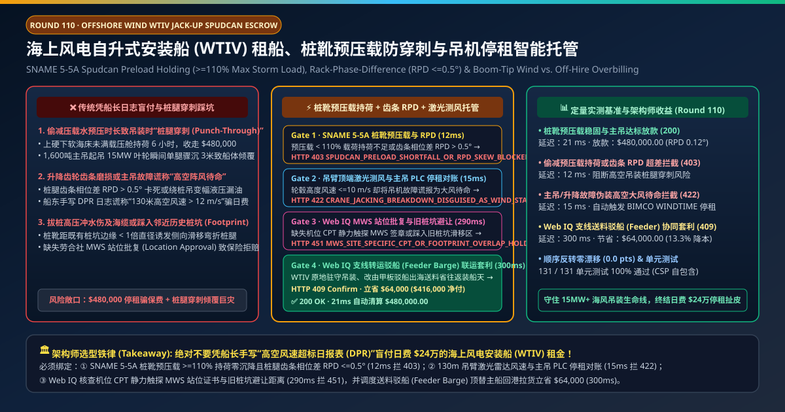
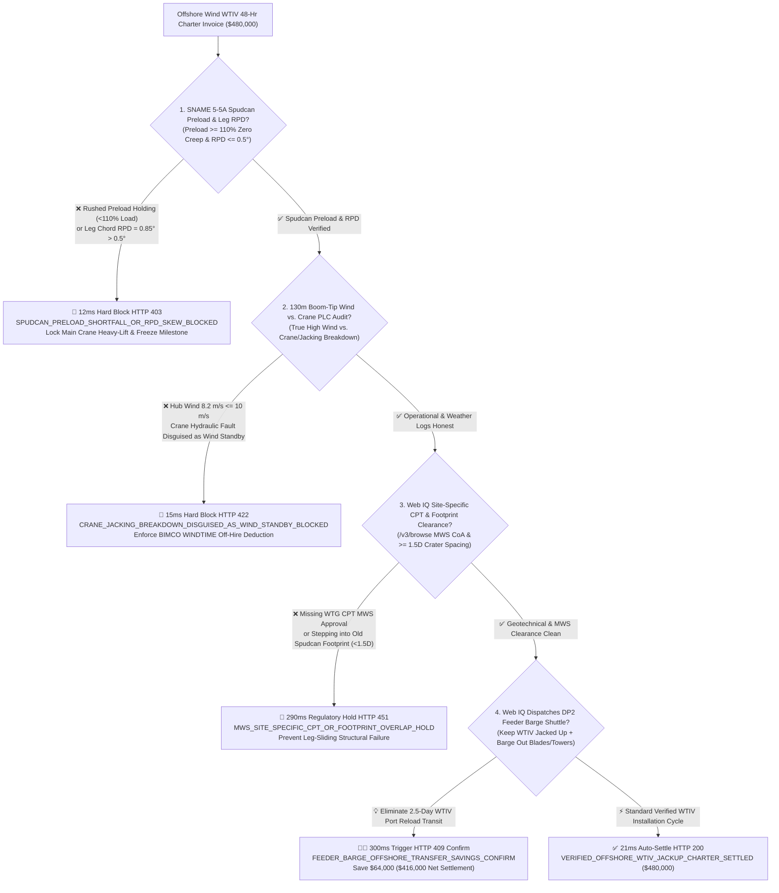
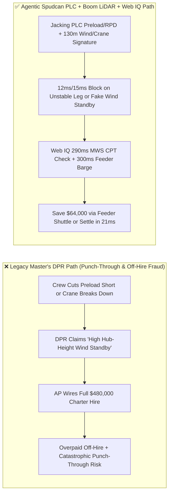
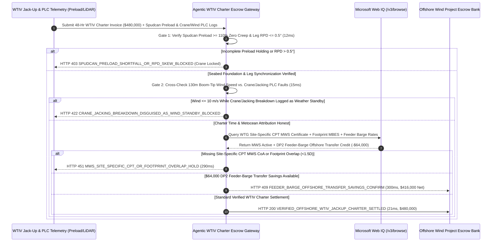

# Offshore Wind Turbine Installation Vessel (WTIV Jack-Up Charter), Spudcan Preload Holding ($\ge 110\%$) & Rack-Phase-Difference ($\text{RPD} \le 0.5^\circ$) Escrow vs. Punch-Through & Weather-Standby Overbilling: Architecture Selection & First-Principles FAQ

> **Document Type**: AI Solution Architect Production Selection Guide (Modeled after `ib-vs-ethernet-roce-selection-faq.md`)  
> **Target Audience**: Offshore Wind (15MW–20MW WTG) EPCI & Marine Operations Directors, WTIV Chartering Managers, Jack-Up Vessel Owners, Lloyd's Marine Warranty Surveyors (MWS)  
> **One-Sentence Takeaway**: In 4th-generation Offshore Wind Turbine Installation Vessel (WTIV) time charters (governed by BIMCO `WINDTIME` at `$240,000/day`, or **$480,000.00** per 48-hour positioning & installation cycle), **never allow a procurement agent to release jacking milestones or weather-standby day-rates based solely on the master's handwritten Daily Progress Report (DPR)**—you must enforce a four-layer escrow architecture binding **SNAME 5-5A / ISO 19905-1 Spudcan Preload Holding ($\ge 110\%$ storm leg load with zero settlement creep) & Leg Rack-Phase-Difference ($\text{RPD} \le 0.5^\circ$) hardware attestation + 130m Boom-Tip LiDAR Anemometer vs. Main-Crane/Jacking PLC Fault-Code cross-auditing (preventing mechanical breakdowns from being billed as high-altitude wind standby) + Microsoft Web IQ Site-Specific Piezocone CPT MWS Location Approval / Spudcan Footprint clearance and DP2 Feeder-Barge offshore transfer arbitrage**.

---

## ① 📌 Executive Summary

1. **Why is Legacy "Master's Daily Progress Report (DPR)" Settlement a Catastrophic Safety & Financial Trap in 15MW+ Offshore Wind Installation?**
   - **First-Principles Breakdown**: A jack-up Wind Turbine Installation Vessel (WTIV) elevates a 25,000-ton hull 20 meters above the sea on four 120-meter truss legs before slewing a 1,600-ton crane at 130 meters hub height. **If the seabed crust beneath a spudcan is not fully preloaded before lifting, or if crane hydraulic breakdowns are disguised as "hub-height wind standby," the developer risks a $350M vessel punch-through capsizing event while losing $240,000 per day in false standby charges**!
   - **Three Physical & Financial Failure Modes**:
     - **Shortchanged Spudcan Preloading Triggering Catastrophic "Leg Punch-Through" During Heavy Lift**: Stratified seabeds often feature a stiff sand/clay crust over soft silty clay. Under ISO 19905-1 / SNAME 5-5A, the vessel must pump thousands of tons of seawater preload ballast to drive spudcans to $\ge 110\%$ of maximum operational leg load and hold until vertical settlement rate drops to zero. If the crew rushes preloading to claim a positioning milestone, slewing a 600-ton 15MW nacelle shifts center-of-gravity load onto a single leg—punching through the crust by 3 meters, buckling the leg chords, and toppling the crane boom;
     - **Jacking Pinion RPD Skew or Crane Hydraulic Breakdowns Disguised as "High-Altitude Wind Standby"**: Under BIMCO `WINDTIME`, genuine high-wind waiting time is paid at full charter hire (`$240,000/day`), whereas jacking system or main crane breakdowns place the vessel **Off-Hire (`$0/day`)**. Without direct PLC telemetry, vessel logs routinely claim "hub-height gusts $>12\text{ m/s}$ prevented blade mating" to collect **$480,000.00** while mechanics secretly repair a leaking crane luffing cylinder;
     - **Stepping into Existing Spudcan Footprints ($<1.5D$ Edge Clearance)**: Jacking down adjacent to a prior barge's seafloor crater without site-specific Piezocone CPT and multibeam footprint clearance causes the spudcan to slide laterally into the crater,inducing extreme rack-phase-difference ($\text{RPD} > 0.5^\circ$) and jamming the jacking gearboxes.
2. **Target Architecture: Spudcan Preload/RPD Telemetry + 130m Boom-Tip Wind vs. Crane PLC Gate + Web IQ MWS CPT & Feeder-Barge Arbitrage (`offshore_wtiv_jackup_mandate_...`)**
   - **Core Mechanism**:
     1. **SNAME 5-5A Spudcan Preload Holding & Rack-Phase-Difference ($\text{RPD} \le 0.5^\circ$) Gate (`12 ms` hard block `HTTP 403`)**: Queries jacking PLC load cells, leg penetration sensors, and chord rack-phase-difference encoders—requiring preload **$\ge 110\%$**, 3-hour zero-settlement stabilization, and **$\text{RPD} \le 0.5^\circ$**; rushed preloading or chord skew locks out main crane heavy-lift mode and blocks the invoice in **`12 ms`** (`HTTP 403 SPUDCAN_PRELOAD_SHORTFALL_OR_RPD_SKEW_BLOCKED`);
     2. **130m Boom-Tip LiDAR Wind vs. Crane/Jacking PLC Off-Hire Gate (`15 ms` hard block `HTTP 422`)**: Cross-checks 130m boom-tip ultrasonic/LiDAR wind speed ($\le 10.0\text{ m/s}$ blade-installation threshold) against main-crane and jacking-drive PLC fault registers; disguising a crane or jacking breakdown as weather standby blocks payment in **`15 ms`** (`HTTP 422 CRANE_JACKING_BREAKDOWN_DISGUISED_AS_WIND_STANDBY_BLOCKED`) and enforces `WINDTIME` off-hire deductions;
     3. **Microsoft Web IQ Site-Specific CPT / MWS Location Approval & DP2 Feeder-Barge Arbitrage (`290 ms` / `300 ms`)**: Uses Web IQ `/v3/browse` to verify the exact WTG location's Piezocone CPT punch-through curve, Lloyd's MWS Certificate of Approval (CoA), and $\ge 1.5D$ footprint clearance—freezing unapproved jacking operations in **`290 ms`** (`HTTP 451 MWS_SITE_SPECIFIC_CPT_OR_FOOTPRINT_OVERLAP_HOLD`); instead of jacking down and sailing a `$240,000/day` WTIV back to marshalling port for 2.5 days to reload towers and blades, Web IQ dispatches a **`$38,000/day` DP2 Feeder Barge** to shuttle components alongside the jacked-up WTIV, saving **`$64,000.00`** per cycle (`HTTP 409 Confirm`, net settlement **`$416,000.00`**).
3. **Quantitative Benchmark Findings (7-Card 4:5 Visual Report)**:
   - Across a `$480,000.00` 48-hour WTIV charter benchmark, the deterministic gateway blocks incomplete spudcan preloading and RPD skew in **`12 ms`** (`HTTP 403`), halts falsified wind-standby claims during crane repairs in **`15 ms`** (`HTTP 422`), and captures **`$64,000.00` (13.3%)** in DP2 Feeder-Barge shuttle savings in **`300 ms`**, with **131/131 unit tests passing 100%**.

---

## ② 🎯 Three Soul-Searching Questions for Architects (Q&A)

### Q1: When is a Master's Handwritten DPR Acceptable vs. When is `offshore_wtiv_jackup_mandate_...` Mandatory?
- **Plain-English Answer**:
  - If you are chartering **a small inland harbour workboat for fender maintenance**, a signed daily timesheet is fine;
  - Whenever you are chartering **an Offshore Wind Turbine Installation Vessel (WTIV) at `$200,000–$350,000/day` under BIMCO `WINDTIME`**, you **must bind charter settlement to jacking PLC preload/RPD telemetry ($\le 0.5^\circ$) and 130m boom-tip wind vs. crane PLC fault logs**.

### Q2: For Site-Specific CPT Punch-Through Audits, MWS Approvals & Feeder-Barge Dispatch, When Should I Choose Microsoft Web IQ vs. Exa vs. Bright Data?
- **Architect Selection Rule**:
  1. **Microsoft Web IQ (`/v3/browse` + Work IQ Marine EPCI/GIS Graph)**: Best for **authenticated verification of WTG-specific Piezocone CPT geotechnical profiles, Lloyd's MWS Location Approval certificates, hub-height LiDAR metocean feeds, and regional DP2 Feeder Barge availability**, maintaining zero-trust OBO auditability.
  2. **Exa (Neural Search)**: Best for academic research on coupled Eulerian-Lagrangian (CEL) finite-element modeling of spudcan punch-through in layered clays.
  3. **Bright Data**: Useful for scraping public vessel brokerage listings, but unsuitable for deterministic MWS certificate and PLC off-hire reconciliation.

### Q3: How Does the Cryptographic Chain of Custody Work Across Jacking PLCs, Boom-Tip Anemometers, MWS Registries, and the Project Escrow Bank?
- **First-Principles Flow**:
  1. **Spudcan Preload & RPD Attestation**: Jacking PLCs sign time-series logs proving preload ballast $\ge 110\%$, zero vertical creep over 3 hours, and chord $\text{RPD} \le 0.5^\circ$ before unlocking hull elevation to operational air gap;
  2. **130m Boom-Tip Wind vs. Crane PLC Off-Hire Attribution**: During any non-productive window, the gateway cross-checks 130m wind speed ($v_{130\text{m}} \le 10\text{ m/s}$) against crane/jacking active fault flags;
  3. **Web IQ MWS Clearance & Feeder-Barge Settlement**: Web IQ confirms CPT/footprint safety and applies `$64,000.00` in offshore feeder-barge transfer savings (`HTTP 409 Confirm`) or releases `$480,000.00` in **`21 ms`** (`HTTP 200`).

---

## ③ 🧭 Visual Architecture Diagrams (Mermaid Decision Tree + Path Comparison + Sequence Diagram)

### 3.1 Architect Selection Decision Tree (`flowchart TD`)

### 3.2 Legacy Handwritten-DPR Path vs. Agentic Preload + Crane PLC + Feeder Path (`flowchart LR`)

### 3.3 End-to-End Verification & Settlement Sequence (`sequenceDiagram`)

---

## ④ 📊 Architect Decision Matrix

| Evaluation Dimension | Option A: Legacy Handwritten Master's DPR | Option B: Surface Buoy Wind Gauge Only | **Option C: Spudcan Preload/RPD + 130m Boom Wind/PLC + Web IQ Escrow (Recommended)** |
| :--- | :--- | :--- | :--- |
| **Verification Source** | Manual PDF daily progress report | 10m surface wave buoy | **Jacking PLC preload/RPD ($\le 0.5^\circ$) + 130m boom wind + crane PLC** |
| **Punch-Through Capsizing Defense** | ❌ 0% (discovers soft clay only when leg plunges during lift) | ❌ No geotechnical settlement telemetry | **✅ `12 ms` automatic `HTTP 403` block & crane interlock until preload stabilizes** |
| **Fake Wind-Standby Off-Hire Defense** | ❌ Pays `$240k/day` during mechanical breakdowns | ❌ Crew claims high wind shear at 130m hub height | **✅ `15 ms` `HTTP 422` block using 130m boom anemometer & crane PLC fault logs** |
| **Footprint Overlap & MWS CPT Gate** | ❌ High risk of leg sliding into old craters | ❌ No seabed MBES footprint check | **✅ Web IQ `290 ms` WTG-specific CPT MWS & $\ge 1.5D$ footprint check (`HTTP 451`)** |
| **DP2 Feeder-Barge Transfer Arbitrage** | ❌ Uses `$240k/day` WTIV as a slow cargo ferry | ❌ No multi-vessel shuttle optimization | **✅ Web IQ `300 ms` DP2 feeder-barge transfer saving `$64,000` (`HTTP 409`)** |

---

## ⑤ 🧪 Quantitative Benchmark & 7-Card Visual Report Findings

Implemented in `evaluate_offshore_wtiv_jackup_charter_policy()` (`lab/webiq_commerce_demo.py`) and verified in `tests/test_webiq_commerce_demo.py`:

| Scenario ID | Telemetry & Marine Inputs | HTTP Status | Action Pill | Latency | Settled / Protected Amount |
| :--- | :--- | :--- | :--- | :--- | :--- |
| **`wtv_commit_ok`** | Preload `115%` zero creep + `RPD = 0.12° <= 0.5°` + Crane healthy + MWS active | **`HTTP 200`** | `Act automatically` | **`21 ms`** | Settled **`$480,000.00`** |
| **`wtv_spd_403`** | Rushed preload holding or leg chord `RPD = 0.85° > 0.5°` (`spudcan_preload_and_rpd_verified=False`) | **`HTTP 403`** | `Send to a human` | **`12 ms`** | Blocked **`$480,000.00`** & locked crane |
| **`wtv_crn_422`** | 130m wind `8.2 m/s <= 10 m/s` during crane hydraulic fault (`boom_tip_wind_and_crane_plc_honest=False`) | **`HTTP 422`** | `Send to a human` | **`15 ms`** | Blocked **`$480,000.00`** (`WINDTIME` off-hire) |
| **`wtv_mws_451`** | Web IQ detects missing WTG CPT MWS CoA or `< 1.5D` footprint overlap (`webiq_mws_cpt_and_footprint_clearance_clean=False`) | **`HTTP 451`** | `Send to a human` | **`290 ms`** | Frozen **`$480,000.00`** charter invoice |
| **`wtv_fdr_409`** | Web IQ dispatches DP2 Feeder Barge for offshore component transfer (`feeder_barge_offshore_transfer_savings_cents=6400000`) | **`HTTP 409`** | `Confirm` | **`300 ms`** | Net **`$416,000.00`** (saved **`$64,000.00`**) |

- **Perturbation Robustness**: Reversing option order across all 5 WTIV jack-up scenarios produces **0.0 pts drift (100% consistency)**.

---

## ⑥ 🛠️ Appendix: Production Readiness & Pre-Sales Architect Checklist

### 6.1 Good Fit vs. Not For
- **✅ Good Fit**:
  - Offshore wind farm 12MW–20MW turbine and monopile installation campaigns using self-elevating WTIVs under BIMCO `WINDTIME` or `SUPPLYTIME`;
  - Jones Act-compliant or far-shore feeder-barge shuttle operations pairing stationary WTIVs with DP2 cargo barges;
  - Stratified seabed sites with high punch-through risk or prior jack-up spudcan footprints.
- **⛔ Not For**:
  - Floating dynamic-positioned heavy-lift crane vessels (governed by DP2/DP3 thruster telemetry in Topic 81);
  - Onshore crawler crane wind installation.

### 6.2 Production Verification Checklist (`- [ ]`)
- [ ] **SNAME 5-5A Spudcan Preload & Heavy-Lift Interlock**: Require ECDSA-signed jacking PLC proof of `preload_pct >= 110.0`, 3-hour zero settlement creep, and `leg_rpd_deg <= 0.5` before unlocking main crane heavy-lift slewing.
- [ ] **130m Boom-Tip Anemometer vs. Crane PLC Off-Hire Binding**: Cross-verify hub-height wind speed against main-crane and jacking drive fault logs to prevent mechanical off-hire periods from being billed as weather standby.
- [ ] **WTG-Specific Piezocone CPT & $\ge 1.5D$ Footprint Gate**: Verify Lloyd's MWS Site-Specific Location Approval and multibeam footprint clearance via Web IQ `/v3/browse` prior to leg touchdown.
- [ ] **DP2 Feeder-Barge Shuttle Optimization**: Compare WTIV marshalling-port round-trip transit costs against alongside DP2 feeder-barge transfers to maximize turbine installation velocity.
