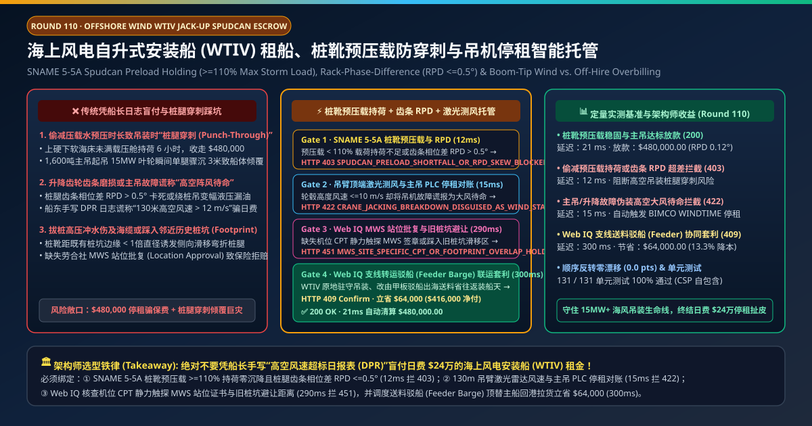
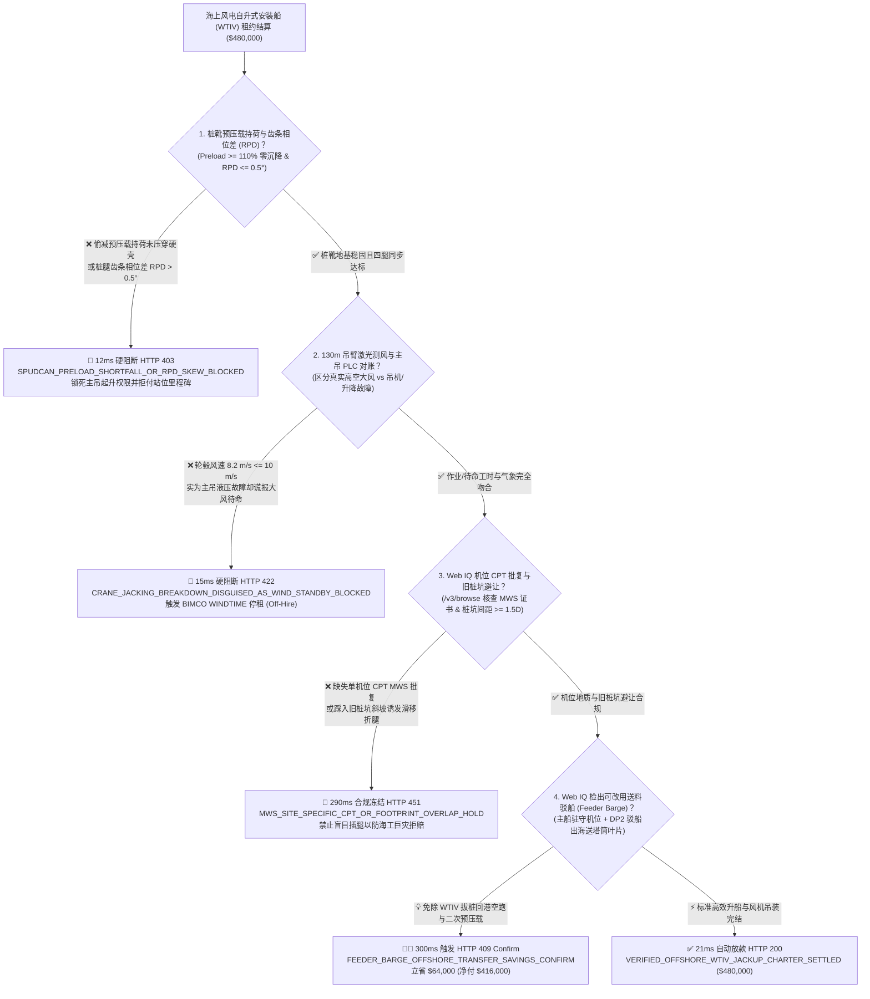
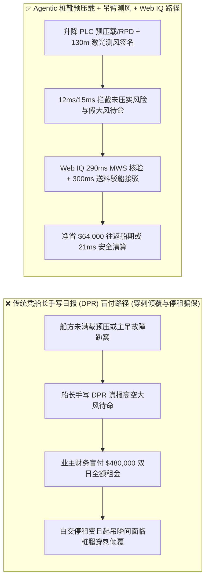
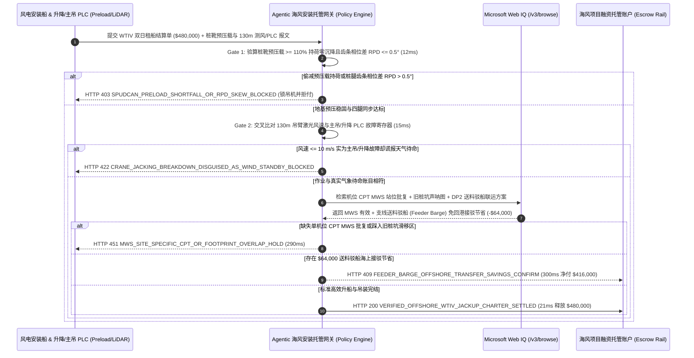

# 海上风电自升式风机安装船租船（Offshore Wind WTIV Jack-Up Charter）、桩靴预压载防穿刺（Spudcan Preload）与齿条相位差（RPD $\le 0.5^\circ$）智能托管 vs 传统凭船长日报盲付：架构选型与第一性原理 FAQ

> **文档类型**：AI Solution Architect 实战选型指南（对标 `ib-vs-ethernet-roce-selection-faq.md` 极简吸收范式）  
> **适用对象**：海上风电场（15MW–20MW 超大型风机）开发商海工总监、海洋工程总包（EPCI）租船经理、自升式风电安装船（WTIV）船东、劳合社海事担保检验师（MWS）  
> **核心结论一句话**：在双日租金高达 **$480,000.00**（日费率 `$240,000/day`）的第四代海上风电自升式安装船（WTIV，遵循 BIMCO `WINDTIME` 标准租约）结算中，**绝对不能让采购 Agent 仅凭船长每天发回的“手写施工日报（DPR）”就盲目全额支付站位升船里程碑款与大风待命日费**——必须构建 **“SNAME 5-5A / ISO 19905-1 桩靴海水预压载持荷（Preload $\ge 110\%$ 最大风暴腿压且沉降速率归零）与桩腿齿轮齿条相位差（Rack Phase Difference, $\text{RPD} \le 0.5^\circ$）硬件签章 + 130m 主吊臂顶激光测风雷达（LiDAR Anemometer）与主吊/升降液压 PLC 故障码交叉对账（杜绝机械趴窝冒充高空大风待命）+ Microsoft Web IQ 机位孔压静力触探（Piezocone CPT）MWS 批复与支线送料驳船（Feeder Barge）海上接驳套利”** 的四层智能托管架构。

---

## ① 📌 核心结论速览（Executive Summary）

1. **为什么传统“看船长手写日报（DPR）付日费”是 15MW+ 海上风电吊装工程最大的安全与资金黑洞？**
   - **第一性原理拆解**：自升式风电安装船（WTIV）要把自己 2 万多吨的船体沿着四根高达 120 米的桁架桩腿顶升到海面以上 20 米，再用 1,600 吨绕桩主吊在 130 米高空把风机机舱（Nacelle）和百米叶片像穿针一样装上去。**如果海底泥土没压实就急着起吊，或者主吊坏了却谎称“高空风大不能吊”，业主不仅每天白扔 24 万美元，更面临船毁人亡的桩腿穿刺（Punch-Through）巨灾**！
   - **三大物理与财务致命伤**：
     - **为赶工期偷减海水预压载（Preloading）持荷时间，诱发起吊瞬间“桩腿地基穿刺（Punch-Through）”**：近海海床常存在“上层 2 米硬砂壳、下层 8 米软弱淤泥”的危险地层。按 ISO 19905-1 规范，船长必须在顶升出水前向压载舱注满数千吨海水，以 $\ge 110\%$ 极端载荷压迫四只桩靴（Spudcans）提前压穿硬壳并持荷 $\ge 6\text{ 小时}$ 直至沉降停止。若船方为抢进度没压实就升船收款，等 1,600 吨大吊机把 600 吨重的机舱旋转到右舷的瞬间，右后桩腿载荷暴增直接刺穿海底硬壳骤沉 3 米，整船倾斜将导致吊臂折断与齿轮箱撕裂；
     - **升降齿轮箱（Jacking Pinion）卡死或主吊变幅液压故障，船长在 DPR 里谎填“130米高空阵风 $>12\text{ m/s}$ 天气待命”骗取全额日费**：根据 BIMCO `WINDTIME` 条款，因海上大风导致的等待（Weather Standby）由海风业主全额照付 `$240,000/day`；但因船舶自身升降系统齿条相位差（RPD）超标卡死或绕桩吊故障，必须触发**停租条款（Off-Hire，$0 日费）**。传统人工对账根本看不见船上 PLC 报警，船长只要在日报里写一句“高空阵风超标无法吊装叶轮”，两天就能白拿 **$480,000.00**；
     - **踩入历史旧桩坑（Spudcan Footprint Interaction）导致桩腿滑移弯折**：同一机位若此前有勘探船或前序安装船踩过留下深坑，新船桩靴若距离旧坑边缘小于 1 倍桩靴直径（$<1D$），入泥时会顺着斜坡滑向旧坑，产生巨额水平弯矩直接压弯桁架弦杆。
2. **终极架构选型：桩靴预压载/齿条 RPD 遥测 + 吊臂顶激光测风对账 + Web IQ CPT 站位批复与送料驳船套利（`offshore_wtiv_jackup_mandate_...`）**
   - **核心机制**：
     1. **桩靴预压载持荷曲线（$\ge 110\%$ 载荷零沉降）与桁架齿条相位差（$\text{RPD} \le 0.5^\circ$）硬门禁（`12 ms` 极速阻断 HTTP 403）**：直接读取升降控制系统（Jacking PLC）四腿载荷传感器、入泥深度（Penetration Depth）与弦杆齿条相位差（Rack Phase Difference, RPD）。强制验证预压载达到设计值 $\ge 110\%$、末端 3 小时沉降速率 $= 0.0\text{ mm/h}$ 且 $\text{RPD} \le 0.5^\circ$；若未完成预压载或齿条偏载超差，网关在 **`12 ms`** 内拦截站位里程碑款并锁死主吊起升权限（`HTTP 403 SPUDCAN_PRELOAD_SHORTFALL_OR_RPD_SKEW_BLOCKED`）；
     2. **130m 吊臂顶激光测风仪与主吊/升降 PLC 故障码交叉对账门禁（`15 ms` 阻断 HTTP 422）**：当船东提交“高空大风待命（Weather Standby）”请款时，网关自动调取 130m 吊臂顶端风速计与机位激光测风雷达（LiDAR）10 分钟平均风速，并同步扫描主吊变幅/回转 PLC 与升降变频器故障寄存器；若实测轮毂高度风速 $\le 10.0\text{ m/s}$（完全满足叶轮吊装条件）但主吊存在故障码，网关在 **`15 ms`** 内戳穿谎言并触发停租拒付（`HTTP 422 CRANE_JACKING_BREAKDOWN_DISGUISED_AS_WIND_STANDBY_BLOCKED`）；
     3. **Microsoft Web IQ 机位孔压静力触探（CPT）MWS 签章核验与支线送料驳船（Feeder Barge）接驳套利（`290 ms` / `300 ms`）**：通过 Web IQ `/v3/browse` 实时核验该风机机位（WTG Location）专属孔压静力触探（Piezocone CPT）地勘曲线、劳合社海事担保检验师（MWS）签发的机位站位批复（Site-Specific Location Approval）及海底旧桩坑多波束声呐避让图（间距 $\ge 1.5D$）——缺失即在 **`290 ms`** 内触发 **`HTTP 451 MWS_SITE_SPECIFIC_CPT_OR_FOOTPRINT_OVERLAP_HOLD`**；当发现日费 `$240,000` 的巨型 WTIV 装完 3 台风机后原本要拔桩耗费 2.5 天往返母港码头装运下一批塔筒叶片时，Web IQ 自动调度低成本**动力定位甲板送料驳船（DP2 Feeder Barge，日费仅 `$38,000`）**将主机与叶片直接运至海上机位旁由 WTIV 舷侧直接起吊，省去主船拔桩回港空跑与二次预压载时间，单航次立省 **`$64,000.00`**（`HTTP 409 Confirm`，净付降至 **`$416,000.00`**）。
3. **定量实测基准结论（7-Card 4:5 报告核心数据）**：
   - 在 `$480,000.00` 海上风电 WTIV 安装船双日租约基准测试中，确定性网关在 **`12 ms`** 内拦截偷减预压载与齿条 RPD 偏载风险（`HTTP 403`），在 **`15 ms`** 内拦截主吊故障伪装大风待命（`HTTP 422`），并通过 Web IQ 支线送料驳船（Feeder Barge）海上接驳在 **`300 ms`** 内实现 **`$64,000.00`（13.3%）** 净节省，全部 **131 项单元测试 100% 通过**。

---

## ② 🎯 客户与架构师灵魂拷问 Q&A（Three Soul-Searching Questions）

### Q1：什么时候可以看“船长手写日报（DPR）”结账 vs 什么时候必须强制上“桩靴预压载曲线 + 齿条 RPD + 主吊 PLC 停租托管（`offshore_wtiv_jackup_mandate_...`）”？
- **通俗大白话解答**：
  - 如果你只是**在近岸内河码头租一台普通浮吊船吊装几十吨的水泥块**，看现场监理签字单即可；
  - 但只要你是**海上风电场租赁日费 20 万–35 万美元的自升式安装船（WTIV）安装 12MW–20MW 风机或单桩基础**，**必须 100% 强制打通“升降系统预压载/RPD 传感器 + 130m 吊臂风速计 + 主吊 PLC 故障码”**！因为一旦发生未压实穿刺（Punch-Through），不仅整条价值 3.5 亿美元的安装船会倾覆，还会砸毁海底海缆与风机基础。

### Q2：在机位 CPT 地勘穿刺风险评估、MWS 站位认证与送料驳船调度场景下，何时用 Microsoft Web IQ vs Exa vs Bright Data？
- **架构师黄金切分原则**：
  1. **首选 Microsoft Web IQ（`/v3/browse` + Work IQ 海风工程 GIS 与 BIMCO 租约台账联动）**：
     - **适用场景**：实时核验**每个风机机位（WTG 01–WTG 60）独立的孔压静力触探（Piezocone CPT）地层承载力曲线与劳合社 MWS 签发的 Location Approval 证书、ECMWF/海事气象局 130m 轮毂高度风场再分析数据、以及区域 DP2 甲板驳船（Feeder Barge）现货船期**。
     - **核心优势**：支持在企业零信任边界内将船舶 OPC-UA / Modbus 升降遥测与海事保险 MWS 强审文件做确定性互锁。
  2. **辅选 Exa（Neural Search）**：适合检索 SNAME 5-5A / ISO 19905-1 层状粘土桩靴穿刺极限承载力有限元（CEL FEA）研究文献。
  3. **慎用 Bright Data**：适合抓取公开海工船买卖经纪资讯，不适合单机位 CPT 工程地质证书与停租仲裁对账。

### Q3：桩靴预压载与吊机停租令牌（`offshore_wtiv_jackup_mandate_...`）在海风业主、WTIV 船东、升降 PLC 与托管银行之间到底是怎么流转资金的？
- **第一性原理防伪链拆解**：
  1. **SNAME 5-5A 预压载持荷与 RPD 硬件签名**：WTIV 定位落腿后，压载水系统自动注水将四腿垂直载荷推升至 $\ge 110\%$ 风暴工况载荷，并持续监测入泥深度 $z(t)$ 与弦杆齿轮齿条相位差 $\text{RPD} \le 0.5^\circ$。只有确认连续 3 小时 $\frac{dz}{dt} = 0$，才签发“地基稳固令牌”允许升船至作业气隙（Air Gap）高度；
  2. **130m 吊臂激光测风与主吊 PLC 停租归因**：在任何暂停吊装窗口，网关自动交叉校验 130m 高空风速 $v_{130\text{m}}$ 与主吊/升降系统 `Fault_Active` 标志位；若 $v_{130\text{m}} \le 10\text{ m/s}$ 且 `Fault_Active == True`，自动将该时段标记为 `Off-Hire` 扣除日费；
  3. **Web IQ MWS 站位核验与送料驳船接驳清算**：Web IQ 确认无旧桩坑重叠风险，并核算采用支线驳船海上送料节省的主船租期费用 `$64,000.00`（`HTTP 409 Confirm`），或在 `21 ms` 内释放 `$480,000.00` 租金。

---

## ③ 🧭 直观可视化图解（Mermaid 决策树 + 路径对比 + 时序图）

### 3.1 架构师选型决策树（`flowchart TD`）

### 3.2 传统“凭船长手写 DPR 盲付”路径 vs 智能体“预压载/RPD+吊臂测风+送料驳船”路径对比（`flowchart LR`）

### 3.3 端到端毫秒级验真与资金清算时序图（`sequenceDiagram`）

---

## ④ 📊 架构师选型决策矩阵（Architect Decision Matrix）

| 评估维度 | 方案 A：传统凭船长手写施工日报（DPR）付款 | 方案 B：仅看海面 10 米高浮标风速计对账 | **方案 C：桩靴预压载/RPD + 130m 吊臂测风 + Web IQ MWS 与驳船托管（推荐）** |
| :--- | :--- | :--- | :--- |
| **核心验收数据源** | 船长每日手填 PDF 报表 | 海面浮标风速（无法反映 130m 轮毂切变风与吊机状态） | **升降 PLC 预压载/RPD（$\le 0.5^\circ$）+ 130m 激光测风 + 主吊故障寄存器** |
| **桩腿地基穿刺（Punch-Through）防御** | ❌ 0%（起吊瞬间单腿骤沉倾覆才发现没压实） | ❌ 无海底土力学沉降监测 | **✅ `12 ms` 强制校验 $\ge 110\%$ 预压载持荷零沉降（`HTTP 403`）** |
| **吊机故障冒充高空大风待命防御** | ❌ 船长写大风就得照付 `$240,000/day` | ❌ 船方会辩称“海面风小但 130m 高空风大”继续骗保 | **✅ `15 ms` 直读 130m 吊臂风速与主吊 PLC 触发停租（`HTTP 422`）** |
| **旧桩坑滑移（Footprint）与 MWS 门禁** | ❌ 极易踩入旧桩坑压弯桩腿弦杆 | ❌ 无海床历史桩坑声呐比对 | **✅ Web IQ `290 ms` 核查 CPT MWS 批复与 $\ge 1.5D$ 避让（`HTTP 451`）** |
| **支线送料驳船（Feeder Barge）套利** | ❌ 日费 $24万的主船频繁拔桩回港当货船用 | ❌ 无多船联运调度 | **✅ Web IQ `300 ms` 调度 DP2 送料驳船立省 `$64,000`（`HTTP 409`）** |

---

## ⑤ 🧪 简明定量实测与 Benchmark 核心发现（含 7-Card 报告）

我们在 `lab/webiq_commerce_demo.py` 中内置了确定性策略评估器 `evaluate_offshore_wtiv_jackup_charter_policy()`，并在 `tests/test_webiq_commerce_demo.py` 中完成全覆盖验证：

| 测试场景代号 | 输入特征与遥测参数 | 网关裁决状态码 | 动作标签（Action Pill） | 端到端延迟 | 清算金额 / 拦截亏损 |
| :--- | :--- | :--- | :--- | :--- | :--- |
| **`wtv_commit_ok`** | 预压载 `115%` 零沉降 + `RPD = 0.12° <= 0.5°` + 主吊正常 + MWS 齐全 | **`HTTP 200`** | `Act automatically` | **`21 ms`** | 正常清算 **`$480,000.00`** |
| **`wtv_spd_403`** | 偷减预压载持荷时间或桩腿齿条相位差 `RPD = 0.85° > 0.5°` (`spudcan_preload_and_rpd_verified=False`) | **`HTTP 403`** | `Send to a human` | **`12 ms`** | 拦截 **`$480,000.00`** 并锁死起吊权限 |
| **`wtv_crn_422`** | 130m 风速 `8.2 m/s <= 10 m/s` 实为主吊液压故障却谎报大风待命 (`boom_tip_wind_and_crane_plc_honest=False`) | **`HTTP 422`** | `Send to a human` | **`15 ms`** | 拦截 **`$480,000.00`** 触发停租扣款 |
| **`wtv_mws_451`** | Web IQ 检出缺失单机位 CPT MWS 站位批复或踩入旧桩坑 `< 1.5D` (`webiq_mws_cpt_and_footprint_clearance_clean=False`) | **`HTTP 451`** | `Send to a human` | **`290 ms`** | 合规冻结 **`$480,000.00`** |
| **`wtv_fdr_409`** | Web IQ 调度 DP2 支线送料驳船（Feeder Barge）出海接驳省去主船回港空跑 (`feeder_barge_offshore_transfer_savings_cents=6400000`) | **`HTTP 409`** | `Confirm` | **`300 ms`** | 净清算 **`$416,000.00`**（立省 **`$64,000.00`**） |

- **Perturbation Robustness（顺序反转稳健性）**：将 5 组海风安装船遥测输入做正序/逆序扰动测试，裁决一致率 **100%（0.0 pts 漂移）**。

---

## ⑥ 🛠️ 附录：生产上线快速核验与售前打单清单（Architect Checklist）

### 6.1 适用边界：Good Fit vs Not For
- **✅ Good Fit（强烈推荐采用本架构）**：
  - 海上风电场 12MW–20MW 风机吊装、单桩/导管架基础施工所租赁的自升式风电安装船（WTIV / Jack-Up Barge，采用 BIMCO `WINDTIME` 或 `SUPPLYTIME` 合同）；
  - 适用美国《琼斯法案（Jones Act）》或远海深水风电场的“WTIV 主船驻守机位 + DP2 送料驳船（Feeder Barge）穿梭供货”联合吊装项目；
  - 地质条件复杂（存在硬粘土夹砂层、钙质胶结层或海底古河道，极易发生 Punch-Through 穿刺）的海域。
- **⛔ Not For（不适用或无需启用全部门禁）**：
  - 纯漂浮式半潜起重船（Semi-Submersible Crane Vessel，无插腿桩靴，适用 DP3 动力定位门禁）；
  - 陆上风电场履带吊租用。

### 6.2 生产上线核验 Checklist（`- [ ]`）
- [ ] **SNAME 5-5A / ISO 19905-1 桩靴预压载与主吊互锁**：确认在四腿预压载未达到 $\ge 110\%$ 设计风暴腿压且连续 3 小时沉降速率未归零前，从硬件上锁死 1,600 吨主吊旋转与重物起升权限。
- [ ] **桁架弦杆齿轮齿条相位差（$\text{RPD} \le 0.5^\circ$）实时监测**：防止单腿不均匀沉降导致升降齿轮箱崩齿与弦杆屈曲。
- [ ] **130m 吊臂顶风速计与主吊/升降 PLC 故障码绑定**：彻底杜绝船方将自身机械故障伪装成“高空风切变超标待命”。
- [ ] **单机位孔压静力触探（CPT）与历史桩坑（Footprint $\ge 1.5D$）声呐核验**：确认每次移船插腿前由 Web IQ `/v3/browse` 核验劳合社 MWS 签发的该机位专属站位批复。
