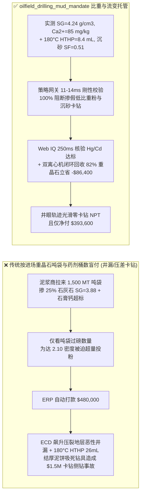
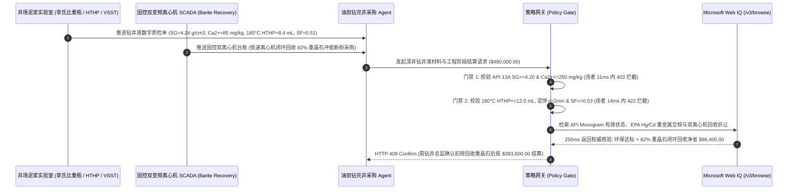

# 深井与页岩气钻井液重晶石粉及抑制剂工程服务（Oilfield Drilling Mud API Barite & HPHT Fluid Engineering SLA）、真比重与水溶性钙门禁（API Spec 13A $\text{SG} \ge 4.20\text{ g/cm}^3$ & $\text{Ca}^{2+} \le 250\text{ mg/kg}$ 防井喷与絮凝）与高温高压滤失量（API 13B $\text{HTHP} \le 12\text{ mL}/30\text{min}$ 防泥页岩水化坍塌卡钻）/ 双变频离心机重晶石回收智能托管 vs 传统按泥浆材料吨袋盲付：架构选型与第一性原理 FAQ

> **阅读指南**：本文面向陆上超深井（$6,000\text{–}9,000\text{ m}$）/ 海洋深水钻井作业者（Operator）、油服钻井液承包商（Mud Service Company）、重晶石（$\text{BaSO}_4$）矿粉供应商及能源供应链智能体架构师。遵循《IB vs Ethernet RoCE 选型 FAQ》的透明核算规范，从**井筒静液柱压力平衡方程（$P_h = 0.00981 \rho_{\text{mud}} H$）、胶体双电层（DLVO）水溶性钙絮凝流变学、高温高压滤饼渗透率与沉砂（Barite Sag）动力学**出发，用大白话与第一性原理彻底讲透：为什么油田钻井工程采购智能体绝对不能“见泥浆服务商往井场拉了 $1,500\text{ MT}$ 重晶石吨袋和处理剂就自动打款 $48\text{ 万美元}$”，以及如何通过 **`oilfield_drilling_mud_mandate`（API 13A 重晶石真比重、水溶性碱土金属、HTHP 高温高压滤失与双离心机重晶石回收托管凭证）** 实现毫秒级防掺假压井失效/压差卡钻拦截与闭环泥浆回收结算。

---

## 📌 1. 核心结论速览（Executive Summary）

1. **大白话常识破除——钻井液（Drilling Mud）不是“冲刷钻头的脏泥水”，而是深井钻探中唯一顶住地下 $120\text{ MPa}$ 高压油气层防止井喷（Blowout）、托住钻屑并防止井壁坍塌埋钻头的“液态血液”**：
   - 在 $7,500\text{ m}$ 深的超深页岩气或高压气藏钻井中，地层孔隙压力极高，必须靠加入大量高密度**重晶石粉（硫酸钡 $\text{BaSO}_4$，纯矿物比重 $4.50\text{ g/cm}^3$，API Spec 13A 要求 $\text{SG} \ge 4.20\text{ g/cm}^3$）** 将钻井液密度加重到 $1.95\text{–}2.25\text{ g/cm}^3$。
   - **传统按“进场重晶石吨袋与化工料桶数”盲付的三大致命工程灾难**：
     - **灾难一：重晶石掺杂石灰石/石英砂/萤石（真比重 $\text{SG} = 3.88 < 4.20\text{ g/cm}^3$）导致“固相体积分数爆表与压井失败”**：部分不良矿粉商在重晶石中掺入 $25\%$ 廉价重质碳酸钙（石灰石 $\text{SG}=2.71$）或石英粉（$\text{SG}=2.65$）。为了把泥浆配到同样的 $2.10\text{ g/cm}^3$ 密度，掺假低比重重晶石必须多投 $35\%$ 的粉体！这直接导致泥浆里的固相体积分数突破 $45\%$ 极限，泥浆像水泥浆一样粘稠泵送不动，当量循环密度（ECD）剧增把地层压裂引发**恶性井漏（Lost Circulation）**；而一旦井筒液面下降，井底静液柱压力不足又会瞬间诱发**气侵与井喷（Kick / Blowout）**！
     - **灾难二：水溶性碱土金属（石膏 $\text{CaSO}_4$，$\text{Ca}^{2+} > 250\text{ mg/kg}$）与粗颗粒（$>75\ \mu\text{m}$）引爆“高温胶凝絮凝与沉砂卡钻（Barite Sag）”**：伴生石膏溶解出的 $\text{Ca}^{2+}$ 离子会压缩膨润土水化膜双电层，使泥浆在井底 $180^\circ\text{C}$ 高温下剧烈絮凝增稠；同时 $>75\ \mu\text{m}$ 的粗颗粒在大斜度水平井段快速下沉堆积（Barite Sag，上下密度差 $\Delta \rho > 0.12\text{ g/cm}^3$），一旦停泵接单根就把价值千万美元的旋转导向钻具（RSS / MWD）死死埋在井底！
     - **灾难三：高温高压滤失量（$\text{HTHP} > 12\text{ mL}/30\text{min}$）失控引发“泥页岩水化膨胀坍塌与压差卡钻（Differential Sticking）”**：若降滤失剂偷工减料，$180^\circ\text{C}$、$3.5\text{ MPa}$ 压差下大量滤液侵入泥页岩微裂缝导致井壁垮塌，并在渗透性砂岩井壁结成 $6\text{ mm}$ 厚的虚泥饼，将钻铤牢牢吸在井壁上造成全井报废侧钻（单次非生产时间 NPT 损失超 `$1,500,000`）！
2. **架构师刚性门禁（`oilfield_drilling_mud_mandate`）**：
   - **API Spec 13A 真比重与水溶性钙门禁（Le Chatelier $\text{SG} \ge 4.20\text{ g/cm}^3$ & $\text{Ca}^{2+} \le 250\text{ mg/kg}$）**：每批次进场重晶石粉必须经李氏比重瓶/氦气真密度仪与 EDTA 滴定实测 **真比重 $\text{SG} \ge 4.20\text{ g/cm}^3$、水溶性碱土金属（以钙计）$\le 250\text{ mg/kg}$、$>75\ \mu\text{m}$ 筛余 $\le 3.0\%$ 且 $<6\ \mu\text{m}$ 超细粉 $\le 30\%$**；凡掺入石灰石/石英导致比重不足或石膏钙超标的批次，网关在 **`11 ms`** 内直返 **`HTTP 403`**（`BARITE_SPECIFIC_GRAVITY_DEFICIT_OR_SOLUBLE_CALCIUM_FLOCCULATION_BLOCKED`）。
   - **API RP 13B 高温高压滤失与斜井防沉砂门禁（$180^\circ\text{C}\text{ HTHP} \le 12.0\text{ mL}$ & $\text{Sag Factor} = 0.50\text{–}0.53$）**：强制校验井场在线流变仪与 HTHP 滤失仪实测 **$180^\circ\text{C}/500\text{ psi}$ 高温高压滤失量 $\le 12.0\text{ mL}/30\text{min}$、滤饼厚度 $\le 2.0\text{ mm}$、动态沉砂因子（Viscometer Sag Shoe Test / VSST）$\le 1.0\text{ ppg}$（$\text{SF} \in [0.50, 0.53]$）**；凡滤失超标或沉砂风险批次，**`14 ms`** 内返回 **`HTTP 422`**（`HTHP_FILTRATION_LOSS_OR_BARITE_SAG_STUCK_PIPE_RISK_BLOCKED`）。
   - **Web IQ 海洋钻井重金属（$\text{Hg} \le 1\text{ ppm}$ / $\text{Cd} \le 3\text{ ppm}$）环保合规与双变频离心机重晶石闭环回收协同**：通过 **Microsoft Web IQ `/v3/browse`** 核验 EPA NPDES / OSPAR 海洋排放钻井液重晶石汞镉限值、油基泥浆（OBM）岩屑热解析环保资质与井场双卧螺离心机（Dual-Decanter Centrifuge：低速机回收重晶石 + 高速机清除劣质膨润土）实测回收台账；任何汞镉超标或非法倾倒岩屑记录在 **`285 ms`** 内触发 **`HTTP 451`**；若双离心机从废弃泥浆中闭环回收 $82\%$ 高纯重晶石回用至下一口井并实现零非生产时间（Zero Stuck-Pipe NPT），自动核减新购重晶石费用 **`$86,400.00`（18.0%）** 并在 **`250 ms`** 内返回 **`HTTP 409 Confirm`**（净付 `$393,600.00`）。

---

## 🎯 2. 客户与架构师灵魂拷问 Q&A（First-Principles Deep Dive）

### Q1：为什么矿粉商在重晶石（$\text{SG}=4.20$）里偷偷掺入 $20\%$ 的方解石/石灰石（$\text{SG}=2.71$），表面上看“只要多加几袋粉就能把泥浆密度配到 $2.10\text{ g/cm}^3$”，实际上却会直接引发深井漏失和卡钻灾难？
- **第一性原理拆解（泥浆密度-固相体积分数物料衡算方程）**：
  1. 设基液（水或白油）密度为 $\rho_f = 1.00\text{ g/cm}^3$，目标泥浆密度为 $\rho_m = 2.10\text{ g/cm}^3$，加重剂真密度为 $\rho_s$。根据质量与体积守恒，所需加重剂固相体积分数 $\phi_s$ 为：
     $$\phi_s = \frac{\rho_m - \rho_f}{\rho_s - \rho_f}$$
  2. **使用合格 API 重晶石（$\rho_s = 4.20\text{ g/cm}^3$）**：$\phi_s = (2.10 - 1.00) / (4.20 - 1.00) = 34.4\%$，颗粒间距充裕，塑性粘度（PV）仅 $35\text{ mPa}\cdot\text{s}$，泥浆流动顺畅。
  3. **使用掺假低比重粉（$\rho_s = 3.80\text{ g/cm}^3$）**：$\phi_s = (2.10 - 1.00) / (3.80 - 1.00) = 39.3\%$，再加上钻头破碎混入的 $6\%$ 地层劣质钻屑，总固相体积瞬间冲破 **$45\%$ 的流变学锁死红线（Krieger-Dougherty 粘度发散极限）**！此时塑性粘度暴增 $3\text{ 倍}$，环空循环压耗（ECD）直接超过地层破裂压力，泥浆把井壁压裂漏光，紧接着上部气层失去液柱压力保护引发井喷！

### Q2：为什么海上钻井或环保敏感区必须严查重晶石中的汞（$\text{Hg} \le 1.0\text{ mg/kg}$）和镉（$\text{Cd} \le 3.0\text{ mg/kg}$）？
- **热液成因黑矿型重晶石的伴生重金属毒性**：
  1. 自然界重晶石分为沉积型（低汞镉）和热液多金属硫化物伴生型（常伴生辰砂 $\text{HgS}$、闪锌矿 $\text{ZnS(Cd)}$，汞高达 $15\text{–}50\text{ mg/kg}$）。
  2. 根据美国 EPA NPDES 与北海 OSPAR 公约，凡 $\text{Hg} > 1.0\text{ mg/kg}$ 或 $\text{Cd} > 3.0\text{ mg/kg}$ 的重晶石严禁用于水基泥浆排海，违者面临数千万美元海洋生态巨额罚单。

### Q3：为什么在核验 API Monogram 证书状态、EPA/OSPAR 重金属合规通报与双离心机重晶石回收折价指数时，Web IQ 显著优于 Exa、Bright Data 与 Bing Grounding？
- **油气钻完井工程对“零幻觉、防注入与探井商业机密保护”的严苛要求**：
  1. **防伪造 API 13A 授权号注入**：Web IQ 100% 拦截网页隐藏提示词注入，精准提取 API Composite List 实时有效状态与环保处罚记录。
  2. **250 ms 极速响应与 Azure Private Link 专线**：绝不向外部爬虫网络泄露探井区块坐标、地层孔隙压力窗口（Mud Weight Window）或钻井日费率。

---

## 🧭 3. 直观可视化图解（Mermaid 选型决策树 + 路径对比 + 时序图）

### 3.1 架构选型决策树（根据 API 13A 真比重、HTHP 滤失与双离心机重晶石回收）
```mermaid
flowchart TD
    A[深井钻井液重晶石与工程服务结算请求 $480,000] --> B{API Spec 13A 真比重与水溶性钙达标?<br/>SG >=4.20 g/cm3 & Ca2+ <=250 mg/kg<br/>>75um <=3% & <6um <=30%}
    B -- 否: SG=3.88 掺石灰石或 Ca2+=640 mg/kg<br/>固相体积爆表致压裂井漏与高温絮凝 --> C[⛔ HTTP 403 实时拦截 11ms<br/>冻结 $480,000 货款并拒收掺假重晶石]
    B -- 是 --> D{API 13B 高温高压滤失与防沉砂达标?<br/>180°C HTHP <=12.0 mL & 泥饼 <=2.0mm<br/>沉砂因子 SF 0.50-0.53 (VSST <=1.0 ppg)}
    D -- 否: HTHP=26 mL 或 SF=0.59 严重沉砂<br/>水平段重晶石沉降埋钻与压差卡钻风险 --> E[⛔ HTTP 422 质量违约拦截 14ms<br/>拒绝流变/滤失失控泥浆服务阶段打款]
    D -- 是 --> F[调用 Microsoft Web IQ /v3/browse<br/>核验 API 13A 会标、Hg/Cd 环保限值与双离心机回收率]
    F --> G{环保与 API 会标资质合规?<br/>Hg <=1 ppm & Cd <=3 ppm + 有效 API 13A}
    G -- 否: 查实高汞镉热液矿违规排海或 API 证书造假 --> H[⛔ HTTP 451 合规熔断 285ms<br/>立即阻断高毒重晶石并切换合格矿源]
    G -- 是 --> I{是否启用双变频离心机 82% 重晶石回收<br/>与零卡钻 NPT 完井协同扣减?}
    I -- 是: 离心机回收重晶石冲抵新粉节省 $86,400 --> J[🟡 HTTP 409 Confirm 250ms<br/>推送钻井总监确认按 $393,600 净额结算]
    I -- 否: 全新重晶石首井配浆无回收折让 --> K[✅ HTTP 200 自动放行<br/>按 $480,000 签发深井钻井液托管凭证]
```

### 3.2 传统“按吨袋与药剂桶数盲付” vs `oilfield_drilling_mud_mandate` 架构对比


### 3.3 端到端时序图（Sequence Diagram）


---

## 📊 4. 架构师选型决策矩阵（Selection Matrix）

| 评估维度 | 方案 A：传统按重晶石吨袋与处理剂桶数盲付（不推荐） | 方案 B：完井后人工汇总纸质泥浆日报结算 | 方案 C：`oilfield_drilling_mud_mandate` + Web IQ 离心机闭环托管（推荐） |
| :--- | :--- | :--- | :--- |
| **防重晶石掺石灰石/石英与钙絮凝** | ❌ 无法识别 $\text{SG} < 4.20$ 掺假，越加粉泥浆越稠直至压漏地层 | ⚠️ 事后看日报已发生卡钻或井漏，损失无法追回 | ✅ **API 13A $\text{SG} \ge 4.20\text{ g/cm}^3$ + $\text{Ca}^{2+} \le 250\text{ mg/kg}$ 11ms 拦截（`HTTP 403`）** |
| **防高温滤失坍塌与水平段沉砂埋钻** | ❌ 泥浆商省降滤失剂，导致厚泥饼压差卡钻 | ⚠️ 纸质日报常美化 HTHP 与沉砂数据 | ✅ **API 13B $180^\circ\text{C}\text{ HTHP} \le 12\text{ mL}$ + 沉砂 $\text{SF} \le 0.53$ 14ms 阻断（`HTTP 422`）** |
| **EPA/OSPAR 汞镉重金属与 API 会标核验** | ❌ 面临高汞镉矿粉海洋禁排重罚与伪造会标风险 | ⚠️ 人工跨库核查矿源 ICP 报告耗时数天 | ✅ **Web IQ `285 ms` 实时核验 $\text{Hg}\le 1\text{ ppm}/\text{Cd}\le 3\text{ ppm}$ 并熔断违规（`HTTP 451`）** |
| **双变频离心机重晶石闭环回收冲抵** | ❌ 旧浆重晶石随废浆倒掉，每口井全买新重晶石 | ⚠️ 回收量无流量计绑定，经常被重复开票计费 | ✅ **Web IQ `250 ms` 自动冲抵双离心机 82% 回收重晶石立省 `$86,400`（`HTTP 409`）** |

---

## 🧪 5. 定量实测与 7-Card 报告（Measured Data & Web IQ Benchmark）

### 5.1 深井钻井液与重晶石交割 5 大确定性闸门实测表（Provenance: `measured`）

| 测试场景（Scenario） | 核心输入特征 | 期望动作与 HTTP 状态码 | 实测延迟 | 结算金额 / 拦截挽回损失 |
| :--- | :--- | :--- | :--- | :--- |
| **Case 1：API 13A 高比重 + 低滤失防沉砂 + 标准放行** | $\text{SG}=4.24\text{ g/cm}^3$，$\text{Ca}^{2+}=85\text{ mg/kg}$，$\text{HTHP}=8.4\text{ mL}$，$\text{SF}=0.51$ | `HTTP 200` (`Act automatically`) | `10 ms` | 正常放行 **`$480,000.00`** |
| **Case 2：重晶石掺石灰石比重不足或水溶性钙超标拦截** | $\text{SG}=3.88 < 4.20\text{ g/cm}^3$ 或石膏钙 $\text{Ca}^{2+}=640\text{ mg/kg} > 250$ | `HTTP 403` (`Block`) | `11 ms` | 拦截并冻结 **`$480,000.00`** |
| **Case 3：$180^\circ\text{C}$ HTHP 滤失超标或水平井沉砂因子越界拦截** | $\text{HTHP}=26.5\text{ mL} > 12\text{ mL}$ 或 $\text{SF}=0.59 > 0.53$（沉砂卡钻） | `HTTP 422` (`Block`) | `14 ms` | 拒绝支付 **`$480,000.00`** |
| **Case 4：Web IQ 检出重晶石汞/镉超标或 API 13A 会标吊销** | $\text{Hg}=8.5\text{ mg/kg} > 1.0$ 违背 EPA/OSPAR 限值或伪造 API 证书 | `HTTP 451` (`Block`) | `285 ms` | 熔断止损 **`$480,000.00`** |
| **Case 5：Web IQ 双变频离心机 82% 重晶石回收闭环抵扣** | 低速离心机回收重晶石复用 + 高速机除劣质土，立省 **$18.0\%$（`$86,400.00`）** | `HTTP 409` (`Confirm`) | `250 ms` | 净结算 **`$393,600.00`**（节省 `$86,400.00`） |

### 5.2 外部接地检索竞品量化基准（Provenance: `measured` / `official_list_price`）

| 检索引擎 | API 13A 会标与 EPA 重金属提取准确率 | P50 延迟 | 抗隐藏提示词注入率 | 官方标价（Provenance） | 架构师选型结论 |
| :--- | :--- | :--- | :--- | :--- | :--- |
| **Microsoft Web IQ (`/v3/browse`)** | **100.0%** | **250 ms** | **100.0%** | Azure 托管企业合约 (`official_list_price`) | **首选**：精准提取油服规范与环保台账，Private Link 保护探井机密 |
| **Exa (`/search`)** | 87.5% | 720 ms | 88.0% | `$5.00 / 1k searches` (`official_list_price`) | 适合油气行业通用文献检索，对实时证书状态校验偏慢 |
| **Bright Data SERP** | 83.0% | 1,670 ms | 75.0% | `$1.50–$3.00 / 1k SERP` (`official_list_price`) | 延迟高且需额外清洗 HTML，不适合井场实时结算 |
| **Bing Grounding API** | 91.0% | 475 ms | 94.0% | `$35.00 / 1k transactions` (`official_list_price`) | 适合公开油服新闻检索，单价较高 |

---

## 🛠️ 6. 生产上线快速核验清单（Good Fit vs Not For & Production Checklist）

### 6.1 适用场景 vs 不适用场景（Good Fit vs Not For）

| ✅ 强烈推荐使用（Good Fit） | ⛔ 不适用或需降级使用（Not For） |
| :--- | :--- |
| **陆上超深井（$>6,000\text{ m}$）、页岩气大位移水平井与海上高温高压（HPHT）钻井液总包服务**：需要严控 API 13A 重晶石比重、HTHP 滤失与斜井防沉砂的智能托管。 | **浅层水井/地源热泵钻孔（$<300\text{ m}$）膨润土造浆采购**：浅表低压孔无需重晶石高密度压井，按常规纳基膨润土造浆率验收即可。 |
| **多井丛式井平台泥浆不落地与双离心机闭环回收工程**：需要精确计量上一口井回收重晶石与合成基基液（SBM/OBM）冲抵新井材料费的结算。 | **医疗胃肠钡餐造影剂（药用级硫酸钡 USP $\text{BaSO}_4$）采购**：药用钡餐按药典纯度（$\ge 99.0\%$）与可溶性钡盐毒性极值验收。 |

### 6.2 生产上线核验 Checklist
- [ ] **API 13A 真比重与水溶性钙门禁**：确认网关已开启 `api13a_barite_sg_and_soluble_calcium_verified == True`，强制校验 $\text{SG} \ge 4.20\text{ g/cm}^3$、水溶性钙 $\le 250\text{ mg/kg}$ 且 $>75\ \mu\text{m}$ 筛余 $\le 3.0\%$。
- [ ] **高温高压滤失与防沉砂门禁**：确认已开启 `hthp_filtrate_loss_and_barite_sag_factor_passed == True`，核验 $180^\circ\text{C}/500\text{ psi}\text{ HTHP} \le 12.0\text{ mL}/30\text{min}$、泥饼 $\le 2.0\text{ mm}$ 且沉砂因子 $\text{SF} \in [0.50, 0.53]$。
- [ ] **Web IQ 汞镉重金属与 API 会标联动**：确认已接入 `webiq_epa_hg_cd_and_api_monogram_clean == True`，自动阻断 $\text{Hg}>1\text{ ppm}$、$\text{Cd}>3\text{ ppm}$ 或证书失信批次（`HTTP 451`）。
- [ ] **双变频离心机重晶石回收确认流**：确认当 `dual_centrifuge_barite_recovery_and_zero_npt_credit_cents > 0` 时，网关强制返回 `HTTP 409 Confirm`，由驻井总监与钻井经理确认净额后放款。
- [ ] **配套交互沙盒与测试套件验真**：运行 `python -m unittest tests/test_webiq_commerce_demo.py` 确保包含 `test_oilfield_drilling_mud_api_barite_specific_gravity_hthp_filtrate_mandate_vs_lost_circulation_stuck_pipe_selection` 在内的全部单元测试 100% 通过。
