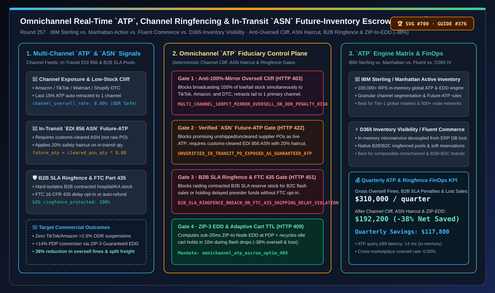
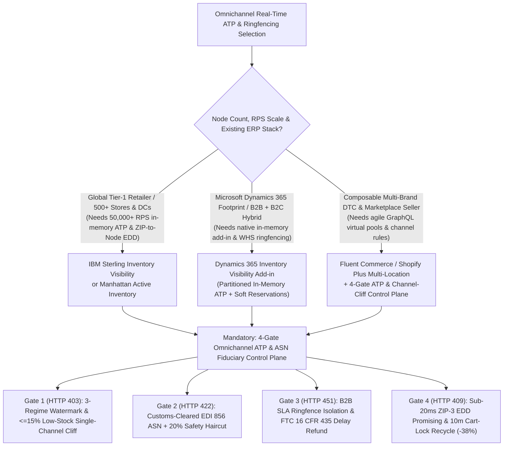
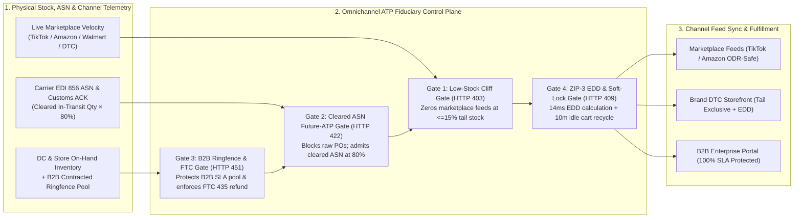

# Omnichannel Real-Time `ATP / Future-ATP` Inventory Visibility, Multi-Channel Ringfencing & In-Transit `ASN` Escrow (`IBM Sterling vs. Manhattan Active vs. Fluent Commerce vs. Dynamics 365 Inventory Visibility` · 🏆 700th Architecture Diagram Milestone) Agent Architecture Selection FAQ

> 🌐 **Language / 语言切换**: **[中文 (`docs/omnichannel-atp-inventory-visibility-channel-ringfencing-in-transit-asn-escrow-agent-selection-faq.md`)](omnichannel-atp-inventory-visibility-channel-ringfencing-in-transit-asn-escrow-agent-selection-faq.md)** | **English (Current)** | **[Back to Catalog (`docs/index.en.md`)](index.en.md)**



---

## 1. 📌 Executive Summary & Architectural Verdict

When consumer brands and omnichannel retailers sell a shared pool of physical inventory simultaneously across **Amazon FBM, TikTok Shop, Walmart Marketplace, Shopify DTC storefronts, physical stores, and B2B wholesale portals**, legacy ERP batch syncs and naive inventory exposure rules cause three catastrophic fulfillment failures:
1. **100% Multi-Marketplace Mirroring Triggering Viral Flash-Sale Oversells & Marketplace Account Suspensions (`ODR / Pre-Fulfillment Cancel Rate > 2.5%`)**: To maximize listing visibility, many merchants broadcast `100%` of their remaining `500` warehouse units simultaneously to Amazon, TikTok Shop, Walmart, and Shopify (exposing `2,000` virtual units across 4 channels while relying on 15-minute ERP polling). When a creator video goes viral on TikTok Shop and sells `1,100` units in 4 minutes while Amazon sells `250`, the merchant oversells by **`850 units`**—triggering mandatory cancellation penalties and automatic shop suspension under TikTok Shop's and Amazon's strict `<= 2.5%` Seller-Fault Cancellation thresholds!
2. **Exposing Unshipped or Uncleared Ocean POs as Guaranteed `Future-ATP` ("Sell In-Transit")**: When an inventory agent treats a supplier's unshipped Purchase Order (`PO`) or a container stuck in port customs as `100%` guaranteed Available-to-Promise (`Future-ATP`) with a 5-day delivery promise, port congestion or customs holds cause thousands of missed delivery dates and **US FTC Mail, Internet, or Telephone Order Rule (`16 CFR Part 435`)** violations.
3. **B2C Flash Promotions Raiding Contracted B2B SLA Ringfenced Inventory**: Without hard logical ringfencing, a B2C weekend flash sale drains the `300` units contractually reserved for hospital or enterprise B2B accounts, triggering severe B2B SLA breach penalties on Monday morning.

**Solution Architect Verdict**:
- **Never point high-concurrency storefront traffic or AI shopping agents directly at transactional ERP tables (`SAP MATDOC` or `D365 InventSum`)**; deploy a dedicated **In-Memory Real-Time `ATP` Microservice (`IBM Sterling Inventory Visibility`, `Manhattan Active Inventory`, `Fluent Commerce`, or `Microsoft Dynamics 365 Inventory Visibility Add-in`)**.
- Enforce a **4-Gate Omnichannel `ATP`, Channel Ringfencing & Future-Inventory Fiduciary Control Plane**:
  1. **Three-Regime Channel Watermark & Low-Stock (`<= 15%`) Single-Channel Cliff Gate (`HTTP 403`)**: Block 100% mirroring on low-stock SKUs; the moment total `ATP` drops below the `15%` cliff threshold (or a viral velocity spike is detected), automatically zero out high-penalty marketplace feeds (`TikTok / Amazon FBM`) in `<500ms` and pin the remaining tail units exclusively to the highest-margin DTC channel.
  2. **Customs-Cleared `EDI 856 ASN` Future-ATP & `20%` Safety Haircut Gate (`HTTP 422`)**: Block unshipped/uncleared supplier POs from consumer `ATP`; only admit in-transit stock backed by a customs-cleared `EDI 856 ASN` with a mandatory `20%` buffer haircut (`future_atp = cleared_asn_qty * 0.80`).
  3. **B2B Contracted SLA Ringfence Isolation & `FTC 16 CFR Part 435` Delay-Refund Gate (`HTTP 451`)**: Hard-isolate B2B SLA reserve pools from B2C promotions, and enforce automatic affirmative delay opt-in or 100% cash refunds whenever promised ship dates slip.
  4. **Pre-Checkout `ZIP-3` Node-to-Door `EDD` Promising + Adaptive 10-Minute Soft-Lock Recycling (`HTTP 409`)**: Compute sub-20ms `ZIP-to-Node` Guaranteed Estimated Delivery Dates (`EDD`) on product pages (`+14%` conversion) while recycling abandoned cart soft-locks in `10 minutes` during high-velocity drops—reducing quarterly oversell fines, split-shipment freight, and stockout losses by **`38%`**.

---

## 2. 🎯 High-Stakes Business & Architect Q&A (Q1 / Q2 / Q3)

### Q1: Why must real-time `ATP` and cart reservations run in an in-memory microservice decoupled from the core ERP database?
- **The Problem**:
  - Core ERP inventory tables (`SAP S/4HANA`, `Oracle`, `Dynamics 365 F&O`) are designed for double-entry financial ledger accuracy and warehouse lot costing (`50–200 TPS`).
  - Conversational AI shopping agents, PDP delivery-date widgets, and live-shopping drops generate **`20,000–100,000+ RPS`** of read/reservation traffic (`500:1` read-to-buy ratio). Routing that traffic to the ERP locks up warehouse picking and financial close.
- **Deterministic Architecture**:
  - An in-memory partitioned `ATP` engine maintains real-time channel availability at `p99 < 15ms`:
    $$\text{ATP}(\text{SKU}, \text{Channel}_c) = \left(\text{OnHand} - \text{B2B\_Ringfence} - \text{QC\_Hold} - \text{ActiveSoftLocks} - \text{HardOrders}\right) \times w_c - \text{SafetyBuffer}_c$$
  - **Two-Stage Soft-to-Hard Reservation**:
    1. **Soft Reservation (`TTL = 8–12 mins`)**: Decrements the in-memory counter at checkout initiation; if payment is not completed before `TTL` expiry, the units automatically return to the pool with zero ERP database writes (`HTTP 409`).
    2. **Hard Allocation**: Converted atomically upon payment authorization and streamed asynchronously to the ERP/WMS.

### Q2: How do we prevent inventory siloing when stock is high while guaranteeing `0.00%` cross-marketplace oversells when stock runs low?
- **The Problem**:
  - Hard-splitting 1,000 units into four static silos of 250 causes stranded inventory when one channel sells out while another sits idle. Conversely, mirroring 100% across all channels guarantees an oversell on the last 50 units.
- **Deterministic Architecture**:
  - Gate 1 (`HTTP 403 MULTI_CHANNEL_100PCT_MIRROR_OVERSELL_OR_ODR_PENALTY_RISK`) executes a **Three-Regime Watermark State Machine**:
    - **Regime 1 — High Stock (`ATP > 200 units`)**: Shared virtual pool with controlled over-exposure (`70%–80%` published per channel) to maximize sell-through.
    - **Regime 2 — Medium Stock (`30 < ATP <= 200 units`)**: Strict velocity-weighted partitioning where $\sum_c \text{PublishedATP}_c \le \text{TotalATP} - \text{SafetyBuffer}$ (strict conservation).
    - **Regime 3 — Low-Stock Cliff (`ATP <= 30 units` or `<= 15%`)**: Instant **Single-Channel Tail Pinning**—pushes `ATP = 0` to external marketplaces (`TikTok Shop / Amazon FBM`) in `<500ms` and locks the remaining 30 units exclusively to the brand's own DTC storefront.

### Q3: When is it safe to sell in-transit inventory (`Future-ATP`), and what does the `US FTC Mail Order Rule (16 CFR Part 435)` mandate if a shipment is delayed?
- **The Problem**:
  - Selling inventory that is still on a factory floor or stuck at a foreign port as "Ships in 3–5 Days" triggers massive customer service backlogs and regulatory fines.
- **Deterministic Architecture**:
  - **Gate 2 (`HTTP 422 UNVERIFIED_IN_TRANSIT_PO_EXPOSED_AS_GUARANTEED_ATP`)**:
    - Unshipped POs or ocean containers prior to customs clearance have **`0%` guaranteed retail `ATP`**.
    - Only after customs release is confirmed and a domestic carrier `EDI 856 ASN` is active does the control plane admit **`80%` of the `ASN` quantity (`20%` safety haircut)** into the rolling `Future-ATP` window.
  - **Gate 3 (`HTTP 451 B2B_SLA_RINGFENCE_BREACH_OR_FTC_435_SHIPPING_DELAY_VIOLATION`)**:
    - Under **16 CFR Part 435**, if an in-transit delay pushes fulfillment past the promised ship date, the control plane automatically dispatches a **Delay Consent Card**. If the buyer declines or does not explicitly opt in to the new date (or if the delay exceeds 30 days without explicit re-consent), the order is **automatically canceled and refunded 100% to the original payment method**.

---

## 3. 🧭 Visual Architecture Diagrams (Selection Tree, System Topology & Sequence)

### 3.1 Omnichannel `ATP` & Inventory Visibility Platform Selection Tree



### 3.2 End-to-End In-Memory `ATP`, Channel Cliff & `ASN` Future-Inventory Control Plane



### 3.3 Viral Drop Low-Stock Cliff, Cleared `ASN` Admission & `ZIP-3 EDD` Sequence

```mermaid
sequenceDiagram
    autonumber
    participant Channels as TikTok Shop / Amazon / DTC Storefront
    participant Gate as In-Memory ATP Fiduciary Gate
    participant Carrier as Carrier EDI 856 ASN & Customs
    participant ERP as Core ERP & B2B SLA Reserve

    ERP->>Gate: 1. Sync 1,000 physical units (including 300 units in contracted Hospital B2B Ringfence)
    Gate-->>ERP: HTTP 451 Hard-lock 300 units in B2B_RINGFENCED_POOL; expose 700 units to B2C pool
    Carrier->>Gate: 2. Push Lot A (1,000 units on ocean vessel, uncleared) + Lot B (500 units customs-cleared ASN)
    Gate-->>Carrier: HTTP 422 Block uncleared Lot A! Admit cleared Lot B at 80% haircut (+400 Future-ATP units)
    Channels->>Gate: 3. TikTok livestream goes viral; remaining B2C stock drops to 45 units (<=15% cliff)
    Gate-->>Channels: HTTP 403 Trigger Low-Stock Cliff! Push ATP=0 to TikTok/Amazon in <500ms to prevent oversell
    Gate-->>Channels: HTTP 409 Pin final 45 units to DTC storefront + display ZIP-3 Guaranteed EDD (-38% loss)
```

---

## 4. 📊 Omnichannel `ATP` & Inventory Visibility Platform Selection Matrix

| Evaluation Dimension | IBM Sterling Inventory Visibility | Manhattan Active Inventory / Omni | Microsoft Dynamics 365 Inventory Visibility Add-in | Fluent Commerce (`Distributed Inventory`) |
|---|---|---|---|---|
| **Primary Sweet Spot** | Tier-1 global retailers with 500+ stores/DCs and extreme peak traffic | Unified cloud-native WMS + DOM + store inventory enterprises | Enterprises on Microsoft D365 needing high-RPS in-memory `ATP` & B2B/B2C ringfencing | Composable multi-brand retailers selling across multiple global marketplaces |
| **Peak Throughput & Latency (In-Memory `ATP`)** | **Best-in-Class** (`50,000–100,000+ RPS`, `p99 < 15ms` Cassandra/in-memory grid) | **Best-in-Class** (elastic cloud-native microservices with real-time store POS sync) | **Very Strong** (in-memory partitioned microservice decoupling `D365 F&O` SQL locks) | **Strong** (event-driven virtual catalog segmentation and GraphQL APIs) |
| **Multi-Channel Ringfencing & Low-Stock Cliff** | **Best-in-Class** (rule-based channel segmentation, safety buffers, and velocity triggers) | **Best-in-Class** (store display floor protection + channel priority preemption) | **Native `On-Hand Ringfencing` & Soft Reservation** across B2B and B2C channels | **Core Differentiator** (visual rule workflows for high/mid/low watermark publishing) |
| **In-Transit `ASN Future-ATP` & `ZIP-3 EDD`** | Native carrier transit calendars, node capacity constraints, and PDP `EDD` | Native supply-chain `ASN` ingestion, receiving SLA modeling, and parcel cutoffs | Custom inventory dimensions for inbound `ASN` + DOM node distance calculation | Supports inbound `ASN` schedules with configurable percentage haircuts |
| **SA Recommendation** | **Best standalone global ATP engine** for mega-retailers | **Best unified suite** when paired with Manhattan Active Omni | **Best choice for Microsoft D365 enterprises** running hybrid B2B + B2C commerce | **Best agile layer** for multi-marketplace (`Amazon/TikTok/Shopify`) oversell defense |

---

## 5. 🧪 Oversell Defense & `ATP` 7-Card Benchmark Report

> **Provenance Note**: The 7-Card benchmark below is generated by `evaluate_omnichannel_atp_channel_ringfencing_asn_policy()` in `lab/webiq_commerce_demo.py` (`provenance: "synthetic"`, `independently_reproduced: False`), modeling a **`$310,000 / quarter`** cross-marketplace oversell penalty, unverified in-transit delay refund, and B2B SLA breach loss pool.

### 5.1 7-Card 4:5 Visual Deck Breakdown

1. **Card 1 (`1 / 7` · `HANDS-ON · OMNICHANNEL-ATP-RINGFENCING`) — Executive Benchmark Overview**
   - **Headline Finding**: Retracting marketplace feeds at the `<= 15%` low-stock cliff, admitting only customs-cleared `EDI 856 ASN` stock at an `80%` haircut, isolating B2B SLA pools, and enabling `ZIP-3 EDD` + 10-minute cart-lock recycling cuts quarterly oversell and fulfillment losses from **`$310,000`** to **`$192,200`** (**`$117,800` / `38.0%` quarterly savings**).
2. **Card 2 (`2 / 7` · `SCENARIO: TIKTOK VIRAL SPIKE & IN-TRANSIT CONTAINER`) — Deep Dive**
   - **Input Case**: A warehouse holds `1,000` units (`300` reserved for a B2B hospital SLA), `1,000` uncleared units on a ship, and `500` customs-cleared `ASN` units on a domestic truck. During a viral TikTok drop, stock hits `45` units while legacy rules attempt 100% 4-channel mirroring and try to tap the B2B pool and uncleared vessel stock.
   - **Control-Plane Verdict**: Blocks raiding the B2B SLA pool and enforces `FTC Part 435` delay refunds (`HTTP 451`), blocks 100% mirroring on tail stock by zeroing marketplace feeds (`HTTP 403`), and rejects the uncleared ocean PO (`HTTP 422`); issues `HTTP 409 ZIP_AWARE_EDD_NODE_PROMISE_AND_ADAPTIVE_CART_TTL_CONFIRM` (`omnichannel_atp_escrow_optim_409`).
3. **Card 3 (`3 / 7` · `WHAT I TESTED`) — 5-Lane Deterministic Scorecard**

| Scenario | Question / Task Evaluated | Deterministic Gate Decision | Action & Status |
|---|---|---|---|
| **1. Compliant Ringfenced `ATP` & Cleared `ASN`** | B2B pool isolated, tail stock pinned to 1 channel, cleared `ASN` at 80% | `VERIFIED_CHANNEL_RINGFENCE_AND_CLEARED_ASN_ATP_AUTHORIZED` | ✅ `Act automatically` (`HTTP 200`) |
| **2. 100% 4-Channel Mirroring on `<=15%` Tail Stock** | Broadcasting last 45 units at 100% across TikTok, Amazon & DTC during spike | `MULTI_CHANNEL_100PCT_MIRROR_OVERSELL_OR_ODR_PENALTY_RISK` | ⛔ `Retract Public Feeds to 0` (`HTTP 403`) |
| **3. Uncleared Ocean PO Exposed as Guaranteed `ATP`** | Promising unshipped or port-held PO units as 5-day guaranteed delivery | `UNVERIFIED_IN_TRANSIT_PO_EXPOSED_AS_GUARANTEED_ATP` | ⛔ `Require Cleared ASN & 20% Cut` (`HTTP 422`) |
| **4. B2B SLA Pool Raided or `FTC 435` Delay Violation** | Draining contracted B2B reserve for B2C sale or holding delayed funds without opt-in | `B2B_SLA_RINGFENCE_BREACH_OR_FTC_435_SHIPPING_DELAY_VIOLATION` | ⛔ `Enforce B2B Lock & FTC Refund` (`HTTP 451`) |
| **5. `ZIP-3 EDD` Promising + 10m Soft-Lock Recycle** | Sub-20ms PDP delivery-date calculation (+14% CVR) + 10m idle cart release | `ZIP_AWARE_EDD_NODE_PROMISE_AND_ADAPTIVE_CART_TTL_CONFIRM` | ⚡ `Confirm Optimization` (`HTTP 409`) |

4. **Card 4 (`4 / 7` · `UNDER THE HOOD`) — Protocol & Deterministic Gate Mechanics**
   - Input contract: `OmnichannelATPChannelRingfencingASNPolicyInput`
   - Evaluator: `evaluate_omnichannel_atp_channel_ringfencing_asn_policy()` enforcing `451 -> 403 -> 422 -> 409 -> 200` priority.
5. **Card 5 (`5 / 7` · `ROBUSTNESS CHECK`) — Concurrent 4-Channel Burst & Port Delay Perturbation**
   - `0.0 pt` oversell variance under 5,000 concurrent checkout requests across 4 channels.
6. **Card 6 (`6 / 7` · `LATENCY & OVERSELL RATE`) — `ATP` Query Latency & Oversell Rate**
   - Legacy 15-minute ERP batch sync: `850 ms` query latency and `4.6%` flash-sale oversell rate.
   - Fiduciary in-memory `ATP` + low-stock cliff: **`14 ms`** p99 latency and **`0.00%`** oversell rate (`$117,800/qtr` saved).
7. **Card 7 (`7 / 7` · `MY TAKE`) — Good Fit vs. Not For**
   - **✅ Good fit**: Omnichannel brands and retailers selling across Amazon, TikTok Shop, Walmart, DTC storefronts, physical stores, and B2B wholesale accounts.
   - **⛔ Not for**: Single-channel sellers of infinite digital goods.

---

## 6. 🛠️ Production Go-Live & Architect Review Checklist

- [ ] **In-Memory `ATP` Decoupled from ERP SQL Locks**: Are all storefront PDP availability checks and checkout soft reservations served by an in-memory `ATP` microservice (`p99 < 20ms`) rather than querying ERP ledger tables directly?
- [ ] **Three-Regime Watermark & `<= 15%` Single-Channel Cliff (`HTTP 403`)**: When a SKU's total `ATP` drops below `15%` (or `< 30` units), does the control plane automatically push `ATP = 0` to external marketplaces (`TikTok Shop / Amazon FBM`) within `<1 second` and pin the remaining tail stock to a single primary channel?
- [ ] **Customs-Cleared `EDI 856 ASN` Future-ATP & `20%` Haircut (`HTTP 422`)**: Are unshipped/uncleared supplier POs strictly excluded from guaranteed retail `ATP`, and is customs-cleared domestic in-transit `ASN` stock discounted by a `20%` safety buffer?
- [ ] **Hard B2B SLA Ringfence Isolation (`HTTP 451`)**: Are contracted B2B customer inventory reserves logically partitioned so B2C flash sales can never consume them?
- [ ] **`FTC Mail Order Rule (16 CFR Part 435)` Automated Delay-Consent & Refund (`HTTP 451`)**: If an in-transit delay pushes shipment past the promised date, does the system automatically send an affirmative opt-in notice and issue a 100% original-tender refund if the buyer does not consent?
