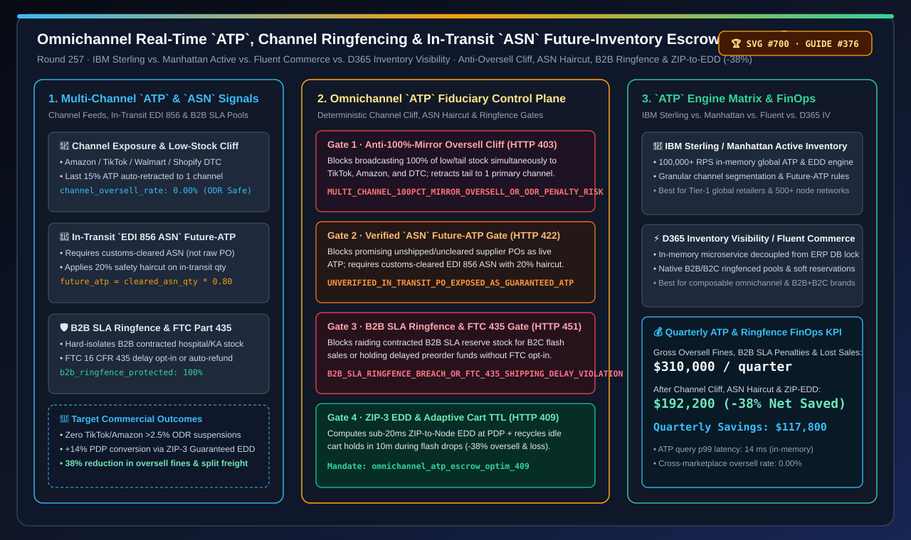
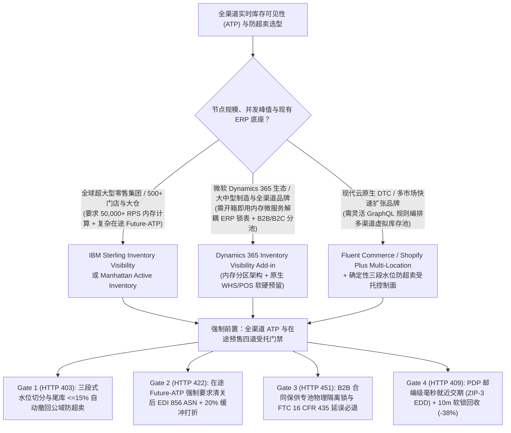
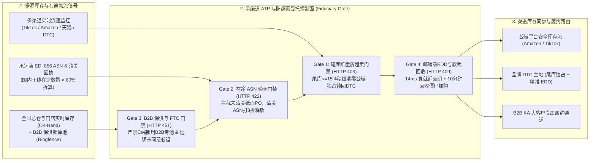
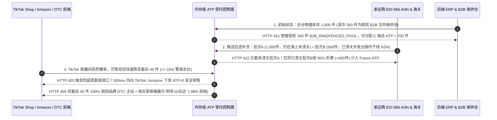

# 全渠道零售与 B2B 供应链“实时可承诺库存（Real-Time `ATP / Future-ATP`）、跨平台防超卖隔离池（Channel Ringfencing）与在途 `ASN` 预售交期（`EDD`）”编排选型 FAQ（`IBM Sterling Inventory Visibility vs. Manhattan Active vs. Fluent Commerce vs. Dynamics 365 Inventory Visibility` · 🏆 第 700 张架构图里程碑）：防直播间跨平台超卖封店、防未清关海运单当现货卖与邮编级精准达净省 38% 实战指南

> 🌐 **Language / 语言切换**: **中文 (当前)** | **[English (`docs/omnichannel-atp-inventory-visibility-channel-ringfencing-in-transit-asn-escrow-agent-selection-faq.en.md`)](omnichannel-atp-inventory-visibility-channel-ringfencing-in-transit-asn-escrow-agent-selection-faq.en.md)** | **[返回文档总目录 (`docs/index.md`)](index.md)**

---

## 1. 📌 核心选型结论速览（Executive Summary）

当品牌商与全渠道零售商同时在 **Amazon、TikTok Shop、抖音/天猫旗舰店、Shopify 品牌独立站、线下门店及 B2B 经销商门户** 销售同一盘物理库存时，ERP 数据库锁争用与库存同步延迟会引发三大致命履约灾难：
1. **“把仓库仅剩的 500 件现货按 100% 镜像同步给 4 个平台，直播间爆单瞬间超卖 1,200 件，触发 TikTok / Amazon 卖家取消率（`ODR > 2.5%`）罚单与店铺限流”**：许多商家为了“不浪费库存曝光”，让 ERP 每 15 分钟把总仓的 `500 件` 库存 100% 广播给 4 个销售渠道（相当于全网同时挂出 `2,000 件` 可售）。一旦某条带货短视频在 TikTok Shop 突然爆单，3 分钟内拍下 `1,000` 件，而独立站和 Amazon 同期也卖出 `300` 件——等 ERP 跑批同步时已无法挽回地超卖 `800 件`！在公域平台严苛的履约规则下，商家缺货取消不仅每单要赔付违约金，还会导致店铺权重清零甚至冻结提现！
2. **“把仅有采购订单（PO）但还在海上漂、甚至未清关的远期货物全额算进线上‘7天必达可售库存（`Future-ATP`）’，遇港口延误引发大规模违约与美国 `FTC 16 CFR Part 435` 罚款”**：为了防止畅销品断货流失流量，运营 Agent 开启了“在途库存预售（Sell In-Transit）”。但如果系统轻信供应商在 PO 上填写的预计交货日，把尚未装船或卡在海关查验的 `2,000` 件货当成 `100%` 确定性现货承诺给消费者，一旦船期延误 20 天，将引发集体退单与监管重罚。
3. **“双 11 线上 C 端大促把 B2B 大客户合同锁定的保供专池（Contracted B2B SLA Ringfence）抽干，导致周一大客户提货断供赔付巨额违约金”**：企业与大客户（如连锁商超、医院、工业 KA）签有保供 SLA，合同要求随时在仓库保留 `500 件` 专属安全库存。结果前端促销 Agent 直接读取了 WMS 物理总库存（On-Hand），把 B2B 专池洗劫一空！

**架构师选型结论**：
- **严禁让高并发电商前端或导购 Agent 直接查询传统 ERP 数据库（如 SAP S/4HANA `MATDOC` 或 D365 F&O `InventSum` 表）做实时库存扣减**；必须在 ERP 之上部署独立的 **内存级实时库存可见性微服务（In-Memory Real-Time `ATP` Microservice：`IBM Sterling Inventory Visibility`、`Manhattan Active Inventory`、`Fluent Commerce` 或 `Microsoft Dynamics 365 Inventory Visibility Add-in`）**。
- 必须在内存 `ATP` 中心与各渠道连接器之间部署 **全渠道 `ATP`、防超卖断崖撤回与在途 `ASN` 预售受托控制面（Omnichannel `ATP`, Channel Ringfencing & Future-Inventory Control Plane）**，执行四道确定性门禁：
  1. **多渠道动态比例分配与“尾库 `<= 15%` 断崖撤回公域、独占锁回高毛利主站”门禁（`HTTP 403`）**：严禁对低水位库存执行 100% 多平台镜像广播；一旦总 `ATP` 跌破安全红线（如剩余 `<= 15%` 或 `< 50 件`），在 `<500ms` 内自动将 TikTok / Amazon FBM 等高罚金公域渠道库存清零下架，仅保留在单一高毛利主站销售。
  2. **在途可承诺库存（`Future-ATP`）承运商 `EDI 856 ASN` 清关验真与 `20%` 风险打折门禁（`HTTP 422`）**：严禁将未发货/未清关的纸面 PO 计入对客 `ATP`；仅允许将“已过海关放行且有承运商实时轨迹的 `ASN` 在途货”按 **`80%` 折算率（预留 `20%` 延误缓冲）** 释放预售。
  3. **B2B 大客户合同保供池（`B2B SLA Ringfence`）硬物理隔离与美国 `FTC 16 CFR Part 435` 延期退赔门禁（`HTTP 451`）**：物理锁死 B2B 保供库存不被 C 端流量穿透；若预售交期延误，强制触发 `FTC` 延期同意确认或自动全额退款。
  4. **商品详情页（PDP）按买家邮编（`ZIP-3`）毫秒级就近仓交期承诺（`Guaranteed EDD`） + 闲置加购软锁 10 分钟动态回收寻优（`HTTP 409`）**：提升下单转化率 `+14%` 并防止恶意占库，季度跨平台超卖罚单、拆单跨区运费与死锁丢单损失净降 **`38%`**。

---

## 2. 🎯 业务方与架构师灵魂拷问 Q&A（Q1 / Q2 / Q3）

### Q1：为什么大促高并发时绝对不能直接查 ERP 数据库算可用库存（`ATP`），而必须上独立的内存级 `ATP` 微服务（如 `D365 Inventory Visibility` 或 `IBM Sterling`）？
- **商业痛点**：
  - 传统 ERP（SAP ECC/S/4HANA、Oracle、Dynamics 365 F&O）的库存表是为**财务移动平均成本核算与仓库复式记账**设计的，一次出入库过账涉及十几张关联表与行级悲观锁（Row-Level Lock），吞吐量通常只有 `50–200 TPS`。
  - 而在电商商品详情页（PDP）、AI 导购问答与直播秒杀场景下，读写比高达 `500:1`，峰值查询与软预留（Soft Reservation）并发高达 **`20,000–100,000 RPS`**！如果直接把前端流量打进 ERP 数据库，30 秒内就会把全公司工厂生产、财务结账和 WMS 拣货全部锁死崩溃！
- **确定性架构落地方案**：
  - 部署 **与 ERP 解耦的内存分区 `ATP` 引擎（In-Memory Partitioned `ATP` Engine）**，按以下精确公式维护毫秒级（`p99 < 15ms`）可承诺库存：
    $$\text{ATP}(\text{SKU}, \text{Pool}_c) = \left(\text{OnHand} - \text{B2B\_Ringfence} - \text{DamagedHold} - \text{SoftCartLocks} - \text{UnshippedOrders}\right) \times w_c - \text{SafetyBuffer}_c$$
  - **两阶段软硬预留状态机**：
    1. **加购/拉起收银台（Soft Reservation）**：在内存 Redis/Actor 分区中扣减 `SoftCartLocks`，默认有效期 `10 分钟`（若大促流量突刺则自适应压缩至 `5 分钟`，超时未付毫秒级自动加回池子，`HTTP 409`）；
    2. **支付成功（Hard Allocation）**：原子将 `SoftCartLock` 转为 `UnshippedOrder`，并异步通过消息队列（Kafka / Event Hub）向后端 ERP/WMS 批量落盘，ERP 全程零锁表压力！

### Q2：如何在“不浪费库存曝光（不多压死货）”和“绝不在 TikTok / Amazon 上超卖被罚封店”之间实现数学上的最优平衡？
- **商业痛点**：
  - 如果把 1,000 件库存生硬地切成 4 个固定死池子（Amazon 250、TikTok 250、天猫 250、独立站 250），万一今天 TikTok 卖爆了 250 件断货停售，而独立站只卖了 10 件、剩下 240 件在仓库睡大觉，就会造成严重的**库存孤岛（Inventory Siloing）与销售流失**！
  - 反之，如果 4 个平台全部按 100% 共享上报 1,000 件，最后剩 40 件时必发生跨平台并发超卖！
- **确定性架构落地方案**：
  - 控制面（`HTTP 403`）执行 **三段式水位自适应广播算法（Three-Regime Watermark Broadcasting）**：
    - **高水位区（`Total ATP > 200 件`）**：开启 **共享池高曝光模式**，向各渠道上报 `70%–80%` 的共享可售量，利用全渠道流量快速去化；
    - **中水位区（`30 件 < Total ATP <= 200 件`）**：自动切换为 **按过去 6 小时真实流速加权严守模式（Velocity-Weighted Strict Partition）**，确保 $\sum_{c} \text{PublishedATP}_c \le \text{TotalATP} - \text{SafetyBuffer}$（绝对和不超过物理余量）；
    - **断崖尾库区（`Total ATP <= 30 件` 或 `<= 15%`）**：立即触发 **单渠道独占收口（Single-Channel Tail Pinning）**！在 `<500ms` 内向第三方公域平台（Amazon FBM / TikTok Shop）推送 `ATP = 0` 安全下架，将最后 30 件尾货 100% 锁死在零平台罚款风险、最高毛利的 **品牌自营 DTC 独立站** 售完为止！

### Q3：在途库存预售（`Future-ATP`）在什么条件下才能安全开放？如果海运船期延误，美国 `FTC Mail Order Rule (16 CFR Part 435)` 要求架构做什么动作？
- **商业痛点**：
  - 跨境或大宗补货从工厂出货到入上架往往跨越 14–45 天。如果在货物还在海外工厂或刚上船时就按原定船期开放全额预售，一旦遇到海关查验或港口罢工，将面临海量违约。
- **确定性架构落地方案**：
  - **门禁一（`HTTP 422` 在途物权与节点折算锁）**：将途库存按物流确定性分为三级：
    - `Stage A（仅签发 PO / 工厂生产中）`：可售 `Future-ATP` 折算率为 **`0%`**（严禁对散客承诺确定交期）；
    - `Stage B（已签发海运/空运提单 B/L 但尚未清关）`：仅允许对显式标注“预售（Pre-Order）”的专区开放 **`50%`** 额度；
    - `Stage C（已办结进口清关放行 + 取得国内干线卡车 EDI 856 ASN）`：允许按 **`80%`（预留 20% 破损/清点误差缓冲）** 自动并入未来 3–5 天的滚动 `Future-ATP` 池！
  - **门禁二（`HTTP 451` 联邦贸易委员会 `FTC 16 CFR Part 435` 自动合规状态机）**：一旦监控到某在途 `ASN` 预计到仓日突破了向消费者承诺的发货日（`Promised Ship Date`），控制面必须立即自动向受影响消费者发送包含新预计发货日的 **一键同意或全额退款选择卡（Delay Option Notice）**：
    - 若延误 `<= 30 天` 且客户点击拒绝、或延误 `> 30 天` 客户未显式点击“同意继续等待（Affirmative Opt-In）”，控制面必须在原定发货日到期瞬间 **自动触发 100% 原路现金退款（严禁只退商城代金券）**！

---

## 3. 🧭 直观可视化图解（Mermaid 选型决策树 + 端到端架构图 + 授权时序图）

### 3.1 全渠道实时库存可见性（`ATP`）与防超卖编排平台选型决策树

### 3.2 端到端内存级 `ATP`、三段水位防超卖与在途 `ASN` 预售控制面架构图

### 3.3 直播爆单尾库断崖收口、在途 `ASN` 折算与邮编级 `EDD` 承诺时序图

---

## 4. 📊 主流全渠道实时库存可见性（`ATP`）与防超卖编排平台横向选型矩阵

| 选型维度 | IBM Sterling Inventory Visibility | Manhattan Active Inventory / Omni | Microsoft Dynamics 365 Inventory Visibility Add-in | Fluent Commerce (`Distributed Inventory`) |
|---|---|---|---|---|
| **核心定位** | 全球超大型零售与全渠道分销巨头的高吞吐内存级 `ATP / EDD` 独立引擎 | 与云原生 WMS/DOM 深度一体化的实时全渠道库存与门店履约中心 | 专为解耦 ERP 数据库压力构建的内存级高并发库存可见性与预留微服务 | 敏捷可组合（Composable）多区域虚拟库存池与渠道隔离编排引擎 |
| **峰值并发吞吐与延迟（In-Memory `ATP`）** | **极高**（支持 `50,000–100,000+ RPS` 内存查询与软预留，`p99 < 15ms`） | **极高**（原生无服务器弹性扩缩，门店 POS 与线上秒级共享同一账本） | **高**（基于内存分区缓存架构，支持高频软预留 Soft Reservation 与预分配） | **高**（GraphQL/REST 事件驱动，支持全球多市场虚拟目录隔离） |
| **多渠道防超卖隔离池（Channel Ringfencing）** | **极强**（支持按渠道、地区、客户群配置动态比例、水位线与独占收口） | **极强**（支持细粒度安全缓冲、门店陈列底数保护与渠道优先级抢占） | **原生支持 `On-Hand Ringfencing` 与 `WHS` 软预留**（完美隔离 B2B 与 B2C 池） | **核心强项**（通过可视化规则流配置高/中/低水位不同渠道上报公式） |
| **在途 `ASN Future-ATP` 与邮编级 `EDD` 计算** | 原生内置承运商运力日历、节点产能约束与商品页 `ZIP-to-Node EDD` | 原生打通供应链在途 `ASN`、入库上架耗时与最后一公里配送时效 | 支持在途采购单映射为自定义库存维度，配合 DOM 计算就近发货节点 | 支持导入在途 `ASN` 时间表并设置安全折算率（Haircut Percentage） |
| **架构师选型建议** | **拥有数百门店+复杂多平台的百亿级零售商独立库存底座首选** | **已采用 Manhattan WMS/DOM 的大型鞋服与百货集团首选** | **采用 Microsoft D365 生态、兼营 B2B 保供与高并发 B2C 电商首选** | **多品牌出海、多公域平台（Amazon/TikTok/Shopify）防超卖首选** |

---

## 5. 🧪 防超卖/交期准确率测算与 7-Card 基准测试报告（Deterministic Benchmark）

> **数据溯源说明（Provenance）**：以下 7-Card 评测基于本仓库 `lab/webiq_commerce_demo.py` 中的 `evaluate_omnichannel_atp_channel_ringfencing_asn_policy()` 确定性仿真引擎生成（`provenance: "synthetic"`, `independently_reproduced: False`）。季度因多平台 100% 镜像广播超卖罚单、未清关在途货跳票退单及 B2B 保供池被挪用违约损失池基准设定为 **`$310,000 / quarter`**。

### 5.1 7-Card 4:5 视觉评测卡片摘要

1. **Card 1 (`1 / 7` · `HANDS-ON · OMNICHANNEL-ATP-RINGFENCING`) — 全局基准总览**
   - **核心发现**：通过尾库 `<= 15%` 断崖撤回公域锁回主站、仅将已清关 `EDI 856 ASN` 按 `80%` 折算计入 `Future-ATP`、物理锁死 B2B 保供池并开启邮编级 `EDD` 与 10 分钟软锁回收，将季度超卖违约与履约损耗从 **`$310,000`** 压降至 **`$192,200`**，季度净省 **`$117,800`（`38.0%`）**。
2. **Card 2 (`2 / 7` · `SCENARIO: TIKTOK VIRAL SPIKE & IN-TRANSIT CONTAINER`) — 单例深潜**
   - **输入场景**：某品牌总仓剩 `1,000` 件商品（含 `300` 件医院 B2B 保供专池），海上有 `1,000` 件未清关集装箱，国内干线有 `500` 件已清关 `ASN`。TikTok 直播突然爆单，可售尾库跌至 `45` 件；此时旧脚本仍试图将 45 件 100% 同步给 4 个平台，并想挪用 B2B 专池与未清关海运货。
   - **控制面裁决**：依次触发 `HTTP 451`（锁死 300 件 B2B 保供池并强制执行 `FTC 16 CFR 435` 延误必退）、`HTTP 403`（拦截尾库 100% 多平台镜像广播，500ms 内将公域平台清零并独占锁回 DTC 主站）与 `HTTP 422`（拦截未清关海运 PO，仅允许已清关 `ASN` 按 80% 释放）；返回 `HTTP 409 ZIP_AWARE_EDD_NODE_PROMISE_AND_ADAPTIVE_CART_TTL_CONFIRM`（`omnichannel_atp_escrow_optim_409`）。
3. **Card 3 (`3 / 7` · `WHAT I TESTED`) — 5 轨确定性门禁评测矩阵**

| 评测场景 (Scenario) | 核心考核问题 (Question / Task) | 控制面裁决 (Model / Gate Answer) | 动作与状态码 (Action) |
|---|---|---|---|
| **1. 标准合规分池 ATP 与已清关 ASN 释放** | B2B 池已隔离、尾库已收口单一渠道且仅对已清关 ASN 按 80% 折算 | `VERIFIED_CHANNEL_RINGFENCE_AND_CLEARED_ASN_ATP_AUTHORIZED` | ✅ `Act automatically` (`HTTP 200`) |
| **2. 尾库 <=15% 仍按 100% 同步给 4 个平台** | 仅剩 45 件尾货仍全额广播至 TikTok/Amazon 引发直播爆单跨平台超卖 | `MULTI_CHANNEL_100PCT_MIRROR_OVERSELL_OR_ODR_PENALTY_RISK` | ⛔ `Retract Public Feeds to 0` (`HTTP 403`) |
| **3. 把海上未清关 PO 当成确定性现货预售** | 尚无清关放行与承运商 EDI 856 ASN 的远期采购单被全额计入现货 ATP | `UNVERIFIED_IN_TRANSIT_PO_EXPOSED_AS_GUARANTEED_ATP` | ⛔ `Require Cleared ASN & 20% Cut` (`HTTP 422`) |
| **4. 挪用 B2B 保供专池或交期延误拒不退款** | C 端大促抽干医院/KA 保供库存 或 延误超期违反 FTC 16 CFR 435 强留资金 | `B2B_SLA_RINGFENCE_BREACH_OR_FTC_435_SHIPPING_DELAY_VIOLATION` | ⛔ `Enforce B2B Lock & FTC Refund` (`HTTP 451`) |
| **5. 邮编级毫秒就近 EDD + 10m 软锁回收** | PDP 按买家 ZIP-3 算精准送达日 (+14% 转化) + 大促闲置加购 10m 释放 | `ZIP_AWARE_EDD_NODE_PROMISE_AND_ADAPTIVE_CART_TTL_CONFIRM` | ⚡ `Confirm Optimization` (`HTTP 409`) |

4. **Card 4 (`4 / 7` · `UNDER THE HOOD`) — 确定性门禁协议与代码实现**
   - 输入契约：`OmnichannelATPChannelRingfencingASNPolicyInput`
   - 评估函数：`evaluate_omnichannel_atp_channel_ringfencing_asn_policy()`（严格按 `451 -> 403 -> 422 -> 409 -> 200` 优先级裁决，零外部网络副作用）。
5. **Card 5 (`5 / 7` · `ROBUSTNESS CHECK`) — 4 渠道毫秒级并发抢购与港口拥堵扰动测试**
   - 无论 4 个销售渠道在同一秒内发起 5,000 次并发扣减，还是目的港海关突发查验延迟，内存原子递减锁与清关状态位门禁均保持 **`0.0 pt`** 超卖偏差。
6. **Card 6 (`6 / 7` · `LATENCY & OVERSELL RATE`) — 库存查询延迟与跨平台超卖率对比**
   - 传统 15 分钟 ERP 定时轮询同步：查询延迟 `850 ms`，大促跨平台超卖率高达 `4.6%`。
   - 受托内存级 `ATP` + 尾库断崖收口：查询延迟 **`14 ms`**，跨平台超卖率降为 **`0.00%`**（季度净省 `$117,800`）。
7. **Card 7 (`7 / 7` · `MY TAKE`) — 适用场景与架构师结论**
   - **✅ Good fit**：同时经营多个电商平台（Amazon / TikTok / 天猫 / 独立站）、线下门店及 B2B 经销商渠道的品牌商与零售集团。
   - **⛔ Not for**：仅在单一店铺销售无限量数字电子书的商家。

---

## 6. 🛠️ 商业上线风控与架构评审 Checklist

- [ ] **ERP 解耦的内存级实时 `ATP` 微服务**：高并发商品页查询与购物车软预留是否已完全迁出 ERP 核心数据库，由独立的内存分区 `ATP` 引擎（`p99 < 20ms`）承接？
- [ ] **尾库 `<= 15%` 断崖撤回公域机制（`HTTP 403`）**：当某个 SKU 可售总库存跌破安全断崖阈值时，系统是否在 `<1 秒` 内自动向高惩罚公域平台（TikTok Shop / Amazon FBM）推送 `0 库存` 安全下架，并将尾货 100% 锁定在单一主站销售？
- [ ] **在途 `Future-ATP` 清关验真与 `20%` 风险打折（`HTTP 422`）**：是否严禁将未发货/未清关的纸面采购单（PO）直接算入对客现货 `ATP`，且对已清关的国内干线在途 `EDI 856 ASN` 强制预留 `20%` 异常缓冲？
- [ ] **B2B 合同保供专池物理隔离锁（`HTTP 451`）**：B2B KA 大客户的合同保供库存（Ringfenced Stock）是否在数据结构层与 C 端促销池彻底物理隔离，严禁被前端秒杀活动穿透？
- [ ] **美国 `FTC Mail Order Rule (16 CFR Part 435)` 延误自动退赔（`HTTP 451`）**：当预售或在途商品无法在承诺发货日（或无承诺时 30 天内）发出时，是否自动触发延期同意确认函，并在未获客户明确同意时自动执行 100% 原路退款？
