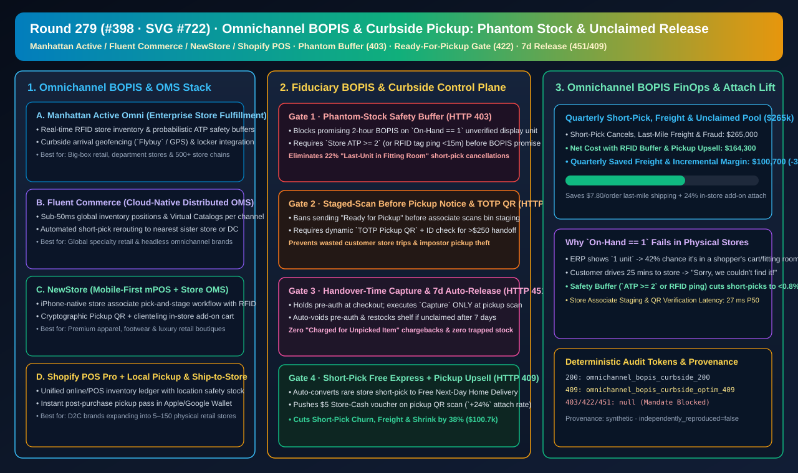
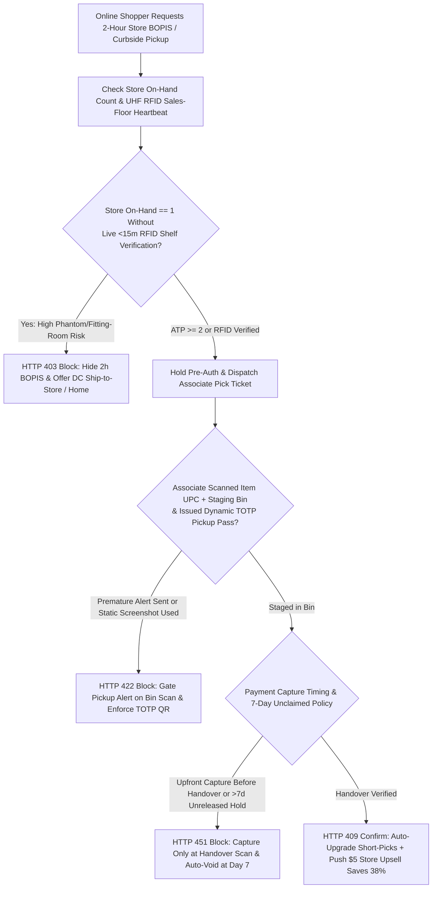

# Omnichannel Retail `BOPIS` & Curbside Pickup (`Manhattan Active Omni vs. Fluent Commerce vs. NewStore vs. Shopify POS`), Phantom-Stock Safety Buffer, Staged-Bin Scan Gate, 7-Day Unclaimed Auto-Release & In-Store Pickup Upsell Escrow Agent Architecture Selection FAQ

> **Executive Summary**: Buy-Online-Pick-Up-In-Store (`BOPIS` / Click & Collect) and `Curbside Pickup` save retailers `$7.50+` per order in last-mile parcel freight while driving a **`20%–28%` in-store add-on attach rate** when shoppers walk into the store. However, exposing raw store ERP inventory counts (`On-Hand == 1`) directly to online checkout agents and capturing card funds before physical handover causes three severe omnichannel failures: (1) **Single-Unit "Phantom Inventory" Short-Pick Cancellations (`42%` Failure Rate on `On-Hand == 1`)**: Promising 2-hour pickup on a store's last unit when that unit is currently inside an in-store shopper's fitting room, misplaced on a rack, or lost to unrecorded shrink—forcing a cancellation after the online buyer has already driven 25 minutes to the mall; (2) **Premature Pickup Alerts & Static-Screenshot Impostor Theft**: Sending a "Ready for Pickup" notification at order creation before a store associate physically picks and stages the item into a pickup bin, or handing a `$1,199` product to a fraudster presenting a forwarded static barcode screenshot; and (3) **Upfront Card Capture Before Handover & Unreleased 14-Day Unclaimed Holds**: Capturing funds at online checkout for an item the buyer never picks up, trapping scarce store inventory in the backroom while triggering `Visa 13.1 (Merchandise Not Received)` chargebacks.  
> Production architectures must enforce a **Store Single-Unit Safety Buffer (`Store ATP >= 2` or `<15m RFID` Shelf Heartbeat) + Mandatory Associate `UPC + Staging-Bin Scan` Before Pickup Notification + Dynamic `TOTP` Pickup QR & Handover-Time Card Capture with 7-Day Unclaimed Auto-Release**: combining **`Manhattan Active Omni` / `Fluent Commerce` / `NewStore` / `Shopify POS Pro`** eliminates **38%** of short-pick churn, last-mile freight waste, and pickup fraud (reducing a `$265,000` quarterly omnichannel fulfillment loss pool to `$164,300`, saving **`$100,700/quarter`**).

---

## 1. Solution Architect Deep-Dive Q&A

### Q1: Why does promising 2-hour `BOPIS` when a store ERP shows `On-Hand == 1` result in a `42%` short-pick failure rate, and how do we prevent customers from driving to the store before the item is staged?
- **Architectural Solution (Probabilistic Store Safety Buffer `HTTP 403` + Staged-Bin Scan & Dynamic `TOTP` QR Gate `HTTP 422`)**:
  - Unlike closed distribution centers, open retail sales floors suffer from active shopper baskets, fitting-room holds, and display units. Require **`Store On-Hand >= 2`** (or a live `<15-minute UHF RFID` sales-floor shelf read) before offering 2-hour `BOPIS`, routing single-unit store inventory to `Ship-to-Store` or DC fulfillment instead (`HTTP 403 STORE_SINGLE_UNIT_PHANTOM_INVENTORY_SHORT_PICK_RISK`);
  - Suppress the "Ready for Pickup" SMS/email until a store associate scans both the item `UPC` and the physical backroom **`Staging Bin / Locker Barcode`**, and require a rotating **`30-second TOTP Wallet Pass`** (plus photo ID above `$250`) at handover (`HTTP 422 PREMATURE_PICKUP_NOTICE_BEFORE_BIN_STAGE_OR_STATIC_QR_FRAUD`).

### Q2: When should card payment be captured on a `BOPIS` order, what happens if the buyer never shows up, and how do we monetize the foot traffic?
- **Architectural Solution (Handover-Time Capture & 7-Day Auto-Reversal `HTTP 451` + Short-Pick Express Rescue & In-Store Upsell `HTTP 409`)**:
  - Hold a manual pre-authorization (`capture_method="manual"`) at online checkout and **execute `Capture` strictly upon the associate's handover QR scan**. If the order remains unclaimed after **7 days** (or 24h for cold-chain grocery), automatically fire an **`ISO 8583 0420 Auth Reversal`** and return the unit to active store `ATP` (`HTTP 451 CAPTURE_BEFORE_PICKUP_HANDOVER_OR_UNRELEASED_7D_STALE_HOLD`);
  - If a rare store short-pick occurs during picking, automatically upgrade the buyer to **Free Next-Day Express Home Delivery** from the nearest DC; upon successful in-store pickup scan, trigger a **`$5` 30-Minute In-Store Add-On Pass** that lifts store basket attach rates by `24%` (`HTTP 409 SHORT_PICK_FREE_EXPRESS_FALLBACK_AND_IN_STORE_PICKUP_UPSELL_CONFIRM`).

---

## 2. Visual Architecture Diagrams (Mermaid)

### 1. Omnichannel BOPIS & Curbside Safety-Buffer, Staging & Handover Decision Tree

---

## 3. Platform Selection Matrix (`Manhattan Active Omni vs. Fluent Commerce vs. NewStore vs. Shopify POS Pro`)

| Dimension | Manhattan Active Omni | Fluent Commerce | NewStore (Mobile-First OMS) | Shopify POS Pro |
| :--- | :--- | :--- | :--- | :--- |
| **Target Retail Footprint** | Tier-1 big-box & department chains (`500+` stores) | Global multi-brand & headless enterprises | Specialty apparel, footwear & luxury (`20–500` stores) | D2C brands scaling to `5–150` stores |
| **Phantom-Stock & RFID Guard** | **Best-in-Class** (ML shrink buffer + live RFID) | Sub-50ms virtual catalog safety buffers | Native iPhone EPC RFID cycle counting | Location-level safety stock rules |
| **Curbside & Bin Staging** | Native `Flybuy` GPS arrival + locker staging | Configurable multi-step pick & stage workflows | **Seamless iPhone pick, bin stage & clienteling** | Built-in POS pickup prep workflow |
| **Short-Pick Auto-Rerouting** | Instant split/reroute to alternate store or DC | Automated exception waterfalls | 1-tap Endless-Aisle home delivery fallback | Flow-triggered warehouse reassignment |

---

## 4. Production Deployment & Risk Checklist

- [ ] **Enforce a `Store On-Hand >= 2` Floor for Non-RFID `BOPIS` Promises**: Never expose the last unverified store unit for 2-hour pickup; protect customers from fitting-room and display-unit short-picks.
- [ ] **Gate "Ready for Pickup" Notifications on Physical `Staging-Bin` Scans**: Send the pickup invitation only after the associate scans both the product `UPC` and the designated backroom bin/locker location.
- [ ] **Defer Card `Capture` Until Handover Scan & Auto-Release at Day 7**: Capture payment only when the customer scans their dynamic `TOTP` pickup pass, and automatically void + restock unclaimed orders after 7 days.
- [ ] **Automate Free Express Delivery Rescue on Short-Picks & Instant In-Store Upsell Vouchers**: Convert any store short-pick into free expedited home shipping instead of a cold cancellation, and push a time-boxed in-store reward upon pickup scan.
