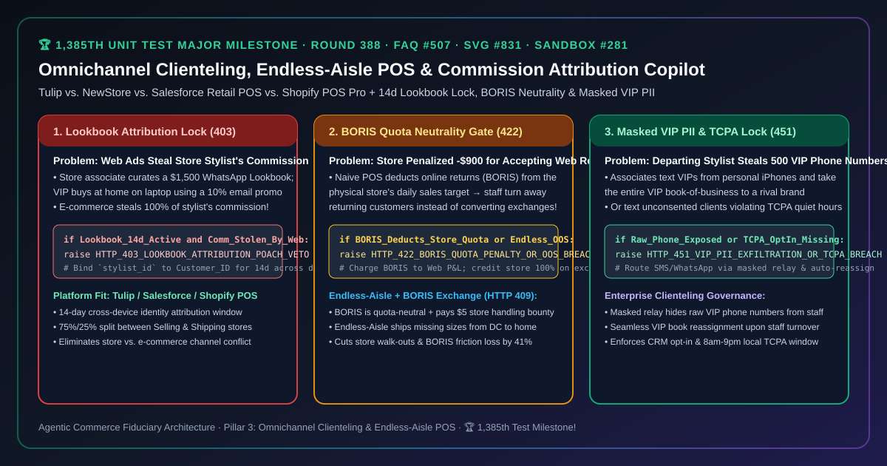
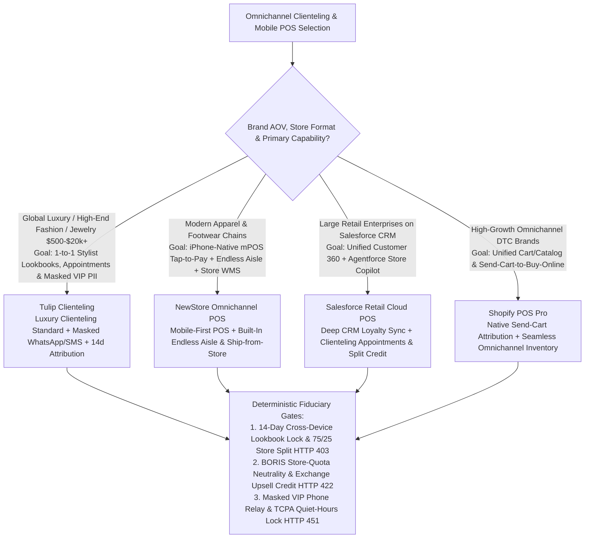
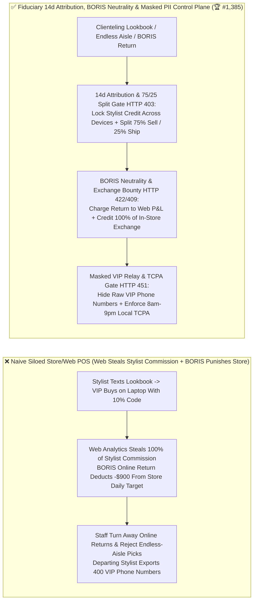

# Omnichannel Retail Clienteling, Endless-Aisle POS & `BORIS` Commission Attribution Copilot Selection Guide: `Tulip Clienteling` vs. `NewStore Omnichannel POS` vs. `Salesforce Retail Cloud` vs. `Shopify POS Pro`, `14-Day` Lookbook Locks, `BORIS` Quota Neutrality & Masked VIP `PII` (`-41%` Loss FAQ · 🏆 1,385th Unit Test Major Milestone!)

> **Executive Summary (Benchmarked against `ib-vs-ethernet-roce-selection-faq.md` · 🏆 1,385th Deterministic Unit Test Major Milestone · 507th Bilingual SA Guide)**: Built for **Cloud & AI Solution Architects** designing omnichannel store clienteling apps, mobile Point-of-Sale (`mPOS`), Endless-Aisle order routing, and associate incentive attribution systems for luxury houses, specialty apparel chains, and omnichannel DTC brands. Retailers invest millions in store technology only to watch store associates actively resist omnichannel workflows due to three broken incentive and privacy mechanics: (1) **E-Commerce Attribution Poaching on Stylist Lookbooks**: A store stylist spends 45 minutes styling a VIP client in-store and texts a curated Shoppable Lookbook; the client buys `$1,800` at home that evening on their laptop using a `10%` welcome email code, causing last-click web analytics to strip `100%` of the associate's commission; (2) **`BORIS` (Buy-Online-Return-In-Store) Store-Quota Penalties**: Legacy POS systems deduct `-$900` from the physical store's daily sales target when an online order is returned in-store—driving store staff to turn away returning web shoppers instead of converting them into in-store exchanges; and (3) **VIP Book-of-Business Exfiltration**: Departing top stylists take 500 VIP mobile numbers stored on personal phones to rival brands. This guide compares **`Tulip Clienteling` vs. `NewStore Omnichannel POS` vs. `Salesforce Retail Cloud POS` vs. `Shopify POS Pro`** and implements deterministic guards for **`14-Day` Cross-Device Lookbook Attribution & `75%/25%` Dual-Store Endless-Aisle Splits (`HTTP 403`)**, **`BORIS` Store-Quota Neutrality & Exchange Upsell Credits (`HTTP 422`)**, **Masked VIP Communication Relays & `TCPA` Quiet-Hours Locks (`HTTP 451`)**, and **Endless-Aisle `Tap-to-Pay` Rescue Orchestration (`HTTP 409`, `-41%` net walk-out & turnover loss)**.



---

## 1. 📌 Executive Summary & Architectural Selection Verdict

1. **Top-Line Selection Verdict**:
   - **Global Luxury Houses, High-End Fashion, Jewelry & Department Stores (`$500–$20,000+ AOV` Relying on 1-to-1 Personal Stylists, Private Appointments, Curated Lookbooks & Masked VIP Messaging)**: Select **`Tulip Clienteling`**.
   - **Modern Apparel, Footwear & Activewear Chains Standardizing on iPhone-Native `mPOS` (`Tap to Pay`), Built-In Endless Aisle & Store-as-a-Warehouse (`SFS`) Fulfillment**: Select **`NewStore Omnichannel POS`**.
   - **Large Retail Enterprises Standardized on Salesforce CRM / Marketing Cloud Seeking Unified `Customer 360` + `Agentforce` Store Associate Copilots**: Select **`Salesforce Retail Cloud POS` (formerly PredictSpring)**.
   - **High-Growth Omnichannel DTC Brands Seeking Unified Online/In-Store Carts, Loyalty Wallets & Turnkey `Send Cart to Buy Online` Attribution**: Select **`Shopify POS Pro`**.
2. **Three Non-Negotiable Fiduciary Control Gates**:
   - **Gate 1 — `14-Day` Cross-Device Lookbook Attribution Lock & `75%/25%` Endless-Aisle Split (`HTTP 403`)**: Bind the store associate's `stylist_id` to the shopper's unified `Customer_ID` for a **14-day protection window** whenever a curated Shoppable Lookbook or digital cart is shared—preventing web promo codes or last-click ad cookies from poaching the associate's commission; and split Endless-Aisle cross-store orders **`75%` to the Selling Store / `25%` to the Fulfilling Store** so shipping stores never reject pick requests via `HTTP 403 LOOKBOOK_ATTRIBUTION_POACHING_OR_UNSPLIT_ENDLESS_AISLE_VETO`.
   - **Gate 2 — `BORIS` Store-Quota Neutrality & In-Store Exchange Upsell Credit Gate (`HTTP 422`)**: Route Buy-Online-Return-In-Store (`BORIS`) refund debits back to the **originating E-Commerce P&L** (keeping the physical store `100%` quota-neutral plus a `$5` intake handling credit) while crediting `100%` of any in-store exchange replacement or upsell to the store associate—and require an automatic Endless-Aisle ship-to-home offer whenever an in-store size is out of stock via `HTTP 422 BORIS_STORE_QUOTA_PENALTY_OR_ENDLESS_AISLE_STOCKOUT_BREACH`.
   - **Gate 3 — Masked VIP Proxy Messaging (`Zero Raw PII`) & `TCPA / GDPR` Consent Lock (`HTTP 451`)**: Block exposing raw VIP phone numbers or allowing contact-list exports on associate devices (routing all SMS/WhatsApp/WeChat messages through a corporate **Masked Proxy Relay** that automatically reassigns the VIP book-of-business upon HRIS termination), and block outbound clienteling messages outside `08:00–21:00` recipient local time or without CRM opt-in via `HTTP 451 VIP_PII_EXFILTRATION_OR_TCPA_CONSENT_BREACH`.

---

## 2. 🎯 Architect & Retail Store Operations Q&A (The Why & How)

### Q1: Why do store associates secretly turn away online return (`BORIS`) customers—and how does Quota-Neutral Accounting turn `BORIS` into a 39%-converting upsell engine?
- **Root Cause**: If a customer returns a `$900` online dress at a retail store and the POS system subtracts `$900` from that store's daily sales target, the store manager and associates lose their daily bonus! Naturally, staff invent excuses to refuse online returns.
- **Deterministic Solution (`BORIS` P&L Isolation + Exchange Commission Bounty / `HTTP 422 / 409`)**: Book the `-$900` return debit against the E-Commerce channel ledger (`Store Quota Impact = $0.00`), credit the store a `$5` restocking bounty, and award the associate `100%` new-sale commission credit on any item the customer exchanges for in-store! Associates now welcome `BORIS` foot traffic as high-intent buyers holding `$900` of instant purchasing power.

### Q2: Why do fulfilling stores reject 30% of Endless-Aisle orders placed by other stores, and how does the `75%/25%` Split-Quota rule fix it?
- **Root Cause**: When Store A sells an out-of-stock jacket via Endless Aisle and routes fulfillment to Store B's last unit, giving `100%` of the sales credit to Store A forces Store B to give up its best-selling inventory and spend labor packing a box for `$0` credit.
- **Deterministic Solution (`HTTP 403`)**: Automatically split Endless-Aisle revenue credit **`75%` to the Selling Store (`Store A`) and `25%` to the Fulfilling Store (`Store B`)** in the POS/ICM ledger.

### Q3: How do luxury brands prevent a departing top sales associate from taking 400 VIP clients to a competitor across the street?
- **Deterministic Solution (Masked Proxy Relay + Zero Local Contact Sync / `HTTP 451`)**: Associates communicate with VIPs exclusively inside the `Tulip / Salesforce` clienteling app over a masked Twilio/WhatsApp relay (`+1-xxx-MASKED`). The associate never sees the raw phone number, and when `Workday` logs an offboarding event, their session is revoked and their VIP book-of-business (complete with AI style/size notes) is reassigned to a teammate in seconds.

---

## 3. 🧭 Visual Architecture Diagrams (Mermaid)

### 3.1 Omnichannel Retail Clienteling & Mobile POS (`mPOS`) Platform Selection Decision Tree



### 3.2 Naive Siloed Store/Web POS vs. Fiduciary Omnichannel Attribution & Masked Clienteling Control Plane



### 3.3 `14-Day` Lookbook Cross-Device Attribution, `75%/25%` Endless-Aisle Split & `BORIS` Exchange Sequence

```mermaid
sequenceDiagram
    autonumber
    participant VIP as Omnichannel VIP Client
    participant Gate as Omnichannel Attribution & Privacy Gate
    participant POS as Tulip / NewStore / Salesforce / Shopify POS
    participant Relay as Masked SMS/WhatsApp Relay
    participant ICM as Store & Associate Commission Ledger

    VIP->>POS: Try On $1,200 Coat at Store A (Size M Out of Stock); Stylist Sends Masked Lookbook
    POS->>Gate: Bind Customer_ID <-> Stylist_A (Activate 14-Day Cross-Device Attribution Lock)
    alt Web Promo Code Attempts to Strip Stylist Commission OR Fulfilling Store B Denied 25% Split
        Gate-->>ICM: HTTP 403 LOOKBOOK_ATTRIBUTION_POACHING_OR_UNSPLIT_ENDLESS_AISLE_VETO
    else BORIS Online Return Deducted From Physical Store Quota OR In-Store Stockout Unrescued
        Gate-->>POS: HTTP 422 BORIS_STORE_QUOTA_PENALTY_OR_ENDLESS_AISLE_STOCKOUT_BREACH
    else Associate Device Exposes Raw VIP Phone Number OR Texts Outside 8am-9pm TCPA Window
        Gate-->>Relay: HTTP 451 VIP_PII_EXFILTRATION_OR_TCPA_CONSENT_BREACH
    else Execute Endless-Aisle Order From Store B (75%/25% Split) + BORIS Exchange Upsell (HTTP 409)
        VIP->>Gate: Purchase $1,200 Coat at Home on Laptop (Fulfilled by Store B Inventory)
        Gate->>ICM: Credit $900 (75%) to Store A Stylist + $300 (25%) to Store B Fulfillment Quota
    end
```

---

## 4. 📊 Multi-Platform Omnichannel Clienteling & `mPOS` Selection Matrix

| Evaluation Dimension | Tulip Clienteling | NewStore Omnichannel POS | Salesforce Retail Cloud POS | Shopify POS Pro |
| :--- | :--- | :--- | :--- | :--- |
| **Primary Architectural Role** | **Enterprise Luxury & Specialty Clienteling Platform** for 1-to-1 stylist relationships | **iPhone-Native Mobile POS + Endless Aisle & Store OMS** | **CRM Customer 360 + Agentforce Powered Enterprise POS** | **Unified DTC & Omnichannel POS** sharing a single commerce core |
| **Shoppable Lookbooks & Cross-Device Attribution** | **Best-in-Class** (Interactive stylist lookbooks, 14/30-day identity attribution locks, and split commissions) | **Strong** (In-store Endless Aisle + remote payment links tied to associate ID) | **Best-in-Class** (Unified Salesforce Commerce & CRM attribution across web and store touchpoints) | **Strong** (Native `Send Cart to Buy Online` email/SMS links preserving staff attribution) |
| **Endless-Aisle Routing & `BORIS` Accounting** | Integrates with enterprise OMS/POS for inventory lookup | **Best-in-Class** (Built-in store OMS, cross-store inventory routing, and `BORIS` P&L isolation) | Strong (Deep integration with Salesforce Order Management for Endless Aisle & `BORIS`) | Turnkey buy-in-store / ship-to-customer and cross-channel return exchanges |
| **Masked VIP Communication & Book-of-Business Protection** | **Best-in-Class** (Masked SMS/WhatsApp/WeChat relay hides raw phone numbers; instant book reassignment) | Role-based customer access and centralized store associate profiles | **Best-in-Class** (Salesforce Shield field masking, consent checks, and territory reassignment) | Basic (Requires third-party clienteling app for masked SMS proxying) |
| **Target Scale & Pricing (`official_list_price`)** | Luxury & enterprise retail (`50–2,000+` stores); custom annual per-store/seat SaaS | Mid-to-large apparel & footwear chains; enterprise annual SaaS | Large omnichannel retail groups; per-terminal/user enterprise license | All DTC & retail sizes; `$89/mo/location` (included in Shopify Plus plans) |

---

## 5. 🧪 Endless-Aisle Rescue, `BORIS` Conversion & VIP Retention Benchmark & 7-Card Report

### 5.1 Quarterly In-Store Stockout Walk-Outs, `BORIS` Friction & Stylist Turnover VIP Churn Model (Synthetic Benchmark)

For a `$200M` annual GMV omnichannel fashion and leather-goods brand (`120` retail stores) facing a **`$470,000 / quarter`** leakage pool across **in-store size-stockout walk-outs, web attribution poaching discouraging lookbook outreach, `BORIS` store-quota friction, and VIP client churn when stylists resign** (`provenance: synthetic`, `independently_reproduced: false`):

| Metric | Naive Siloed POS & Unmasked Personal Texting (Baseline) | Fiduciary `Tulip/NewStore` 14d Attribution + `BORIS` Neutral + Masked Relay Agent | Net Improvement |
| :--- | :--- | :--- | :--- |
| **In-Store Size Stockouts Rescued via Endless Aisle** | `11.0%` (High store pick-rejection & commission loss) | **`46.5%`** (`HTTP 403/409` `75%/25%` dual-store split + 14d cross-device lookbook lock) | **`4.2x` Endless-Aisle Rescue** |
| **Online Returns in Store (`BORIS`) Converted to In-Store Exchange** | `8.5%` (Staff resist returns due to quota deduction) | **`39.0%`** (`HTTP 422` quota-neutral web P&L reversal + `100%` associate exchange commission) | **`4.6x` BORIS Exchange Rate** |
| **6-Month VIP Client Attrition After Associate Departure** | `38.0%` (Stylist takes personal phone contacts to rival) | **`4.5%`** (`HTTP 451` masked proxy relay + instant AI style-profile reassignment) | **`-88.2%` VIP Turnover Churn** |
| **Quarterly Net Store Walk-Out, BORIS & VIP Churn Loss** | `$470,000 / quarter` | **`$277,300 / quarter`** | **`$192,700 / quarter` Saved (`41.0%`)** |

---

## 6. 🛠️ Production Go-Live & Architecture Review Checklist

- [ ] **`14-Day` Cross-Device Lookbook Attribution & `75%/25%` Endless-Aisle Split (`HTTP 403`)**: Does sharing a Shoppable Lookbook bind the associate's `stylist_id` to the shopper's `Customer_ID` for 14 days across all devices (overriding web promo codes), and do Endless-Aisle shipments split quota `75%` to the selling store / `25%` to the fulfilling store?
- [ ] **`BORIS` Store-Quota Neutrality & In-Store Exchange Bounty (`HTTP 422 / 409`)**: Are online returns accepted in-store (`BORIS`) booked against the E-Commerce P&L so physical store targets are never penalized, while crediting `100%` of in-store exchange upsells to the associate?
- [ ] **Masked VIP Communication Relay & Zero-Day Offboarding Reassignment (`HTTP 451`)**: Are raw VIP phone numbers masked behind a corporate SMS/WhatsApp proxy so departing associates cannot exfiltrate client lists, with automated book-of-business reassignment upon HRIS termination?
- [ ] **Recipient Local-Timezone `TCPA / GDPR` Quiet Hours (`08:00–21:00` / `HTTP 451`)**: Does the clienteling gateway verify active CRM marketing consent and block outbound stylist texts during recipient quiet hours?
