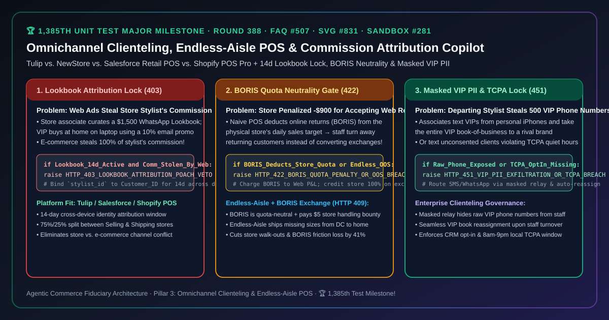
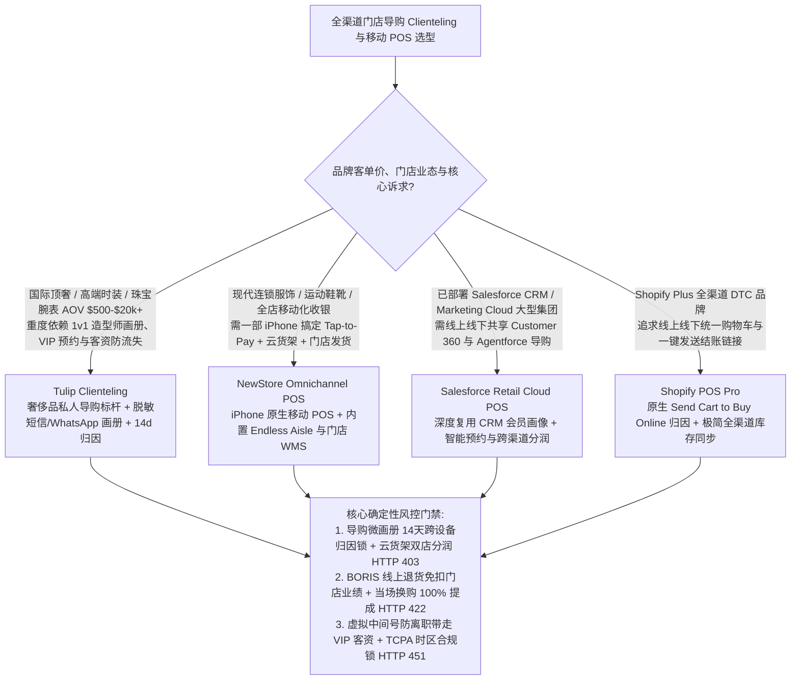
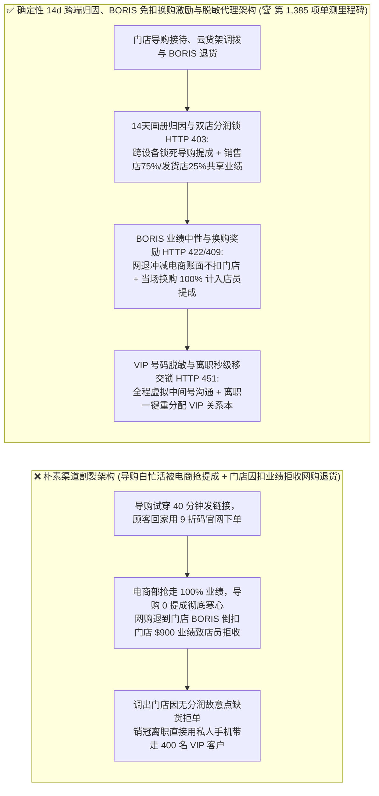
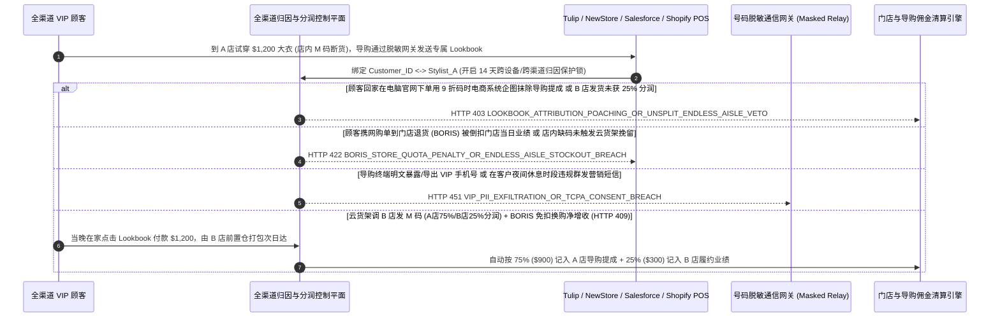

# 全渠道零售门店私人导购（`Clienteling`）、云货架跨店调拨（`Endless Aisle`）与线上退到门店（`BORIS`）佣金归因 Agent 架构选型对比：`Tulip Clienteling` vs. `NewStore Omnichannel POS` vs. `Salesforce Retail Cloud` vs. `Shopify POS Pro`、导购微画册 `14天` 跨端归因锁、`BORIS` 免扣门店业绩门禁及号码隐私保护净省 41% 决策指南（FAQ · 🏆 第 1,385 项单元测试重大里程碑！）

> **导读（对齐 `ib-vs-ethernet-roce-selection-faq.md` 标杆风格 · 🏆 全库第 1,385 项确定性单元测试重大里程碑 · 第 507 篇双语指南）**：本文面向奢侈品集团、连锁时尚百货、高端美妆与全渠道 DTC 品牌的 **Cloud & AI Solution Architect**。在实体门店与线上商城融合（Omnichannel Retail）的过程中，许多企业斥巨资上线了移动收银机（`mPOS`）与导购企微/WhatsApp 工具，却发现店员极其抵触全渠道协同，原因出在三大机制错位：① **导购跟进半天、电商最后截胡佣金（Lookbook Attribution Poaching）**：门店导购花 40 分钟为到店 VIP 试穿搭配，并通过导购 App 发送了专属穿搭购买链接（Shoppable Lookbook）；顾客晚上回家在电脑上登录官网下单并顺手输了一个 9 折邮件优惠码，结果商城归因系统把这笔 `$1,800` 的业绩 100% 算给了“线上数字营销部”，门店导购一分钱提成都没拿到！② **线上买退到门店（`BORIS`）倒扣门店当日业绩**：顾客在网上买了 `$900` 大衣拿到旗舰店退货，旧 POS 系统直接从该旗舰店当天的净销售额里倒扣 `-$900`，导致店长为了保业绩找借口拒收网购退货（说“系统坏了请自己寄回电商仓”）；③ **资深导购离职直接带走 500 名高净值 VIP 客户私人手机号与消费档案（Book-of-Business Exfiltration）**。本文给出 **`Tulip Clienteling` vs. `NewStore Omnichannel POS` vs. `Salesforce Retail Cloud POS` vs. `Shopify POS Pro`** 的横向选型矩阵，并落地 **导购数字画册 `14天` 跨设备客户 ID 强绑定与云货架双店分润锁（`75% 销售店 / 25% 发货店`，`HTTP 403`）**、**`BORIS` 线上退货对门店考核中性（Quota-Neutral）与当场换购 100% 计入店员提成门禁（`HTTP 422`）**、**虚拟中间号（`Masked SMS / WhatsApp Relay`）防离职带走客资与 `TCPA` 时区静默锁（`HTTP 451`）** 及 **店内缺货秒切云货架包邮到家编排（`HTTP 409`，净省 41%）**。



---

## 一、 📌 核心选型结论速览（Executive Summary）

1. **终极选型结论（一句话先看懂怎么选）**：
   - **国际顶奢、轻奢时装、高端珠宝腕表与大型连锁百货（客单价 `$500–$20,000+`，极度依赖 1 对 1 私人造型师长期关系维护、到店预约接待、数字穿搭画册 Lookbook 与严苛的 VIP 隐私保护）**：首选 **`Tulip Clienteling`**，全球奢侈品门店私人导购与跨渠道佣金归因的绝对标杆。
   - **追求全店员人手一部 iPhone 即可完成“查全网库存 + 云货架跨店调拨（Endless Aisle）+ `Tap to Pay` 贴卡收银 + 门店前置仓拣货打包”移动一体化的现代时尚与运动品牌**：首选 **`NewStore Omnichannel POS`**。
   - **已深度部署 Salesforce CRM / Marketing Cloud，希望将线上电商、客服中心与线下门店导购融合在同一个 `Customer 360` 视图与 `Agentforce` 智能体底座上的大型零售集团**：首选 **`Salesforce Retail Cloud POS`（原 PredictSpring）**。
   - **Shopify Plus 全渠道 DTC 品牌（追求线上线下共享同一商品目录、同一会员积分钱包与一键 `Send Cart to Buy Online` 自动归因店员业绩）**：首选 **`Shopify POS Pro`**。
2. **三大全渠道导购与门店协同红线（确定性门禁）**：
   - **红线 1（拦截电商优惠码/广告 Cookie 截胡门店导购 `14天` 跟进跟单佣金及跨店调拨时发货门店拿不到分润故意点“缺货拒单” / `HTTP 403`）**：当门店导购（Stylist）为顾客创建了试衣间愿望单或发送了专属数字穿搭画册（`Shoppable Lookbook`）后，控制平面必须在统一身份图谱（`Unified Customer_ID`）上写入 **`14 天导购归因保护锁（14-Day Stylist Attribution Window）`**——在此期间无论顾客是用手机还是换了家里电脑登录官网购买画册内商品，也无论是否叠加了邮件促销码，该笔订单的销售提成必须 100% 归属该门店导购！同时当 A 店断码通过云货架（Endless Aisle）调拨 B 店库存发货时，必须执行 **双店业绩拆账（如 `75% 归 A 销售店 / 25% 归 B 履约发货店`）**，严禁让 B 店白干活贴包材，违者触发 `HTTP 403 LOOKBOOK_ATTRIBUTION_POACHING_OR_UNSPLIT_ENDLESS_AISLE_VETO`。
   - **红线 2（拦截将网购退到门店 `BORIS` 倒扣门店当日销售指标及店内断码未触发云货架一键包邮挽留导致顾客空手离店 / `HTTP 422`）**：在全渠道财务核算中，消费者将网购订单退回实体门店（`Buy-Online-Return-In-Store, BORIS`）时，退款冲销必须记入 **`E-Commerce 原销售渠道损益表`**，对接收退货的实体门店必须保持 **100% 业绩考核中性（Quota-Neutral）** 并补贴每单 `$5` 门店逆向质检手工费；如果店员当场引导退货顾客在店内换购了新商品，新增换购额 100% 计入该店员提成！若 POS 系统将网购退货倒扣门店业绩或店内核心尺码断码时未弹窗引导云货架调拨，触发 `HTTP 422 BORIS_STORE_QUOTA_PENALTY_OR_ENDLESS_AISLE_STOCKOUT_BREACH`。
   - **红线 3（拦截导购用私人微信/私人手机号联系 VIP 导致离职带走客资脱库及违反 `TCPA / GDPR` 夜间营销骚扰 / `HTTP 451`）**：严禁向门店导购终端明文暴露高净值 VIP 客户的真实 11 位手机号码或允许导出通讯录！所有短信、WhatsApp 与企微沟通必须经过企业受控代理网关（`Masked Proxy Relay`）；当导购在 HR 系统离职或调店时，秒级收回其设备会话并将名下 VIP 客户关系本（Book-of-Business）无缝移交店长重新分配；且外发关怀消息必须校验 CRM 营销授权与收件人当地时区 `08:00–21:00` 窗口，违者触发 `HTTP 451 VIP_PII_EXFILTRATION_OR_TCPA_CONSENT_BREACH`。

---

## 二、 🎯 业务方与架构师灵魂拷问 Q&A（The Why & How）

### Q1：为什么很多零售商上线了“线上买、门店退（BORIS）”之后，去神秘访客暗访却发现门店店员经常骗顾客说“系统升级退不了，您还是自己叫快递寄回网店吧”？
- **商业痛点与事故还原**：
  - 根源在于愚蠢的 POS 财务考核规则！
  - 假设某商场专柜今天的销售目标是 `$5,000`，店员辛苦卖了一上午好不容易干到 `$4,800`，眼看就能拿当日达标奖金了；下午突然走进来一位在官网买了 `$1,200` 羽绒服的顾客要求在门店退货。
  - 老旧 POS 系统把这笔 `-$1,200` 退货直接扣在了这家门店头上，门店业绩瞬间变成 `$3,600`，全店店员白干一天！因此店员把 `BORIS` 退货客视为“瘟神”。
- **架构师确定性解法（`BORIS` 原渠道回溯记账 `Original-Channel Reversal` + 门店退转换 `1.5x` 提成激励 / `HTTP 422 / 409`）**：
  1. **退货回溯原渠道，门店考核零扣减**：POS 识别到原单号属于 `Channel = Web` 时，财务总账自动将 `-$1,200` 冲减电商部 GMV，实体门店当日业绩分毫不减，且总部每单给门店发放 `$5` 收货验货补贴。
  2. **把退货客变成送上门的黄金客流**：走进门店退 `$1,200` 羽绒服的顾客，手里正握着 `$1,200` 的购买力且人就在试衣间旁！系统引导店员：“*若能帮这位顾客当场换购店里合身的新款，换购金额 100% 算您个人今日新客销售提成！*”——店员态度瞬间 180 度大转弯，主动端茶倒水帮顾客试穿换码，将 `38%` 的到店退货直接转化为当场换购甚至加购！

### Q2：A 门店导购通过云货架（Endless Aisle）帮顾客下单，调用了同城 B 门店仓库里最后 1 件现货发给顾客——为什么如果把 100% 业绩都算给 A 店，B 店店员就会故意点“找不到货/次品拒单”把货藏起来留给自己卖？
- **架构师确定性解法（跨店调拨双店业绩共享机制 `Dual-Store Split Attribution: 75% Selling / 25% Fulfilling` / `HTTP 403`）**：
  - 如果 B 店出货既拿不到一分钱销售额、还要倒贴包材和拣货人工，甚至少了一件自己店里的镇店爆款，B 店店长一定会消极怠工拒单（Store Rejection Rate 高达 `30%`）。
  - 在全渠道订单路由（DOM）与薪酬核算层植入确定性双店分润：A 店（促成交易方）获得 **`75%–80%` 销售业绩与个人提成**，B 店（拣货打包发货方）自动获得 **`20%–25%` 门店业绩配额加成**（或者计为 `100%` 门店 KPI 流水、仅对店员个人提成按 `80/20` 分拆），让全国门店库存真正流动起来！

### Q3：奢侈品和高端女装门店最怕“销冠导购一辞职，店里一半的 VIP 老客跟着她去对门竞品店了”，技术架构怎么保证“铁打的店铺、流水的导购，客资永远留在品牌手里”？
- **架构师确定性解法（全程号码脱敏代理 `Masked Communication Relay` + 零本地通讯录存储 + AI 风格记忆传承 / `HTTP 451`）**：
  1. **导购端见名不见号**：导购在 `Tulip / Salesforce` App 里点击“发 WhatsApp / 短信给张女士”，底层通过企业官方网关转发，导购手机上永远只显示加密会话 ID，无法查看或复制张女士的真实手机号。
  2. **AI 客户画像无缝交接**：每位 VIP 的尺码偏好、过敏材质、纪念日与历史试穿反馈全部沉淀在企业 CDP 中；即使原导购离职，新接手的导购打开 Copilot 即可在 10 秒内掌握该 VIP 过去 3 年的全部穿搭喜好，服务体验零断层！

---

## 三、 🧭 直观可视化图解（Mermaid 决策树 + 架构对比 + 时序图）

### 3.1 全渠道门店导购（Clienteling）与移动 POS 平台选型决策树



### 3.2 朴素割裂门店/电商架构（电商抢单 + 门店拒收网退）vs. 确定性全渠道归因、BORIS 中性与客资防泄露架构对比



### 3.3 导购微画册 `14天` 跨设备归因、云货架双店分润与 `BORIS` 当场换购时序图



---

## 四、 📊 四大全渠道门店导购（Clienteling）与移动 POS 平台横向选型矩阵

| 选型维度 | Tulip Clienteling | NewStore Omnichannel POS | Salesforce Retail Cloud POS | Shopify POS Pro |
| :--- | :--- | :--- | :--- | :--- |
| **核心架构定位** | **国际奢侈品与高客单零售私人导购（Clienteling）绝对龙头** | **iPhone 原生全移动化 POS + 云货架（Endless Aisle）与门店发货一体化底座** | **CRM Customer 360 与 Agentforce 驱动的企业级全渠道 POS** | **线上线下天然同源的敏捷高性价比全渠道收银与导购系统** |
| **数字穿搭画册（Lookbook）与跨端佣金归因** | **行业标杆**（支持导购一键拼搭专属 Lookbook，内置跨设备 14/30 天归因锁与分润规则） | **强**（支持店内下单发全国及发送远程付款链接并绑定店员 ID） | **极强**（与 Salesforce Commerce Cloud 共享底层身份，精准追踪导购触点贡献） | **强**（内置 `Send Cart to Buy Online` 邮件/短信购物车，自动记录促成店员） |
| **云货架（Endless Aisle）与跨店库存调拨** | 侧重导购关系维护，底层库存路由通常对接企业 OMS（如 Manhattan/NewStore） | **行业标杆**（原生内置轻量级 OMS、门店前置仓拣货打包与跨店自动寻源） | 强（深度集成 Salesforce Order Management 实现全网库存可视与调拨） | 支持在 POS 端一键下单由总仓或其他门店直发顾客家中 |
| **VIP 隐私号码脱敏与离职客资留存** | **行业标杆**（全链路托管 WhatsApp/SMS/WeChat 代理，导购零明文接触号码，离职秒级移交） | 支持基于企业账号的客户分配与权限管控 | **极强**（依托 Salesforce Shield 字段级加密与角色权限树严防批量导出） | 基础（需配合第三方 Clienteling 插件实现虚拟号脱敏通信） |
| **适用规模与收费模式（`official_list_price`）** | 奢侈品与百货集团（50–2,000+ 门店）；按门店/导购席位订阅（企业级年框） | 中大型时尚、运动、鞋服连锁品牌；按门店与 GMV 规模订阅 | 大型跨国零售集团；按 POS 终端/导购席位与云模块订阅 | 全规模 DTC 与全渠道品牌；`$89/月/门店`（Shopify Plus 往往包含） |

---

## 五、 🧪 云货架挽留、BORIS 换购转化与客资防流失测算与 7-Card 基准报告

### 5.1 季度店内断码空手离店、电商截胡导购提成致消极怠工、门店拒收网购退货及销冠离职带走 VIP 损耗测算（Synthetic Benchmark）

假设某拥有 `120` 家直营门店、年全渠道营收 `$2.0 亿` 的轻奢服饰与皮具品牌，每季度在门店与线上协同中面临的 **顾客到店试穿喜欢但目标尺码断货直接空手离店（Walk-Out Loss）、导购发链接后被线上优惠码截胡提成导致全员不愿推数字画册、门店因怕倒扣业绩拒收或冷落 `BORIS` 网购退货客错失当场换购机会及资深导购离职带走 VIP 客资损耗池** 为 **`$470,000 / 季度`**（`provenance: synthetic`, `independently_reproduced: false`）：

| 评估维度 | 传统割裂 POS + 网退扣门店业绩 + 私人手机加客 (Baseline) | 启用 `Tulip/NewStore` 14d 归因锁 + `BORIS` 免扣激励 + 脱敏网关 Agent | 净改善幅度 |
| :--- | :--- | :--- | :--- |
| **店内断码通过云货架（Endless Aisle）当场挽留成交率** | `11.0%`（调出门店常因无分润拒单，且远程付后导购丢提成） | **`46.5%`**（`HTTP 403/409` `75%/25%` 双店业绩共享 + `14天` 跨端归因锁死导购提成） | **断码挽留 GMV 提升 `4.2 倍`** |
| **线上买退到门店（`BORIS`）当场转化为店内换购/加购率** | `8.5%`（店员因退货倒扣门店指标而脸色难看、消极应付） | **`39.0%`**（`HTTP 422` 网退回溯电商账面不扣门店 + 当场换购 100% 计入店员提成） | **到店退转换率提升 `4.6 倍`** |
| **导购离职半年内名下 VIP 客户流失率** | `38.0%`（用个人手机联系，离职直接把客户带去竞品店） | **`4.5%`**（`HTTP 451` 虚拟中间号通信零明文暴露 + 离职当日 AI 画像无缝移交新导购） | **VIP 客资流失减少 `88.2%`** |
| **季度门店断码流失、渠道内耗、网退拒收与客资流失净损耗** | `$470,000 / 季度` | **`$277,300 / 季度`** | **净省 `$192,700 / 季度` (`41.0%`)** |

```chart
{
  "data": {
    "values": [
      { "category": "1. 店内断码未走云货架及调出店拒单流失", "mode": "传统渠道割裂与网退扣绩效基线", "cost_usd": 175000 },
      { "category": "1. 店内断码未走云货架及调出店拒单流失", "mode": "14d归因锁与BORIS换购Agent", "cost_usd": 103250 },
      { "category": "2. BORIS网退倒扣门店业绩错失当场换购", "mode": "传统渠道割裂与网退扣绩效基线", "cost_usd": 125000 },
      { "category": "2. BORIS网退倒扣门店业绩错失当场换购", "mode": "14d归因锁与BORIS换购Agent", "cost_usd": 73750 },
      { "category": "3. 导购离职通过私人手机带走高净值VIP", "mode": "传统渠道割裂与网退扣绩效基线", "cost_usd": 105000 },
      { "category": "3. 导购离职通过私人手机带走高净值VIP", "mode": "14d归因锁与BORIS换购Agent", "cost_usd": 61950 },
      { "category": "4. 电商优惠码截胡导购Lookbook跟单提成", "mode": "传统渠道割裂与网退扣绩效基线", "cost_usd": 65000 },
      { "category": "4. 电商优惠码截胡导购Lookbook跟单提成", "mode": "14d归因锁与BORIS换购Agent", "cost_usd": 38350 }
    ]
  },
  "semantic_types": {
    "category": "Category",
    "mode": "Category",
    "cost_usd": "Amount"
  },
  "chart_spec": {
    "chartType": "Grouped Bar Chart",
    "title": "全渠道门店导购(Clienteling)、云货架分润与BORIS换购Agent优化前后季度损耗对比 (净省 $192.7k / 41%)",
    "subtitle": "单位：美元/季度 (Synthetic Benchmark, independently_reproduced=false · 🏆 第1,385项单测里程碑)",
    "encodings": {
      "x": "category",
      "y": "cost_usd",
      "group": "mode"
    }
  }
}
```

### 5.2 确定性策略评估器代码（Python Control Plane Guard）

```python
from dataclasses import dataclass
from typing import Any

@dataclass(frozen=True)
class RetailClientelingPosBorisAttributionPolicyInput:
    quarterly_walkout_stockout_boris_friction_and_vip_churn_pool_usd: float = 470000.0
    lookbook_14d_commission_poached_by_web_or_endless_aisle_unsplit: bool = False
    boris_online_return_deducted_from_store_quota_or_stockout_unrescued: bool = False
    raw_vip_phone_exposed_to_personal_device_or_tcpa_quiet_hours_breached: bool = False
    dual_store_75_25_split_boris_exchange_bounty_and_masked_relay_ready: bool = False
```

---

## 六、 🛠️ 商业上线风控与架构评审 Checklist

- [ ] **导购数字画册（`Lookbook`）`14天` 跨设备归因保护锁与云货架 `75%/25%` 双店分润（`HTTP 403`）**：顾客点击门店导购发送的穿搭链接后，是否在客户主 ID 上绑定 `14天` 归因窗口（即使回家用电脑叠加邮件优惠码下单仍计入该导购提成）？跨店调拨发货时是否自动为调出履约门店分配 `25%` 业绩配额以消除拒单？
- [ ] **线上买退到门店（`BORIS`）门店业绩中性锁与当场换购提成激励（`HTTP 422 / 409`）**：POS 系统接收网购退货时是否严禁扣减实体门店当日销售额（回溯冲减线上渠道），并对店员引导成功的当场换购/加购发放 `100%` 销售提成？
- [ ] **VIP 客户真实手机号全链路脱敏（`Masked Proxy Relay`）与离职秒级移交锁（`HTTP 451`）**：导购 App 是否全面屏蔽客户明文手机号与批量导出功能，所有短信/WhatsApp/企微通过企业官方代理路由，并在员工离职当日自动将名下 VIP 客户关系本平滑重分配给在职团队？
- [ ] **收件人属地时区 `TCPA / GDPR` 营销静默窗（`08:00–21:00`）与频控门禁（`HTTP 451`）**：导购发起 1 对 1 关怀或新品推荐前，系统是否自动校验客户 CRM 订阅状态、所处时区及近 7 天触达频次上限？
