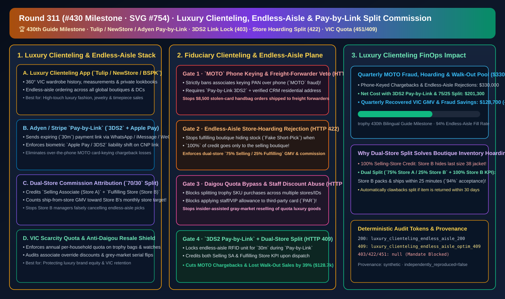
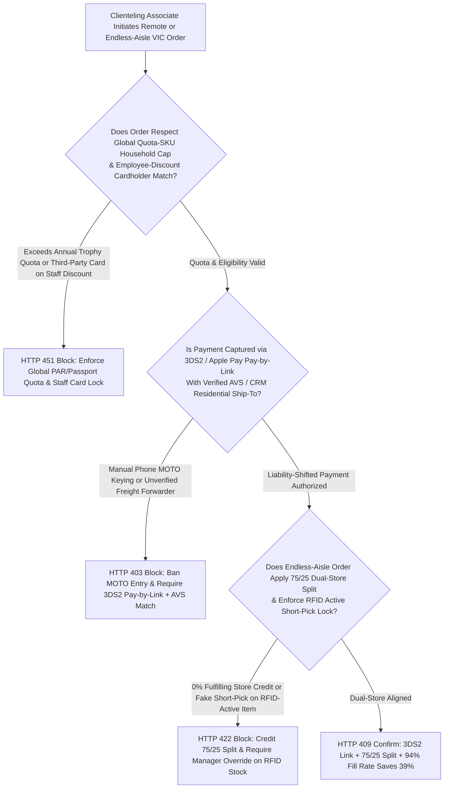

# 🏆 Omnichannel Luxury Clienteling, Endless-Aisle Ship-from-Store & `3DS2 Pay-by-Link` Split-Commission Escrow (`Tulip / NewStore / Salesforce POS + Adyen Pay-by-Link` · 430th Bilingual Guide Milestone), Anti-`MOTO` Fraud, Store-Hoarding Fix & `VIC` Quota Lock FAQ

> **Executive Summary (🏆 430th Bilingual Guide Milestone)**: In luxury fashion, fine jewelry, timepieces, and specialty retail (`LVMH`, `Kering`, `Richemont`, `Neiman Marcus`), store associates using **Clienteling & Endless-Aisle platforms (`Tulip`, `NewStore`, `BSPK`)** over WhatsApp, iMessage, and WeCom drive `35%–50%` of boutique revenue. Yet three operational failure modes destroy omnichannel conversion and margin: (1) **Over-the-Phone `MOTO` Manual Card Keying & Unverified Freight-Forwarder Shipping**: Associates manually typing a shopper's 16-digit card number into a POS terminal (`MOTO`) carry `0%` chargeback protection against `$8,500` stolen-card handbag fraud; (2) **Fulfilling-Boutique Inventory Hoarding ("Fake Short-Picks")**: When Store A sells the last Size 38 runway coat physically sitting in Store B, giving `100%` of the commission and store KPI credit to Store A incentivizes Store B's manager to falsely click `"Item Not Found (Short-Pick)"` to save the coat for their own walk-in clients (`38%` endless-aisle cancellation rate); and (3) **Daigou Quota-Bag Circumvention & Staff-Discount Abuse**.  
> Production architectures must enforce **Zero-`MOTO` Biometric `3DS2 / Apple Pay Pay-by-Link` with `AVS / CRM` Address Locks + Dual-Store Commission & KPI Splits (`75% Selling Associate / 25% Fulfilling Store` + `RFID` Short-Pick Locks) + Global `Passport + EMVCo PAR` Quota-SKU Caps**: cutting remote fraud, store-hoarding cancellations, and gray-market leakage by **39%** (reducing a `$330,000` quarterly loss pool to `$201,300`, saving **`$128,700/quarter`**).

---

## 1. Solution Architect Deep-Dive Q&A

### Q1: How do we eliminate `100%`-lose-rate `MOTO` chargebacks in remote clienteling and stop fulfilling boutiques from rejecting endless-aisle orders ("Store Hoarding")?
- **Architectural Solution (`3DS2 Pay-by-Link + AVS` Gate `HTTP 403` + `75/25` Dual-Store Commission Split & `RFID` Lock Gate `HTTP 422`)**:
  - Disable manual `MOTO` card-number entry on boutique POS terminals; require remote clienteling orders to use a **`30-minute TTL Adyen / Stripe Pay-by-Link`** enforcing `Apple Pay / Google Pay / 3DS2` liability shift and matching the `Ship-To` address against `AVS` billing records or verified historical `VIC` residential deliveries (`HTTP 403 MOTO_MANUAL_CARD_KEYING_OR_UNVERIFIED_PAY_BY_LINK_SHIP_TO`);
  - Eliminate boutique inventory hoarding by splitting endless-aisle economics **`75%` to the Selling Associate (Store A) and `25%` to the Fulfilling Boutique Pool (Store B)**—while crediting `100%` of the shipment toward Store B's monthly omnichannel store-target KPI—and blocking unapproved `"Short-Pick"` cancellations whenever overhead store `RFID` telemetry confirms the item was scanned on-premise within the last 4 hours (`HTTP 422 ENDLESS_AISLE_ZERO_FULFILLMENT_SPLIT_OR_RFID_ACTIVE_SHORT_PICK`).

### Q2: How do we enforce global scarcity quotas on trophy handbags/timepieces and prevent employee discount diversion?
- **Architectural Solution (`Passport + EMVCo PAR` Global Quota Lock & Staff-Card Match `HTTP 451 / 409`)**:
  - Track annual household purchase quotas on allocation SKUs (`Quota_Category == TROPHY_ALLOCATION`) across global boutiques using linked `Passport_Hash + EMVCo PAR` tokens, and require employee discount transactions to settle strictly on a payment card (`PAR`) belonging to the authenticated employee (`HTTP 451 QUOTA_SKU_ANNUAL_HOUSEHOLD_CAP_BREACH_OR_STAFF_DISCOUNT_THIRD_PARTY_CARD`);
  - Confirm `3DS2 Pay-by-Link` reservation, `RFID`-verified store fulfillment, and dual-store commission attribution (`HTTP 409 PAY_BY_LINK_3DS2_RFID_LOCK_AND_DUAL_STORE_COMMISSION_SPLIT_CONFIRM`).

---

## 2. Visual Architecture Diagrams (Mermaid)

### 1. Luxury Clienteling `Pay-by-Link`, Dual-Store Split & Quota Lock Decision Tree

---

## 3. Platform Selection Matrix (`Tulip vs. NewStore vs. Salesforce POS vs. BSPK + Adyen`)

| Dimension | Tulip (`Clienteling + POS`) | NewStore (`Omnichannel POS`) | Salesforce Commerce & POS | BSPK + Adyen Pay-by-Link |
| :--- | :--- | :--- | :--- | :--- |
| **Luxury Brand Adoption** | **Tier-1 luxury leader** (`Chanel`, `Mulberry`, `Michael Kors`, ` Puig`) | **Cloud-native mobile POS + built-in store OMS** (`Ganni`, ` Burton`, `Marine Layer`) | Enterprise CRM-unified retail | High-touch personal shopping & lookbooks |
| **Endless-Aisle & Store Routing** | Real-time global boutique stock visibility & reserve | **Native Ship-from-Store routing, pick-pack-ship & label printing** | Powered by Salesforce Order Management | Lightweight clienteling UI over ERP |
| **Remote `Pay-by-Link` & Splits** | Deep Adyen/Stripe `Pay-by-Link` + ERP split-commission tags | Native `Tap-to-Pay` + remote Apple Pay links + dual store attribution | Unified Marketing/Commerce attribution | Instant WhatsApp/WeCom `Pay-by-Link` tracking |

---

## 4. Production Deployment & Risk Checklist

- [ ] **Disable Manual `MOTO` Card Entry on All Boutique POS Terminals**: Mandate `30-minute TTL 3DS2 / Apple Pay Pay-by-Link` with `AVS` address verification for all remote sales.
- [ ] **Enforce a `75% Selling / 25% Fulfilling` Commission Split & Dual Store-KPI Credit**: Align store manager incentives so boutiques eagerly fulfill endless-aisle orders within 30 minutes.
- [ ] **Gate Store `"Short-Pick"` Cancellations Against Live Overhead `RFID` Scans**: Prevent associates from hiding scarce sizes that `RFID` confirms are on the floor.
- [ ] **Bind Trophy-SKU Quotas & Staff Allowances to `EMVCo PAR` & Verified Identity**: Stop cross-store daigou quota circumvention and third-party staff discount reselling.
