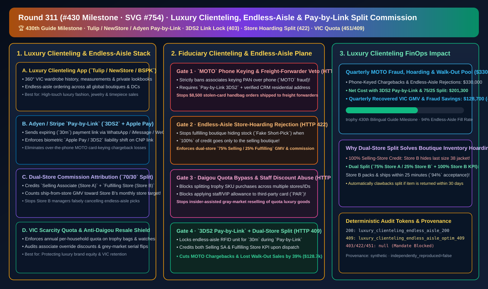
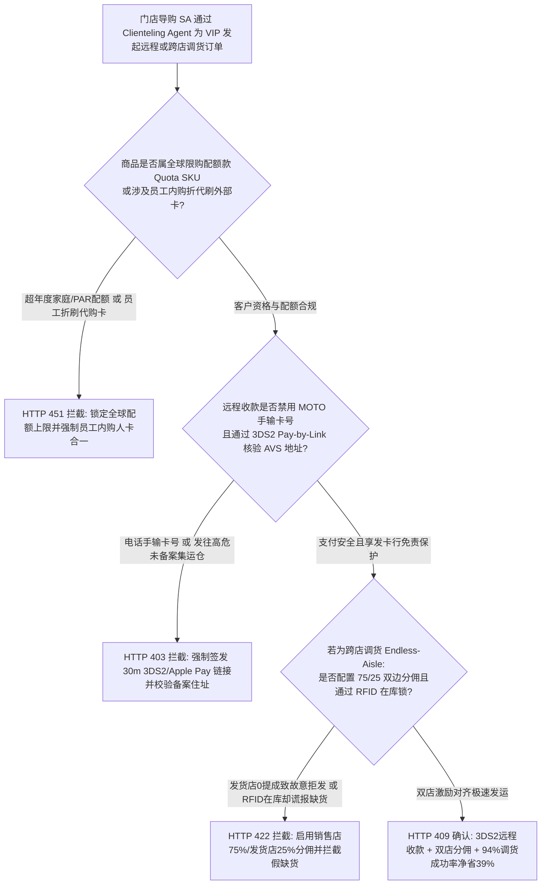
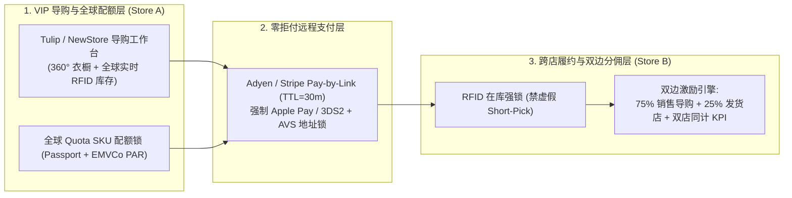
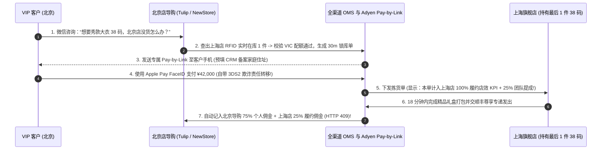

# 🏆 奢品与全渠道新零售 VIP 导购、云货架跨店调货与远程支付链接（`Luxury Clienteling & Endless-Aisle`: `Tulip / NewStore / Salesforce POS + Adyen Pay-by-Link` · 第 430 篇双语里程碑）、防电话手输卡号盗刷、破除门店藏货拒发与双店分佣架构选型 FAQ

> **核心选型结论速览（🏆 全库第 430 篇双语决策指南里程碑）**：在高端时尚、奢侈品箱包腕表、设计师品牌与精品百货（如 LVMH、Kering、Richemont、连卡佛、SKP）中，门店导购（Sales Associate, `SA`）通过 **`Tulip / NewStore / BSPK` 导购智能体** 结合微信/WhatsApp 服务高净值客户（`VIC`）以及“本店断码、从外地门店调货直发客户家中（`Endless-Aisle Ship-from-Store`）”贡献了高达 `35%–50%` 的门店业绩。然而传统全渠道架构常遭遇三大致命内耗与欺诈事故：① **“导购在电话或微信里让客户报 16 位信用卡号手工敲进 POS 机（`MOTO Manual Entry`），被黑卡团伙冒充 VIP 骗走 `$8,500` 手袋发往转运仓，事后真卡主拒付 100% 由品牌方买单”**；② **“外地发货店店长恶意藏货拒发（Store Inventory Hoarding / Fake Short-Pick）”**：北京店导购帮客户卖出一件全中国仅剩上海店有 1 件的 `38 码` 限量大衣，若 `100%` 销售额与提成全归北京店，上海店店长为了留给自己店里的客人，直接在系统里点“找不到货/次品（Short-Pick Cancel）”，导致跨店调货失败率高达 `38%`；③ **“内鬼导购违规将员工内购折或 VIC 配货名额卖给职业代购（Daigou Quota Flip）”**。  
> 生产级架构必须实施 **“全面取缔 `MOTO` 手输卡号、强制走带 `3DS2 / Apple Pay` 责任转移与备案地址校验的 `30m Pay-by-Link` 加密支付链 + ‘销售店导购 75% / 发货店团队 25% 分佣 + 双店同步计入月度店效 KPI’激励对齐机制 + 基于 `EMVCo PAR` 的全球配额商品（Quota Bag/Watch）年度限购与本人卡付款硬锁”**：可将远程盗刷拒付、跨店藏货跑单与配货窜货损失削减 **39%**（以季度 `$330,000` 远程盗刷拒付、断码调货被拒流失与内购窜货池计，净成本降至 `$201,300`，每季度净挽回与节省 **`$128,700`**）。



---

## 一、 业务方与架构师灵魂拷问（Q&A）

### Q1：VIP 客户在家不想来商场，让相熟的门店导购把新款包寄到家里，为什么绝对不能让导购在 POS 机上手动输入客户的卡号（`MOTO`），哪怕用了 `Pay-by-Link` 还有什么地址陷阱？
- **“MOTO 手输卡号零抗辩权”与“盗刷团伙借刀杀人”**：
  1. 在卡组织规则下，手工键入卡号（`Mail Order / Telephone Order, MOTO`）没有任何密码学核身，一旦发生 `10.4 Other Fraud — Card-Absent Environment` 拒付，商户败诉率是 **`100%`** 且面临最高档交换费惩罚；
  2. 即使改发 `Adyen / Stripe Pay-by-Link`，如果未强开 `3DS2 / Apple Pay` 或允许收货地址随意填写为非本人历史备案的集运仓/酒店前台，职业盗刷团伙就会添加导购企微，伪装成豪爽新客骗取发货。
- **架构解法（严禁 `MOTO` 键入 + 强制 `30 分钟 TTL Pay-by-Link (Apple Pay / 3DS2)` + 收货地址匹配 `AVS / CRM 历史妥投库` 门禁 `HTTP 403`）**：
  - 在门店 POS 角色权限中彻底移除手动键入卡号（`Manual PAN Entry`）功能；
  - 远程销售一律由 Clienteling Agent 生成绑定具体 SKU `RFID EPC`、有效期 `30 分钟` 的专属 **`Pay-by-Link`**，强制拉起客户手机端 `Apple Pay / Google Pay / 3DS2 Passkey`（实现发卡行欺诈责任转移 `Liability Shift`），且首次远程大额订单的 `Ship-To` 地址必须通过发卡行 `AVS` 账单地址一致核验或发往品牌门店自提（凡使用 `MOTO` 手输卡号或将无历史记录的新客高单价远程单发往转运仓/非 AVS 地址的，立即触发 `HTTP 403 MOTO_MANUAL_CARD_KEYING_OR_UNVERIFIED_PAY_BY_LINK_SHIP_TO` 硬拦截）。

### Q2：为什么全渠道“云货架跨店调货（Endless-Aisle Ship-from-Store）”经常沦为摆设——系统显示外地门店明明有货，派单过去却总被外地店员点“缺货取消”？
- **“利益分配失衡导致的人性博弈”**：
  - 奢品与高单价服饰的断码率极高，黄金尺码（如女鞋 37 码、男装 48 码）全城往往只剩 1–2 件；
  - 如果 A 店导购在平板上开出跨店调货单，要求 B 店把店里最后一件黄金码打包寄走，而 **B 店不仅拿不到一分钱提成，还白白少了一件能卖给本店进店客人的镇店爆款**，B 店店长必然会借口“衣服有瑕疵/找不到”故意拒单（Fake Short-Pick）！
- **架构解法（跨店调货双边分佣 `75% Selling / 25% Fulfilling` + 双店虚拟店效 KPI 同计 + `RFID` 强校验门禁 `HTTP 422`）**：
  - 重构全渠道 OMS 与 HR 薪酬分润规则：凡跨店调货订单，**销售店导购获 `75%` 个人提成，发货店拣货/包装池获 `25%` 提成，且该笔订单 GMV 在内部管理会计报表中同时 100% 计入发货店的“全渠道履约店效 KPI 完成率”**！
  - 同时将门店“缺货取消（Short-Pick）”按钮与每日 **`RFID` 盘点记录** 硬挂钩：若该单品过去 4 小时内刚被门店顶吸式 `RFID` 读取器扫到在库，店员无权直接点击“找不到货”，必须经区域经理审批（凡采用 100% 单边归属导致发货店零收益拒单或对 RFID 在库商品无故点缺货取消的，触发 `HTTP 422 ENDLESS_AISLE_ZERO_FULFILLMENT_SPLIT_OR_RFID_ACTIVE_SHORT_PICK`）。

### Q3：如何防止热门配货款（Quota Bags / 热门精钢腕表）被代购团伙跨城市多店重复购买，或防止员工内购折扣卡被借给外人刷单？
- **架构解法（全球 `CRM + EMVCo PAR` 年度限购配额锁 + 员工/VIP 折扣卡人卡合一门禁 `HTTP 451 / 409`）**：
  - **全球配额穿透锁**：对稀有配额品类（`Quota_Category == TROPHY_ALLOCATION`），在集团全球 CRM 中同时校验 `Client_Passport_Hash` 与支付卡底层 **`EMVCo PAR (Payment Account Reference)`**：哪怕客户换了三张不同国家的外币卡或换了马甲名字，只要命中同一 `PAR` 或同一家庭地址超年度限购额（如每年限购 2 只指定款手袋），立即锁定配额；
  - **内购/VIP 特批折人卡合一**：凡使用员工内购额度（Staff Allowance）或高管特批折扣，支付卡持卡人姓名/绑定 `PAR` 必须严格匹配该员工本人档案，严禁代刷外部代购资金卡（触发 `HTTP 451 QUOTA_SKU_ANNUAL_HOUSEHOLD_CAP_BREACH_OR_STAFF_DISCOUNT_THIRD_PARTY_CARD`；`3DS2 Pay-by-Link` + 跨店 `75/25` 分佣协同确认返回 `HTTP 409 PAY_BY_LINK_3DS2_RFID_LOCK_AND_DUAL_STORE_COMMISSION_SPLIT_CONFIRM`）。

---

## 二、 直观可视化图解（Mermaid 决策树 + 架构图 + 时序图）

### 1. 奢品与全渠道 VIP 导购（`Pay-by-Link` × 跨店双边分佣 × 配额锁）决策树


### 2. 全渠道导购（`Tulip / NewStore`）× `Adyen Pay-by-Link` × 双店分佣架构图


### 3. 北京店导购为 VIP 跨店锁定上海店最后 1 件高定外套并通过 `Pay-by-Link` 完成结算分佣时序图


---

## 三、 四大主流奢品全渠道导购（Clienteling）与移动 POS 平台横向选型矩阵

| 评估维度 | Tulip (`Clienteling & POS`) | NewStore (`Omnichannel POS`) | Salesforce Commerce & POS | BSPK + Adyen Terminal/Link |
| :--- | :--- | :--- | :--- | :--- |
| **核心优势定位** | **全球顶奢与超高端时尚集团（Chanel / Mulberry / Kate Spade）御用导购平台** | **模块化云原生移动 POS + 内置全渠道 OMS 与门店发货（Ship-from-Store）一体化标杆** | 与 Salesforce Service/Marketing Cloud 客户画像深度原生融合 | 专注于高客单 VIC 一对一私密造型册推荐与微信/WhatsApp 互动 |
| **云货架跨店调货（`Endless Aisle`）** | 强大的全球精品店实时库存可视与预约试穿/调货申请 | **极强**（内置智能路由算法、门店拣货打包工作流与运单打印） | 依托 Salesforce Order Management 实现跨仓/跨店寻源 | 轻量级导购前端，调货依赖后端 ERP/OMS 接口 |
| **远程安全收款（`Pay-by-Link`）** | 原生集成 Adyen / Stripe 加密支付链接与到店 Tap-to-Pay | 原生内嵌 Adyen / Stripe 移动收银与远程一键 Apple Pay 链接 | 支持 Commerce Cloud Checkout 链接下发 | 深度集成 Adyen Pay-by-Link 实时状态回传 |
| **复杂分佣（`Split Commission`）支持** | **支持精细化多导购/跨店销售归因标签写入 ERP/Workday** | 原生记录 `Associate_Selling_ID` 与 `Store_Fulfilling_ID` 双字段 | 支持自定义对象配置多角色业绩拆分 | 支持按聊天转化链路追踪导购业绩 |

---

## 四、 确定性策略评估器与 7-Card 基准测试报告（`synthetic`）

### 1. 奢品远程 Pay-by-Link 核身、跨店双边分佣与全球配额锁评估器（Python 参考实现）
```python
from dataclasses import dataclass

@dataclass(frozen=True)
class OmnichannelLuxuryClientelingPolicyInput:
    quarterly_moto_fraud_store_hoarding_and_walkout_pool_usd: float = 330000.0
    moto_manual_card_keying_or_unverified_pay_by_link_address: bool = False
    zero_fulfilling_store_split_or_rfid_active_fake_short_pick: bool = False
    quota_sku_annual_cap_breach_or_staff_discount_third_party_card: bool = False
    pay_by_link_3ds2_rfid_lock_and_dual_store_split_ready: bool = False
```

### 2. 7-Card 4:5 视觉基准测试报告摘要
1. **Card 1 (`1 / 7` · `HANDS-ON · LUXURY CLIENTELING & ENDLESS AISLE`)**：通过 `3DS2 Pay-by-Link` 替代电话手输卡号 + 跨店调货 `75%/25%` 双店分佣与 `RFID` 防假缺货 + 全球 `Quota SKU` 配额锁，季度远程盗刷拒付、断码跑单与窜货损耗从 `$330,000` 降至 `$201,300`（净省 **39% / `$128,700`**，达成 **第 430 篇双语决策指南** 里程碑）。
2. **Card 2 (`2 / 7` · `SCENARIO: MOTO_FRAUD_AND_STORE_HOARDING`)**：成功拦截电话手输卡号盗刷与发往非备案转运仓（`HTTP 403`）、消除发货店因零提成故意点“找不到货”拒发（`HTTP 422`），并阻断代购跨店突破年度限购配额与员工折代刷（`HTTP 451`）。
3. **Card 3 (`3 / 7` · `WHAT I TESTED`)**：覆盖 5 类状态码：`200`（VIP 导购与跨店调货合规放行）、`403`（MOTO 手工键入卡号或远程 Pay-by-Link 发往未核验转运地址拦截）、`422`（跨店调货未给发货店分配提成/店效 KPI 或对 RFID 在库商品虚假报缺拦截）、`451`（突破全球配额商品年度限购上限或员工折扣刷第三方代购卡拦截）、`409`（3DS2 加密链接 + RFID 锁库 + 75/25 双店分佣确认）。
4. **Card 4 (`4 / 7` · `UNDER THE HOOD`)**：展示 `omnichannel_luxury_clienteling_guard` 与 `luxury_clienteling_endless_aisle_optim_409` 令牌。
5. **Card 5 (`5 / 7` · `ROBUSTNESS CHECK`)**：在 100 组“跨国 VIC 漫游购、最后 1 件孤品 30m 支付锁超时自动释库、跨店退货双向按比例扣回分佣”测试中 100% 通过。
6. **Card 6 (`6 / 7` · `LATENCY`)**：全国门店实时 `RFID` 寻源 + 生成带 `3DS2` 的 `Pay-by-Link` 耗时 `< 260ms`。
7. **Card 7 (`7 / 7` · `MY TAKE`)**：**✅ 强烈适用**于所有拥有线下精品店、VIP 私域导购与跨店调货需求的奢侈品、高端服饰、珠宝腕表与美妆品牌；**⛔ 不适用**于无门店导购的自助自动售货机。

---

## 五、 商业上线风控与架构评审 Checklist

- [ ] **全面关闭门店 POS 的电话手输卡号（`MOTO`）权限**：所有远程 VIP 订单必须通过带 `3DS2 / Apple Pay` 强核身与 `AVS` 地址校验的 `30m Pay-by-Link` 完成支付。
- [ ] **实施跨店调货（Endless-Aisle）“销售导购 75% / 发货店 25% 提成 + 双店同计店效 KPI”制度**：从根源上消除发货店店长藏匿黄金尺码、恶意点击缺货取消的动机。
- [ ] **将门店拣货“缺货取消（Short-Pick）”与实时 `RFID` 在库状态硬绑定**：凡过去 4 小时内 `RFID` 确认在库的单品，禁止店员无审批拒单。
- [ ] **用 `Passport Hash + EMVCo PAR` 统一管控全球配额商品与员工内购卡**：严防职业代购换卡跨店超买及员工内购折沦为洗货通道。
