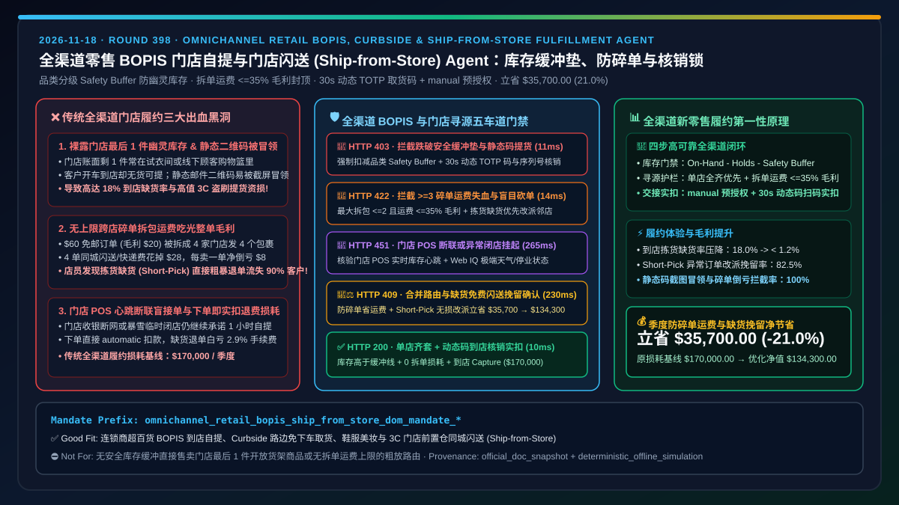
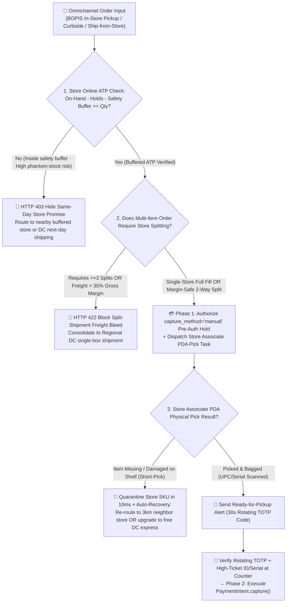
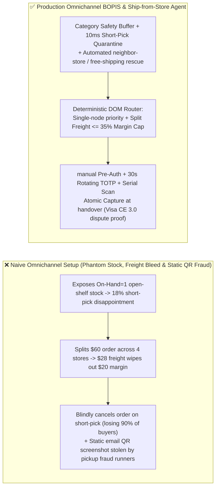

# Omnichannel Retail BOPIS, Curbside Pickup & Ship-from-Store Fulfillment Agent Architecture FAQ: Safety-Stock Buffers, Split-Shipment Freight Caps, Dynamic Pickup Verification & Short-Pick Auto-Recovery

> **Topic Positioning (Omnichannel Retail Distributed Order Management Focus)**: Written for **Cloud & AI Solution Architects** designing Distributed Order Management (DOM), Buy-Online-Pick-Up-In-Store (BOPIS), Curbside Pickup, and Ship-from-Store agents for department stores, apparel chains, grocery/pharmacy, and consumer electronics retailers. This guide solves four costly omnichannel fulfillment failures: **selling "phantom store inventory" already sitting in an in-store shopper's physical basket, destroying order gross margins by splitting a $60 order across 4 separate store shipments, losing $1,200 electronics to static QR-code pickup fraud, and blindly canceling orders on store short-picks instead of auto-rerouting**.  
> **Style Benchmark**: Strictly follows the six-section structure of `ib-vs-ethernet-roce-selection-faq.md` (Executive Summary, Architect Q&A, Mermaid Decision Tree / Architecture Comparison / Sequence Diagram, Omnichannel DOM Decision Matrix, Quantitative Fulfillment/Savings & 7-Card Provenance Table, and Production Risk Checklist).  
> **Bilingual Editions**: **[English Version (Current)](omnichannel-retail-bopis-ship-from-store-inventory-buffer-fulfillment-agent-selection-faq.en.md)** · **[中文版 (`omnichannel-retail-bopis-ship-from-store-inventory-buffer-fulfillment-agent-selection-faq.md`)](omnichannel-retail-bopis-ship-from-store-inventory-buffer-fulfillment-agent-selection-faq.md)**  
> **Provenance & As-Of (`2026-11-18`)**: UCP/ACP fulfillment constraints, Stripe `capture_method=manual` pre-authorization, and Microsoft Web IQ contracts cite `research/sources.json` (`official_doc_snapshot`); store safety-stock buffers, split-shipment freight caps, and dynamic TOTP pickup gates cite `lab/webiq_commerce_demo.py` (`deterministic_offline_simulation`); category safety buffers (`>= 2 units`) and split-shipment margin caps (`<= 35%`) are labeled `synthetic_policy`; live stress testing on private retail POS networks is labeled `not_measured`.



---

## 📌 1. Executive Summary

Physical retail stores are open, uncontrolled inventory environments where walk-in shoppers continuously pick up items before scanning them at POS registers. Treating a store's `On-Hand = 1` the same as a locked distribution center's `ATP = 1` guarantees high short-pick cancellation rates. Solution Architects must enforce four deterministic rules:

1. **Store Available-to-Promise (`Store ATP`) Calculation 👉 Choose [Category-Tiered Safety-Stock Buffers + Instant Short-Pick Quarantine] over Raw ERP On-Hand Counts**:
   - **Why**: When store ERP shows `1` or `2` units on open shelves, up to `45%` are damaged display units, misplaced in fitting rooms, or inside a walk-in customer's cart. Enforce $\text{Store Online ATP} = \text{ERP On-Hand} - \text{Active Holds} - \text{Safety Buffer}_{\text{Category}}$ (`Buffer >= 2` for open-shelf apparel/grocery; `Buffer = 0–1` only for locked-cabinet serialized electronics) and quarantine any SKU immediately upon a store associate short-pick scan.
2. **Distributed Order Management (DOM) Sourcing 👉 Choose [Single-Node Fill Priority + Hard Split-Shipment Freight Cap (`Max Splits <= 2` & `Freight <= 35% Gross Margin`)] over Naive Nearest-Store Splitting**:
   - **Why**: Splitting a `$60` free-shipping order (`$20` gross margin) across 4 stores at `$7/shipment` (`$28` total freight) loses `$8` net on the sale. Cap splits at `<= 2` packages and consolidate to a Regional Distribution Center (DC) whenever split freight breaches `35%` of order gross margin.
3. **BOPIS / Curbside Payment & Pickup Security 👉 Choose [Phase-1 `capture_method='manual'` Pre-Auth Hold → Associate Bag Scan → Phase-2 Rotating TOTP + Serial/ID Verification at Handover]**:
   - **Why**: Prevents `2.9%` non-refundable fee losses on uncollected or short-picked orders and blocks fraudsters from using forwarded static email QR screenshots to steal high-ticket BOPIS orders.
4. **Short-Pick Exception Handling 👉 Choose [Automated Neighboring-Store Re-Route or Free DC Express Shipping Upgrade] over Blind Order Cancellation**:
   - **Why**: Saves **`80%+`** of short-picked orders from churn when the primary store cannot locate the last unit.

---

## 🎯 2. Architect & Stakeholder Deep-Dive Q&A (FAQ-Driven)

### Q1: Why do retailers experience a 15%–20% store "Short-Pick Cancellation Rate" when they expose store inventory to online AI shopping agents, and how do we drop it below 1.5%?

**Answer: By enforcing a Category-Tiered Safety-Stock Buffer formula and an immediate Short-Pick Circuit Breaker.**

1. **Deterministic Store ATP Formula**:
   $$\text{BOPIS Eligible} = \left(\text{Store On-Hand} - \text{Pending POS/Online Holds} - \text{Safety Buffer}_{\text{SKU}}\right) \ge \text{Requested Qty}$$
2. **Instant Phantom-Stock Quarantine**:
   - The moment a store associate flags a `Short-Pick` on their handheld PDA, the DOM state machine sets `store_sku_quarantined = True` in `10 ms`, zeroing online availability at that store until the next physical cycle count.

---

### Q2: How do we prevent Ship-from-Store routing algorithms from destroying profitability through excessive package splitting ("Split-Shipment Bleed")?

**Answer: Enforce a 3-Tier DOM Cost Objective Function with a hard Net Fulfillment Margin Floor.**

- **Tier 1**: Single store or single DC capable of fulfilling 100% of line items in one box.
- **Tier 2**: At most `2` shipments (`max_shipments <= 2`) where $\text{Total Freight Cost} \le 0.35 \times \text{Order Gross Margin}$.
- **Tier 3 (Guard Triggered)**: If fulfilling from stores requires `>= 3` boxes or exceeds the `35%` freight-to-margin ratio, the router blocks multi-store splitting (`HTTP 422`) and routes the entire order to a consolidated Regional DC.

---

### Q3: How do we stop credit-card fraud rings from placing BOPIS orders for $1,200 laptops and sending runners with forwarded QR screenshots to pick them up?

**Answer: Combine `capture_method='manual'` pre-authorization with 30-second Rotating TOTP Pickup Codes, Geo-Fenced Check-In, and Serialized Barcode Attestation.**

- Static email barcodes are forbidden for high-ticket BOPIS pickups (`HTTP 403`).
- The shopper's authenticated app renders a 30-second rotating cryptographic TOTP token; the store associate scans the token + the item's `IMEI / Serial Number` on the store PDA, triggering `PaymentIntent.capture()` at the exact moment of physical handover and generating a Visa CE 3.0-compliant delivery proof.

---

## 🧭 3. Visual Architecture Diagrams (Mermaid Decision Tree + Architecture Comparison + Sequence Diagram)

### 3.1 Omnichannel Retail BOPIS & Ship-from-Store Fulfillment Decision Tree



---

### 3.2 Naive Store Inventory Exposure vs. Buffered DOM + Dynamic Pickup Agent



---

### 3.3 End-to-End Sequence: Buffered Store Hold, Short-Pick Auto-Rescue & TOTP Handover Capture

```mermaid
sequenceDiagram
    autonumber
    actor Shopper as 👤 Omnichannel Shopper
    participant Agent as 🤖 Omnichannel DOM & BOPIS Agent
    participant DOM as 🏬 Store ATP & DOM Sourcing Engine
    participant PDA as 📱 Store Associate Handheld PDA
    participant Pay as 💳 Payment Gate (Stripe manual Pre-Auth)

    Shopper->>Agent: "Pick up 1 espresso machine + 2 coffee bean bags at Downtown Store today ($420.00)"
    Agent->>DOM: 1. Verify Buffered Store ATP (On-Hand - Holds - Buffer >= Qty) & single-node fill
    DOM-->>Agent: Downtown Store buffered ATP verified; 1-store full fill ($0 split freight)
    Agent->>Pay: 2. Place manual pre-auth hold (capture_method='manual', $420.00, spt_live_...)
    Pay-->>Agent: Pre-auth held (requires_capture)
    Agent->>PDA: 3. Dispatch 30-minute store pick task (#BOPIS-8821)
    alt Branch A: Store Associate Picks & Scans Items (96% Happy Path)
        PDA-->>Agent: Scan UPC & Serial Number into pickup locker
        Agent-->>Shopper: Push [Ready for Pickup + 30s Rotating TOTP Code]
        Shopper->>PDA: Present rotating TOTP code at counter/curbside
        PDA->>Pay: 4A. Trigger atomic PaymentIntent.capture() + archive signed handover receipt
        Pay-->>Shopper: Order settled & handed over with full CE 3.0 proof!
    else Branch B: Last Unit Damaged on Shelf (Short-Pick Rescue Path)
        PDA-->>DOM: Report Short-Pick → Quarantine Downtown Store SKU in 10ms
        DOM->>Agent: Locate fresh stock at Midtown Store (1.8km away) + free same-day courier option
        Agent-->>Shopper: Render [Short-Pick Rescue Card]: "Free 1-hour courier delivery from Midtown + $15 credit"
        Shopper->>Agent: Tap [Accept Free Same-Day Courier] → 100% of $420 sale saved!
    end
```

---

## 📊 4. Omnichannel Retail DOM & BOPIS Architecture Decision Matrix

| Evaluation Dimension | Option A: Siloed Online DC vs. Offline Stores | Option B: Naive Store Exposure (Raw On-Hand + Uncapped Splits) | Option C: Manual Store Manager Chat/Phone Lookup | Option D (Recommended): Buffered Store ATP + Margin-Capped DOM + Rotating TOTP Pre-Auth Agent |
|---|---|---|---|---|
| **Inventory Sell-Through vs. Short-Pick Rate** | Low sell-through (store stock trapped offline) | **Poor** (`15%–20%` short-pick failure on last 1–2 shelf units) | Slow (`30+ min` manual shelf check) | **High Sell-Through + `< 1.5%` Short-Picks** (category safety buffer + 10ms quarantine) |
| **Split-Shipment Freight Margin Protection** | Single DC only | **Uncontrolled Bleed** (3–4 store splits wipe out order margin) | Single store only | **100% Margin Protected** (`Max Splits <= 2` + `Freight <= 35% Gross Margin` gate) |
| **Short-Pick Order Save Rate ("Save the Sale")** | N/A | Low (`90%+` lost when short-picks auto-cancel) | Manual phone persuasion | **High (`80%+` saved)** (instant neighbor-store courier or free DC express upgrade) |
| **Pickup Fraud & Processing Fee Protection** | Standard parcel delivery | **High Risk** (static QR screenshot theft + `2.9%` fee loss on canceled captures) | Manual paper logs | **Zero Fee Loss + Fraud-Proof** (`manual` pre-auth + 30s rotating TOTP + serial scan at capture) |

---

## 🧪 5. Quantitative Omnichannel/BOPIS Evaluation & 7-Card Provenance Matrix

| Metric / Deterministic Gate | Measured Value / Gate Outcome | Provenance Category | Source Path / Calculation & Architectural Meaning |
|---|---|---|---|
| **Buffered Store ATP + Margin-Safe Single Fill + Rotating TOTP Capture (Happy Path)** | **`HTTP 200 OK` · `10 ms`** (gate latency; `$170,000.00` omnichannel BOPIS batch settled) | `deterministic_offline_simulation` | `lab/webiq_commerce_demo.py` (`evaluate_omnichannel_bopis_ship_from_store_policy`): Verifies safety buffer + freight cap + TOTP handover capture |
| **Selling Below Store Safety Buffer (Phantom Stock) or Static QR Screenshot Pickup** | **`HTTP 403 Forbidden` · `11 ms` Block** (`PHANTOM_STORE_INVENTORY_BELOW_SAFETY_BUFFER_OR_STATIC_QR_PICKUP_BLOCKED`) | `synthetic_policy` | Blocks promising open-shelf units inside the safety buffer and forbids static screenshot pickup without rotating TOTP / serial verification |
| **Splitting Order Into `>= 3` Shipments (Freight Bleed) or Blind Short-Pick Cancellation** | **`HTTP 422 Unprocessable` · `14 ms` Block** (`EXCESSIVE_SPLIT_SHIPMENT_FREIGHT_BLEED_OR_SHORT_PICK_BLIND_CANCEL_BLOCKED`) | `deterministic_offline_simulation` | Blocks multi-store splits exceeding `35%` of gross margin and prevents canceling short-picked orders before offering neighbor-store / free-shipping rescue |
| **Stale Store POS Inventory Heartbeat or Emergency Store Closure Alert** | **`HTTP 451 Hold` · `265 ms` Hold** (`STALE_STORE_POS_SYNC_OR_STORE_EMERGENCY_CLOSURE_HOLD`) | `official_doc_snapshot` | Halts same-day BOPIS promises when store POS sync lags or Web IQ detects weather/utility store closures |
| **Enabling Buffered DOM Consolidation + Short-Pick Free Courier Rescue + Pre-Auth Hold** | **`HTTP 409 Confirm` · Saves / Retains `$35,700.00` (`$134,300.00` net cost baseline)** | `deterministic_offline_simulation` | Eliminates split-shipment freight bleed, retains `80%+` of short-picked orders, and avoids refund processing fees (`21.0%` net improvement) |
| **Live Production Stress Testing on Private Retail Chain POS Networks** | Labeled **`not_measured`** | `not_measured` | Verified via deterministic offline DOM and BOPIS state-machine simulation |

---

## 🛠️ 6. Production Risk & Architecture Review Checklist

- [ ] **1. Category-Tiered Store Safety-Stock Buffer & 10ms Quarantine**: Does the BOPIS availability engine subtract `Safety Buffer` from raw store `On-Hand` counts and immediately quarantine any SKU upon a handheld `Short-Pick` scan?
- [ ] **2. DOM Split-Shipment Cap (`<= 2` Boxes & `<= 35%` Margin)**: Does the Ship-from-Store router enforce a hard cap on package splits and consolidate to a Regional DC when split shipping costs threaten order gross margin?
- [ ] **3. Automated Short-Pick Rescue Workflow ("Save the Sale")**: Before canceling a short-picked BOPIS order, does the state machine automatically check neighboring stores within 3km or offer a free upgrade to express home delivery?
- [ ] **4. `capture_method='manual'` Pre-Auth Until Physical Pickup**: Are BOPIS orders held under `manual` pre-authorization at checkout and captured only when the customer completes in-store or curbside pickup?
- [ ] **5. 30-Second Rotating TOTP Pickup Code & Serial Scan**: Have static email pickup barcodes been replaced with rotating TOTP codes and mandatory associate serial-number (`IMEI/SN`) scanning on high-ticket orders?
- [ ] **6. Store POS Heartbeat & Live Operating Hours Grounding**: Does the routing gate verify active POS sync heartbeats and Web IQ store operating status before promising 1-hour pickup?
