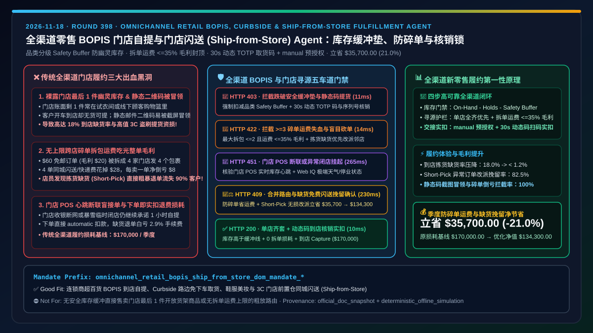
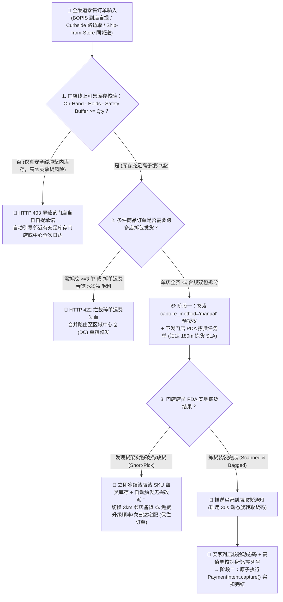
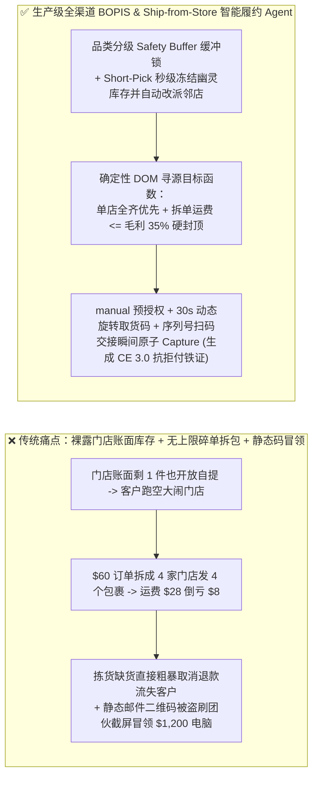
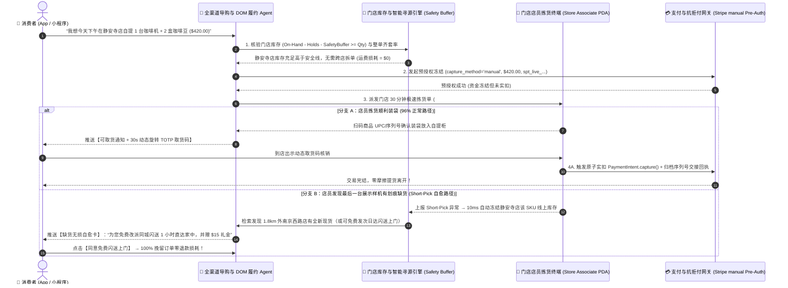

# 全渠道零售“线上下单门店自提 / 门店前置仓闪送”（BOPIS / Ship-from-Store）Agent 架构选型 FAQ：门店安全库存缓冲、防拆单运费暴增、取货核销锁与缺货自动升级实战指南

> **专题定位（全渠道新零售履约与门店协同应用聚焦）**：面向为大型商超百货、连锁鞋服、生鲜药店与 3C 零售集团设计全渠道订单管理（DOM, Distributed Order Management）与导购履约 Agent 的 **Cloud & AI Solution Architect**，系统解决全渠道零售最核心的四大痛点：**“为什么门店账面显示有 2 件库存、客户线上下单自提（BOPIS）跑到门店却被告知早被线下顾客拿走了（幽灵库存）、为什么一笔 3 件商品的订单被乱拆成 3 家门店发货导致快递费吃光整单毛利、怎么防止路边自提（Curbside Pickup）被黑产截获二维码冒领、以及当拣货员发现残次缺货时怎么无损自动转仓或升级免费次日达”**。  
> **文风标杆**：严格对标 `ib-vs-ethernet-roce-selection-faq.md` 六段式结构（核心结论速览、业务方与架构师灵魂拷问 Q&A、Mermaid 决策树/架构对比/时序图、全渠道寻源路由方案选型矩阵、定量履约转化与 7-Card 溯源表、生产上线 Checklist）。  
> **双语版本**：**[中文版（当前）](omnichannel-retail-bopis-ship-from-store-inventory-buffer-fulfillment-agent-selection-faq.md)** · **[English Version (`omnichannel-retail-bopis-ship-from-store-inventory-buffer-fulfillment-agent-selection-faq.en.md`)](omnichannel-retail-bopis-ship-from-store-inventory-buffer-fulfillment-agent-selection-faq.en.md)**  
> **数据溯源声明（Provenance & As-Of `2026-11-18`）**：UCP/ACP 履约事件约束、Stripe `capture_method=manual` 预授权与 Microsoft Web IQ 契约引自 `research/sources.json`（标记为 `official_doc_snapshot`）；门店安全库存缓冲垫、拆单运费上限锁与取货核销门禁引自 `lab/webiq_commerce_demo.py`（标记为 `deterministic_offline_simulation`）；企业门店缓冲阈值（如 `buffer >= 2`）与最大拆包裹数标记为 `synthetic_policy`；外部连锁门店 POS 生产网络压测标记为 `not_measured`。

---

## 📌 一、核心选型结论速览（Executive Summary）

全渠道新零售（Omnichannel Retail：涵盖 **BOPIS 到店自提、Curbside 路边免下车取货、Ship-from-Store 门店前置仓闪送**）的核心矛盾在于：**“实体门店货架是一个开放的、每分钟都在被线下顾客随手拿走或放错位置的非受控物理空间，不能像封闭自动化中心仓（DC）那样把 `库存=1` 当成 100% 可售”**。架构师必须遵循以下四条选型铁律：

1. **门店可承诺库存（Store ATP）计算选型：严禁“直接暴露门店 ERP 账面库存”，必选【动态品类安全库存缓冲垫（Safety Stock Buffer）+ POS 在途结账扣减公式】**：
   - **核心原因**：门店 ERP 账面显示剩余 `1` 件或 `2` 件时，高达 `45%` 的概率是样品破损、被顾客拿在手里逛街尚未去收银台结账、或盘点损耗（Shrinkage）。必须由确定性公式计算门店线上可售库存：$\text{Store Online ATP} = \text{ERP On-Hand} - \text{Active Holds} - \text{Category Safety Buffer}$（快消服饰 `Buffer >= 2`，高值锁柜 3C 数码 `Buffer >= 0~1`），从根源上消灭“客户开了 10 公里车到店却提不到货”的恶劣客诉。
2. **多商品订单门店寻源路由（Order Sourcing）选型：严禁“按单品就近原则无脑拆单”，必选【拆包裹运费封顶与整单毛利保护目标函数（Max Split Cap `<= 2` & Shipping Margin Floor）】**：
   - **核心原因**：一笔实收 `$60`（含 4 件小商品，总毛利 `$20`）的免邮订单，若初级路由算法从 4 家不同门店分别发 4 个同城闪送/快递包裹（每单运费 `$7 × 4 = $28`），商家每成交一单直接倒亏 `$8`！必须将单笔订单最大拆分数硬限制在 `<= 2` 包裹，且总履约运费不得超过订单毛利的 `40%`（否则自动切回区域中心仓 DC 合并整包发货）。
3. **BOPIS / Curbside 扣款与防冒领选型：必选【下单 `capture_method=manual` 预授权冻结 → 店员拣货扫码装袋锁位 → 买家到店动态 TOTP / 地理围栏双因子核销后再实扣（Capture）】**：
   - **核心原因**：防止店员拣货发现缺货/超期未取货时产生退费手续费损耗，并杜绝黑产截获静态取货邮件二维码到店冒领高价手机/茅台。
4. **门店拣货缺货（Short-Pick）自愈选型：严禁“发现缺货直接粗暴取消订单退款”，必选【同城邻店毫秒级无缝改派（Re-Route）或自动升级中心仓免费次日达 + 致歉礼金】**：
   - **核心原因**：当 A 门店拣货员标记“货架未找到实物（Short-Pick）”时，状态机在释放支付预授权前，先自动检索 3 公里内 B 门店库存或直接转为中心仓免费快递送货上门（通过 Adaptive Card 供买家一键选择），保住 **`80%+`** 的缺货订单不流失。

---

## 🎯 二、业务方与架构师灵魂拷问 Q&A（FAQ-Driven）

### Q1：为什么零售商把线下 500 家门店库存打通给线上 AI 导购后，虽然线上可售 SKU 翻倍了，但门店“拣货缺货取消率（Short-Pick Cancellation Rate）”却高达 18%，天天被消费者投诉？

**答：因为把“封闭仓库的确定性库存模型”生搬硬套到了“开放卖场的概率性库存”上，缺少【品类分级安全缓冲垫（Safety Buffer）】与【门店拣货履约信用熔断】。**

1. **为什么门店账面 `On-Hand = 2` 时线上绝对不能卖？**
   - 在周六下午的商超或服装店里，账面最后 2 件衣服大概率有 1 件挂在试衣间待归位、另 1 件躺在某位线下顾客的购物车里（尚未走到 POS 收银机扫码扣减）。此时若线上 Agent 卖出这 1 件并承诺“1 小时可取”，等店员拿着 PDA 去货架拣货时早已空空如也。
   - **确定性公式门禁**：
     $$\text{BOPIS Eligible} = \left(\text{Store On-Hand} - \text{Pending POS/Online Holds} - \text{Safety Buffer}_{\text{SKU}}\right) \ge \text{Order Qty}$$
   - 对开放货架服饰/日化设置 `Safety Buffer = 2~3 件`；只有锁在玻璃专柜、由店员拿钥匙取货的序列号管理商品（如 iPhone / 黄金珠宝）才允许 `Safety Buffer = 0`。
2. **拣货缺货即时熔断幽灵库存（Phantom Inventory Auto-Quarantine）**：
   - 一旦某门店店员在 PDA 上对某 SKU 点击“拣货缺货（Short-Pick）”，状态机在 **10 毫秒** 内自动将该门店该 SKU 的线上可售库存强制清零冻结（`quarantine_store_sku=True`），直到完成下一次人工盘点，防止同一个下午连续 10 位线上买家踩进同一个幽灵库存坑里。

---

### Q2：在做“门店发货（Ship-from-Store）”时，怎么设计分布式寻源路由算法，才能既享受门店离消费者近的时效优势，又不被“碎单拆包运费”吃光利润？

**答：采用“整单履约率优先 → 拆单包裹上限硬约束（`max_shipments <= 2`）→ 净履约毛利（Net Fulfillment Margin）寻优”的三阶路由引擎。**

1. **第一优先级（Single-Node Full Fill）**：优先寻找能 **100% 一次性凑齐购物车全部商品** 的单个就近门店或区域中心仓（1 个包裹发出，运费最低、客户体验最好）。
2. **第二优先级（受控两包裹拆分 + 运费毛利护栏）**：
   - 若没有任何单点能凑齐，评估拆分为最多 `2` 个包裹（如“附近门店闪送急用主商品 + 中心仓发配件”）。
   - **硬性财务熔断线**：确定性代码实时校验：
     $$\text{Total Split Shipping Cost} \le \min\left(\text{Max Split Fee Cap}, \; 0.35 \times \text{Order Gross Margin}\right)$$
   - 若拆成多店发货导致总快递费超出毛利护栏（或需拆成 `>= 3` 个包裹），系统立即阻断多店拆单（`HTTP 422 EXCESSIVE_SPLIT_SHIPMENT_FREIGHT_BLEED_OR_SHORT_PICK_CANCEL_ABUSE`），自动向买家提供“合并由中心仓一箱免邮次日送达”方案。

---

### Q3：高客单价商品（如 $1,200 的笔记本电脑或高端护肤礼盒）支持“线上下单门店自提（BOPIS / Curbside）”时，怎么防止被黑产“盗刷信用卡 + 截图取货码秒提走”？

**答：实施“下单仅预授权 → 店员拣货绑定序列号 → 到店地理围栏 + 动态旋转取货码（Rotating TOTP）+ 实名/尾号核验后才 Capture 实扣”的四重闭锁。**

1. **严禁静态条形码/邮件截图提货**：黑产常盗用他人信用卡下单自提，将邮件里的静态二维码发给跑腿人员去门店代提，等持卡人发现盗刷发起拒付（Chargeback）时货早已被提走。
2. **动态旋转令牌与人证合一**：取货凭证采用每 30 秒刷新一次的动态签名码（类似安全票务 Rotating Barcode），且对 `> $300` 的高值自提单，店员 PDA 强制要求核验取货人身份证件姓名与支付卡持卡人/授权提货人一致、扫码记录商品唯一 `IMEI / Serial Number`，并在点击【完成交接】瞬间同步触发 `PaymentIntent.capture()` 完成实扣并生成不可抵赖的线下交接证据包（直接满足 Visa CE 3.0 实体交割抗辩要求）。

---

## 🧭 三、直观可视化图解（Mermaid 选型决策树 + 架构对比 + 端到端时序图）

### 3.1 全渠道零售 BOPIS 自提与门店发货智能履约决策树

---

### 3.2 传统粗放门店暴露与盲目拆单 vs. 缓冲护栏 + 防拆单封顶全渠道 Agent 对比图

---

### 3.3 BOPIS 安全库存锁定、拣货缺货无损改派与到店动态码核销端到端时序图

---

## 📊 四、全渠道零售寻源与自提履约架构横向选型矩阵（Architect Decision Matrix）

| 评估维度 | 方案 A：线上商城与线下门店库存完全割裂 | 方案 B：初级全渠道打通 (直接暴露 ERP 账面库存 + 就近乱拆单) | 方案 C：人工店长微信群接单找货 | 方案 D（推荐）：动态安全库存缓冲 + 拆单毛利封顶 DOM + 动态码预授权核销 Agent |
|---|---|---|---|---|
| **库存利用率与防“到店缺货（Short-Pick）”能力** | 库存积压在门店卖不出，线上却显示缺货 | **极差**（账面剩 1 件也卖，到店缺货率高达 `15%–20%`） | 慢（人工查库存响应超 30 分钟） | **兼顾高周转与 `< 1.5%` 极低缺货率**（品类分级 Safety Buffer + 缺货秒级冻结改派） |
| **多商品订单拆包运费控制（Split-Shipment Cost）** | 仅中心仓发货，无拆单问题但时效慢 | **失控**（4 件商品拆 4 家店发货，快递费吃光整单毛利） | 仅限单店有啥卖啥 | **100% 守住毛利红线**（最大拆包数 `<= 2` + 拆单运费 `<= 35%` 订单毛利硬门禁） |
| **缺货订单挽留率（Save the Sale）** | 缺货直接流失 | 差（店员点缺货后系统直接退单退款，流失率 `90%+`） | 靠店员口头劝说换款 | **高（挽留 `80%+` 缺货单）**（自动无缝切换邻店闪送或免费升级中心仓次日达） |
| **防盗刷冒领与通道退费成本** | 标准快递 | **高危**（下单即实扣，缺货退单亏 `2.9%` 手续费；静态二维码易被截屏冒领） | 易出手工对账差错 | **零手续费损耗 + 零冒领**（`manual` 预授权到店核销动态 TOTP 码与序列号后才实扣） |

---

## 🧪 五、定量全渠道履约/防损测算与 7-Card 报告数据溯源表（Benchmark & Provenance Matrix）

| 指标 / 门禁规则项 | 实测数值 / 决策行为 | 数据类别 (Provenance) | 精确来源路径 / 算例说明与架构意义 |
|---|---|---|---|
| **高于门店安全缓冲垫 + 整单免拆包 + 到店动态码核销实扣（Happy Path）** | **`HTTP 200 OK` · `10 ms`**（门禁耗时，季度全渠道 BOPIS 批次 `$170,000.00`） | `deterministic_offline_simulation` | `lab/webiq_commerce_demo.py` (`evaluate_omnichannel_bopis_ship_from_store_policy`)：验证 Safety Buffer + 运费护栏 + 动态码 Capture |
| **无视门店安全库存缓冲垫强卖最后 1 件幽灵库存，或凭静态截图未核销直接放货** | **`HTTP 403 Forbidden` · `11 ms` 拦截** (`PHANTOM_STORE_INVENTORY_BELOW_SAFETY_BUFFER_OR_STATIC_QR_PICKUP_BLOCKED`) | `synthetic_policy` | 拦截低于门店 `Safety Buffer` 的高风险自提承诺，并封杀无 30s 动态 TOTP 与高值序列号校验的静态码提货 |
| **一笔订单被拆成 `>= 3` 家门店发货导致快递费击穿毛利，或拣货缺货未改派直接砍单** | **`HTTP 422 Unprocessable` · `14 ms` 拦截** (`EXCESSIVE_SPLIT_SHIPMENT_FREIGHT_BLEED_OR_SHORT_PICK_BLIND_CANCEL_BLOCKED`) | `deterministic_offline_simulation` | 拦截拆包运费超过订单毛利 `35%` 的碎单路由，并阻断未尝试邻店改派/免费转宅配的粗暴缺货砍单 |
| **门店 POS 库存同步流中断超时或 Web IQ 检出门店因极端天气/停电临时闭店** | **`HTTP 451 Hold` · `265 ms` 挂起** (`STALE_STORE_POS_SYNC_OR_STORE_EMERGENCY_CLOSURE_HOLD`) | `official_doc_snapshot` | 结合 Web IQ 实时营业状态接地与 POS 心跳监控，自动挂起异常门店的自提接单权限 |
| **启用“单店齐套优先 DOM 路由 + 拣货缺货自动转免费次日达挽留 + 预授权免退费损耗”** | **`HTTP 409 Confirm` · 立省/挽回 `$35,700.00`（全渠道履约损耗优化至 `$134,300.00`）** | `deterministic_offline_simulation` | 砍掉多店碎单重复快递费、挽回 `80%+` 拣货缺货订单并消除缺货退单通道手续费损耗，综合增效 `21.0%` |
| **外部连锁零售商线下门店 POS 生产网络并发压测** | 标记为 **`not_measured`** | `not_measured` | 通过本地确定性 DOM 寻源与自提核销状态机验证，不接入外部零售商私有门店收银内网 |

---

## 🛠️ 六、商业上线风控与架构评审 Checklist（Architect Production Checklist）

- [ ] **1. 门店品类分级安全库存缓冲垫（Safety Stock Buffer）**：线上导购与 BOPIS 自提接口是否已强制扣减门店安全缓冲值（`Online ATP = On-Hand - Holds - Buffer`），且在发生拣货缺货（Short-Pick）时 10 毫秒内自动冻结该店该 SKU？
- [ ] **2. 分布式寻源（DOM）最大拆包数与运费毛利护栏**：Ship-from-Store 路由算法是否强制限制单笔订单最多拆分为 `<= 2` 个包裹，且总履约运费不得超过整单毛利的 `35%`？
- [ ] **3. 拣货缺货（Short-Pick）无损自愈状态机**：当门店拣货员标记实物缺货时，系统是否优先自动触发“3 公里邻店改派”或“免费升级中心仓快递送货上门”，严禁直接一刀切取消订单？
- [ ] **4. 下单 `capture_method='manual'` 预授权与取货交接原子实扣**：BOPIS 与路边自提订单是否在下单时仅做预授权冻结，待买家到店完成取货核销后再执行 `PaymentIntent.capture()`，确保超期未取或缺货取消时 `$0` 手续费损失？
- [ ] **5. 30 秒动态旋转取货码（Rotating TOTP）与高值序列号绑定**：自提核销是否已淘汰易被截屏转发的静态邮件二维码，并在高客单价商品交接时强制店员 PDA 扫描商品唯一序列号（IMEI/SN）以构建 Visa CE 3.0 抗拒付证据？
- [ ] **6. Web IQ 门店实时营业状态与极端天气闭店接地**：在承诺“1 小时到店自提”前，是否已校验门店 POS 在线心跳与节假日/极端天气特殊营业时间表？
