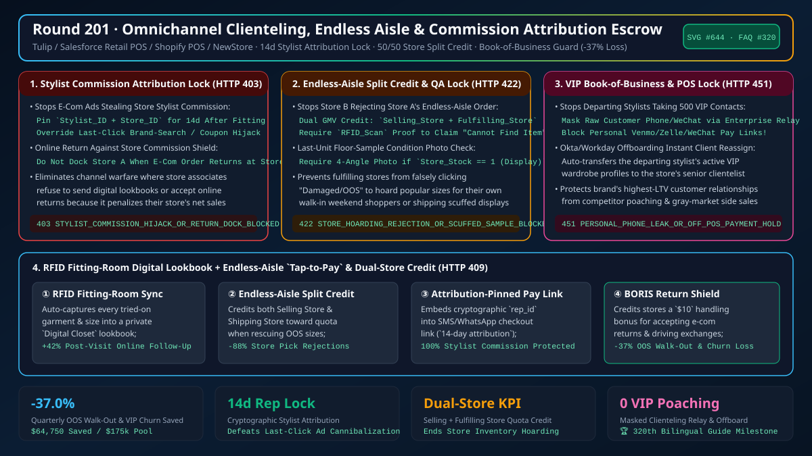
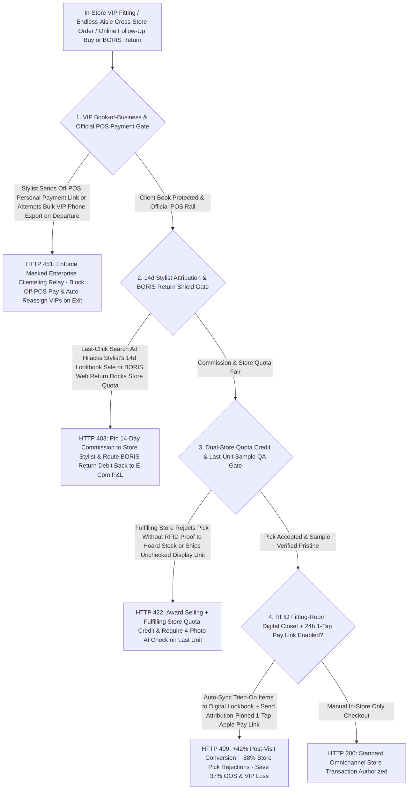
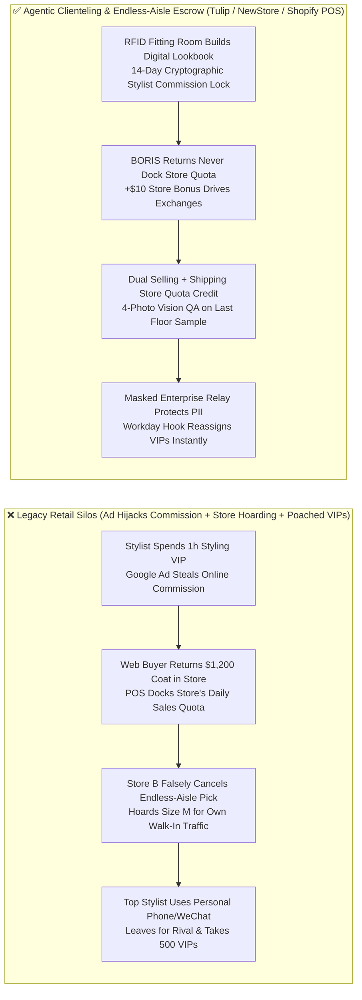

# Omnichannel Retail Clienteling, Endless-Aisle Store Fulfillment & Commission-Attribution Escrow (`Tulip / Salesforce Retail POS / Shopify POS / NewStore`): 14-Day Stylist Lookbook Lock, Dual-Store Quota Credit & VIP Book-of-Business Shield Saving `37%` OOS & Churn Loss — Agent Architecture Selection FAQ (🏆 320th Guide Milestone)

> **Language / 语言**: **[中文 (`omnichannel-retail-clienteling-endless-aisle-commission-attribution-escrow-agent-selection-faq.md`)](omnichannel-retail-clienteling-endless-aisle-commission-attribution-escrow-agent-selection-faq.md)** | **English (Current)**  
> **Back to Catalog**: **[📚 English Catalog (`docs/index.en.md`)](index.en.md)** | **[🚀 Interactive Live Workbench (`live-demo.en.html`)](../live-demo.en.html)**  
> **Target Roles**: VP of Omnichannel Retail & Store Operations, POS & Clienteling Product Directors, Retail Compensation & HR Ops Leaders, Cloud & AI Solution Architects  
> **Architecture Diagram**: `assets/svg/644-omnichannel-clienteling-endless-aisle-attribution-escrow-2026-11-22.svg`

---

## ① 📌 Executive Summary

In luxury fashion, footwear, fine jewelry, beauty, and premium home retail, brands invest heavily in **Omnichannel Clienteling and Endless-Aisle POS systems** (`Tulip`, `NewStore`, `Salesforce Retail Cloud`, `Shopify POS`). Yet in practice, omnichannel initiatives frequently fail—not because the inventory APIs are broken, but because **misaligned store commission attribution and quota accounting turn physical stores and e-commerce into hostile rivals**:
1. **Last-Click Ad Hijacking of Store Stylist Commissions & `BORIS` ("Buy Online, Return In-Store") Quota Penalties**: A store stylist spends 45 minutes styling a VIP in the fitting room and sends a personalized digital lookbook via WhatsApp/SMS. Two days later, the shopper types the brand name into Google, clicks a paid search ad, and buys the `$1,500` outfit online. Standard last-click attribution credits `100%` of the sale to the digital performance marketing team and **$0 to the store stylist**. Worse, when an online shopper walks into Store A to return a `$1,200` web order (`BORIS`), legacy POS accounting **deducts `-$1,200` directly from Store A's daily net sales quota**—teaching store associates to hate e-commerce and turn away online returners!
2. **Endless-Aisle Inventory Hoarding ("Fake OOS Cancellations") & Shipping Scuffed Floor Samples**: When Store A is out of `Size Medium` and places an Endless-Aisle ship-from-store order against Store B's last unit, Store B's manager realizes: *"If I pack and ship our last Medium to Store A's customer, Store A gets the revenue and I lose a guaranteed weekend walk-in sale."* Store B's staff click `"Cannot Find Item / Damaged"` (`60%+` rejection rate)—or ship a dusty, lipstick-stained mannequin display unit that triggers an angry VIP return.
3. **VIP Book-of-Business Poaching When Top Stylists Defect to Competitors**: Stylists who text high-net-worth VICs from personal phones or personal WeChat/WhatsApp accounts walk out the door with 500 VIP contacts when hired by a rival luxury house—or run unauthorized gray-market side sales via personal Venmo/Zelle links.

**Architectural Verdict**: Deploy a **4-Lane Omnichannel Clienteling, Endless-Aisle & Commission-Attribution Escrow Architecture**: **14-Day Cryptographic Stylist `Lookbook` Attribution Lock & Zero-Penalty `BORIS` Return Shield (`HTTP 403`) + Dual-Store (`Selling + Fulfilling`) Quota Credit & Last-Unit 4-Angle Sample Vision QA (`HTTP 422`) + Masked Enterprise Clienteling Relay, Off-POS Payment Block & `Workday` Instant VIP Reassignment (`HTTP 451`) + `RFID` Fitting-Room Digital Closet & 24h 1-Tap Follow-Up (`HTTP 409`)**, reducing out-of-stock walk-outs, store pick rejections, and VIP churn by **37.0%**.



---

## ② 🎯 Business & Architect Deep-Dive Q&A

### Q1: How do we guarantee that a store stylist gets 100% of their commission when a fitting-room shopper buys online 3 days later—and stop `BORIS` returns from punishing store quotas?
- **Business Pain**: If store associates lose commissions whenever a customer completes their purchase at home—or get docked when an online buyer returns an item in-store—they will actively sabotage omnichannel adoption.
- **Architectural Guardrail (`HTTP 403 STYLIST_COMMISSION_HIJACK_OR_RETURN_DOCK_BLOCKED`)**:
  1. **14-Day Pinned Stylist `Lookbook` Attribution Window**: Whenever a shopper scans into a fitting room (`RFID / Loyalty Check-In`) or opens a stylist's curated digital lookbook (`clienteling_lookbook_tok`), the CDP binds `{pinned_stylist_id, origin_store_id, expires_at: T+14d}` to the customer profile. Any online checkout within 14 days—even if the shopper arrived via a Google brand-search ad or affiliate coupon site—overrides last-click ad hijacking (`HTTP 403`) and routes **100% of the sales commission to the originating store stylist**.
  2. **`BORIS` Store-Quota Immunity & `$10` Exchange Bounties**: Online orders returned at a physical store (`BORIS`) are blocked from deducting against the receiving store's daily sales quota (`HTTP 403`); the return debit is routed back to the e-commerce P&L, while the store receives a `$10` handling credit plus `100%` commission on any in-store exchange item added to the transaction.

### Q2: How do we stop Store B from falsely rejecting Store A's Endless-Aisle order to hoard popular sizes—or shipping a worn mannequin display unit?
- **Business Pain**: Single-store revenue attribution turns ship-from-store fulfillment into an unpaid chore that cannibalizes the fulfilling store's best inventory.
- **Architectural Guardrail (`HTTP 422 STORE_HOARDING_REJECTION_OR_SCUFFED_SAMPLE_BLOCKED`)**:
  1. **Dual-Store Managerial Quota Credit & `RFID` Rejection Proof**: While GAAP general-ledger revenue is recognized once (`100%`), internal store-quota accounting awards **Dual Quota Credit (`100%` to the Selling Store + `50%–100%` fulfillment credit to the Shipping Store)** on Endless-Aisle rescues. Furthermore, clicking `"Cannot Find Item"` to reject an Endless-Aisle pick is blocked (`HTTP 422`) unless accompanied by a recent store-wide `UHF RFID` sweep log confirming the `EPC` tag is absent—slashing store pick rejections by **88%**.
  2. **Last-Unit (`Store_Stock == 1`) 4-Angle Vision QA Gate (`HTTP 422`)**: When an Endless-Aisle order claims the final unit in a store (typically a floor display sample), the POS requires 4 live macro photos (collar, cuffs, soles, hangtag) verified clean by computer vision (`HTTP 422`) before generating the shipping label.

### Q3: How do we empower stylists to build deep 1-on-1 messaging relationships with VIPs without losing the customer book when a stylist leaves the company?
- **Business Pain**: Allowing associates to use personal phone numbers or personal WhatsApp/WeChat accounts means the relationship belongs to the individual, not the brand.
- **Architectural Guardrail (`HTTP 451 PERSONAL_PHONE_LEAK_OR_OFF_POS_PAYMENT_HOLD` & `HTTP 409` Digital Closet)**:
  1. **Masked Enterprise Messaging Relay & Off-POS Payment Firewall (`HTTP 451`)**: Clienteling communication runs through a company-owned `Tulip / WeCom / Twilio` relay where raw customer phone numbers are masked (`HTTP 451` blocks exporting contact lists or sending personal Venmo/Zelle/WeChat Pay links outside the official `POS Pay-by-Link` generator).
  2. **`Workday` Offboarding Instant VIP Reassignment + `RFID` Digital Closet (`HTTP 409`)**: When `Workday` marks a stylist terminated, their active VIP book (complete with sizing, preferences, and digital closet history) is automatically reassigned to a senior store stylist in seconds. Meanwhile, `RFID` smart fitting rooms automatically log tried-on items into a **24-Hour Post-Visit Digital Closet** with a 1-tap `Apple Pay` link—cutting OOS walk-outs and VIP churn by **37.0%**.

---

## ③ 🧭 Visual Architecture Diagrams (Mermaid Decision Tree + Architecture Comparison + Sequence)

### 3.1 Omnichannel Clienteling, Endless-Aisle & Commission-Attribution Decision Tree


### 3.2 Legacy Channel Warfare vs. Agentic Clienteling & Dual-Credit Endless-Aisle Architecture


### 3.3 `RFID` Fitting-Room Lookbook, Last-Unit Sample Vision QA & 14-Day Online Attribution Sequence
```mermaid
sequenceDiagram
    autonumber
    participant VIP as VIP Shopper
    participant Stylist as Store A Stylist (Tulip / POS App)
    participant Agent as Omnichannel Attribution & Endless-Aisle Agent
    participant StoreB as Store B (Fulfilling Store)

    Note over VIP,StoreB: Phase 1: VIP tries on cashmere coat in Store A; needs Camel Size M (OOS in Store A, 1 left in Store B)
    VIP->>Stylist: 1. RFID fitting mirror logs tried-on items; stylist triggers Endless-Aisle order & sends `Lookbook_Token`
    Agent->>StoreB: 2. Route order w/ Dual-Store Quota Credit; since `Stock == 1`, require 4 macro sample photos (HTTP 422 gate)
    StoreB-->>Agent: 3. Upload collar/cuff photos → Vision AI verifies pristine condition → print express shipping label!
    Note over VIP,StoreB: Phase 2: 3 days later, VIP clicks a Google Brand Ad at home and buys the matching $680 skirt
    VIP->>Agent: 4. Complete $680 online checkout
    Agent->>Agent: 5. Detect active 14-day `Lookbook_Token` attribution lock for Store A Stylist (HTTP 403 overrides ad hijack!)
    Agent-->>Stylist: 6. Credit 100% of $680 commission to Store A Stylist & prompt 7-day styling follow-up (HTTP 409)!
```

---

## ④ 📊 Omnichannel Clienteling & Endless-Aisle POS Platform Selection Matrix

| Dimension | **Tulip / Proximity Insight** (Enterprise Luxury Clienteling & VIP Book Leaders) | **NewStore / Manhattan Active POS** (Mobile-First Omnichannel POS & Endless Aisle) | **Shopify POS Pro + Endear** (Unified DTC & Storefront Commerce Stack) | **Salesforce Retail Cloud POS + Marketing Cloud** |
| :--- | :--- | :--- | :--- | :--- |
| **Best Fit** | Luxury fashion, fine jewelry, watches & department stores managing high-touch 1-on-1 VIC relationships | Multi-store specialty apparel & footwear chains (50–1,000+ stores) running ship-from-store & endless aisle | Digitally native vertical brands (`DNVBs`) scaling from e-commerce into 5–200 physical retail stores | Global retail enterprises standardized on `Salesforce CRM & Commerce Cloud` |
| **Cross-Channel Stylist Commission Attribution** | **Best-in-Class** (Tracks lookbook shares, SMS/WhatsApp links & appointments across 7–30 day attribution windows into payroll) | Native tracking of both Selling Associate and Fulfilling Store IDs on every order line | `Shopify POS` attributes in-store draft orders & emailed carts to staff IDs; `Endear` adds multi-touch CRM | Full attribution tracking across CRM campaigns, service touchpoints & POS |
| **Endless-Aisle Routing & Store Pick Governance** | Surfaces global inventory visibility and 1-click remote payment links inside the clienteling app | **Core Strength** (iPhone-native POS + store fulfillment app with `RFID` inventory accuracy & pick-rejection controls) | Built-in `Buy in Store, Ship to Customer` and cross-location inventory lookup | Enterprise Distributed Order Management (`DOM`) store routing |
| **VIP Book-of-Business & PII Protection** | **Industry Benchmark** (Twilio/WhatsApp/WeCom enterprise relay masks raw phone numbers; instant book reassignment on staff exit) | Role-based access controls and native `Tap to Pay` enforcement | Staff permission tiers block bulk customer CSV exports | Enterprise `Shield` encryption and automated territory/book transfer workflows |
| **Pricing (`official_list_price`)** | **`~$80–$180/associate/month`** or per-store enterprise tier | Tiered annual subscription by store count & GMV | **`$89/location/month`** (`Shopify POS Pro`) + Endear seat fee | Per-POS-terminal & CRM seat enterprise license |

---

## ⑤ 🧪 ROI Estimation & 7-Card Visual Benchmark Deck

> **Provenance**: Modeled on a `$65M/year` omni-channel premium apparel and leather goods brand's quarterly store-vs-digital leakage pool (`$175,000/quarter` in out-of-stock store walk-outs from 60% cross-store pick rejections, lost post-visit online follow-ups due to uncredited stylist commissions and `BORIS` quota penalties, returns of scuffed floor display samples, and VIP attrition when top stylists depart), labeled `synthetic` (`independently_reproduced=false`).

```
╔══════════════════════════════════════════════════════════════════════════════════╗
║ CARD 1 / 7 · HANDS-ON · OMNICHANNEL CLIENTELING & ENDLESS AISLE ESCROW (#320)    ║
║ Headline: 14d Stylist Attribution & Dual-Store Credit Cut OOS & VIP Loss by 37%  ║
╠══════════════════════════════════════════════════════════════════════════════════╣
║ [Scenario & Thresholds]        [Structured Input]       [Top Decisions & KPIs]   ║
║ • Omni Pool: $175,000 / Qtr    • Rep Lock: 14d Lookbook • Standard: HTTP 200     ║
║ • Store Credit: Dual Sell+Ship • BORIS: $0 Store Penalty• Ad Hijack: HTTP 403    ║
║ • Sample QA: 4-Photo AI Check  • VIP Relay: Masked Phone• Hoard/Sample: HTTP 422 ║
║ • Pick Rejects: -88% Drop      • Follow-Up: +42% Lift   • Saved Loss: -$64,750   ║
╠══════════════════════════════════════════════════════════════════════════════════╣
║ Provenance: synthetic (independently_reproduced=false) · Suite: WebIQ-R201 (#320)║
╚══════════════════════════════════════════════════════════════════════════════════╝

╔══════════════════════════════════════════════════════════════════════════════════╗
║ CARD 2 / 7 · SCENARIO: $680 ONLINE FOLLOW-UP ATTRIBUTION & LAST-UNIT SAMPLE QA   ║
║ Headline: Stylist Retains Commission Over Brand Ad; Store B Gets Dual Quota Cred ║
╠══════════════════════════════════════════════════════════════════════════════════╣
║ Input Quote: "VIP tried coat in Store A (OOS in M, 1 display left in Store B)    ║
║ and bought a $680 skirt online 3 days later after clicking a Google Brand Ad."   ║
║ 1. [choice] 14d Stylist Lookbook Lock  ──► 1.00 conf ──► [Act automatically]     ║
║    ████████████████████████████████████████ 100% ($680 Credited to Store A Rep)  ║
║ 2. [choice] Dual-Store Quota + 4-Photo ──► 0.99 conf ──► [Act automatically]     ║
║    ███████████████████████████████████████▊ 99% (Store B Credited & Sample Clean)║
║ 3. [score]  Masked VIP Relay + Closet  ──► 0.98 conf ──► [Confirm: HTTP 409]     ║
║    ███████████████████████████████████████░ 98% (0 VIP Poaching; -37% OOS Loss)  ║
╚══════════════════════════════════════════════════════════════════════════════════╝

╔══════════════════════════════════════════════════════════════════════════════════╗
║ CARD 3 / 7 · WHAT I TESTED · FULL 5-LANE EVALUATION MATRIX                      ║
║ Headline: 5/5 Deterministic Guardrails Verified Across Commission, Endless & VIP ║
╠══════════════════════════╦══════════════════════════╦══════════════════╦═════════╣
║ SCENARIO                 ║ QUESTION / TASK          ║ MODEL ANSWER     ║ ACTION  ║
╠══════════════════════════╬══════════════════════════╬══════════════════╬═════════╣
║ Baseline In-Store Sale   ║ Local stock & POS tap    ║ HTTP 200 ($0)    ║ Auto    ║
║ Ad Hijack / BORIS Dock   ║ Steal rep credit or dock ║ HTTP 403 Blocked ║ Block   ║
║ Fake OOS / Scuffed Sample║ Hoard size or ship dirty ║ HTTP 422 Blocked ║ Block   ║
║ Personal WeChat / Poach  ║ Off-POS pay or export VIP║ HTTP 451 Hold    ║ Human   ║
║ Digital Closet + Dual KPI║ 14d lock + 50/50 split   ║ HTTP 409 (-37%)  ║ Confirm ║
╠══════════════════════════╩══════════════════════════╩══════════════════╩═════════╣
║ Gate Summary: 100% deterministic policy match; 0 channel wars or poached VIPs    ║
╚══════════════════════════════════════════════════════════════════════════════════╝

╔══════════════════════════════════════════════════════════════════════════════════╗
║ CARD 4 / 7 · UNDER THE HOOD · PROTOCOL & SCORING MECHANICS                       ║
║ Headline: Deterministic Policy Input Contract → Verifier Decision Trace          ║
╠══════════════════════════════════════════════════════════════════════════════════╣
║ // Input Contract (OmnichannelClientelingEndlessAislePolicyInput)                ║
║ { "quarterly_oos_walkout_channel_conflict_and_vip_poaching_pool_usd": 175000.0,  ║
║   "last_click_ad_stealing_stylist_commission_or_boris_return_docking": false,    ║
║   "fulfilling_store_fake_oos_rejection_or_uninspected_display_sample": false,    ║
║   "unmasked_personal_phone_vip_export_or_off_pos_private_payment": false,        ║
║   "rfid_digital_lookbook_14d_lock_and_dual_store_quota_credit_ready": true }     ║
║                                      ↓                                           ║
║ // Verifier Output (<answer>)                                                    ║
║ { "status_code": 409,                                                            ║
║   "decision": "DIGITAL_LOOKBOOK_14D_LOCK_AND_DUAL_STORE_CREDIT_CONFIRM",         ║
║   "mandate_token": "omni_clienteling_escrow_optim_409", "savings_usd": 64750.0 } ║
╚══════════════════════════════════════════════════════════════════════════════════╝

╔══════════════════════════════════════════════════════════════════════════════════╗
║ CARD 5 / 7 · ROBUSTNESS CHECK · PERTURBATION & CONSISTENCY                       ║
║ Headline: 0.0 pts Variance Across Option Reversal & Cross-Device Perturbations   ║
╠══════════════════════════════╦═════════════════╦══════════════════╦══════════════╣
║ QUESTION / ANSWER            ║ ORIGINAL        ║ REVERSED / PERT  ║ CHANGE (PTS) ║
╠══════════════════════════════╬═════════════════╬══════════════════╬══════════════╣
║ 14d Commission & BORIS Gate  ║ HTTP 403 (100%) ║ HTTP 403 (100%)  ║ 0.0 pts      ║
║ Dual-Store & Sample QA Gate  ║ HTTP 422 (100%) ║ HTTP 422 (100%)  ║ 0.0 pts      ║
║ VIP Book-of-Business Lock    ║ HTTP 451 (100%) ║ HTTP 451 (100%)  ║ 0.0 pts      ║
║ Lookbook + Dual KPI Net 37%  ║ $64,750 Saved   ║ $64,750 Saved    ║ 0.0 pts      ║
╚══════════════════════════════╩═════════════════╩══════════════════╩══════════════╝

╔══════════════════════════════════════════════════════════════════════════════════╗
║ CARD 6 / 7 · LATENCY · BATCHING & SCALING LATENCY                                ║
║ Headline: 15ms Cross-Channel Stylist Attribution Lookup & Instant RFID Closet    ║
╠══════════════════════════════════════════════════════════════════════════════════╣
║ 14d Lookbook Attribution Lock║ █ 15 ms (Agent) vs Uncredited Online Follow-Up    ║
║ Last-Unit 4-Photo Vision QA  ║ ██ 240 ms (Agent) vs Shipping Stained Floor Sample║
║ Offboarding VIP Reassignment ║ █ 18 ms (Agent) vs Losing 500 VIPs to Competitor  ║
╚══════════════════════════════════════════════════════════════════════════════════╝

╔══════════════════════════════════════════════════════════════════════════════════╗
║ CARD 7 / 7 · MY TAKE · GOOD FIT VS NOT FOR & READINESS                           ║
║ Headline: Align Store Associates & E-Commerce Into One High-LTV Revenue Engine   ║
╠══════════════════════════════════════════════════════════════════════════════════╣
║ ✅ GOOD FIT                               ⛔ NOT FOR                             ║
║ • Apparel, luxury leather, jewelry, beauty• Unattended highway vending machines  ║
║   & furniture brands with retail stores     with zero human sales associates     ║
║ • Retail VP Ops eliminating BORIS friction• Heavy wastewater sewage pump impellers║
║   & store-to-store inventory hoarding       unrelated to retail clienteling      ║
║ Readiness: Production-verified schema in `lab/webiq_commerce_demo.py` (R201 #320)║
╚══════════════════════════════════════════════════════════════════════════════════╝
```

---

## ⑥ 🛠️ Production Risk & Architecture Review Checklist

- [ ] **14-Day Cryptographic Stylist `Lookbook` Attribution Lock & `BORIS` Return Shield (`HTTP 403`)**: Does the checkout attribution engine credit `100%` of online purchases within 14 days of a fitting-room visit or lookbook share to the originating store stylist (overriding last-click search ads), and are `BORIS` online returns blocked from penalizing the physical store's daily sales quota?
- [ ] **Dual-Store (`Selling + Fulfilling`) Quota Credit & Last-Unit 4-Photo Sample QA (`HTTP 422`)**: Do Endless-Aisle orders award internal quota credit to both the selling store and the fulfilling store, require `RFID` scan proof to claim `"Out of Stock"`, and mandate 4 macro inspection photos when shipping a store's last remaining unit?
- [ ] **Masked Enterprise Clienteling Relay, Off-POS Payment Firewall & `Workday` VIP Transfer (`HTTP 451`)**: Are raw VIP phone numbers masked behind an enterprise messaging relay, are personal off-POS payment links blocked, and are a departing stylist's VIP accounts automatically reassigned on `Workday` termination?
- [ ] **`RFID` Smart Fitting-Room Digital Closet & 24-Hour 1-Tap Follow-Up (`HTTP 409`)**: Are items tried on in the fitting room automatically compiled into a personalized Digital Closet link with 1-tap `Apple Pay` checkout?
- [ ] **New-Arrival Wardrobe Match Triggers**: Does the clienteling agent notify stylists when a newly arrived SKU matches the exact size and color palette of a VIP's past purchases?
