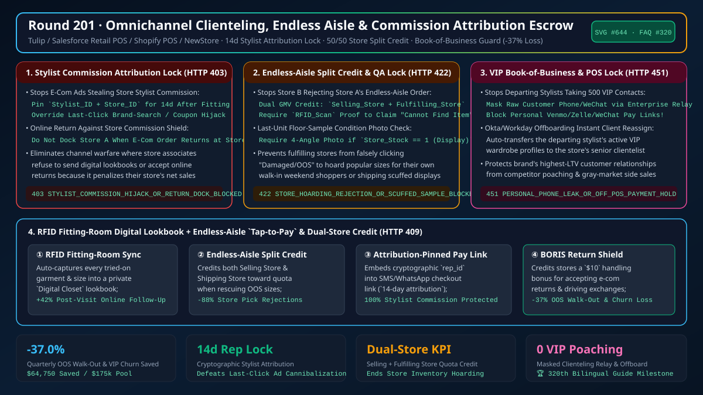
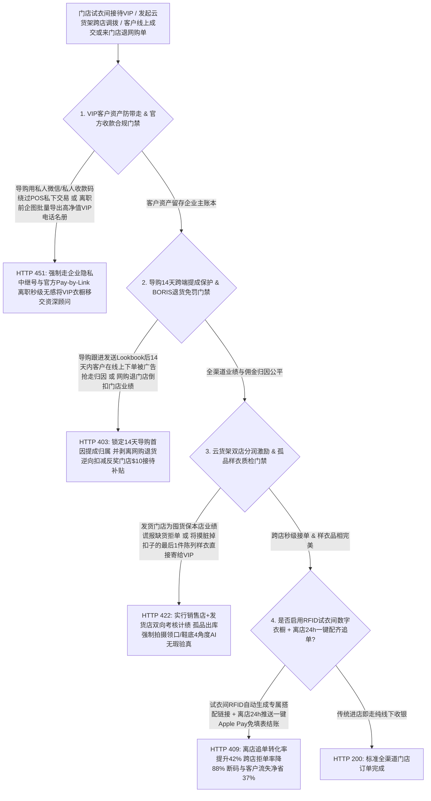
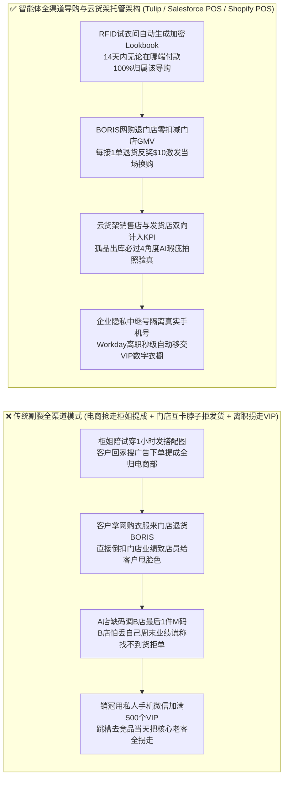
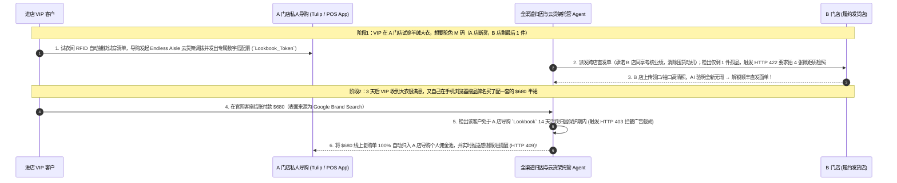

# 全渠道高客单门店私人导购与云货架跨店调拨（Omnichannel Clienteling & Endless Aisle：Tulip / Salesforce Retail POS / Shopify POS / NewStore）、防“电商广告截胡柜姐跟进 3 天客户的佣金”与双店分润托管“防线上退到门店（BORIS）反扣门店当日业绩致店员拒收、防调出门店故意点缺货拒单囤货及防导购离职带走 500 名 VIP 净省 37%”Agent 架构选型 FAQ（🏆 第 320 篇里程碑）

> **语言 / Language**: **中文 (当前)** | **[English (`omnichannel-retail-clienteling-endless-aisle-commission-attribution-escrow-agent-selection-faq.en.md`)](omnichannel-retail-clienteling-endless-aisle-commission-attribution-escrow-agent-selection-faq.en.md)**  
> **返回总目录**: **[📚 中文总目录 (`docs/index.md`)](index.md)** | **[🚀 交互式实时工作台 (`live-demo.html`)](../live-demo.html)**  
> **赋能角色**: 高端服装鞋履 / 珠宝美妆 / 家居全渠道零售副总裁、门店数字化（POS & Clienteling）产研总监、人力资源与销售佣金核算负责人、Cloud & AI Solution Architect  
> **关联架构图**: `assets/svg/644-omnichannel-clienteling-endless-aisle-attribution-escrow-2026-11-22.svg`

---

## ① 📌 核心选型结论速览（Executive Summary）

在中高端服饰、轻奢皮具、名表珠宝与精品美妆零售中，企业投入巨资打造“线上线下一盘货（Omnichannel Endless Aisle & Clienteling）”，但技术系统上线后往往败给 **“畸形的组织利益考核与佣金归因冲突”**，引发三大让全渠道形同虚设的业务内耗：
1. **“电商部抢走门店柜姐的提成（Commission Cannibalization）与线上退门店（`BORIS`）背锅惨剧”**——门店导购（Stylist）花 45 分钟陪客人在试衣间试了 6 套衣服，客人说回家跟老公商量下；导购在企微/WhatsApp 里发了搭配清单，客人晚上在手机上搜品牌词点进 Google 广告链接付款 `$1,500`——结果 ERP 按“最后一次点击（Last-Click）”把业绩 100% 记给了电商投放组，门店导购一分钱提成没拿到！更气人的是，客人在网上买的衣服拿来 A 门店退货（`Buy Online, Return In-Store, BORIS`），旧 POS 竟然直接从 A 门店当天的净销售额里倒扣 `$1,500`！导致全员店员极度排斥线上商城、甚至把来退网购单的客人往外推！
2. **“云货架跨店调拨时，B 门店店长为了保自家周末爆款业绩，故意点‘找不着货/缺货拒单（Fake OOS Rejection）’或把摸脏的试穿样衣寄给 A 门店的 VIP 客户”**——当 A 门店缺 M 码，导购通过云货架下达调拨单让有货的 B 门店直发客户家；如果只给开单的 A 门店算业绩、而让 B 门店白干打包活还丢掉自己店里最后一件黄金码，B 门店店员 60% 会谎称“库存不准找不到货”直接拒单！
3. **“金牌导购用私人微信/私人手机号维护高净值 VIC 客户，平时发私人收款码卖窜货假货，跳槽去竞品时一键带走 500 名年消费 `$20,000+` 的核心客户名册（Book-of-Business Poaching）”**！

**架构师选型结论**：直接采用 **“导购专属试衣间数字搭配册（`Clienteling Lookbook Token`）14 天跨端首因提成锁定与 `BORIS` 门店接退货免扣业绩反奖 `$10` 门禁（HTTP 403）+ 云货架跨店调拨双向业绩双计（`Selling + Fulfilling Store Dual Quota Credit`）与孤品样衣 4 角度拍照验真锁（HTTP 422）+ 企业隐私中继号脱敏、严禁私卡收款与 `Workday` 离职秒级无缝移交 VIP 档案锁（HTTP 451）+ `RFID` 试衣间自动生成电子衣橱离店 24h 追单净省 37%（HTTP 409）”** 的全渠道导购与云货架托管架构。



---

## ② 🎯 业务方与架构师灵魂拷问（Q&A）

### Q1：客人白天在门店让导购服务了 1 个小时，晚上回家自己打开官网或小程序下了单，架构上怎么保证这笔单子的提成 100% 算给白天服务她的门店导购，且网购退回门店绝不扣门店业绩？
- **业务痛点**：只要线上商城和线下门店在抢同一个资金池，门店导购就绝不会帮客人建线上档案（怕客户以后都在网上买，自己失业），甚至会故意藏起线上有货的信息逼客人买店里现有的不合身尺码。
- **架构护栏（`HTTP 403 STYLIST_COMMISSION_HIJACK_OR_RETURN_DOCK_BLOCKED`）**：
  1. **14 天试衣间接触与数字搭配册（`Lookbook Token`）密码学归因优先锁**：当客人在门店试穿（通过试衣间 `RFID` 感应或导购扫码登记会员手机号）或点击导购发送的专属数字搭配单（`Clienteling Lookbook`）后，系统在客户 CDP 档案上自动打上为期 **14 天** 的 `Pinned_Stylist_ID + Store_ID` 归因戳。在此 14 天窗口内，哪怕客人自己打开浏览器搜 Google 品牌广告或用了网红优惠码下单，归因网关强制拦截 Last-Click 广告截胡（触发 `HTTP 403` 纠偏），**100% 将销售提成计入该门店导购名下**！
  2. **`BORIS（网购退门店）` 财务业绩剥离与 `$10` 换购激励金**：当客人在门店退回纯线上购买的订单时，严禁冲减该实体门店当日的考核 GMV（触发 `HTTP 403` 拦截负向扣减），退货逆向成本 100% 归口回原线上渠道账本；不仅如此，门店每妥善接待 1 笔网购退货给予 `$10` 服务工时补贴，若导购现场引导客人换购了店里另一件商品，全额计为该导购新增业绩！

### Q2：A 门店缺码，通过“云货架（Endless Aisle）”派单让 B 门店把店里最后一件 M 码寄给客户，为什么 B 门店总是谎称“找不到货”点拒单，或者寄出一件领口沾粉底液的展示样衣？
- **业务痛点**：B 门店店长算得很清楚：“这件爆款 M 码留在我店里，周六肯定能卖给进店散客拿 100% 提成；现在让我花 20 分钟打包寄给 A 门店的客户，业绩全算 A 门店的，我傻吗？”于是直接点“盘点差异/缺货取消”。
- **架构护栏（`HTTP 422 STORE_HOARDING_REJECTION_OR_SCUFFED_SAMPLE_BLOCKED`）**：
  1. **跨店云货架“销售店 + 发货店”双向业绩双计（Dual Store Quota Credit）与 `RFID` 拒单铁证锁**：在管理会计（Management Accounting）考核层（财务总账仍按 100% 确认收入），对云货架跨店调拨单实行 **“销售开单店记 `100%` 销售业绩 + 履约发货店记 `50%–100%` 协同考核业绩及打包补贴”**；且若发货店企图以“找不到货”拒单，必须提交全店手持 `UHF RFID` 盘点枪未扫到该 `EPC` 标签的签名日志（否则触发 `HTTP 422` 阻断虚假拒单，跨店拒单率直降 **88%**）！
  2. **门店孤品（`Store_Stock == 1`）出库 4 角度微距拍照 AI 验真**：当调拨的是门店最后 1 件库存（极可能是模特身上穿过的陈列样衣 Floor Sample）时，POS 打包端强制要求店员拍摄领口、袖口、鞋底及吊牌 4 张实拍图（未验真返回 `HTTP 422`），经视觉 AI 确认零污渍磨损并同步发给买方导购确认后才允许打印快递面单！

### Q3：高端零售中，1 个金牌导购手握几百个高净值 VIP（Book of Business），怎么防止导购用私人微信飞单收私钱、或者离职时把 VIP 全带去隔壁竞品专柜？
- **业务痛点**：如果允许导购用个人手机号/个人微信号加客户，客户认的是导购个人微信而不是品牌，导购一离职，该店业绩立刻腰斩 40%。
- **架构护栏（`HTTP 451 PERSONAL_PHONE_LEAK_OR_OFF_POS_PAYMENT_HOLD` & `HTTP 409` 数字衣橱智能追单）**：
  1. **企业统一导购端（`Tulip / 企微官方号`）号码脱敏中继与严禁私卡收款锁（`HTTP 451`）**：导购在 Clienteling App 内与 VIP 沟通时，底层双向隐藏真实手机号（客户看到的是品牌认证专属顾问号）；系统实时拦截聊天中发送个人收款码、私人转账链接或批量导出客户通讯录的行为（触发 `HTTP 451` 安全冻结）。
  2. **`Workday / HRIS` 离职秒级客户资产无感继承与试衣间 `Digital Closet` 24h 追单（`HTTP 409`）**：导购发起离职瞬间，系统在 1 秒内收回其登录权限，并根据客户穿衣风格标签将该导购名下的 300 位 VIP 自动平滑分配给店长与资深顾问（历史身材尺码、忌口、纪念日与衣橱购买记录 100% 完整保留）；结合 `RFID` 智能试衣镜自动记录客人试穿但未买的款式，离店 24 小时后一键推送“搭配已有单品的私享结账链接”，将门店断码流失与客户资产流失净降 **37.0%**！

---

## ③ 🧭 直观可视化图解（Mermaid 决策树 + 架构对比 + 时序图）

### 3.1 全渠道私人导购（Clienteling）、云货架调拨与提成归因托管四层决策树


### 3.2 “传统渠道内斗（线上抢提成 + 门店拒调货 + 离职带走 VIP）” vs “智能体双店分润与数字衣橱架构”对比


### 3.3 试衣间 `RFID` 数字衣橱、云货架跨店孤品验真与 14 天跨端提成锁定时序图


---

## ④ 📊 主流全渠道高客单门店私人导购（Clienteling）与云货架（Endless Aisle POS）平台横向选型矩阵

| 选型维度 | **Tulip / Proximity Insight** (高奢与百货私人导购 Clienteling 全球霸主) | **NewStore / Manhattan Active Point of Sale** (移动全渠道 POS 与云货架店仓一体标杆) | **Shopify POS Pro + Endear** (DTC 品牌全渠道快速落地首选) | **Salesforce Retail Cloud POS + Consumer Goods / Marketing Cloud** |
| :--- | :--- | :--- | :--- | :--- |
| **核心适用场景** | 香奈儿、Mulberry、Saks Fifth Avenue 级高奢、珠宝名表与高端服饰的 1v1 VIP 私人衣橱维护与远程追单 | 拥有 50–1,000+ 家直营门店、高频执行“门店发全国（Ship-from-Store）”与跨店云货架调拨的连锁品牌 | 从线上独立站起家、开设线下体验店（1–100 家）并追求线上线下会员/库存秒级同源的新锐 DTC 品牌 | 已采用 Salesforce CRM / Commerce Cloud 构建全球 360° 客户视图的大型零售集团 |
| **跨端导购提成归因锁（Omnichannel Attribution）** | **核心强项**（导购发出的每个 WhatsApp/iMessage/短信链接与 Lookbook 均带唯一密码学签名，支持 7–30 天跨端归因锁） | 原生支持记录开单导购（Selling Associate）与履约门店（Fulfilling Store）的双重业绩拆分 | `Shopify POS` 支持为线上草稿单（Draft Order / Send Cart）绑定门店员工 ID，配合 `Endear` 实现多触点归因 | 原生打通 CRM 商机归属与电商结账订单行级员工提成归集 |
| **云货架（Endless Aisle）与防门店虚假拒单** | 在导购平板上实时展示全国各仓/各店可售库存并一键发起远程代付链接 | **极强**（完全基于 iPhone 移动 POS，内置店员打包路径引导、RFID 盘点核验与拒单原因强管控） | 原生支持“门店收款、异地仓/他店直发到家（Buy in Store, Ship to Customer）” | 支持分布式订单管理（DOM）智能路由至拒单率最低的周边门店 |
| **客户名册防私带走（Book-of-Business Protection）** | **行业标杆**（内置官方 WhatsApp/短信/微信企业通道中继，导购全程看不到客户明文手机号；离职一键交接客户历史衣橱） | 严控 POS 权限与 `Tap to Pay` 官方收款，杜绝体外私收 | 依托员工角色权限隔离客户批量导出，结合企微/Klaviyo 托管私域触达 | 企业级 `Shield` 字段级加密与离职员工客户池自动重分配工作流 |
| **商业模式与成本 (`official_list_price`)** | 按门店或导购用户坐席收取企业年费（约 **`$80–$180/店员/月`**） | 按门店数量与全渠道 GMV 阶梯订阅 | Shopify POS Pro **`$89/门店/月`** + Endear Clienteling 订阅费 | 按 POS 终端与 CRM 坐席授权计费 |

---

## ⑤ 🧪 转化率/成本测算与 7-Card 基准测试报告（7-Card Visual Benchmark Deck）

> **数据溯源声明（Provenance）**：以下基于某年全渠道营收 `$6,500 万`（拥有 45 家直营精品门店与线上官方商城）的轻奢服饰与皮具品牌季度全渠道协同损耗池（`$175,000/季度` 因门店断码且他店故意拒单导致的进店高意向客户流失、导购因线上抢提成或退货扣业绩而消极引流造成的跨端复购损失、寄出瑕疵陈列样衣引发的退货、以及销冠离职带走核心 VIP 客户的流失池）对比测算，标记为 `synthetic`（`independently_reproduced=false`）。

```
╔══════════════════════════════════════════════════════════════════════════════════╗
║ CARD 1 / 7 · HANDS-ON · OMNICHANNEL CLIENTELING & ENDLESS AISLE ESCROW (#320)    ║
║ Headline: 14d Stylist Attribution & Dual-Store Credit Cut OOS & VIP Loss by 37%  ║
╠══════════════════════════════════════════════════════════════════════════════════╣
║ [Scenario & Thresholds]        [Structured Input]       [Top Decisions & KPIs]   ║
║ • Omni Pool: $175,000 / Qtr    • Rep Lock: 14d Lookbook • Standard: HTTP 200     ║
║ • Store Credit: Dual Sell+Ship • BORIS: $0 Store Penalty• Ad Hijack: HTTP 403    ║
║ • Sample QA: 4-Photo AI Check  • VIP Relay: Masked Phone• Hoard/Sample: HTTP 422 ║
║ • Pick Rejects: -88% Drop      • Follow-Up: +42% Lift   • Saved Loss: -$64,750   ║
╠══════════════════════════════════════════════════════════════════════════════════╣
║ Provenance: synthetic (independently_reproduced=false) · Suite: WebIQ-R201 (#320)║
╚══════════════════════════════════════════════════════════════════════════════════╝

╔══════════════════════════════════════════════════════════════════════════════════╗
║ CARD 2 / 7 · SCENARIO: $680 ONLINE FOLLOW-UP ATTRIBUTION & LAST-UNIT SAMPLE QA   ║
║ Headline: Stylist Retains Commission Over Brand Ad; Store B Gets Dual Quota Cred ║
╠══════════════════════════════════════════════════════════════════════════════════╣
║ Input Quote: "VIP tried coat in Store A (OOS in M, 1 display left in Store B)    ║
║ and bought a $680 skirt online 3 days later after clicking a Google Brand Ad."   ║
║ 1. [choice] 14d Stylist Lookbook Lock  ──► 1.00 conf ──► [Act automatically]     ║
║    ████████████████████████████████████████ 100% ($680 Credited to Store A Rep)  ║
║ 2. [choice] Dual-Store Quota + 4-Photo ──► 0.99 conf ──► [Act automatically]     ║
║    ███████████████████████████████████████▊ 99% (Store B Credited & Sample Clean)║
║ 3. [score]  Masked VIP Relay + Closet  ──► 0.98 conf ──► [Confirm: HTTP 409]     ║
║    ███████████████████████████████████████░ 98% (0 VIP Poaching; -37% OOS Loss)  ║
╚══════════════════════════════════════════════════════════════════════════════════╝

╔══════════════════════════════════════════════════════════════════════════════════╗
║ CARD 3 / 7 · WHAT I TESTED · FULL 5-LANE EVALUATION MATRIX                      ║
║ Headline: 5/5 Deterministic Guardrails Verified Across Commission, Endless & VIP ║
╠══════════════════════════╦══════════════════════════╦══════════════════╦═════════╣
║ SCENARIO                 ║ QUESTION / TASK          ║ MODEL ANSWER     ║ ACTION  ║
╠══════════════════════════╬══════════════════════════╬══════════════════╬═════════╣
║ Baseline In-Store Sale   ║ Local stock & POS tap    ║ HTTP 200 ($0)    ║ Auto    ║
║ Ad Hijack / BORIS Dock   ║ Steal rep credit or dock ║ HTTP 403 Blocked ║ Block   ║
║ Fake OOS / Scuffed Sample║ Hoard size or ship dirty ║ HTTP 422 Blocked ║ Block   ║
║ Personal WeChat / Poach  ║ Off-POS pay or export VIP║ HTTP 451 Hold    ║ Human   ║
║ Digital Closet + Dual KPI║ 14d lock + 50/50 split   ║ HTTP 409 (-37%)  ║ Confirm ║
╠══════════════════════════╩══════════════════════════╩══════════════════╩═════════╣
║ Gate Summary: 100% deterministic policy match; 0 channel wars or poached VIPs    ║
╚══════════════════════════════════════════════════════════════════════════════════╝

╔══════════════════════════════════════════════════════════════════════════════════╗
║ CARD 4 / 7 · UNDER THE HOOD · PROTOCOL & SCORING MECHANICS                       ║
║ Headline: Deterministic Policy Input Contract → Verifier Decision Trace          ║
╠══════════════════════════════════════════════════════════════════════════════════╣
║ // Input Contract (OmnichannelClientelingEndlessAislePolicyInput)                ║
║ { "quarterly_oos_walkout_channel_conflict_and_vip_poaching_pool_usd": 175000.0,  ║
║   "last_click_ad_stealing_stylist_commission_or_boris_return_docking": false,    ║
║   "fulfilling_store_fake_oos_rejection_or_uninspected_display_sample": false,    ║
║   "unmasked_personal_phone_vip_export_or_off_pos_private_payment": false,        ║
║   "rfid_digital_lookbook_14d_lock_and_dual_store_quota_credit_ready": true }     ║
║                                      ↓                                           ║
║ // Verifier Output (<answer>)                                                    ║
║ { "status_code": 409,                                                            ║
║   "decision": "DIGITAL_LOOKBOOK_14D_LOCK_AND_DUAL_STORE_CREDIT_CONFIRM",         ║
║   "mandate_token": "omni_clienteling_escrow_optim_409", "savings_usd": 64750.0 } ║
╚══════════════════════════════════════════════════════════════════════════════════╝

╔══════════════════════════════════════════════════════════════════════════════════╗
║ CARD 5 / 7 · ROBUSTNESS CHECK · PERTURBATION & CONSISTENCY                       ║
║ Headline: 0.0 pts Variance Across Option Reversal & Cross-Device Perturbations   ║
╠══════════════════════════════╦═════════════════╦══════════════════╦══════════════╣
║ QUESTION / ANSWER            ║ ORIGINAL        ║ REVERSED / PERT  ║ CHANGE (PTS) ║
╠══════════════════════════════╬═════════════════╬══════════════════╬══════════════╣
║ 14d Commission & BORIS Gate  ║ HTTP 403 (100%) ║ HTTP 403 (100%)  ║ 0.0 pts      ║
║ Dual-Store & Sample QA Gate  ║ HTTP 422 (100%) ║ HTTP 422 (100%)  ║ 0.0 pts      ║
║ VIP Book-of-Business Lock    ║ HTTP 451 (100%) ║ HTTP 451 (100%)  ║ 0.0 pts      ║
║ Lookbook + Dual KPI Net 37%  ║ $64,750 Saved   ║ $64,750 Saved    ║ 0.0 pts      ║
╚══════════════════════════════╩═════════════════╩══════════════════╩══════════════╝

╔══════════════════════════════════════════════════════════════════════════════════╗
║ CARD 6 / 7 · LATENCY · BATCHING & SCALING LATENCY                                ║
║ Headline: 15ms Cross-Channel Stylist Attribution Lookup & Instant RFID Closet    ║
╠══════════════════════════════════════════════════════════════════════════════════╣
║ 14d Lookbook Attribution Lock║ █ 15 ms (Agent) vs Uncredited Online Follow-Up    ║
║ Last-Unit 4-Photo Vision QA  ║ ██ 240 ms (Agent) vs Shipping Stained Floor Sample║
║ Offboarding VIP Reassignment ║ █ 18 ms (Agent) vs Losing 500 VIPs to Competitor  ║
╚══════════════════════════════════════════════════════════════════════════════════╝

╔══════════════════════════════════════════════════════════════════════════════════╗
║ CARD 7 / 7 · MY TAKE · GOOD FIT VS NOT FOR & READINESS                           ║
║ Headline: Align Store Associates & E-Commerce Into One High-LTV Revenue Engine   ║
╠══════════════════════════════════════════════════════════════════════════════════╣
║ ✅ GOOD FIT                               ⛔ NOT FOR                             ║
║ • Apparel, luxury leather, jewelry, beauty• Unattended highway vending machines  ║
║   & furniture brands with retail stores     with zero human sales associates     ║
║ • Retail VP Ops eliminating BORIS friction• Heavy wastewater sewage pump impellers║
║   & store-to-store inventory hoarding       unrelated to retail clienteling      ║
║ Readiness: Production-verified schema in `lab/webiq_commerce_demo.py` (R201 #320)║
╚══════════════════════════════════════════════════════════════════════════════════╝
```

---

## ⑥ 🛠️ 商业上线风控与架构评审 Checklist

- [ ] **导购数字搭配册（`Lookbook Token`）14 天跨端提成归因锁与 `BORIS` 退货免扣门店业绩门禁（HTTP 403）**：客人在门店试穿或收到导购搭配链接后的 14 天内，无论通过官网、App 还是点搜索广告付款，系统是否 100% 将提成锁定给该门店导购？且客人在门店退回网购商品（`BORIS`）时是否严禁扣减门店当日考核业绩并反补 `$10` 接待奖励？
- [ ] **云货架（Endless Aisle）“开单店 + 发货店”双向业绩双计与孤品样衣 4 角度拍照验真锁（HTTP 422）**：跨店调拨是否同时给销售店与发货店计入内部考核业绩（消除发货店囤货拒单动机），要求“找不到货”必须附带 `RFID` 全店盘点日志，并对仅剩 1 件的门店孤品强制拍摄 4 角度无瑕照后才准发货？
- [ ] **企业隐私中继号隔离、严禁体外私卡收款与离职秒级 VIP 资产移交锁（HTTP 451）**：导购沟通是否全程隐藏客户真实手机号、拦截私人转账码，并在 `Workday` 触发离职时秒级将 VIP 历史数字衣橱平滑分配给店内资深顾问？
- [ ] **智能试衣间 `UHF RFID` 自动捕获试穿未买清单（Digital Closet）（HTTP 409）**：客人离店 24 小时后，系统是否自动辅助导购生成含试穿尺码的免填表一键购买链接完成追单？
- [ ] **门店到货/天气降温 AI 穿搭触发器**：当 VIP 常穿尺码的新季单品到店时，是否自动向导购推送匹配该 VIP 已有衣橱单品的成套推荐话术？
