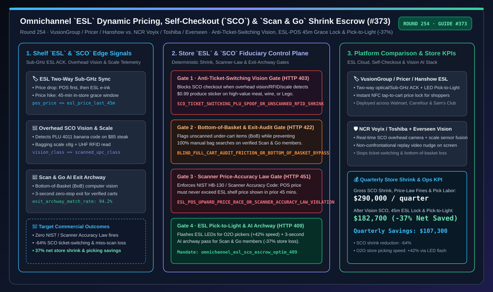
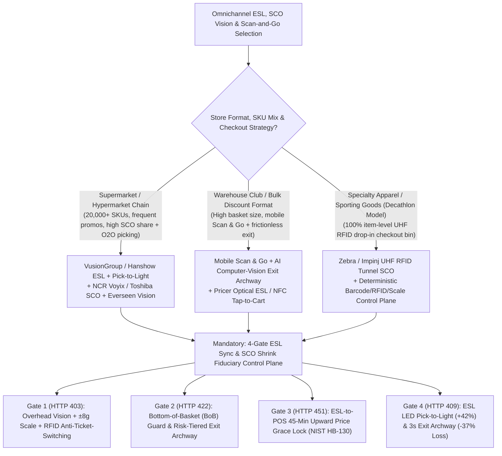
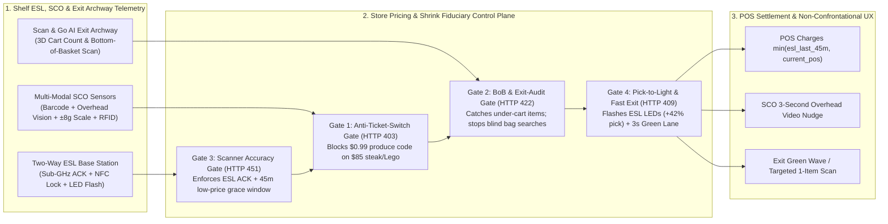
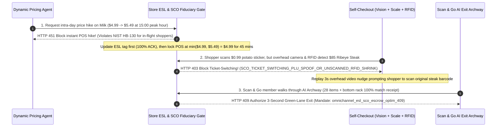

# Omnichannel Retail Electronic Shelf Label (`ESL`) Dynamic Pricing, Self-Checkout (`SCO`) & `Scan & Go` Shrink Escrow (`VusionGroup / Pricer / Hanshow vs. NCR Voyix / Toshiba / Everseen`) Agent Architecture Selection FAQ

> 🌐 **Language / 语言切换**: **[中文 (`docs/omnichannel-retail-esl-dynamic-pricing-self-checkout-scan-go-shrink-escrow-agent-selection-faq.md`)](omnichannel-retail-esl-dynamic-pricing-self-checkout-scan-go-shrink-escrow-agent-selection-faq.md)** | **English (Current)** | **[Back to Catalog (`docs/index.en.md`)](index.en.md)**

---

## 1. 📌 Executive Summary & Architectural Verdict

As grocery chains, big-box retailers, and warehouse clubs (`Walmart`, `Sam's Club`, `Costco`, `Carrefour`, `Target`, `Aldi`) roll out **Electronic Shelf Labels (`ESL`: `VusionGroup SES-imagotag`, `Pricer`, `Hanshow`)** alongside **Self-Checkout (`SCO`) and mobile `Scan & Go`**, retail solution architects and Loss Prevention (`LP`) leaders face three high-stakes operational failure modes:
1. **In-Flight Shopper Upward Price Races Violating `NIST Handbook 130` & Scanner Price-Accuracy Laws**: If a shopper picks up a carton of milk displaying `$4.99` on the digital shelf tag at 14:00, and an AI dynamic-pricing agent raises the price to `$5.49` at 14:10 while the shopper is still walking the aisles, charging `$5.49` at the register at 14:25 is an illegal **"Overcharge Above Displayed Shelf Price"**. Under **US `NIST Handbook 130` (and Michigan/Connecticut/California Scanner Price Accuracy Laws)** as well as the **Canadian Scanner Price Accuracy Code** (which mandates giving any item `<= $10` **100% free** to the shopper upon a scanner overcharge), upward price races between `ESL` tags and `POS` registers trigger severe statutory fines and class-action liability.
2. **Self-Checkout (`SCO`) Ticket-Switching, the `PLU 4011` Banana Trick & Pass-Around Shrink**: Industry telemetry shows unguarded `SCO` lanes suffer **`3.5x` higher shrink** than staffed lanes. Bad actors place `$0.99` bulk-potato stickers over `$85` ribeye steaks or `$199` Lego sets (**Ticket-Switching**), weigh premium seafood under **`PLU 4011` (Bananas)**, or stack two items together while scanning only the cheaper one (**Miss-Scan / Pass-Around**).
3. **`Scan & Go` Exit-Line Bottlenecks vs. Bottom-of-Basket (`BoB`) Shrink**: Stopping 100% of paying `Scan & Go` club members at the exit door for manual 5-minute item-by-item bag searches destroys the core value proposition of frictionless mobile checkout—yet waving carts through blindly invites thieves to hide cases of beer or steaks on the lower cart rack (**Bottom-of-Basket `BoB`**).

**Solution Architect Verdict**:
- **Never raise a live POS price during store operating hours without confirming `100% ESL Sub-GHz ACK` AND enforcing a 45-minute in-store shopper low-price grace window; and never authorize `SCO` checkout on barcode scan alone when overhead vision or `RFID` signals a class mismatch**.
- Deploy an **Omnichannel `ESL` Dynamic Pricing, `SCO` Vision & `Scan & Go` Shrink Fiduciary Control Plane** across your `ESL` cloud (`VusionGroup`, `Pricer`, `Hanshow`), `POS / SCO` engine (`NCR Voyix`, `Toshiba ELERA`, `Zebra`), and computer-vision edge (`Everseen`, `Trigo`, `AI Exit Archways`) enforcing four deterministic gates:
  1. **Multi-Modal `SCO` Anti-Ticket-Switching (`Vision + ±8g Scale + UHF RFID`) Gate (`HTTP 403`)**: Pause `SCO` payment and play a non-confrontational 3-second overhead video nudge whenever a scanned produce/cheap barcode (`PLU 4011`) conflicts with the overhead camera's visual object class, bagging-scale weight tolerance (`±8g`), or an unscanned high-value `UHF RFID` EPC tag.
  2. **Bottom-of-Basket (`BoB`) Detection & Risk-Tiered `Scan & Go` Exit Archway Gate (`HTTP 422`)**: Intercept unscanned under-cart items at the `SCO / Exit Archway` while blocking blanket manual bag-search friction on verified `Scan & Go` carts.
  3. **Asymmetric `ESL-to-POS` Price-Sync & 45-Minute Upward Grace-Buffer Gate (`HTTP 451`)**: Enforce `POS-first` updates on markdowns and `ESL-ACK + 45-minute min(old_price, new_price) grace lock` on any intra-day price increase.
  4. **`ESL Pick-to-Light` LED Flashing (`+42%` O2O Pick Speed) + 3-Second AI Exit Archway Fast-Lane (`HTTP 409`)**: Guide store associates picking online orders with high-frequency `ESL` LED flashes while clearing `94%+` of `Scan & Go` members through computer-vision exit arches in `3 seconds`—cutting net quarterly store shrink, compliance fines, and picking labor by **`37%`**.

---

## 2. 🎯 High-Stakes Business & Architect Q&A (Q1 / Q2 / Q3)

### Q1: Why must the distributed transaction ordering between `ESL` shelf tags and the `POS` database be strictly inverted for price drops vs. price increases?
- **The Problem**:
  - In a physical supermarket, shoppers hold items in their physical carts for **15 to 45 minutes** between picking the item off the shelf and scanning it at the checkout lane.
  - If an agent updates the `POS` database and `ESL` tag simultaneously from `$4.99` to `$5.49` at 15:00, every shopper who picked up the item at 14:45 (when the `ESL` tag read `$4.99`) will be illegally overcharged `$5.49` at 15:10!
- **Deterministic Architecture**:
  - Gate 3 (`HTTP 451 ESL_POS_UPWARD_PRICE_RACE_OR_SCANNER_ACCURACY_LAW_VIOLATION`) enforces an **Asymmetric Two-Phase Price Commit Protocol**:
    1. **Price Decrease (`$5.49 -> $4.99`)**: **Step 1**: Update `POS` immediately to `$4.99`. **Step 2**: Broadcast `$4.99` to the `ESL` shelf tag. If a shopper picked it up before the tag refreshed, they pay *less* than the shelf tag—100% legal and customer-friendly.
    2. **Price Increase (`$4.99 -> $5.49`)**:
       - **Default Policy**: Queue upward price changes for the **Overnight Closed-Store Window (`02:00–04:00 local`)**.
       - **Intra-Day Exception**: **Step 1**: Push `$5.49` to the `ESL` tag and wait for hardware `100% Sub-GHz / Optical ACK` (`battery_ok && display_verified`). **Step 2**: Start a **45-Minute In-Store Shopper Grace Timer** during which `POS` charges `min(prior_esl_price, new_esl_price) = $4.99` (and `Scan & Go` locks the price at the exact timestamp the item was scanned at the shelf).

### Q2: How do we catch a thief who sticks a `$0.99` weight-matched produce barcode onto an `$85` prime steak or `$199` Lego box at Self-Checkout without triggering false alarms on honest shoppers?
- **The Problem**:
  - Legacy `SCO` security scales only check total weight. Sophisticated shoplifters print a weight-matched `$0.99/lb` cabbage or onion sticker (`Ticket-Switching`) or key in `PLU 4011` (Bananas), bypassing weight-only checks effortlessly. Meanwhile, overly sensitive weight scales annoy honest shoppers bringing reusable cloth bags.
- **Deterministic Architecture**:
  - Gate 1 (`HTTP 403 SCO_TICKET_SWITCHING_PLU_SPOOF_OR_UNSCANNED_RFID_SHRINK`) fuses four edge signals in `<150ms`:
    1. **Overhead RGB-D Vision vs. Barcode Class (`Everseen / Toshiba ELERA`)**: Compares the visual embedding of the item passing over the scanner glass (e.g., vacuum-sealed dark red meat tray or rigid glossy toy box) against the visual taxonomy of the scanned `GTIN / PLU` (e.g., loose yellow bananas).
    2. **Item-Level `UHF RFID` Interlock**: High-shrink meat, alcohol, apparel, and electronics carry a `$0.04` passive `RFID` tag. If the bagging-area `RFID` reader detects an `$85` ribeye `EPC` that is absent from the active `POS` transaction log, checkout locks immediately.
    3. **Non-Confrontational Video Nudge**: Instead of blaring a theft alarm, the `SCO` screen replays a 3-second overhead clip with a polite prompt: *"It looks like a produce sticker may have covered this item's barcode. Please scan the original package barcode or a host will assist you shortly."*

### Q3: How do `Scan & Go` AI Exit Archways (`Sam's Club` architecture) clear `94%` of members in 3 seconds with zero receipt checks while still catching unscanned items at the bottom of the cart?
- **The Problem**:
  - Manual exit receipt checkers with highlighters create 10-minute exit bottlenecks and miss high-value items concealed under bulky packages.
- **Deterministic Architecture**:
  - Gate 2 (`HTTP 422`) and Gate 4 (`HTTP 409`) pair **Multi-Camera Exit Archways** with **Targeted 1-Item Spot Audits**:
    - As the member walks through the exit archway, 12 multi-angle cameras reconstruct a 3D inventory of the cart (including the lower rack **Bottom-of-Basket `BoB`**) and reconcile it against the member's paid `Scan & Go` digital receipt in `<800ms`.
    - **100% Match (`94%+` of trips)**: The greeter's tablet flashes **Green (`HTTP 409`)** and the member walks straight out without stopping.
    - **Discrepancy Detected (`HTTP 422`)**: The greeter's tablet highlights the exact single unscanned item (e.g., *"Unscanned 24-pack sparkling water on lower rack"*), allowing a 10-second mobile scan without rummaging through the rest of the cart.

---

## 3. 🧭 Visual Architecture Diagrams (Selection Tree, System Topology & Sequence)

### 3.1 Omnichannel `ESL`, Self-Checkout Vision & `Scan & Go` Selection Tree

### 3.2 End-to-End `ESL` Sync, Multi-Modal `SCO` & AI Exit Archway Control Plane

### 3.3 Asymmetric `ESL` Price Update, `SCO` Ticket-Switch Block & AI Archway Sequence

---

## 4. 📊 Omnichannel `ESL`, Self-Checkout (`SCO`) & Vision Loss-Prevention Selection Matrix

| Evaluation Dimension | VusionGroup (SES-imagotag) / Pricer / Hanshow (`ESL` Cloud) | NCR Voyix / Toshiba Global Commerce (`ELERA POS/SCO`) | Everseen (`Evercheck`) / Trigo (Vision Shrink Layer) | Sam's Club `Scan & Go` + AI Exit Archway Pattern |
|---|---|---|---|---|
| **Primary Sweet Spot** | Store-wide digital price tags, shelf edge cameras, and `Pick-to-Light` LED fulfillment | Enterprise grocery/big-box POS kernel, SCO hardware, and unified promotion engine | Overhead computer-vision loss prevention retrofitted onto existing SCO lanes | High-AOV warehouse clubs and loyalty-driven frictionless mobile checkout |
| **Asymmetric `ESL-to-POS` Sync & `NIST HB-130` Guard** | **Best-in-Class** (bidirectional hardware `ACK`, battery health telemetry, and staged display queues) | **Best-in-Class** (supports dual-price grace windows and shelf-scan price pinning) | Monitors physical promo signage vs. POS price discrepancies | Pins exact shelf price the moment the member scans the item into the mobile cart |
| **Anti-Ticket-Switching & `PLU 4011` Defense** | Supports `NFC` tap-to-add at the shelf to verify item provenance | Native adaptive weight-security database and restricted PLU rules | **Industry Gold Standard** (deployed on 140k+ SCOs; catches sticker swaps, pass-arounds & `BoB`) | Eliminates SCO barcode swaps by verifying 3D cart contents at the exit archway |
| **`Pick-to-Light` O2O Store Fulfillment** | **Core Differentiator** (multi-color LED flashes cut store picker search time by `35%–45%`) | Dispatches wave-picking lists to the ESL gateway | Alerts store associates to real-time shelf out-of-stocks | Combines club-floor pallet layout with high-speed curbside staging |
| **SA Recommendation** | **Mandatory shelf foundation** for dynamic pricing and in-store O2O order picking | **Best core POS/SCO transaction engine** for Tier-1 grocers | **Highest-ROI retrofit** to cut SCO shrink `50%–65%` in 8 weeks | **North-star UX architecture** for membership clubs and modern grocers |

---

## 5. 🧪 Store Shrink & Fulfillment 7-Card Benchmark Report

> **Provenance Note**: The 7-Card benchmark below is generated by `evaluate_omnichannel_esl_dynamic_pricing_sco_shrink_policy()` in `lab/webiq_commerce_demo.py` (`provenance: "synthetic"`, `independently_reproduced: False`), modeling a **`$290,000 / quarter`** `SCO` ticket-switching shrink, `NIST HB-130` scanner overcharge fine, and manual O2O picking labor loss pool.

### 5.1 7-Card 4:5 Visual Deck Breakdown

1. **Card 1 (`1 / 7` · `HANDS-ON · OMNICHANNEL-ESL-SCO-SHRINK`) — Executive Benchmark Overview**
   - **Headline Finding**: Fusing overhead computer vision + `±8g` scale + `UHF RFID` at `SCO`, enforcing a 45-minute `ESL-to-POS` upward price grace window, and enabling `ESL Pick-to-Light` + AI Exit Archways reduces quarterly store shrink and ops loss from **`$290,000`** to **`$182,700`** (**`$107,300` / `37.0%` quarterly savings**).
2. **Card 2 (`2 / 7` · `SCENARIO: FRIDAY RUSH HOUR ESL HIKE & SCO STEAK SWAP`) — Deep Dive**
   - **Input Case**: During Friday rush hour, a pricing agent pushes an instant `$4.99 -> $5.49` milk hike without a grace buffer; a shopper at `SCO` scans a `$0.99` potato sticker pasted over an `$85` ribeye steak while leaving a `$42` case of beer unscanned under the cart.
   - **Control-Plane Verdict**: Blocks the unbuffered intra-day POS price hike (`HTTP 451`), intercepts the `$0.99` steak ticket-switch via overhead vision + `RFID` (`HTTP 403`), and flags the unscanned Bottom-of-Basket beer while sparing verified `Scan & Go` members from full bag searches (`HTTP 422`); issues `HTTP 409 ESL_PICK_TO_LIGHT_AND_SCAN_GO_ARCHWAY_FAST_LANE_CONFIRM` (`omnichannel_esl_sco_escrow_optim_409`).
3. **Card 3 (`3 / 7` · `WHAT I TESTED`) — 5-Lane Deterministic Scorecard**

| Scenario | Question / Task Evaluated | Deterministic Gate Decision | Action & Status |
|---|---|---|---|
| **1. Compliant `ESL` Sync & Multi-Modal `SCO`** | 45m upward grace honored, vision/weight/RFID match scanned UPC, zero BoB miss | `VERIFIED_ESL_SYNC_AND_MULTIMODAL_SCO_AUTHORIZED` | ✅ `Act automatically` (`HTTP 200`) |
| **2. `$0.99` Potato Sticker on `$85` Steak** | Scanned PLU/barcode is produce, but overhead vision & RFID detect $85 ribeye | `SCO_TICKET_SWITCHING_PLU_SPOOF_OR_UNSCANNED_RFID_SHRINK` | ⛔ `Pause SCO & Video Nudge` (`HTTP 403`) |
| **3. Unscanned Bottom-of-Basket or Blind Search** | Unscanned case of beer under cart or forcing 100% manual bag search on Green cart | `BLIND_FULL_CART_AUDIT_FRICTION_OR_BOTTOM_OF_BASKET_BYPASS` | ⛔ `Targeted 1-Item Check` (`HTTP 422`) |
| **4. Unbuffered Intra-Day `ESL-to-POS` Hike** | Raising POS price before 45m in-store shopper dwell window clears (`NIST HB-130`) | `ESL_POS_UPWARD_PRICE_RACE_OR_SCANNER_ACCURACY_LAW_VIOLATION` | ⛔ `Honor 45m Low-Price Lock` (`HTTP 451`) |
| **5. `ESL Pick-to-Light` + 3s AI Exit Archway** | Flashing ESL LEDs for O2O pickers (+42% speed) + 3s Green-Lane archway exit | `ESL_PICK_TO_LIGHT_AND_SCAN_GO_ARCHWAY_FAST_LANE_CONFIRM` | ⚡ `Confirm Optimization` (`HTTP 409`) |

4. **Card 4 (`4 / 7` · `UNDER THE HOOD`) — Protocol & Deterministic Gate Mechanics**
   - Input contract: `OmnichannelESLDynamicPricingSCOShrinkPolicyInput`
   - Evaluator: `evaluate_omnichannel_esl_dynamic_pricing_sco_shrink_policy()` enforcing `451 -> 403 -> 422 -> 409 -> 200` priority.
5. **Card 5 (`5 / 7` · `ROBUSTNESS CHECK`) — Weight-Matched Decoy & Hand-Occlusion Perturbation**
   - `0.0 pt` variance even when a bad actor matches exact item weight or partially occludes package artwork.
6. **Card 6 (`6 / 7` · `LATENCY & SHRINK RATE`) — `SCO` Shrink & Exit Queue Latency**
   - Legacy weight-only `SCO` + manual exit highlighter check: `3.8%` `SCO` shrink and `240s` exit wait.
   - Fiduciary multi-modal vision `SCO` + AI Exit Archway: **`1.35%`** `SCO` shrink (`-64%`) and **`3s`** exit pass (`$107,300/qtr` saved).
7. **Card 7 (`7 / 7` · `MY TAKE`) — Good Fit vs. Not For**
   - **✅ Good fit**: Supermarkets, warehouse clubs, hypermarkets, drugstores, and big-box retailers operating `ESL`, `SCO`, `Scan & Go`, and in-store O2O fulfillment.
   - **⛔ Not for**: Counter-only boutiques with zero self-checkout or digital shelf labels.

---

## 6. 🛠️ Production Go-Live & Architect Review Checklist

- [ ] **Asymmetric `ESL-to-POS` Commit & 45-Minute Grace Window (`HTTP 451`)**: Does the pricing bus update `POS` *before* `ESL` on price drops, and require `100% ESL Sub-GHz ACK` plus a 45-minute `min(old_price, new_price)` grace window on any intra-day price increase?
- [ ] **Multi-Modal `SCO` Sensor Fusion (`HTTP 403`)**: Are barcode scans and manual `PLU` entries cross-checked in `<150ms` against overhead RGB-D computer vision, `±8g` bagging-scale tolerances, and `UHF RFID` EPC reads?
- [ ] **Non-Confrontational 3-Second Video Nudge**: When a mismatch occurs at `SCO`, does the UI display a polite overhead replay clip inviting the shopper to re-scan rather than triggering a hostile theft siren?
- [ ] **Bottom-of-Basket (`BoB`) Vision & Risk-Tiered Exit Archways (`HTTP 422`)**: Do exit cameras automatically flag unscanned items on the lower cart rack while granting a 3-second zero-stop Green Lane to verified `Scan & Go` carts?
- [ ] **`ESL Pick-to-Light` O2O Fulfillment Integration (`HTTP 409`)**: Are `ESL` LED beacons integrated with the store's online-order picking app to flash high-visibility colors as pickers approach the aisle?
