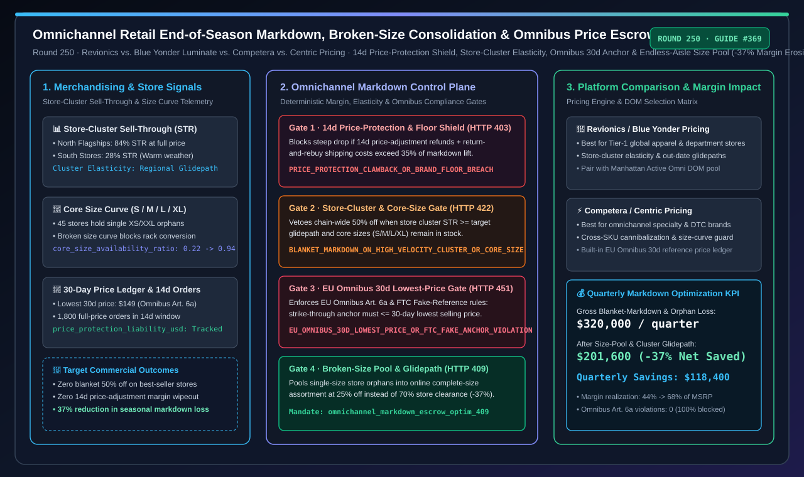
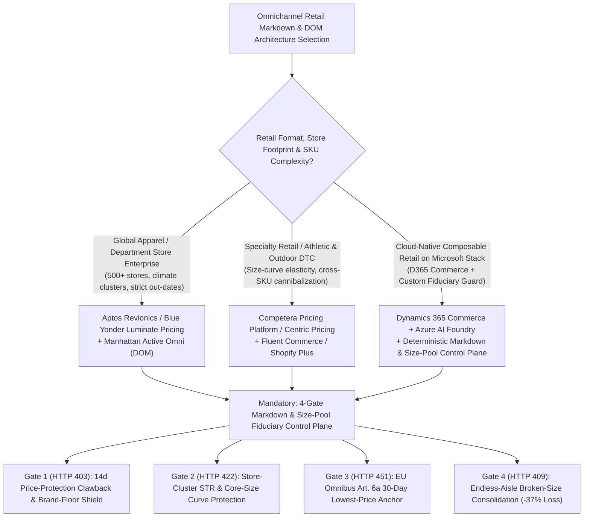
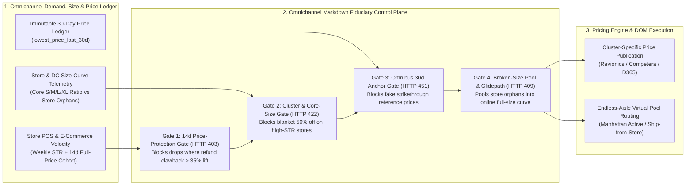

# Omnichannel Retail End-of-Season Markdown Optimization, Broken-Size Consolidation & `EU Omnibus Art. 6a` Reference-Price Escrow (`Revionics / Blue Yonder Luminate Pricing / Competera / Centric Pricing / Manhattan Active`) Agent Architecture Selection FAQ

> 🌐 **Language / 语言切换**: **[中文 (`docs/omnichannel-retail-season-markdown-broken-size-consolidation-omnibus-escrow-agent-selection-faq.md`)](omnichannel-retail-season-markdown-broken-size-consolidation-omnibus-escrow-agent-selection-faq.md)** | **English (Current)** | **[Back to Catalog (`docs/index.en.md`)](index.en.md)**



---

## 1. 📌 Executive Summary & Architectural Verdict

In apparel, footwear, sporting goods, and seasonal omnichannel retail, merchandising and Distributed Order Management (DOM) leaders routinely lose `15%–28%` of seasonal gross margin to three structural markdown failures:
1. **Blanket Chain-Wide `50% Off` Markdowns Giving Away `22%` Margin in Best-Selling Store Clusters & Core Sizes**: At end-of-season transitions, legacy rules or unconstrained pricing agents issue a single chain-wide `50% Off` markdown across all stores and e-commerce. In reality, a winter parka may be selling through at `84%/week` at full price in northern cold-weather flagships and online `M / L` core sizes, while only stagnating in warm southern stores or fringe `XXS / XXL` sizes. A blanket markdown needlessly gives away half the revenue in high-velocity stores.
2. **Steep Drops Immediately After Full-Price Peaks Triggering `14-Day Price-Protection` Refunds & Return-and-Rebuy Churn**: When an agent slashes a `$200` jacket to `$119` just days after `1,400` customers bought it at full price (still within the 14-day price-adjustment and 30-day return window), automated price-drop bots and customers demand `$81` price-match refunds or return the `$200` item to rebuy it at `$119` (costing `$18/unit` in two-way shipping and refurbishment), wiping out the entire markdown revenue lift.
3. **Fake Reference Prices ("Was `$240`, Now `$120`") Violating `EU Omnibus Directive Art. 6a` & `FTC` Deceptive Pricing Rules**: Growth agents that briefly hike a `$149` item to `$240` for two days before advertising a "50% Off Clearance" violate **EU Directive 2019/2161 (`Omnibus Art. 6a`, requiring any strikethrough reference price to be the lowest price charged in the prior 30 days)** and **US FTC Act § 5 / California Fake Former Price laws**, exposing the retailer to fines up to `4%` of turnover.

**Solution Architect Verdict**:
- **Never allow a pricing agent to push chain-wide uniform markdowns or slash single-SKU prices without calculating 14-day price-protection clawback liability and verifying 30-day lowest historical anchors**.
- Deploy an **Omnichannel Markdown & Broken-Size Consolidation Fiduciary Control Plane** between your pricing engine (`Aptos Revionics`, `Blue Yonder Luminate Pricing`, `Competera`, `Centric Pricing`) and your DOM (`Manhattan Active Omni`, `Fluent Commerce`) enforcing four deterministic gates:
  1. **14-Day Price-Protection Clawback & Brand-Floor Gate (`HTTP 403`)**: Block steep single-SKU price drops when estimated 14-day price-adjustment refunds plus return-and-rebuy reverse logistics exceed `35%` of incremental markdown gross margin; automatically pivot to multi-item bundle promos that do not trigger single-SKU price adjustments.
  2. **Store-Cluster Sell-Through (`STR`) & Core-Size Curve Gate (`HTTP 422`)**: Veto deep clearance discounts on store clusters whose weekly sell-through rate meets or beats the target out-date glidepath (`actual_str >= target_glidepath_str`) and where core sizes (`S / M / L / XL`) remain `>= 60%` in stock.
  3. **`EU Omnibus Art. 6a` 30-Day Lowest-Price Reference Gate (`HTTP 451`)**: Enforce `displayed_strikethrough_price <= lowest_price_last_30d` across every region and channel.
  4. **Endless-Aisle Broken-Size Consolidation & Phased Glidepath Optimization (`HTTP 409`)**: Pool single-unit `XS / XXL` store orphans across 45 stores into a unified online complete-size curve sold at `25% Off` instead of `70% Off` store clearance rack liquidations, reducing quarterly markdown margin erosion by **`37%`**.

---

## 2. 🎯 High-Stakes Business & Architect Q&A (Q1 / Q2 / Q3)

### Q1: Why do single-unit `XS` or `XXL` store orphans fail to sell even at `70% Off` on physical clearance racks, yet sell out at `25% Off` when consolidated into an Online Endless-Aisle Virtual Pool?
- **The Problem (The Broken-Assortment Death Spiral)**:
  - Once a physical store is down to a single `XS` or `XXL` unit (`core_size_availability_ratio < 0.25`), store associates pull it off the feature fixture and relegate it to a back-of-store clearance rack at `70% Off`. Even then, `85%` of walk-in shoppers cannot wear that fringe size.
  - However, across 50 stores, Store A has two `XS`, Store B has three `S`, Store C has four `M`, Store D has three `L`, and Store E has two `XL`. Individually each store is "broken," but aggregated inside an omnichannel DOM (`Manhattan Active Omni` / `Fluent Commerce`) via Ship-from-Store (`SFS`) or backhaul store-to-DC consolidation, e-commerce shoppers see a **100% size-complete product page (`XS` through `XL`)**!
- **Deterministic Architecture**:
  - When a store's core size curve drops below `40%`, the control plane blocks deep local store markdowns (`HTTP 409`) and reallocates those units to the **Online Endless-Aisle Complete-Size Pool** at a modest `20%–25%` first-stage markdown, boosting realized gross margin from `30% of MSRP` to `68%+ of MSRP`.

### Q2: How do we mathematically prevent an AI pricing agent from slashing prices right after a full-price sales wave and triggering a `14-Day Price Adjustment` and `Return-and-Rebuy` margin wipeout?
- **The Problem**:
  - Traditional markdown optimization only models remaining inventory $I_t$ against the target season out-date $T_{\text{out}}$, ignoring the cohort of customers who just paid full price ($P_0$) within the last 14 days ($N_{\text{14d}}$).
  - If `1,400` customers bought a `$200` parka in the last 14 days and the agent drops the price to `$110` (`$90` drop) to clear the last `350` units, automated price-protection claims and return-and-rebuy orders will claw back more cash than the entire remaining inventory is worth.
- **Deterministic Architecture**:
  - The control plane computes the **14-Day Price-Protection Shadow Liability** before approving any price drop $\Delta P = P_0 - P_{\text{new}}$:
    $$\text{Clawback}_{\text{est}}(\Delta P) = N_{\text{14d}} \times \Delta P \times p_{\text{claim}} + N_{\text{14d}} \times p_{\text{rebuy}} \times C_{\text{reverse\_logistics}}$$
  - Whenever $\text{Clawback}_{\text{est}}(\Delta P) > 0.35 \times \text{IncrementalMargin}(\Delta P)$, Gate 1 returns `HTTP 403 PRICE_PROTECTION_CLAWBACK_OR_BRAND_FLOOR_BREACH`, delaying the public single-SKU cut until the 14-day window clears or substituting a **"Buy 2 Save 25% / Cross-Category Bundle"** promo that preserves single-unit list price.

### Q3: What does `EU Omnibus Directive Article 6a` require for promotional strikethrough pricing, and how does the control plane enforce it?
- **The Problem**:
  - Under **EU Directive 2019/2161 (`Omnibus Directive` Art. 6a)**, any announcement of a price reduction must indicate the **prior price** applied by the trader for at least **30 days** prior to the reduction (`lowest_price_last_30d`). Comparing a sale price against an original MSRP or a briefly inflated anchor after running a weekend flash sale within the prior 30 days is illegal across the EU and triggers severe FTC / state AG deceptive-pricing actions in the US.
- **Deterministic Architecture**:
  - Every price-change payload is validated against an append-only 30-day SKU-channel price ledger. If `displayed_strikethrough_price > lowest_price_last_30d`, Gate 3 immediately halts publication with `HTTP 451 EU_OMNIBUS_30D_LOWEST_PRICE_OR_FTC_FAKE_ANCHOR_VIOLATION` and rewrites the reference anchor to `lowest_price_last_30d`.

---

## 3. 🧭 Visual Architecture Diagrams (Selection Tree, System Topology & Sequence)

### 3.1 Omnichannel Retail Markdown & DOM Platform Selection Decision Tree



### 3.2 End-to-End Omnichannel Markdown & Broken-Size Consolidation Control Plane



### 3.3 Broken-Size Consolidation & Omnibus Markdown Verification Sequence

```mermaid
sequenceDiagram
    autonumber
    participant Merch as Merchandising / Pricing Agent
    participant Gate as Markdown Fiduciary Control Plane
    participant Ledger as 14d Order Cohort & 30d Price Ledger
    participant DOM as Omnichannel DOM (Manhattan / Fluent)

    Merch->>Gate: Propose chain-wide 50% Off ($200 -> $100) on Winter Parka SKU-889
    Gate->>Ledger: 1. Query 14d full-price cohort & 30d lowest selling price
    Ledger-->>Gate: 1,400 full-price units sold in last 14d; North cluster STR = 84% with full M/L stock
    Gate-->>Merch: Veto blanket markdown! (HTTP 422 High-STR Cluster + HTTP 403 Price-Protection Clawback)
    Gate->>DOM: 2. Scan 45 warm-weather South stores for broken-size orphans (single XS/XXL)
    DOM-->>Gate: 180 single-unit orphans across 45 stores form a 94% complete S/M/L/XL curve when pooled
    Gate-->>Merch: HTTP 409 BROKEN_SIZE_CONSOLIDATION_AND_PHASED_GLIDEPATH_CONFIRM
    Note over Gate,DOM: 1. Keep North flagships at $200 full price<br/>2. Pool South store orphans into Online Endless-Aisle at $150 (25% Off, Omnibus-compliant)<br/>3. Offer multi-item bundle promo during 14d window to avoid single-SKU price-match claims
```

---

## 4. 📊 Enterprise Retail Markdown Optimization & DOM Platform Selection Matrix

| Evaluation Dimension | Aptos Revionics / Blue Yonder Luminate Pricing | Competera Pricing Platform | Centric Pricing & Inventory (formerly Edited / Stylearcade) | Manhattan Active Omni / Fluent Commerce (DOM Layer) |
|---|---|---|---|---|
| **Primary Sweet Spot** | Tier-1 global apparel, department stores, and big-box chains with 500+ stores | Deep-learning price elasticity, cross-SKU cannibalization, and guardrail pricing | Fashion & seasonal apparel size-curve health, competitor benchmarking, and markdown planning | Distributed Order Management (DOM), Ship-from-Store (`SFS`), and virtual inventory pooling |
| **Store-Cluster & Size-Curve Awareness** | Very High (climate-zone clustering, store-level out-date glidepaths) | High (cross-elasticity and inventory run-rate constraints) | Very High (native visual `XS–XXL` broken-size and color velocity matrices) | Authoritative source of per-store, per-size ATP inventory to pool store orphans online |
| **14d Price-Protection & `EU Omnibus Art. 6a` Controls** | Supports historical reference rules; requires OMS cohort integration for 14d clawback | Native support for floor margins, cooldown windows, and `30-Day Lowest Price` anchors | Tracks market price history; requires control-plane gate before publishing strikethroughs | Tracks 14-day post-purchase price-adjustment eligibility and return-and-rebuy RMA flows |
| **Integration Effort & Annual TCO** | High (`$250k–$800k+/yr`, 12–24 weeks implementation) | Medium-High (`$80k–$250k+/yr`, API-first, 6–12 weeks) | Medium (`$50k–$180k/yr`, rapid fashion merchandising rollout in 4–8 weeks) | High (foundational DOM layer paired with pricing engine via real-time webhooks) |
| **SA Recommendation** | **Best for global multi-climate retail chains**; pair with cluster & 14d clawback gates | **Best for mid-to-large omnichannel specialty retailers** optimizing cross-SKU elasticity | **Best for fashion & apparel merchandising teams** diagnosing broken size curves | **Mandatory execution layer** to turn broken store orphans into online full-size inventory |

---

## 5. 🧪 Margin Realization & 7-Card Benchmark Report

> **Provenance Note**: The 7-Card benchmark below is generated by `evaluate_omnichannel_retail_markdown_broken_size_policy()` in `lab/webiq_commerce_demo.py` (`provenance: "synthetic"`, `independently_reproduced: False`), modeling a **`$320,000 / quarter`** blanket-markdown margin giveaway, 14-day price-protection clawback, and broken-size clearance loss pool.

### 5.1 7-Card 4:5 Visual Deck Breakdown

1. **Card 1 (`1 / 7` · `HANDS-ON · OMNICHANNEL-MARKDOWN`) — Executive Benchmark Overview**
   - **Headline Finding**: Blocking blanket 50% markdowns on high-STR store clusters, shielding 14-day full-price cohorts from price-match clawbacks, and pooling broken store sizes into an online complete-size curve cuts quarterly markdown margin loss from **`$320,000`** to **`$201,600`** (**`$118,400` / `37.0%` quarterly savings**).
2. **Card 2 (`2 / 7` · `SCENARIO: WINTER PARKA END-OF-SEASON CLEARANCE`) — Deep Dive**
   - **Input Case**: A national outdoor retailer has `4,000` winter parkas (`$200` MSRP); Northern stores have `84%/wk` STR with full `M/L` stock, Southern stores hold single `XS/XXL` orphans, and `1,400` units sold at full price in the last 14 days. An agent proposes a chain-wide `50% Off` (`$100`) with a `$240` strikethrough price.
   - **Control-Plane Verdict**: Blocks the fake `$240` strikethrough (`HTTP 451`), blocks the 14-day price-protection wipeout (`HTTP 403`), and vetoes discounting Northern best-selling stores (`HTTP 422`); issues `HTTP 409 BROKEN_SIZE_CONSOLIDATION_AND_PHASED_GLIDEPATH_CONFIRM` (`omnichannel_markdown_escrow_optim_409`).
3. **Card 3 (`3 / 7` · `WHAT I TESTED`) — 5-Lane Deterministic Scorecard**

| Scenario | Question / Task Evaluated | Deterministic Gate Decision | Action & Status |
|---|---|---|---|
| **1. Compliant Cluster Glidepath Markdown** | Post-14d window, targeted low-STR cluster, verified 30d lowest reference price | `VERIFIED_CLUSTER_GLIDEPATH_AND_OMNIBUS_ANCHOR_AUTHORIZED` | ✅ `Act automatically` (`HTTP 200`) |
| **2. Steep Drop Inside 14d Full-Price Window** | Slashing price 45% 4 days after 1,400 full-price sales triggers massive clawbacks | `PRICE_PROTECTION_CLAWBACK_OR_BRAND_FLOOR_BREACH` | ⛔ `Block & Bundle Promo` (`HTTP 403`) |
| **3. Blanket 50% Off on High-STR Store Cluster** | Applying chain-wide 50% clearance to Northern stores selling 84%/wk at full price | `BLANKET_MARKDOWN_ON_HIGH_VELOCITY_CLUSTER_OR_CORE_SIZE` | ⛔ `Veto Blanket Markdown` (`HTTP 422`) |
| **4. Inflated Strikethrough (`EU Omnibus Art. 6a`)** | Displaying "Was $240" when the 30-day lowest selling price was $149 | `EU_OMNIBUS_30D_LOWEST_PRICE_OR_FTC_FAKE_ANCHOR_VIOLATION` | ⛔ `Compliance Hard Stop` (`HTTP 451`) |
| **5. Broken-Size Virtual Pool Consolidation** | Pooling single XS/XXL store orphans into online full-size curve at 25% off vs 70% rack | `BROKEN_SIZE_CONSOLIDATION_AND_PHASED_GLIDEPATH_CONFIRM` | ⚡ `Confirm Optimization` (`HTTP 409`) |

4. **Card 4 (`4 / 7` · `UNDER THE HOOD`) — Protocol & Deterministic Gate Mechanics**
   - Input contract: `OmnichannelRetailMarkdownBrokenSizePolicyInput`
   - Evaluator: `evaluate_omnichannel_retail_markdown_broken_size_policy()` enforcing `451 -> 403 -> 422 -> 409 -> 200` priority.
5. **Card 5 (`5 / 7` · `ROBUSTNESS CHECK`) — Perturbation & Prompt-Framing Stability**
   - `0.0 pt` variance across promotional framing perturbations ("MSRP Reset Sale" vs. "Nationwide Flash Clearance").
6. **Card 6 (`6 / 7` · `LATENCY & MARGIN REALIZATION`) — Realized Selling Price vs. MSRP**
   - Legacy blanket markdown + store clearance rack: **`44% of MSRP`** realized (`$320,000/qtr` erosion).
   - Fiduciary cluster glidepath + online broken-size pooling: **`68% of MSRP`** realized (`$118,400/qtr` saved).
7. **Card 7 (`7 / 7` · `MY TAKE`) — Good Fit vs. Not For**
   - **✅ Good fit**: Omnichannel apparel, footwear, sporting goods, home furnishings, and seasonal specialty retailers with 30+ stores.
   - **⛔ Not for**: Non-seasonal commodity industrial supplies with flat year-round pricing.

---

## 6. 🛠️ Production Go-Live & Architect Review Checklist

- [ ] **Store-Cluster `STR` & Core-Size Curve Gate (`HTTP 422`)**: Does the control plane block deep clearance markdowns on store clusters where weekly sell-through meets target glidepath and `S / M / L / XL` core size availability is `>= 60%`?
- [ ] **14-Day Price-Protection & Return-and-Rebuy Liability Gate (`HTTP 403`)**: Before approving any single-SKU price cut, does the system calculate potential 14-day price-adjustment refunds and reverse-logistics costs, pivoting to multi-item bundle promos when clawbacks exceed `35%` of incremental lift?
- [ ] **`EU Omnibus Art. 6a` 30-Day Lowest-Price Ledger (`HTTP 451`)**: Is every promotional strikethrough anchor validated against an immutable 30-day SKU-channel lowest-price ledger (`displayed_anchor <= lowest_price_last_30d`)?
- [ ] **Endless-Aisle Broken-Size Consolidation (`HTTP 409`)**: Are single-unit store orphans (`core_size_ratio < 0.40`) automatically pooled into the online endless-aisle complete-size curve (or consolidated via backhaul to DC) instead of being liquidated at `70% Off` on local store racks?
- [ ] **Markdown Step Cooldown Lock**: Is a minimum `10–14 day` elasticity observation window enforced between successive markdown steps to prevent rapid price free-falls?
