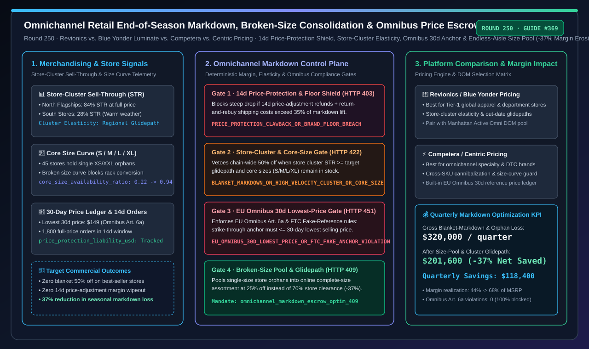
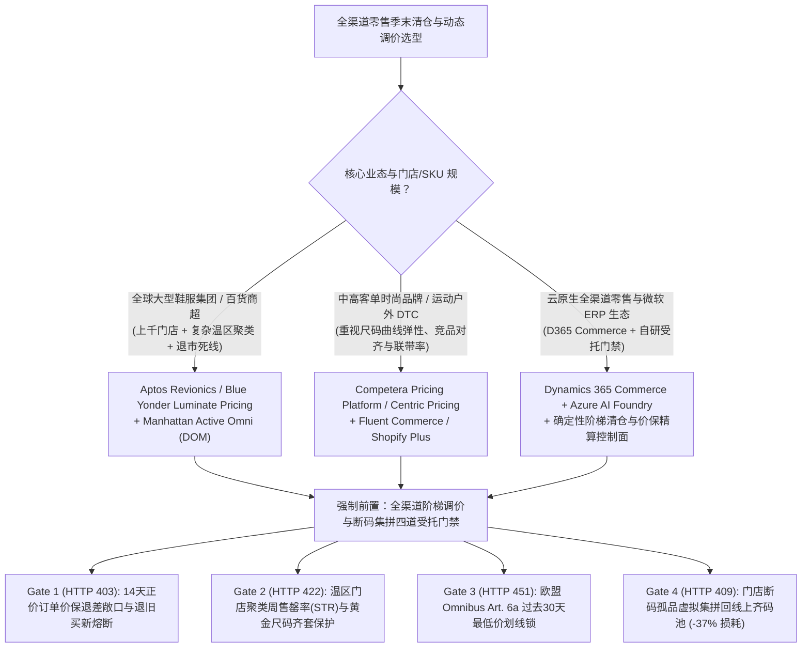
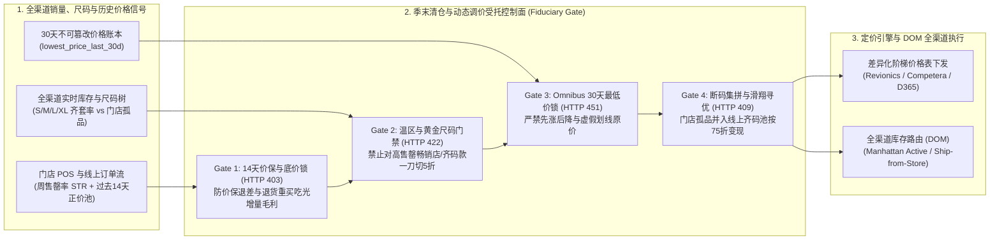
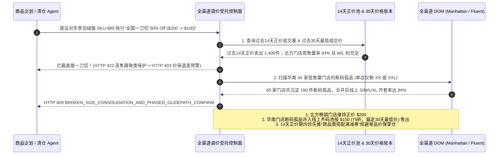

# 全渠道服装与百货零售“季末阶梯清仓动态调价（End-of-Season Markdown Optimization）、断码孤品跨店集拼与欧盟 `Omnibus` 30 天最低价合规托管（`Revionics / Blue Yonder Luminate Pricing / Competera / Centric Pricing / Manhattan Active`）”Agent 架构选型 FAQ：防全国一刀切 5 折砸穿畅销店毛利、防 14 天价保引发退货重买穿仓与虚拟齐码池净省 37% 实战指南

> 🌐 **Language / 语言切换**: **中文 (当前)** | **[English (`docs/omnichannel-retail-season-markdown-broken-size-consolidation-omnibus-escrow-agent-selection-faq.en.md`)](omnichannel-retail-season-markdown-broken-size-consolidation-omnibus-escrow-agent-selection-faq.en.md)** | **[返回文档总目录 (`docs/index.md`)](index.md)**

---

## 1. 📌 核心选型结论速览（Executive Summary）

在鞋服时尚、运动户外、季节性家电及全渠道百货零售中，商品企划（Merchandising）与全渠道订单管理（DOM）负责人经常面临三个严重侵蚀毛利的定价与库存痛点：
1. **“全国一刀切全场 5 折（Blanket Chain-Wide 50% Markdown）”白白送掉畅销门店与黄金尺码 `22%` 纯毛利**：到了季末换季窗口，传统定价规则或未加约束的 AI 定价 Agent 对某款季节性商品直接下发“全国门店 + 线上统一打 5 折”指令。实际上，该羽绒服在北方寒冷温区门店及线上 `M / L` 黄金尺码正以正价每周售罄 `84%`，仅在华南温暖区门店和 `XXS / XXL` 边缘尺码滞销。一刀切 5 折虽然清掉了华南尾货，却把北方门店原本能按正价卖出的数千件爆款白白让利了一半！
2. **“刚正价卖完第 3 天就大降价”引发 14 天价保（Price Adjustment）退差挤兑与“退旧买新（Return-and-Rebuy）”双倍运费穿仓**：上新或小促刚过 10 天，数千名高净值顾客刚以 `$200` 正价买走大衣（仍处于 14 天价保期与 30 天无理由退货期内），定价 Agent 只看未来清仓进度，突然把该款直降到 `$119`。结果不仅触发海量顾客索要 `$81` 价保退差，更导致大批顾客直接寄回刚拆封的 `$200` 衣服重新下一单 `$119`（往返运费 + 熨烫翻新再亏 `$18/件`），降价后的净毛利反而倒挂！
3. **“先提价再打折（Fake Reference Price）”违反欧盟 `Omnibus Directive Art. 6a` 与美国 `FTC` 虚假划线价法案**：部分电商运营 Agent 为了制造“3 折清仓”噱头，在降价前先把平时卖 `$99` 的商品提价到 `$199` 挂两天，再打“5 折特惠 `$99`”。这直接触犯欧盟 **《综合指令》（EU Omnibus Directive Art. 6a：任何促销划线原价必须展示过去 30 天内的历史最低实际成交价）** 及美国 **FTC 欺诈性定价规则**，面临高达全球营收 `4%` 的监管罚单。

**架构师选型结论**：
- **严禁让定价 Agent 对全渠道、全温区、全尺码下发无差别的“一刀切清仓折扣”，或跳过过去 14 天正价订单价保敞口精算直接降价**。
- 必须在定价引擎（`Aptos Revionics`、`Blue Yonder Luminate Pricing`、`Competera`、`Centric Pricing`）与全渠道库存中心（`Manhattan Active Omni`、`Fluent Commerce`）之间部署 **全渠道季末阶梯调价与断码集拼受托控制面（Omnichannel Markdown & Broken-Size Consolidation Control Plane）**，执行四道确定性门禁：
  1. **过去 14 天正价订单价保退差（Price-Protection Clawback）与品牌底价熔断门禁（`HTTP 403`）**：降价前实时核算过去 14 天正价未过保订单的退差敞口与退货重买逆向物流成本；若超过本次降价预期增量毛利的 `35%` 或跌破品牌底线毛利，立即拦截并切换为“不触发单品价保的跨品类满减搭配券”。
  2. **温区门店聚类周售罄率（Cluster `STR`）与黄金尺码齐套率弹性门禁（`HTTP 422`）**：若某温区门店聚类的周售罄率达到或超过目标清仓滑翔路径（`actual_str >= target_glidepath_str`）且核心尺码（`S / M / L / XL`）齐套率 `>= 60%`，严禁对该聚类下发深度清仓折扣。
  3. **欧盟 `Omnibus Art. 6a` 过去 30 天最低成交价锚定与防虚假划线价门禁（`HTTP 451`）**：强制校验促销划线基准价 `<= lowest_price_last_30d`，彻底杜绝“先涨后降”合规暴雷。
  4. **门店断码孤品“虚拟集拼回线上凑齐整码（Endless-Aisle Broken-Size Consolidation）” + 阶梯滑翔调价寻优（`HTTP 409`）**：将 50 家门店各自仅剩 1 件的断码孤品在线上聚合为完整尺码池按 `75 折` 售出，替代门店 `3 折` 贱卖，季度清仓毛利损耗净降 **`37%`**。

---

## 2. 🎯 业务方与架构师灵魂拷问 Q&A（Q1 / Q2 / Q3）

### Q1：为什么线下门店只剩 1 件 `XS` 和 1 件 `XXL` 时哪怕打 3 折都卖不掉，而把它们从门店锁库移入“线上全渠道虚拟齐码池（Endless-Aisle Virtual Pool）”却能按 75 折甚至 8 折快速卖空？
- **商业痛点（断码陈列死亡螺旋 Broken-Assortment Death Spiral）**：
  - 在实体服装或鞋履门店中，当某个款式只剩下 1 件 `XS` 或 1 件 `XXL`（即尺码齐套率 `< 25%`）时，导购既无法将其陈列在黄金主推衣架上，进店试穿的顾客也有 `85%` 的概率因没有自己的 `M / L` 码而扫兴离开。为了腾出货架，店长只能申请将其打 `3 折` 塞进角落的特价花车。
  - 然而，如果全国 60 家门店里：A 店剩 2 件 `XS`、B 店剩 3 件 `S`、C 店剩 4 件 `M`、D 店剩 2 件 `L`、E 店剩 1 件 `XL`——单看任何一家门店都是“断码死货”，但把这 60 家门店的孤品在全渠道 DOM（如 `Manhattan Active Omni`）中拼成一个**线上虚拟总仓**，线上消费者看到的就是一个**从 `XS` 到 `XL` 尺码 100% 齐全的热销商品**！
- **确定性架构落地方案**：
  - 控制面每日扫描各门店 SKU 的尺码深度（Size Depth）。一旦某门店某款的黄金尺码（`S/M/L`）断码（`store_core_size_ratio < 0.40`），**严禁在门店就地打 3 折贱卖（触发 `HTTP 409` 寻优）**。
  - 系统自动将该门店孤品标记为 **线上优先全渠道共享库存（Online Endless-Aisle Pool / Ship-from-Store Priority）**，在线上恢复完整尺码展示并仅执行温和的 `20%–25% Off` 首轮阶梯折扣；或利用门店每周例行补货返程空车并回区域退货中心（DC Consolidation）。实测将原本只能按 `30% MSRP` 清仓的断码尾货提升至 `72% MSRP` 变现！

### Q2：如何用确定性数学模型防止 AI 定价 Agent“刚在大促或上新期卖完 2,000 件正价商品，隔天就降价 40%”引发价保退差与退货重买踩踏？
- **商业痛点**：
  - 传统的清仓优化算法只看“当前剩余库存 $I_t$ 与距离退市死线（Out-Date $T_{\text{end}}$）的周数”，完全无视**刚刚过去的 14 天内有多少顾客买了正价**！
  - 假设某款冲锋衣原价 `$200`，过去 14 天刚卖出 `1,500` 件正价。今天定价 Agent 为了清理剩下的 `400` 件库存，把价格直接降到 `$120`（降幅 `$80`）。此时，过去 14 天买正价的顾客中哪怕只有 `45%`（`675` 人）通过全自动价保机器人或“退旧买新”索要 `$80` 差价，品牌方就要倒吐 `$54,000` 现金 + 逆向物流费——而剩下的 `400` 件全部卖完总共才收回 `$48,000` 营业额！
- **确定性架构落地方案**：
  - 在控制面引入 **14 天在途价保负债阴影成本公式（Price-Protection Shadow Liability Gate）**：
    $$\text{Clawback}_{\text{est}}(\Delta P) = N_{\text{14d}} \times \Delta P \times p_{\text{claim}} + N_{\text{14d}} \times p_{\text{rebuy}} \times C_{\text{reverse\_ship}}$$
  - 当 $\text{Clawback}_{\text{est}}(\Delta P) > 0.35 \times \text{IncrementalMargin}(\Delta P)$ 时，控制面立即返回 `HTTP 403 PRICE_PROTECTION_CLAWBACK_OR_BRAND_FLOOR_BREACH`，自动执行两种无损替代策略：① **顺延单品直降窗口**至正价订单波峰滑出 14 天价保期之后；② **改发“满 2 件享 75 折 / 跨品类搭配购（Multi-Buy Bundle Promo）”**——既带动了滞销款出清，又因为单品标价未变而不触发 14 天单品价保条款！

### Q3：欧盟 `Omnibus Directive (Art. 6a)` 对促销划线价有什么硬性技术要求？为什么很多跨境与欧洲零售品牌的动态定价 Agent 会在这里吃巨额罚单？
- **商业痛点**：
  - 动态定价系统经常根据天气、竞品价格或周末流量在 `$120`、`140`、`$160` 之间高频浮动。当进入季末清仓打折时，如果前端直接拿最初吊牌价（MSRP `$200`）或上周短暂调高的 `$160` 作为划线原价（如写成 `Was $200, Now $110 — 45% Off!`），而过去 30 天内该商品曾在某次闪促中卖过 `$119`，在欧盟法域即构成违法。
- **确定性架构落地方案**：
  - 根据 **EU Directive 2019/2161 (`Omnibus Directive` Article 6a)**，商户每次宣布降价促销（Price Reduction Announcement）时，展示的基准原价（Prior/Reference Price）**必须严格等于该商品在本次降价前至少 30 天内在该销售渠道适用的最低价格（`lowest_price_last_30d`）**（仅生鲜易腐品或渐进式连续加深折扣 Progressive Markdowns 在满足特定连续性条件下有例外）。
  - 控制面在每次下发促销价前强制核对 immutable 价格时序表：若 `displayed_reference_price > lowest_price_last_30d`，立即阻断并返回 `HTTP 451 EU_OMNIBUS_30D_LOWEST_PRICE_OR_FTC_FAKE_ANCHOR_VIOLATION`，自动将前端划线价修正为 `lowest_price_last_30d` 或改用不带百分比划线的净价标签（Net Price Everyday Low Price）。

---

## 3. 🧭 直观可视化图解（Mermaid 选型决策树 + 端到端架构图 + 授权时序图）

### 3.1 全渠道零售动态调价与季末清仓引擎选型决策树

### 3.2 端到端季末阶梯清仓与断码集拼受托控制平面架构图

### 3.3 季末断码孤品集拼、价保敞口复核与阶梯调价时序图

---

## 4. 📊 主流零售动态定价、季末清仓（Markdown）与 DOM 平台横向选型矩阵

| 选型维度 | Aptos Revionics / Blue Yonder Luminate Pricing | Competera Pricing Platform | Centric Pricing & Inventory (原 Stylearcade / Edited) | Manhattan Active Omni / Fluent Commerce (DOM 协同层) |
|---|---|---|---|---|
| **核心定位** | 超大型连锁零售、商超与全球鞋服集团全生命周期价格与清仓优化 | 深度学习驱动的全渠道零售弹性定价、交叉替代率与护栏引擎 | 时尚鞋服与季节性零售专用的尺码断码分析、竞品对标与季末调价台 | 全渠道分布式订单管理（DOM）、门店发货（SFS）与虚拟库存池编排 |
| **温区门店聚类与尺码曲线（Size Curve）感知** | 极强（支持按气候带、商圈等级与退市死线生成门店级滑翔路径） | 强（支持 SKU 间蚕食效应 Cannibalization 与库存速度约束） | 极强（原生可视化 `XS–XXL` 尺码断码度与色码销售速度矩阵） | 原生掌握各店各尺码实时可用库存（ATP），负责将孤品汇入线上池 |
| **14 天价保敞口精算与欧盟 `Omnibus Art. 6a` 合规** | 支持历史最低价规则配置，但需与 OMS 正价在途退货窗口联动拦截 | 原生支持自定义价格底线、调价频率冷却期与 `30-Day Lowest Price` 锚点 | 提供市场历史价格轨迹追踪，需通过控制面拦截违规划线价下发 | 负责管理订单履行状态与 14 天价保/退换货资格核验 |
| **接入复杂度与年化 TCO** | 高（`$250k–$800k+/yr`，实施周期 12–24 周，适合百亿级零售商） | 中高（`$80k–$250k+/yr`，API 友好，实施周期 6–12 周） | 中（`$50k–$180k/yr`，开箱即用时尚行业看板，4–8 周上线） | 高（DOM 核心底座，需通过 Webhook/API 与定价引擎实时联动） |
| **架构师选型建议** | **全球多温区连锁百货/运动巨头首选**；必须前置门店聚类与价保门禁 | **中大型全渠道专业零售商首选**；适合防跨款自相残杀与精细调价 | **时尚服饰与快时尚品牌企划团队首选**；强于尺码健康度诊断 | **断码尾货变现的必备执行底座**；没有 DOM 集拼，定价再准也卖不掉门店孤品 |

---

## 5. 🧪 转化率/毛利测算与 7-Card 基准测试报告（Deterministic Benchmark）

> **数据溯源说明（Provenance）**：以下 7-Card 评测基于本仓库 `lab/webiq_commerce_demo.py` 中的 `evaluate_omnichannel_retail_markdown_broken_size_policy()` 确定性仿真引擎生成（`provenance: "synthetic"`, `independently_reproduced: False`）。季度清仓毛利侵蚀与孤品贱卖风险池基准设定为 **`$320,000 / quarter`**。

### 5.1 7-Card 4:5 视觉评测卡片摘要

1. **Card 1 (`1 / 7` · `HANDS-ON · OMNICHANNEL-MARKDOWN`) — 全局基准总览**
   - **核心发现**：通过阻断高售罄温区一刀切 5 折、拦截 14 天价保期穿仓降价，并将门店断码孤品集拼至线上齐码池按 75 折变现，将季度清仓毛利损失从 **`$320,000`** 压缩至 **`$201,600`**，季度净挽回毛利 **`$118,400`（`37.0%`）**。
2. **Card 2 (`2 / 7` · `SCENARIO: WINTER PARKA END-OF-SEASON CLEARANCE`) — 单例深潜**
   - **输入场景**：某全国连锁户外品牌季末剩余 `4,000` 件鹅绒派克大衣（原价 `$200`），其中北方 30 家门店周售罄率高达 `84%` 且 `M/L` 码齐全，华南 45 家门店仅剩单件 `XS/XXL` 断码孤品，过去 14 天刚卖出 `1,400` 件正价；Agent 试图下发“全国统一 5 折 `$100`（划线原价写成 `$240`）”。
   - **控制面裁决**：依次触发 `HTTP 451`（违规虚标高于 30 天最低价 `$200` 的划线价）、`HTTP 403`（触发 14 天正价池退差穿仓）与 `HTTP 422`（误伤北方高售罄畅销店）；修正后返回 `HTTP 409 BROKEN_SIZE_CONSOLIDATION_AND_PHASED_GLIDEPATH_CONFIRM`，签发 `omnichannel_markdown_escrow_optim_409`。
3. **Card 3 (`3 / 7` · `WHAT I TESTED`) — 5 轨确定性门禁评测矩阵**

| 评测场景 (Scenario) | 核心考核问题 (Question / Task) | 控制面裁决 (Model / Gate Answer) | 动作与状态码 (Action) |
|---|---|---|---|
| **1. 标准合规分温区阶梯调价** | 已过正价波峰、仅针对滞销温区且划线价符合 30 天最低价 | `VERIFIED_CLUSTER_GLIDEPATH_AND_OMNIBUS_ANCHOR_AUTHORIZED` | ✅ `Act automatically` (`HTTP 200`) |
| **2. 14天正价波峰期暴力直降穿仓** | 刚卖出 1,400 件正价第 4 天就直降 45% 引发海量价保退差与退旧买新 | `PRICE_PROTECTION_CLAWBACK_OR_BRAND_FLOOR_BREACH` | ⛔ `Block & Bundle Promo` (`HTTP 403`) |
| **3. 全国一刀切 5 折误伤北方畅销店** | 对周售罄率 84% 且黄金尺码齐全的寒冷区门店同步下发 5 折清仓令 | `BLANKET_MARKDOWN_ON_HIGH_VELOCITY_CLUSTER_OR_CORE_SIZE` | ⛔ `Veto Blanket Markdown` (`HTTP 422`) |
| **4. 先涨到 $240 再打 5 折违反 Omnibus** | 过去 30 天最低价为 $149，促销却虚标划线原价 $240 制造假 5 折 | `EU_OMNIBUS_30D_LOWEST_PRICE_OR_FTC_FAKE_ANCHOR_VIOLATION` | ⛔ `Compliance Hard Stop` (`HTTP 451`) |
| **5. 门店断码孤品集拼回线上齐码池** | 将 45 家门店单件 XS/XXL 孤品汇入线上全尺码池按 75 折代替 3 折出清 | `BROKEN_SIZE_CONSOLIDATION_AND_PHASED_GLIDEPATH_CONFIRM` | ⚡ `Confirm Optimization` (`HTTP 409`) |

4. **Card 4 (`4 / 7` · `UNDER THE HOOD`) — 确定性门禁协议与代码实现**
   - 输入契约：`OmnichannelRetailMarkdownBrokenSizePolicyInput`
   - 评估函数：`evaluate_omnichannel_retail_markdown_broken_size_policy()`（严格按 `451 -> 403 -> 422 -> 409 -> 200` 优先级裁决，零外部网络副作用）。
5. **Card 5 (`5 / 7` · `ROBUSTNESS CHECK`) — 促销话术扰动与逆序稳定性测试**
   - 无论清仓 Agent 将“先提价再打折”包装成“恢复吊牌指导价后大促”还是将一刀切降价称为“全国同庆回馈”，30 天最低价账本与门店聚类 `STR` 校验均保持 **`0.0 pt`** 偏差。
6. **Card 6 (`6 / 7` · `LATENCY & MARGIN REALIZATION`) — 变现折扣率对比**
   - 传统一刀切清仓 + 门店花车贱卖：季末尾货平均实收折扣率仅 **`44% of MSRP`**（叠加价保退差净亏 `$320,000/季`）。
   - 受托控制面（温区滑翔 + 虚拟齐码池集拼）：季末尾货平均实收折扣率提升至 **`68% of MSRP`**（净省 `$118,400/季`）。
7. **Card 7 (`7 / 7` · `MY TAKE`) — 适用场景与架构师结论**
   - **✅ Good fit**：拥有 30+ 线下门店与电商渠道的鞋服配饰、运动户外、家纺家居与季节性消费品零售商。
   - **⛔ Not for**：全年价格恒定且无尺码/季节淘汰周期的工业标品耗材。

---

## 6. 🛠️ 商业上线风控与架构评审 Checklist

- [ ] **温区/商圈门店聚类与黄金尺码齐套率门禁（`HTTP 422`）**：是否严禁对周售罄率（`STR`）达标且 `S / M / L / XL` 核心尺码齐套率 `>= 60%` 的畅销门店下发深度清仓折扣？
- [ ] **14 天在途价保退差与“退旧买新”敞口精算（`HTTP 403`）**：每次下调单品公开售价前，是否自动扫描过去 14 天（或平台价保期）内的正价成交订单量，并在价保退差损耗超标时自动切换为“跨品类/多件满减券”？
- [ ] **欧盟 `Omnibus Art. 6a` 过去 30 天最低价不可篡改账本（`HTTP 451`）**：每个 SKU+渠道是否维护了过去 30 天的真实最低成交价（`lowest_price_last_30d`），并硬性拦截任何高于该锚点的划线原价展示？
- [ ] **门店断码孤品虚拟集拼回线上齐码池（`HTTP 409`）**：当单店某款黄金尺码断码沦为单件孤品时，DOM 是否自动将其转为线上全渠道共享库存（Ship-from-Store Endless Aisle）凑齐尺码按微折售出，而非在门店花车打 3 折贱卖？
- [ ] **季末退市死线（Out-Date Glidepath）步长冷却锁**：两次阶梯调价之间是否强制留足 `>= 10–14 天` 的价格弹性观察窗口，防止 Agent 在 48 小时内连续三次跳水降价砸穿品牌心智？
