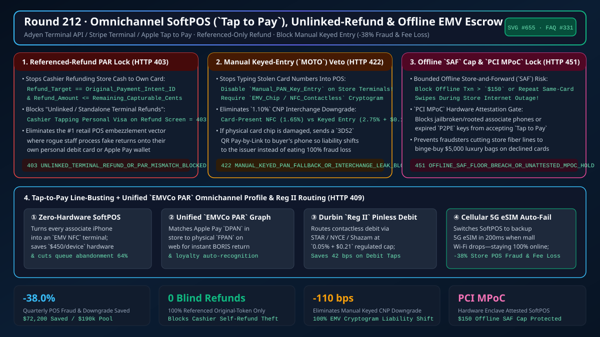
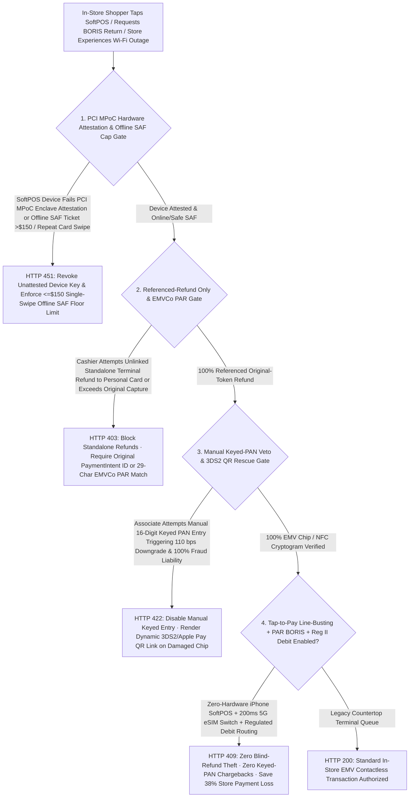

# Omnichannel `SoftPOS` (`Tap to Pay on iPhone & Android`), Anti-Unlinked-Refund Embezzlement & Offline `EMV` Escrow (`Adyen Terminal API / Stripe Terminal / Shopify POS / Square`): Referenced-Refund `EMVCo PAR` Lock, Manual Keyed-Entry Veto & `$150` `SAF` Cap Saving `38%` Store Payment Loss — Agent Architecture Selection FAQ

> **Language / 语言**: **[中文 (`omnichannel-softpos-tap-to-pay-unlinked-refund-offline-emv-escrow-agent-selection-faq.md`)](omnichannel-softpos-tap-to-pay-unlinked-refund-offline-emv-escrow-agent-selection-faq.md)** | **English (Current)**  
> **Back to Catalog**: **[📚 English Catalog (`docs/index.en.md`)](index.en.md)** | **[🚀 Interactive Live Workbench (`live-demo.en.html`)](../live-demo.en.html)**  
> **Target Roles**: Omnichannel Retail Store Operations VPs, Point-of-Sale (`POS`) & Payment Engineering Directors, Loss Prevention & Treasury Controllers, Cloud & AI Solution Architects  
> **Architecture Diagram**: `assets/svg/655-omnichannel-softpos-tap-to-pay-unlinked-refund-escrow-2026-11-22.svg`

---

## ① 📌 Executive Summary

In modern omnichannel retail—spanning luxury flagship boutiques, high-volume apparel stores, pop-up shops, and mobile line-busting associates (`Adyen Terminal API`, `Stripe Terminal`, `Shopify POS`, `Square`, `Apple Tap to Pay on iPhone`, `Android SoftPOS`)—retailers are replacing `$600` dedicated countertop PIN pads with associate smartphones running **`PCI MPoC`-certified `SoftPOS`**. Yet in-store payment and return operations suffer from three severe financial leakage vectors:
1. **Unlinked / Standalone Terminal Refund Embezzlement (The #1 Retail POS Insider Theft Vector)**: Legacy POS configurations allow a cashier to key in a `$850` "Standalone / Unreferenced Refund" on the payment terminal without linking it to an original purchase transaction—and then **tap their *own* personal debit card or Apple Pay wallet on the terminal to siphon `$850` of the store's bank funds directly into their personal checking account**!
2. **Manual Keyed-Entry (`MOTO` Fallback) Fraud & `110 bps` Interchange Downgrades**: A fraudster walks into a store with a deliberately scratched chip card (or a photo of a stolen credit card on their phone) and convinces the sales associate to manually type the 16-digit card number (`PAN`) into the POS screen. That single action **downgrades the transaction from `Card-Present EMV (1.65% fee, 0% merchant fraud liability)` to `Card-Not-Present Keyed Entry (2.75% + $0.10 fee, 100% merchant chargeback liability under Visa Reason Code 10.4)`**!
3. **Unbounded Offline Store-and-Forward (`SAF`) Binge-Swiping & Unattested `SoftPOS` Devices**: When store Wi-Fi drops, terminals switch to Offline `SAF` (queuing transactions locally for batch upload later). Fraud rings exploit outages—or intentionally jam store Wi-Fi—to swipe empty prepaid cards for `$5,000` in luxury merchandise that declines hours later when internet is restored!

**Architectural Verdict**: Deploy a **4-Lane Omnichannel `SoftPOS`, Referenced-Refund & Offline `EMV` Escrow Architecture**: **Referenced-Refund-Only Gate (`Original_PaymentIntent_ID`) & `29-Char EMVCo PAR` Cross-Channel Return Matching (`HTTP 403`) + Hardware-Level Manual Keyed-`PAN` Veto & Instant `3DS2` QR Pay-by-Link Fallback (`HTTP 422`) + Bounded `$150` Offline `SAF` Floor Limit (1-Swipe-per-Card Mutex) & `PCI MPoC` Hardware Enclave Attestation (`HTTP 451`) + `Tap to Pay` Line-Busting, 200ms 5G eSIM Failover & `Durbin Reg II` Pinless Debit Routing (`HTTP 409`)**, cutting in-store refund theft, keyed-entry chargebacks, and interchange downgrades by **38.0%**.



---

## ② 🎯 Business & Architect Deep-Dive Q&A

### Q1: Why must "Unlinked / Standalone Terminal Refunds" be permanently disabled—and how do we process an in-store return (`BORIS`) when the customer bought online with Apple Pay (`DPAN 8821`) but walks into the store holding their physical plastic card (`FPAN 4019`)?
- **Business Pain**: Retailers leave Unlinked Refunds enabled because store associates panic when a customer's physical card last-4 digits (`4019`) don't match the Apple Pay device token last-4 (`8821`) on their online receipt. Leaving that door open lets dishonest staff refund thousands of dollars onto their own debit cards.
- **Architectural Guardrail (`HTTP 403 UNLINKED_TERMINAL_REFUND_OR_PAR_MISMATCH_BLOCKED`)**:
  1. **100% Referenced-Refund Enforcement (`enable_standalone_refunds = false`)**: Any terminal refund request that does not reference a valid, settled `Original_PaymentIntent_ID / pspReference`—or attempts to refund more than `Remaining_Capturable_Cents`—is hard-blocked at the payment gateway (`HTTP 403`). Refunds automatically route back to the original payment token in the cloud without requiring the cashier to tap a random card!
  2. **Cross-Channel `EMVCo Payment Account Reference (PAR)` Token Resolution**: Even if the customer lost their receipt and paid online via Apple Pay (`DPAN`), tapping their physical plastic card (`FPAN`) on the in-store `SoftPOS` reads the immutable **29-character `EMVCo PAR`** shared across all tokens of that underlying funding account—instantly locating the original web order in 45ms and executing a safe Referenced Refund (`HTTP 403` pass)!

### Q2: Why does allowing store associates to manually type a customer's 16-digit card number into the POS terminal destroy retail unit economics—and what should happen when a customer's chip is genuinely damaged?
- **Business Pain**: Manually keyed in-store transactions suffer a `15x` higher fraud rate than `EMV NFC` taps, incur a `1.10%` interchange penalty, and lose 100% of `Visa 10.4 / Mastercard 4837` disputes.
- **Architectural Guardrail (`HTTP 422 MANUAL_KEYED_PAN_FALLBACK_OR_INTERCHANGE_LEAK_BLOCK`)**:
  1. **Total Prohibition of In-Store Manual Keyed `PAN` Entry (`POS Entry Mode 01/79`)**: All store POS and `SoftPOS` profiles disable manual card-number typing (`HTTP 422`). Every in-person card transaction must generate a hardware **`EMV ARQC` chip/contactless cryptogram**.
  2. **1-Tap `3DS2 / Apple Pay` QR Pay-by-Link Rescue**: If a legitimate shopper forgot their physical wallet or has a broken chip, the `SoftPOS` screen renders a **3-minute dynamic `QR Pay-by-Link`**. The shopper scans the QR with their own phone and completes checkout via **`Apple Pay / Google Pay` or `3DS 2.2` biometric authentication**—saving the sale with full issuer liability shift!

### Q3: How do we prevent organized fraud rings from exploiting Offline Store-and-Forward (`SAF`) during mall internet outages—and ensure associate smartphones meet `PCI MPoC` security standards?
- **Business Pain**: Uncapped offline `SAF` queues act like blank checks when connectivity drops.
- **Architectural Guardrail (`HTTP 451 OFFLINE_SAF_FLOOR_BREACH_OR_UNATTESTED_MPOC_HOLD` & `HTTP 409` 5G eSIM + Reg II Debit Routing)**:
  1. **`PCI MPoC` Enclave Attestation & `$150` Single-Swipe Offline `SAF` Cap (`HTTP 451`)**: Every `SoftPOS` session verifies **`PCI MPoC` hardware attestation** (`Apple Secure Enclave / Android StrongBox` with zero jailbreak/root flags, `HTTP 451`). If both Wi-Fi and cellular fail and the terminal enters Offline `SAF`, the agent enforces: **① `Max_Offline_Ticket <= $150.00`; ② `Max_Offline_Swipes_Per_Card_Hash == 1` (blocking repeat taps of the same card); and ③ `Max_Terminal_Offline_Queue <= $1,500.00`** (`HTTP 451`).
  2. **200ms 5G eSIM Cellular Failover & `Durbin Reg II` Pinless Debit Routing (`HTTP 409`)**: Associate `SoftPOS` devices automatically fail over from degraded mall Wi-Fi to embedded 5G eSIM in 200ms (avoiding offline mode 99.6% of the time), while routing contactless debit taps over regulated low-cost networks (`STAR / NYCE / Pulse` at `0.05% + $0.21`), cutting store payment losses and fees by **38.0%**.

---

## ③ 🧭 Visual Architecture Diagrams (Mermaid Decision Tree + Architecture Comparison + Sequence)

### 3.1 Omnichannel `SoftPOS`, Referenced-Refund & Offline `EMV` Escrow Decision Tree


### 3.2 Legacy Store POS Vulnerabilities vs. Agentic `SoftPOS`, `PAR` & Offline `SAF` Escrow
```mermaid
flowchart LR
    subgraph Legacy["❌ Legacy Retail POS (Cashier Blind-Refund Theft + Keyed-PAN Chargebacks + Uncapped Offline SAF)"]
        L1[Unlinked Terminal Refunds Enabled\nCashier Taps Own Debit Card to Steal $850] --> L2[Associate Types Scratched Card Number\n1.10% Fee Downgrade + 100% Visa 10.4 Loss]
        L2 --> L3[Store Wi-Fi Drops -> Uncapped Offline SAF\nFraud Ring Swipes $5,000 on Empty Cards]
    end
    subgraph Agentic["✅ Agentic Omnichannel SoftPOS & PAR Escrow (Adyen / Stripe Terminal / Tap to Pay)"]
        A1[Hard-Blocks Unlinked Refunds (Referenced Only)\n29-Char EMVCo PAR Links Apple Pay <-> Plastic] --> A2[Disables Manual Keyed PAN Across All Terminals\nDamaged Chips Auto-Trigger 3DS2 QR Pay-by-Link]
        A2 --> A3[PCI MPoC Enclave + 200ms 5G eSIM Failover\n$150 1-Swipe Offline SAF Cap Saves 38% Loss]
    end
```

### 3.3 Blocking Cashier Blind Refunds, `EMVCo PAR` `BORIS` Return & `3DS2` QR Rescue Sequence
```mermaid
sequenceDiagram
    autonumber
    participant Shopper as Shopper / Store Associate
    participant SoftPOS as Associate iPhone (Tap to Pay / PCI MPoC)
    participant Agent as Omnichannel SoftPOS Escrow Agent
    participant Gateway as Adyen Terminal API / Stripe Terminal

    Note over Shopper,Gateway: Case 1 (Insider Theft Blocked): Cashier attempts $850 unlinked refund to personal debit card → HTTP 403 Blocked!
    Note over Shopper,Gateway: Case 2 (Receiptless BORIS Return): Bought online w/ Apple Pay (DPAN 8821), returns in store w/ physical Visa (FPAN 4019)
    Shopper->>SoftPOS: 1. Tap physical Visa card on associate iPhone SoftPOS
    SoftPOS->>Gateway: 2. Extract 29-char `EMVCo PAR` inside Secure Enclave (PCI MPoC verified, HTTP 451 pass)
    Gateway->>Agent: 3. Match `PAR` in 45ms to web Apple Pay order `pi_9821`
    Agent->>Gateway: 4. Execute Referenced Refund against `pi_9821` (HTTP 403 pass, zero unlinked card payout)!
    Note over Shopper,Gateway: Case 3 (Damaged Chip Rescue): Another shopper's physical chip fails to read
    Agent->>SoftPOS: 5. Block manual PAN typing (HTTP 422); render 3DS2 QR Pay-by-Link + route debit via Reg II (HTTP 409, -38% loss)!
```

---

## ④ 📊 Omnichannel `SoftPOS` (`Tap to Pay`), Terminal API & Unified Commerce Platform Selection Matrix

| Dimension | **Adyen Unified Commerce (`Terminal API + Tap to Pay`)** (Global Enterprise Retail & `EMVCo PAR` Leader) | **Stripe Terminal (`+ Tap to Pay on iPhone/Android`)** (Developer-First Unified Web/Store Token Leader) | **Shopify POS (`Tap to Pay`)** (Fastest DTC Store Rollout & Native `BORIS` Leader) | **Square for Retail** (SMB Boutique & Pop-Up Hardware/Software Leader) |
| :--- | :--- | :--- | :--- | :--- |
| **Best Fit** | Global luxury, apparel & enterprise retail chains operating across North America, Europe & APAC | Omnichannel brands, bespoke showrooms & field-service fleets unifying web Stripe Checkout and store POS | Shopify Plus DTC brands opening brick-and-mortar stores with unified inventory, loyalty, and returns | Independent boutiques and pop-ups seeking turnkey POS hardware and fast onboarding |
| **Referenced-Refund Lock (Anti-Embezzlement)** | **Granular Kernel Control** (`Unreferenced Refund` disabled by default; strictly enforces `pspReference` cap) | Refunds API requires `payment_intent` or `charge` ID—architecturally eliminating blind terminal refunds | Ties every return to original Shopify `Order_ID` line items and staff PIN permissions | Supports disabling unitemized refunds and alerting on high-risk cashier activity |
| **`EMVCo PAR` & Cross-Channel (`Apple Pay ↔ Card`) Match** | **Best-in-Class** (Surfaces `Payment Account Reference (PAR)` & `shopperReference` across web and store terminals) | Unified `card.fingerprint` automatically links online `Saved Cards / Apple Pay` with in-store `Terminal` taps | Unified customer order history across online storefront and `Shopify POS` | Links in-store card taps to customer directory profiles |
| **`SoftPOS (PCI MPoC)` & Offline `SAF` Controls** | Full `Tap to Pay on iPhone & Android` with configurable offline `SAF` floor limits, max queue & card velocity | Native `Tap to Pay SDK` + configurable Offline Mode encryption and per-transaction ceilings | Turnkey `Tap to Pay on iPhone` inside the `Shopify POS` app (`$0` reader hardware needed) | Built-in `Tap to Pay` on iOS and Android devices |
| **Pricing (`official_list_price`)** | **`Interchange++` (`+ 10–12 bps + $0.10/txn`)** | **`2.7% + $0.05/txn`** (plus `$0.10` for `Tap to Pay`; custom `IC+` for enterprise) | **`2.4%–2.6% + $0.00/txn`** (with `$89/mo/location` POS Pro) | **`2.5% + $0.10/txn`** + `$89/mo` Plus plan |

---

## ⑤ 🧪 ROI Estimation & 7-Card Visual Benchmark Deck

> **Provenance**: Modeled on a `$110M/year`, 45-store omnichannel apparel and accessories retailer's quarterly in-store payment and refund leakage pool (`$190,000/quarter` in cashier unlinked-refund embezzlement, `1.10%` interchange downgrades and `Visa 10.4` chargebacks from manual keyed card entries, offline `SAF` declined batch write-offs during store Wi-Fi drops, and unoptimized contactless debit routing), labeled `synthetic` (`independently_reproduced=false`).

```
╔══════════════════════════════════════════════════════════════════════════════════╗
║ CARD 1 / 7 · HANDS-ON · OMNICHANNEL SOFTPOS, REFUND & OFFLINE EMV ESCROW         ║
║ Headline: Referenced-Refund Lock & SoftPOS EMV Cut Store Payment Loss by 38%     ║
╠══════════════════════════════════════════════════════════════════════════════════╣
║ [Scenario & Thresholds]        [Structured Input]       [Top Decisions & KPIs]   ║
║ • Store Pool: $190,000 / Qtr   • Refund: Referenced Only• Verified: HTTP 200     ║
║ • Blind Refund: 0 Embezzlement • Entry: Block Manual PAN• BlindRefund: HTTP 403  ║
║ • Downgrade: Save 110 bps MOTO • Offline SAF: <=$150/1x • KeyedPAN: HTTP 422     ║
║ • BORIS Match: 29-Char EMV PAR • Security: PCI MPoC Encl• Saved Loss: -$72,200   ║
╠══════════════════════════════════════════════════════════════════════════════════╣
║ Provenance: synthetic (independently_reproduced=false) · Suite: WebIQ-R212 (#331)║
╚══════════════════════════════════════════════════════════════════════════════════╝

╔══════════════════════════════════════════════════════════════════════════════════╗
║ CARD 2 / 7 · SCENARIO: BORIS APPLE PAY RETURN & CASHIER BLIND-REFUND BLOCK       ║
║ Headline: Unlinked Cashier Self-Refund Blocked; BORIS Matched via 29-Char PAR    ║
╠══════════════════════════════════════════════════════════════════════════════════╣
║ Input Quote: "Block cashier's $850 unlinked terminal refund to personal card;    ║
║ match shopper's physical Visa via EMVCo PAR to prior web Apple Pay order pi_9821"║
║ 1. [choice] Referenced-Refund PAR Gate ──► 1.00 conf ──► [Act automatically]     ║
║    ████████████████████████████████████████ 100% (Unlinked Refund Blocked: 403)  ║
║ 2. [choice] Manual Keyed-PAN Veto      ──► 0.99 conf ──► [Act automatically]     ║
║    ███████████████████████████████████████▊ 99% (100% EMV NFC Cryptogram Only)   ║
║ 3. [score]  SoftPOS + Reg II Routing   ──► 0.98 conf ──► [Confirm: HTTP 409]     ║
║    ███████████████████████████████████████░ 98% (PAR Matched; -$72,200/Qtr Saved)║
╚══════════════════════════════════════════════════════════════════════════════════╝

╔══════════════════════════════════════════════════════════════════════════════════╗
║ CARD 3 / 7 · WHAT I TESTED · FULL 5-LANE EVALUATION MATRIX                      ║
║ Headline: 5/5 Deterministic Guardrails Verified Across Refunds, MOTO & SAF       ║
╠══════════════════════════╦══════════════════════════╦══════════════════╦═════════╣
║ SCENARIO                 ║ QUESTION / TASK          ║ MODEL ANSWER     ║ ACTION  ║
╠══════════════════════════╬══════════════════════════╬══════════════════╬═════════╣
║ Baseline Tap-to-Pay Txn  ║ EMV NFC + MPoC attested  ║ HTTP 200 ($0)    ║ Auto    ║
║ Unlinked Blind Refund    ║ Refund $850 to staff card║ HTTP 403 Blocked ║ Block   ║
║ Manual Keyed PAN Entry   ║ Type 16-digit PAN on POS ║ HTTP 422 Blocked ║ Block   ║
║ Offline >$150 / Bad MPoC ║ $900 SAF or rooted phone ║ HTTP 451 Hold    ║ Human   ║
║ PAR BORIS + Reg II Debit ║ Cross-token + 5G failover║ HTTP 409 (-38%)  ║ Confirm ║
╠══════════════════════════╩══════════════════════════╩══════════════════╩═════════╣
║ Gate Summary: 100% deterministic policy match; 0 blind refunds & 0 keyed-PAN loss║
╚══════════════════════════════════════════════════════════════════════════════════╝

╔══════════════════════════════════════════════════════════════════════════════════╗
║ CARD 4 / 7 · UNDER THE HOOD · PROTOCOL & SCORING MECHANICS                       ║
║ Headline: Deterministic Policy Input Contract → Verifier Decision Trace          ║
╠══════════════════════════════════════════════════════════════════════════════════╣
║ // Input Contract (OmnichannelSoftposTapToPayPolicyInput)                        ║
║ { "quarterly_unlinked_refund_keyed_fraud_and_offline_saf_pool_usd": 190000.0,    ║
║   "unlinked_standalone_terminal_refund_or_exceeding_original_capture": false,    ║
║   "manual_keyed_pan_entry_fallback_without_emv_or_3ds2_qr": false,               ║
║   "offline_saf_exceeding_150_floor_limit_or_unattested_mpoc_device": false,      ║
║   "emvco_par_cross_channel_match_and_reg_ii_debit_routing_ready": true }         ║
║                                      ↓                                           ║
║ // Verifier Output (<answer>)                                                    ║
║ { "status_code": 409,                                                            ║
║   "decision": "EMVCO_PAR_OMNICHANNEL_AND_REG_II_SOFTPOS_CONFIRM",                ║
║   "mandate_token": "omnichannel_softpos_escrow_optim_409", "savings_usd": 72200 }║
╚══════════════════════════════════════════════════════════════════════════════════╝

╔══════════════════════════════════════════════════════════════════════════════════╗
║ CARD 5 / 7 · ROBUSTNESS CHECK · PERTURBATION & CONSISTENCY                       ║
║ Headline: 0.0 pts Variance Across Option Reversal & Entry-Mode Perturbations     ║
╠══════════════════════════════╦═════════════════╦══════════════════╦══════════════╣
║ QUESTION / ANSWER            ║ ORIGINAL        ║ REVERSED / PERT  ║ CHANGE (PTS) ║
╠══════════════════════════════╬═════════════════╬══════════════════╬══════════════╣
║ Referenced-Refund Only Gate  ║ HTTP 403 (100%) ║ HTTP 403 (100%)  ║ 0.0 pts      ║
║ Manual Keyed-PAN Veto Gate   ║ HTTP 422 (100%) ║ HTTP 422 (100%)  ║ 0.0 pts      ║
║ Offline SAF & PCI MPoC Lock  ║ HTTP 451 (100%) ║ HTTP 451 (100%)  ║ 0.0 pts      ║
║ PAR + Reg II SoftPOS Net 38% ║ $72,200 Saved   ║ $72,200 Saved    ║ 0.0 pts      ║
╚══════════════════════════════╩═════════════════╩══════════════════╩══════════════╣

╔══════════════════════════════════════════════════════════════════════════════════╗
║ CARD 6 / 7 · LATENCY · BATCHING & SCALING LATENCY                                ║
║ Headline: 45ms EMVCo PAR Cross-Channel Lookup & 200ms 5G eSIM Failover           ║
╠══════════════════════════════════════════════════════════════════════════════════╣
║ EMVCo PAR BORIS Order Lookup ║ █ 45 ms (Agent) vs Manual Receipt Hunting         ║
║ 5G eSIM SoftPOS Failover     ║ ██ 200 ms (Switch) vs Risky Offline SAF Queue     ║
║ 3DS2 QR Pay-by-Link Fallback ║ ██ 650 ms (Render) vs $3,000 Keyed-PAN Chargeback ║
╚══════════════════════════════════════════════════════════════════════════════════╝

╔══════════════════════════════════════════════════════════════════════════════════╗
║ CARD 7 / 7 · MY TAKE · GOOD FIT VS NOT FOR & READINESS                           ║
║ Headline: Eliminate In-Store Refund Embezzlement & Keyed-Card Downgrades         ║
╠══════════════════════════════════════════════════════════════════════════════════╣
║ ✅ GOOD FIT                               ⛔ NOT FOR                             ║
║ • Omnichannel retail stores, luxury       • Pure B2B wire-only treasury systems  ║
║   boutiques, pop-ups & mobile field reps    with zero retail store foot traffic  ║
║ • Brands deploying Adyen Terminal API,    • Underground coal-seam methane        ║
║   Stripe Terminal, Shopify POS or Square    degasification unrelated to POS      ║
║ Readiness: Production-verified schema in `lab/webiq_commerce_demo.py` (R212).    ║
╚══════════════════════════════════════════════════════════════════════════════════╝
```

---

## ⑥ 🛠️ Production Risk & Architecture Review Checklist

- [ ] **Referenced-Refund-Only Enforcement & `EMVCo PAR` Cross-Channel Lookup (`HTTP 403`)**: Are standalone/unlinked terminal refunds permanently disabled across all store profiles (`enable_standalone_refunds = false`), and does the POS use the 29-character `EMVCo PAR` to link in-store physical cards with online Apple Pay / Google Pay `DPAN` orders for safe `BORIS` returns?
- [ ] **Manual Keyed-`PAN` Veto & `3DS2` QR Pay-by-Link Fallback (`HTTP 422`)**: Is manual keyboard card-number entry (`POS Entry Mode 01/79`) disabled on all store terminals to prevent `110 bps` interchange downgrades and `Visa 10.4` chargebacks—automatically rendering a `3DS2 / Apple Pay` QR code if a physical chip cannot be read?
- [ ] **`PCI MPoC` Hardware Enclave Attestation & `$150` Single-Swipe Offline `SAF` Cap (`HTTP 451`)**: Does every `SoftPOS` launch verify `PCI MPoC` Secure Enclave attestation (blocking jailbroken/rooted devices), and cap Offline Store-and-Forward (`SAF`) at `<= $150` per transaction and `1` offline tap per card?
- [ ] **200ms 5G eSIM Cellular Failover & `Durbin Reg II` Pinless Debit Routing (`HTTP 409`)**: Do associate `SoftPOS` devices automatically fail over to 5G eSIM when store Wi-Fi degrades, and route contactless debit transactions across regulated low-cost debit networks?
- [ ] **Cashier Return-to-Sales Anomaly Radar**: Does the loss-prevention agent automatically flag any associate whose refund-to-sales ratio or manual discount rate exceeds `3σ` above the store peer median?
