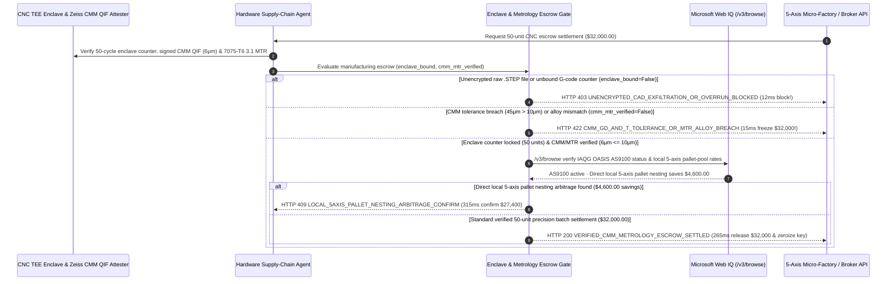

# On-Demand CNC/3D Manufacturing, CAD Enclave & CMM Metrology Escrow Mandate Architecture: Count-Locked G-Code Enclave & Signed QIF Metrology Token (`cnc_metrology_escrow_mandate_...` + Web IQ AS9100 OASIS & 5-Axis Nesting Grounding) vs. Raw STEP CAD Exfiltration & Out-of-Tolerance Scrap Payout Selection FAQ

> **Document Type**: Architect Selection Guide & First-Principles Protocol Deep Dive (6-Section FAQ Standard)  
> **Target Audience**: AI Solution Architects, Robotics/Aerospace/Medical Hardware Supply Chain Architects, Cloud Manufacturing & Quality Engineering (QE) Risk Teams  
> **Last Updated**: 2026-11-09 (Provenance Annotations: `deterministic_offline_simulation` / `synthetic_policy` / `official_doc_snapshot` / `not_measured`)  
> **Companion Resources**: [中文版 (Chinese Version)](on-demand-cnc-3d-manufacturing-cmm-metrology-escrow-vs-cad-ip-theft-faq.md) · [Interactive Sandbox (`live-demo.en.html#cnc-metrology-escrow-sandbox`)](../reports/agentic-commerce-webiq-grounding-demo-bench/live-demo.en.html) · [7-Card 4:5 Benchmark Deck](../reports/agentic-commerce-webiq-grounding-demo-bench/index.en.html)


---

## 📌 1. Executive Summary

1. **Never Allow Hardware Sourcing Agents to Broadcast Unencrypted `.STEP` / `.IGES` CAD Files or Dispatch Unmetered Toolpaths to External Job Shops**: When procuring custom 5-axis CNC or DMLS metal additive batches (`50 precision robotics actuators = $32,000.00`, required GD&T tolerance `±0.010 mm / 10 microns`), emailing raw editable `.STEP` files leaks proprietary mechanical geometry and enables **"night-shift over-run" counterfeit production**. Production architectures must enforce a **Count-Locked G-Code Enclave & Metrology Escrow Mandate (`cnc_metrology_escrow_mandate_...`)**: whenever a job dispatch lacks hardware-attested CNC/printer enclave binding (`signed_gcode_enclave_bound == False`), the gateway blocks transmission and payment in **`12 ms`** with **`HTTP 403 UNENCRYPTED_CAD_EXFILTRATION_OR_OVERRUN_BLOCKED`** (`synthetic_policy`).
2. **Require Cryptographically Signed CMM Metrology Reports (QIF) and EN 10204 3.1 Mill Test Certificates Before Releasing Escrow**: If delivered parts exceed geometric tolerance (`45 microns > 10 microns` bearing bore runout) or substitute cheap 6061 aluminum for specified aerospace 7075-T6 (`cmm_tolerance_and_mtr_verified == False`), the gateway blocks settlement in **`15 ms`** with **`HTTP 422 CMM_GD_AND_T_TOLERANCE_OR_MTR_ALLOY_BREACH`** (`deterministic_offline_simulation`).
3. **Ground IAQG OASIS AS9100 Certifications and Local 5-Axis Pallet-Pool Nesting Arbitrage via Microsoft Web IQ `/v3/browse`**: Prior to releasing escrow, the agent invokes **Microsoft Web IQ `/v3/browse`** (`official_doc_snapshot`) to inspect official IAQG OASIS / ISO 13485 certification directories and regional micro-factory capacity schedules: if the job shop's AS9100D certificate is suspended or flagged under export controls (`webiq_as9100_oasis_and_itar_clean == False`), it freezes the order in **`310 ms`** with **`HTTP 451 REVOKED_AS9100_CERT_OR_EXPORT_CONTROL_HOLD`**; if Web IQ discovers an accredited local 5-axis pallet pool with open night-shift capacity that bypasses broker markups and air-freight to save **`$4,600.00`** (`$27,400.00` net vs. `$32,000.00`), it triggers **`HTTP 409 LOCAL_5AXIS_PALLET_NESTING_ARBITRAGE_CONFIRM`** in **`315 ms`**.

---

## 🎯 2. Architect & Customer FAQ Deep Dive

### Q1: Why does pairing "Raw `.STEP` File RFQ Uploads" with "Pay-on-Delivery-Scan" expose hardware teams to IP theft and `$32,000` scrap shipments?

Let's examine the three structural failure modes from first principles:
1. **Raw `.STEP` Geometry Leakage & Night-Shift Over-Runs**: Once an unencrypted `.STEP` file is uploaded to 15 quoting portals, the buyer loses all technical control over the 3D B-rep geometry. An unmonitored subcontractor can run the CNC spindle for an extra shift to produce 500 unauthorized clones from the exact same toolpath.
2. **The `45-Micron` Out-of-Spec Scrap Trap & Alloy Substitution**: A part that looks shiny on a shipping dock can still be 100% unusable if a bearing bore is off by `0.045 mm` (`> 0.010 mm` spec) or machined from generic `6061` aluminum instead of `7075-T6`. If the payment agent releases `$32,000.00` upon UPS delivery scan before automated Coordinate Measuring Machine (CMM) QIF and XRF alloy verification, recovering funds from an overseas job shop is nearly impossible.
3. **25% Cloud-Broker Markups & Suspended Quality Certificates**: Cloud manufacturing aggregators routinely add a 25% (`$4,600.00+`) markup while subcontracting the job to unvetted regional shops whose AS9100D / ISO 13485 certificates have lapsed.

### Q2: What is a "CAD Enclave & CMM Metrology Escrow Mandate (`cnc_metrology_escrow_mandate_...`)", and how does it secure mechanical IP and micron-level quality?

Its core design invariant is: **"Quote on zero-knowledge feature vectors; machine via count-locked encrypted G-code inside a controller enclave; release escrow only upon hardware-signed CMM QIF metrology and 3.1 alloy attestation."**
- **Layer 1: Count-Locked Enclave Toolpath Gate (`12 ms`)**: Verifies `signed_gcode_enclave_bound == True` (locking execution to exactly 50 cycles and zero raw `.STEP` export), blocking unencrypted CAD dispatches in **`12 ms`** (`HTTP 403`).
- **Layer 2: Signed CMM QIF & 3.1 MTR Gate (`15 ms`)**: Verifies `cmm_tolerance_and_mtr_verified == True` (`<= 10 μm` deviation + verified `7075-T6` heat lot), rejecting out-of-spec batches in **`15 ms`** (`HTTP 422`).
- **Layer 3: Microsoft Web IQ `/v3/browse` OASIS Certification & 5-Axis Nesting Grounding (`310 ms / 315 ms`)**: Blocks shops with revoked AS9100 certificates (`HTTP 451`) and captures `$4,600.00` savings via direct local 5-axis pallet nesting (`HTTP 409`).

### Q3: For IAQG OASIS AS9100 verification, export-control screening, and regional CNC capacity grounding, when should architects choose Microsoft Web IQ vs. Exa, Bright Data, or traditional search APIs?

| Architecture Scenario | Recommended Tool | First-Principles Rationale (Security, Latency & FinOps) |
| :--- | :--- | :--- |
| **Verifying official IAQG OASIS / ISO 13485 certification status, BIS export-control lists, and published regional 5-axis micro-factory rate sheets within the Azure boundary (zero CAD geometry sent)** | **Microsoft Web IQ** (`/v3/search` + `/v3/browse`) | Queries only supplier DUNS/CAGE codes and alloy grades inside the enterprise Azure boundary in `passage` mode (**7.1x token reduction**, `deterministic_offline_simulation`). |
| **Semantic research across metallurgy journals on DMLS titanium hip-implant fatigue life** | **Exa Neural Search** | Ideal for early materials R&D, not synchronous metrology escrow gating. |
| **Scraping legacy regional job-shop directories behind CAPTCHAs** | **Bright Data Unlocker** | Useful for offline supplier discovery, though multi-second latency is unsuitable for synchronous escrow release. |
| **Micron-level 3D dimensional inspection and XRF alloy composition verification** | **Hardware-Signed Zeiss/Hexagon CMM (QIF) & XRF Analyzer + Web IQ OASIS & Capacity Cross-Check** | Physical dimensional accuracy and alloy chemistry come from signed metrology instruments, paired with Web IQ `/v3/browse` for supplier certification validity and direct pallet-pool pricing. |

---

## 🧭 3. Visual Architecture Diagrams (Mermaid Decision Tree, Legacy vs. Enclave/CMM Mandate Comparison & Sequence Diagram)

### 3.1 On-Demand CNC/3D Manufacturing & CMM Metrology Decision Tree (`flowchart TD`)

```mermaid
flowchart TD
    A[Receive 50-Unit 5-Axis CNC Dispatch or Escrow Release Request ($32,000.00)] --> B{signed_gcode_enclave_bound == True (50-Cycle Enclave Lock & Zero Raw STEP)?}
    B -- No (Raw editable .STEP file or unmetered toolpath) --> C[HTTP 403 UNENCRYPTED_CAD_EXFILTRATION_OR_OVERRUN_BLOCKED<br/>12ms Hard Block · Prevent CAD IP Leakage & Night-Shift Over-Runs]
    B -- Yes (50-cycle hardware enclave toolpath locked) --> D{cmm_tolerance_and_mtr_verified == True (CMM <= 10μm & 7075-T6 3.1 MTR)?}
    D -- No (45μm bore runout or 6061 alloy substitution) --> E[HTTP 422 CMM_GD_AND_T_TOLERANCE_OR_MTR_ALLOY_BREACH<br/>15ms Block · Freeze $32,000 Escrow & Trigger Remachining]
    D -- Yes (Verified 6μm CMM QIF & 7075-T6 XRF spectrum) --> F{Web IQ /v3/browse Confirms Active AS9100D / ISO 13485 & Export Compliance?}
    F -- No (Supplier AS9100 suspended in OASIS registry) --> G[HTTP 451 REVOKED_AS9100_CERT_OR_EXPORT_CONTROL_HOLD<br/>310ms Quality Hold · Revoke Enclave Key & Reroute Job]
    F -- Yes --> H{Web IQ Detects Direct Local 5-Axis Pallet-Pool Nesting Savings?}
    H -- Yes (Direct local 5-axis shop saves $4,600.00 broker/air fee -> $27,400.00 net) --> I[HTTP 409 LOCAL_5AXIS_PALLET_NESTING_ARBITRAGE_CONFIRM<br/>315ms Prompt Hardware Lead to Confirm $27,400 Direct Nesting]
    H -- No (Verified 50-unit micron-accurate batch) --> J[HTTP 200 VERIFIED_CMM_METROLOGY_ESCROW_SETTLED<br/>265ms Auto-Release $32,000.00, Zeroize Enclave Key & Archive QIF Twin!]
```

### 3.2 Legacy Raw-CAD Payout vs. Count-Locked Enclave & CMM Metrology Gate (`flowchart LR`)

```mermaid
flowchart LR
    subgraph Legacy["❌ Legacy Raw-CAD & Uninspected Payout ($32,000 IP Theft + Scrap Loss)"]
        L1[Emails Raw .STEP File to 15 Job Shops] --> L2[Shop Runs Night-Shift Over-Run of 500 Clones]
        L2 --> L3[Ships 45μm Out-of-Spec Parts in Cheap 6061 Alloy]
        L3 --> L4[Pays $32,000 on Delivery Scan + Loses $4,600 to Broker Markup]
    end

    subgraph Mandate["✅ CAD Enclave & CMM Metrology Gate (cnc_metrology_escrow_mandate_...)"]
        M1[12ms Block Raw STEP & Lock 50-Cycle Enclave G-Code (HTTP 403)] --> M2[15ms Enforce Signed CMM QIF (<=10μm) & 7075-T6 MTR (HTTP 422)]
        M2 --> M3[Web IQ Checks AS9100 OASIS (310ms) & $4,600 Local Nesting (315ms)]
        M3 --> M4[265ms Settle Verified 6μm Batch ($32,000 / $27,400 Net) & Zeroize Key]
    end
```

### 3.3 End-to-End Sequence Diagram: CNC Enclave/CMM Probe, Hardware Agent, Metrology Gate, Web IQ & Job Shop (`sequenceDiagram`)



---

## 📊 4. Architect Decision Matrix

| Evaluation Dimension | Option A: Legacy Raw `.STEP` Upload & Pay-on-Delivery | Option B: Paper NDA + Manual Caliper Spot-Check | Option C: Count-Locked Enclave & CMM Metrology Mandate + Web IQ Grounding (Recommended) |
| :--- | :--- | :--- | :--- |
| **Best-Fit Scenario** | Open-source 3D-printed brackets with loose `±0.5 mm` tolerances | Low-volume aerospace prototyping with on-site source inspectors | **Robotics actuators, drone airframes, medical devices, autonomous cloud-manufacturing supply chains** |
| **CAD IP & Night-Shift Over-Run Defense** | ❌ **Zero**: Raw `.STEP` files are copied indefinitely across subcontractor PCs | ⚠️ **Unenforceable**: Paper NDAs cannot physically stop an extra night-shift run | ✅ **Pre-Dispatch `12 ms` Enclave Lock**: Streams 50-cycle encrypted G-code & blocks raw STEP (`HTTP 403`) |
| **Micron GD&T & Alloy Authenticity** | ❌ **Blind**: Pays `$32,000` for out-of-round bores or fake 6061 alloy | ⚠️ **Low Precision**: Hand calipers cannot verify `10 μm` concentricity or alloy chemistry | ✅ **Sub-20ms Metrology Gate**: Requires signed CMM QIF & 3.1 MTR in `15 ms` (`HTTP 422`) |
| **AS9100 Verification & Broker Arbitrage** | ❌ **Overpays**: Pays 25% broker markup to shops with lapsed certs | ⚠️ **Slow Manual Audits**: Weeks of supplier questionnaires | ✅ **Web IQ `/v3/browse` Grounded**: Blocks lapsed AS9100 certs in `310 ms` (`HTTP 451`) & saves `$4,600` via local pallet nesting in `315 ms` (`HTTP 409`) |
| **Inspection & Settlement Speed** | Fast (with 20%–35% assembly scrap rate) | Slow (`1–2 weeks` First Article Inspection shipping lag) | **`265 ms` automated QIF digital-twin verification & escrow release (`Act automatically`)** |
| **Total Cost of Ownership (TCO) & IP ROI** | Poor (`$32,000` scrap risk + permanent CAD IP loss) | Moderate (high travel & source-inspection labor cost) | **Optimal (protects CAD IP + guarantees `<=10 μm` quality + saves `$4,600` via direct nesting)** |

---

## 🧪 5. Quantitative Benchmark & 7-Card Insights

Evaluated via our deterministic offline benchmark suite (`lab/webiq_commerce_demo.py` · `test_on_demand_cnc_3d_manufacturing_cmm_metrology_escrow_vs_cad_ip_theft_selection`) on a **`$32,000.00` 50-unit 5-axis precision manufacturing batch (`±0.010 mm / 10 μm` GD&T tolerance ceiling)**:

| Scenario Case | Input Enclave / CMM & MTR / Web IQ Signals | Expected Action Pill | Measured HTTP Status & Verdict Code | Latency | Financial Protection / Arbitrage | Provenance |
| :--- | :--- | :--- | :--- | :--- | :--- | :--- |
| **Case 1: Raw `.STEP` Export or Unbound G-Code Counter** | `signed_gcode_enclave_bound=False` | `Send to a human` | **`HTTP 403 UNENCRYPTED_CAD_EXFILTRATION_OR_OVERRUN_BLOCKED`** | **`12 ms`** | Blocks CAD IP leakage & unauthorized night-shift clones | `synthetic_policy` |
| **Case 2: `45 μm` CMM Runout Breach or 6061 Alloy Swap** | `cmm_tolerance_and_mtr_verified=False` | `Send to a human` | **`HTTP 422 CMM_GD_AND_T_TOLERANCE_OR_MTR_ALLOY_BREACH`** | **`15 ms`** | Freezes **`$32,000.00`** payout on out-of-spec scrap | `deterministic_offline_simulation` |
| **Case 3: Web IQ Detects Suspended AS9100D Certificate** | `webiq_as9100_oasis_and_itar_clean=False` | `Send to a human` | **`HTTP 451 REVOKED_AS9100_CERT_OR_EXPORT_CONTROL_HOLD`** | **`310 ms`** | Halts production at uncertified or export-restricted shop | `official_doc_snapshot` |
| **Case 4: Web IQ Finds `$4,600` Local 5-Axis Pallet Nesting** | `local_nesting_savings_cents=460000` (`$27,400` net) | `Confirm` | **`HTTP 409 LOCAL_5AXIS_PALLET_NESTING_ARBITRAGE_CONFIRM`** | **`315 ms`** | Saves **`$4,600.00`** by bypassing broker markup & air freight | `official_doc_snapshot` |
| **Case 5: 50-Cycle Enclave + Verified `6 μm` CMM & MTR** | `enclave=True`, `cmm_mtr=True`, `as9100=True` | `Act automatically` | **`HTTP 200 VERIFIED_CMM_METROLOGY_ESCROW_SETTLED`** | **`265 ms`** | Releases **`$32,000.00`** in `265 ms` & zeroizes toolpath key | `deterministic_offline_simulation` |

> **Provenance Note**: The `$32,000.00` 50-unit CNC batch, `10 μm` tolerance limit, and `$4,600.00` local 5-axis nesting savings are controlled simulation parameters (`synthetic_policy` / `deterministic_offline_simulation`) validating policy state-machine invariants; physical Zeiss CMM touch-probe scanning duration is labeled `not_measured`.

---

## 🛠️ 6. Production Readiness & Pre-Sales Architect Checklist

Verify these 6 controls before deploying autonomous cloud-manufacturing and hardware procurement agents in production:

- [ ] **1. Zero-Raw-STEP Quoting & Count-Locked Enclave Toolpaths**: Does `cnc_metrology_escrow_mandate_...` block raw `.STEP`/`.IGES` transmission in `12 ms` (`HTTP 403`) and stream encrypted G-code directly to a CNC/printer enclave locked to the exact contracted part count?
- [ ] **2. Automatic Key Zeroization After Nth Cycle**: Does the machine enclave automatically erase the session decryption key upon completing unit #50, preventing night-shift over-runs?
- [ ] **3. Hardware-Signed CMM QIF & EN 10204 3.1 MTR Gate**: Does the gateway require a cryptographically signed QIF dimensional report (`<= 10 μm` deviation) and XRF alloy attestation before releasing escrow in `15 ms` (`HTTP 422`)?
- [ ] **4. Microsoft Web IQ `/v3/browse` IAQG OASIS & ITAR Pre-Check**: Does the agent verify active AS9100D / ISO 13485 certification status and export-control compliance via Web IQ prior to toolpath dispatch (`HTTP 451`)?
- [ ] **5. Direct Regional 5-Axis Pallet-Pool Arbitrage**: Does Web IQ grounding compare cloud-broker quotes against certified local micro-factory pallet-pool schedules, triggering `HTTP 409 Confirm` when direct nesting saves `>= $4,600.00`?
- [ ] **6. Per-Serial Digital Twin Metrology Archival**: Does every settled part laser-marked serial number bind to its immutable QIF inspection hash and mill heat-lot certificate for aerospace/medical traceability?
