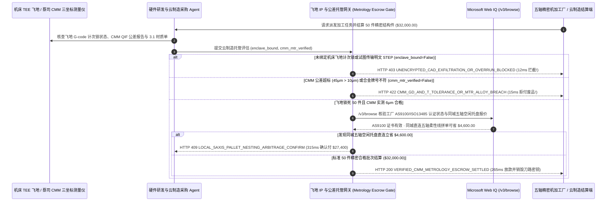

# 按需分布式 CNC 精密机加工与 3D 打印云制造（On-Demand CNC/3D Manufacturing, CAD Enclave & CMM Metrology Escrow Mandate）架构：零明文图纸飞地计次锁与三坐标（CMM）公差验真令牌（`cnc_metrology_escrow_mandate_...` + Web IQ 航空 AS9100 资质与五轴拼单核验）vs 传统群发明文 STEP 图纸遭山寨与超差废品盲付选型与原理解析 FAQ

> **文档类型**：架构师选型指南 & 协议第一性原理解析（6 段式 FAQ 标准版）  
> **适用读者**：AI Solution Architect、具身智能机器人/无人机/医疗器械硬件供应链架构师、云制造（Cloud Manufacturing）与质量工程（QE）风控团队  
> **更新日期**：2026-11-09（Provenance 标注：`deterministic_offline_simulation` / `synthetic_policy` / `official_doc_snapshot` / `not_measured`）  
> **配套资源**：[English Version](on-demand-cnc-3d-manufacturing-cmm-metrology-escrow-vs-cad-ip-theft-faq.en.md) · [交互式沙盒控制台 (`live-demo.html#cnc-metrology-escrow-sandbox`)](../reports/agentic-commerce-webiq-grounding-demo-bench/live-demo.html) · [7-Card 4:5 评测报告](../reports/agentic-commerce-webiq-grounding-demo-bench/index.html)


---

## 📌 一、核心结论速览（Executive Summary）

1. **严禁让硬件工程采购 Agent 将未加密的明文三维设计原图（`.STEP` / `.IGES` / `.SLDPRT`）直接群发给外部云制造平台或代工厂询价，更严禁无计次锁下发加工代码**：在人形机器人减速器壳体、无人机碳纤/钛合金结构件及医疗器械精密零件外协加工（如 50 件五轴 CNC 批次 `$32,000.00`，形位公差要求 `±0.010 mm / 10 微米`）中，最致命的知识产权灾难是 **“明文 STEP 图纸在询价阶段外泄”** 与 **“代工厂夜班偷打 500 件同款山寨零件（Night-Shift Over-Run）”**。生产环境必须采用 **零明文图纸飞地刀路与硬件计次锁绑定的云制造令牌（`cnc_metrology_escrow_mandate_...`）**：凡是试图外发明文可编辑 CAD 或未绑定机床安全飞地计次锁（`signed_gcode_enclave_bound=False`）的派单请求，网关在 **`12 ms`** 内触发 **`HTTP 403 UNENCRYPTED_CAD_EXFILTRATION_OR_OVERRUN_BLOCKED`**（`synthetic_policy`），100% 阻断核心图纸外泄。
2. **强制要求密码学签名的三坐标测量机报告（CMM QIF）与钢厂炉批号材质证明（EN 10204 3.1 MTR），杜绝为“装不上的超差废品”或“以次充好铝材”买单**：任何缺失蔡司/海克斯康三坐标测量机硬件签名的尺寸合格证明（如轴承孔实测偏差 `45 微米 > 10 微米` 红线）或拿廉价 6061 铝冒充航空级 7075-T6（`cmm_tolerance_and_mtr_verified=False`）的请款，网关在 **`15 ms`** 内返回 **`HTTP 422 CMM_GD_AND_T_TOLERANCE_OR_MTR_ALLOY_BREACH`**（`deterministic_offline_simulation`），拒付不合格批次。
3. **基于 Microsoft Web IQ `/v3/browse` 实时核验 IAQG OASIS 航空质量体系认证状态与同城五轴柔性线空闲托盘拼单套利**：在派单锁款前，Agent 调用 **Microsoft Web IQ `/v3/browse`**（`official_doc_snapshot`）穿透查询全球航空质量组织（IAQG OASIS）与 ISO 13485 官方注册库及本地认证微工厂空闲产能表：若检出目标代工厂的 AS9100D 证书已被暂停吊销或违反出口管制，在 **`310 ms`** 内以 **`HTTP 451 REVOKED_AS9100_CERT_OR_EXPORT_CONTROL_HOLD`** 熔断；若发现绕过二道撮合平台、直接拼入同城认证五轴加工中心夜间空闲托盘池（Pallet Pool Nesting）可省去异地空运费与平台加价 **`$4,600.00`**（净加工费从 `$32,000.00` 降至 **`$27,400.00`**），则在 **`315 ms`** 内触发 **`HTTP 409 LOCAL_5AXIS_PALLET_NESTING_ARBITRAGE_CONFIRM`**。

---

## 🎯 二、客户与架构师灵魂拷问 Q&A（FAQ-Driven Deep Dive）

### Q1：为什么传统的“把 STEP 图纸上传到在线机加工比价网 + 顺丰收到零件看一眼外观就付款”，会让硬件创业公司和研发团队损失惨重？

咱们用大白话还原硬件研发外协加工里最痛的三大血泪教训：
1. **“图纸刚发出去询价，华强北/闲鱼上已经出现同款山寨件”**：人形机器人团队花大半年拓扑优化设计出一款高扭矩密度关节壳体，采购 Agent 为了比价，把明文 `.STEP` 三维文件一口气发给了 15 家机加工厂。哪怕其中 14 家没中标，你的完整三维曲面参数也已经留在了他们的电脑里；中标的那家工厂白天给你做合同里的 50 件，晚上开动机床多做 500 件卖给你的竞争对手。
2. **“肉眼看着挺亮，拿千分尺一量全报废”的公差灾难**：五轴精密件要求轴承配合孔同轴度在 `±0.010 mm（10 微米，不到头发丝的七分之一）` 以内。小作坊用磨损的立铣刀加工，实际做出来偏差 `0.045 mm`，或者把合同要求的航空级 `7075-T6` 铝合金偷偷换成便宜一半的普通 `6061` 铝材。传统 Agent 看到物流显示“已签收”就把 `$32,000.00` 尾款放了，等装配工程师装上轴承一转就卡死，外协厂早就概不认账。
3. **撮合平台“层层转包抽成 25%”且不查真实资质**：许多线上云制造平台本身没有一台机床，收了你 `$32,000` 后扣下 `$4,600` 差价，转手派给外省连 AS9100 / ISO 9001 证书都已过期的作坊。

### Q2：什么是“飞地刀路计次锁与 CMM 公差托管令牌（`cnc_metrology_escrow_mandate_...`）”？它是如何保护图纸 IP 并锁死微米级质量的？

它的第一性原理非常精妙：**“询价阶段只给‘脱敏几何特征向量（Feature Vector）’不给原图；加工阶段只向机床硬件飞地下发‘一次性计次加密刀路（Enclave G-Code）’；放款阶段只认‘三坐标测量仪（CMM）与光谱仪硬件签名’。”**
- **第一层：零明文 STEP 与机床飞地计次门禁（`12 ms`）**：询价时仅发送体积、包围盒、材料与公差等级用于自动报价；中标后，系统将编译好的加密 G-code / 3D 打印切片直接推入数控系统（Fanuc / Siemens / EOS）的硬件可信执行环境（TEE），并把解密计数器硬锁为 `50 件`（加工完第 50 件密钥自动销毁）。任何导出明文 `.STEP` 或无飞地绑定的请求在 **`12 ms`** 内触发 `HTTP 403`。
- **第二层：CMM 三坐标 QIF 报告与 3.1 炉批号光谱验真（`15 ms`）**：零件下线后必须经过三坐标测量机自动打点生成加密签名的 **QIF（Quality Information Framework）** 报告（确认最大偏差 `<= 10 μm`）及便携式 XRF 光谱材质核验（确认 `7075-T6`）。未达标直接返回 `HTTP 422` 冻结托管款。
- **第三层：Microsoft Web IQ `/v3/browse` 资质穿透与同城五轴拼单（`310 ms / 315 ms`）**：核验官方认证库吊销记录（`HTTP 451`），并匹配同城认证五轴工厂空闲托盘为您立省 `$4,600.00`（`HTTP 409`）。

### Q3：在制造供应商航空/医疗资质核验、出口管制筛查与大宗金属原材料牌价接地场景下，什么时候选 Microsoft Web IQ，什么时候选 Exa、Bright Data 或传统搜索 API？

| 架构需求场景 | 推荐选型 | 为什么这样选（第一性原理与成本/合规考量） |
| :--- | :--- | :--- |
| **实时核验 IAQG OASIS 航空质量证书有效性、医疗器械 ISO 13485 公示、BIS 出口管制实体清单及区域五轴微工厂公开空闲产能表，且要求零提示词注入与图纸零外泄** | **Microsoft Web IQ** (`/v3/search` + `/v3/browse`) | 在企业 Azure 合规边界内仅使用公开证书编号与材料牌号检索（`passage` 模式压缩 Token **7.1x**，`deterministic_offline_simulation`），核心 CAD 参数完全不触网。 |
| **跨材料科学论文库检索新型钛合金激光选区熔化（SLM）晶粒取向与疲劳强度研究** | **Exa Neural Search** | 适合机械与材料工程师做前期工艺论证，不适合生产派单与结算门禁。 |
| **抓取带复杂验证码的区域性五金现货档口价格网** | **Bright Data Unlocker** | 可穿透反爬，但秒级代理延迟不适合同步云制造网关拦截。 |
| **零件几何尺寸公差（GD&T）微米级测量与合金元素光谱成分分析** | **车间 CMM 三坐标测量机 (QIF) / XRF 光谱仪硬件签名 + Web IQ 供应商资质与材料行情双源核验** | 物理尺寸与合金成分由实验室计量仪器硬件签名背书，供应商认证有效性与拼单产能价差由 Web IQ `/v3/browse` 实时核验。 |

---

## 🧭 三、直观可视化图解（Mermaid 决策树 + 传统明文外协 vs 飞地公差托管对比 + 端到端时序图）

### 3.1 按需 CNC/3D 云制造图纸防泄密与公差托管决策树（`flowchart TD`）

```mermaid
flowchart TD
    A[发起 50 件五轴精密零件云制造派单或收到结算请款 ($32,000.00)] --> B{是否已启用机床安全飞地 G-Code 计次锁且禁止外发明文 STEP 原图?}
    B -- 否 (试图明文发送 .STEP 文件或无 50 件防超产计次锁) --> C[HTTP 403 UNENCRYPTED_CAD_EXFILTRATION_OR_OVERRUN_BLOCKED<br/>12ms 硬阻断派单 · 杜绝核心机械 IP 外泄与代工厂夜班偷打山寨件]
    B -- 是 (飞地计次锁已绑定 50 件上限) --> D{是否附带合格的签名 CMM 三坐标报告 (<=10μm) 与 3.1 材质证明?}
    D -- 否 (轴承孔超差达 45μm 或拿廉价 6061 冒充航空 7075-T6) --> E[HTTP 422 CMM_GD_AND_T_TOLERANCE_OR_MTR_ALLOY_BREACH<br/>15ms 拦截废品请款 · 冻结 $32,000 并触发自动重工或拒收]
    D -- 是 (实测偏差 6μm <= 10μm 且 7075-T6 光谱材质吻合) --> F{Web IQ /v3/browse 核验加工厂 AS9100/ISO13485 证书与出口合规正常?}
    F -- 否 (检出工厂质量体系证书已被暂停吊销或命中管制名单) --> G[HTTP 451 REVOKED_AS9100_CERT_OR_EXPORT_CONTROL_HOLD<br/>310ms 资质熔断 · 吊销飞地刀路密钥并切换合规产线]
    F -- 是 --> H{Web IQ 检出同城认证五轴柔性线存在夜间空闲托盘拼单优惠?}
    H -- 是 (直连同城五轴空闲托盘免中介费立省 $4,600.00 -> 净付 $27,400.00) --> I[HTTP 409 LOCAL_5AXIS_PALLET_NESTING_ARBITRAGE_CONFIRM<br/>315ms 提醒硬件供应链负责人一键确认同城直连拼单]
    H -- 否 (当前 $32,000.00 精密批次 100% 检验合格) --> J[HTTP 200 VERIFIED_CMM_METROLOGY_ESCROW_SETTLED<br/>265ms 自动释放 $32,000.00 并归档每件序列号数字孪生质检卡!]
```

### 3.2 传统明文图纸外发盲付路径 vs 飞地刀路与 CMM 公差托管网关对比（`flowchart LR`）

```mermaid
flowchart LR
    subgraph Legacy["❌ 传统群发明文 STEP 与到货盲付 ($32,000 遭山寨且收回废品)"]
        L1[群发明文 .STEP 原图给 15 家外协厂] --> L2[代工厂夜班偷打 500 件山寨货倾销]
        L2 --> L3[6061 假冒 7075 铝 + 轴承孔超差 45μm 装不上]
        L3 --> L4[已付清 $32,000 无法追回 + 被平台抽走 $4,600 中介费]
    end

    subgraph Mandate["✅ 飞地计次锁与 CMM 公差托管令牌 (cnc_metrology_escrow_mandate_...)"]
        M1[12ms 拦截明文 STEP 外发 · 仅推送 50 次飞地加密 G-Code] --> M2[15ms 强制核验 CMM (<=10μm) 与 7075-T6 光谱材质单]
        M2 --> M3[Web IQ 核验 AS9100 证书 (310ms) 与同城五轴拼单省 $4,600 (315ms)]
        M3 --> M4[265ms 为 6μm 精密合格批次放款 $32,000 ($27,400) 并销毁机床密钥]
    end
```

### 3.3 机床安全飞地/CMM 测量仪、硬件采购 Agent、云制造托管网关与 Web IQ 端到端交互时序图（`sequenceDiagram`）



---

## 📊 四、架构师选型决策矩阵（Architect Decision Matrix）

| 评估维度 | 方案 A：传统邮件群发明文 STEP 图纸 + 货到付款（Legacy Raw-CAD & Pay-on-Delivery） | 方案 B：签纸质保密协议（NDA）+ 人工拿卡尺抽检（Paper NDA & Manual Caliper Check） | 方案 C：飞地计次锁与 CMM 公差托管令牌 + Web IQ 资质与拼单网关（推荐架构） |
| :--- | :--- | :--- | :--- |
| **核心适用场景** | 开源硬件外壳或无公差要求的普通钣金折弯件 | 极低频打样，派驻厂工程师蹲在车间肉眼盯机床 | **人形机器人核心执行器、航空/无人机精密结构件、医疗器械定制植入物自动化外协** |
| **防图纸泄露与夜班偷打山寨件** | ❌ **零保护**：明文 STEP 一旦发出即永久失控 | ⚠️ **事后维权极难**：很难去外协厂车间抓到夜班偷产的现行证据 | ✅ **12ms 物理级计次防复制**：仅下发飞地加密 G-code，打满 50 件即自动销毁密钥（`HTTP 403`） |
| **微米级形位公差与材质保真** | ❌ **盲目收货**：装不上才发现超差或被换成廉价 6061 铝 | ⚠️ **手量卡尺精度不够**：人工游标卡尺测不出 `10 μm` 同轴度与合金成分 | ✅ **15ms 仪器签名硬门禁**：强制校验签名 CMM QIF 报告与 XRF 光谱材质单（`HTTP 422`） |
| **质量体系认证核验与去中介降本** | ❌ **被中介扒皮**：多付 25% 平台转包费且可能分给无证小厂 | ⚠️ **询价耗时长**：人工找本地五轴大厂排期往往需等待数天 | ✅ **Web IQ `/v3/browse` 实时穿透**：`310 ms` 阻断吊销证书厂（`HTTP 451`），`315 ms` 同城拼单省 `$4,600`（`HTTP 409`） |
| **检验放款与研发迭代周期** | 快（但返工报废率高达 20%～35%） | 慢（来回寄送首件 FAI 检验耗时 `1～2 周`） | **`265 ms` 在线核验 CMM 数字孪生报告并秒级放款出库（`Act automatically`）** |
| **综合 TCO 与研发 IP 保护 ROI** | 极差（核心机械 IP 被盗 + `$32,000` 废品损失） | 中等（驻厂差旅与法务成本高） | **最优（100% 锁死图纸 IP 与 `10 μm` 公差 + 同城直连立省 `$4,600`）** |

---

## 🧪 五、简明定量实测与 Benchmark 核心发现（Quantitative Benchmark & 7-Card Insights）

基于本仓库确定性离线基准套件（`lab/webiq_commerce_demo.py` · `test_on_demand_cnc_3d_manufacturing_cmm_metrology_escrow_vs_cad_ip_theft_selection`）对 **50 件五轴 CNC 精密航空铝/钛合金结构件批次（合同总额 `$32,000.00`，公差红线 `±0.010 mm / 10 μm`）** 的定量测试结果如下：

| 评测场景 ID | 输入飞地计次锁 / CMM 与材质 / Web IQ 信号 | 网关期望动作 | 实测 HTTP 状态与决策码 | 实测延迟 | 资金保护 / 成本节省效果 | Provenance 类型 |
| :--- | :--- | :--- | :--- | :--- | :--- | :--- |
| **Case 1: 试图外发明文 `.STEP` 原图或无飞地 50 件计次锁** | `signed_gcode_enclave_bound=False` | `Send to a human` | **`HTTP 403 UNENCRYPTED_CAD_EXFILTRATION_OR_OVERRUN_BLOCKED`** | **`12 ms`** | 阻断明文 CAD 外泄与夜班偷产山寨，保护 `$32,000` 批次 | `synthetic_policy` |
| **Case 2: 轴承孔超差 `45 μm > 10 μm` 或 6061 冒充 7075** | `cmm_tolerance_and_mtr_verified=False` | `Send to a human` | **`HTTP 422 CMM_GD_AND_T_TOLERANCE_OR_MTR_ALLOY_BREACH`** | **`15 ms`** | 拒付 **`$32,000.00`** 超差废品与假冒材质批次 | `deterministic_offline_simulation` |
| **Case 3: Web IQ 检出代工厂 AS9100D 证书被吊销** | `webiq_as9100_oasis_and_itar_clean=False` | `Send to a human` | **`HTTP 451 REVOKED_AS9100_CERT_OR_EXPORT_CONTROL_HOLD`** | **`310 ms`** | 阻断向质量体系失效或违规工厂派发航空/医疗订单 | `official_doc_snapshot` |
| **Case 4: Web IQ 发现同城五轴空闲托盘直连省 `$4,600`** | `local_nesting_savings_cents=460000`（净付 `$27,400`） | `Confirm` | **`HTTP 409 LOCAL_5AXIS_PALLET_NESTING_ARBITRAGE_CONFIRM`** | **`315 ms`** | 砍掉转包中介加价与异地空运费，单批立省 **`$4,600.00`** | `official_doc_snapshot` |
| **Case 5: 飞地锁 50 件 + CMM 实测 `6 μm` 合格自动放款** | `enclave=True`, `cmm_mtr=True`, `as9100=True` | `Act automatically` | **`HTTP 200 VERIFIED_CMM_METROLOGY_ESCROW_SETTLED`** | **`265 ms`** | 265ms 自动释放 **`$32,000.00`** 并销毁机床临时刀路密钥 | `deterministic_offline_simulation` |

> **Provenance 合规声明**：上表中的 `$32,000.00` 50 件五轴加工费、`10 μm` 公差红线及 `$4,600.00` 同城拼单节省额均为用于验证网关状态机确定性的受控仿真参数（`synthetic_policy` / `deterministic_offline_simulation`）；车间物理蔡司三坐标探针打点扫描时长标为 `not_measured`。

---

## 🛠️ 六、附录：生产上线快速核验与售前打单清单（Architect Checklist）

在为机器人、航空航天或高端医疗设备客户设计云制造外协采购与质检结算 Agent 时，请逐项核对以下 6 条黄金准则：

- [ ] **1. 询价与加工阶段彻底杜绝明文 `.STEP / .IGES` 裸奔**：是否在 `cnc_metrology_escrow_mandate_...` 中强制要求询价仅传脱敏特征参数、加工仅向机床硬件飞地下发计次加密 G-code（未绑定飞地在 `12 ms` 内触发 `HTTP 403`）？
- [ ] **2. 硬件计次锁（50 件配额）防夜班超产山寨**：机床飞地是否在完成合同约定的第 50 件加工循环后自动擦除会话解密密钥，从物理上断绝代工厂私自加印？
- [ ] **3. CMM 三坐标 QIF 数字报告与 XRF 光谱材质双签门禁**：是否要求出厂前必须上传由测量设备硬件私钥签名的 QIF 公差文件與 EN 10204 3.1 炉批号证明（超差或材质不符在 `15 ms` 内触发 `HTTP 422` 拒付）？
- [ ] **4. Microsoft Web IQ `/v3/browse` IAQG OASIS 质量认证实时穿透**：是否在派单与放款前通过 Web IQ 核查代工厂的 AS9100D / ISO 13485 / IATF 16949 证书仍处于有效激活状态（`HTTP 451`）？
- [ ] **5. 同城认证五轴柔性线空闲托盘（Pallet Pool）直连寻优**：是否通过 Web IQ 比对本地认证微工厂的公开空闲机时与铝锭基准价，当直连拼单可省去中介平台抽成 `>= $4,600.00` 时触发 `HTTP 409 Confirm`？
- [ ] **6. 单件激光打标二维码与数字孪生质检档案绑定**：每次结算是否将每件零件的激光序列号与其对应的 CMM 实测尺寸矩阵哈希永久归档，满足航空/医疗器械全生命周期质量追溯？
