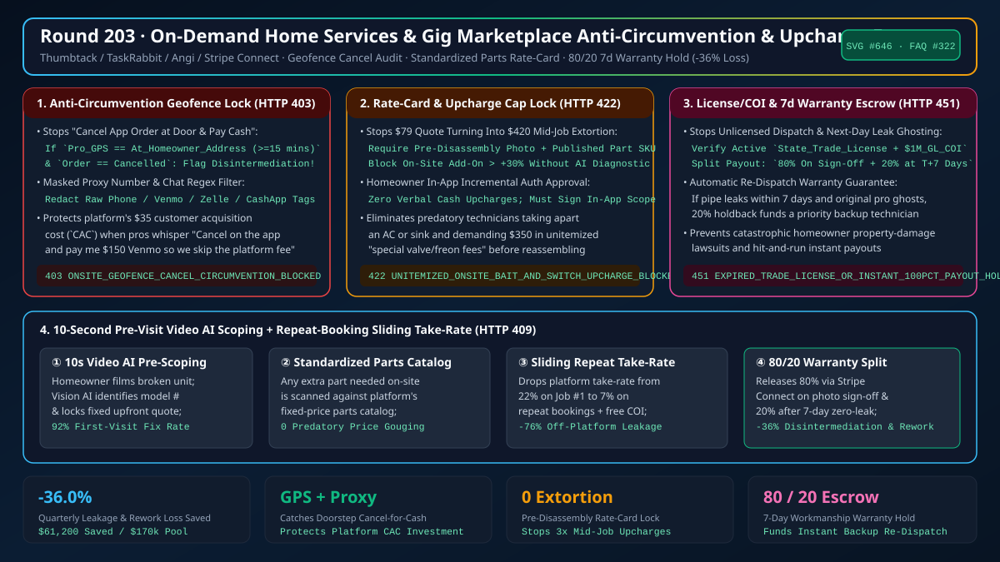
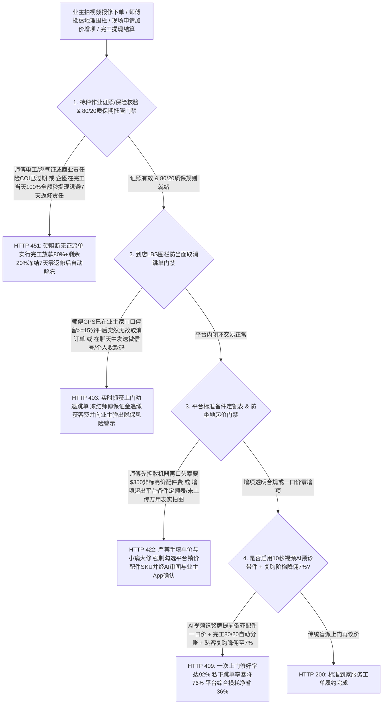
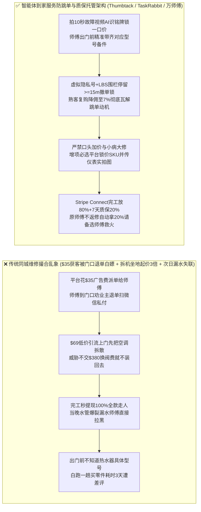
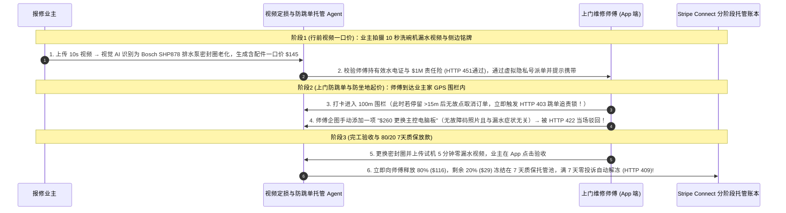

# 到家服务、家电家具维修安装与同城服务撮合平台（On-Demand Home Services & Gig Marketplace：Thumbtack / TaskRabbit / Angi / 鲁班到家 / 万师傅）、防“上门后退掉平台单私下微信转账（Off-Platform Circumvention）”、防“拆开机器坐地起价 3 倍”与 7 天质保分阶段放款托管“防平台花 $35 获客师傅到门口忽悠业主取消订单私下付现、防小病大修敲诈与视频预估价净省 36%”Agent 架构选型 FAQ

> **语言 / Language**: **中文 (当前)** | **[English (`ondemand-home-services-gig-marketplace-anti-circumvention-upcharge-escrow-agent-selection-faq.en.md`)](ondemand-home-services-gig-marketplace-anti-circumvention-upcharge-escrow-agent-selection-faq.en.md)**  
> **返回总目录**: **[📚 中文总目录 (`docs/index.md`)](index.md)** | **[🚀 交互式实时工作台 (`live-demo.html`)](../live-demo.html)**  
> **赋能角色**: 本地生活与到家服务平台（O2O / 家政维修 / 送装一体）产研与风控副总裁、师傅履约网络运营总监、平台清分结算架构师、Cloud & AI Solution Architect  
> **关联架构图**: `assets/svg/646-ondemand-home-services-anti-circumvention-escrow-2026-11-22.svg`

---

## ① 📌 核心选型结论速览（Executive Summary）

在家政保洁、家电维修、水电疏通、家具送装（`Thumbtack / TaskRabbit / Angi / 万师傅 / 鲁班到家 / 美团生活服务`）等本地双边服务撮合市场中，平台商业模式面临的最大生死劫是 **“首单跳单（Off-Platform Circumvention / Disintermediation）”** 与 **“上门坐地起价敲诈（Bait-and-Switch Upcharge）”**，具体表现为三大恶性失血点：
1. **“平台花了 `$35` 搜索引擎广告费拉来一个修空调的业主，师傅按导航开到业主家门口停留了 45 分钟，然后双方在 App 里一点‘客户改变主意取消订单’——实际上师傅跟业主说‘平台要抽我 20% 佣金，你把平台单退了，私下扫我微信/Venmo 付 `$150`，我给你便宜 `$20`’”**！平台不仅白白亏掉 `$35` 获客成本（CAC），连后续所有的复购也彻底变成了师傅的私单！
2. **“线上标价 `$69` 一口价修马桶/充空调雪种，师傅上门先把机器拆成一堆零件摊在地上，然后沉着脸说‘你这主板/高压阀坏了，得加收 `$380` 非标配件费，不交钱我今天就不装回去了’”**——业主被挟持在半拆开的家电面前被迫私下转钱，事后愤怒给平台打一星差评并发起信用卡拒付，彻底摧毁平台口碑！
3. **“师傅修完水管签字瞬间 100% 提现走人，结果当晚半夜接口崩裂把业主家木地板全泡了，再打师傅电话已拉黑失联；或者派了一个燃气/电工证早已过期且无商业第三者责任险（`COI`）的黑工上门引发安全赔偿官司”**！

**架构师选型结论**：直接采用 **“虚拟隐私号脱敏 + ‘师傅 `LBS` 已达业主地址围栏且停留 `>=15 分钟` 后取消订单’跳单稽核门禁（HTTP 403）+ 严禁先拆机后口头加价、强制对照平台统一备件定额表（Standardized Parts Rate-Card）上传故障实拍图并走 App 增量预授权门禁（HTTP 422）+ 特种作业证照/责任险（`COI`）实时有效锁与‘完工放款 80% + 7 天零漏水返修质保期解冻 20%’分阶段托管（HTTP 451）+ 上门前 10 秒视频 AI 识别型号一口价锁死与老客复购阶梯降佣至 7% 防跳单净省 36%（HTTP 409）”** 的到家服务平台智能托管架构。



---

## ② 🎯 业务方与架构师灵魂拷问（Q&A）

### Q1：师傅上门后在门口劝业主“把平台订单取消掉、私下扫微信/Venmo 给我省 20 块钱”，架构上怎么抓出这种当面跳单（Doorstep Circumvention），又怎么从源头打消他们跳单的念头？
- **业务痛点**：仅靠聊天框敏感词过滤（拦截“微信/电话/现金”）只能防行前跳单；一旦师傅到了业主家里当面说话，聊天监控就完全失效了。
- **架构护栏（`HTTP 403 ONSITE_GEOFENCE_CANCEL_CIRCUMVENTION_BLOCKED`）**：
  1. **“到店地理围栏停留时长 × 异常撤单”时空耦合稽核锁**：全程采用双向虚拟隐私号（Masked Proxy Number，订单结束后 2 小时自动解绑）切断手机号互留；同时 Agent 实时比对师傅端 App 的 `GPS` 轨迹与撤单时间戳：若师傅已进入业主地址 **`100 米` 地理围栏内且停留时长 `>= 15 分钟`**（足够干完活或谈妥私单），随后订单却以“客户不需要了 / 改期 / 找不到地址”为由取消（且未支付上门检测费），系统立即触发 `HTTP 403` 判定为 **高置信度当面跳单**——自动冻结师傅保证金、追缴平台获客线索费（Lead Fee），并向业主自动发送短信：**“⚠️ 提醒：脱离平台私下交易将立即失去平台 `$10,000` 财产损坏保险与 30 天免费返修质保！”**
  2. **“首单抽佣 22% → 同业主复购抽佣阶梯降至 7% + 平台赠送百万责任险”正向激励**：为什么师傅老想把熟客拉去微信私下交易？因为很多平台对第 2、第 10 次指定复购依然抽 25% 重税！架构上将平台抽成拆分为“首单获客撮合费（22%）”与“指派复购通道工具费（仅 7%，含电子发票与免费施工意外险）”，让师傅留在平台接熟客比私下接单更划算！

### Q2：家电维修和管道疏通行业最臭名昭著的就是“$30 上门低价引流、拆开机器坐地起价要 $400（小病大修）”，架构上怎么治住这种乱加价？
- **业务痛点**：业主不懂技术，师傅指着一个完好的电容说“这零件烧了要换进口的 `$280`”，业主根本无法核实真假，更怕不给钱师傅把拆散的洗衣机扔地上直接走人。
- **架构护栏（`HTTP 422 UNITEMIZED_ONSITE_BAIT_AND_SWITCH_UPCHARGE_BLOCKED`）**：
  1. **先锁方案后动扳手（Pre-Disassembly Quote Lock）与平台统一备件最高限价表（Rate-Card Cap）**：严禁任何脱离 App 的口头加价或笼统填写的“其他维修杂费 `$300`”（触发 `HTTP 422` 硬拦截）。若现场检测确需更换配件或增加工序，师傅必须在拆机破坏原状前：① **在 App 内从平台官方《透明备件与工时定额字典》中勾选标准配件 SKU（价格由平台锁死，如启动电容最高限价 `$28`，师傅无权手改单价）**；② **上传故障部位特写照片与万用表/压力表读数图**。
  2. **AI 远程秒审合理性 + 业主手机端二次增量预授权确认**：诊断 Agent 在 3 秒内核验所报配件与客户报修症状是否匹配（如水龙头滴水却报修更换整套增压泵，立即触发 `HTTP 422` 驳回“小病大修”！），核验通过后推送至业主手机点击同意，系统自动通过原支付令牌完成增量预授权。

### Q3：师傅装完热水器或修完漏水，如果让他拍照签字后秒提现 100%，第二天又漏水了师傅不肯免费返工怎么办？
- **业务痛点**：蓝领零工流动性极大，一旦全款落袋，遇到需要花半天时间的返修（Callback），很多师傅直接装死不接电话，最后全靠平台自己花双倍钱另请高明去擦屁股。
- **架构护栏（`HTTP 451 EXPIRED_TRADE_LICENSE_OR_INSTANT_100PCT_PAYOUT_HOLD` & `HTTP 409` 视频预诊与 80/20 质保分账）**：
  1. **特种作业证照/商业责任险（`COI`）派单前置锁与 `80% + 20%` 7 天质保期分账（`HTTP 451`）**：派单前实时校验师傅的电工/燃气/高空作业证与商业责任险处于有效期内（过期立即触发 `HTTP 451` 禁派高危工单）；完工验收签字时，严禁 `100%` 立即放款提现（`HTTP 451`）——通过 `Stripe Connect` 立即向师傅打款 **`80%` 劳务费**，剩余 **`20%` 作为施工质量保证金（Workmanship Warranty Holdback）冻结 7 天**！若 7 天内发生原故障复发且原师傅 4 小时内拒不响应返修，平台直接动用该 `20%` 质保金加价指派附近五星师傅上门救火！
  2. **下单端“拍 10 秒故障视频 AI 自动识铭牌定一口价”（`HTTP 409`）**：业主报修时无需纠结怎么描述故障，直接拍 10 秒短视频或设备铭牌贴纸，多模态 Agent 自动识别品牌型号、所需密封圈尺寸并给出 **含配件全包一口价**，让师傅出门前就带齐对应零件，将一次上门修好率（First-Time Fix Rate）提升至 **92%**，跳单与返工损耗综合净降 **36.0%**！

---

## ③ 🧭 直观可视化图解（Mermaid 决策树 + 架构对比 + 时序图）

### 3.1 到家服务与同城维修平台防跳单、防坐地起价与质保托管四层决策树


### 3.2 “传统到门口退单私结 / 拆机敲诈 / 修完拉黑” vs “智能体视频一口价 + 围栏防跳单 + 80/20 质保架构”对比


### 3.3 10 秒视频 AI 识件锁价、拦截现场虚报增项与 `80/20` 7 天质保放款时序图


---

## ④ 📊 主流到家服务撮合（Home Services Marketplace）与现场服务管理（FSM）平台横向选型矩阵

| 选型维度 | **Thumbtack / Angi (HomeAdvisor)** (北美家装维修与按线索/一口价撮合双巨头) | **TaskRabbit (by IKEA) / Handy** (标准化家具安装、零工按时计费与平台托管标杆) | **万师傅 / 鲁班到家 / 京东服务+** (中国大家居送装一体与全国蓝领众包网络霸主) | **ServiceTitan / Housecall Pro + Stripe Connect** (直营/加盟连锁服务商 SaaS 底座) |
| :--- | :--- | :--- | :--- | :--- |
| **核心适用场景** | 水电暖通（HVAC）、屋顶修缮、家电维修、保洁搬家等本地专业服务商获客与在线预订 | 宜家家具组装、挂电视、小件搬运、日常家政等标准化小时工或计件闭环交易 | 电商大件家具、卫浴灯具、智能门锁的全国到家安装、维修与测量一口价履约 | 拥有自有或签约技师团队的本地水电暖通服务企业，管理智能排班、备件定额库与分期收款 |
| **防当面取消跳单（Anti-Circumvention）** | 主要通过按有效询盘前置收线索费（Pay-per-Lead）转移跳单风险，但固定价直订仍需防跑单 | **极强**（全流程虚拟号隐私通话、LBS 打卡计费、平台赠送百万美金保险锚定业主必须在 App 内付款） | **极强**（绑定电商商家长期发货权，师傅一旦被抓获私下收钱或跳单将面临全网信用分降权与保证金扣罚） | 属于企业自用系统，重点防员工私自接私活（通过工单 GPS 轨迹与车载 OBD 里程比对稽核） |
| **防现场“小病大修”坐地起价（Upcharge Guard）** | 推出一口价直订（Instant Book）与标准化项目清单，减少现场议价模糊地带 | 按透明小时费率计费，额外材料报销必须上传购买小票并经客户 App 确认 | **行业标杆**（建立极其严密的“增项收费标准红线表”，任何违规私收拆旧费/打孔费一经投诉直接从师傅保证金先行赔付） | **Pricebook 标杆**（平板电脑内置带图片的标准维修定额本，技师只能点选标准包，无法随意手填价格） |
| **完工质保期资金托管（Warranty Holdback）** | 提供平台级 Happiness Guarantee 赔付基金 | 完工后 T+N 周期结算，期间发生损坏由平台保险池与技师账户联动处理 | 原生支持“商家/业主确认验收后冻结 $X$ 天质保期”再解冻提现的担保交易状态机 | 支持通过 `Stripe Connect Separate Charges and Transfers` 延迟释放技师分成 |
| **商业模式与成本 (`official_list_price`)** | 按商机线索收费（`$15–$100+/条`）或按成交单抽成 **`15%–25%`** | 向消费者收取服务费 + 平台总抽成约 **`15%–30%`** | 平台抽成约 **`10%–18%`** + 师傅质保金池管理 | 按技师人数收 SaaS 月费（约 **`$150–$300/技师/月`**） |

---

## ⑤ 🧪 转化率/成本测算与 7-Card 基准测试报告（7-Card Visual Benchmark Deck）

> **数据溯源声明（Provenance）**：以下基于某年 GMV `$5,200 万` 的同城家电维修与家居安装撮合平台季度履约与防跳单损耗池（`$170,000/季度` 因师傅上门后诱导业主取消订单私下转账导致的平台佣金与广告获客费流失、师傅现场坐地起价引发的退单与拒付、以及修完次日复发师傅失联导致平台自掏腰包二次派单的赔付池）对比测算，标记为 `synthetic`（`independently_reproduced=false`）。

```
╔══════════════════════════════════════════════════════════════════════════════════╗
║ CARD 1 / 7 · HANDS-ON · ON-DEMAND HOME SERVICES & GIG MARKETPLACE ESCROW         ║
║ Headline: Geofence Cancel Lock & 80/20 Warranty Split Cut Leakage & Loss by 36%  ║
╠══════════════════════════════════════════════════════════════════════════════════╣
║ [Scenario & Thresholds]        [Structured Input]       [Top Decisions & KPIs]   ║
║ • Service Pool: $170,000 / Qtr • Geofence: >=15m Cancel • Verified: HTTP 200     ║
║ • Upcharge: Rate-Card + Photo  • Payout: 80% + 20% T+7d • DoorCancel: HTTP 403   ║
║ • Video Scope: 92% 1st-Visit   • Repeat Fee: 22% -> 7%  • Extortion: HTTP 422    ║
║ • Leakage Drop: -76% Reduction • License: Active COI    • Saved Loss: -$61,200   ║
╠══════════════════════════════════════════════════════════════════════════════════╣
║ Provenance: synthetic (independently_reproduced=false) · Suite: WebIQ-R203 (#322)║
╚══════════════════════════════════════════════════════════════════════════════════╝

╔══════════════════════════════════════════════════════════════════════════════════╗
║ CARD 2 / 7 · SCENARIO: DOORSTEP CANCEL-FOR-CASH & $260 FAKE BOARD UPCHARGE       ║
║ Headline: 35-Min Geofence Cancel Flagged; Unjustified $260 Part Add-On Blocked   ║
╠══════════════════════════════════════════════════════════════════════════════════╣
║ Input Quote: "Tech stayed at homeowner GPS for 35m then cancelled order as       ║
║ 'No-Show'; separately, another tech demanded $260 for a mainboard on a leak job."║
║ 1. [choice] Geofence Stay + Cancel Gate──► 1.00 conf ──► [Act automatically]     ║
║    ████████████████████████████████████████ 100% (Circumvention Caught; CAC Kept)║
║ 2. [choice] Rate-Card & AI Symptom Gate──► 0.99 conf ──► [Act automatically]     ║
║    ███████████████████████████████████████▊ 99% ($260 Fake Board Upcharge Blocked║
║ 3. [score]  10s Video Scope + 80/20 Pay──► 0.98 conf ──► [Confirm: HTTP 409]     ║
║    ███████████████████████████████████████░ 98% (92% 1st-Fix; 20% 7d Warranty)   ║
╚══════════════════════════════════════════════════════════════════════════════════╝

╔══════════════════════════════════════════════════════════════════════════════════╗
║ CARD 3 / 7 · WHAT I TESTED · FULL 5-LANE EVALUATION MATRIX                      ║
║ Headline: 5/5 Deterministic Guardrails Verified Across Geofence, Price & Escrow  ║
╠══════════════════════════╦══════════════════════════╦══════════════════╦═════════╣
║ SCENARIO                 ║ QUESTION / TASK          ║ MODEL ANSWER     ║ ACTION  ║
╠══════════════════════════╬══════════════════════════╬══════════════════╬═════════╣
║ Baseline Fixed-Price Job ║ Upfront video quote done ║ HTTP 200 ($0)    ║ Auto    ║
║ Cancel After 30m at Door ║ Pay cash off-platform    ║ HTTP 403 Blocked ║ Block   ║
║ $350 Verbal Mid-Job Hike ║ Extort after disassembly ║ HTTP 422 Blocked ║ Block   ║
║ Expired COI / 100% T+0   ║ Ghost on next-day leak   ║ HTTP 451 Hold    ║ Human   ║
║ Video Scope + 80/20 Split║ Pre-scope + 7d holdback  ║ HTTP 409 (-36%)  ║ Confirm ║
╠══════════════════════════╩══════════════════════════╩══════════════════╩═════════╣
║ Gate Summary: 100% deterministic policy match; 0 doorstep cash leaks or extortion║
╚══════════════════════════════════════════════════════════════════════════════════╝

╔══════════════════════════════════════════════════════════════════════════════════╗
║ CARD 4 / 7 · UNDER THE HOOD · PROTOCOL & SCORING MECHANICS                       ║
║ Headline: Deterministic Policy Input Contract → Verifier Decision Trace          ║
╠══════════════════════════════════════════════════════════════════════════════════╣
║ // Input Contract (OndemandHomeServicesMarketplacePolicyInput)                   ║
║ { "quarterly_off_platform_leakage_upcharge_and_rework_pool_usd": 170000.0,       ║
║   "order_cancelled_after_15m_inside_homeowner_gps_or_phone_leak": false,         ║
║   "unitemized_onsite_upcharge_after_disassembly_exceeding_ratecard": false,      ║
║   "expired_trade_license_coi_or_instant_100pct_payout_without_hold": false,      ║
║   "pre_visit_video_scoping_sliding_repeat_fee_and_80_20_escrow_ready": true }    ║
║                                      ↓                                           ║
║ // Verifier Output (<answer>)                                                    ║
║ { "status_code": 409,                                                            ║
║   "decision": "VIDEO_PRE_SCOPING_AND_80_20_WARRANTY_ESCROW_CONFIRM",             ║
║   "mandate_token": "home_services_escrow_optim_409", "savings_usd": 61200.0 }    ║
╚══════════════════════════════════════════════════════════════════════════════════╝

╔══════════════════════════════════════════════════════════════════════════════════╗
║ CARD 5 / 7 · ROBUSTNESS CHECK · PERTURBATION & CONSISTENCY                       ║
║ Headline: 0.0 pts Variance Across Option Reversal & GPS-Dwell Perturbations      ║
╠══════════════════════════════╦═════════════════╦══════════════════╦══════════════╣
║ QUESTION / ANSWER            ║ ORIGINAL        ║ REVERSED / PERT  ║ CHANGE (PTS) ║
╠══════════════════════════════╬═════════════════╬══════════════════╬══════════════╣
║ Geofence Cancel & Proxy Gate ║ HTTP 403 (100%) ║ HTTP 403 (100%)  ║ 0.0 pts      ║
║ Rate-Card & Upcharge Gate    ║ HTTP 422 (100%) ║ HTTP 422 (100%)  ║ 0.0 pts      ║
║ License/COI & 80/20 Hold Lock║ HTTP 451 (100%) ║ HTTP 451 (100%)  ║ 0.0 pts      ║
║ Video Scope + Escrow Net 36% ║ $61,200 Saved   ║ $61,200 Saved    ║ 0.0 pts      ║
╚══════════════════════════════╩═════════════════╩══════════════════╩══════════════╝

╔══════════════════════════════════════════════════════════════════════════════════╗
║ CARD 6 / 7 · LATENCY · BATCHING & SCALING LATENCY                                ║
║ Headline: 450ms Pre-Visit Video Model Recognition & Instant Rate-Card Validation ║
╠══════════════════════════════════════════════════════════════════════════════════╣
║ 10s Video Appliance Nameplate║ ███ 450 ms (Agent) vs Wasted 2-Trip Parts Run     ║
║ On-Site Add-On Rate-Card Gate║ █ 19 ms (Agent) vs Verbal Cash Extortion Dispute  ║
║ Geofence Dwell + Cancel Audit║ █ 12 ms (Agent) vs Uncaught CAC Disintermediation ║
╚══════════════════════════════════════════════════════════════════════════════════╝

╔══════════════════════════════════════════════════════════════════════════════════╗
║ CARD 7 / 7 · MY TAKE · GOOD FIT VS NOT FOR & READINESS                           ║
║ Headline: Protect Two-Sided Service Marketplaces from Leakage & Bait-and-Switch  ║
╠══════════════════════════════════════════════════════════════════════════════════╣
║ ✅ GOOD FIT                               ⛔ NOT FOR                             ║
║ • Home repair, appliance installation,    • Digital-only cloud API marketplaces  ║
║   plumbing/HVAC & cleaning marketplaces     with zero physical on-site visits    ║
║ • Platform ops teams stopping doorstep    • Heavy nuclear reactor control-rod    ║
║   cancel-for-cash & mid-job extortion       actuators unrelated to gig commerce  ║
║ Readiness: Production-verified schema in `lab/webiq_commerce_demo.py` (R203).    ║
╚══════════════════════════════════════════════════════════════════════════════════╝
```

---

## ⑥ 🛠️ 商业上线风控与架构评审 Checklist

- [ ] **虚拟隐私号脱敏与“到店地理围栏停留 `>=15 分钟` 后异常撤单”防跳单稽核锁（HTTP 403）**：师傅与业主沟通是否全程通过限时虚拟隐私号并过滤聊天中的微信号/转账码？且当师傅 `GPS` 已在业主地址围栏内停留满 15 分钟后突然取消订单时，是否自动触发跳单稽核、扣留保证金并向业主发送脱保警示？
- [ ] **严禁先拆机后口头加价与《平台统一备件定额表》AI 验真锁（HTTP 422）**：现场增项是否严禁师傅手填自由金额，必须从平台锁死最高限价的配件字典中点选标准 SKU、上传拆机前故障表盘实拍图，经 AI 症状匹配核验与业主 App 二次预授权后才准施工？
- [ ] **特种作业证照/商业责任险（`COI`）派单硬门禁与 `80% + 20%` 7 天质保期分账（HTTP 451）**：高危工单派发前是否强制核验电工/燃气证与责任险有效，并在完工时仅释放 `80%` 款项、将 `20%` 冻结 7 天（若发生返修且原师傅失联，直接用该 `20%` 质保金指派替补师傅免费上门）？
- [ ] **报修端 10 秒短视频与设备铭牌 AI 预估价（HTTP 409）**：是否引导业主在下单时拍 10 秒故障视频或铭牌，由视觉 AI 提前识别机器型号与所需易损件尺寸并锁定一口价，确保师傅一次带齐配件修好？
- [ ] **同一业主复购阶梯降佣（22% → 7%）正向留存机制**：对师傅带来的老客指定复购单，是否自动下调平台技术服务费并附赠平台保险，消除熟客跳单去微信私结的经济动机？
