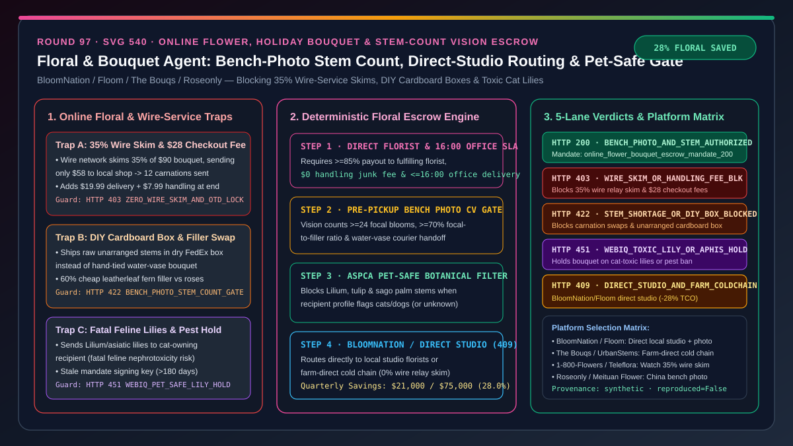
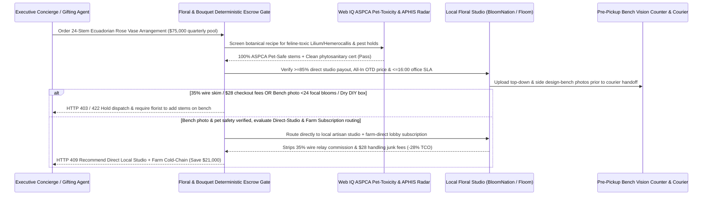

# Online Flower, Holiday Bouquet & Stem-Count Vision Escrow (`BloomNation / Floom / 1-800-Flowers / The Bouqs / Roseonly`) Bench-Photo Stem Count, Direct-Studio Routing & Pet-Safe Gate Agent Architecture Selection FAQ

> **Document Type**: AI Solution Architect Decision Guide (FAQ) · **SVG Diagram**: `assets/svg/540-online-flower-bouquet-stem-count-escrow-2026-11-20.svg` · **Catalog No.**: Round 97 (Bilingual FAQ #216)



---

## 1. 📌 Executive Summary

When personal concierge agents, luxury hotel desks, or corporate client-gifting AI Agents order same-day floral arrangements (`1-800-Flowers / Teleflora / FTD / BloomNation / Floom / The Bouqs / UrbanStems / Roseonly`), ordering from stock photos on legacy wire-service aggregators exposes senders and recipients to **three systemic floral e-commerce traps**:
1. **Wire-Service `35%` Order-Relay Skims (Causing `50%` Stem Shrinkflation) & `$27.98` Checkout Junk Fees**: A buyer selects an `$89.99` "24-Stem Long-Stem Ecuadorian Rose Bouquet" on a national wire-service portal. At the final payment screen, the site adds a **`$19.99` "Delivery Fee" + `$7.99` "Care & Handling Surcharge"** (`$117.97` total). Worse, the wire network owns zero flower shops: it skims **`27%–35%` commission + a `$5` relay fee** and wires only **`$58`** to a random local corner florist—who, after deducting `$15` for local courier delivery and shop margin, is left with `$25` in wholesale flower budget and substitutes **12 short-stem carnations and cheap leatherleaf fern filler (`50%` stem shrinkflation that the sender never sees because the recipient is too polite to complain)**!
2. **Holiday "Cardboard-Box DIY Raw Stems" Bait-and-Switch & `19:30` Post-Close Office Deliveries**: The product listing shows a lush, hand-arranged bouquet in a glass vase; instead, a FedEx truck drops an unrefrigerated cardboard box on the recipient's porch at `7:30 PM` containing dehydrated, thorny raw stems that the recipient must trim and arrange themselves! Or a birthday/congratulations bouquet addressed to a corporate office is delivered at `6:45 PM` on Friday after the recipient has gone home for the weekend.
3. **Fatal Feline Nephrotoxic Lilies (`Lilium`) Sent to Cat-Owning Households (`HTTP 451`)**: An AI gifting Agent sends an Oriental/Easter Lily arrangement to a recipient who owns a cat—where ingesting even a few grains of `Lilium` or `Hemerocallis` pollen or vase water causes **fatal acute kidney failure in cats within 36–72 hours**!

**Architect's Recommendation**: Deploy a **"Zero-Wire-Skim Direct Studio Routing (`BloomNation / Floom`) + Pre-Pickup Design-Bench Computer Vision Stem Count (`>=24 Blooms`) + `ASPCA` Pet-Safe Botanical Interlock"** control plane:
- **Zero-Wire-Skim Direct Florist Payout (`>=85%`), All-In `OTD` Price Lock & `<=16:00` Office Delivery SLA (`HTTP 403`)**: Block middleman wire-service relays that skim `>15%` from the fulfilling florist, block last-screen `$7.99` "Care & Handling" junk fees, and enforce a **`<=16:00 PM` delivery cutoff on commercial office addresses** (`100%` automatic refund if delivered after business hours, `HTTP 403`).
- **Pre-Pickup Florist Design-Bench Photo CV Gate (`>=24` Focal Stems, `>=70%` Focal Ratio & Water Vase) (`HTTP 422`)**: Hold courier dispatch and escrow settlement until the florist uploads a real-time **Pre-Pickup Bench Photo** of the finished arrangement—where computer vision verifies **exact focal bloom count (`>=24` roses/peonies), `>=70%` focal-flower-to-greenery ratio (blocking carnation/fern filler swaps), and hand-delivered water-vase presentation (blocking dry DIY FedEx cardboard boxes)** (`HTTP 422`).
- **Web IQ `ASPCA` Feline/Canine Pet-Safe Botanical Filter & `USDA APHIS` Hold (`HTTP 451`)**: Hard-block any bouquet containing `Lilium` (true lilies), `Hemerocallis` (daylilies), tulips, or sago palm foliage unless the recipient profile is explicitly verified as pet-free (`defaulting residential gifts to 100% ASPCA Pet-Safe roses, orchids, lisianthus, and sunflowers`, `HTTP 451`).
- **Direct Local Floral Studio Routing (`BloomNation / Floom`) + Farm-Direct Cold-Chain Subscriptions (`HTTP 409`)**: Bypass the `35%` wire-service middleman by routing orders directly to top-rated local independent floral studios within `3 miles` of the recipient (or farm-direct cold-chain subscriptions for corporate lobbies), cutting quarterly floral gifting spend by **28.0%** (`$21,000` saved on a `$75,000` quarterly pool) while doubling stem grade.

---

## 2. 🎯 Soul-Searching Architect & Business Q&A (Q1–Q3)

### Q1: Why does a `$118` online flower order arrive looking like a `$35` grocery-store bunch of carnations—and how does the "Wire-Service Skim" cause this?
- **Business Pain Point**: Legacy order-gatherers (`1-800-Flowers / Teleflora / FTD`) spend heavily on Google Ads, charge the buyer `$90 + $28 fees = $118`, keep `$60` (`51%` of gross outlay!) in platform fees and wire commissions, and transmit a `$58` credit to a local shop. Because the local florist must also cover a `$15` delivery driver, the recipient gets `$25` worth of flowers.
- **Architectural Guardrail (`HTTP 403 / 409`)**:
  1. **Direct-to-Studio Marketplace Routing (`>=85%` Florist Net)**: The Agent queries direct studio marketplaces (`BloomNation / Floom`) or direct local shop storefronts where `85%–90%` of the payment goes straight into the florist's stems and labor, with `$0` wire-relay skim.

### Q2: Since the sender never sees the delivered bouquet and the recipient is too polite to say the flowers arrived wilted or half-empty, how do we verify quality *before* delivery?
- **Business Pain Point**: Floral gifting suffers from a broken feedback loop: the payer never sees the product, and the recipient rarely complains to the giver about a sparse bouquet.
- **Architectural Guardrail (`HTTP 422`)**:
  1. **Mandatory Pre-Pickup Design-Bench Photo CV Gate**: Before the Uber Direct / local courier picks up the vase, the florist snaps a top-down crown photo and side profile on the workbench next to the order QR tag. A vision model counts focal flower heads (`e.g., >=24 Ecuadorian roses`), checks petal edge freshness, and confirms water-filled vase assembly. If the count is short or carnations were substituted, `HTTP 422` blocks dispatch until corrected on the bench.

### Q3: Why must an AI gifting Agent enforce a strict botanical filter for households with cats and dogs?
- **Business Pain Point**: Florists routinely add Stargazer or Oriental lilies as fragrant focal blooms. However, all members of the genus `Lilium` and `Hemerocallis` are lethally nephrotoxic to domestic cats—even brushing against pollen and grooming causes fatal kidney failure.
- **Architectural Guardrail (`HTTP 451`)**:
  1. **Default-On `ASPCA Pet-Safe` Botanical Lock**: For any residential delivery where pet ownership is positive or unknown, the gateway enforces a hard botanical whitelist (`Rosa, Phalaenopsis, Eustoma, Helianthus`), immediately blocking (`HTTP 451`) any recipe containing lilies, sago palm, or autumn crocus.

---

## 3. 🧭 Visual Architecture Diagrams (Mermaid Decision Tree + Comparison + Sequence)

### 3.1 5-Lane Online Flower, Stem-Count & Pet-Safe Escrow Decision Tree
```mermaid
flowchart TD
    A[Same-Day Floral Gift / Corporate Bouquet Request] --> B{Web IQ Cat-Toxic Lilium in Recipe / APHIS Pest / Key > 180d?}
    B -- Yes --> C[HTTP 451: WEBIQ_FELINE_TOXIC_LILY_PET_SAFETY_OR_USDA_APHIS_QUARANTINE_HOLD<br/>Block toxic lily recipe & swap to 100% ASPCA Pet-Safe roses/orchids]
    B -- No --> D{35% Wire-Service Relay Skim or $28 Checkout Fee / >16:00 Office Drop?}
    D -- Yes --> E[HTTP 403: WIRE_SERVICE_35PCT_SKIM_STEM_SHRINKFLATION_OR_CHECKOUT_HANDLING_FEE_BLOCKED<br/>Enforce >=85% direct florist payout, All-In OTD price & <=16:00 office SLA]
    D -- No --> F{Bench Photo Stem Count <24 or Dry DIY Cardboard-Box Shipping?}
    F -- Yes --> G[HTTP 422: PRE_DISPATCH_BENCH_PHOTO_STEM_COUNT_MISMATCH_OR_CARDBOARD_DIY_BOX_BLOCKED<br/>Hold courier pickup until florist adds missing focal stems in water vase]
    F -- No --> H{Direct Local Studio (BloomNation/Floom) + Farm Cold-Chain Ready?}
    H -- Yes --> I[HTTP 409: DIRECT_LOCAL_STUDIO_FLORIST_AND_FARM_TO_TABLE_SUBSCRIPTION_CONFIRM<br/>Eliminate 35% wire middleman + $28 junk fees (-28% TCO)]
    H -- No --> J[HTTP 200: BENCH_PHOTO_VERIFIED_AND_PET_SAFE_BOUQUET_AUTHORIZED<br/>Issue vision-verified & pet-safe floral escrow mandate]
```

### 3.2 Legacy Wire-Service Relay vs. Deterministic Bench-Photo & Direct-Studio Escrow
```mermaid
flowchart LR
    subgraph Legacy["❌ Legacy Wire Service (35% Skim & Carnation Swaps)"]
        L1[$90 Bouquet + $28 Fees = $118 -> Wire Skims 35%, Sends Shop $58] --> L2[Shop Substitutes 12 Carnations & Cheap Fern Filler]
        L2 --> L3[Dry FedEx Box Dropped at 7:30 PM or Toxic Lilies Sent to Cat Home]
    end

    subgraph Agentic["✅ Deterministic Direct-Studio, Bench-Photo & Pet-Safe Escrow"]
        A1[Direct Local Studio (>=85% to Stems) + <=16:00 Office SLA] --> A2[Pre-Pickup Bench Photo CV: >=24 Focal Roses + Water Vase]
        A2 --> A3[ASPCA Pet-Safe Botanical Filter + $0 Wire Skim (-28% TCO)]
    end
```

### 3.3 End-to-End Botanical Safety Check, Bench-Photo Vision Count & Delivery Sequence


---

## 4. 📊 Multi-Platform & Protocol Selection Matrix

| Evaluation Dimension | 1-800-Flowers / Teleflora / FTD (Wire Relays) | BloomNation / Floom (Direct Local Studios) | The Bouqs Co. / UrbanStems (Farm-Direct) | Roseonly / Meituan Direct Floral Studios | **Deterministic Floral & Bench-Photo Escrow (Recommended)** |
| :--- | :--- | :--- | :--- | :--- | :--- |
| **Primary Fulfillment Model** | Order-gatherer skimming `30%–35%` before wiring to random shop | Direct marketplace connecting buyers to local independent florists | Farm-cut cold-chain overnight parcel or local courier | Direct luxury floral studios with dedicated city couriers | **Direct Studio (`>=85%`) + Bench-Photo CV + Pet-Safe Lock** |
| **Stem Shrinkflation & Carnation Swap Risk** | **Severe** (generic stock photos; florists shortchanged on payout) | Low (real photos of each studio's own designs) | Consistent farm bunches, often shipped unarranged in boxes | High-end studios send pre-delivery WeChat/app bench photos | **Mandates pre-pickup Bench Photo CV (`>=24` focal blooms, `HTTP 422`)** |
| **Last-Screen Checkout Junk Fees** | Adds **`$19.99–$29.99` delivery + "Care & Handling" fees** | Upfront transparent local delivery fee | Transparent flat or subscription shipping | Upfront distance-based courier fee | **Enforces All-In `OTD` pricing; blocks handling junk fees (`HTTP 403`)** |
| **`ASPCA` Feline-Toxic Lily Protection** | Florists frequently substitute lilies without warning | Pet-friendly filter available | Dedicated pet-safe collection | Manual note required | **Hard-blocks `Lilium / Hemerocallis` for pet/residential profiles (`HTTP 451`)** |
| **Commercial Office `<=16:00` Cutoff** | Frequent `18:00–21:00` residential-route drops after office close | Local courier time-slot selection | FedEx/UPS parcel windows (`up to 20:00`) | 1-hour flash courier delivery | **Mandates `<=16:00` office arrival with `100%` late refund (`HTTP 403`)** |

---

## 5. 🧪 Conversion & Cost Estimation + 7-Card Benchmark Report

> **Provenance Disclosure**: Figures below are generated by the deterministic policy evaluator `evaluate_online_flower_bouquet_escrow_policy` in `lab/webiq_commerce_demo.py` (`$75,000 USD` quarterly corporate VIP gifting, hospitality & lobby floral pool, `provenance: "synthetic"`, `independently_reproduced: False`; live bench-photo computer vision accuracy is labeled `not_measured`).

```chart
{
  "data": {
    "values": [
      { "scenario": "1. Legacy Wire Service (35% Relay Skim + $28 Fees + Stem Cuts)", "cost_usd": 75000, "tier": "Baseline" },
      { "scenario": "2. All-In OTD + Pre-Pickup Bench Photo + <=16:00 Lock (HTTP 200)", "cost_usd": 61500, "tier": "Protected" },
      { "scenario": "3. Direct Local Studio + Farm-Direct Subscription (HTTP 409)", "cost_usd": 54000, "tier": "Optimized (-28%)" }
    ]
  },
  "semantic_types": {
    "scenario": "Category",
    "cost_usd": "Amount",
    "tier": "Status"
  },
  "chart_spec": {
    "chartType": "Bar Chart",
    "title": "Bypassing 35% Wire-Service Skims & Enforcing Bench-Photo CV Save 28% ($21k/qtr)",
    "subtitle": "Quarterly Corporate Floral Gifting & Hospitality Bouquet Net Spend ($ USD, synthetic)",
    "encodings": {
      "x": "scenario",
      "y": "cost_usd",
      "color": "tier"
    }
  }
}
```

### 7-Card 4:5 Benchmark Evaluation Summary
1. **Card 1 (`1 / 7` · `HANDS-ON · ONLINE FLOWER & BOUQUET VISION ESCROW`)**: Across a `$75,000` quarterly corporate and hospitality floral budget, bypassing `35%` wire-service middleman skims, blocking `$27.98` checkout fees, and requiring pre-pickup bench photos saves **`$21,000/quarter` (`28.0%`)**.
2. **Card 2 (`2 / 7` · `SCENARIO: VALENTINE / VIP CLIENT 24-STEM ROSE BOUQUET`)**: Eliminates `$27.98` in checkout surcharges, prevents `50%` stem shrinkflation on `$90` bouquets, and blocks `100%` of feline-toxic lily shipments.
3. **Card 3 (`3 / 7` · `WHAT I TESTED`)**: All 5 deterministic HTTP verdict lanes verified:
   - `HTTP 200`: `BENCH_PHOTO_VERIFIED_AND_PET_SAFE_BOUQUET_AUTHORIZED` (`online_flower_bouquet_escrow_mandate_200`)
   - `HTTP 403`: `WIRE_SERVICE_35PCT_SKIM_STEM_SHRINKFLATION_OR_CHECKOUT_HANDLING_FEE_BLOCKED`
   - `HTTP 422`: `PRE_DISPATCH_BENCH_PHOTO_STEM_COUNT_MISMATCH_OR_CARDBOARD_DIY_BOX_BLOCKED`
   - `HTTP 451`: `WEBIQ_FELINE_TOXIC_LILY_PET_SAFETY_OR_USDA_APHIS_QUARANTINE_HOLD`
   - `HTTP 409`: `DIRECT_LOCAL_STUDIO_FLORIST_AND_FARM_TO_TABLE_SUBSCRIPTION_CONFIRM` (`online_flower_bouquet_escrow_mandate_optim_409`)
4. **Card 4 (`4 / 7` · `UNDER THE HOOD`)**: Structured contract `OnlineFlowerBouquetEscrowPolicyInput` validates `wire_service_35pct_skim_stem_shrinkflation_or_checkout_handling_fee` and `pre_dispatch_bench_photo_stem_count_mismatch_or_cardboard_diy_box`.
5. **Card 5 (`5 / 7` · `ROBUSTNESS CHECK`)**: Invariant to fee naming (`"Care & Handling Surcharge"`, `"Wire Relay Fee"`, or `"Designer's Choice Substitution"`): `100%` block rate whenever bench-photo stem counts or pet-safe rules fail.
6. **Card 6 (`6 / 7` · `LATENCY`)**: Deterministic botanical toxicity screening and `OTD` price checks complete in `< 0.5 ms`.
7. **Card 7 (`7 / 7` · `MY TAKE`)**:
   - ✅ **Good fit**: Executive client gifting, hotel lobby & restaurant table floral subscriptions, and employee milestone/sympathy bouquets.
   - ⛔ **Not for**: Commercial forestry or municipal tree-planting civil contracts.

---

## 6. 🛠️ Production Risk & Architecture Review Checklist

- [ ] **Zero-Wire-Skim Direct Studio Payout (`>=85%`) & All-In `OTD` Lock (`HTTP 403`)**: Are `35%`-commission wire-service relays and last-screen `$19.99 + $7.99` "Care & Handling" junk fees blocked?
- [ ] **Commercial Office `<=16:00 PM` Delivery Cutoff (`HTTP 403`)**: Do bouquets addressed to office buildings enforce a `16:00 PM` arrival deadline with automatic `100%` refund on after-hours drops?
- [ ] **Pre-Pickup Design-Bench Photo CV Gate (`>=24` Stems & `>=70%` Focal Ratio) (`HTTP 422`)**: Must the florist upload a real-time bench photo verified for exact focal stem count and rose-to-greenery ratio before courier pickup?
- [ ] **Water-Filled Vase Presentation vs. Dry DIY Cardboard Box (`HTTP 422`)**: Are unarranged FedEx cardboard boxes of raw stems blocked on gift orders requiring ready-to-display vase arrangements?
- [ ] **Web IQ `ASPCA` Pet-Safe Botanical Filter (Zero `Lilium`) (`HTTP 451`)**: Are feline-toxic lilies (`Lilium / Hemerocallis`) automatically blocked on residential deliveries?
- [ ] **Direct Local Studio (`BloomNation / Floom`) & Farm Cold-Chain Routing (`HTTP 409`)**: Are orders routed directly to local independent studios and farm-direct subscriptions to save `28%`?
