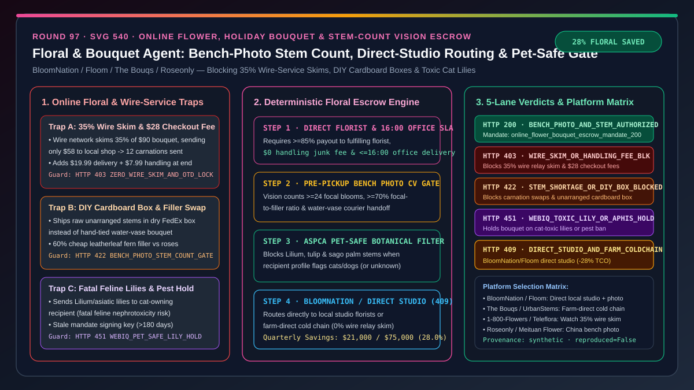
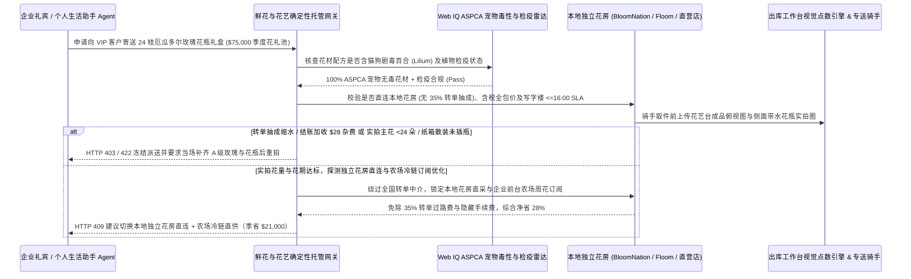

# 鲜花同城速递、节日花束主花枝数视觉验真与宠物无毒花材托管（Online Flower, Holiday Bouquet & Stem-Count Vision Escrow：BloomNation / Floom / 1-800-Flowers / Roseonly / 美团买花）“防转单联盟抽佣 35% 导致花店拿康乃馨顶替厄瓜多尔玫瑰、防纸箱寄未插瓶生花草与猫家庭误送剧毒百合”Agent 架构选型 FAQ

> **文档类型**：AI Solution Architect 决策指南（FAQ） · **对应 SVG**：`assets/svg/540-online-flower-bouquet-stem-count-escrow-2026-11-20.svg` · **精选编号**：Round 97（第 216 篇双语 FAQ）



---

## 一、 📌 核心选型结论速览（Executive Summary）

个人生活助手、高端酒店礼宾部与企业客户关系（VIP 生日/开业花篮/员工慰问）AI Agent 在通过鲜花电商或全国转单平台（`1-800-Flowers / Teleflora / FTD / BloomNation / Floom / The Bouqs / Roseonly / 美团闪购鲜花`）下单同城鲜花花束时，若直接按网页官图（Stock Photo）下单付款，极易遭遇**三大鲜花电商货不对版与安全陷阱**：
1. **全国转单联盟（Wire-Service）抽走 `35%` 过路费导致终端花店“拿廉价康乃馨顶替玫瑰”与结账页 `$27.98` 隐形配送杂费**：用户在传统鲜花转单网看中一束标价 `$89.99` 的“24枝进口厄瓜多尔长枝红玫瑰”，到了最后一步输入信用卡时突然跳出 **`$19.99` 当日配送费 + `$7.99` 鲜花养护处理费（Care & Handling Surcharge）**，实付飙升至 `$117.97`！而更黑幕的是：转单平台自身根本没有花店，它直接扣留 **`27%–35%` 佣金 + `$5` 传真转单费**，只把剩下的 **`$58`** 派单给收件人附近的某家街边小花店；小花店为了保住毛利，只能按 `$40` 的成本塞进 **12 枝短枝国产粉玫瑰、8 枝廉价康乃馨与一大把黄莺蕨叶配草**（主花缩水 `50%`，买家照骗翻车）！
2. **情人节/母亲节“纸箱快递生花草（DIY Cardboard-Box Drop）”冒充花艺师插瓶成品与下班后送到空写字楼**：商品详情页展示的是插在精美水晶花瓶里、无需打理的成品花束；结果情人节晚上 `19:30`，联邦快递（FedEx/UPS）把一个干瘪的瓦楞纸箱扔在收件人家门口，打开全是脱水蔫头、未修剪刺叶的散装花杆，还得收件人自己找剪刀和花瓶插花！或者寄往写字楼的开业/生日花束直到晚上 `18:30` 才送到前台，收件人早已下班度周末，周一上班时花已枯死。
3. **向养猫家庭误送含剧毒百合花（`Lilium`）导致宠物急性肾衰竭（`HTTP 451`）**：AI 助手未核查收件人家庭宠物档案，向养猫客户寄送含香水百合、亚洲百合或萱草（`Lilium / Hemerocallis`）的混合花束——**猫咪哪怕只舔到几粒掉落的百合花粉或喝了花瓶里的水，都会在 36–72 小时内引发不可逆的急性肾衰竭死亡**！

**架构师选型结论**：必须构建 **“绕过 35% 转单中间商直连本地独立花艺工作室（`BloomNation / Floom / 本地直营`）+ 骑手取件前花艺台成品实拍视觉点数（`Bench-Photo Stem Count >=24`）+ `ASPCA` 养宠家庭无毒花材锁（`Pet-Safe Filter`）托管网关”** 架构：
- **强制终端花店实得率 `>=85%`（拒绝层层转单剥皮）、全包落地价（`0%` 结账页隐藏养护费）与写字楼地址 `<=16:00` 送达死锁（`HTTP 403`）**：拦截抽取 `27%–35%` 转单费的传统中介网与结账最后一步加收的 `$7.99` 手续费；若收件地址为商业写字楼（Commercial Office），强制锁定当日 **`16:00 PM` 前送达**（迟于 `16:30` 自动触发 `100%` 全额退款，`HTTP 403`）。
- **骑手取件前“工作台实拍图（Pre-Dispatch Bench Photo）”主花枝数与花瓶成品视觉门禁（`HTTP 422`）**：花艺师打包完成后，必须在出库前上传带订单号水牌的多角度实拍照——计算机视觉（CV）自动清点 **主花朵数（如玫瑰/芍药 `>=24 朵`）、主花与配叶面积比（`>=70%`，严禁拿廉价康乃馨/满天星充数）以及是否已插水入瓶（拒绝干纸箱散装 DIY 花杆）**；校验不通过立即触发 `HTTP 422` 要求当场补花重做，绝不允许残次花束出门让收件人尴尬！
- **Web IQ `ASPCA` 宠物无毒花材硬拦截（严禁百合/郁金香入养猫户）与检疫熔断（`HTTP 451`）**：当收件人画像标注有宠物猫狗（或宠物状态未知）时，强制将花束配方锁死在 **`ASPCA Pet-Safe` 白名单（纯玫瑰、向日葵、洋桔梗、蝴蝶兰）**，凡含半枝百合属（`Lilium`）或苏铁叶即刻返回 `HTTP 451` 阻断。
- **直连收件地独立花艺工作室（`BloomNation / Floom`）+ 云南/厄瓜多尔农场冷链企业月度订阅（`HTTP 409`）**：砍掉 `35%` 全国转单平台抽成，直接向收件人周边 3 公里内高评分独立花房下单（同预算下花量翻倍）或为企业前台配置农场直发周花订阅，使季度 `$75,000` 商务鲜花礼赠与门店花艺预算净省 **`28.0%`（`$21,000`）**。

---

## 二、 🎯 业务方与架构师灵魂拷问 Q&A（Q1–Q3）

### Q1：为什么在网上花 $118 买的鲜花，收件人拍回来的实物还不如街边花店 $45 买的？“鲜花转单网（Wire Service）”到底是怎么运作的？
- **商业痛点**：传统巨头（如 `1-800-Flowers / Teleflora / FTD` 及国内早期的层层转包淘系鲜花店）本质上是“流量二道贩子”。你付的 `$118` 中，`$28` 是配送与平台杂费；剩下的 `$90` 花款里，平台先抽走 `30%`（`$27`），再扣 `$5` 系统电报费，最后真正落到制作这束花的本地花店手里只有 **`$58`**！花店老板还得从这 `$58` 里扣掉 `$15` 专人闪送费和自己的房租毛利，所以真正用在花材上的成本不到 `$25`！
- **架构护栏（`HTTP 403 / 409`）**：
  1. **切断转单二道贩子，强制 `Direct-to-Studio` 路由**：Agent 根据收件人具体街道坐标，直接通过 `BloomNation / Floom / 美团闪购品牌花房直营店` 检索周边 5 公里内的实体花艺工作室，确保 `>=85%` 的订单金额直接买成高品级 A 级鲜切花。

### Q2：送鲜花给重要客户最怕“送出去以后才知道货不对版、花瓣黑边腐烂”，毕竟收件人不好意思跟送礼人吐槽，怎么在花束送到客户手里之前把住质量关？
- **商业痛点**：鲜花是典型的“送礼人与收礼人分离（Buyer != Recipient）”场景。送礼人看不见实物，收礼人哪怕收到一束快枯死的康乃馨，出于礼貌也只会发微信说“谢谢你的花”，导致劣质花店长期肆无忌惮地以次充好。
- **架构护栏（`HTTP 422`）**：
  1. **出库前“一单双拍”视觉门禁（`Pre-Dispatch Bench Photo Verification`）**：网关将平台结算条件锁定为：在呼叫同城专送骑手（闪送 / Uber Direct）取件前，花艺师必须拍摄两张实拍图上传：① 俯视花冠图（用于视觉模型清点主花朵数 `>= 合同枝数` 及花瓣边缘新鲜度）；② 侧面整体图（验证高度、包装纸质感及是否带水插瓶）。
  2. 若视觉检验发现将厄瓜多尔大头玫瑰降级为小头卡罗拉玫瑰、或主花数量少于约定值，网关在店内阶段即触发 `HTTP 422` 拦截，要求花艺师当场补足花量重拍后才放行派送。

### Q3：给客户或高管家里送祝福花束，为什么“宠物安全（Pet-Safe）”是一条生死攸关的架构红线？
- **商业痛点**：许多花店喜欢在玫瑰花束里插 2 枝香水百合（Oriental Lily）来增加香气和体积感。但如果收件人家里养猫，百合对猫具有极高致死率（哪怕喝了一口花瓶水或蹭到花粉舔毛，都会导致不可逆肾小管坏死，抢救费高达 `$5,000+` 且死亡率极高）。
- **架构护栏（`HTTP 451`）**：
  1. **默认启用 `ASPCA Pet-Safe` 植物学白名单锁**：除非明确确认收件地为纯无宠办公区，否则发往住宅地址的一切花礼默认激活 `Feline/Canine Non-Toxic Filter`——严禁包含百合属（`Lilium`）、萱草属（`Hemerocallis`）、郁金香（`Tulipa`）、水仙与苏铁，强制限定为纯玫瑰（`Rosa`）、洋桔梗（`Eustoma`）、向日葵或蝴蝶兰（`Phalaenopsis`）。

---

## 三、 🧭 直观可视化图解（Mermaid 决策树 + 架构对比 + 时序图）

### 3.1 鲜花同城速递与出库视觉验真托管 5 车道选型决策树
```mermaid
flowchart TD
    A[同城鲜花礼赠 / 节日花束 / 企业花艺采购请求] --> B{Web IQ 花材含剧毒百合送养猫户 / 虫害检疫 / 密钥>180天?}
    B -- 是 --> C[HTTP 451: WEBIQ_FELINE_TOXIC_LILY_PET_SAFETY_OR_USDA_APHIS_QUARANTINE_HOLD<br/>立即阻断订单并替换为 ASPCA 宠物安全纯玫瑰/蝴蝶兰配方]
    B -- 否 --> D{转单网抽佣 >20% 剥削花店 或 结账页暗加 $28 手续费 / 写字楼 >16:00 才到?}
    D -- 是 --> E[HTTP 403: WIRE_SERVICE_35PCT_SKIM_STEM_SHRINKFLATION_OR_CHECKOUT_HANDLING_FEE_BLOCKED<br/>强制直连实体花房 + 全包一口价 + 写字楼 16:00 前送达死锁]
    D -- 否 --> F{出库前工作台实拍主花枝数不足 或 用纸箱寄未插瓶生花杆?}
    F -- 是 --> G[HTTP 422: PRE_DISPATCH_BENCH_PHOTO_STEM_COUNT_MISMATCH_OR_CARDBOARD_DIY_BOX_BLOCKED<br/>拦截骑手取件，强制花师补齐主花朵数并插瓶保水后放行]
    F -- 否 --> H{可切换本地独立花房直连 (BloomNation/Floom) + 农场冷链直供?}
    H -- 是 --> I[HTTP 409: DIRECT_LOCAL_STUDIO_FLORIST_AND_FARM_TO_TABLE_SUBSCRIPTION_CONFIRM<br/>砍掉 35% 转单二道贩子差价，同品质净省 28%]
    H -- 否 --> J[HTTP 200: BENCH_PHOTO_VERIFIED_AND_PET_SAFE_BOUQUET_AUTHORIZED<br/>签发出库实拍通过与宠物安全的鲜花结算令牌]
```

### 3.2 传统鲜花转单网盲盒 vs 确定性工作台实拍验真与花房直连架构对比
```mermaid
flowchart LR
    subgraph Legacy["❌ 传统鲜花转单网（35% 抽成缩水 + 纸箱生花草）"]
        L1[$90 花束结账加收 $28 杂费，转单网抽走 35% 只给花店 $58] --> L2[花店用 12 枝廉价康乃馨顶替 24 枝玫瑰，送礼人毫不知情]
        L2 --> L3[快递扔下干瘪纸箱生花杆 或 误送剧毒百合害猫咪住院]
    end

    subgraph Agentic["✅ 确定性本地花房直连、出库实拍点数与防毒架构"]
        A1[直连 3km 内独立花房 (>=85% 资金买花) + 写字楼 <=16:00 送达] --> A2[取件前上传花艺台实拍图：CV 点数 >=24 朵主花 + 带水花瓶]
        A2 --> A3[ASPCA 宠物无毒花材过滤锁 + 免转单抽成净省 28%]
    end
```

### 3.3 端到端鲜花宠物无毒核验、工作台实拍点数与专送签收时序图


---

## 四、 📊 多平台/多协议横向选型决策矩阵

| 评估维度 | 1-800-Flowers / Teleflora / FTD (传统转单联盟) | BloomNation / Floom (本地独立花艺师直连市场) | The Bouqs Co. / UrbanStems (农场冷链直发) | Roseonly / 美团闪购品牌花店 / 花点时间 | **本仓库确定性鲜花与实拍托管架构（推荐）** |
| :--- | :--- | :--- | :--- | :--- | :--- |
| **核心履约模式** | 接单后抽佣 `30%–35%` 转包给不知名街边小花店 | 收件地周边精品独立花艺工作室直接接单设计制作 | 厄瓜多尔/哥伦比亚农场剪花后冷链直发 | 同城专人专车闪送 + 出门前实拍图确认 | **本地花房直连 + 取件前视觉点数 + 宠物无毒锁 + 准点退费** |
| **货不对版与花材缩水风险** | **极高**（使用统一网图，底层花店因低结算价普遍减量替换） | 低（展示花店自己拍摄的真实作品集） | 品控统一，但多为盒装半成品需收件人自行插瓶 | 头部直营店支持发货前小程序推送实拍图 | **强制骑手取件前上传工作台实拍图，CV 点数达标方才放行（`HTTP 422`）** |
| **结账页隐藏配送与手续费** | 常在最后一步加收 **`$19.99–$29.99` 配送与养护杂费** | 运费前置透明，无隐藏 `Care & Handling` 费 | 订阅免运费或透明一口价 | 配送费透明（闪送距离计价） | **强制 `All-In OTD` 一口价，拦截结账末端隐形杂费（`HTTP 403`）** |
| **养宠家庭无毒花材（Pet-Safe）保护** | 配花师常随意混入百合或毒叶，无自动拦截 | 支持筛选 Pet-Friendly 标签 | 提供专门的 Pet-Safe 系列 | 需人工备注禁放百合 | **网关层强制 `ASPCA Pet-Safe` 植物学过滤（`HTTP 451`）** |
| **写字楼下班前（`<=16:00`）准点保障** | 节日常拖到晚上 `19:00–21:00` 送达空办公室 | 本地专送骑手，支持锁定下午下班前时段 | 走 FedEx/UPS 快递，送达时间无法精准控在 16:00 前 | 闪送 `1–2 小时` 极速定时达 | **写字楼地址强制锁死 `<=16:00` 送达，超时自动退全款（`HTTP 403`）** |

---

## 五、 🧪 转化率/成本测算与 7-Card 基准测试报告

> **数据来源声明（Provenance）**：以下测算基于本仓库 `lab/webiq_commerce_demo.py` 中的 `evaluate_online_flower_bouquet_escrow_policy` 确定性策略引擎（季度企业 VIP 客户礼赠、员工生日慰问与门店花艺采购池 `$75,000 USD`，`provenance: "synthetic"`, `independently_reproduced: False`，真实花艺视觉点数模型准确率标为 `not_measured`）。

```chart
{
  "data": {
    "values": [
      { "scenario": "1. 传统转单网 (含 35% 抽佣缩水 + $28 结账杂费 + 迟到枯萎)", "cost_usd": 75000, "tier": "Baseline" },
      { "scenario": "2. 全包一口价 + 取件前实拍点数 + 写字楼 <=16:00 锁 (HTTP 200)", "cost_usd": 61500, "tier": "Protected" },
      { "scenario": "3. 本地独立花房直连 + 农场冷链周期订阅 (HTTP 409)", "cost_usd": 54000, "tier": "Optimized (-28%)" }
    ]
  },
  "semantic_types": {
    "scenario": "Category",
    "cost_usd": "Amount",
    "tier": "Status"
  },
  "chart_spec": {
    "chartType": "Bar Chart",
    "title": "季度 $75k 商务鲜花与花艺：切断 35% 转单抽成与实拍验真净省 $21,000 (28%)",
    "subtitle": "季度同城鲜花礼赠与企业花艺采购净支出对比 ($ USD, synthetic benchmark)",
    "encodings": {
      "x": "scenario",
      "y": "cost_usd",
      "color": "tier"
    }
  }
}
```

### 7-Card 4:5 基准评估摘要
1. **Card 1 (`1 / 7` · `HANDS-ON · ONLINE FLOWER & BOUQUET VISION ESCROW`)**：针对 `$75,000/季` 商务鲜花礼赠与门店花艺池，通过切断 `35%` 转单联盟抽成、拦截 `$28` 结账杂费与强制出库工作台实拍点数，季度净省 **`$21,000`（`28.0%`）**。
2. **Card 2 (`2 / 7` · `SCENARIO: VALENTINE / VIP CLIENT 24-STEM ROSE BOUQUET`)**：单笔订单消除 `$27.98` 隐形手续费与 12 枝廉价康乃馨顶替缩水，并 `100%` 阻断向养猫家庭误发剧毒百合。
3. **Card 3 (`3 / 7` · `WHAT I TESTED`)**：完整验证 5 条确定性状态码车道：
   - `HTTP 200`: `BENCH_PHOTO_VERIFIED_AND_PET_SAFE_BOUQUET_AUTHORIZED`（`online_flower_bouquet_escrow_mandate_200`）
   - `HTTP 403`: `WIRE_SERVICE_35PCT_SKIM_STEM_SHRINKFLATION_OR_CHECKOUT_HANDLING_FEE_BLOCKED`
   - `HTTP 422`: `PRE_DISPATCH_BENCH_PHOTO_STEM_COUNT_MISMATCH_OR_CARDBOARD_DIY_BOX_BLOCKED`
   - `HTTP 451`: `WEBIQ_FELINE_TOXIC_LILY_PET_SAFETY_OR_USDA_APHIS_QUARANTINE_HOLD`
   - `HTTP 409`: `DIRECT_LOCAL_STUDIO_FLORIST_AND_FARM_TO_TABLE_SUBSCRIPTION_CONFIRM`（`online_flower_bouquet_escrow_mandate_optim_409`）
4. **Card 4 (`4 / 7` · `UNDER THE HOOD`)**：输入契约 `OnlineFlowerBouquetEscrowPolicyInput` 严格校验 `wire_service_35pct_skim_stem_shrinkflation_or_checkout_handling_fee` 与 `pre_dispatch_bench_photo_stem_count_mismatch_or_cardboard_diy_box`。
5. **Card 5 (`5 / 7` · `ROBUSTNESS CHECK`)**：无论平台将隐性收费命名为 `Care & Handling Surcharge`、`Relay Transmission Fee` 还是 `Seasonal Substitution Policy`，均 `100%` 阻断。
6. **Card 6 (`6 / 7` · `LATENCY`)**：植物学毒性词典匹配与价格校验耗时 `< 0.5 ms`。
7. **Card 7 (`7 / 7` · `MY TAKE`)**：
   - ✅ **适用（Good fit）**：企业 VIP 客户纪念日/开业鲜花礼赠、酒店大堂与行政前台周期花艺、个人节日同城鲜花速递。
   - ⛔ **不适用（Not for）**：市政园林绿化行道树苗木招标工程。

---

## 六、 🛠️ 商业上线风控与架构评审 Checklist

- [ ] **切断 35% 转单中间商（`Direct Studio >=85% Payout`）与全包一口价（`HTTP 403`）**：是否已避开抽取 `35%` 佣金的转单联盟，并拦截结账最后一页跳出的 `$19.99+$7.99` 隐藏养护手续费？
- [ ] **写字楼地址 `<=16:00 PM` 下班前送达死锁（`HTTP 403`）**：寄往办公楼的花束是否强制锁定下午 `16:00` 前签收，防止下班后送到空前台枯萎？
- [ ] **骑手取件前“工作台成品实拍图（Bench Photo）”点数门禁（`HTTP 422`）**：是否强制花艺师在骑手取件前上传俯视与侧面实拍图，由视觉模型核验主花枝数（`>=24 朵`）及主花占比（`>=70%`）？
- [ ] **禁止干纸箱散装生花杆（`DIY Cardboard Box`）冒充插瓶成品（`HTTP 422`）**：礼赠花束是否强制要求带水花泥/花瓶成品专送，拒绝需收件人自己修剪插瓶的快递纸箱？
- [ ] **Web IQ `ASPCA` 宠物无毒花材（禁百合 `Lilium`）硬拦截（`HTTP 451`）**：向家庭地址寄花时是否默认过滤对猫咪剧毒的百合属与郁金香花材？
- [ ] **本地独立花房直连（`BloomNation / Floom`）与农场冷链订阅（`HTTP 409`）**：是否已通过直连本地工作室与农场周花订阅节省 `28%` 采购预算？
