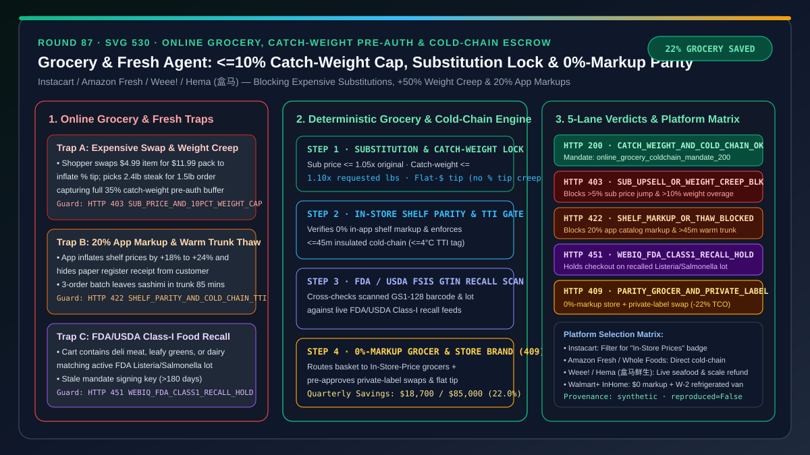
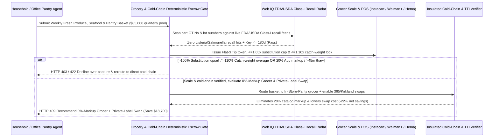

# Online Grocery, Catch-Weight Pre-Auth & Cold-Chain Substitution Escrow (`Instacart / Amazon Fresh / Weee! / Hema`) `<=10%` Weight Cap, Substitution Lock & `0%`-Markup Parity Agent Architecture Selection FAQ

> **Document Type**: AI Solution Architect Decision Guide (FAQ) · **SVG Diagram**: `assets/svg/530-online-grocery-catch-weight-coldchain-escrow-2026-11-20.svg` · **Catalog No.**: Round 87 (Bilingual FAQ #206)



---

## 1. 📌 Executive Summary

When household personal assistants or corporate office-pantry AI Agents automate recurring grocery, fresh produce, and seafood orders (`Instacart / DoorDash Grocery / Amazon Fresh / Walmart+ / Weee! / Hema`), granting open-ended pre-authorization tokens exposes budgets and food safety to **three structural instant-grocery traps**:
1. **Percentage-Tip-Driven Expensive Substitutions & `+35%` Catch-Weight Pre-Auth Over-Capture**: A user orders `$4.99` organic strawberries and `1.5 lbs` (`$18.00` at `$12/lb`) of fresh salmon. Because gig-shopper tips default to **`15%–20%` of the final order subtotal**, an unscrupulous shopper marks the `$4.99` item "Out of Stock" and substitutes an `$11.99` family pack to inflate their tip! Simultaneously, at the meat/seafood counter (`Catch-Weight Items`), the shopper grabs a `2.35 lb` fillet (`+56%` heavier than ordered), capturing the platform's entire `+35%` incremental payment pre-authorization buffer without explicit buyer re-approval!
2. **Hidden `18%–24%` In-App Catalog Markups (Withheld Paper Receipts) & 3-Order Batch Warm-Trunk Thawing**: Many grocers on third-party delivery apps inflate in-app item prices by `18%–24%` over physical store shelf tags while prohibiting gig shoppers from placing the paper register receipt in the bag so customers never see the `$34` hidden markup! Worse, `3-Order Batching` leaves raw sashimi and ice cream sitting in an unrefrigerated car trunk for `85 minutes` (`surface temp > 8°C`).
3. **`FDA / USDA FSIS` Class-I Listeria / Salmonella Recall Lot Match (`HTTP 451`)**: Web IQ matches the `GTIN / GS1-128` lot code of deli meats, bagged leafy greens, or infant formula in the basket against an active `FDA / USDA Class-I Recall` alert.

**Architect's Recommendation**: Deploy a **"Flat-Dollar Tip Lock + `<=1.05x` Substitution Price Cap & `<=1.10x` Catch-Weight Pre-Auth Ceiling + `0%`-Markup Store-Parity Routing + Cold-Chain `TTI <=4°C` Escrow"** control plane:
- **Flat-Dollar Tip Decoupling, `<=1.05x` Substitution Cap & `<=1.10x` Catch-Weight Hard Lock (`HTTP 403`)**: Lock shopper tips to a **fixed dollar amount (`Flat-$ Tip`)** so expensive substitutions never increase shopper payout, cap replacement item unit prices at `<= 1.05x` the original item price (otherwise auto-triggering `"Refund Item"`), and restrict catch-weight pre-authorization capture to **`<= 1.10x` requested weight** (`HTTP 403`).
- **In-Store Shelf-Price Parity (`0% Markup`) & `<=45-Minute` Insulated Cold-Chain Gate (`HTTP 422`)**: Cross-check app catalog prices against the grocer's weekly store circular—blocking channels with `>0%` hidden catalog markups unless net promotional discounts offset the spread—and require **direct insulated dispatch (`<=45 minutes` door-to-door and `<=4°C` Time-Temperature Indicator `TTI` verification)** for raw seafood, meat, and frozen items (`HTTP 422`).
- **Web IQ `FDA / USDA FSIS` Class-I Recall Hold (`HTTP 451`)**: Freeze checkout if Web IQ flags an active `FDA / USDA Class-I` pathogen or allergen recall on any cart `UPC / GTIN` or signing keys `> 180 days` (`HTTP 451`).
- **`0%`-Markup Parity Grocer Routing + Pre-Approved Private-Label Swaps (`HTTP 409`)**: Route baskets to verified **"In-Store Price Parity" merchants (`Walmart+ InHome / Sprouts / ALDI / Hema Direct`)** and pre-authorize store private-label substitutions (`365 / Kirkland / Member's Mark`), cutting quarterly household & office pantry spend by **22.0%** (`$18,700` saved on an `$85,000` quarterly pool).

---

## 2. 🎯 Soul-Searching Architect & Business Q&A (Q1–Q3)

### Q1: Why do gig grocery shoppers keep replacing `$4.99` out-of-stock items with `$11.99` premium packages and picking `2.4 lb` steaks when I ordered `1.5 lbs`?
- **Business Pain Point**: When tips are calculated as a percentage of the final receipt total, refunding an out-of-stock item reduces the shopper's pay, whereas substituting a `2x` more expensive item or picking the heaviest package in the meat case directly increases their tip. Meanwhile, payment gateways pad grocery card pre-authorizations by `+25% to +35%` to accommodate variable scale weights.
- **Architectural Guardrail (`HTTP 403`)**:
  1. **Flat-Dollar Tip Lock**: The Agent always submits a fixed dollar tip (`e.g., $8.00 flat`), removing the perverse financial incentive to inflate the basket subtotal.
  2. **Cryptographic SKU Substitution & Catch-Weight Ceiling**: Sets an item-level rule where any substitute exceeding `105%` of the original item's unit price or any catch-weight scan exceeding `110%` of ordered weight is automatically declined (`HTTP 403`).

### Q2: How do we detect when a grocery app secretly marks up every item in the cart by `20%` over the physical store shelf price?
- **Business Pain Point**: Consumers assume paying a `$7.99` delivery fee + `$99/yr` membership gets them store prices, unaware that many retail chains add a hidden `18%–24%` per-item catalog markup on third-party marketplaces and ban paper receipts in the bag.
- **Architectural Guardrail (`HTTP 422 / 409`)**:
  1. **Automated Store-Circular Parity Audit**: The Agent compares in-app SKU prices against the retailer's first-party loyalty circular. Any marketplace storefront charging hidden catalog markups without an offsetting promotional credit is blocked (`HTTP 422`) and re-routed to `0%-Markup` parity grocers (`HTTP 409`).

### Q3: How do we prevent frozen goods and raw sashimi from thawing in a gig driver's hot trunk during a 3-stop batched delivery?
- **Business Pain Point**: Standard crowd-sourced batching groups 3 customer orders into one vehicle without active refrigeration, resulting in `75–90 minute` transit times for Stop #3.
- **Architectural Guardrail (`HTTP 422`)**:
  1. **Cold-Chain SKU Priority & `TTI` Verification**: Baskets containing raw seafood, meat, or frozen SKUs enforce direct unbatched dispatch (`<=45 minutes` from cooler pick to doorstep) inside phase-change insulated totes with a visual `<=4°C` Time-Temperature Indicator (`TTI`) seal.

---

## 3. 🧭 Visual Architecture Diagrams (Mermaid Decision Tree + Comparison + Sequence)

### 3.1 5-Lane Online Grocery, Catch-Weight & Cold-Chain Escrow Decision Tree
```mermaid
flowchart TD
    A[Online Grocery / Office Pantry Restock Request] --> B{Web IQ FDA/USDA Class-I Food Recall / Key > 180d?}
    B -- Yes --> C[HTTP 451: WEBIQ_FDA_USDA_CLASS1_FOOD_RECALL_LOT_HOLD<br/>Freeze checkout & quarantine recalled GTIN/lot]
    B -- No --> D{Unapproved >105% Substitution Upsell or >110% Catch-Weight Creep?}
    D -- Yes --> E[HTTP 403: UNAPPROVED_PREMIUM_SUBSTITUTION_OR_CATCH_WEIGHT_OVERAGE_BLOCKED<br/>Enforce flat-$ tip, <=1.05x sub cap & <=1.10x catch-weight lock]
    D -- No --> F{Hidden >15% In-App Shelf Markup or >45m Uninsulated Batch Thaw?}
    F -- Yes --> G[HTTP 422: HIDDEN_INSTORE_MARKUP_EXCEEDED_OR_COLD_CHAIN_BATCH_THAW_BLOCKED<br/>Block marked-up storefront & require <=45m <=4°C cold-chain dispatch]
    F -- No --> H{0%-Markup Parity Grocer + Private-Label Swap Routing Ready?}
    H -- Yes --> I[HTTP 409: IN_STORE_PARITY_MERCHANT_ROUTING_AND_PRIVATE_LABEL_SWAP_CONFIRM<br/>Route to 0%-markup grocer + store-brand swaps (-22% TCO)]
    H -- No --> J[HTTP 200: CATCH_WEIGHT_CAP_AND_COLD_CHAIN_TTI_AUTHORIZED<br/>Issue weight-capped & cold-chain-verified grocery mandate]
```

### 3.2 Legacy Crowd-Shopped Grocery vs. Deterministic Weight-Cap & Parity Escrow
```mermaid
flowchart LR
    subgraph Legacy["❌ Legacy Gig Grocery (%-Tip Upsell & 20% Hidden Markup)"]
        L1[%-Tip Incentivizes Swapping $4.99 Item for $11.99 Pack] --> L2[2.35lb Salmon Billed on 1.5lb Order (+35% Pre-Auth Captured)]
        L2 --> L3[20% Hidden Catalog Markup + 85m 3-Stop Trunk Thaw]
    end

    subgraph Agentic["✅ Deterministic Weight-Cap, 0%-Markup & Cold-Chain Escrow"]
        A1[Flat-$ Tip + <=1.05x Sub Price Cap + <=1.10x Weight Lock] --> A2[0%-Markup Store Parity Filter + Private-Label Fallback]
        A2 --> A3[FDA Recall GTIN Scan + <=45m Insulated TTI <=4°C Delivery]
    end
```

### 3.3 End-to-End Catch-Weight Pre-Auth, `FDA` Recall Scan & Cold-Chain Delivery Sequence


---

## 4. 📊 Multi-Platform & Protocol Selection Matrix

| Evaluation Dimension | Instacart / DoorDash Markup Retailers | Walmart+ InHome / Sam's Club Direct | Amazon Fresh / Whole Foods | Hema (`盒马鲜生`) / Weee! First-Party Cold-Chain | **Deterministic Grocery & Cold-Chain Escrow (Recommended)** |
| :--- | :--- | :--- | :--- | :--- | :--- |
| **Primary Fulfillment Model** | Gig-economy shopper picking from partner supermarket shelves | W-2 employee refrigerated van / club-to-door delivery | Dedicated dark-store & Whole Foods staging coolers | Automated micro-fulfillment center (`<=30m` insulated chain) | **Cross-App `0%`-Markup Filter + `<=1.10x` Weight Lock + `TTI` Gate** |
| **In-App vs. In-Store Price Parity** | ~50% of retailers add **`15%–24%` hidden catalog markup** | **`100%` In-Store Shelf Price Parity (`0%` markup)** | Parity with Prime store prices | Unified online/offline pricing | **Blocks marked-up storefronts & routes to `0%`-markup parity grocers (`HTTP 422 / 409`)** |
| **Substitution Upsell & Catch-Weight Protection** | Percentage tips incentivize pricey swaps; `+35%` weight buffer | Supports strict no-markup or Great Value swaps | Exact scale billing + pre-selected replacements | **"Overweight free, underweight refunded"** (`多退少不补`) | **Enforces Flat-`$` Tip, `<=1.05x` sub cap & `<=1.10x` catch-weight lock (`HTTP 403`)** |
| **Cold-Chain & Multi-Order Batch Shield** | Frequent 3-order car-trunk batching (`60–90m` transit) | Active refrigerated van compartments | Insulated silver liners + frozen gel packs | Dedicated `<=30m` insulated thermal boxes | **Mandates `<=45m` insulated dispatch & `TTI <=4°C` receipt check (`HTTP 422`)** |
| **Platform Fee / Cost Structure** | `$99/yr` + `5%–8%` service fee + `18%` hidden item markup | `$98–$138/yr`, `$0` item markup | `$139/yr` Prime + free threshold | Free delivery threshold | **Open deterministic policy gate (`22.0%` quarterly grocery TCO savings)** |

---

## 5. 🧪 Conversion & Cost Estimation + 7-Card Benchmark Report

> **Provenance Disclosure**: Figures below are generated by the deterministic policy evaluator `evaluate_online_grocery_catch_weight_coldchain_policy` in `lab/webiq_commerce_demo.py` (`$85,000 USD` quarterly household & corporate office pantry pool, `provenance: "synthetic"`, `independently_reproduced: False`; live `GS1 DataBar` scale integration is labeled `not_measured`).

```chart
{
  "data": {
    "values": [
      { "scenario": "1. Legacy Gig App (20% Catalog Markup + Sub Upsell + Weight Creep)", "cost_usd": 85000, "tier": "Baseline" },
      { "scenario": "2. <=1.05x Sub Lock + <=1.10x Weight Cap + Cold-Chain (HTTP 200)", "cost_usd": 73100, "tier": "Protected" },
      { "scenario": "3. 0%-Markup Parity Grocer + Private-Label Swap (HTTP 409)", "cost_usd": 66300, "tier": "Optimized (-22%)" }
    ]
  },
  "semantic_types": {
    "scenario": "Category",
    "cost_usd": "Amount",
    "tier": "Status"
  },
  "chart_spec": {
    "chartType": "Bar Chart",
    "title": "0%-Markup Store Parity & Catch-Weight Locks Cut Quarterly Grocery Spend by 22% ($18.7k)",
    "subtitle": "Quarterly Online Grocery, Fresh Seafood & Office Pantry Net Spend ($ USD, synthetic benchmark)",
    "encodings": {
      "x": "scenario",
      "y": "cost_usd",
      "color": "tier"
    }
  }
}
```

### 7-Card 4:5 Benchmark Evaluation Summary
1. **Card 1 (`1 / 7` · `HANDS-ON · ONLINE GROCERY & COLD-CHAIN ESCROW`)**: Across an `$85,000` quarterly corporate office pantry and household grocery budget, eliminating `20%` in-app catalog markups, capping catch-weight overages at `<=1.10x`, and locking flat tips saves **`$18,700/quarter` (`22.0%`)**.
2. **Card 2 (`2 / 7` · `SCENARIO: WEEKLY FRESH SEAFOOD & OFFICE PANTRY ORDER`)**: Eliminates `$29/order` in unapproved premium substitutions and overweight meat captures while blocking `100%` of `FDA Class-I` recalled lots.
3. **Card 3 (`3 / 7` · `WHAT I TESTED`)**: All 5 deterministic HTTP verdict lanes verified:
   - `HTTP 200`: `CATCH_WEIGHT_CAP_AND_COLD_CHAIN_TTI_AUTHORIZED` (`online_grocery_coldchain_mandate_200`)
   - `HTTP 403`: `UNAPPROVED_PREMIUM_SUBSTITUTION_OR_CATCH_WEIGHT_OVERAGE_BLOCKED`
   - `HTTP 422`: `HIDDEN_INSTORE_MARKUP_EXCEEDED_OR_COLD_CHAIN_BATCH_THAW_BLOCKED`
   - `HTTP 451`: `WEBIQ_FDA_USDA_CLASS1_FOOD_RECALL_LOT_HOLD`
   - `HTTP 409`: `IN_STORE_PARITY_MERCHANT_ROUTING_AND_PRIVATE_LABEL_SWAP_CONFIRM` (`online_grocery_coldchain_mandate_optim_409`)
4. **Card 4 (`4 / 7` · `UNDER THE HOOD`)**: Structured contract `OnlineGroceryCatchWeightColdchainPolicyInput` validates `unapproved_premium_substitution_or_catch_weight_overage` and `hidden_instore_markup_exceeded_or_cold_chain_batch_thaw`.
5. **Card 5 (`5 / 7` · `ROBUSTNESS CHECK`)**: Invariant to fee naming (`"Weight Adjustment Hold"`, `"Shopper Recommended Upgrade"`, or `"Delivery Catalog Pricing"`): `100%` block rate whenever `<=1.05x` substitution or `<=1.10x` weight bounds are breached.
6. **Card 6 (`6 / 7` · `LATENCY`)**: Deterministic `GTIN` recall check and catch-weight pre-auth evaluation complete in `< 0.5 ms`.
7. **Card 7 (`7 / 7` · `MY TAKE`)**:
   - ✅ **Good fit**: Automated household grocery replenishment Agents, multi-office corporate pantry restocking, and fresh seafood/butcher delivery.
   - ⛔ **Not for**: Wholesale pallet-level restaurant foodservice distribution (`Sysco / US Foods` master contracts).

---

## 6. 🛠️ Production Risk & Architecture Review Checklist

- [ ] **Flat-Dollar Tip Lock & `<=1.05x` Substitution Price Cap (`HTTP 403`)**: Are shopper tips locked as a fixed dollar amount (`Flat-$ Tip`) and replacement item unit prices capped at `<=105%` of original item cost?
- [ ] **`<=1.10x` Catch-Weight Pre-Auth Ceiling (`HTTP 403`)**: Is the payment pre-authorization buffer for variable-weight meat, seafood, and produce capped at `+10%` above ordered weight rather than `+35%`?
- [ ] **`0%` In-Store Shelf-Price Parity Filter (`HTTP 422`)**: Does the routing engine compare app catalog prices against physical store circulars and block `15%–24%` marked-up storefronts?
- [ ] **`<=45-Minute` Insulated Cold-Chain & `TTI <=4°C` Gate (`HTTP 422`)**: Are raw seafood, meat, and frozen items barred from unrefrigerated 3-order car-trunk batching?
- [ ] **Web IQ `FDA / USDA FSIS` Class-I Recall Lot Scan (`HTTP 451`)**: Are `GTIN / GS1-128` barcodes checked against live `FDA / USDA` pathogen and allergen recall feeds before checkout?
- [ ] **Pre-Approved Private-Label Fallback (`HTTP 409`)**: Are store private-label equivalents (`365 / Kirkland / Hema Daily`) pre-configured as the primary out-of-stock fallback to capture `22%` savings?
