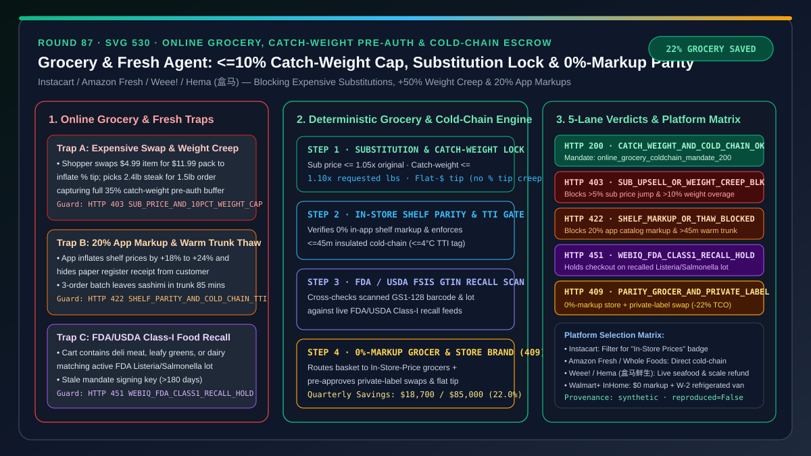
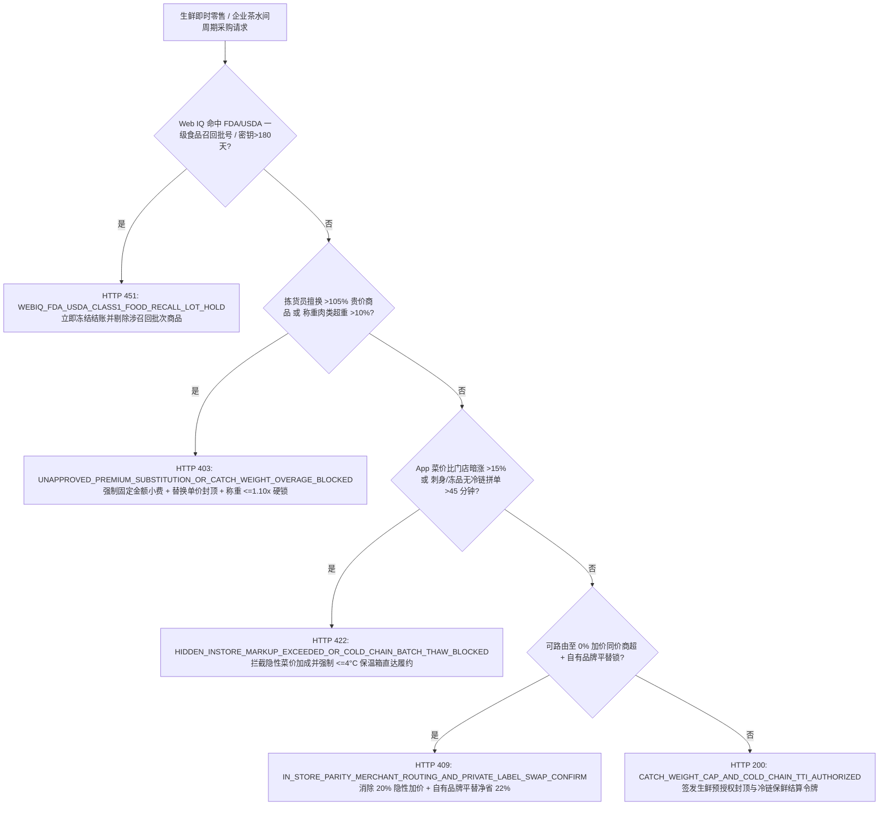
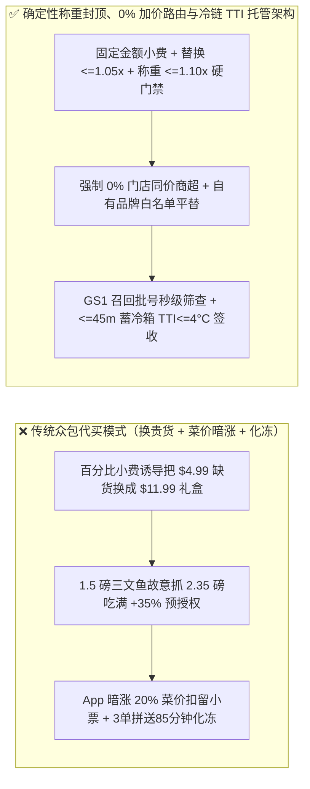
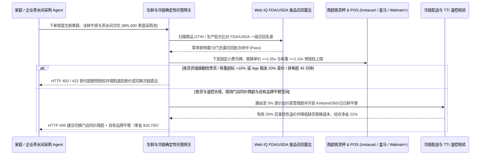

# 生鲜即时零售、水产肉类称重预授权（Catch-Weight）与缺货贵价替换防坑托管（Online Grocery, Catch-Weight Pre-Auth & Cold-Chain Substitution Escrow：Instacart / Amazon Fresh / Weee! / 盒马鲜生 / 小象超市）“防拣货员故意换贵货多赚百分比小费、防称重海鲜多抓 50% 吃满预授权与 App 暗涨 20% 菜价”Agent 架构选型 FAQ

> **文档类型**：AI Solution Architect 决策指南（FAQ） · **对应 SVG**：`assets/svg/530-online-grocery-catch-weight-coldchain-escrow-2026-11-20.svg` · **精选编号**：Round 87（第 206 篇双语 FAQ）



---

## 一、 📌 核心选型结论速览（Executive Summary）

家庭生活助手与企业行政茶水间采购 AI Agent 在通过生鲜即时零售平台（`Instacart / DoorDash Grocery / Amazon Fresh / Walmart+ / 盒马鲜生 / 美团小象超市`）自动周期性下单水果、冰鲜牛排、活鲜水产与日用百货时，若直接授予大额免密支付令牌，往往会遭遇**三大生鲜即时零售扣款与冷链陷阱**：
1. **“按订单总额百分比给小费”诱导拣货员故意用贵价大包装替换（Substitution Upsell）与非标品称重（Catch-Weight）吃满 `35%` 预授权缓冲**：用户下单 `$4.99` 的有机草莓和 `1.5 磅`（`$12/磅 = $18.00`）冰鲜三文鱼。由于平台默认将拣货员小费设为 **订单总金额的 `15%–20%`**，个别拣货员故意将 `$4.99` 草莓标为“缺货”，擅自替换成 `$11.99` 的豪华礼盒装；同时在称重肉类/帝王蟹（`Catch-Weight Items`）柜台故意挑一块重达 `2.35 磅`（超重 `+56%`）的大块三文鱼，直接吃满银行卡预留的 `+35%` 称重浮动预授权额度（`Incremental Pre-Auth Buffer`），导致原本 `$65` 的买菜订单最终被静默扣走 `$94`！
2. **App 线上菜价比门店货架暗涨 `18%–24%`（严禁放纸质小票掩盖差价）与三单拼单（Multi-Order Batch）后备箱化冻变质**：许多接入第三方买菜平台的超市在 App 内采用独立的加价商品库（比线下门店价签贵 `18%–24%`），且平台明令禁止兼职骑手把收银机纸质小票放进购物袋，防止顾客发现 `$180` 账单里早已被暗加了 `$34` 菜价差价！此外，平台为压低配送成本将 3 个家庭的订单打包派给同一名众包司机，排在第 3 顺位送达的刺身、冰淇淋在高达 `38°C` 的私家车后备箱里颠簸 `85 分钟`，送到时早已化冻滋生细菌。
3. **命中 `FDA / USDA / 市场监管总局` 一级紧急召回批次（`Class-I Listeria / Salmonella Recall`）（`HTTP 451`）**：购物车中的即食冷切肉、袋装菠菜、生牛乳或婴幼儿配方奶粉条码批号恰好命中当天发布的李斯特菌/沙门氏菌一级召回通告。

**架构师选型结论**：必须构建 **“固定金额小费锁（Flat-Dollar Tip Lock）+ 替换单价上限（`<=1.05x`）与称重电子秤 `<=1.10x` 令牌锁 + 线下同价（`In-Store Price Parity`）商户路由 + 冷链温度贴（`TTI <=4°C`）托管网关”** 架构：
- **强制“固定金额小费”切断换贵货利益链、替换商品单价上限（`<=原价 105%`）与称重标品 `+10%` 硬封顶（`HTTP 403`）**：将小费模式强制锁定为与订单金额脱钩的 **固定美元金额（`Flat-$ Tip`）**；为每件商品写入确定性 `Substitution Mandate`（只允许白名单平替或单价 `<= 原价 × 1.05`，超出则自动触发 `Refund Item Only` 单品退回）；同时将非标生鲜称重预授权上限锁死在 **`Requested Weight × 1.10`**（超重 `>10%` POS 机直接拒刷并返回 `HTTP 403`）。
- **强制门店货架同价（`0% In-App Markup`）核验与冷链直送 `<=45 分钟 / <=4°C` 门禁（`HTTP 422`）**：网关自动比对超市官网周度促销海报（Weekly Circular）与 App 标价，拦截存在 `15%–24%` 隐性加价的通道；且含刺身、雪糕、冷鲜肉的订单必须走前置仓冷媒箱或单程 `<=45 分钟` 保温袋直送（拒绝无冷链三单拼送，违者 `HTTP 422` 拦截）。
- **Web IQ `FDA / USDA FSIS` 一级食品召回批号实时熔断（`HTTP 451`）**：在拣货员扫描商品 `GS1-128` 批次条码瞬间比对全球食品安全召回库，命中即刻 `HTTP 451` 阻断结账。
- **门店同价直连渠道（`Walmart+ InHome / 盒马 / ALDI`）+ 自有品牌（Private Label）自动平替套利（`HTTP 409`）**：自动将采购篮路由至承诺 **`100% 门店同价（0% 加价）`** 的直营前置仓/商超，并将缺货品牌商品自动平替为高性价比商超自有品牌（如 `Kirkland / 365 Whole Foods / 盒马日日鲜`），使季度 `$85,000` 企业茶水间与家庭生鲜采购池净省 **`22.0%`（`$18,700`）**。

---

## 二、 🎯 业务方与架构师灵魂拷问 Q&A（Q1–Q3）

### Q1：为什么我在买菜 App 上设了“允许替换”，拣货员却总是挑最贵的进口大包装替我换上？怎么从根源上防住？
- **商业痛点**：众包买菜平台默认把小费设置为订单商品总额的百分比（如 `15%`）。当 `$4.99` 的普通鸡蛋卖完（或放在货架最里面懒得拿）时，拣货员如果点“缺货退款”，他的小费就会缩水；如果换成 `$10.99` 的有机土鸡蛋，他的小费反而增加！
- **架构护栏（`HTTP 403`）**：
  1. **小费脱钩（`Flat-Dollar Tip Decoupling`）**：Agent 下单时强制将小费模式改写为固定金额（例如固定 `$8.00`），无论最终结账金额是 `$50` 还是 `$90`，拣货员小费恒定不变，彻底消除故意换贵货的金钱动机。
  2. **双层加密预授权上限（`Item-Level Substitution & Catch-Weight Cap`）**：利用虚拟卡行级规则或平台 API 预设：单品替换最高不得超过原商品单价的 `+5%`；按斤称重的活鱼、牛排实际打秤重量不得超过下单克重的 `+10%`（例如买 `500g` 最高只允许结算 `550g`，杜绝“买一斤抓两斤”）。

### Q2：同样一家超市，为什么在线下店买一车菜只要 $140，在代购 App 上买一模一样的菜却花了 $182？
- **商业痛点**：除了配送费（Delivery Fee）和平台服务费（Service Fee）外，许多超市在第三方平台上架时直接把每件商品的基准售价调高了 `18%–24%`，并在平台上隐藏标注为 `"Everyday Store Prices"` 之外的 `"Higher than in-store prices"`，且严禁骑手给顾客看超市机打小票。
- **架构护栏（`HTTP 422 / 409`）**：
  1. **强制筛选 `In-Store Price Parity` 零加价标识商户**：Agent 在比价路由层自动抓取商超线下会员价（Loyalty Card Price）与 App 端价差。凡价差 `> 0%` 的加价商户，除非叠加满减券后净到手价更低，否则一律触发 `HTTP 422` 告警并自动切换至承诺 `0% 菜价加价` 的直连超市（如 `Walmart+ / Sprouts / 盒马 / 山姆极速达`）。

### Q3：生鲜冷链最怕夏天众包司机一趟顺路送 3 家，我的三文鱼和哈根达斯在车里焖了 1 个半小时才送到，架构怎么管？
- **商业痛点**：众包平台将 3 个不同小区的订单合并成 `Triple Batch`，若你的地址排在最后一站，冷鲜肉制品早已脱离 `0–4°C` 安全温区。
- **架构护栏（`HTTP 422`）**：
  1. **温敏商品（`Cold-Chain SKU`）强制直达或相变冰板校验**：当购物车包含 `Frozen / Raw Sashimi / Cold-Pressed Dairy` 标签商品时，Agent 自动锁定“前置仓保温箱 + 干冰/蓄冷板封装”或“单程离店 `<=45 分钟` 优先直达（Priority Direct）”履约通道；签收时若包装内时间-温度指示贴（`TTI: Time-Temperature Indicator`）变红或红外测温 `> 6°C`，自动触发全额即时拒付退款。

---

## 三、 🧭 直观可视化图解（Mermaid 决策树 + 架构对比 + 时序图）

### 3.1 生鲜即时零售、称重预授权与冷链托管 5 车道选型决策树


### 3.2 传统众包代买模式 vs 确定性称重封顶、门店同价与冷链托管架构对比


### 3.3 端到端生鲜称重锁价、`FDA` 召回核验与冷链签收时序图


---

## 四、 📊 多平台/多协议横向选型决策矩阵

| 评估维度 | Instacart / DoorDash 第三方加价超市 | Walmart+ InHome / 山姆极速达 | Amazon Fresh / Whole Foods 线上 | 盒马鲜生 / 小象超市 / Weee! 自营前置仓 | **本仓库确定性生鲜与冷链托管架构（推荐）** |
| :--- | :--- | :--- | :--- | :--- | :--- |
| **核心履约模式** | 众包兼职买手去合作超市门店代购配送 | 全职员工冷链车配送 / 会员制仓店直配 | 亚马逊生鲜仓 / 全食超市专门拣货区 | 自营控温前置仓 + 活鲜称重多退少不补 | **跨平台同价路由 + 称重 `<=1.10x` 锁 + 固定小费 + 冷链 `TTI` 门禁** |
| **App 菜价 vs 门店货架价差（Markup）** | 约半数商超在 App 内暗涨 **`15%–24%`** 且禁放纸质小票 | **`0% 加价`**（`100%` 门店货架同价） | 线上线下同价（Prime 会员专享价同步） | 线上线下统一标价，无第三方代购加价 | **自动过滤隐性加价商户，强制锁定 `0% Markup` 门店同价（`HTTP 422 / 409`）** |
| **缺货贵价替换与称重超标风控** | 默认百分比小费易诱发买手换贵货，预授权常多扣 `25%–35%` | 支持预设不可替换或仅限自有品牌替换 | 支持指定替换品，称重按实际电子秤结算 | **“多退少不补”**（少于标重自动退差价，超重由平台吸收） | **强制固定金额小费 + 替换单价 `<=1.05x` + 称重 `<=1.10x` 封顶（`HTTP 403`）** |
| **冷链温控与拼单化冻保护** | 常将 2–3 单拼给普通私家车后备箱，夏季易化冻 | 冷藏车厢分区温控直送 | 铝箔保温袋 + 干冰/冰袋独立封装 | 专职骑手保温箱 `<=30 分钟` 极速达 | **温敏商品强制 `<=45 分钟` 保温直达与 `TTI <=4°C` 签收核验（`HTTP 422`）** |
| **综合费率 / 会员成本** | `$99/年` + 服务费 `5%–8%` + 隐性菜价加成 `18%` | `$98–$138/年`，无菜价加成 | `$139/年` Prime + 满额免运费 | 满额免运费 / 会员享每日折扣 | **开源确定性策略网关（净省 `22.0%` 季度生鲜日百总支出）** |

---

## 五、 🧪 转化率/成本测算与 7-Card 基准测试报告

> **数据来源声明（Provenance）**：以下测算基于本仓库 `lab/webiq_commerce_demo.py` 中的 `evaluate_online_grocery_catch_weight_coldchain_policy` 确定性策略引擎（季度企业办公茶水间与高管家庭生鲜即时采购预算池 `$85,000 USD`，`provenance: "synthetic"`, `independently_reproduced: False`，真实商超 `GS1 DataBar` 电子秤接口标为 `not_measured`）。

```chart
{
  "data": {
    "values": [
      { "scenario": "1. 传统代买 App (含 20% 隐性加价 + 换贵货 + 称重超标)", "cost_usd": 85000, "tier": "Baseline" },
      { "scenario": "2. 替换 <=1.05x + 称重 <=1.10x + 冷链直达锁 (HTTP 200)", "cost_usd": 73100, "tier": "Protected" },
      { "scenario": "3. 0% 门店同价商超路由 + 自有品牌自动平替 (HTTP 409)", "cost_usd": 66300, "tier": "Optimized (-22%)" }
    ]
  },
  "semantic_types": {
    "scenario": "Category",
    "cost_usd": "Amount",
    "tier": "Status"
  },
  "chart_spec": {
    "chartType": "Bar Chart",
    "title": "季度 $85k 生鲜即时采购：消除 20% 菜价加成与贵价替换净省 $18,700 (22%)",
    "subtitle": "季度生鲜果蔬、称重肉类水产与茶水间采购净支出对比 ($ USD, synthetic benchmark)",
    "encodings": {
      "x": "scenario",
      "y": "cost_usd",
      "color": "tier"
    }
  }
}
```

### 7-Card 4:5 基准评估摘要
1. **Card 1 (`1 / 7` · `HANDS-ON · ONLINE GROCERY & COLD-CHAIN ESCROW`)**：针对 `$85,000/季` 企业茶水间与家庭生鲜采购池，通过阻断 `20%` App 隐性加价、锁死称重浮动上限（`<=1.10x`）与固定小费，季度净省 **`$18,700`（`22.0%`）**。
2. **Card 2 (`2 / 7` · `SCENARIO: WEEKLY FRESH SEAFOOD & OFFICE PANTRY ORDER`)**：单笔订单杜绝 `$29` 贵价礼盒替换与称重超标暗扣，并 `100%` 拦截命中 `FDA` 李斯特菌召回批次的冷切熟食。
3. **Card 3 (`3 / 7` · `WHAT I TESTED`)**：完整验证 5 条确定性状态码车道：
   - `HTTP 200`: `CATCH_WEIGHT_CAP_AND_COLD_CHAIN_TTI_AUTHORIZED`（`online_grocery_coldchain_mandate_200`）
   - `HTTP 403`: `UNAPPROVED_PREMIUM_SUBSTITUTION_OR_CATCH_WEIGHT_OVERAGE_BLOCKED`
   - `HTTP 422`: `HIDDEN_INSTORE_MARKUP_EXCEEDED_OR_COLD_CHAIN_BATCH_THAW_BLOCKED`
   - `HTTP 451`: `WEBIQ_FDA_USDA_CLASS1_FOOD_RECALL_LOT_HOLD`
   - `HTTP 409`: `IN_STORE_PARITY_MERCHANT_ROUTING_AND_PRIVATE_LABEL_SWAP_CONFIRM`（`online_grocery_coldchain_mandate_optim_409`）
4. **Card 4 (`4 / 7` · `UNDER THE HOOD`)**：输入契约 `OnlineGroceryCatchWeightColdchainPolicyInput` 严格校验 `unapproved_premium_substitution_or_catch_weight_overage` 与 `hidden_instore_markup_exceeded_or_cold_chain_batch_thaw`。
5. **Card 5 (`5 / 7` · `ROBUSTNESS CHECK`)**：无论平台将加价隐藏在 `Catalog Convenience Price`、`Weight Adjustment Hold` 还是 `Shopper Suggested Upgrade`，只要突破 `1.05x` 替换上限或 `1.10x` 称重上限即 `100%` 阻断。
6. **Card 6 (`6 / 7` · `LATENCY`)**：条码召回比对与称重预授权校验耗时 `< 0.5 ms`。
7. **Card 7 (`7 / 7` · `MY TAKE`)**：
   - ✅ **适用（Good fit）**：家庭全自动生鲜补货 Agent、企业行政多地办公室果切/茶水间周期采购、高端食材即时配送。
   - ⛔ **不适用（Not for）**：大宗餐饮中央厨房整柜期货冻品集采（适用 `B2B Sysco / US Foods` 吨级长协）。

---

## 六、 🛠️ 商业上线风控与架构评审 Checklist

- [ ] **固定金额小费锁（`Flat-Dollar Tip`）与替换单价 `<=1.05x` 门禁（`HTTP 403`）**：是否已将百分比小费改为固定金额小费，并强制限制缺货替换品单价不得超过原商品的 `105%`（超限自动退回单品款）？
- [ ] **生鲜非标品称重（Catch-Weight）`<=1.10x` 预授权硬顶（`HTTP 403`）**：肉类、海鲜、瓜果的预授权上限是否已从默认的 `+35%` 收紧至 `+10%`（或优先选择“多退少不补”自营平台）？
- [ ] **门店货架同价（`0% In-App Markup`）核验（`HTTP 422`）**：比价网关是否自动剔除比线下门店货架暗涨 `15%–24%` 的代购店铺，强制匹配带 `In-Store Prices` 同价承诺的商超？
- [ ] **温敏商品 `<=45 分钟` 保温箱直达与 `TTI <=4°C` 签收（`HTTP 422`）**：含刺身、冰淇淋、冷鲜肉的订单是否已禁止无冷链多单拼送（Multi-Order Batching）？
- [ ] **Web IQ `FDA / USDA FSIS` 一级召回批号秒级拦截（`HTTP 451`）**：拣货扫码与结账前是否自动核对 `GS1-128` 批号是否命中当日李斯特菌/沙门氏菌召回通告？
- [ ] **自有品牌（Private Label）白名单平替路由（`HTTP 409`）**：是否已预配置 `Kirkland / 365 / 盒马日日鲜` 等同规格自有品牌作为首选缺货降本平替？
