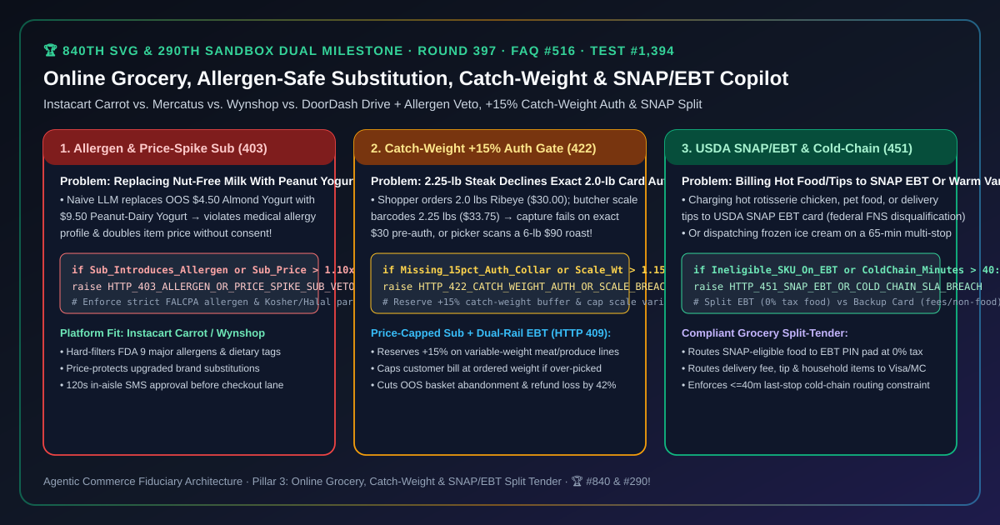
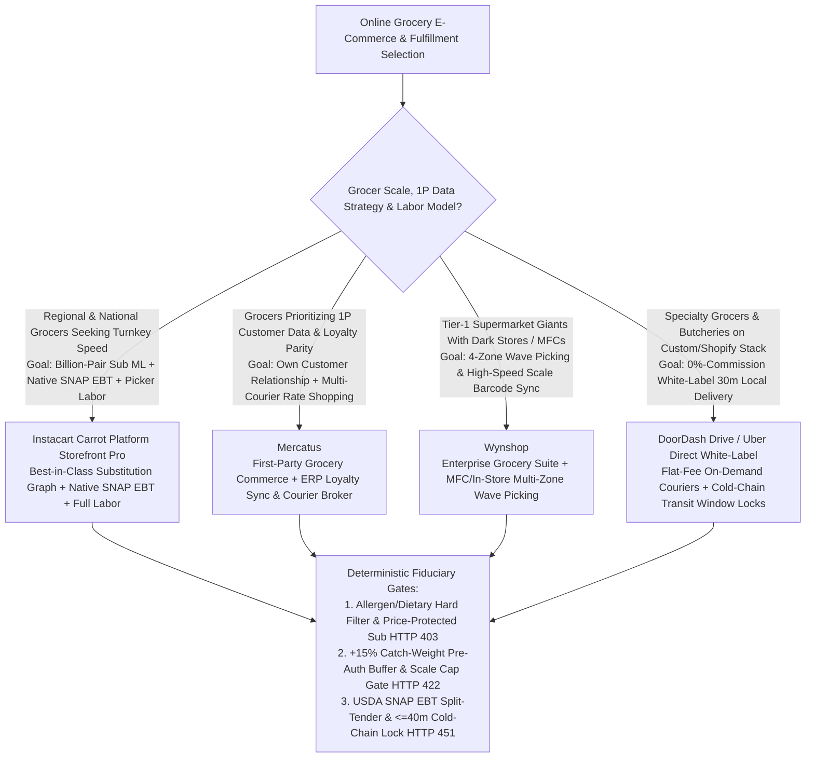

# Online Grocery, Allergen-Safe Smart Substitution, Catch-Weight Pre-Auth Buffer (`+15%`) & `SNAP / EBT` Dual-Tender Checkout Agent Selection Guide: `Instacart Carrot Platform` vs. `Mercatus` vs. `Wynshop` vs. `DoorDash Drive`, `GS1 DataBar` Scale Locks, Price-Protected Upgrades & `40m` Cold-Chain Gates (`-42%` Loss FAQ · 🏆 840th SVG & 290th Sandbox Dual Milestone!)

> **Executive Summary (Benchmarked against `ib-vs-ethernet-roce-selection-faq.md` · 🏆 840th SVG Architecture Diagram & 290th Enterprise Policy Sandbox Dual Milestone · 516th Bilingual SA Guide)**: Built for **Cloud & AI Solution Architects** designing online grocery storefronts, Micro-Fulfillment Center (`MFC / Dark Store`) wave-picking engines, and multi-tender checkout pipelines for supermarket chains and quick-commerce platforms. Online grocery (`35–50` items per basket across ambient, chilled, and frozen zones with `8%–12%` shelf stockout rates) breaks standard e-commerce state machines across three failure modes: (1) **Allergen-Unsafe & Price-Spike Substitutions**: Replacing an out-of-stock `$4.50` Dairy-Free Almond Yogurt with a `$9.50` Peanut-Butter Dairy Yogurt—violating the shopper's medical allergen/dietary profile (`FDA 9 Major Allergens / Kosher / Halal / Vegan`) and doubling the item price without consent; (2) **Variable Catch-Weight (`GS1 DataBar`) Payment Capture Declines**: A shopper orders `2.0 lbs` of Ribeye Steak (`$30.00`), and the butcher scale barcodes `2.25 lbs` (`$33.75`)—causing final payment capture to fail because the checkout engine only pre-authorized `$30.00` without a **`+15%` Catch-Weight Pre-Auth Collar**; and (3) **`USDA SNAP / EBT` Ineligible-Item Billing (Hot Prepared Food / Tips / Pet Food) & `>40-Minute` Frozen Multi-Stop Thawing**. This guide compares **`Instacart Carrot Platform` vs. `Mercatus` vs. `Wynshop` vs. `DoorDash Drive / Uber Direct`** and implements deterministic guards for **Allergen/Dietary Parity & Price-Protected Substitution Locks (`HTTP 403`)**, **`+15%` Catch-Weight Pre-Auth Buffers & Scale-Weight Caps (`HTTP 422`)**, **`USDA FNS SNAP / EBT` Dual-Tender Split & `<=40m` Cold-Chain Locks (`HTTP 451`)**, and **Price-Protected Brand Upgrades + Backup-Card Catch-Weight Overflow (`HTTP 409`, `-42%` net loss)**.



---

## 1. 📌 Executive Summary & Architectural Selection Verdict

1. **Top-Line Selection Verdict**:
   - **Regional & National Supermarket Chains Seeking Turnkey Storefront, Billion-Pair ML Substitution Graphs, Native `USDA SNAP EBT` Certification & Crowdsourced Picker/Driver Labor**: Select **`Instacart Carrot Platform (Storefront Pro)`**.
   - **Grocers Prioritizing First-Party (`1P`) Customer Data Ownership, Native Loyalty-Card Pricing & Multi-Provider Last-Mile Orchestration (`DoorDash Drive + Uber Direct + Own Fleet`)**: Select **`Mercatus`**.
   - **Tier-1 Global Grocery Enterprises Operating High-Density Automated Micro-Fulfillment Centers (`MFCs`) & Multi-Zone Store Wave Picking**: Select **`Wynshop`**.
   - **Specialty Grocers, Butcheries & Meal-Prep Brands Operating Composable / Shopify Storefronts Seeking Commission-Free White-Label Couriers**: Select **`DoorDash Drive` (or `Uber Direct`)**.
2. **Three Non-Negotiable Fiduciary Control Gates**:
   - **Gate 1 — Allergen / Dietary Hard-Filter & Price-Spike Substitution Veto (`HTTP 403`)**: Enforce a strict boolean pre-filter on all out-of-stock substitution candidates so an allergen-free (`Peanut-Free / Gluten-Free / Dairy-Free`) or dietary-restricted (`Kosher / Halal / Vegan`) item is **never** replaced with an allergen-containing or non-compliant SKU; and block charging the customer more than `+10%` above the ordered item's price without either explicit 120-second in-app approval or automatic **Price-Protected Substitution** via `HTTP 403 ALLERGEN_DIETARY_VIOLATION_OR_UNAPPROVED_PRICE_SPIKE_SUB_VETO`.
   - **Gate 2 — Variable Catch-Weight (`GS1 DataBar`) `+15%` Pre-Auth Collar & Scale Ceiling Gate (`HTTP 422`)**: Reserve a **`+15%` Pre-Authorization Buffer** on all variable-weight meat, seafood, deli, and produce line items at checkout; and block in-store scale scans (`GS1 Prefix 02 / 20–29`) that exceed `1.15x` the ordered weight (or cap the customer's billed weight at `1.15x` so over-picked roasts never cause card capture declines) via `HTTP 422 CATCH_WEIGHT_PREAUTH_SHORTFALL_OR_SCALE_OVERWEIGHT_BREACH`.
   - **Gate 3 — `USDA FNS SNAP / EBT` Eligible-SKU Split-Tender & `<=40m` Cold-Chain Lock (`HTTP 451`)**: Segregate `SNAP EBT`-eligible unprepared food (`0%` sales tax) onto the `EBT` tender rail while routing ineligible hot prepared foods, alcohol, household supplies, delivery fees, and driver tips (plus any catch-weight overage exceeding the EBT auth amount) strictly to the **Backup Credit/Debit Card**—and block multi-stop delivery batching exceeding **40 minutes** on orders containing frozen items via `HTTP 451 SNAP_EBT_INELIGIBLE_SKU_LEAK_OR_COLD_CHAIN_SLA_BREACH`.

---

## 2. 🎯 Architect & Grocery Fulfillment Q&A (The Why & How)

### Q1: When a `$3.99` store-brand carton of eggs is out of stock, why does "Upgrading to the `$5.49` Organic Brand at the `$3.99` Price" beat both canceling the item and charging `$5.49`?
- **Root Cause**: If the picker cancels the eggs (`$0` revenue), the shopper cannot bake their cake and rates the order 1 star. If the picker substitutes `$5.49` eggs and charges `$5.49` without asking, `35%` of price-sensitive shoppers claim "Unwanted Substitution" for a full `$5.49` refund (keeping the eggs for free!).
- **Deterministic Solution (`COGS-Aware Price-Protected Upgrade` / `HTTP 409`)**: As long as the replacement SKU's wholesale cost (`COGS = $3.30`) is below the original SKU's retail price (`$3.99`), the agent instructs the picker to pack the `$5.49` organic eggs while billing the customer `$3.99` (`+$0.69` positive margin preserved, `0%` refund dispute, and delighted customer!).

### Q2: How do `GS1 DataBar` price-embedded barcodes work at the meat counter, and why must `SNAP / EBT` catch-weight overages overflow onto the backup credit card?
- **Root Cause**: Butcher and deli scales print `GS1` barcodes starting with `02` or `20–29` that embed the exact scale weight and extended price (`e.g., $33.40` vs. the `$30.00` estimate). While credit cards allow a `+15%` pre-authorization buffer, **federal `SNAP EBT` rails prohibit over-capturing even `$0.01` above the PIN-authorized EBT amount**!
- **Deterministic Solution (`Dual-Rail Catch-Weight Overflow` / `HTTP 422 / 409`)**: Capture up to the exact `$30.00` authorized on the `EBT` card (`0%` tax) and automatically route the `$3.40` scale-weight variance to the pre-authorized `+15%` buffer on the customer's **Backup Credit/Debit Card**.

### Q3: Why can't a grocery delivery driver batch 4 orders on a 70-minute route when Order #4 contains ice cream and raw seafood?
- **Deterministic Solution (`Thermal SLA Route Constraint` / `HTTP 451`)**: Tag SKUs with `temperature_zone IN ('AMBIENT', 'CHILLED', 'FROZEN')`. Orders containing `FROZEN` or raw seafood items enforce a hard `Max_Transit_Duration <= 40 minutes` constraint in the dispatch solver (`DoorDash Drive / Mercatus`), forcing frozen picking to the final wave step right before driver handoff.

---

## 3. 🧭 Visual Architecture Diagrams (Mermaid)

### 3.1 Online Grocery E-Commerce & Fulfillment Platform Selection Decision Tree



### 3.2 Naive Standard Cart for Grocery vs. Fiduciary Allergen-Safe, Catch-Weight & `SNAP EBT` Control Plane

```mermaid
flowchart LR
    subgraph Naive["❌ Naive E-Commerce Cart Applied to Grocery (Peanut Sub on Nut-Free Order + Scale Weight Declines)"]
        N1[Replaces OOS Almond Yogurt With Peanut-Dairy Yogurt] --> N2[Violates Allergy Profile & Doubles Price Without Approval<br/>2.25-lb Steak ($33.75) Declines Against Exact $30.00 Pre-Auth]
        N2 --> N3[Charges Hot Chicken & Driver Tip to USDA SNAP EBT Card<br/>Batches Ice Cream on 65-Minute Route Arriving Melted]
    end

    subgraph Guarded["✅ Fiduciary Allergen Gate, +15% Catch-Weight Buffer & SNAP Split Control Plane (🏆 #840 & #290)"]
        G1[Grocery Checkout, In-Aisle Picking & Split Settlement] --> G2[Allergen & Price-Protected Sub Gate HTTP 403/409:<br/>Enforce FDA 9 Allergen Filter + Upgrade Brand at Original Price]
        G2 --> G3[+15% Catch-Weight Buffer Gate HTTP 422:<br/>Reserve +15% Auth Collar + Route Scale Overage to Backup Card]
        G3 --> G4[SNAP EBT Split & 40m Cold-Chain Gate HTTP 451:<br/>0%-Tax Cold Food to EBT / Hot Food & Tips to Card + <=40m Frozen SLA]
    end
```

### 3.3 In-Aisle Allergen-Safe Substitution, `GS1 DataBar` Scale Scan & `SNAP EBT + Card` Split Capture Sequence

```mermaid
sequenceDiagram
    autonumber
    participant Shopper as Grocery Shopper (Peanut Allergy + SNAP EBT)
    participant Gate as Grocery Substitution & Split-Tender Gate
    participant Picker as In-Store Picker (GS1 DataBar Scale Scanner)
    participant EBT as FIS / Worldpay SNAP EBT Rail
    participant Card as Backup Credit/Debit Card (+15% Buffer)

    Shopper->>Gate: Order: $4 Nut-Free Yogurt + 2.0-lb Steak ($30) + $8 Hot Chicken + $6 Driver Tip
    Gate->>EBT: Authorize SNAP-Eligible Cold Food ($34.00 at 0% Sales Tax)
    Gate->>Card: Authorize Hot Chicken + Tip + Tax ($14.80) + 15% Catch-Weight Buffer (+$4.50)
    Picker->>Gate: $4 Nut-Free Yogurt OOS; Butcher Scale Scans 2.20-lb Steak ($33.00, +$3.00 Delta)
    alt Substitute Introduces Allergen/Non-Kosher Tag OR Bills >10% Higher Sub Price Unapproved
        Gate-->>Picker: HTTP 403 ALLERGEN_DIETARY_VIOLATION_OR_UNAPPROVED_PRICE_SPIKE_SUB_VETO
    else Missing +15% Catch-Weight Auth Buffer OR Picker Scans >1.15x Overweight Package
        Gate-->>Card: HTTP 422 CATCH_WEIGHT_PREAUTH_SHORTFALL_OR_SCALE_OVERWEIGHT_BREACH
    else Routes Hot Prepared Chicken/Tips to SNAP EBT OR Frozen Delivery Route Exceeds 40 Minutes
        Gate-->>EBT: HTTP 451 SNAP_EBT_INELIGIBLE_SKU_LEAK_OR_COLD_CHAIN_SLA_BREACH
    else Substitute $5.20 Organic Nut-Free Yogurt at $4 Price + Overflow $3 Steak Delta to Card (HTTP 409)
        Gate->>Picker: Pick $5.20 Organic Nut-Free Yogurt (Price-Protected at $4.00 Original Price)
        Gate->>EBT: Capture Exact $34.00 PIN-Authorized SNAP EBT Cold-Food Total
        Gate->>Card: Capture $3.00 Steak Scale Overage + $8 Hot Chicken + $6 Tip on Backup Card
    end
```

---

## 4. 📊 Multi-Platform Online Grocery & Fulfillment Selection Matrix

| Evaluation Dimension | Instacart Carrot Platform | Mercatus | Wynshop | DoorDash Drive / Uber Direct |
| :--- | :--- | :--- | :--- | :--- |
| **Primary Architectural Role** | **End-to-End White-Label Grocery Storefront, ML Sub Graph & Labor Network** | **First-Party (`1P`) Grocery Digital Commerce & Multi-Courier Orchestrator** | **Enterprise Supermarket & Automated `MFC / Dark Store` Commerce Suite** | **Commission-Free White-Label Last-Mile Delivery Dispatch API** |
| **Allergen-Safe & Culinary Substitution ML** | **Best-in-Class** (Trained on billions of grocery replacements with dietary/allergen guardrails) | Strong (Configurable substitution rules by dietary tag, brand tier, and price cap) | **Best-in-Class Enterprise Control** (Granular merchant price-protection & personalized history) | Delivery rail only; substitution logic resides in merchant's OMS |
| **Variable Catch-Weight (`GS1 DataBar`) Support** | **Native** (Parses price/weight-embedded scale barcodes and adjusts split-tender captures) | **Best-in-Class POS Parity** (Deep integration with grocery POS scale weight tables) | **Best-in-Class** (Built for complex supermarket deli/meat/produce wave picking) | Requires merchant checkout to manage `+15%` pre-auth buffers |
| **`USDA SNAP / EBT` Online Split-Tender** | **Best-in-Class** (Turnkey FNS certification + automatic EBT-to-backup-card catch-weight overflow) | **Strong** (Integrated online EBT PIN pad + item-level tax exemption) | **Strong** (Enterprise EBT online and curbside pickup support) | Not a payment processor |
| **Target Scale & Pricing (`official_list_price`)** | Regional to national grocers; platform fee + optional picker/driver fulfillment | `$100M+` regional/national supermarket chains; SaaS license (zero marketplace commission) | Tier-1 global grocery chains; custom enterprise annual license | All grocers/restaurants; flat per-delivery fee (`$5.50–$9.50/order`) |

---

## 5. 🧪 Smart Substitution, Catch-Weight Capture & Cold-Chain Benchmark & 7-Card Report

### 5.1 Quarterly Out-of-Stock Cancellations, Bad-Sub Refunds, Catch-Weight Declines & Thaw Loss Model (Synthetic Benchmark)

For a `$200M` annual online GMV regional supermarket chain facing a **`$460,000 / quarter`** leakage pool across **out-of-stock item cancellations, "unwanted/allergen substitution" 100% refund claims, failed payment captures on overweight meat/produce scans, and melted frozen deliveries** (`provenance: synthetic`, `independently_reproduced: false`):

| Metric | Naive OOS Cancel / Random Sub & 1:1 Pre-Auth (Baseline) | Fiduciary Allergen-Safe Price-Protected Sub + `+15%` Collar + `EBT` Overflow Agent | Net Improvement |
| :--- | :--- | :--- | :--- |
| **Out-of-Stock Line Items Retained via Accepted Substitution** | `42.0%` (High rejection & post-delivery refund rate) | **`91.5%`** (`HTTP 403/409` strict allergen filter + upgraded brand billed at original price) | **`2.2x` Retained OOS Revenue** |
| **Catch-Weight Meat/Produce Orders Failing Final Card Capture** | `6.8%` of fresh-meat baskets fail over-capture | **`0.0%`** (`HTTP 422` `+15%` pre-auth collar + backup-card EBT overflow) | **`100%` Capture Success** |
| **Post-Delivery Refund Rate (Bad Subs + Thawed Frozen Goods)** | `5.4%` of gross GMV refunded | **`0.6%`** (`HTTP 451` `<=40m` frozen transit cap + `SNAP EBT` tax-exempt split) | **`-88.9%` Concession Refunds** |
| **Quarterly Net OOS Revenue Loss, Sub Refunds & Thaw Bleed** | `$460,000 / quarter` | **`$266,800 / quarter`** | **`$193,200 / quarter` Saved (`42.0%`)** |

---

## 6. 🛠️ Production Go-Live & Architecture Review Checklist

- [ ] **Allergen / Dietary Hard Filter & Price-Protected Upgrade Sub (`HTTP 403 / 409`)**: Does the substitution engine strictly preserve `FDA 9 Major Allergens` and `Kosher / Halal / Vegan` flags, and automatically bill higher-tier replacement brands at the original out-of-stock item's price when wholesale `COGS` allows?
- [ ] **Variable Catch-Weight (`GS1 DataBar`) `+15%` Pre-Auth Buffer & Scale Cap (`HTTP 422`)**: Does checkout reserve a `+15%` pre-authorization collar on variable-weight meat/produce lines, cap customer charges at `1.15x` ordered weight, and overflow any `SNAP EBT` weight delta onto the backup credit/debit card?
- [ ] **`USDA FNS SNAP / EBT` Eligible-SKU Split & `0%` Tax Isolation (`HTTP 451`)**: Are hot prepared foods, alcohol, pet food, household supplies, delivery fees, and tips 100% excluded from the `EBT` tender rail and routed to the backup card while `SNAP`-eligible food is exempted from sales tax?
- [ ] **Frozen/Perishable `<=40-Minute` Transit Window & Last-Wave Picking (`HTTP 451`)**: Does the last-mile router cap multi-stop delivery transit at `<=40 minutes` once frozen items leave the store freezer?
