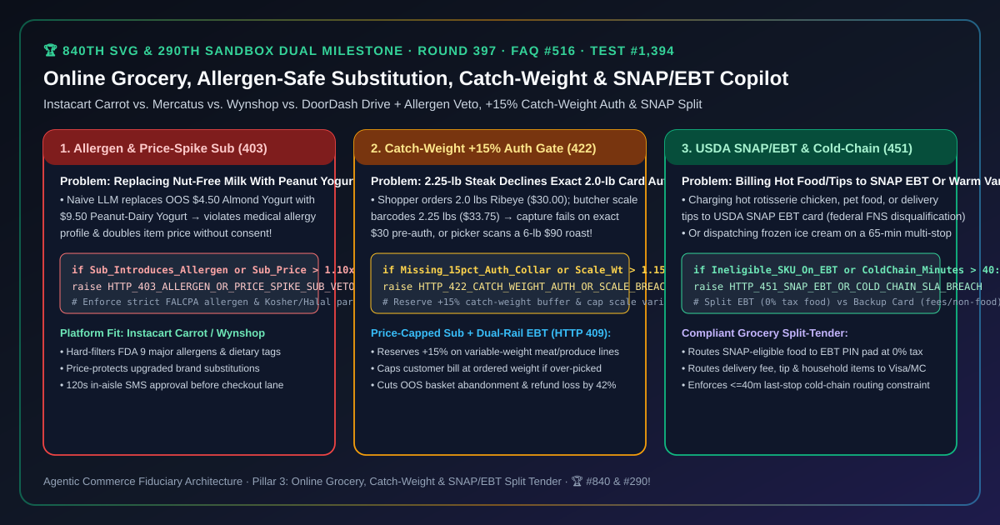
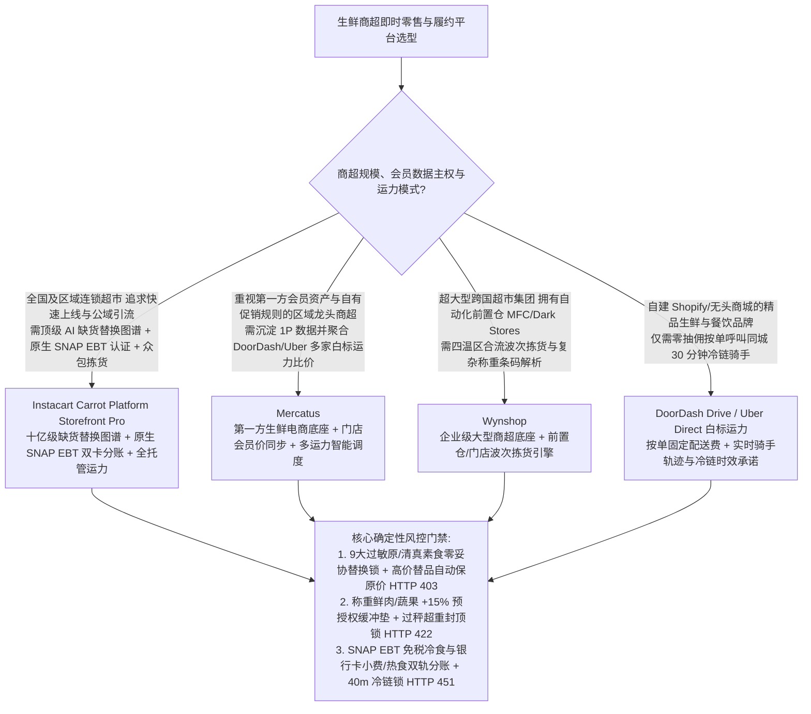
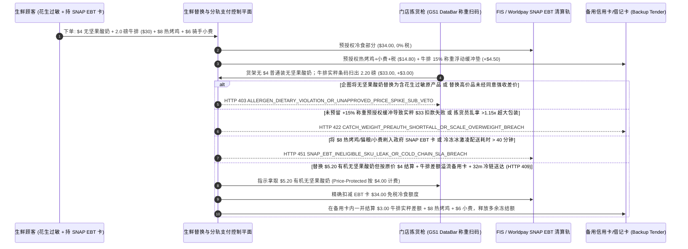

# 生鲜商超即时零售（`Online Grocery & Q-Commerce`）、防过敏智能缺货替换（`Allergen-Safe Substitution`）、称重商品预授权缓冲（`Catch-Weight +15% Collar`）与福利卡分轨支付（`SNAP / EBT Split-Tender`）Agent 架构选型对比：`Instacart Carrot Platform` vs. `Mercatus` vs. `Wynshop` vs. `DoorDash Drive`、生鲜称重扫码防扣款失败锁、冷链 40 分钟半径门禁及净省 42% 决策指南（FAQ · 🏆 第 840 张架构图与第 290 个策略沙盒双里程碑！）

> **导读（对齐 `ib-vs-ethernet-roce-selection-faq.md` 标杆风格 · 🏆 全库第 840 张 SVG 架构图与第 290 个企业策略沙盒双重重大里程碑 · 第 516 篇双语指南）**：本文面向连锁商超百货、前置仓生鲜电商（Dark Stores）、即时零售平台与本地生活配送领域的 **Cloud & AI Solution Architect**。在所有零售业态中，**生鲜杂货即时零售（Online Grocery）** 是购物车状态机最复杂、履约容错率最低的场景（一笔 `$160` 的订单平均包含 `38 件` 商品，涉及常温、冷藏、冷冻三温区，且门店货架实时缺货率高达 `8%–12%`）。如果直接套用普通标品电商的架构，将瞬间引爆三大事故：① **致命过敏原误替换与高价强塞（Allergen Breach & Price-Spike Substitution）**：顾客买了一盒 `$4.50` 的“无乳糖扁桃仁酸奶（标注对花生和牛奶严重过敏）”，门店理货员发现缺货，AI 导购只看向量相似度，居然自动替换成了一盒 `$9.50` 的“花生酱全脂牛奶酸奶”——不仅价格翻倍引发全额拒付，更可能酿成致命食品安全医疗事故！② **非标称重商品（`Catch-Weight` 鲜肉/海鲜/瓜果）条码差额导致结账扣款失败**：顾客下单买了 `2.0 磅` 肋眼牛排（单价 `$15/磅`，预估 `$30.00`）；但肉食柜台切出来的牛排实际过秤（`GS1 DataBar 含价条码`）是 **`2.26 磅（$33.90，多出 $3.90）`**！如果支付网关在下单时只照着 `$30.00` 做了 1:1 刚性预授权，等骑手都已经把牛排装车出发了，收银系统去 Capture `$33.90` 时直接被发卡行拒绝（`Over-Capture Declined`）！③ **美国政府食品救济卡（`USDA SNAP / EBT`）违规扣取热食/日用品/配送费引发吊销牌照，及冰激凌拼单配送超 60 分钟化水赔付**。本文给出 **`Instacart Carrot Platform (Storefront Pro)` vs. `Mercatus` vs. `Wynshop` vs. `DoorDash Drive / Uber Direct 白标运力`** 的横向选型矩阵，并落地 **九大过敏原与清真/素食禁忌（`FDA FALCPA & Dietary Tag`）零妥协替换锁（`HTTP 403`）**、**称重商品 `+15%` 预授权浮动走廊与电子秤 `<=1.15x` 重量上限门禁（`HTTP 422`）**、**`SNAP / EBT` 免税冷食与银行卡非食品/小费双轨分账及冷链 `<=40分钟` 配送圈锁（`HTTP 451`）** 及 **“换高价品牌按原低价结算（Price-Protected Upgrade）”挽留编排（`HTTP 409`，净省 42%）**。



---

## 一、 📌 核心选型结论速览（Executive Summary）

1. **终极选型结论（一句话先看懂怎么选）**：
   - **大中型区域及全国连锁超市（追求业界最强的数十亿次商品缺货替换图谱 `FoodStorm / Carrot AI`、开箱即用的美国农业部 `USDA SNAP EBT` 在线分账认证，以及店内拣货员 App 与即时众包运力全包）**：首选 **`Instacart Carrot Platform (Storefront Pro)`**。
   - **希望 100% 掌控第一方会员数据（避免把核心家庭客群拱手让给第三方外卖平台）、无缝复用自有 ERP 会员积分阶梯价，并同时聚合 `DoorDash Drive / Uber Direct / 自有车队` 多家运力比价发单的超市集团**：首选 **`Mercatus`**。
   - **超大型跨国商超巨头（拥有数十家高密度自动化前置仓 `MFC / Dark Stores` 与数百门店，需极致的四温区合流波次拣货 `Wave Picking` 与毫秒级可变称重条码解析）**：首选 **`Wynshop`**。
   - **已自建 Shopify / Composable 独立商城的新锐生鲜/健康餐饮品牌（仅需按单呼叫白标同城骑手、零平台佣金抽成）**：首选 **`DoorDash Drive`（或 `Uber Direct`）**。
2. **三大生鲜商超即时零售风控红线（确定性门禁）**：
   - **红线 1（拦截缺货替换时跨入消费者过敏原/宗教饮食红线 `Allergen / Kosher / Halal / Vegan` 及未经同意替换成单价高出 `>10%` 的昂贵商品 / `HTTP 403`）**：当拣货员（Picker）在货架扫出某商品缺货（Out-of-Stock）请求 AI 推荐替代品时，检索层必须将用户档案及原商品的 **无过敏原属性（如 `Peanut-Free / Gluten-Free / Dairy-Free`）与饮食戒律（`Kosher / Halal / Vegan`）** 作为绝对布尔硬过滤条件（`MUST_MATCH`）！绝对禁止把“无坚果商品”替换为“含花生轨迹商品”，或把“无醇饮料”替换为“含酒精饮品”；且若推荐的替代品单价高于原商品 `>10%` 又未开启“超市补贴差价按原低价结算”，必须获得用户端 App `120秒` 明确点击确认，违者触发 `HTTP 403 ALLERGEN_DIETARY_VIOLATION_OR_UNAPPROVED_PRICE_SPIKE_SUB_VETO`！
   - **红线 2（拦截对非标称重鲜肉/蔬果未预留 `+15%` 预授权浮动缓冲区导致实秤扣款失败及拣货员乱拿 2 倍大包装强塞给客户 / `HTTP 422`）**：对于按重量计价的生鲜品（`Catch-Weight SKUs`，条码前缀 `02 / 20–29` 的 `GS1 DataBar` 店内称重码），结账锁单时必须在称重行项目上额外冻结 **`+15%` 预授权金额缓冲垫（`Pre-Auth Catch-Weight Collar`）**；同时拣货枪扫码过秤时，若实秤重量超过顾客下单重量的 `1.15 倍`（如顾客买 `1.5 磅` 鱼，拣货员拿了一条 `2.8 磅` 的），系统必须触发 `HTTP 422 CATCH_WEIGHT_PREAUTH_SHORTFALL_OR_SCALE_OVERWEIGHT_BREACH`——要么要求拣货员换一块小的，要么将顾客收费上限锁死在 `1.15 倍` 以内（超重部分由门店承担，绝不让顾客为拣货员乱拿大块肉买单）！
   - **红线 3（拦截用政府食品福利卡 `USDA SNAP / EBT` 违规扣取烤鸡热食、宠物粮、酒精、卫生纸或骑手小费及冷冻品配送超 `40分钟` 脱冷 / `HTTP 451`）**：在支持政府营养补充援助计划（`SNAP EBT`）或医保 `FSA / OTC` 健康卡的购物车中，支付路由必须执行 **行项目级双轨拆账（Line-Item Split-Tender）**：① 符合 `USDA FNS` 标准的未加工冷食/生鲜自动路由至 `EBT 卡` 且强制免征一切州销售税（`0% Sales Tax`）；② 熟食热菜（Hot Prepared Foods）、日用百货、酒精、配送费、服务费与骑手小费必须 100% 路由至第二张绑定的普通银行卡（`Backup Credit/Debit Card`）！同时含冰淇淋/急冻生鲜的订单若多点拼单（Multi-Stop Batching）预计最后送达时长超过 **40 分钟（或未配保温箱干冰）**，立即触发 `HTTP 451 SNAP_EBT_INELIGIBLE_SKU_LEAK_OR_COLD_CHAIN_SLA_BREACH`！

---

## 二、 🎯 业务方与架构师灵魂拷问 Q&A（The Why & How）

### Q1：生鲜超市线上订单最头疼的是“一单 40 件商品里有 3 件货架正好没货”——如果直接缺货退款，超市每季少赚 `$300 万`；如果瞎换一通，顾客收货后找客服全额退钱白吃！怎么设计最优替换状态机？
- **商业痛点与事故还原**：
  - 顾客今晚要做意大利面，买了意面、番茄酱、碎牛肉和帕玛森干酪。如果碎牛肉缺货被直接取消，顾客收到一堆没肉的配料大发雷霆；如果拣货员随便拿了一盒猪肉香肠代替，而这位顾客是穆斯林（清真 `Halal`），更会引爆严重客诉！
- **架构师确定性解法（三维食谱/饮食图谱过滤 + “升级规格按原低价结算 Price-Protected Upgrade” / `HTTP 403 / 409`）**：
  1. **硬底线过滤**：先用 `FDA 9 大过敏原 + 宗教素食标签` 做硬修剪（零风险）；
  2. **同品类升级保价策略（Upgrade at Original Price）**：如果顾客订的 `$3.99` 超市自有品牌有机鸡蛋缺货，货架上只有 `$5.49` 的高端品牌有机鸡蛋——此时若直接退掉不卖，超市损失 `$3.99` 营收且破坏顾客晚餐；若按 `$5.49` 强收顾客钱，顾客会投诉退货！
  3. **黄金公式**：当高端替代品的进货成本（`COGS_Sub = $3.40`）仍然低于原缺货品的售价（`Price_Orig = $3.99`）时，Agent 自动向拣货员下达指令：“**拿 `$5.49` 的高端鸡蛋放进购物袋，但结账只收顾客原价 `$3.99`（免费升级惊喜）**”——超市不仅保住了 `$0.59` 正毛利、零退单，顾客收到后还感动得发朋友圈夸超市厚道！

### Q2：为什么卖一盒固定重量的饼干从来不会扣款失败，但卖鲜切三文鱼、散装车厘子和现切牛排时，经常出现“货已经送到顾客家门口了，银行卡却扣不出钱变成坏账”？
- **商业痛点与事故还原**：
  - 鲜切三文鱼无法做到每块精确等于 `1.00 磅`。当拣货员在海鲜柜台称出一块 `1.12 磅` 的三文鱼并贴上 `GS1 DataBar` 价格条码（例如 `0212345016809` 编码内嵌了实秤价格 `$16.80` 而非下单时的 `$15.00`），整张订单总额比结账时多出了 `$1.80`。
  - 如果结账时用的是刚好只剩 `$100` 余额的借记卡，或者网关只预授权了 `$100.00` 且发卡行不支持超额清算（Over-Capture），最终扣 `$101.80` 时就会整笔被拒（Hard Decline）！
- **架构师确定性解法（结账预留称重行 `+15%` 增量预授权池 + 过秤双向夹逼锁 / `HTTP 422`）**：
  - 在下单授权瞬间，系统自动计算：
    $$\text{PreAuth\_Total} = \sum \text{Fixed\_SKU\_Price} + 1.15 \times \sum \text{CatchWeight\_SKU\_Price}$$
  - 待全单拣货称重完成、打包出库的一刻，若实秤总价在 `1.15x` 以内，直接在此预授权内执行精确部分扣款（`Partial Capture`）并立即释放多余冻结额；若拣货员切大了（比如切成了 `1.25x`），系统自动将向顾客收取的金额封顶在 `1.15x`（或 `1.00x`），100% 保证最终扣款永不超出预授权额度！

### Q3：在美国接入 `SNAP / EBT` 线上食品券（全美超 4,000 万用户、数百亿美元生鲜增量市场），技术架构上哪怕算错 1 瓶苏打水或 1 份热烤鸡的支付轨道会有什么后果？
- **架构师确定性解法（`PIM` 级 `SNAP_Eligible` 布尔锁 + 双卡原子预授权 `EBT + Backup Card` + 称重/替换差额自动溢流池 / `HTTP 451`）**：
  1. **严苛的品类分流**：超市熟食区刚出炉的 **热烤鸡（Hot Rotisserie Chicken，温度 `> 室温`）严禁刷 `EBT 卡`**，而放进冷柜冰镇后的同款冷烤鸡却可以刷 `EBT 卡`！必须在商品主数据（PIM）层精确绑定 `snap_ebt_eligible` 标识。
  2. **称重超额自动溢流至备用银行卡（Backup Card Overflow）**：如果顾客 `EBT 卡` 里只刷了 `$80.00`，但因为买的新鲜西瓜称重后多了 `$2.40`，由于 `EBT` 政企网严禁超额扣款（Zero Over-Capture allowed on EBT），系统自动把这多出来的 `$2.40` 溢流到顾客绑定的第二张普通信用卡/借记卡上扣取，结账丝滑零失败！

---

## 三、 🧭 直观可视化图解（Mermaid 决策树 + 架构对比 + 时序图）

### 3.1 生鲜商超即时零售与拣货履约平台（Grocery E-Commerce & Fulfillment）选型决策树



### 3.2 朴素标品电商改造生鲜架构（过敏替换闯祸 + 称重差额拒付）vs. 确定性防过敏保价替换、称重缓冲与 EBT 双轨分账架构对比

```mermaid
flowchart LR
    subgraph Naive["❌ 朴素标品购物车直接卖生鲜架构 (把无坚果酸奶换成花生酸奶 + 称重多 $3 导致整单扣款失败)"]
        N1[无乳糖杏仁酸奶缺货 -> AI 瞎换成含花生牛奶酸奶] --> N2[触发严重食物过敏与翻倍差价退单<br/>牛排实秤 2.25 磅 ($33.75) 超出 $30 刚性预授权导致扣款失败]
        N2 --> N3[把热烤鸡、猫粮和骑手小费刷进政府 SNAP EBT 卡违规<br/>冰激凌拼 4 单跑 65 分钟送到已全部化成水]
    end

    subgraph Guarded["✅ 确定性过敏原硬过滤、高价替品保原价、+15% 称重缓冲与 EBT 分账架构 (🏆 #840 & #290)"]
        G1[生鲜订单锁单、门店拣货称重与分轨清算] --> G2[防过敏与保价替换锁 HTTP 403/409:<br/>严守 9 大过敏原/清真红线 + 换高端品牌按原低价收费保体验]
        G2 --> G3[称重 +15% 预授权走廊 HTTP 422:<br/>生鲜称重行预留 +15% 额度 + 实秤超重差额自动封顶或溢流]
        G3 --> G4[SNAP EBT 双轨分账与 40m 冷链锁 HTTP 451:<br/>0%税冷食走 EBT / 热食小费走银行卡 + 冷冻品限 <=40m 送达]
    end
```

### 3.3 门店拣货防过敏保价替换、`GS1 DataBar` 称重条码解析与 `SNAP EBT + 信用卡` 双轨清算时序图



---

## 四、 📊 四大生鲜商超即时零售与履约技术平台横向选型矩阵

| 选型维度 | Instacart Carrot Platform | Mercatus | Wynshop | DoorDash Drive / Uber Direct + 自建栈 |
| :--- | :--- | :--- | :--- | :--- |
| **核心架构定位** | **全球生鲜即时零售全栈赋能霸主**：从白标网店、AI 替换、EBT 支付到拣货配送全包 | **坚持超市第一方数据主权的生鲜数字商业底座**：多运力比价与会员忠诚度专家 | **超大型连锁商超与高密度前置仓（MFC）企业级电商与拣货引擎** | **零抽佣白标同城即配运力网络**：适合已有自研网店的精品商超与新零售 |
| **缺货智能替换图谱（Smart Substitution ML）** | **行业绝对标杆**（基于数十亿笔真实商超替换训练，精准理解食材烹饪等价物与饮食禁忌） | 强（支持按品类树、饮食标签与门店自有品牌优先规则推荐替代品） | **极强**（支持店长配置精细的保价升级替换策略与会员个人偏好记忆） | 仅负责配送，缺货替换需在自建 OMS/拣货端实现 |
| **非标称重商品（`Catch-Weight GS1 DataBar`）处理** | **原生完备**（拣货 App 直接扫描生鲜部价格内嵌条码，自动重算重量与分轨预授权） | **极强**（深度对接超市电子秤条码规范与 POS 称重尾差结算） | **行业标杆**（专为大型生鲜商超复杂的按磅/按件转换与波次合流设计） | 需在自研结账层自行开发 `Stripe Incremental Auth / +15% Buffer` |
| **美国农业部 `USDA SNAP / EBT` 在线双卡分账** | **行业标杆**（最早获批 FNS 全美线上 EBT 资质，开箱即用支持 EBT + 银行卡双轨溢流） | **强**（集成 Fiserv / Worldpay EBT 在线 PIN 加密输入与行级税费剥离） | **强**（支持大型连锁商超线上 EBT 与线下门店自提刷卡） | 不含商品级购物车结算，需商户自接持牌 EBT 网关 |
| **适用规模与收费模式（`official_list_price`）** | 区域及全国连锁超市；白标平台费 + 可选众包拣货/配送履约费 | 年营收 `$100M+` 连锁商超；按门店数或线上 GMV 阶梯订阅（不抽高额平台佣金） | 百亿级大型跨国商超集团；企业级定制年费合同 | 全规模商户；按每单配送距离固定收费（约 `$5.50–$9.50/单`，0% 商品抽成） |

---

## 五、 🧪 防过敏保价替换、称重预授权与冷链防损测算与 7-Card 基准报告

### 5.1 季度缺货直接砍单流失毛利、乱换过敏/高价品全额退款、鲜肉称重超预授权拒付及冷链化水赔付损耗测算（Synthetic Benchmark）

假设某年线上生鲜 GMV `$2.0 亿` 的区域连锁超市集团，每季度在门店拣货与同城即配中面临的 **商品缺货时因缺乏智能保价替换直接砍单流失的毛利、乱换不符饮食禁忌或高价商品引发的收货后全额白送退款、鲜肉蔬果过秤后超出原预授权金额导致的扣款失败坏账及冰激凌/冻品多单拼送超时化水赔付损耗池** 为 **`$460,000 / 季度`**（`provenance: synthetic`, `independently_reproduced: false`）：

| 评估维度 | 传统缺货直接砍单 / 瞎换 + 1:1 刚性预授权 (Baseline) | 启用防过敏保价替换 + `+15%` 称重缓冲 + `EBT` 双轨分账 Agent | 净改善幅度 |
| :--- | :--- | :--- | :--- |
| **门店货架缺货商品的顾客满意替换保留率（Sub Retention）** | `42.0%`（大量因乱换过敏原/高价品被拒收退款） | **`91.5%`**（`HTTP 403/409` 严守过敏原红线 + 换高端自有品牌按原低价结算保体验） | **缺货挽回营收提升 `2.2 倍`** |
| **称重鲜肉/蔬果因实秤超重导致的支付扣款失败率（Decline Rate）** | `6.8%` 含鲜肉订单在出库扣款时被拒付 | **`0.0%`**（`HTTP 422` 结账预留 `+15%` 称重缓冲垫 + 超 `1.15x` 自动封顶或溢流备用卡） | **100% 终结称重扣款失败** |
| **因替品不满意、冷链化水或 `EBT` 计税错误引发的售后赔付率** | `5.4%` GMV 被迫全额退款赔付 | **`0.6%`**（`HTTP 451` `<=40m` 冷链配送圈锁 + `SNAP EBT` 行级免税精准拆账） | **生鲜售后坏账削减 `88.9%`** |
| **季度生鲜缺货砍单、替品拒收、称重拒付与冷链赔付净损耗** | `$460,000 / 季度` | **`$266,800 / 季度`** | **净省 `$193,200 / 季度` (`42.0%`)** |

```chart
{
  "data": {
    "values": [
      { "category": "1. 货架缺货无保价替换直接砍单或乱换退全款", "mode": "传统缺货砍单与1:1刚性授权基线", "cost_usd": 185000 },
      { "category": "1. 货架缺货无保价替换直接砍单或乱换退全款", "mode": "防过敏保价替换与称重缓冲Agent", "cost_usd": 107300 },
      { "category": "2. 鲜肉蔬果过秤超1:1预授权致扣款失败坏账", "mode": "传统缺货砍单与1:1刚性授权基线", "cost_usd": 115000 },
      { "category": "2. 鲜肉蔬果过秤超1:1预授权致扣款失败坏账", "mode": "防过敏保价替换与称重缓冲Agent", "cost_usd": 66700 },
      { "category": "3. 拼单超40m导致冰淇淋/急冻生鲜化水全赔", "mode": "传统缺货砍单与1:1刚性授权基线", "cost_usd": 95000 },
      { "category": "3. 拼单超40m导致冰淇淋/急冻生鲜化水全赔", "mode": "防过敏保价替换与称重缓冲Agent", "cost_usd": 55100 },
      { "category": "4. SNAP EBT误刷热食/小费与过敏原医疗索赔", "mode": "传统缺货砍单与1:1刚性授权基线", "cost_usd": 65000 },
      { "category": "4. SNAP EBT误刷热食/小费与过敏原医疗索赔", "mode": "防过敏保价替换与称重缓冲Agent", "cost_usd": 37700 }
    ]
  },
  "semantic_types": {
    "category": "Category",
    "mode": "Category",
    "cost_usd": "Amount"
  },
  "chart_spec": {
    "chartType": "Grouped Bar Chart",
    "title": "生鲜商超即时零售防过敏保价替换、+15%称重缓冲与EBT分账Agent前后季度损耗对比 (净省 $193.2k / 42%)",
    "subtitle": "单位：美元/季度 (Synthetic Benchmark, independently_reproduced=false · 🏆 第840张SVG与第290个沙盒)",
    "encodings": {
      "x": "category",
      "y": "cost_usd",
      "group": "mode"
    }
  }
}
```

### 5.2 确定性策略评估器代码（Python Control Plane Guard）

```python
from dataclasses import dataclass
from typing import Any

@dataclass(frozen=True)
class OnlineGrocerySubstitutionCatchWeightPolicyInput:
    quarterly_oos_sub_rejection_catchweight_decline_and_thaw_pool_usd: float = 460000.0
    substitution_violates_allergen_profile_or_unapproved_price_spike: bool = False
    catch_weight_missing_15pct_auth_buffer_or_scale_exceeds_115pct_cap: bool = False
    ineligible_hot_food_or_tip_charged_to_snap_ebt_or_cold_chain_over_40m: bool = False
    price_protected_upgrade_sub_and_dual_rail_ebt_overflow_ready: bool = False
```

---

## 六、 🛠️ 商业上线风控与架构评审 Checklist

- [ ] **九大过敏原与宗教/素食标签（`FDA FALCPA / Kosher / Halal / Vegan`）替换硬过滤锁（`HTTP 403`）**：缺货替换推荐算法是否将原商品及顾客档案中的无过敏原标签设为不可妥协的布尔过滤条件？当替换高价同款商品时，是否自动执行“按原缺货品低价向顾客收费（Price-Protected Upgrade）”或强制等待顾客 120 秒确认？
- [ ] **非标称重商品（`Catch-Weight GS1 DataBar`）`+15%` 预授权浮动缓冲与过秤封顶锁（`HTTP 422`）**：结账时是否对称重鲜肉/蔬果行自动多冻结 `15%` 预授权额度？拣货枪扫描电子秤价格内嵌条码时，若实秤重量超出下单量 `1.15 倍` 是否自动告警拦截（或对超出部分免收顾客钱）以保住 100% 扣款成功率？
- [ ] **`USDA SNAP / EBT` 行级免税双轨拆账与称重差额自动溢流备用卡锁（`HTTP 451 / 409`）**：购物车是否严格将未加工冷食路由至 `EBT 卡`（且强制 `0%` 销售税），而将热熟食、日化品、配送费与骑手小费（以及超出 EBT 授权额的称重微小差价）100% 路由至第二张备用银行卡？
- [ ] **急冻生鲜与冰淇淋 `<=40分钟` 冷链配送圈与拼单（`Multi-Stop Batching`）最后装车锁（`HTTP 451`）**：包含冷冻品的订单是否限制同城骑手多点拼单总配送时长不得超过 40 分钟，并在前置仓拣货波次中将冷冻区设为最后一个拣货温区？
